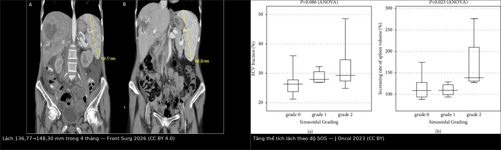
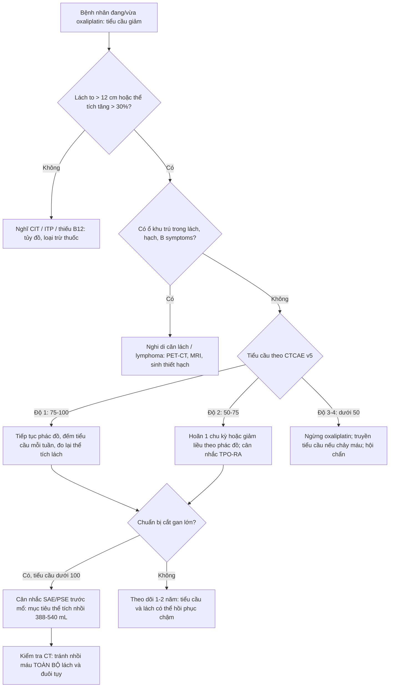
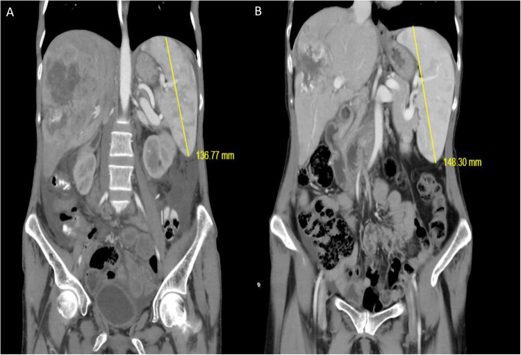
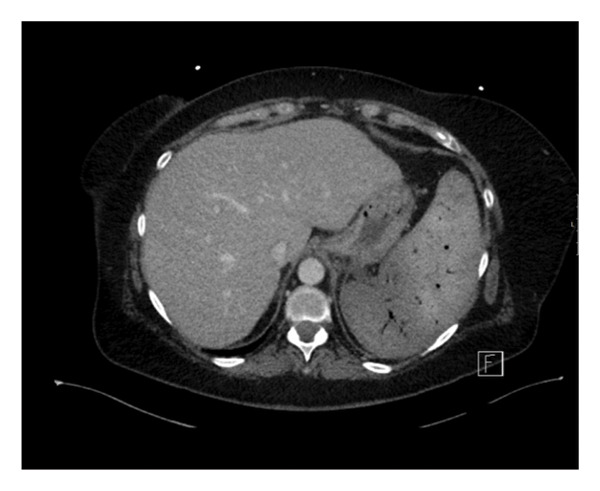

# 1792 — Lách to và giảm tiểu cầu do oxaliplatin: lách là "áp kế" của hệ cửa / Oxaliplatin-induced splenomegaly and thrombocytopenia

**Tags:** `pattern:lach-to` `pattern:giam-tieu-cau` `pattern:gia-di-can` `vung:lach` `vung:bung` `vung:gan` `protocol:CT-bung-co-can-quang` `protocol:sieu-am-bung` `protocol:MRI-gan` `score:CTCAE-v5` `incidentaloma:lach-to`
**Mức chắc chắn (certainty):** tổng hợp y văn (literature synthesis) — số liệu đọc từ toàn văn các bài mở: đoàn hệ 181 bệnh nhân ung thư trực tràng (*Cancer Medicine* 2026, PMC13458283, CC BY-NC-ND — chỉ dùng số liệu, không lấy ảnh), đoàn hệ phẫu thuật cắt gan 2025 (*Hepatobiliary Surgery and Nutrition*, PMC12170277, CC BY-NC-ND), phân tích mô bệnh–ECV (*Journal of Oncology* 2023, PMC9943597, CC BY), báo cáo ca nút mạch lách (*Frontiers in Surgery* 2026, PMC13057329, CC BY; *Case Reports in Hematology* 2026, PMC12905002, CC BY). Ca nguyên văn giữ đúng chú thích gốc; chỗ nguồn khác nhau được ghi rõ.

## 1. Tổng quan bệnh học – cơ chế hình ảnh

- **Câu hỏi thực hành:** bệnh nhân đại trực tràng đang FOLFOX/XELOX, theo dõi thấy **lách to dần + tiểu cầu tụt**. Đây là **di căn lách**, **giảm tiểu cầu miễn dịch (ITP)**, **ức chế tủy do hóa chất**, hay **tăng áp cửa do oxaliplatin**? Câu trả lời đổi hoàn toàn việc làm: truyền tiểu cầu/corticoid, giảm liều, hay **ngừng oxaliplatin và chuẩn bị can thiệp mạch**.
- **Cơ chế chuỗi (vì sao lách to):**
  1. **Oxaliplatin → tổn thương tế bào nội mô xoang gan** (sinusoidal endothelial cells): xoang giãn, xuất huyết vi thể, xơ hóa quanh xoang, tắc các nhánh tĩnh mạch cửa nhỏ → **hội chứng tắc xoang gan (sinusoidal obstruction syndrome, SOS)** / **bệnh mạch cửa-xoang (porto-sinusoidal vascular disease, PSVD)**.
  2. **Tăng áp cửa** (trước xoang) → **ứ máu lách** → lách to; lách to là **dấu hiệu sớm và định lượng được** của mức tổn thương xoang, trước khi có varices/cổ trướng.
  3. Lách to → **bể chứa tiểu cầu** (splenic sequestration) tăng; đồng thời **gan tổn thương giảm sản xuất thrombopoietin (TPO)** và oxaliplatin **độc trực tiếp lên megakaryocyte** → **giảm tiểu cầu ba đường** (ức chế tủy + giảm TPO + ứ lách).
- **TẠI SAO dùng thể tích lách làm thước đo:** lách là tạng **đàn hồi, giãn được**, thể tích thay đổi **hàng chục phần trăm** trước khi có triệu chứng; còn tiểu cầu phản ánh **hậu quả** (ứ + giảm sinh). Vì vậy **thể tích lách là biến sớm, tiểu cầu là biến muộn** — và hai biến này **tương quan nghịch có ý nghĩa** (p < 0,001 với thể tích lách và với AST; n = 181, PMC13458283).
- **Số liệu định lượng:**
  - **Tần suất:** giảm tiểu cầu **50%** khi oxaliplatin đơn trị; **37% số chu kỳ FOLFOX4** so với **4%** số chu kỳ FOLFIRI (gộp 2 thử pha III, 2.145 bệnh nhân — review *Current Oncology* 2025, PMC12384460). Trong đoàn hệ TNT 181 ca: **giảm tiểu cầu 65,2% (118/181)**, **lách to 38,1% (69/181)**.
  - **Lách to:** tới **~90%** bệnh nhân có oxaliplatin trong các loạt khác nhau, **thể tích tăng trung bình ~31%**; **86%** tăng kích thước lách sau FOLFOX bổ trợ (PMC12170277, PMC9943597). **Định nghĩa dùng trong nghiên cứu:** tỉ lệ thể tích lách **> 1,3** (tức **tăng > 30%**); nhiều nhóm lâm sàng dùng **đường kính lớn nhất > 12 cm** trên CT là lách to.
  - **Mức tăng theo độ mô bệnh:** nhóm **SOS độ 2** có **mức tăng thể tích lách trung vị ~135%** (khoảng tứ phân vị tới ~205%), cao hơn rõ so với độ 0–1 (~105–110%); **p = 0,023** (PMC9943597).
  - **Ngưỡng tiên lượng trước cắt gan:** **tăng thể tích lách > 8,6%** dự báo **biến chứng gan–mật sau mổ** (AUC **0,62**; p = 0,02); nhóm này nhận oxaliplatin nhiều hơn (p < 0,001), nhiều xơ gan hóa (p = 0,03) và **giảm tiểu cầu trước mổ** (p < 0,001) — PMC12170277.
  - **Thời gian:** giảm tiểu cầu và rối loạn chức năng gan do oxaliplatin có thể **kéo dài 1–2 năm** sau khi kết thúc hóa trị (PMC11634394).
  - **Yếu tố bảo vệ:** thêm **bevacizumab** làm **chậm thời điểm lách to ≥ 30%** (p = 0,02) và **giảm tỉ lệ giảm tiểu cầu** (JNCI 2018, PMID 29346573) — nên đừng quy mọi lách to cho "hóa trị" mà bỏ qua phác đồ có/không bevacizumab.
- **Vì sao lách to lại là "di căn giả" trên hình ảnh:** lách to + nhiều nốt gan mới sau hóa trị là bộ đôi của **SOS + nốt tăng sản FNH-like** (bài 1733); đọc lách to giúp **nghĩ đúng bối cảnh** trước khi gọi nốt gan là di căn.

## 2. Mẫu hình + chẩn đoán phân biệt theo bối cảnh (Gamut)

- **Khuôn 1 — Lách to MỚI + tiểu cầu giảm, đang hoặc vừa xong oxaliplatin, gan có/không có dấu SOS.** Gamut: **SOS/PSVD do oxaliplatin** vs **di căn lách** vs **ITP** vs **ức chế tủy do hóa chất** vs **huyết khối tĩnh mạch cửa/lách**. Chốt: **thể tích lách tăng > 30% so với trước điều trị + tiểu cầu tương quan nghịch + không có ổ lách khu trú**.
- **Khuôn 2 — Lách to đơn độc, không giảm tiểu cầu.** Gamut: **sung huyết (SOS, suy tim phải, huyết khối TM lách)** vs **thâm nhiễm (lymphoma, leukemia)** vs **nhiễm trùng (sốt rét, EBV)** vs **bệnh dự trữ** vs **lách phụ to**. Chốt: **cấu trúc nhu mô đồng nhất + bối cảnh**; nốt giảm tỷ trọng trong lách to → nghĩ **di căn hoặc lymphoma**, không phải SOS.
- **Khuôn 3 — Giảm tiểu cầu đơn độc, lách bình thường.** Gamut: **CIT (ức chế tủy)** vs **ITP** vs **TTP/HUS** vs **DIC** vs **thiếu B12/acid folic**. Chốt: **kích thước lách bình thường là chốt loại mạnh cho ứ lách**; ITP không lách to.
- **Khuôn 4 — Lách to + tiểu cầu thấp ở bệnh nhân CHUẨN BỊ cắt gan.** Gamut: **tăng áp cửa do SOS** vs **xơ gan nền** vs **di căn lách**. Chốt: **tăng thể tích lách > 8,6%** và **tiểu cầu < 100 × 10⁹/L** → nguy cơ biến chứng gan sau mổ, cân nhắc **nút mạch lách trước mổ**.
- **Khuôn 5 — Lách to + sốt + ổ giảm tỷ trọng trong lách.** Gamut: **áp-xe lách** vs **nhồi máu lách** vs **di căn lách hoại tử**. Chốt: **khí trong ổ + sốt** → áp-xe; **hình nêm ngoại vi** → nhồi máu (bài 146).
- Gợi nhớ **SPLEEN**: **S**inusoidal injury (oxaliplatin) · **P**ortal hypertension · **L**ow platelets · **E**nlarged spleen · **E**xclude metastasis · **N**ormal marrow/ITP workup.

## 3. Bảng so sánh phân biệt (ma trận đối chiếu)

| Thực thể (entity) | Hình ảnh điển hình | Chốt vào (rule-in) | Chốt loại (rule-out) | Gợi ý xác nhận |
|---|---|---|---|---|
| **Lách to do oxaliplatin/SOS (bài này)** | Lách to **đồng nhất**, tăng dần theo chu kỳ; **thể tích tăng > 30%**; có thể kèm gan to, cổ trướng, giãn tĩnh mạch thực quản, **nốt FNH-like** | **Tiền sử oxaliplatin + lách to mới + tiểu cầu tương quan nghịch + không ổ khu trú** | **Ổ giảm tỷ trọng trong lách + sốt** → không phải SOS đơn thuần | Đo thể tích lách trên CT (3D Slicer), so phim trước điều trị; đếm tiểu cầu mỗi chu kỳ |
| **Di căn lách** | **Ổ giảm tỷ trọng đơn độc hoặc nhiều ổ**, bờ không đều; thường **không** làm lách to cấp tính | **Nốt khu trú trong lách + ung thư đã biết (đại tràng trái, vú, phổi, melanoma)** | **Lách to đồng nhất, không ổ** → không phải di căn | CT 4 thì/MRI; PET-FDG; **không chọc lách mù** |
| **ITP (giảm tiểu cầu miễn dịch)** | **Lách bình thường**; không lách to, không ổ | **Tiểu cầu thấp đơn độc + lách bình thường + tủy nhiều megakaryocyte** | **Lách to > 12 cm** → không phải ITP đơn thuần | Công thức máu, tủy đồ, loại trừ thuốc |
| **CIT (ức chế tủy do hóa chất)** | Lách bình thường; có thể kèm giảm bạch cầu/hemoglobin | **Giảm cả 2–3 dòng, hồi phục theo chu kỳ, không lách to** | **Chỉ tiểu cầu giảm + lách to** → nghĩ ứ lách/TPO | Đếm tế bào gốc, thời gian hồi phục sau chu kỳ |
| **Huyết khối TM lách/cửa** | **Lách to + ổ nhồi máu nêm ngoại vi**; huyết khối trong lòng mạch trên CT 4 thì | **Khuyết thuốc trong lòng TM lách/cửa + nhồi máu nêm** | **Mạch thông, không nhồi máu** → không phải huyết khối | CTA/CT tĩnh mạch 4 thì; Doppler |
| **Lymphoma/thâm nhiễm lách** | Lách to **không đồng nhất**, nốt/tổn thương nhiều ổ, hạch ổ bụng | **Nốt lách + hạch + B symptoms** | **Lách to đồng nhất sau oxaliplatin** → nghĩ SOS | PET-CT, sinh thiết hạch (không sinh thiết lách) |
| **Lách phụ to / splenosis** | Nốt **đồng tín hiệu lách** ở rốn lách hoặc ổ bụng, **không phải lách chính to** | **Nốt cùng cấu trúc lách, nhiều ổ sau chấn thương/cắt lách** | **Lách chính tăng thể tích** → không phải lách phụ | So sánh tín hiệu mọi thì; xạ hình nhiệt huyết (bài 192) |

*Trái: CT trước (A) và sau 4 tháng (B) — lách dài **136,77 mm → 148,30 mm**, cùng bệnh nhân đang hóa trị và cắt gan (Gürel D và cs., Front Surg 2026, CC BY 4.0). Phải: thể tích lách tăng theo độ SOS — **độ 2 tăng trung vị ~135%**, p = 0,023 (Kai K và cs., J Oncol 2023, CC BY). Ảnh ghép letterbox, giữ nguyên tỷ lệ.*

### Ba con số dùng để ra quyết định
- **> 30%** thể tích lách (hoặc **> 12 cm** đường kính lớn nhất) = lách to có ý nghĩa — ngưỡng nghiên cứu dùng thống nhất.
- **< 100 × 10⁹/L** tiểu cầu = ngưỡng "có ý nghĩa lâm sàng": tăng nguy cơ **hoãn/giảm liều** và tái diễn ở chu kỳ sau (PMC12384460); cũng là một tiêu chuẩn **tăng áp cửa sớm** sau cắt gan (PMC13503494).
- **> 8,6%** tăng thể tích lách trước mổ = ngưỡng dự báo **biến chứng gan–mật sau cắt gan** (AUC 0,62) — thấp hơn nhiều so với ngưỡng "lách to" 30%, nên **đừng chờ lách to mới lo**.

## 4. Protocol chụp + phân độ và xử trí

- **CT bụng có cản quang thì tĩnh mạch cửa** là chuẩn đo thể tích lách: lát **≤ 1 mm**, tái tạo 3D, **segmentation bằng 3D Slicer** (phương pháp của PMC12170277). Ghi **thể tích (mL)** và **đường kính lớn nhất (cm)**, luôn so với **phim trước hóa trị**.
- **Công thức nhanh trên siêu âm/CT:** **chỉ số lách (splenic index) = dài × rộng × cao** (cm³); hoặc **tỉ số tiểu cầu / đường kính lách** (platelet count/spleen diameter ratio) để ước lượng tăng áp cửa.
- **Thời điểm:** đo **trước chu kỳ đầu** (baseline), lặp sau **3–4 chu kỳ** và **trước mổ gan**; nếu tiểu cầu < 100 × 10⁹/L thì đo mỗi chu kỳ.
- **Phân độ tiểu cầu theo CTCAE v5.0:** **độ 1: 75–100**; **độ 2: 50–75**; **độ 3: 25–50**; **độ 4: < 25 × 10⁹/L**.
- **Ngưỡng thực hành trước khi truyền hóa chất:** nhiều trung tâm đặt mục tiêu **> 75 × 10⁹/L** (ca nguyên văn 1) hoặc **> 100 × 10⁹/L** (ca nguyên văn 2) tùy phác đồ.
- **Nếu cần tiếp tục điều trị mà tiểu cầu không lên:** **nút mạch lách một phần (partial splenic embolization, PSE)** — mục tiêu **thể tích nhồi máu 388–540 mL** (Beppu, *Hepatol Res* 2025); PSE **30–35%** đưa tiểu cầu **65 → 150 × 10⁹/L sau 5 ngày**, đỉnh **174** sau 19 ngày.
- **Trước cắt gan lớn:** **nút mạch lách (SAE)** có thể **bình thường hóa tiểu cầu trong 2 tuần** (419 / 340 / 159 × 10³/µL ở 3 ca) và làm **giảm varices** — cho phép mổ an toàn (PMC13057329).

## 5. Biến thể bình thường và cạm bẫy

- **Cạm bẫy 1 — Đo lách bằng một đường kính.** Đường kính dọc thay đổi theo mặt cắt và người đo; **thể tích 3D** mới đủ nhạy (ngưỡng tiên lượng chỉ **8,6%**). Luôn đo trên **cùng pha, cùng máy, cùng tư thế**.
- **Cạm bẫy 2 — Lách to mà không nghĩ tới nguyên nhân ngoài hóa trị.** **Suy tim phải, xơ gan, huyết khối TM lách, lymphoma** đều gây lách to; hỏi phác đồ có **bevacizumab** (làm chậm lách to) và xem **gan có dấu SOS** không.
- **Cạm bẫy 3 — "Lách to = di căn".** Di căn lách **rất hiếm**: 37 ca trong y văn, **86,5% xuất hiện muộn** (trung vị **24 tháng**), **78,4% từ đại tràng trái**; biểu hiện là **ổ khu trú**, không phải lách to đồng nhất (PMC13173727).
- **Cạm bẫy 4 — Nhầm lách to với lách phụ/splenosis.** Nốt đồng tín hiệu lách ở rốn lách hoặc ổ bụng sau chấn thương/cắt lách **không phải** lách chính to; so **mọi thì** và xem tiền sử (bài 192).
- **Cạm bẫy 5 — PSE quá tay.** Nhồi máu **toàn bộ lách** gây **tiểu cầu tăng vọt 873 × 10⁹/L**, **nhồi máu đuôi tụy**, đau kéo dài và mất chức năng miễn dịch lách; mục tiêu là **một phần (30–50%)**, không phải "càng nhiều càng tốt" (PMC12905002).
- **Cạm bẫy 6 — Quy tiểu cầu thấp cho tái phát ung thư.** Tiểu cầu và chức năng gan có thể **hồi phục chậm 1–2 năm**; đừng đổi phác đồ chỉ vì tiểu cầu thấp nếu lách to và không có tổn thương tiến triển.
- **Cạm bẫy 7 — Bỏ sót tăng áp cửa thật.** Lách to + giãn tĩnh mạch thực quản + cổ trướng sau oxaliplatin là **PSVD**, không phải xơ gan; chẩn đoán nhầm thành xơ gan làm bệnh nhân mất cơ hội cắt gan (bài 1910, 149).

## 6. Tự lượng giá — Blind Quiz

**Ca 1 — Nữ 45 tuổi, di căn gan đại trực tràng, hóa trị chuyển đổi rồi cắt gan phải. Trước mổ 4 tháng, CT cho thấy lách thay đổi. Tiểu cầu 142 → 80 × 10³/µL. Đọc hai phim và giải thích.**

- Hỏi: (1) Lách có to thật không, tính theo ngưỡng nào? (2) Vì sao tiểu cầu tụt cùng lúc? (3) Điều này đổi kế hoạch mổ thế nào?

<b>Bấm để hiện đáp án</b>

- **(A)** lách dài **136,77 mm**; **(B)** sau 4 tháng **148,30 mm** → **tăng ~8,4%**, vượt **ngưỡng 8,6%** dự báo biến chứng gan sau mổ (AUC 0,62) và đã **> 12 cm**.
- Tiểu cầu **142 → 80 × 10³/µL** = **CTCAE độ 1–2**, tương quan nghịch với thể tích lách; kèm **cổ trướng** → nghĩ **SOS/tăng áp cửa do oxaliplatin**, không phải di căn.
- Trả lời: (1) **có**, theo cả ngưỡng > 12 cm và > 8,6%; (2) **ứ lách + giảm TPO + độc tủy**; (3) trì hoãn/điều chỉnh, cân nhắc **SAE trước mổ** và mổ ở trung tâm có kinh nghiệm cắt gan sau hóa trị.
- Nguồn: Gürel D và cs., *Front Surg* 2026, Fig. 2 (PMC13057329, CC BY 4.0). *Phản biện:* ca này lách chỉ tăng 8,4% nhưng đã có cổ trướng — cho thấy **ngưỡng thể tích không thay thế được đánh giá tăng áp cửa lâm sàng**.

**Ca 2 — Bệnh nhân ung thư vú, tiểu cầu nền 80–90 × 10⁹/L, cần paclitaxel + trastuzumab. Nút mạch lách một phần được thực hiện, nhưng CT sau đó cho hình dưới. Tiểu cầu 21 ngày sau là 873 × 10⁹/L. Sai ở đâu?**

- Hỏi: (1) Hình cho thấy gì? (2) Vì sao tiểu cầu tăng quá mức? (3) Biến chứng kèm theo và bài học?

<b>Bấm để hiện đáp án</b>

- **(1)** **nhồi máu toàn bộ lách**: nhu mô lách giảm tỷ trọng, không ngấm thuốc, còn vỏ/viền; dự kiến chỉ nút **nhánh dưới** bằng hạt 500–900 µm nhưng CT cho thấy **toàn bộ lách**.
- **(2)** Mất toàn bộ nhu mô lách → **mất bể chứa tiểu cầu**, tiểu cầu tăng bù **873 × 10⁹/L** sau 21 ngày (nguy cơ huyết khối).
- **(3)** Kèm **nhồi máu đuôi tụy** (đau, tăng amylase) và bệnh nhân **mất cửa sổ hóa trị**; mục tiêu đúng là **nhồi một phần 30–50%**, thể tích nhồi **388–540 mL**, không phải toàn bộ.
- Nguồn: Ridha Z và cs., *Case Rep Hematol* 2026, Fig. 3 (PMC12905002, CC BY 4.0).

**Ca 3 — Nam 60 tuổi, ung thư đại tràng sigma mổ 3 năm trước, theo dõi CT thấy lách to 14 cm và một ổ 3 cm giảm tỷ trọng ở cực dưới lách. Tiểu cầu 88 × 10⁹/L. Có phải chỉ là "lách to do oxaliplatin"?**

<b>Bấm để hiện đáp án</b>

- **Không.** Lách to đồng nhất sau oxaliplatin **không có ổ khu trú**; **ổ giảm tỷ trọng trong lách** ở bệnh nhân đại tràng trái là **di căn lách** cho tới khi chứng minh khác — dù hiếm (37 ca y văn, 78,4% từ đại tràng trái, trung vị 24 tháng).
- Xử trí: **MRI lách/CT 4 thì + PET-FDG**, hội chẩn; **không chọc sinh thiết lách mù** vì nguy cơ chảy máu; nếu đơn độc → **cắt lách** có tiên lượng tốt (DFS 89,3%).
- Bài học: **hai tổn thương có thể cùng tồn tại** — lách to do SOS **không loại trừ** di căn lách; phải đọc **nhu mô lách từng thì**, không chỉ đo kích thước.
- Nguồn số liệu: Li Y, Hu J, *World J Surg Oncol* 2026 (PMC13173727, CC BY-NC-ND).

## Bài liên quan chéo
- [1910 – Hội chứng tắc xoang gan (SOS) do oxaliplatin](../1910-hoi-chung-tac-xoang-gan-sos/lesson.md) (cơ chế nền; lách to là dấu định lượng)
- [1733 – Nốt tái tạo FNH-like sau hóa trị](../1733-not-tai-tao-fnh-like-sau-hoa-tri/lesson.md) (bộ đôi "lách to + nốt gan mới")
- [140 – Lách tăng đặc](../140-lach-tang-dac/lesson.md) (gamut lách to và tổn thương lách)
- [146 – Huyết khối TM lách và nhồi máu lách](../146-huyet-khoi-tm-lach-va-nhoi-mau-lach/lesson.md) (phân biệt nhồi máu nêm với SOS)
- [192 – Splenosis và lách phụ sau cắt lách](../192-splenosis-va-lach-phu-sau-cat-lach/lesson.md) (cạm bẫy nốt đồng tín hiệu lách)
- [149 – Tăng áp cửa không xơ gan](../149-tang-ap-cua-khong-xo-gan/lesson.md) (PSVD, chẩn đoán phân biệt với xơ gan)

> Không dùng để chẩn đoán độc lập khi chưa có người hướng dẫn.
