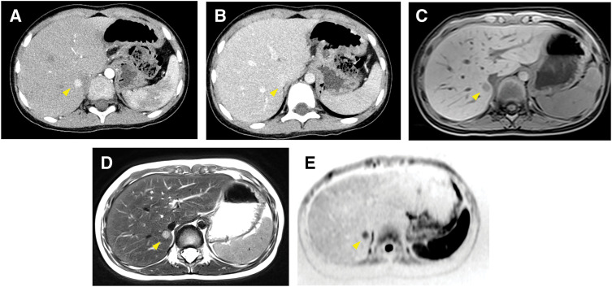
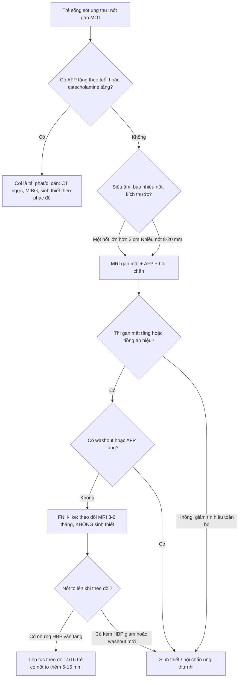
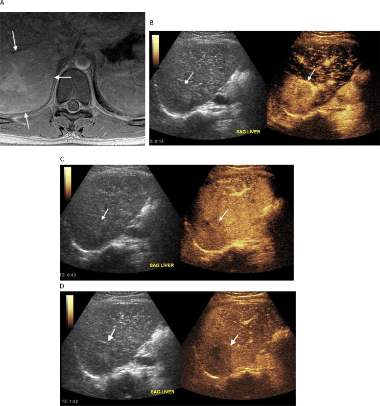

# 1793 — Nốt FNH-like ở trẻ sau hóa trị hoặc ghép tế bào gốc: "di căn giả" của người sống sót ung thư nhi / Paediatric FNH-like lesions after chemotherapy or HSCT

**Tags:** `pattern:not-gan` `pattern:nhieu-o` `pattern:ngam-dong-mach` `pattern:gia-di-can` `pattern:gan-lanh-tinh` `vung:gan` `vung:gan-mat` `protocol:MRI-gan` `protocol:MRI-gan-DWI` `protocol:CEUS` `score:RECIST-1.1` `incidentaloma:not-gan`
**Mức chắc chắn (certainty):** tổng hợp y văn (literature synthesis) — số liệu đọc từ toàn văn bài mở: 16 trẻ sau hóa trị (*Diagnostic and Interventional Radiology* 2020, PMID 32490830 — chỉ dùng số liệu, không lấy ảnh), CEUS ở 68 bệnh nhân ung thư nhi (*Cancer Imaging* 2024, PMC11360734, CC BY 4.0), ca FNH giả di căn Wilms (*Surgical Case Reports* 2026, PMC13148888, CC BY 4.0), ca FNH-like bẩm sinh giả u nguyên bào gan (*World J Pediatr Surg* 2025, PMC12004462, CC BY-NC 4.0), chuỗi 17 ca sau ghép tế bào gốc (*Bone Marrow Transplant* 2015, PMID 25581411) và bài người lớn của repo (bài 1733). Ca nguyên văn giữ đúng chú thích gốc.

## 1. Tổng quan bệnh học – cơ chế hình ảnh

- **Vấn đề thực hành:** trẻ đã điều trị u nguyên bào thần kinh, Wilms, medulloblastoma hoặc đã ghép tế bào gốc, đang theo dõi định kỳ, bỗng có **nốt gan mới**. Phản xạ "nốt mới = tái phát/di căn" dẫn tới **sinh thiết, cắt gan, đổi phác đồ** — trong khi phần lớn là **nốt tăng sản lành tính kiểu FNH (FNH-like lesion)**.
- **Vì sao trẻ có nốt này (cơ chế mạch máu):**
  1. **Hóa chất gây độc nội mô xoang gan** — oxaliplatin, cyclophosphamide, busulfan, và **xạ toàn thân (TBI)** ở ghép tế bào gốc — làm tổn thương tế bào nội mô xoang, huyết khối vi mạch, giảm tưới máu từng vùng.
  2. Vùng **giảm tưới máu teo lại**, vùng lân cận **tăng tưới máu bù** → **tăng sản tế bào gan** thành nốt. Nốt **một tiểu thùy = tăng sản nốt tái tạo (NRH)**; nốt **nhiều tiểu thùy = FNH-like**.
  3. Vì là **tế bào gan bình thường**, không có đột biến sinh ung, nốt **có thể to lên và sinh thêm** theo thời gian nhưng **không di căn**.
- **TẠI SAO "thì gan mật" là trọng tài (vật lý + mô học):** thuốc cản quang gan mật (**gadoxetate disodium**, **gadobenate dimeglumine**) bị **tế bào gan bắt qua OATP1B1/1B3** rồi thải vào đường mật qua MRP2. Ở **thì gan mật (hepatobiliary phase, HBP)** — **15–20 phút** với gadoxetate (0,025 mmol/kg), **60–120 phút** với gadobenate (0,1 mmol/kg) — gan bình thường sáng, còn **mô không có tế bào gan (di căn, u nguyên bào gan) tối**. FNH-like **có tế bào gan** → **tăng tín hiệu (11/16)** hoặc **đồng tín hiệu (5/16)**, gần như **không bao giờ giảm tín hiệu toàn bộ**.
- **Số liệu định lượng:**
  - **Tần suất:** FNH chỉ chiếm **~2% u gan ở trẻ**; nhưng ở trẻ sống sót ung thư, tổn thương gan khu trú gặp ở **17% (46/273)** trẻ điều trị u đặc, xuất hiện **≥ 2 năm** sau chẩn đoán (Smith, dẫn trong PMC11360734).
  - **Loạt 16 trẻ sau hóa trị** (PMC7360070): **13/16 nhiều nốt**, 3/16 một nốt; **khoảng cách 2–14 năm** từ chẩn đoán ung thư đến lúc phát hiện nốt; **đường kính nốt lớn nhất trung vị 19,5 mm (8–41 mm)**; HBP **tăng tín hiệu 11**, **đồng tín hiệu 5**; **4 trẻ tăng số lượng và kích thước**, mỗi nốt **to thêm 6–15 mm**.
  - **Sau ghép tế bào gốc** (17 ca, PMC25581411): nguy cơ tăng khi **tuổi lúc ghép ≤ 12 (HR 9,10)**, **GVHD mạn (HR 2,99)**, **liệu pháp hormone (HR 4,02)**, **xạ ổ bụng (HR 4,37)**; **9/12 trẻ đo FibroScan có xơ gan** → cần **theo dõi suốt đời**.
  - **CEUS trong ung thư nhi** (68 bệnh nhân, 68 tổn thương: **59 lành/87%**, 9 ác/13%): độ nhạy **83–100%**, độ đặc hiệu **93,1–96,0%**, NPV **98,0–100%**, độ chính xác **93,8–94,6%**.
  - **Sẹo trung tâm** chỉ có ở **35%** FNH < 3 cm → **thiếu sẹo không loại trừ**.
- **Vì sao trẻ khác người lớn:** nốt xuất hiện **sớm hơn** so với tuổi (có ca **bẩm sinh**), **nhiều ổ hơn**, và bối cảnh **ung thư nhi** khiến bác sĩ **không dám theo dõi** — chính là chỗ sai.

## 2. Mẫu hình + chẩn đoán phân biệt theo bối cảnh (Gamut)

- **Khuôn 1 — Trẻ sống sót u đặc, nốt gan MỚI nhỏ (8–20 mm), nhiều ổ, ≥ 2 năm sau điều trị.** Gamut: **FNH-like** vs **di căn (u nguyên bào thần kinh, Wilms)** vs **NRH** vs **u máu**. Chốt: **HBP tăng/đồng tín hiệu + không washout + không tăng AFP/catecholamine**.
- **Khuôn 2 — Trẻ sau GHÉP TẾ BÀO GỐC, nhiều nốt gan + lách to + giảm tiểu cầu.** Gamut: **FNH-like/NRH sau HSCT** vs **di căn** vs **nhiễm nấm (candida microabscess)** vs **bệnh gan do GVHD**. Chốt: **HBP + bối cảnh + không sốt**.
- **Khuôn 3 — Sơ sinh/trẻ < 6 tháng, khối gan đơn độc, AFP cao.** Gamut: **FNH-like bẩm sinh** vs **u nguyên bào gan thể thai** vs **u máu**. Chốt: **AFP so với tuổi** (sơ sinh bình thường tới **50.000 ng/mL**), **MRI gan mật**, và **sinh thiết có hội chẩn mô bệnh nhi**.
- **Khuôn 4 — Nốt to lên khi theo dõi.** Gamut: **FNH-like đang tăng sản** vs **di căn tiến triển** vs **u nguyên bào gan**. Chốt: **HBP vẫn tăng/đồng + không washout mới**; **kích thước một mình không phải tiêu chuẩn ác**.
- **Khuôn 5 — Nhiều nốt + gan to + suy gan cấp ở trẻ đang điều trị.** Gamut: **thâm nhiễm u nguyên bào thần kinh (pepper syndrome)** vs **FNH-like** vs **viêm gan do thuốc**. Chốt: **bệnh cảnh cấp + catecholamine niệu + hạch/tủy** → không phải FNH-like.
- Gợi nhớ **FNH-like**: **F** — **F**ollow-up dài (2–14 năm sau điều trị) · **N** — **N**hiều nốt, **N**hỏ · **H** — **H**BP tăng/đồng tín hiệu · **L** — **L**ành, **L**ớn lên vẫn lành.

## 3. Bảng so sánh phân biệt (ma trận đối chiếu)

| Thực thể (entity) | Hình ảnh điển hình | Chốt vào (rule-in) | Chốt loại (rule-out) | Gợi ý xác nhận |
|---|---|---|---|---|
| **FNH-like sau điều trị (bài này)** | Nốt **8–20 mm**, **nhiều ổ**; ngấm mạnh thì động mạch; **không washout**; **HBP tăng 11/16 hoặc đồng 5/16**; sẹo trung tâm chỉ **35%** khi < 3 cm | **Tiền sử hóa trị/HSCT + nhiều nốt nhỏ + HBP tăng/đồng + AFP và catecholamine bình thường** | **HBP giảm tín hiệu toàn bộ + washout + AFP tăng** → không phải FNH-like | MRI gan mật; theo dõi 3–6 tháng; sinh thiết chỉ khi không điển hình |
| **Di căn u nguyên bào thần kinh** | **Gan to, nhiều nốt/ thâm nhiễm lan tỏa** ("pepper syndrome"), có thể **vôi hóa**; thường kèm hạch/tủy | **Bệnh cảnh đang điều trị + catecholamine niệu tăng + tủy xương dương** | **Nốt nhỏ rời rạc, HBP tăng, bệnh ổn định nhiều năm** → không phải di căn | MIBG/¹⁸F-DOPA, catecholamine, tủy đồ |
| **Di căn Wilms** | Nốt gan **giảm tỷ trọng**, thường **kèm di căn phổi**; xuất hiện trong đợt điều trị | **U Wilms tiến triển + nốt gan mới cùng đợt + di căn phổi** | **Nốt đơn độc, HBP tăng/đồng, xuất hiện nhiều năm sau** → nghĩ FNH | CT ngực, siêu âm/MRI gan, theo dõi |
| **U nguyên bào gan (hepatoblastoma)** | Trẻ **< 3 tuổi**, khối lớn, **không đồng nhất**, có thể **vôi hóa**, ngấm mạnh thì động mạch, **HBP giảm tín hiệu** | **AFP tăng theo tuổi + khối lớn + HBP giảm** | **AFP trong ngưỡng tuổi + nốt nhỏ + HBP tăng** → không phải HBL | AFP, MRI gan mật, sinh thiết có hội chẩn |
| **FNH-like bẩm sinh** | Khối **đa cung (polylobate) 30 × 28 mm**, T2 tăng không đồng nhất, T1 giảm nhẹ; HBP tăng; **có thể giống u nguyên bào gan thể thai** | **Sơ sinh + AFP trong ngưỡng tuổi + khối đa cung + HBP tăng** | **AFP tăng rất cao + HBP giảm** → nghĩ HBL | MRI gan mật; **sinh thiết + hội chẩn mô bệnh nhi** trước khi cắt |
| **NRH sau HSCT** | Nốt **≤ 3 mm** rất nhiều, **lưới giảm tín hiệu trên HBP**, lách to, giảm tiểu cầu | **Sau HSCT + nốt nhỏ + lưới HBP + giảm tiểu cầu** | **Nốt > 5 mm có viền và washout** → không phải NRH đơn thuần | MRI HBP, đếm tiểu cầu, FibroScan |
| **U máu / u mạch máu** | **T2 rất sáng**, ngấm **viền ngoại vi** rồi đầy dần; **HBP giảm tín hiệu** | **Ngấm ngoại vi – trung tâm theo thì + T2 rất sáng** | **Ngấm đồng nhất ngay thì động mạch + HBP tăng** → không phải u máu | Siêu âm, MRI; không sinh thiết |
| **Adenoma** | Nốt đồng nhất, ngấm mạnh, có thể **xuất huyết**; HBP **giảm** hoặc **đồng** | **Nốt đơn độc lớn, HBP giảm, bối cảnh glycogenosis/AND** | **Nhiều nốt nhỏ sau hóa trị + HBP tăng** → không phải adenoma | MRI gan mật; theo dõi |

*Bé gái 5 tuổi, u Wilms giai đoạn IV đã lui bệnh; nốt **10 mm phân thùy I**: (A) CT thì động mạch **tăng đậm độ**, (B) thì cân bằng **giữ thuốc, đồng tỷ trọng**, (C) T1 **giảm tín hiệu**, (D) T2 **tăng tín hiệu**, (E) DWI **hạn chế khuếch tán**. Cắt gan ổ I: **FNH 10 × 8 mm có sẹo trung tâm**. Nguồn: Miyoshino W và cs., *Surg Case Rep* 2026, Fig. 2 (CC BY 4.0).*

### Ba dấu hiệu quyết định "lành hay tái phát"
- **Thì gan mật:** **11/16 tăng**, **5/16 đồng** — **không ca nào giảm tín hiệu toàn bộ**; di căn/u nguyên bào gan **giảm tín hiệu**.
- **Không washout:** FNH-like giữ thuốc ở thì cửa/muộn (như ca A→B ở hình trên); **washout mới xuất hiện** là dấu hiệu đáng lo.
- **Xét nghiệm nền:** **AFP theo tuổi** và **catecholamine niệu** bình thường là chốt loại mạnh trong bối cảnh ung thư nhi.

## 4. Protocol chụp + theo dõi

- **Bước 1 — siêu âm (không bức xạ, không an thần):** đo kích thước, số nốt, echo; nếu nốt mới ở trẻ đã điều trị ung thư → **CEUS** nếu có kinh nghiệm (độ chính xác **93,8–94,6%**, NPV **98–100%**).
- **Bước 2 — MRI gan có cản quang gan mật** (chuẩn khẳng định): T1 in/out phase, **T2 fat-sat**, **DWI b = 0/800** + ADC, động mạch – cửa – muộn, **HBP 15–20 phút** (gadoxetate) hoặc **60–120 phút** (gadobenate). Lát **4 mm**.
- **Bước 3 — xét nghiệm:** **AFP so với ngưỡng tuổi** (sơ sinh tới **50.000 ng/mL** là bình thường), **catecholamine niệu**, chức năng gan, đếm tiểu cầu (nếu sau HSCT).
- **Theo dõi (đề xuất thực hành, chưa có guideline riêng cho trẻ):**
  - Nốt **điển hình** (ngấm mạnh, không washout, HBP tăng/đồng): **MRI 3–6 tháng/lần trong năm đầu**, sau đó **6–12 tháng**; **không sinh thiết**, **không áp RECIST** cho tổn thương lành.
  - Nốt **to lên** mà HBP vẫn tăng/đồng → **tiếp tục theo dõi** (4/16 trẻ to thêm **6–15 mm**, vẫn lành).
  - **Sinh thiết/cắt** chỉ khi: **HBP giảm tín hiệu toàn bộ**, **washout mới**, **AFP/catecholamine tăng**, hoặc khối **> 3–5 cm** gây triệu chứng.
- **Sau ghép tế bào gốc:** theo dõi **suốt đời** vì FNH có thể xuất hiện **nhiều năm sau** và **9/12 trẻ có xơ gan** trên FibroScan.

## 5. Biến thể bình thường và cạm bẫy

- **Cạm bẫy 1 — DWI hạn chế khuếch tán vẫn là FNH.** Ca nguyên văn Wilms: nốt **hạn chế khuếch tán rõ** trên DWI mà mô bệnh là FNH; DWI ở nốt nhỏ **không đủ phân biệt**, phải dựa vào **HBP + diễn tiến**.
- **Cạm bẫy 2 — CEUS "washout" vẫn là FNH.** Ca 18 tuổi sau medulloblastoma: **tăng mạnh 14 giây**, rồi **giảm tín hiệu ở 43 giây và 1 phút 42** — kiểu giống ác tính, nhưng mô bệnh **FNH**. Đừng chốt ác chỉ vì một pha CEUS.
- **Cạm bẫy 3 — "To lên = tái phát".** **4/16 trẻ** có nốt **to thêm 6–15 mm** và **tăng số nốt** mà vẫn lành; luôn đọc lại **HBP** trước khi đổi chẩn đoán.
- **Cạm bẫy 4 — HBP đồng tín hiệu.** **5/16 nốt** chỉ **đồng tín hiệu**, không tăng; đồng tín hiệu vẫn **loại trừ di căn** (di căn giảm tín hiệu), nhưng dễ bị bỏ qua nếu chỉ tìm "nốt sáng".
- **Cạm bẫy 5 — Sơ sinh có AFP "cao" là bình thường.** AFP **46.758 ng/mL** ở trẻ 3 ngày tuổi vẫn **trong ngưỡng** (25.000–50.000); đọc AFP mà không theo tuổi dẫn tới **mổ oan u nguyên bào gan thể thai** — đúng ca FNH-like bẩm sinh đã bị cắt gan phải.
- **Cạm bẫy 6 — Mô bệnh nhi cũng có thể nhầm.** Ca bẩm sinh trên có **glypican-3+, β-catenin dương màng, glutamine synthetase+** và bị đọc là **u nguyên bào gan thể thai** ở lần đầu; cần **hội chẩn mô bệnh trung tâm** trước phẫu thuật lớn.
- **Cạm bẫy 7 — Bỏ sót bệnh mạch nền.** Nốt FNH-like sau HSCT thường đi kèm **lưới HBP giảm tín hiệu, lách to, giảm tiểu cầu, xơ gan trên FibroScan (9/12)** — đọc các dấu này để không bỏ **PSVD/tăng áp cửa** (bài 1910, 1792).

## 6. Tự lượng giá — Blind Quiz

**Ca 1 — Bé gái 5 tuổi, u Wilms giai đoạn IV, lui bệnh 2 năm. Siêu âm theo dõi thấy nốt 10 mm gan phải. Đọc 5 chuỗi xung và quyết định.**

- Hỏi: (1) Nốt có washout không? (2) DWI hạn chế khuếch tán nói lên gì? (3) Vì sao vẫn phải cắt trong ca này?

<b>Bấm để hiện đáp án</b>

- **(A)** thì động mạch **tăng đậm độ**; **(B)** thì cân bằng **đồng tỷ trọng, giữ thuốc** → **không washout**. **(C)** T1 giảm, **(D)** T2 tăng, **(E)** DWI **hạn chế khuếch tán**.
- Trả lời: (1) **Không**; (2) **không đặc hiệu** — FNH nhỏ vẫn hạn chế khuếch tán; (3) vì nốt **to dần trên các lần chụp** và bối cảnh Wilms giai đoạn IV, ê-kíp chọn **cắt gan ổ I để chẩn đoán**; kết quả **FNH 10 × 8 mm có sẹo trung tâm** — lành.
- Bài học: khi **không thể loại trừ bằng hình ảnh**, cắt nhỏ để chẩn đoán là hợp lý; nhưng nếu **HBP tăng/đồng + không washout** thì **theo dõi trước** là lựa chọn ít xâm lấn.
- Nguồn: Miyoshino W và cs., *Surg Case Rep* 2026, Fig. 2 (PMC13148888, CC BY 4.0). *Phản biện:* ca này **không có HBP** — thiếu đúng chuỗi xung quyết định, nên phải dựa vào diễn tiến.

**Ca 2 — Nam 18 tuổi, sống sót medulloblastoma 12,5 năm. Tình cờ thấy tổn thương gan trên MRI cột sống. CEUS được làm. Đọc 3 pha.**

- Hỏi: (1) Kiểu ngấm này gợi ác hay lành? (2) Vì sao vẫn kết luận FNH? (3) Vai trò của CEUS ở trẻ sống sót ung thư?

<b>Bấm để hiện đáp án</b>

- **(B)** 14 giây: **tăng mạnh**; **(C)** 43 giây và **(D)** 1 phút 42: **giảm tín hiệu** so với gan → bề ngoài giống **washout** của tổn thương ác.
- Trả lời: (1) **giống ác**, đây là ca **không điển hình**; (2) **mô bệnh = FNH** — CEUS một mình **không đủ**; (3) CEUS có **độ chính xác 93,8–94,6%, NPV 98–100%** và **không bức xạ/không an thần**, hữu ích để **sàng lọc và theo dõi**, nhưng ca không điển hình vẫn cần **MRI gan mật**.
- Nguồn: Mostafa AG và cs., *Cancer Imaging* 2024, Fig. 2 (PMC11360734, CC BY 4.0).

**Ca 3 — Sơ sinh 3 ngày tuổi, khối gan 30 × 28 mm đa cung, AFP 46.758 ng/mL. Có phải u nguyên bào gan?**

<b>Bấm để hiện đáp án</b>

- **Chưa thể kết luận.** AFP **46.758 ng/mL nằm trong ngưỡng bình thường của trẻ < 6 tháng (25.000–50.000)** — "cao" theo người lớn nhưng **bình thường theo tuổi**.
- MRI: khối **đa cung**, T2 tăng không đồng nhất, T1 giảm nhẹ; sinh thiết ban đầu đọc **u nguyên bào gan thể thai**, hội chẩn trung tâm xác nhận — nhưng sau **cắt gan phải**, mô bệnh cuối cùng là **FNH-like bẩm sinh**.
- Bài học: (1) **luôn so AFP với tuổi**; (2) khối đa cung ở sơ sinh có **chẩn đoán phân biệt FNH-like bẩm sinh**; (3) **hội chẩn mô bệnh nhi trung tâm trước phẫu thuật lớn**.
- Nguồn: Gatto A và cs., *World J Pediatr Surg* 2025, Fig. 1 (PMC12004462, CC BY-NC 4.0).

## Bài liên quan chéo
- [1733 – Nốt FNH-like sau hóa trị ở người lớn](../1733-not-tai-tao-fnh-like-sau-hoa-tri/lesson.md) (cùng cơ chế, khác bối cảnh tuổi)
- [1792 – Lách to và giảm tiểu cầu do oxaliplatin](../1792-lach-to-giam-tieu-cau-do-oxaliplatin/lesson.md) (bộ đôi "lách to + nốt gan mới")
- [1910 – Hội chứng tắc xoang gan (SOS)](../1910-hoi-chung-tac-xoang-gan-sos/lesson.md) (nền mạch máu của FNH-like/NRH)
- [121 – Khối gan và LI-RADS](../121-khoi-gan-LIRADS/lesson.md) (khung đọc khối gan, ngấm–washout)
- [122 – U lành gan](../122-u-lanh-gan/lesson.md) (FNH kinh điển, adenoma, u máu)
- [1648 – Di căn gan ở ung thư vú](../1648-di-can-gan-ung-thu-vu/lesson.md) (khung đọc di căn gan; hàng phân biệt của nốt mới)
- [600 – Tổng quan Nhi khoa](../600-tong-quan-nhi-khoa/lesson.md) (bản đồ hệ Nhi, bài liên quan chéo)

> Không dùng để chẩn đoán độc lập khi chưa có người hướng dẫn.
