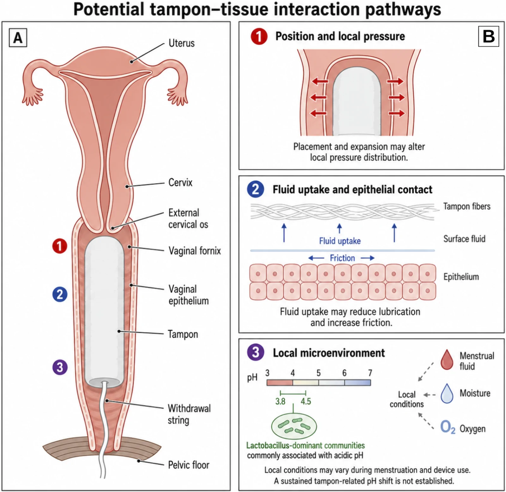
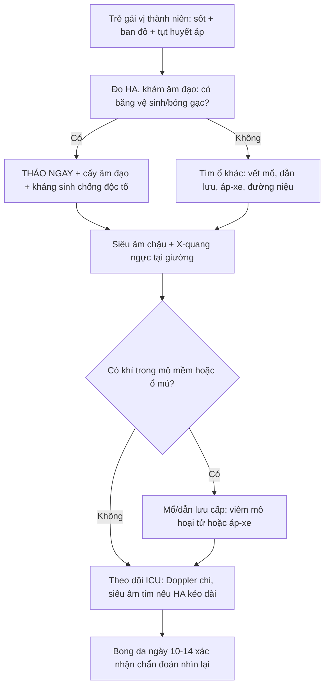
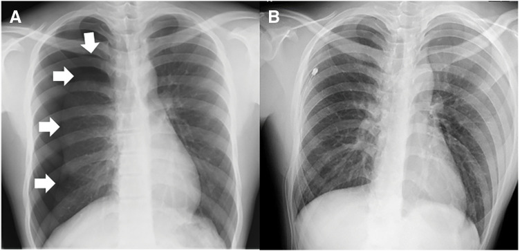
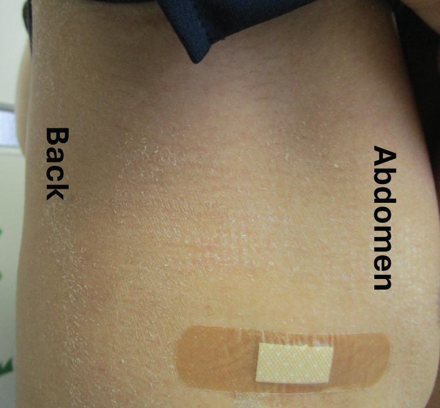

# 1794 — Hội chứng sốc độc tố do băng vệ sinh/bóng gạc bỏ quên ở trẻ vị thành niên: chẩn đoán nằm ở lâm sàng, hình ảnh chỉ để tìm ổ và loại bắt chước / Tampon-associated toxic shock syndrome

**Tags:** `pattern:soc` `pattern:viem-mo-mem` `pattern:di-vat` `pattern:u-dich` `vung:am-dao` `vung:sinh-duc-nu` `vung:phoi` `vung:da` `protocol:sieung-am` `protocol:XR` `protocol:CT` `protocol:MRI` `protocol:echo` `score:CDC-2011`
**Mức chắc chắn (certainty):** tổng hợp y văn (literature synthesis) — số liệu lấy từ **102 ca sốc độc tố do kinh nguyệt (m-TSS) điều trị tại 43 ICU** (Clin Infect Dis 2022, PMID 33906228), **96 ca TSS sau mổ** (tổng quan hệ thống 2020, trích trong ca nguyên văn), **tổng quan cơ chế TSST-1** (Clin Microbiol Rev 2020, PMC7254860), **ca nguyên văn 14 tuổi sau dẫn lưu tràn khí màng phổi** (Surg Case Rep 2025, PMC12256205) và **tổng quan TSS ở trẻ** (Paediatr Drugs 2005, PMID 15777108). Chỗ chưa có số thì ghi "chưa rõ".

> **Câu chốt:** TSS là **bệnh do siêu kháng nguyên (superantigen)**, không phải nhiễm khuẩn huyết thông thường — **cấy máu âm ở 102/102 ca**. Vì vậy **hình ảnh không bao giờ chẩn đoán được TSS**; vai trò của bác sĩ CĐHA là **tìm ổ nhiễm (băng vệ sinh/bóng gạc bỏ quên, ổ mủ sau mổ, áp-xe)**, **loại bắt chước** (viêm mô hoại tử có khí, huyết khối, áp-xe thận) và **đánh giá biến chứng** (phù phổi/ARDS, suy tim, thiếu máu chi). Trong khi đó, **bỏ sót = tử vong trong 24–48 giờ**.
> Nối với [1735 – Dị vật âm đạo ở trẻ](../1735-di-vat-am-dao-o-tre-chua-ro/lesson.md) và [1682 – Rò bàng quang–âm đạo ở trẻ](../1682-ro-bang-quang-am-dao-o-tre/lesson.md).

## 1. Tổng quan bệnh học – cơ chế hình ảnh

### 1.1 Vì sao băng vệ sinh gây sốc (cơ chế phân tử, không phải "nhiễm trùng máu")

- **Siêu kháng nguyên TSST-1** (toxic shock syndrome toxin 1) do *Staphylococcus aureus* tiết ra, **không cần xử lý kháng nguyên**: nó **bắc cầu MHC lớp II trên tế bào trình diện kháng nguyên với chuỗi Vβ2 của thụ thể tế bào T** (và với **CD40, CD28**) → **hoạt hóa đa dòng** tế bào T, không chọn lọc đặc hiệu kháng nguyên.
- **Hệ quả định lượng:** bình thường tế bào T mang Vβ2 chỉ **~10%**, nhưng trong TSS cấp chúng **tăng sinh tới 70%** tổng tế bào T; bão cytokine (TNF, IL-1, IL-6, IFN-γ) gây **tăng thấm mao mạch, giãn mạch, ức chế cơ tim** → **tụt huyết áp + phù + tổn thương đa cơ quan**. **Liều gây chết ước tính ở người: 0,1 µg** độc tố (PMC7254860).
- **Vì sao là băng vệ sinh chứ không phải tampon nào cũng vậy:** sản xuất TSST-1 **tuyệt đối cần oxy**; âm đạo bình thường kỵ khí, còn **băng vệ sinh đưa oxy vào theo độ thấm hút** — đây là lý do **TSS do kinh nguyệt gắn với tampon, còn TSS do liên cầu (GAS) thì không**. Ngoài ra: **glucose ức chế ngược (catabolite repression)** sản xuất độc tố, còn **protein là cơ chất**; pH trước kinh **giảm kiểm soát của lactobacilli**, cho phép *S. aureus* tăng từ không phát hiện được lên **10⁷–10¹¹ vi khuẩn** trong âm đạo, **đỉnh ngày 2–3 của kỳ kinh** — đúng lúc khởi phát m-TSS.
- **Vì sao sốc mà cấy máu âm:** tổn thương do **độc tố lưu hành**, không do vi khuẩn trong máu. Trong 102 ca ICU, **100% cấy máu âm**, nhưng **MSSA mọc từ 92/96 mẫu âm đạo** và **TSST-1 có ở 66/76 chủng (87%)**. Đây là lý do **không được chờ cấy máu** để chẩn đoán.
- **Vì sao ban đỏ rồi bong da:** viêm mao mạch da + thoát dịch → **ban đỏ kiểu "cháy nắng" (sunburn-like erythroderma)**; tổn thương lớp gai và thượng bì → **bong da (desquamation) ở ngày 10–14**, tức **sau khi bệnh nhân đã ổn định** — dấu hiệu này **không giúp chẩn đoán lúc cấp cứu**, chỉ giúp nhìn lại.

### 1.2 Ngưỡng định lượng nằm lòng

| Chỉ số | Con số | Nguồn |
|---|---|---|
| Tỉ lệ mắc lịch sử (Mỹ, 1976–1980) | **14,4/100.000 phụ nữ 12–49 tuổi** | PMC7254860 |
| Tuổi trung vị trong ICU | **18 tuổi (IQR 16–24)** — đúng nhóm vị thành niên | PMID 33906228 |
| Cấy máu dương | **0/102** | PMID 33906228 |
| *S. aureus* nhạy methicillin từ âm đạo | **92/96 (95,8%)** | PMID 33906228 |
| Chủng mang gen TSST-1 | **66/76 (87%)** | PMID 33906228 |
| Đạt tiêu chuẩn CDC 2011 "xác định" lúc nhập ICU | **0/102**; "nghi ngờ" **52%** | PMID 33906228 |
| Cần vận mạch | **84%** | PMID 33906228 |
| Cần đặt nội khí quản | **21%** | PMID 33906228 |
| Kháng sinh chống độc tố (clindamycin/linezolid) | **79%** | PMID 33906228 |
| IVIG | **8%** | PMID 33906228 |
| Tử vong trong ICU | **0/102** | PMID 33906228 |
| Tử vong TSS do tụ cầu ở trẻ | **3–5%** | PMID 15777108 |
| Tử vong TSS do liên cầu ở trẻ | **5–10%** (người lớn **30–80%**) | PMID 15777108 |
| TSS sau mổ (39.000 ca phẫu thuật) | **0,003% (12 ca)** | PMC12256205 |
| TSS sau mổ — tổng quan 96 ca (1978–2018) | Khởi phát **trung vị 4 ngày**; **24% di chứng vĩnh viễn**; **tử vong 9,38%**; **54,2% có triệu chứng tiêu hóa** | PMC12256205 |
| Tỉ lệ không do kinh nguyệt (giám sát Pháp 2008) | **65%**, tử vong **22%** so với **0%** ở thể kinh nguyệt | PMC12256205 |
| Bong da xuất hiện | **ngày 10** sau khởi phát (ca nguyên văn) | PMC12256205 |

> **Phản biện:** tử vong **0%** trong 102 ca ICU (2022) **mâu thuẫn** với **22%** của giám sát Pháp 2008 và **9,38%** của tổng quan sau mổ. Khác biệt đến từ **chọn bệnh** (thể kinh nguyệt trẻ, khỏe mạnh so với thể sau mổ/người già) và **thời điểm chẩn đoán**. Không được trích "TSS lành tính" cho mọi thể.

### 1.3 Vì sao hình ảnh trông như vậy (vật lý + mô bệnh)

- **Phổi (X-quang/CT):** tăng thấm mao mạch phổi → **mờ kính mờ hai bên, đối xứng, không choán chỗ**, có thể kèm **tràn dịch màng phổi hai bên**; **bóng tim không to** nếu chưa có suy tim. Đây là **phù phổi không do tim (non-cardiogenic)**; khác phù do tim ở **tim to, phân bố hình cánh bướm, dày vách**. Trong TSS còn có **ức chế cơ tim** → có thể **tim to + EF giảm** trên siêu âm (thường **hồi phục sau 1–2 tuần**).
- **Băng vệ sinh/bóng gạc trong âm đạo:** bông + không khí có **đậm độ thấp** — trên **CT không cản quang** là **cấu trúc hình trụ đậm độ thấp trong lòng âm đạo** (dễ nhầm với khí hoặc dịch); trên **siêu âm** là **cấu trúc tăng âm trong âm đạo**, có thể có **bóng lưng**; trên **MRI T2** là **cấu trúc giảm tín hiệu**. Vì vậy **X-quang bụng/chậu gần như vô dụng** — bông không cản quang.
- **Mô mềm (CT):** viêm mô hoại tử do liên cầu/tụ cầu → **khí trong mô mềm (gas), dày cân (fascial thickening), tụ dịch dọc cân**; đây là **dấu hiệu ngoại khoa cấp cứu**, không phải TSS đơn thuần.
- **Khớp/chi:** thiếu máu chi do tụt huyết áp + đông máu nội mạch rải rác → **thiếu tín hiệu mạch trên Doppler**, không phải huyết khối đơn thuần.

## 2. Mẫu hình + chẩn đoán phân biệt theo vị trí (gamut)

**Mẫu hình:** **trẻ gái vị thành niên (hoặc phụ nữ trẻ sau sinh/sau mổ)** với **sốt cao + ban đỏ lan tỏa + tụt huyết áp + tổn thương ≥ 3 cơ quan** (tiêu hóa, cơ, thận, gan, huyết học, thần kinh trung ương), thường **trong 2–5 ngày đầu kỳ kinh** hoặc **2–4 ngày sau mổ**.

**Gamut theo nguồn ổ:**

- **Do kinh nguyệt (menstrual):** băng vệ sinh, cốc nguyệt san, màng ngăn âm đạo, bọt biển tránh thai, bóng gạc bỏ quên sau soi/đặt thuốc.
- **Không do kinh nguyệt (non-menstrual) — 65% trong giám sát Pháp:** **vết mổ/vết thương**, **dẫn lưu** (như ca 14 tuổi sau chọc hút màng phổi), **áp-xe** (cơ, quanh hậu môn, vú, xoang), **viêm xương–tủy**, **bỏng**, **viêm mũi xoang có bóng gạc**, **nhiễm trùng sau sinh (viêm nội mạc tử cung)**.
- **Bắt chước (mimics):** **sốc nhiễm khuẩn từ đường niệu (urosepsis)/áp-xe vùng chậu**, **viêm mô hoại tử**, **bệnh Kawasaki**, **sốc phản vệ**, **MIS-C**, **DRESS/SJS**, **sốt phát ban do Rickettsia**, **sốt xuất huyết Dengue**, **hội chứng bong vảy da do tụ cầu (SSSS)**.

**Gamut theo vị trí tổn thương trên hình ảnh (để chọn đúng ổ):**

- **Âm đạo/tử cung:** băng vệ sinh, bóng gạc, ứ dịch, viêm nội mạc tử cung sau sinh.
- **Mô mềm/thành bụng/chi:** áp-xe, viêm mô hoại tử (khí trong mô).
- **Phổi–màng phổi:** ARDS, tràn dịch, ổ nhiễm sau dẫn lưu.
- **Tiết niệu:** áp-xe thận/quanh thận, viêm bể thận — bắt chước sốc nhiễm khuẩn hay gặp nhất ở trẻ gái.
- **Tim:** suy tim cấp do độc tố, tràn dịch màng tim (ít gặp).

**Mnemonic "TAMPON":** **T**ụt huyết áp, **A**nh hưởng đa cơ quan ≥ 3, **M**ụn/ban đỏ kiểu cháy nắng, **P**hân biệt với sốc nhiễm khuẩn, **O**xy là điều kiện sinh độc tố (băng vệ sinh), **N**gày 10–14 bong da.

## 3. Bảng so sánh phân biệt (ma trận đối chiếu)

| Thực thể (entity) | Hình ảnh/lâm sàng điển hình | Chốt vào (rule-in) | Chốt loại (rule-out) | Gợi ý xác nhận |
|---|---|---|---|---|
| **TSS do kinh nguyệt** | Sốt > 38,9 °C + ban đỏ lan tỏa + tụt huyết áp trong **2–5 ngày đầu kỳ kinh**; **siêu âm/CT thấy băng vệ sinh trong âm đạo**; bong da ngày 10–14 | **Sốc + ban + đang dùng băng vệ sinh + ≥ 3 cơ quan** | Có ổ mủ rõ ở nơi khác (áp-xe thận, viêm phổi) → nghĩ sốc nhiễm khuẩn | Cấy âm đạo, **tháo băng vệ sinh ngay**, theo dõi huyết áp |
| **TSS không do kinh nguyệt (sau mổ/dẫn lưu)** | Sốt **2–4 ngày** sau mổ, ban kiểu cháy nắng, tiêu chảy/nôn (**54,2%**), vết mổ **trông sạch** | **Sốc + ban + tiền sử mổ/dẫn lưu trong 4 ngày** | Vết mổ sưng nóng đỏ mủ rõ → áp-xe, cần dẫn lưu chứ không chỉ kháng sinh | Cấy dịch/đầu dẫn lưu, **không đợi cấy máu** |
| **Sốc nhiễm khuẩn đường niệu** | Sốt + đau hông lưng + lắc lư thận dương; CT có **thận to, giảm ngấm, ổ áp-xe** | **Ổ áp-xe trên CT + cấy nước tiểu dương** | CT thận bình thường + cấy nước tiểu âm → ít khả năng | CT bụng có cản quang, cấy nước tiểu trước kháng sinh |
| **Viêm mô hoại tử** | Đau **không tương xứng**, da tím/tối, **khí trong mô mềm trên CT**, dày cân | **Khí trong mô mềm + dày cân + đau nặng** | Không có khí, không dày cân → ít khả năng | CT mô mềm; **mổ thăm dò không chờ hình ảnh** |
| **Bệnh Kawasaki** | Trẻ **< 5 tuổi**, sốt ≥ 5 ngày, môi nứt, lưỡi dâu tây, hạch cổ, phù/bong da đầu ngón; **tụt huyết áp ít gặp** | **Sốt ≥ 5 ngày + ≥ 4/5 tiêu chuẩn + giãn mạch vành** | Sốc sâu + ban ngay ngày 1–2 → nghĩ TSS hơn | Siêu âm tim, tiểu cầu, CRP |
| **SSSS (bong vảy da do tụ cầu)** | Trẻ nhỏ, **bong da thành mảng lớn**, **không tụt huyết áp**, độc tố bong vảy (exfoliative toxin) | **Bong da + huyết áp ổn định** | Có sốc + tổn thương đa cơ quan → TSS | Cấy da/mũi, sinh thiết thượng bì |

*Sơ đồ mặt cắt dọc khung chậu: (A) băng vệ sinh nằm trong âm đạo, liên quan cổ tử cung, cùng đồ và sàn chậu; (1) áp lực và vị trí, (2) hấp thu dịch và tiếp xúc biểu mô, (3) vi môi trường (pH 3,8–4,5 khi có lactobacilli). Đây là cơ sở để hiểu vì sao **độ thấm hút + oxy + pH trung tính** thúc đẩy sản xuất TSST-1. Front Bioeng Biotechnol 2026 (PMC13624471), CC BY 4.0.*

### Ba dấu hiệu quyết định

- **Sốc + ban đỏ kiểu cháy nắng + đang hành kinh = TSS cho tới khi chứng minh ngược lại:** tháo băng vệ sinh là **điều trị**, không phải "chờ kết quả".
- **Cấy máu âm không loại trừ:** 0/102 ca dương; phải **cấy âm đạo/dịch ổ** và tìm **độc tố**.
- **Khí trong mô mềm = viêm mô hoại tử, không phải TSS:** cần **mổ ngay**, không chờ hội chẩn.

## 4. Protocol chụp + hệ phân độ/điểm chuẩn hóa

### 4.1 Thứ tự xử trí (hình ảnh đứng sau lâm sàng)

1. **Lâm sàng trước:** đo huyết áp, nhịp tim, tri giác; **hỏi kỹ "đang dùng băng vệ sinh/cốc nguyệt san/bóng gạc không"**; khám âm đạo bằng mỏ vịt (nếu đã dậy thì và hợp tác) để **lấy băng vệ sinh/bóng gạc ra** và cấy.
2. **Cấy trước kháng sinh:** máu (2 bộ), âm đạo/dịch ổ, nước tiểu; **không chờ kết quả** để bắt đầu kháng sinh.
3. **Hình ảnh có mục tiêu — không chụp tràn lan:**
   - **Siêu âm vùng chậu** (đầu tay, không bức xạ): tìm **băng vệ sinh/bóng gạc** (cấu trúc tăng âm trong âm đạo), **ứ dịch**, **áp-xe vùng chậu**, **xoắn buồng trứng** (bắt chước).
   - **X-quang ngực tại giường** nếu khó thở/giảm oxy: **ARDS/phù phổi, tràn dịch, ổ nhiễm sau dẫn lưu**.
   - **CT bụng–chậu có cản quang** khi siêu âm không kết luận hoặc nghi **áp-xe/viêm mô hoại tử**; **CT không cản quang** đủ để tìm **khí trong mô mềm**.
   - **Siêu âm tim** khi có **tụt huyết áp kéo dài, tiếng thổi mới, hoặc nghi suy tim do độc tố** — đánh giá **EF và tràn dịch màng tim**.
   - **Doppler chi** khi chi lạnh/tím — loại **tắc mạch do sốc**.
4. **Không** chụp MRI toàn thân "tầm soát ổ nhiễm" trong sốc: **thời gian vận chuyển và thuốc an thần là nguy hiểm**, trong khi ổ chính thường **đã biết sau khám**.

### 4.2 Tiêu chuẩn CDC 2011 (dùng để phân loại, KHÔNG dùng để loại trừ tại giường)

- **Sốt ≥ 38,9 °C.**
- **Ban đỏ lan tỏa (erythroderma).**
- **Bong da 1–2 tuần sau khởi phát** (ở bàn tay, bàn chân, hoặc toàn thân).
- **Tụt huyết áp:** người lớn **HATT ≤ 90 mmHg**; trẻ **< 5th percentile theo tuổi** hoặc tụt ≥ 15% so với nền.
- **≥ 3 cơ quan:** tiêu hóa (nôn/tiêu chảy), cơ (CK tăng **≥ 2 lần**), niêm mạc (sung huyết âm đạo/hầu), thận (creatinin **≥ 2 lần** hoặc **> 2 mg/dL**), gan (bilirubin/transaminase **≥ 2 lần**), huyết học (tiểu cầu **< 100.000/µL**), thần kinh trung ương (tri giác không định hướng/không có sốt).
- **Xác định (confirmed):** đủ tất cả + **cấy dương** (máu/âm đạo/dịch ổ). **Nghi ngờ (probable):** đủ lâm sàng, cấy âm.
- **Vì sao không dùng để loại trừ:** **0/102 ca** trong ICU đạt mức "xác định" lúc nhập viện và chỉ **52%** đạt "nghi ngờ" — tiêu chuẩn này **quá chặt cho thực hành cấp cứu**, đúng như tác giả kết luận. Chẩn đoán tại giường là **sốc + ban + ≥ 3 cơ quan**, có hay không có kết quả cấy.

### 4.3 Điều trị (để hiểu vì sao hình ảnh chỉ là hỗ trợ)

- **Kiểm soát nguồn (source control):** **tháo băng vệ sinh/bóng gạc**, dẫn lưu ổ mủ, cắt lọc mô hoại tử. Đây là can thiệp **quyết định sống còn**, không phải kháng sinh.
- **Kháng sinh:** **clindamycin hoặc linezolid** (ức chế tổng hợp độc tố — "antitoxin") **+ kháng tụ cầu** (vancomycin/oxacillin theo kháng sinh đồ); ở thể liên cầu thêm **penicillin + clindamycin**.
- **Hồi sức:** bù dịch tinh thể, vận mạch (norepinephrine), thông khí khi ARDS.
- **IVIG:** dùng ở **8%** ca trong loạt ICU (PMID 33906228); bằng chứng **không đồng nhất** — không thay thế kiểm soát nguồn. Ghi rõ "chưa rõ hiệu quả" khi tư vấn.

### 4.4 Sơ đồ tiếp cận

## 5. Biến thể bình thường và cạm bẫy

- **"Không có băng vệ sinh" không loại trừ TSS:** **65%** ca tụ cầu là **không do kinh nguyệt** trong giám sát Pháp; nguồn có thể là **vết mổ, dẫn lưu, áp-xe, xoang**.
- **Cấy máu âm là bình thường trong TSS:** **0/102**; đừng đợi cấy máu rồi mới điều trị.
- **Bong da xuất hiện muộn (ngày 10–14):** lúc cấp cứu chỉ có **ban đỏ** — nếu chờ bong da mới chẩn đoán là **chờ quá muộn**.
- **Băng vệ sinh không cản quang:** **X-quang chậu bình thường** là chuyện thường; phải **siêu âm/CT** mới thấy. Ngược lại, **khí trong âm đạo trên CT là bình thường**, không phải dấu hiệu hoại tử.
- **Ban đỏ khó thấy ở da sẫm màu:** tìm **ban ở niêm mạc, lòng bàn tay/chân, vùng nếp** và hỏi **"da rát như cháy nắng"**.
- **Nhầm với sốc nhiễm khuẩn thông thường:** dẫn tới **chỉ dùng kháng sinh, không tháo băng vệ sinh/không dẫn lưu** → tử vong dù kháng sinh đúng.
- **Nhầm với SSSS:** SSSS **không tụt huyết áp**, do **độc tố bong vảy**, trẻ nhỏ; điều trị khác (kháng sinh, chăm sóc da).
- **Tái phát:** khuyến cáo **không dùng lại tampon** ít nhất vài tháng, hoặc **dùng xen kẽ**; tư vấn này thuộc phần phòng bệnh, không phải hình ảnh.
- **Chụp CT toàn thân "tìm ổ" trong sốc:** làm chậm kiểm soát nguồn, tăng nguy cơ thuốc an thần — chỉ chụp **theo mục tiêu**.

## 6. Tự lượng giá — Blind Quiz ngay trên trang tĩnh

**Ca 1 — Nam 14 tuổi, tràn khí màng phổi phải, đặt catheter 18-Fr. Ngày thứ 2 sốt 39 °C, nôn, tiêu chảy. Đọc phim trước.**

- Câu hỏi: (1) Hai ảnh khác nhau ở đâu? (2) Sốt ngày 2 sau dẫn lưu gợi ý gì? (3) Cấy máu âm có loại trừ chẩn đoán không?

<b>Bấm để hiện đáp án (findings + chẩn đoán)</b>

- Dấu hiệu: (A) **tràn khí màng phổi phải** (mũi tên) với phổi xẹp; (B) sau đặt catheter 18-Fr, **phổi phải nở tốt**, không còn tràn khí.
- Chẩn đoán: **TSS không do kinh nguyệt sau dẫn lưu màng phổi** — cấy dịch màng phổi và đầu catheter mọc *S. aureus* sinh **TSST-1 + enterotoxin C**; **cấy máu âm**; bong da ở nách/mông **ngày 10**; khỏi sau 14 ngày kháng sinh.
- Bài học: nguồn nhiễm có thể **trông sạch**; sốt + ban + tiêu chảy sau can thiệp 2–4 ngày phải nghĩ TSS, **không chờ cấy máu**.
- Nguồn ảnh: Surg Case Rep 2025 (PMC12256205), Hình 1, CC BY 4.0.

**Ca 2 — Cùng bệnh nhi, ngày thứ 10 sau đặt dẫn lưu.**

- Câu hỏi: (1) Dấu hiệu này tên gì? (2) Vì sao nó xuất hiện muộn? (3) Nó giúp chẩn đoán hay chỉ xác nhận nhìn lại?

<b>Bấm để hiện đáp án (findings + chẩn đoán)</b>

- Dấu hiệu: **bong da (desquamation) dạng vảy** ở nách, mông và thân — hậu quả của tổn thương thượng bì do độc tố và thoát dịch.
- Ý nghĩa: xuất hiện **1–2 tuần sau khởi phát**, tức **sau giai đoạn sốc** → chỉ **xác nhận chẩn đoán nhìn lại**, không dùng để chẩn đoán cấp. Bệnh nhi đã được điều trị và xuất viện **ngày 11**.
- Nguồn ảnh: Surg Case Rep 2025 (PMC12256205), Hình 2, CC BY 4.0.

**Ca 3 — Nữ 16 tuổi, ngày 3 kỳ kinh, sốt 39,5 °C, ban đỏ toàn thân, HATT 78 mmHg, nôn 6 lần, creatinin 1,9 mg/dL, tiểu cầu 88.000/µL. Siêu âm chậu: cấu trúc tăng âm trong âm đạo, không có dịch tự do.**

- Câu hỏi: (1) Chẩn đoán và việc đầu tiên phải làm? (2) Có đạt tiêu chuẩn CDC "xác định" không? (3) Có cần CT bụng–chậu ngay không?

<b>Bấm để hiện đáp án (findings + chẩn đoán)</b>

- Chẩn đoán: **TSS do kinh nguyệt** (sốt + ban + tụt huyết áp + tiêu hóa/thận/huyết học = ≥ 3 cơ quan). **Việc đầu tiên: tháo băng vệ sinh + cấy âm đạo + kháng sinh chống độc tố**, không chờ kết quả.
- CDC: **chưa "xác định"** vì chưa có kết quả cấy; có thể đạt mức **"nghi ngờ"**. Theo loạt 102 ca ICU, **0 ca đạt mức xác định lúc nhập viện** — tiêu chuẩn này không dùng để trì hoãn điều trị.
- Hình ảnh: **không cần CT ngay** — siêu âm đã thấy dị vật, không có ổ mủ/dịch tự do; CT chỉ đặt ra khi **siêu âm không kết luận, nghi áp-xe, hoặc sốc không giải thích được**. Đừng để việc chụp làm chậm **tháo băng vệ sinh**.

## Bài liên quan chéo
- [1735 – Dị vật âm đạo ở trẻ chưa rò](../1735-di-vat-am-dao-o-tre-chua-ro/lesson.md)
- [1682 – Rò bàng quang–âm đạo ở trẻ](../1682-ro-bang-quang-am-dao-o-tre/lesson.md)
- [691 – Sỏi bàng quang và sỏi quanh catheter ở trẻ](../691-soi-bang-quang-va-soi-quanh-catheter-o-tre/lesson.md)
- [1430 – Độc tính thần kinh sau CAR-T (ICANS)](../1430-icans-doc-tinh-than-kinh-sau-car-t/lesson.md)

## Ảnh
- `images/1794_soc-doc-to-bang-ve-sinh_XR_PMC12256205.jpg` — Surg Case Rep 2025 (PMC12256205), Hình 1, CC BY 4.0.
- `images/1794_soc-doc-to-bang-ve-sinh_Anh-lam-sang_PMC12256205.jpg` — cùng bài, Hình 2, CC BY 4.0.
- `images/1794_soc-doc-to-bang-ve-sinh_So-do_PMC13624471.jpg` — Front Bioeng Biotechnol 2026 (PMC13624471), Hình 2, CC BY 4.0.
- Nguồn + giấy phép từng ảnh: `images/CREDITS.md`; nguồn bài: `sources.md`.

> Không dùng để chẩn đoán độc lập khi chưa có người hướng dẫn.
