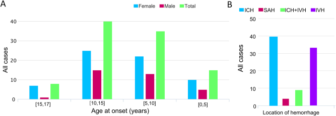
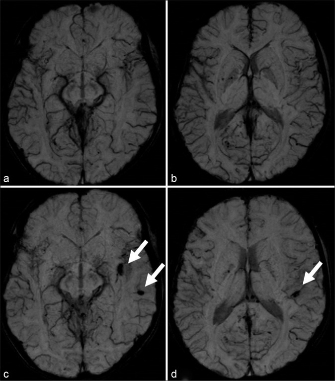
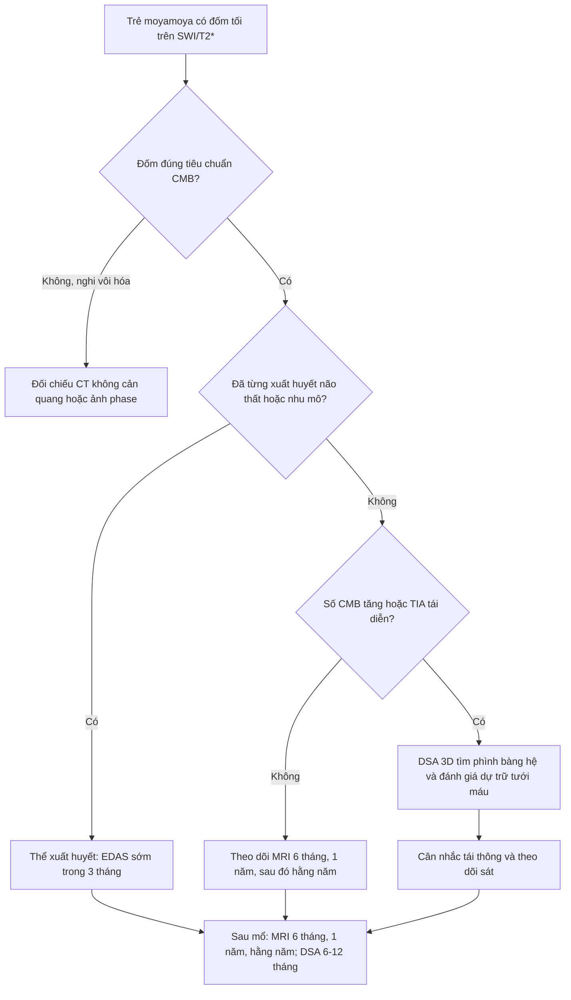
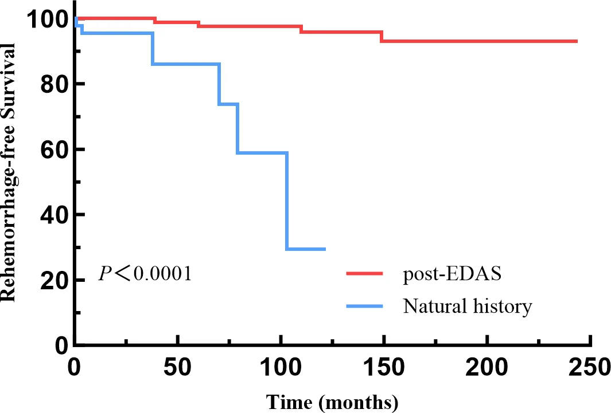
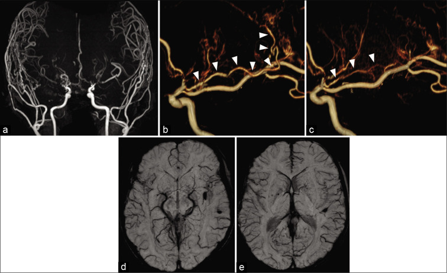
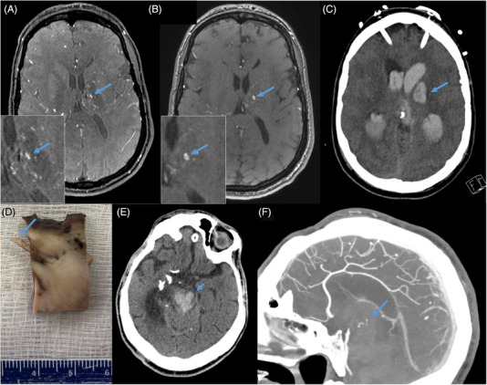

# 1795 — Xuất huyết & vi chảy máu trong bệnh moyamoya ở trẻ: đọc SWI/T2*, phân biệt chảy máu do thuốc với bệnh nền & khi nào tái thông dự phòng / Hemorrhage and cerebral microbleeds in pediatric moyamoya

**Tags:** `pattern:vi-chay-mau` `pattern:xuat-huyet-nao` `vung:nao-nhi` `vung:quanh-nao-that` `score:Suzuki` `protocol:SWI-3T` `protocol:MRA-TOF` `protocol:DSA`
**Mức chắc chắn (certainty):** tổng hợp y văn (literature synthesis) — ghép 3 nguồn chính: đoàn hệ 96 trẻ moyamoya thể xuất huyết (hMMD) theo dõi 1103 patient-year (PMC13540288), 302 trẻ sau tái thông theo dõi trung vị 21 năm (PMC12778558), và ca de novo vi chảy máu ở bé trai 7 tuổi (PMC8247715). Không phải ca nguyên văn của nhóm; số nào nguồn không đưa thì ghi "chưa rõ".

> **Câu chốt:** ở trẻ, **xuất huyết chỉ chiếm 2,2–9,5%** khởi phát moyamoya, nhưng khi đã xuất huyết thì **tái xuất huyết 7,5%/năm** — cao hơn nhiều so với người lớn. **Vi chảy máu (cerebral microbleed — CMB) trên SWI/T2\* là dấu hiệu sớm của ứng suất huyết động** trên mạng bàng hệ quanh não thất, xuất hiện **trước** xuất huyết lớn ở một số trẻ. Điểm quyết định: **EDAS trong 3 tháng đầu sau xuất huyết đầu tiên** giảm tái xuất huyết **18,75 lần** và giảm biến chứng sau mổ.

## 1. Tổng quan bệnh học – cơ chế hình ảnh

### 1.1 Vì sao trẻ moyamoya xuất huyết — và vì sao máu hay vào não thất (TẠI SAO)

- **Nền bệnh:** hẹp – tắc tiến triển đoạn cuối động mạch cảnh trong (internal carotid artery — ICA) và đoạn gần động mạch não giữa (middle cerebral artery — MCA). Để bù, não huy động **mạng bàng hệ quanh não thất (periventricular anastomosis)** gồm 3 kiểu theo mạch xuyên: **thể vân (lenticulostriate), đồi thị (thalamic) và màng mạch (choroidal)** (phân loại Funaki, dẫn qua PMC8247715).
- **Vì sao mạch bàng hệ dễ vỡ:** đây là mạch nhỏ, thành mỏng, **thiếu lớp cơ trơn và màng đàn hồi**, lại phải chịu áp lực hệ thống thay cho vùng não thiếu máu. Theo **định luật Laplace** (ứng suất thành ∝ áp lực × bán kính / độ dày thành), bán kính tăng khi giãn + thành mỏng = **ứng suất thành tăng vọt** → vỡ ở kích thước rất nhỏ.
- **Vì sao máu vào não thất:** nhánh màng mạch trước (anterior choroidal artery — AChA) đi sát não thất bên; khi giãn và tăng áp lực, vỡ sẽ đổ trực tiếp vào não thất. Trong 96 trẻ hMMD: **xuất huyết não thất (intraventricular hemorrhage — IVH) 43,8%**, xuất huyết nhu mô (intracerebral hemorrhage — ICH) **33,3%**, ICH + IVH **12,5%**, dưới nhện (subarachnoid hemorrhage — SAH) **10,4%**; **giãn AChA gặp ở 70,8%** (PMC13540288).
- **Vì sao trẻ ít xuất huyết hơn người lớn nhưng vẫn nguy hiểm:** thời gian phơi nhiễm huyết động ngắn hơn, nhưng khi hẹp tiến triển nhanh thì **ứng suất tăng đột ngột**. Trẻ hMMD thường có **TIA trước xuất huyết trung bình 19,2 tháng** (Ahn, dẫn qua PMC8247715) — cửa sổ để can thiệp.
- **Vì sao CMB thấy được trên SWI/T2\*:** khi mao mạch vỡ rỉ máu, hemoglobin thoái hóa thành **hemosiderin (Fe³⁺, thuận từ)**. Sắt thuận từ tạo **bất đồng nhất từ trường cục bộ** → mất tín hiệu lan rộng (**blooming**) trên chuỗi xung gradient-echo T2\*/SWI. SWI là chuỗi 3D gradient-echo có **độ phân giải không gian cao hơn và độ nhạy cao hơn T2\*** với các đốm sắt nhỏ (PMC12643450). Đốm CMB điển hình: **tròn, 2–5 mm (tối đa ~10 mm), không phù, không hiệu ứng khối**, thường ở ranh giới chất trắng – vỏ hoặc quanh não thất.
- **Vì sao CMB quan trọng:** ở người lớn, CMB là **yếu tố dự báo xuất huyết**: 4/4 ca xuất huyết trong một đoàn hệ tiến cứu đều có CMB trước đó; **nguy cơ xuất huyết 6,6%/năm** khi có CMB không triệu chứng, và **CMB mới xuất hiện 1,7%/năm** (Kuroda, dẫn qua PMC8247715).

### 1.2 Ngưỡng định lượng nằm lòng (bắt buộc nhớ)

| Chỉ số | Con số | Nguồn |
|---|---|---|
| Tỷ lệ khởi phát bằng xuất huyết ở trẻ moyamoya | **2,2–9,5%** | PMC13540288 |
| Tuổi xuất huyết đầu tiên | trung bình **12 tuổi (9–14)**; nữ đỉnh **13–15 tuổi**, nam **10–12 tuổi** | PMC13540288 |
| Giới | **nữ 59,4%** (57/96) | PMC13540288 |
| Loại xuất huyết | **IVH 43,8%** · ICH 33,3% · ICH + IVH 12,5% · SAH 10,4% | PMC13540288 |
| Giãn AChA / tổn thương PCA | **70,8%** / **34,4%** (sớm 22,9%, muộn 11,5%) | PMC13540288 |
| Xuất huyết lần đầu | **8,7%/patient-year** (96 sự kiện/1103 patient-year) | PMC13540288 |
| Tái xuất huyết **trước** EDAS | **7,5%/năm** (7 sự kiện/93,2 patient-year) | PMC13540288 |
| Tái xuất huyết **sau** EDAS | **0,4%/năm** (4 sự kiện/959,9 patient-year) → giảm **18,75 lần** | PMC13540288 |
| Yếu tố dự báo tái xuất huyết | **mRS ≥ 3 khi nhập viện: OR 5,280** (1,083–25,739) | PMC13540288 |
| EDAS sớm (≤ 3 tháng sau xuất huyết đầu) | **OR 0,107** (0,012–0,933) cho tái xuất huyết | PMC13540288 |
| Biến chứng sau mổ | **12,8%**; EDAS sớm **94,5% không biến chứng** so với **76,9%** khi muộn | PMC13540288 |
| Xuất huyết muộn sau tái thông ở trẻ | **2,6%** (8/302), trung vị **19 năm** sau mổ (IQR 14–22,75) | PMC12778558 |
| Xạ trị trước đó | **HR 5,5** (1,1–27,6) cho xuất huyết muộn | PMC12778558 |
| CMB ở trẻ | **7 ca trong 2 báo cáo**; **0/20 trẻ** trong đoàn hệ T2\* tiến cứu | PMC8247715; PMID 23223508 |
| CMB ở người lớn | **26,8%** không triệu chứng; **51,9%** trên PSI, gộp **46%**; **45,7–63,3%** ở chất trắng quanh não thất | PMID 31589987; PMID 24558166; PMID 24529354 |
| Tái thông thời thơ ấu và CMB khi trưởng thành | **7,8%** so với **35,2%** nếu không tái thông | PMID 31589987 |
| Aspirin sau tái thông (bệnh Moyamoya thiếu máu, người lớn) | TIA **19,5% vs 38,0%** (RR 0,51); xuất huyết **2,3% vs 2,8%** (RR 0,80; NS) | PMC10246502 |

*Hình 2 — (A) Số ca xuất huyết theo nhóm tuổi và giới: đỉnh ở nhóm 10–15 tuổi. (B) Vị trí: ICH nhiều nhất, sau đó IVH; ICH + IVH và SAH ít hơn. Đây là đoàn hệ 1350 trẻ moyamoya, 98 ca xuất huyết trước mổ — khác với đoàn hệ 96 trẻ ở bảng trên (PMC13540288) nên tỷ lệ không trùng khớp tuyệt đối. Nguồn: Guo Q et al., Int J Surg 2025 (PMC12430935), **CC BY-NC-ND 4.0** — nguyên bản, không crop.*

## 2. Mẫu hình + chẩn đoán phân biệt theo vị trí (gamut)

**Mẫu hình cần nhận ra:** trẻ **moyamoya đã biết** (hoặc trẻ châu Á có TIA tái diễn) → trên **SWI 3T** thấy **một hoặc vài đốm tối tròn nhỏ ở chất trắng quanh não thất**, thường **cùng bên bán cầu có hẹp MCA tiến triển**, kèm **giãn AChA** trên MRA. Đốm có thể **xuất hiện mới trong vài tháng** và **mất/không tăng sau tái thông**.

**Gamut theo vị trí (mnemonic "QUANH NÃO THẤT – NHÂN XÁM – VỎ/CHẤT TRẮNG – Ổ MỔ"):**

1. **QUANH NÃO THẤT (periventricular):** CMB do mạng bàng hệ thể màng mạch/đồi thị — hay gặp nhất trong moyamoya, đặc biệt **AChA giãn**. Đây là vị trí **dự báo IVH**.
2. **NHÂN XÁM (basal ganglia/thalamus):** CMB do nhánh thể vân – đồi thị; cũng là nơi ICH lớn hay xảy ra. Ở trẻ, nguyên nhân tăng huyết áp **rất hiếm** — đừng mặc định.
3. **VỎ – CHẤT TRẮNG DƯỚI VỎ (lobar/gray-white junction):** nghĩ **tổn thương sợi trục lan tỏa (diffuse axonal injury — DAI)** sau chấn thương, **thuyên tắc mỡ**, di chứng xạ trị, hoặc **cavernoma**.
4. **Ổ MỔ / ĐƯỜNG MỔ (postoperative):** hemosiderin tồn dư sau tái thông hoặc sau dẫn lưu — **không phải CMB mới**; so phim cũ và vị trí giải phẫu.

**Phân biệt "CMB thật" với các bắt chước (mimic):**

- **Vôi hóa** (đám rối mạch mạc, nhân xám): cũng mất tín hiệu trên SWI, nhưng **không tròn đều, bờ theo cấu trúc giải phẫu**, và **tăng đậm trên CT không cản quang**.
- **Tĩnh mạch tủy nổi rõ ("brush sign" / prominent medullary veins):** các đường **thẳng, chạy theo tĩnh mạch**, do tăng deoxyhemoglobin khi giảm tưới máu — **không phải đốm rời rạc**.
- **Dị vật kim loại, khí, xương sọ dày:** tạo blooming **ở rìa** hoặc theo đường vào.

## 3. Bảng so sánh phân biệt (ma trận đối chiếu)

| Thực thể (entity) | Hình ảnh điển hình | Chốt vào (rule-in) | Chốt loại (rule-out) | Gợi ý xác nhận |
|---|---|---|---|---|
| **CMB do moyamoya** | Đốm **tròn 2–5 mm**, tối trên SWI/T2\*, **quanh não thất** hoặc nhân xám, không phù, không hiệu ứng khối; có thể tăng số theo thời gian | **Bệnh moyamoya + đốm quanh não thất + giãn AChA/PComA + không có vôi hóa trên CT** | Đốm lớn > 10 mm, có phù/viền, hoặc nằm ngoài vùng bàng hệ → nghĩ nguyên nhân khác | SWI 3T lặp sau **6–12 tháng**; MRA/DSA tìm phình bàng hệ |
| **Cavernoma** | Nhân "bỏng ngô" (popcorn) T1/T2 hỗn hợp, **viền hemosiderin dày**, thường có phù nhẹ nếu mới xuất huyết | **Viền hemosiderin dày + nhân hỗn hợp + không liên quan vùng bàng hệ** | Chỉ có đốm nhỏ đơn độc, không có nhân → khó chốt, cần SWI lặp | MRI đa chuỗi xung; theo dõi |
| **DAI sau chấn thương** | Nhiều đốm **ở ranh giới chất trắng – vỏ, thể chai, cuống não**, đối xứng | **Tiền sử chấn thương + phân bố đặc trưng + không có hẹp ICA** | Có hẹp ICA cuối + bàng hệ moyamoya → nguyên nhân là moyamoya | MRI sọ sau chấn thương; hỏi bệnh sử |
| **CMB do tăng huyết áp** | Đốm ở **nhân xám, đồi thị, cầu não**, thường nhiều và đối xứng | **HA cao kéo dài + tổn thương chất trắng + không hẹp ICA** | Trẻ không tăng huyết áp, có bàng hệ moyamoya → loại | Đo HA 24 giờ; MRA |
| **Vôi hóa nhân xám/đám rối** | Đốm tối trên SWI nhưng **tăng đậm trên CT**, bờ theo giải phẫu | **CT không cản quang có vôi hóa cùng vị trí** | CT âm tính và đốm tròn rời rạc → không phải vôi hóa | CT não không cản quang hoặc ảnh phase |
| **Hemosiderin sau mổ** | Đốm/đường tối **dọc đường mổ, quanh khoan sọ**, có thể có mảnh kim loại | **Vị trí trùng đường mổ + có phim trước mổ để so** | Vị trí xa đường mổ, xuất hiện mới theo thời gian → CMB thật | So phim cũ; CT tìm mảnh kim loại |
| **Tĩnh mạch tủy nổi (brush sign)** | Các đường tối **mảnh, liên tục, chạy theo tĩnh mạch** quanh não thất | **Hình dạng đường + thay đổi theo tưới máu + không phải đốm** | Đốm tròn rời rạc, bờ rõ → CMB | SWI nhiều mặt cắt; ASL/SPECT |

*Hình 3 — SWI 3T ở bé trai 7 tuổi: (a,b) 6 tháng sau mổ bán cầu phải — **chưa có CMB** ở bán cầu trái; (c,d) 9 tháng — **3 CMB mới** ở chất trắng quanh não thất trái (mũi tên trắng), cùng lúc hẹp MCA trái tiến triển. Đây là ảnh so sánh trực tiếp "trước – sau" của cùng một bệnh nhân. Nguồn: Inoue K et al., Surg Neurol Int 2021 (PMC8247715), **CC BY-NC-SA 4.0** — nguyên bản, không crop.*

## 4. Protocol chụp + hệ phân độ & chiến lược xử trí

**Chụp gì (thứ tự leo thang):**

1. **MRI 3T + SWI** là chuỗi chọn lọc để đếm CMB; nếu không có SWI thì **T2\* GRE** (nhạy hơn 1,5T, nhưng **thấp hơn SWI** — không so số đốm giữa hai chuỗi). Kèm **DWI/ADC** (nhồi máu cấp), **FLAIR** (tổn thương chất trắng), **MRA TOF** (hẹp ICA/MCA, giãn AChA/PComA).
2. **DSA 3D** khi: xuất huyết não thất không rõ nguyên nhân, nghi phình bàng hệ, hoặc trước tái thông. DSA vẫn là chuẩn vàng cho hẹp/bàng hệ và cho **Suzuki**.
3. **ASL/SPECT/PET** đánh giá **dự trữ tưới máu** trước mổ và phát hiện **hội chứng tăng tưới máu (CHS)** sau mổ.
4. **CT không cản quang** khi cần loại **vôi hóa** (bắt chước CMB) hoặc khi trẻ cấp cứu không chụp MRI được.

**Đếm và ghi báo cáo CMB (tối thiểu):** số lượng, vị trí (quanh não thất / nhân xám / thùy), kích thước lớn nhất (mm), có/không thay đổi so phim cũ. **Tăng số CMB hoặc CMB mới** là tín hiệu động học, quan trọng hơn con số tuyệt đối.

**Suzuki (DSA) — dùng để mô tả tiến triển, không phải chỉ định mổ:**

*Hình 2 — 96 trẻ moyamoya thể xuất huyết: đường đỏ **sau EDAS** gần như nằm ngang, đường xanh **diễn biến tự nhiên** tụt còn ~30% không tái xuất huyết sau 10 năm (P < 0,0001). EDAS giảm tái xuất huyết **18,75 lần** (7,5% → 0,4%/năm). Nguồn: Chen C et al., Stroke Vasc Neurol 2026 (PMC13540288), **CC BY-NC 4.0**; chuyển webp→PNG, không sửa nội dung.*

**Chiến lược xử trí (theo nguồn):**

- **Đã xuất huyết:** **EDAS trong vòng 3 tháng** sau xuất huyết đầu tiên — giảm tái xuất huyết (OR 0,107) và giảm biến chứng (OR 0,219); tỷ lệ không biến chứng **94,5% vs 76,9%** (PMC13540288). **mRS ≥ 3 khi nhập viện** là yếu tố nguy cơ tái xuất huyết mạnh nhất (OR 5,280) → nhóm này cần theo dõi sát và không trì hoãn.
- **Chưa xuất huyết nhưng có CMB:** không có thử nghiệm ngẫu nhiên ở trẻ; quyết định **cá thể hóa**. Dữ liệu người lớn cho thấy CMB dự báo xuất huyết, và **tái thông thời thơ ấu gắn với CMB ít hơn khi trưởng thành** (7,8% vs 35,2%, PMID 31589987) — lập luận ủng hộ tái thông sớm ở trẻ có CMB mới/tăng nhanh kèm giảm dự trữ tưới máu, nhưng đây là **suy luận**, không phải bằng chứng cấp I.
- **Theo dõi sau mổ:** MRI **6 tháng, 1 năm, sau đó hằng năm**; DSA **6–12 tháng** sau mổ (quy trình của PMC13540288). Xuất huyết muộn vẫn có thể xảy ra **trung vị 19 năm** sau tái thông (2,6%, PMC12778558) → **không được cắt theo dõi khi trẻ chuyển sang người lớn**.
- **Chống kết tập tiểu cầu:** ở người lớn **bệnh moyamoya thiếu máu** sau tái thông, aspirin **100 mg/ngày** giảm TIA (19,5% vs 38,0%) mà **không tăng xuất huyết** (2,3% vs 2,8%; RR 0,80; NS) (PMC10246502). Ở trẻ **thể xuất huyết**, không có dữ liệu tương tự; **CMB đơn thuần trên SWI không phải lý do tự động ngừng aspirin** nếu chỉ định là thiếu máu — nhưng phải loại phình bàng hệ, kiểm soát huyết áp và hỏi lại lý do dùng thuốc. Chi tiết liều/kháng aspirin: xem bài **681**.

## 5. Biến thể bình thường và cạm bẫy

- **Cạm bẫy 1 — đếm vôi hóa thành CMB:** đám rối mạch mạc và nhân xám vôi hóa **bloom rất mạnh** trên SWI. Luôn đối chiếu **CT không cản quang** hoặc ảnh phase trước khi gọi là CMB.
- **Cạm bẫy 2 — so số CMB giữa 1,5T T2\* và 3T SWI:** SWI nhạy hơn, nên "tăng số đốm" có thể chỉ là **đổi kỹ thuật**. Chỉ so khi **cùng từ trường, cùng chuỗi xung, cùng độ dày lát**.
- **Cạm bẫy 3 — bỏ sót CMB vì "chỉ có một đốm":** ca de novo ở bé 7 tuổi chỉ có **3 đốm** nhưng kèm **hẹp MCA tiến triển**; giá trị nằm ở **động học**, không phải số lượng (PMC8247715).
- **Cạm bẫy 4 — gán mọi xuất huyết sau tái thông cho "bệnh nền":** phải loại **CHS** (tăng tưới máu, thường ngày 1–7), **phình bàng hệ mới/to nhanh**, **tăng huyết áp**, và **biến chứng vết mổ**. Ca xuất huyết muộn 19 năm sau mổ có **phình mạch bàng hệ đồi thị 1,4 × 2 mm** làm thủ phạm (PMC12778558).
- **Cạm bẫy 5 — cho rằng tái thông "chữa khỏi" nguy cơ xuất huyết:** 2,6% trẻ vẫn xuất huyết muộn, đặc biệt **sau xạ trị** (HR 5,5) — cần theo dõi suốt đời (PMC12778558).
- **Cạm bẫy 6 — quy kết xuất huyết cho aspirin mà bỏ qua bệnh nền:** trong bệnh moyamoya, xuất huyết thường do **mạch bàng hệ vỡ** hoặc **phình bàng hệ**, không phải do thuốc; ngừng aspirin đơn thuần không xử lý được nguyên nhân và có thể gây nhồi máu.
- **Biến thể bình thường:** **giãn nhẹ, đối xứng tĩnh mạch tủy quanh não thất** ("brush sign") ở trẻ thiếu máu não mạn — theo dõi, không can thiệp; **vôi hóa đám rối mạch mạc** theo tuổi.

## 6. Tự lượng giá — Blind Quiz ngay trên trang tĩnh

**Ca 1 — Bé trai 7 tuổi, TIA yếu nửa người trái, đã mổ tái thông bán cầu phải. Sáu tháng sau xuất hiện TIA phải; MRA cho thấy hẹp MCA trái tiến triển. Ảnh MRA + dựng 3D + SWI sau đó:**

- Câu hỏi: (1) Đầu mũi tên trắng trong ảnh 3D chỉ cấu trúc gì? (2) Vì sao CMB lại xuất hiện ở bán cầu **trái** trong khi trẻ đã được tái thông bán cầu **phải**? (3) Sau khi tái thông bán cầu trái, điều gì xảy ra với bàng hệ và CMB?

<b>Bấm để hiện đáp án (findings + chẩn đoán)</b>

- **Findings:** (a) MRA: hẹp/tắc đoạn cuối ICA hai bên, bàng hệ ngoài sọ nuôi bán cầu phải tốt sau mổ. (b,c) Dựng 3D: **nhánh bàng hệ từ động mạch màng mạch trước (AChA)** chạy quanh não thất rồi nối với động mạch tủy (đầu mũi tên trắng) — kiểu **bàng hệ thể màng mạch**. (d,e) SWI sau mổ trái: các **CMB cũ** còn lại, **không có CMB mới** sau 1 năm.
- **Chẩn đoán:** **bệnh moyamoya thể thiếu máu có bàng hệ thể màng mạch tăng áp lực**; CMB mới xuất hiện khi hẹp MCA trái tiến triển, phản ánh **ứng suất huyết động tăng** trên mạng bàng hệ — không phải do bán cầu đã mổ.
- **Vì sao bán cầu trái:** tổn thương giải phẫu nằm ở bán cầu **có hẹp tiến triển**, không phụ thuộc bán cầu đã tái thông.
- **Sau tái thông trái:** AChA **co lại**, bàng hệ bất thường biến mất, **không thêm CMB** sau 1 năm — đây là lập luận hình ảnh ủng hộ tái thông làm giảm ứng suất bàng hệ.
- **Nguồn ảnh:** Inoue K et al., Surg Neurol Int 2021 (PMC8247715), **CC BY-NC-SA 4.0**.

**Ca 2 — Bệnh nhân trong đoàn hệ 302 trẻ moyamoya đã tái thông, có tiền sử xạ trị sọ. Hai mươi năm sau mổ, đột ngột đau đầu, nôn, liệt nửa người. Ảnh cũ 9 năm trước và ảnh cấp:**

- Câu hỏi: (1) Ảnh A/B (MRA 9 năm trước) có bất thường gì? (2) Ảnh C (CT cấp) mô tả gì? (3) Vì sao xuất huyết xảy ra **muộn** như vậy và yếu tố nguy cơ nào cần hỏi?

<b>Bấm để hiện đáp án (findings + chẩn đoán)</b>

- **Findings:** (A,B) MRA TOF 9 năm trước xuất huyết: **giãn khu trú 1,4 × 2 mm** trong mạch bàng hệ đồi thị (mũi tên xanh, ảnh phóng đại). (C) CT không cản quang: **xuất huyết đồi thị lớn kèm máu trong não thất** (mũi tên xanh), có hiệu ứng khối. (D) Bệnh phẩm; (E,F) CT/CTA sau đó.
- **Chẩn đoán:** **vỡ phình mạch bàng hệ quanh não thất (thalamic/choroidal collateral aneurysm) muộn sau tái thông** — thủ phạm thường gặp của xuất huyết muộn trong đoàn hệ này; **không phải tái hẹp đơn thuần**.
- **Vì sao muộn:** tái thông giảm nhưng **không xóa** ứng suất lên mạng bàng hệ còn tồn tại; phình có thể hình thành và lớn dần trong nhiều năm. Trong 302 trẻ, xuất huyết xảy ra **trung vị 19 năm** sau mổ (2,6%).
- **Yếu tố nguy cơ phải hỏi:** **xạ trị sọ trước đó** (HR 5,5; 1,1–27,6), phình bàng hệ đã biết, kiểm soát huyết áp kém.
- **Nguồn ảnh:** See AP et al., Stroke 2024 (PMC12778558), **CC BY-NC-ND 4.0** — nguyên bản, không crop.

**Ca 3 — Diễn giải dữ liệu (dùng biểu đồ Kaplan–Meier ở mục 4):** một trẻ 11 tuổi vừa xuất huyết não thất lần đầu, mRS 2, hẹn mổ EDAS sau 6 tháng vì "chờ hồi phục".

- Câu hỏi: (1) Nguy cơ tái xuất huyết trước mổ là bao nhiêu mỗi năm? (2) Hẹn 6 tháng có hợp lý không? (3) Sau mổ, nguy cơ còn bao nhiêu và theo dõi thế nào?

<b>Bấm để hiện đáp án (findings + chẩn đoán)</b>

- **Trước mổ:** **7,5%/năm** (7 sự kiện/93,2 patient-year) — cao gấp ~19 lần so với sau mổ (0,4%/năm).
- **Hẹn 6 tháng là quá muộn:** **EDAS trong 3 tháng** giảm tái xuất huyết (OR 0,107) và giảm biến chứng (OR 0,219); nhóm mổ sớm có **94,5% không biến chứng** so với **76,9%** ở nhóm muộn. Với mRS 2 (không phải ≥ 3), trẻ thuộc nhóm nguy cơ tái xuất huyết thấp hơn nhưng vẫn nên mổ sớm.
- **Sau mổ:** còn **0,4%/năm**, nhưng **không bằng 0** — theo dõi MRI **6 tháng, 1 năm, hằng năm**, DSA **6–12 tháng**; nhắc cha mẹ quay lại ngay khi đau đầu dữ dội/tri giác xấu, và **theo dõi tiếp khi trưởng thành** (xuất huyết muộn trung vị 19 năm).
- **Nguồn số liệu:** PMC13540288 và PMC12778558.

## Bài liên quan chéo
- [652 – Đột quỵ mạch máu não ở trẻ: moyamoya & viêm mạch](../652-dot-quy-mach-mau-nao-nhi-moyamoya-viem-mach/lesson.md)
- [660 – Theo dõi sau tái thông moyamoya ở trẻ](../660-theo-doi-sau-tai-thong-moyamoya-o-tre/lesson.md)
- [1780 – Chọn kỹ thuật tái thông moyamoya: EDAS/EDAMS vs STA–MCA](../1780-chon-ky-thuat-tai-thong-moyamoya-o-tre/lesson.md)
- [1782 – Phình mạch nội sọ trong moyamoya: thân vs bàng hệ](../1782-phinh-mach-trong-moyamoya/lesson.md)
- [681 – Chống kết tập tiểu cầu sau tái thông mạch não ở trẻ](../681-chong-ket-tap-tieu-cau-sau-tai-thong-mach-nao-o-tre/lesson.md)
- [207 – Phình mạch nội sọ chưa vỡ: nguy cơ vỡ & chỉ định can thiệp](../207-phinh-mach-noi-so-chua-vo/lesson.md)
- [682 – Bệnh mạch não & quá tải sắt: T2*/QSM](../682-benh-mach-nao-qua-tai-sat-thalassemia/lesson.md)
- [200 – Tổng quan hệ Thần kinh](../200-tong-quan-he-than-kinh/lesson.md)

## Ảnh
- `1795_tai-phan-bo_so-do_PMC12430935-Fig2.jpg` — Guo Q et al., Int J Surg 2025 (PMC12430935), **CC BY-NC-ND 4.0**.
- `1795_vi-chay-mau-moyamoya_SWI_PMC8247715-Fig3.jpg` — Inoue K et al., Surg Neurol Int 2021 (PMC8247715), **CC BY-NC-SA 4.0**.
- `1795_vi-chay-mau-moyamoya_MRA-3D_PMC8247715-Fig5.jpg` — Inoue K et al., cùng bài, **CC BY-NC-SA 4.0**.
- `1795_xuat-huyet-muon_CT-MRA_PMC12778558-Fig2.jpg` — See AP et al., Stroke 2024 (PMC12778558), **CC BY-NC-ND 4.0**.
- `1795_EDAS-KM_bieu-do_PMC13540288-Fig2.png` — Chen C et al., Stroke Vasc Neurol 2026 (PMC13540288), **CC BY-NC 4.0**.
- Chi tiết nguồn/giấy phép từng ảnh: `images/CREDITS.md`.

> Không dùng để chẩn đoán độc lập khi chưa có người hướng dẫn.
