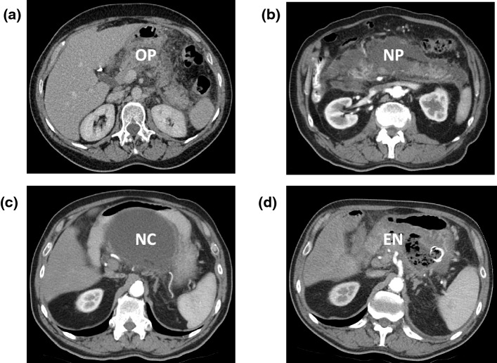
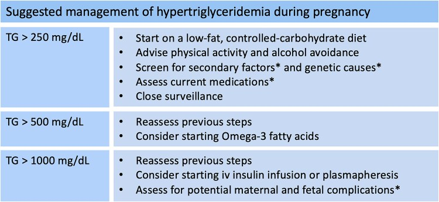
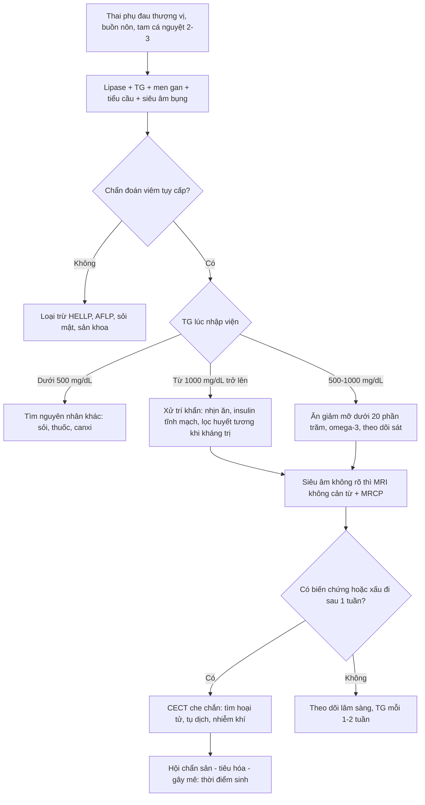
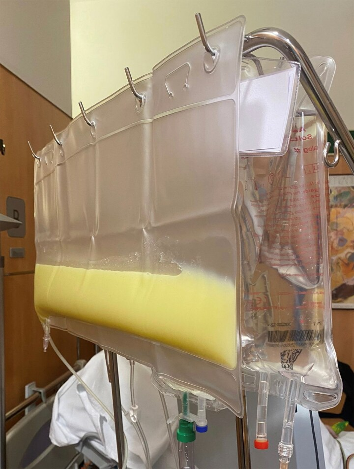
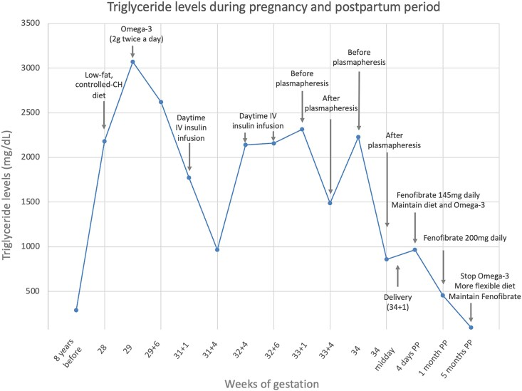

# 1796 — Chylomicronemia trong thai kỳ: tăng triglyceride, viêm tụy cấp & tư vấn sinh sản / Chylomicronemia in pregnancy — hypertriglyceridemia, acute pancreatitis and reproductive counselling

**Tags:** `pattern:viem-tuy` `pattern:hoai-tu` `vung:tuỵ` `score:Atlanta-2012` `score:Balthazar-CTSI` `protocol:MRI-khong-can-tu` `protocol:CECT`
**Mức chắc chắn (certainty):** tổng hợp y văn (literature synthesis) — ghép đoàn hệ 116 thai kỳ ở 49 phụ nữ chylomicronemia (PMC12819854), ca lâm sàng có hình ảnh học đầy đủ (PMC12596100), tổng quan về tăng triglyceride trong thai (PMC13194070) và tổng quan quản lý viêm tụy cấp kèm tiêu chuẩn hình ảnh (PMC9454414). Số nào nguồn không đưa thì ghi "chưa rõ".

> **Câu chốt:** thai kỳ **làm giảm hoạt tính LPL tới 85%** → TG tăng **100–300%**; ở người có chylomicronemia, **nguy cơ viêm tụy cấp tăng 30 lần (đa yếu tố) đến 120 lần (thể gia đình)** so với dân số chung. Điểm quyết định: **TG ≥ 11,3 mmol/L (1000 mg/dL) là ngưỡng nguy cơ cao phải xử trí khẩn**; trên hình ảnh, **đừng chờ hoại tử để chẩn đoán** — CECT chỉ có giá trị tìm hoại tử **sau ~1 tuần**, còn **MRI không cản từ** là lựa chọn ưu tiên khi cần chụp trong thai.

## 1. Tổng quan bệnh học – cơ chế hình ảnh

### 1.1 Vì sao thai kỳ "đẩy" triglyceride lên — và vì sao tụy bị viêm (TẠI SAO)

- **Sinh lý:** estrogen và lactogen nhau thai **ức chế hoạt tính lipoprotein lipase (LPL) tới 85%** → giảm thủy phân triglyceride (TG) trong chylomicron/VLDL; đồng thời gan **tăng sản xuất VLDL**. Kết quả: TG tăng **100–300%** so với trước thai, **gấp ~2,5 lần** vào cuối thai (PMC13194070, PMC12819854).
- **Vì sao người bình thường không viêm tụy:** TG mẹ bình thường cuối thai **hiếm khi vượt 300 mg/dL (3,3 mmol/L)** — dưới ngưỡng gây bệnh (PMC6942404). Chỉ khi có **nền chylomicronemia** (FCS — thể gia đình do đột biến LPL/APOC2/GPIHBP1/APOA5/LMF1, hoặc MCS — thể đa yếu tố kèm ĐTĐ/béo/suy giáp/rượu/thuốc) thì TG mới vượt **10 mmol/L** và gây bệnh.
- **Vì sao TG cao gây viêm tụy:** TG tích trong mao mạch tụy bị **lipase tụy** thủy phân → **acid béo tự do (FFA)** nồng độ cao, gây **độc tế bào nang tụy và nội mô mao mạch**; chylomicron gây **tắc mao mạch, thiếu máu cục bộ, toan** — toan lại hoạt hóa FFA thêm (vòng xoáy). Đây là lý do hình ảnh sớm thường chỉ là **phù tụy + dịch quanh tụy**, còn **hoại tử** xuất hiện muộn hơn, và **dịch quanh tụy giàu lipid** dễ bị bội nhiễm.
- **Vì sao "sữa" lại liên quan đến hình ảnh:** chylomicron là hạt lớn **tán xạ ánh sáng** → huyết tương đục như sữa (**lactescent/milky plasma**), và cùng cơ chế đó gây **nhiễu xét nghiệm**: **giả hạ natri** (pseudohyponatremia) và **amylase có thể bình thường lúc nhập viện** → **không loại trừ viêm tụy bằng amylase bình thường** (PMC6942404). Trên lâm sàng, hình ảnh và lipase quan trọng hơn.
- **Vì sao chẩn đoán hình ảnh khó trong thai:** tử cung lớn **đẩy tụy ra sau và lên cao**, ruột giãn hơi → **siêu âm thường không thấy đuôi tụy** ở cuối thai; **CT** nhạy với hoại tử nhưng có **bức xạ**; **MRI** tránh bức xạ nhưng cần **thời gian chụp dài** và trẻ mẹ khó nằm ngửa ở tam cá nguyệt 3.

### 1.2 Ngưỡng định lượng nằm lòng (bắt buộc nhớ)

| Chỉ số | Con số | Nguồn |
|---|---|---|
| TG tăng trong thai | **100–300%** so với trước thai; **~2,5 lần** cuối thai | PMC13194070; PMC12819854 |
| Hoạt tính LPL bị ức chế | **tới 85%** | PMC12819854 |
| TG mẹ bình thường cuối thai | **hiếm khi > 300 mg/dL (3,3 mmol/L)** | PMC6942404 |
| Tăng TG nhẹ / vừa / nặng | **150–500** / **500–1000** / **> 1000 mg/dL** (1,7–5,6 / 5,6–11,3 / > 11,3 mmol/L) | PMC9454414 |
| Chylomicronemia (định nghĩa TG rất cao) | **> 10 mmol/L (880 mg/dL)** | PMC12819854; PMC12677934 |
| Ngưỡng nguy cơ viêm tụy cao trong thai | **≥ 1000 mg/dL (11,3 mmol/L)** | PMC12596100; PMC6942404 |
| Tăng nguy cơ viêm tụy theo TG | **+4%** nguy cơ cho **mỗi 100 mg/dL** tăng thêm **trên 1000 mg/dL** | PMC9454414 |
| Viêm tụy cấp trong thai (dân số chung) | **< 0,35%**; tần suất **1/1000–1/10.000** | PMC12819854; PMC6942404 |
| FCS: có ≥ 1 cơn viêm tụy trong thai | **42% phụ nữ** (MCS: **10%**; P = 0,01) | PMC12819854 |
| Thai kỳ có viêm tụy | **17% (FCS) vs 5% (MCS)**; P = 0,02 | PMC12819854 |
| Nguy cơ so với dân số chung | **×30 (MCS)** đến **×120 (FCS)** | PMC12819854 |
| Sinh non | **56% phụ nữ FCS vs 19% MCS** (theo thai kỳ: **19,6% vs 6,2%**, P = 0,05); tuổi thai sinh non trung bình **33,7 ± 3,3 tuần** | PMC12819854 |
| Sảy thai / thai chậm phát triển | **11,8% vs 10,7%** / **5,9% vs 9,2%** — không khác biệt | PMC12819854 |
| Thai chết sau cơn viêm tụy cấp | **2 ca** trong 116 thai kỳ | PMC12819854 |
| TG trước mang thai báo hiệu nguy cơ | **> 4 mmol/L** → phải coi là có nguy cơ viêm tụy | PMC12819854 |
| Siêu âm bụng phát hiện sỏi ống mật chủ | độ nhạy **73%**, độ đặc hiệu **91%** | PMC9737239 |
| CT phát hiện sỏi ống mật chủ | độ nhạy **72–78%**, độ đặc hiệu **96%** | PMC9737239 |
| MRI/MRCP phát hiện sỏi ống mật chủ | độ chính xác **> 90%** | PMC9737239 |
| Thời điểm CECT để thấy hoại tử | **không sớm hơn ~1 tuần** sau khởi phát (hoại tử cần vài ngày mới hiện) | PMC9454414 |
| Chỉ định CECT khi xấu đi | **CRP ≥ 150 mg/L**, bạch cầu tăng dai dẳng, suy cơ quan | PMC9454414 |
| Chế độ ăn giảm mỡ | **< 20%** năng lượng; thể nặng **< 10%** | PMC13194070 |
| Omega-3 (EPA + DHA) | **≥ 2–4 g/ngày** → giảm TG **20–40%** | PMC13194070 |
| Thuốc ApoC-III mới (olezarsen/volanesorsen/plozasiran) | giảm TG **40–70%**; **chưa có dữ liệu an toàn thai**; olezarsen **không khuyến nghị** | PMC13194070 |
| Ca minh họa | thai 28 tuần, **TG 2184 mg/dL (24,68 mmol/L)**; lọc huyết tương tuần 33; sinh **34+1 tuần** | PMC12596100 |

## 2. Mẫu hình + chẩn đoán phân biệt theo vị trí (gamut)

**Mẫu hình cần nhận ra:** thai phụ **tam cá nguyệt 2–3** (hoặc **sớm sau sinh**) đau **thượng vị lan ra sau lưng**, buồn nôn, **TG rất cao** — thường **đã biết rối loạn lipid hoặc ĐTĐ/suy giáp/béo** — siêu âm bụng **không thấy sỏi**, tụy **phù to, giảm âm, dịch quanh tụy**; CT/MRI: **phù tụy lan tỏa + dịch quanh tụy**, muộn hơn có **hoại tử không ngấm thuốc**.

**Gamut theo vị trí và bối cảnh (mnemonic "TỤY – MẬT – GAN–MÁU – SẢN"):**

1. **TỤY (pancreas):** **tăng TG** (chủ đề bài này), **sỏi mật/bùn mật** (nguyên nhân hay nhất nói chung), rượu (hiếm ở thai), **tăng canxi do cường tuyến cận giáp**, thuốc; **viêm tụy tự miễn** rất hiếm.
2. **MẬT (biliary):** viêm túi mật cấp, sỏi ống mật chủ, **hội chứng sau ERCP** — siêu âm + MRCP là chốt.
3. **GAN – MÁU (hepatobiliary/haematologic):** **HELLP**, **gan nhiễm mỡ cấp trong thai (acute fatty liver of pregnancy — AFLP)**, **tiền sản giật** — đau thượng vị + tăng men gan + giảm tiểu cầu; **không** có tụy phù.
4. **SẢN (obstetric):** **nhau bong non**, **vỡ tử cung**, **xoắn phần phụ**, **thai ngoài tử cung vỡ** — siêu âm sản khoa trước, không được bỏ qua khi đau bụng cấp ở thai phụ.

**Vì sao gamut quan trọng hơn chẩn đoán đơn thuần:** trong loạt 32 ca viêm tụy cấp ở thai tại Bắc Kinh, **tăng TG là nguyên nhân hay nhất (56,2%)**, sỏi mật **28,1%** — ngược với dân số chung nơi sỏi mật chiếm ưu thế (PMC9115992). Ở thai phụ đau thượng vị, **hai nguyên nhân này phải loại trừ song song**.

## 3. Bảng so sánh phân biệt (ma trận đối chiếu)

| Thực thể (entity) | Hình ảnh điển hình | Chốt vào (rule-in) | Chốt loại (rule-out) | Gợi ý xác nhận |
|---|---|---|---|---|
| **Viêm tụy cấp do tăng TG** | Tụy **phù to, giảm âm/giảm ngấm thuốc lan tỏa**, **dịch quanh tụy**; muộn: **hoại tử không ngấm thuốc**, tụ dịch | **TG ≥ 1000 mg/dL + đau thượng vị điển hình + tụy phù/dịch quanh tụy** | TG bình thường, có **sỏi ống mật chủ** hoặc **túi mật thành dày** → nguyên nhân mật | Lipase, TG, siêu âm → MRCP; CECT sau ~1 tuần nếu xấu |
| **Viêm tụy do sỏi mật** | Tụy phù + **giãn ống mật chủ**, sỏi/bùn trong túi mật hoặc ống mật | **Sỏi/bùn + ống mật chủ giãn + men gan tăng kiểu tắc mật** | Không sỏi, TG rất cao → nghĩ tăng TG | Siêu âm (Se 73%/Sp 91%), MRCP (> 90%), EUS |
| **HELLP** | Gan **bình thường hoặc phù nhẹ**, có thể **tụ máu dưới bao gan**; **không có dịch quanh tụy** | **Tiểu cầu thấp + LDH cao + AST/ALT cao + tan máu + huyết áp cao** | Tụy phù rõ + TG cao + tiểu cầu bình thường → không phải HELLP | Xét nghiệm máu, theo dõi sản khoa |
| **Gan nhiễm mỡ cấp trong thai** | Gan **giảm đậm độ lan tỏa** trên CT/US, **không có tổn thương tụy**; có thể cổ trướng | **Hạ đường huyết + rối loạn đông máu + bệnh não gan + vàng da ở tam cá nguyệt 3** | TG rất cao + tụy phù + đường huyết bình thường → không phải AFLP | Xét nghiệm gan–đông máu, siêu âm; chẩn đoán chủ yếu lâm sàng |
| **Viêm túi mật cấp** | Túi mật **căng, thành dày > 3 mm**, sỏi, **dấu Murphy siêu âm**, dịch quanh túi mật | **Thành túi mật dày + sỏi + điểm đau khu trú hạ sườn phải** | Tụy phù + dịch quanh tụy + TG cao → không phải viêm túi mật đơn thuần | Siêu âm; MRI nếu nghi biến chứng |
| **Loét dạ dày thủng** | **Khí tự do dưới hoành** trên X-quang/CT; không có dịch quanh tụy | **Khí tự do + đề kháng thành bụng** | Không khí tự do, có phù tụy → loại | X-quang bụng đứng, CT |
| **Nhiễm toan ceton do ĐTĐ** | Không có tổn thương tụy đặc hiệu; có thể **phù tụy nhẹ do tăng TG kèm** | **Đường huyết rất cao + ceton + toan chuyển hóa** | TG rất cao nhưng không toan ceton → viêm tụy là chính | Khí máu, ceton máu/nước tiểu |
| **Nhau bong non / vỡ tử cung** | Siêu âm: **khối máu sau nhau**, bánh nhau bong; **dịch ổ bụng**; tử cung co cứng | **Đau bụng + ra máu âm đạo + suy thai cấp** | Tử cung và bánh nhau bình thường, tụy phù → loại | Siêu âm sản khoa, monitoring thai |

*Hình 5 — (a) **OP** — viêm tụy phù đơn thuần: tụy ngấm thuốc đồng nhất, dịch quanh tụy ít. (b) **NP** — hoại tử tụy: vùng tụy **không ngấm thuốc** (tối), bờ không đều. (c) **NC** — tụ dịch hoại tử: ổ dịch lớn, dày thành, chứa mảnh mô hoại tử. (d) **EN** — hoại tử **nhiễm khí**: các **bóng khí** trong vùng hoại tử (mũi tên) — dấu hiệu nhiễm trùng, cần can thiệp. Nguồn: *Drugs* 2022 (PMC9454414), **CC BY-NC 4.0** — nguyên bản, không crop.*

## 4. Protocol chụp + hệ phân độ & chiến lược xử trí

**Chụp gì trong thai (thứ tự leo thang):**

1. **Siêu âm bụng** đầu tay: túi mật, sỏi/bùn, ống mật chủ, dịch quanh tụy — **Se 73% / Sp 91%** cho sỏi ống mật chủ, nhưng **hạn chế ở cuối thai/béo/nhiều hơi** (PMC9737239).
2. **MRI bụng không cản từ** (T2 HASTE/SSFSE, T1 fat-sat, DWI, **MRCP**) khi siêu âm không kết luận: độ chính xác **> 90%** cho sỏi ống mật chủ, thấy **phù tụy, dịch quanh tụy, tụ dịch** (PMC9737239); ưu tiên vì **không bức xạ**.
3. **CECT** chỉ khi **thay đổi quyết định điều trị** (nghi hoại tử nhiễm trùng, biến chứng mạch máu, không rõ chẩn đoán) — **che chắn bụng**, hạn chế số thì; **không dùng CECT sớm để "tìm hoại tử"** vì **hoại tử cần ~1 tuần mới thấy rõ** (PMC9454414).
4. **X-quang ngực/bụng đứng** khi nghi thủng tạng hoặc tràn dịch/ARDS; **không** thay thế CT/MRI cho tụy.

**Phân độ (bắt buộc ghi trong báo cáo):**

- **Revised Atlanta 2012:** **nhẹ** (không suy cơ quan, không biến chứng tại chỗ) — **trung bình nặng** (suy cơ quan **< 48 giờ** và/hoặc biến chứng tại chỗ) — **nặng** (suy cơ quan **> 48 giờ**).
- **Balthazar CTSI / MCTSI** trên CECT: điểm theo **mức viêm tụy + hoại tử + tụ dịch**; CTSI > 7 gắn với tỷ lệ biến chứng và tử vong cao.
- **Mốc thời gian của biến chứng:** **< 4 tuần** = tụ dịch quanh tụy cấp (APFC) / tụ dịch hoại tử cấp (ANC); **> 4 tuần** = **pseudocyst** (không có mô đặc) / **walled-off necrosis (WON)** (có mô hoại tử) — đọc sai mốc này dẫn tới can thiệp sai thời điểm.

*Hình 3 — Phác đồ đề xuất theo **ba ngưỡng**: **TG > 250 mg/dL** → bắt đầu **ăn giảm mỡ, giảm carbohydrat kiểm soát**, vận động, tránh rượu, **sàng lọc nguyên nhân thứ phát và biến thể gen** (LPL, ApoC-II, ApoA-V, ApoE, GPIHBP1), rà soát thuốc đang dùng; **TG > 500 mg/dL** → xem lại các bước trên + **cân nhắc omega-3**; **TG > 1000 mg/dL** → xem lại + **cân nhắc insulin tĩnh mạch hoặc lọc huyết tương** + **đánh giá biến chứng mẹ và thai**. Đây là phác đồ của nhóm tác giả (ca bệnh), không phải hướng dẫn quốc tế. Nguồn: Raventós A et al., JCEM Case Rep 2025 (PMC12596100), **CC BY-NC-ND 4.0** — nguyên bản.*

**Chiến lược xử trí (theo nguồn):**

- **Mục tiêu TG:** giữ **< 1000 mg/dL (11,3 mmol/L)** trong suốt thai; ở FCS theo dõi **mỗi 4 tuần** đầu thai và **mỗi 1–2 tuần** khi thai lớn (PMC13194070).
- **Ăn uống:** giảm mỡ **< 20%** năng lượng (nặng: **< 10%**), đủ acid béo thiết yếu và vitamin tan trong mỡ; **omega-3 ≥ 2–4 g/ngày** giảm TG **20–40%** (PMC13194070).
- **Thuốc:** **fenofibrate** có thể dùng **sau tam cá nguyệt 1** (PMC13194070); statin không dùng thường quy; **insulin tĩnh mạch** khi TG rất cao/ĐTĐ; **các thuốc ApoC-III (olezarsen, volanesorsen, plozasiran) chưa có dữ liệu an toàn thai** — chỉ dùng trong nghiên cứu/ca đặc biệt (PMC13194070, PMC12677934).
- **Lọc huyết tương (therapeutic plasma exchange — TPE):** khi **TG rất cao + đau bụng/nguy cơ viêm tụy cấp cận kề** hoặc **không đáp ứng ăn+insulin**; hiệu quả hạ TG nhanh và an toàn trong thai theo loạt ca (PMC13583583), nhưng **không có bằng chứng giảm tử vong** so với điều trị nội khoa (PMC6942404) — chỉ định theo **nguy cơ, không theo con số đơn thuần**.
- **Thời điểm sinh:** quyết định **đa chuyên khoa**; ưu tiên **sinh đường âm đạo** nếu không có chỉ định sản khoa; trong đoàn hệ, **59% ca FCS được khởi phát chuyển dạ** so với 26% MCS (P = 0,029) (PMC12819854). Sau sinh **TG vẫn có thể cao** — tiếp tục theo dõi và **tránh estrogen liều cao** (thuốc tránh thai phối hợp) khi TG chưa kiểm soát (PMC12596100).

*Hình 1 — Túi dịch lấy ra trong lọc huyết tương ở tam cá nguyệt 3: **lớp huyết tương đục như sữa** do chylomicron — tương ứng TG máu **trên 2000 mg/dL**. Đây là hình ảnh "tại giường" giải thích vì sao TG cao gây **nhiễu xét nghiệm** và vì sao huyết tương được thay bằng lọc. Nguồn: Raventós A et al., JCEM Case Rep 2025 (PMC12596100), **CC BY-NC-ND 4.0** — nguyên bản.*

## 5. Biến thể bình thường và cạm bẫy

- **Cạm bẫy 1 — loại trừ viêm tụy vì amylase bình thường:** trong tăng TG, **amylase có thể trong giới hạn bình thường lúc nhập viện** (PMC6942404) và bị **nhiễu do huyết tương đục**. Dùng **lipase** + hình ảnh; đừng dựa vào amylase.
- **Cạm bẫy 2 — chờ hoại tử trên CT sớm:** CECT trong **48–72 giờ đầu** thường **chỉ thấy phù**, dễ kết luận "nhẹ" rồi bỏ theo dõi. Hoại tử cần **~1 tuần** mới rõ; chụp sớm chỉ để **chẩn đoán phân biệt**, không để phân độ (PMC9454414).
- **Cạm bẫy 3 — đọc tụ dịch sai mốc 4 tuần:** **< 4 tuần** là tụ dịch cấp (APFC/ANC) — **chưa can thiệp** trừ khi nhiễm trùng/chèn ép; **> 4 tuần** mới thành pseudocyst/WON. Can thiệp sớm vào ổ dịch cấp làm tăng biến chứng.
- **Cạm bẫy 4 — TG "bình thường" sau khi nhịn ăn:** TG **giảm nhanh sau vài ngày nhịn ăn**, nên xét nghiệm muộn có thể **che mất nguyên nhân tăng TG** (PMC6942404). Hỏi lại TG lúc nhập viện/phòng khám trước đó, hoặc mẫu huyết tương lưu.
- **Cạm bẫy 5 — bỏ sót HELLP/AFLP vì "đã có nguyên nhân tụy":** đau thượng vị + tăng men gan ở thai phụ có thể là **HELLP** hoặc **AFLP** đồng thời; kiểm **tiểu cầu, LDH, đường huyết, đông máu** — không chỉ lipase.
- **Cạm bẫy 6 — siêu âm bình thường ở cuối thai:** tử cung lớn che tụy; **siêu âm bình thường không loại trừ viêm tụy** — chuyển MRI/MRCP.
- **Cạm bẫy 7 — giả hạ natri:** huyết tương đục làm **natri đo thấp giả**; đừng truyền natri ưu trương theo con số giả (PMC12596100, phần bàn luận nhiễu xét nghiệm).
- **Biến thể bình thường:** **tụy thoái hóa mỡ** ở người béo (giảm đậm độ lan tỏa, không có dịch quanh tụy) và **phù tụy nhẹ sau ăn nhiều mỡ** trên MRI — không kèm đau thì không gọi viêm tụy.

*Hình 2 — TG (mg/dL) từ trước thai đến 5 tháng sau sinh: đỉnh **~3000 mg/dL ở 28–29 tuần** dù đã ăn giảm mỡ; **insulin tĩnh mạch** ban ngày kéo xuống ~1700 rồi ~1000; **lọc huyết tương** ở 33+1 và 33+4 tuần hạ nhanh về ~1500 rồi ~900; **sinh 34+1 tuần**; sau sinh dùng **fenofibrate** và ngừng omega-3 → TG về bình thường. Đọc bảng này để thấy **mỗi can thiệp chỉ "hạ bậc", không chữa khỏi** — cần lặp lại và theo dõi. Nguồn: PMC12596100, **CC BY-NC-ND 4.0**.*

## 6. Tự lượng giá — Blind Quiz ngay trên trang tĩnh

**Ca 1 — Thai phụ 36 tuổi, 28 tuần, đau thượng vị 2 ngày, không sỏi mật trên siêu âm. TG 2184 mg/dL. Ảnh chụp túi dịch sau một thủ thuật:**

- Câu hỏi: (1) Dịch trong túi là gì và vì sao đục? (2) Với TG 2184 mg/dL, nguy cơ chính là gì và ngưỡng nào buộc xử trí khẩn? (3) Thủ thuật này chỉ định khi nào?

<b>Bấm để hiện đáp án (findings + chẩn đoán)</b>

- **Findings:** **huyết tương đục như sữa** — lớp chylomicron lơ lửng; tương ứng TG **2184 mg/dL (24,68 mmol/L)**.
- **Chẩn đoán:** **chylomicronemia nặng trong thai** với **viêm tụy cấp do tăng TG** (đau thượng vị + TG rất cao + không sỏi).
- **Nguy cơ & ngưỡng:** TG **≥ 1000 mg/dL (11,3 mmol/L)** = nguy cơ cao viêm tụy, phải xử trí khẩn; mỗi **+100 mg/dL trên 1000** tăng **4%** nguy cơ (PMC9454414). Nguy cơ viêm tụy ở FCS khi mang thai **gấp 120 lần** dân số chung (PMC12819854).
- **Thủ thuật:** **lọc huyết tương (TPE)** — chỉ định khi TG rất cao kèm nguy cơ/đang viêm tụy và **không đáp ứng ăn giảm mỡ + insulin**; trong ca này làm ở **33 tuần**, sau đó sinh **34+1 tuần**.
- **Nguồn ảnh:** Raventós A et al., JCEM Case Rep 2025 (PMC12596100), **CC BY-NC-ND 4.0**.

**Ca 2 — Bốn bệnh nhân viêm tụy cấp, CECT sau 1 tuần. Nhìn 4 ảnh trước khi mở đáp án:**

- Câu hỏi: (1) Gọi tên (a)–(d). (2) Ảnh nào bắt buộc can thiệp/kháng sinh? (3) Vì sao không nên chụp CECT này trong 48 giờ đầu?

<b>Bấm để hiện đáp án (findings + chẩn đoán)</b>

- **(a) OP:** viêm tụy **phù đơn thuần**, tụy ngấm thuốc đồng nhất. **(b) NP:** **hoại tử tụy** — vùng không ngấm thuốc, bờ không đều. **(c) NC:** **tụ dịch hoại tử** — ổ dịch dày thành chứa mô hoại tử. **(d) EN:** **hoại tử nhiễm khí** — bóng khí trong vùng hoại tử.
- **Bắt buộc can thiệp:** **(d) EN** (nhiễm trùng hoại tử: kháng sinh + dẫn lưu/necrosectomy theo bước); **(c)** cần theo dõi và can thiệp nếu nhiễm trùng/chèn ép.
- **Vì sao không chụp sớm:** hoại tử **cần vài ngày đến ~1 tuần** mới biểu hiện; CECT sớm chỉ thấy phù → **đánh giá thấp** độ nặng (PMC9454414).
- **Nguồn ảnh:** *Drugs* 2022 (PMC9454414), **CC BY-NC 4.0**.

**Ca 3 — Diễn giải đường cong TG (dùng hình 2 ở mục 5):** thai phụ FCS, TG 3000 mg/dL ở 29 tuần dù ăn giảm mỡ; đề nghị "chờ đến 37 tuần rồi mổ lấy thai".

- Câu hỏi: (1) Vì sao không nên chờ? (2) Can thiệp nào có thể làm trước? (3) Sau sinh cần gì?

<b>Bấm để hiện đáp án (findings + chẩn đoán)</b>

- **Không chờ:** TG đỉnh ở **tam cá nguyệt 3** và nguy cơ viêm tụy tăng theo TG; trong đoàn hệ, **42% phụ nữ FCS có ≥ 1 cơn viêm tụy khi mang thai**, **2 thai chết sau cơn viêm tụy**, sinh non trung bình **33,7 tuần** (PMC12819854). Chờ 37 tuần là **phơi nhiễm nguy cơ cao nhất** mà không thêm lợi ích.
- **Trước:** ăn giảm mỡ **< 10–20%**, omega-3 **2–4 g/ngày**, **insulin tĩnh mạch** nếu TG rất cao/ĐTĐ, **lọc huyết tương** khi kháng trị; theo dõi TG **1–2 tuần/lần**; hội chẩn sản–tiêu hóa–gây mê để chọn thời điểm sinh.
- **Sau sinh:** tiếp tục **fenofibrate** (được phép sau tam cá nguyệt 1, và sau sinh), theo dõi TG, **tránh estrogen liều cao**, tư vấn **kế hoạch hóa gia đình** và **sàng lọc gia đình** (FCS là bệnh lặn — tư vấn di truyền trước lần mang thai sau).
- **Nguồn số liệu:** PMC12819854, PMC13194070, PMC12596100.

## Bài liên quan chéo
- [683 – Điều trị tăng triglyceride kháng trị & dự phòng tái phát viêm tụy](../683-tang-triglyceride-khang-tri-o-tre/lesson.md)
- [684 – Tăng triglyceride do asparaginase trong ALL nhi](../684-tang-triglyceride-asparaginase-all-nhi/lesson.md)
- [628 – Viêm tụy tăng triglyceride ở trẻ](../628-viem-tuy-tang-triglyceride-o-tre/lesson.md)
- [551 – Bệnh nguyên bào nuôi thai kỳ (GTD)](../551-benh-nguyen-bao-nuoi-thai-ky/lesson.md)
- [532 – U xơ trong thai kỳ & thoái triển đỏ](../532-u-xo-trong-thai-ky-thoai-trien-do/lesson.md)
- [553 – Đảo ngược tử cung do sinh](../553-dao-nguoc-tu-cung-do-sinh/lesson.md)
- [500 – Tổng quan Vú & Sản phụ khoa](../500-tong-quan-vu-san-phu-khoa/lesson.md)

## Ảnh
- `1796_huyet-tuong-sua-sau-loc-huyet-tuong_Anh_PMC12596100-Fig1.jpg` — Raventós A et al., JCEM Case Rep 2025 (PMC12596100), **CC BY-NC-ND 4.0**.
- `1796_tg-theo-thai-ky_bieu-do_PMC12596100-Fig2.jpg` — cùng bài, **CC BY-NC-ND 4.0**.
- `1796_phac-do-xu-tri_bieu-do_PMC12596100-Fig3.jpg` — cùng bài, **CC BY-NC-ND 4.0** (phác đồ của nhóm tác giả; xem `images/CREDITS.md`).
- `1796_viem-tuy-hoai-tu-so-voi-phu_ne-CECT_PMC9454414-Fig5.jpg` — *Drugs* 2022 (PMC9454414), **CC BY-NC 4.0**.
- Chi tiết nguồn/giấy phép từng ảnh: `images/CREDITS.md`.

> Không dùng để chẩn đoán độc lập khi chưa có người hướng dẫn.
