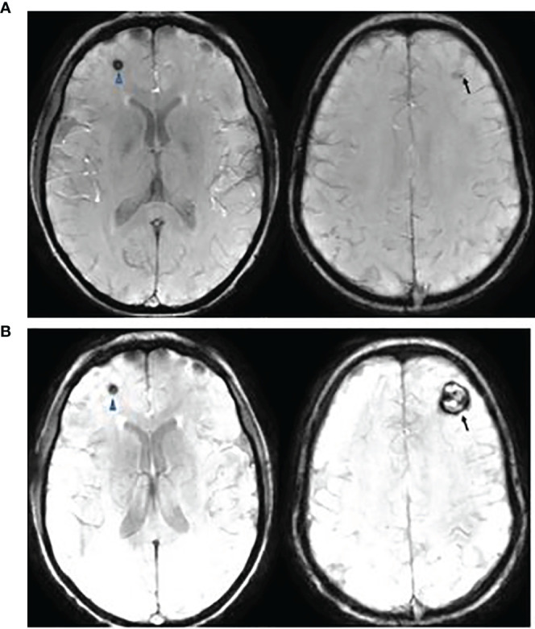
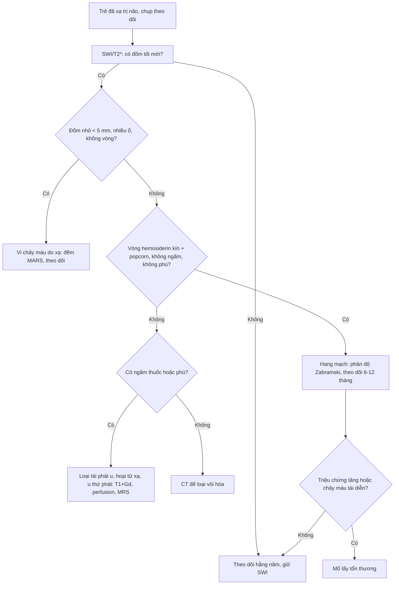
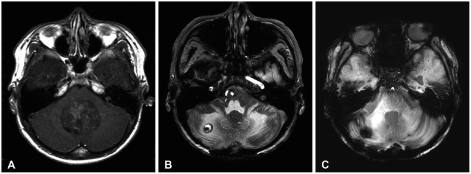
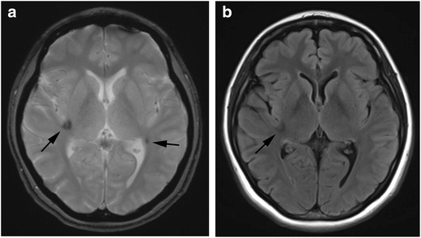
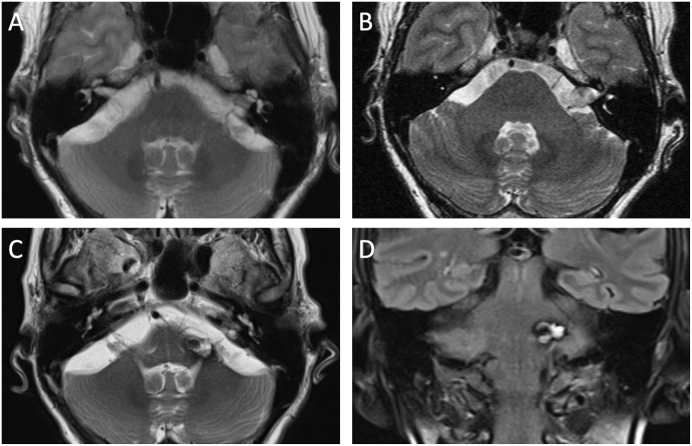

# 1797 — Vi chảy máu & hang mạch do xạ trị sọ ở trẻ: đọc SWI sau xạ, phân biệt tái phát u / *Radiation-induced cerebral microbleeds and cavernomas in children*

**Tags:** `pattern:vi-chay-mau` `pattern:hang-mach` `vung:nao-nhi` `score:Zabramski` `score:MARS` `protocol:SWI-3T`
**Mức chắc chắn (certainty):** tổng hợp y văn (literature synthesis) — ghép 1 đoàn hệ 79 trẻ medulloblastoma so sánh proton–photon (Front Oncol 2021, PMC8542782, CC BY 4.0), 1 đoàn hệ 190 trẻ u não nguyên phát (J Neurol Sci 2017, PMID 27856004 — chỉ trích số liệu), 2 đoàn hệ 59 và 171 trẻ (J Neurosurg Pediatr 2006, PMID 16506497; Strahlenther Onkol 2008, PMID 18427759 — chỉ trích số liệu), 1 nghiên cứu SWI–FLAIR ở người lớn sau xạ (Res Diagn Interv Imaging 2023, PMC11265380, CC BY 4.0), 2 ca RICM (Brain Tumor Res Treat 2025, PMC12070075, CC BY-NC 4.0; Brain Spine 2026, PMC12972701, CC BY 4.0) và 1 tổng quan hình ảnh biến chứng thần kinh ở trẻ ung thư (Insights Imaging 2018, PMC5991004, CC BY 4.0).

> **Bài này trả lời 4 câu hỏi của lần chụp theo dõi "bình thường" ở trẻ đã xạ trị não:**
> (1) **SWI có đốm tối mới — vi chảy máu do xạ hay di căn/chảy máu khác?** (2) **Đốm đó tiến triển thành hang mạch thật không, và bao lâu?** (3) **Khi nào mổ, khi nào chỉ theo dõi?** (4) **Một khối mới ngấm thuốc trong trường chiếu là hang mạch, hoại tử xạ hay u thứ phát?**
> Nối [1795 – Vi chảy máu trong moyamoya](../1795-xuat-huyet-vi-chay-mau-moyamoya-o-tre/lesson.md) (cơ chế **huyết động**, không phải xạ), [204 – Hoại tử phóng xạ](../204-hoai-tu-phong-xa-sau-xa-tri-u-nao/lesson.md), [261 – Bệnh não chất trắng do xạ](../261-benh-nao-chat-trang-do-xa-tri/lesson.md), [268 – Bệnh tủy do xạ](../268-benh-tuy-do-xa-tri/lesson.md).

## 1. Tổng quan bệnh học – cơ chế hình ảnh

### 1.1 Vì sao xạ trị tạo ra "đốm tối" rồi "hang mạch"

- **Tổn thương nội mạc vi mạch do xạ:** tia ion hóa gây chết tế bào nội mạc, dày màng đáy, huyết khối vi mạch và **giãn mao mạch (telangiectasia)**. Các mạch giãn thành mỏng, không có nhu mô thần kinh xen giữa, dòng chảy chậm, áp lực thấp → **cavernoma** (hang mạch). Máu rỉ qua thành mạch → **hemosiderin** lắng đọng quanh tổn thương.
- **TẠI SAO SWI/T2\* thấy được mà T2/FLAIR bỏ sót:** hemosiderin và deoxyhemoglobin là chất **thuận từ (paramagnetic)** — làm lệch từ trường cục bộ, tạo **hiệu ứng cảm ứng từ** lan rộng hơn tổn thương thật (**blooming artifact**). Chuỗi gradient-echo (GRE) và đặc biệt **SWI với ảnh minIP** nhạy với hiệu ứng này, phát hiện được ổ chảy máu **< 5–10 mm** mà T2/FLAIR chỉ thấy như "sạch". Đây là lý do **bắt buộc có SWI/T2\*** trong mọi lần chụp theo dõi sau xạ não.
- **TẠI SAO vòng hemosiderin hoàn chỉnh lại quan trọng:** hang mạch có **vòng hemosiderin bao quanh toàn chu vi** (sản phẩm của nhiều đợt vi chảy máu), bên trong là "popcorn" tín hiệu hỗn hợp do máu ở các tuổi khác nhau (T1/T2 lẫn lộn: methemoglobin sáng T1, hemosiderin tối T2). U/di căn không có kiến trúc "popcorn + vòng hoàn chỉnh" và thường **ngấm thuốc + có phù**.
- **TẠI SAO tổn thương không nằm đúng "trường chiếu"**: xạ làm tổn thương **vi mạch lan tỏa** toàn não (nhất là sau xạ toàn não), nên chỉ **15,8–19,8%** tổn thương trùng khớp vùng chiếu xạ khu trú — đừng loại trừ vì "ngoài trường chiếu".

### 1.2 Ngưỡng định lượng nằm lòng (bắt buộc nhớ)

| Đại lượng | Con số | Nguồn |
|---|---|---|
| Trẻ medulloblastoma sau xạ có CM/CM-like trên GRE/SWI | **86,1% (68/79)**; photon **86,7% (26/30)**, proton **85,7% (42/49)** | PMC8542782 |
| Thời gian xuất hiện CM | photon **40,2 tháng** vs proton **18,2 tháng** (P = 1,98 × 10⁻⁴) | PMC8542782 |
| Loại tổn thương lần đầu | **Zabramski type IV (đốm, chỉ thấy trên GRE/SWI): 93,6% (59/63)** | PMC8542782 |
| Phát hiện bằng chuỗi nào | GRE **29,8 tháng** vs SWI **23,7 tháng** sau xạ | PMC8542782 |
| Cần mổ | **3/79** (1 photon, 2 proton); không khác giữa 2 phương thức | PMC8542782 |
| Tích lũy CM sau xạ (59 trẻ medulloblastoma) | **5,6% / 14% / 43%** ở **3 / 5 / 10 năm**; 31% có tổn thương | PMID 16506497 |
| Tích lũy CM sau xạ (171 trẻ) | **2,24% / 3,86% / 4,95% / 6,74%** ở **5 / 10 / 15 / 20 năm**; tiềm tàng **2,9–18,4 năm** | PMID 18427759 |
| Tuổi lúc xạ < 10 | **nguy cơ cao hơn, tiềm tàng ngắn hơn (P = 0,044)** | PMID 18427759 |
| Lắng đọng hemosiderin khu trú (FHD) | **41,6%** nhóm có xạ (n = 132) vs **0%** nhóm không xạ (n = 58) | PMID 27856004 |
| Yếu tố nguy cơ FHD | tuổi nhỏ **P = 0,031**; thời gian theo dõi **P = 0,010**; mô học **embryonal P = 0,003** | PMID 27856004 |
| Trùng khớp vị trí với trường chiếu | chỉ **15,8%** (xạ khu trú) và **19,8%** (xạ toàn não + khu trú) | PMID 27856004 |
| Nguy cơ chảy máu của cavernoma | **0,7–1,1%/tổn thương/năm** khi chưa chảy máu; **~4,5%/năm** khi đã chảy máu | StatPearls 2023 (tổng quan) |
| Vi chảy máu (CMB) sau xạ | 28/51 lần chụp có CMB; **số CMB tăng theo thời gian, không theo liều**; **không trùng FLAIR** trong 7 năm đầu | PMC11265380 |

## 2. Mẫu hình + chẩn đoán phân biệt theo vị trí (gamut)

**Mẫu hình A — đốm tối đơn độc hoặc rải rác trên SWI trong vùng đã xạ:**
- **Vi chảy máu do xạ (CMB)** → đốm **< 5 mm**, không vòng, không phù, không ngấm; nhiều đốm theo thời gian.
- **Hang mạch type IV (dot-like)** → đốm **5–10 mm** chỉ thấy trên GRE/SWI, có thể lớn dần thành type II.
- **Di căn chảy máu** (melanoma, choriocarcinoma, thyroid, RCC) → thường **ngấm thuốc, phù, lớn nhanh**, bệnh cảnh ung thư nguyên phát.
- **Vôi hóa** → cũng "blooming" trên SWI; phân biệt bằng **CT (tăng đậm độ)**, không có vòng hemosiderin trên T2.

**Mẫu hình B — khối "popcorn" có vòng hemosiderin, thùy não hoặc hố sau:**
- **Hang mạch do xạ (type I–III)** → vòng hoàn chỉnh, không phù (trừ khi vừa chảy máu), **không/ngấm rất ít**.
- **Hoại tử xạ** → tiềm tàng **6–24 tháng**, bờ "bong bóng xà phòng", ngấm viền, phù, giảm tưới máu.
- **U thứ phát do xạ** (meningioma, sarcoma, RIT) → khối **ngấm thuốc mạnh**, lớn dần, tiềm tàng nhiều năm.
- **Tái phát u** → ngấm thuốc + phù + choán chỗ, DWI có thể hạn chế (u đặc).

**Mẫu hình C — nhiều tổn thương + bất thường mạch nuôi:**
- **DVA (developmental venous anomaly)** → "caput medusae" ngấm thuốc, thường **đi kèm** hang mạch; **không cắt bỏ DVA** (nguy cơ nhồi máu tĩnh mạch).
- **AVM** → flow void lớn, động mạch nuôi rõ; khác hang mạch (không có shunt).

**Gamut theo vị trí:** thùy trán/đỉnh (hay gặp nhất, trong trường chiếu), nhân xám–bao trong, **thân não/tiểu não** (vùng boost trong medulloblastoma — nguy cơ chảy máu và di chứng cao hơn).

## 3. Bảng so sánh phân biệt (ma trận đối chiếu)

| Thực thể (entity) | Hình ảnh điển hình | Chốt vào (rule-in) | Chốt loại (rule-out) | Gợi ý xác nhận |
|---|---|---|---|---|
| **Hang mạch do xạ (Zabramski I–III)** | "Popcorn" tín hiệu hỗn hợp, **vòng hemosiderin hoàn chỉnh**, blooming mạnh trên SWI, **không phù, không ngấm** | **Vòng hemosiderin kín + popcorn + trong vùng đã xạ + không ngấm** | Ngấm thuốc đáng kể + phù lan rộng → không phải hang mạch đơn thuần | SWI + T1+Gd; so ảnh cũ thấy lớn chậm qua nhiều năm |
| **Hang mạch type IV (dot-like)** | Đốm **5–10 mm** chỉ thấy trên GRE/SWI, T1/T2 bình thường | **Chỉ dương trên SWI/GRE + không ngấm + không phù** | Thấy rõ trên T1/T2 và ngấm thuốc → u/di căn | SWI 3T; theo dõi 6–12 tháng |
| **Vi chảy máu do xạ (CMB)** | Đốm **< 5 mm**, nhiều ổ, rải rác, không vòng | **Nhiều đốm nhỏ + tăng dần theo thời gian sau xạ** | Một ổ đơn độc > 10 mm có vòng → hang mạch thật | SWI minIP; đếm theo MARS |
| **Tái phát u** | Khối ngấm thuốc, phù, choán chỗ, lớn nhanh | **Ngấm thuốc + phù + lớn dần + DWI hạn chế** | Không ngấm, không phù, ổn định nhiều năm → không phải tái phát | T1+Gd, DWI, MRS/perfusion |
| **Hoại tử xạ** | Bờ "bong bóng", ngấm viền, phù, **6–24 tháng sau xạ** | **Tiềm tàng 6–24 tháng + ngấm viền + giảm tưới máu** | Tiềm tàng > 3 năm, vòng hemosiderin kín → hang mạch | Perfusion/DSC, MRS (không có choline cao) |
| **U thứ phát do xạ** | Khối ngấm thuốc mạnh, xương/vỏ não, tiềm tàng nhiều năm | **Ngấm mạnh + lớn liên tục + ngoài mô u cũ** | Ổn định, không ngấm → không phải u | T1+Gd, CT xương, sinh thiết khi nghi |
| **Vôi hóa** | Tăng đậm độ trên CT, blooming trên SWI, không vòng | **CT tăng đậm độ + không vòng hemosiderin** | Có vòng hemosiderin + popcorn → hang mạch | CT không cản quang |
| **DVA đi kèm** | "Caput medusae" ngấm thuốc, tĩnh mạch dẫn lưu | **Ngấm hình nan hoa + tĩnh mạch dẫn lưu** | Không có mạch nuôi → không phải DVA | T1+Gd; **không cắt DVA** |

*Bệnh nhân nữ 20 tuổi, medulloblastoma xạ proton lúc 10 tuổi (36 Gy toàn trục + 55,9 Gy hố sau). SWI ở **8 năm** (A) và **10 năm** (B): tổn thương trán trái (**mũi tên**) lớn dần thành hang mạch có vòng hemosiderin, trong khi đốm trán phải (**đầu mũi tên**) đứng yên — chính là Zabramski type IV. Bệnh nhân đau đầu tăng, mổ lấy hang mạch trán trái và hết đau. Nguồn: Front Oncol 2021 (PMC8542782), CC BY 4.0.*

### Ba câu hỏi đọc phim theo thứ tự
1. **Đốm tối có vòng hemosiderin kín và "popcorn" bên trong không?** Có → hang mạch; không → vi chảy máu/vôi hóa/khác.
2. **Có ngấm thuốc và phù không?** Có → u, hoại tử xạ, áp-xe; không → hang mạch.
3. **Mốc thời gian và tốc độ lớn?** Lớn chậm qua nhiều năm trong vùng đã xạ = hang mạch; lớn nhanh vài tháng = u/hoại tử.

## 4. Protocol chụp + phân độ + lịch theo dõi

### 4.1 Protocol MRI sau xạ não ở trẻ
- **SWI (hoặc T2\* GRE nếu không có SWI)**: TE dài **20–40 ms**, lát **1–2 mm**, dựng **minIP** để không bỏ sót đốm nhỏ. Đây là chuỗi **quyết định**, không thay bằng FLAIR.
- **FLAIR + T2 + DWI + T1 ± gadolinium**: T1+Gd để loại tái phát/hoại tử/u thứ phát (giai đoạn đầu sau xạ); sau 5 năm có thể bỏ cản quang nếu không nghi ngờ, nhưng **vẫn giữ SWI**.
- **CT không cản quang** khi cần phân biệt **vôi hóa** với máu (blooming giả).
- **1,5 T vẫn phát hiện được** nhưng **3 T + SWI** nhạy hơn và phát hiện sớm hơn (SWI 23,7 tháng vs GRE 29,8 tháng).
- **Trẻ nhỏ:** cân nhắc thuốc an thần và thời gian chụp; không rút ngắn chuỗi SWI để bù thời gian.

### 4.2 Phân độ Zabramski (dùng cho hang mạch) và MARS (đếm vi chảy máu)
- **Zabramski type I:** máu bán cấp — T1/T2 **sáng**, vòng hemosiderin; thường có triệu chứng cấp.
- **Type II:** "popcorn" hỗn hợp, **vòng hemosiderin hoàn chỉnh**, không phù — thể điển hình nhất.
- **Type III:** mạn — lõi T1/T2 **giảm/đồng tín hiệu**, vòng hemosiderin rõ ("black dot").
- **Type IV:** đốm **chỉ thấy trên GRE/SWI**, T1/T2 bình thường — **93,6%** tổn thương do xạ khởi đầu ở dạng này.
- **MARS (Microbleed Anatomical Rating Scale):** đếm CMB theo 3 vùng (thùy, sâu, hố sau) × 2 bên; dùng để theo dõi **số lượng** theo thời gian thay vì mô tả cảm tính.

### 4.3 Lịch theo dõi và ngưỡng can thiệp
- **Theo dõi:** MRI + SWI **hằng năm** ở trẻ đã xạ não, **kéo dài ≥ 10 năm** (tích lũy tới **43% ở 10 năm**, tiềm tàng tới **18,4 năm**); trẻ xạ **< 10 tuổi**, mô học **embryonal**, hoặc xạ toàn trục → nguy cơ cao hơn, không ngừng theo dõi sớm.
- **Chỉ định mổ:** **chảy máu có triệu chứng tái diễn**, **choán chỗ/đau đầu tăng** (như ca trong ảnh), hoặc chẩn đoán không chắc chắn sau khi loại u. **Không mổ** tổn thương type IV không triệu chứng — nguy cơ chảy máu **0,7–1,1%/năm**.
- **Không xạ lại** vào hang mạch (không có bằng chứng giảm chảy máu; nguy cơ tổn thương mô lành).
- **Không sinh thiết** hang mạch điển hình — nguy cơ chảy máu, và mô bệnh không đổi xử trí.

## 5. Biến thể bình thường và cạm bẫy

- **Blooming của vôi hóa và kim loại:** răng, mão, shunt, kẹp phẫu thuật, đầu đinh vít sọ đều tạo đốm tối; **CT không cản quang** hoặc ảnh phase phân biệt. Đừng gọi là "di căn mới".
- **Một ổ chảy máu lớn che mất nhiều đốm nhỏ:** đọc **minIP** và các lát mỏng, đừng dừng ở tổn thương gây triệu chứng.
- **Đốm trên SWI không đồng nghĩa hang mạch:** vi chảy máu, vôi hóa, di căn melanoma (T1 sáng do melanin/methHb) đều tối trên SWI. **Vòng hemosiderin kín** mới là chốt.
- **"Tổn thương mới" ở người sống lâu sau xạ không mặc định là di căn:** tiềm tàng tới **18,4 năm**; hỏi lại **bản đồ liều xạ** và so ảnh cũ trước khi sinh thiết.
- **DVA đi kèm hang mạch** — cắt bỏ DVA gây nhồi máu tĩnh mạch; báo cho phẫu thuật viên trên hình ảnh.
- **Hoại tử xạ và tái phát u trước 24 tháng** — đừng quy mọi khối ngấm thuốc sớm cho hang mạch; hang mạch **không ngấm**.
- **U thứ phát do xạ** (meningioma, sarcoma) xuất hiện **nhiều năm sau**, ngấm mạnh, lớn liên tục — phải loại khi thấy khối mới ngấm thuốc, kể cả khi đã có nhiều hang mạch xung quanh.
- **Sai lầm hay gặp:** coi đốm SWI là "artifact" và bỏ qua; hoặc ngược lại, gọi mọi đốm là di căn và sinh thiết/mổ oan.

## 6. Tự lượng giá — Blind Quiz

**Ca 1 — Nữ 20 tuổi, medulloblastoma mổ + xạ proton lúc 10 tuổi; đau đầu tăng dần. So sánh SWI cách nhau 2 năm.**

- Gợi ý: không sốt, không dấu thần kinh khu trú mới; xạ 36 Gy toàn trục + 55,9 Gy hố sau.
- Hỏi: hai tổn thương khác nhau thế nào? Tổn thương nào cần mổ?

<b>Bấm để hiện đáp án (findings + chẩn đoán)</b>

- **Findings:** (A) 8 năm — đốm tối nhỏ trán trái (mũi tên) và đốm trán phải (đầu mũi tên). (B) 10 năm — tổn thương trán trái **lớn thành khối có vòng hemosiderin hoàn chỉnh** ("popcorn"), tổn thương phải **không đổi**.
- **Chẩn đoán:** **hang mạch do xạ (Zabramski type II) bên trái** — lớn dần, gây đau đầu; bên phải là **type IV** (đốm, chỉ thấy trên SWI).
- **Xử trí:** mổ lấy tổn thương trán trái vì **triệu chứng tăng + lớn dần**; tổn thương type IV theo dõi. Sau mổ hết đau đầu.
- Nguồn: Front Oncol 2021 (PMC8542782), CC BY 4.0.

**Ca 2 — Trẻ medulloblastoma, xạ proton 36 Gy + boost 19,8 Gy; 8 năm sau chụp theo dõi, không triệu chứng.**

- Gợi ý: ảnh A là khối u nguyên phát ở não thất IV lúc chẩn đoán; B và C là theo dõi sau 8 và 9 năm.
- Hỏi: ổ chảy máu nhỏ ở đâu, có cần mổ không? Vì sao không?

<b>Bấm để hiện đáp án (findings + chẩn đoán)</b>

- **Findings:** (A) khối ngấm thuốc lớn ở não thất IV lúc chẩn đoán; (B) **ổ chảy máu nhỏ, không triệu chứng ở tiểu não phải** 8 năm sau điều trị; (C) 9 năm — ổn định/giảm, không tái phát u.
- **Chẩn đoán:** **hang mạch do xạ** (thể nhỏ, không triệu chứng).
- **Xử trí:** **theo dõi** — nguy cơ chảy máu 0,7–1,1%/năm; mổ chỉ khi có triệu chứng/tái chảy máu.
- Nguồn: Brain Tumor Res Treat 2025 (PMC12070075), CC BY-NC 4.0.

**Ca 3 — Nữ 29 tuổi, tiền sử xạ trị sọ vì ALL, khám định kỳ không triệu chứng.**

- Gợi ý: không đau đầu, không dấu thần kinh; ảnh (a) là T2*, (b) là FLAIR.
- Hỏi: mô tả tổn thương và vị trí; có phải di căn không? Theo dõi thế nào?

<b>Bấm để hiện đáp án (findings + chẩn đoán)</b>

- **Findings:** (a) T2* — **đốm giảm tín hiệu khu trú** ở **thùy đảo phải** và **thùy thái dương–đỉnh trái** (mũi tên), không phù; (b) FLAIR — **giảm tín hiệu nhẹ** tương ứng, không có khối choán chỗ.
- **Chẩn đoán:** **lắng đọng hemosiderin khu trú sau xạ (vi chảy máu)**, không phải di căn.
- **Xử trí:** theo dõi MRI + SWI hằng năm; không sinh thiết, không điều trị.
- Nguồn: Insights Imaging 2018 (PMC5991004), CC BY 4.0.

**Ca 4 — Người lớn trẻ, tiền sử Gamma Knife cho schwannoma tiền đình; 19 năm sau chụp lại.**

- Gợi ý: không triệu chứng mới; ảnh A (2004) trước xạ, B (2017) sau 12 năm, C–D (2024) sau 19 năm.

<b>Bấm để hiện đáp án (findings + chẩn đoán)</b>

- **Findings:** (C) T2 và (D) FLAIR — tổn thương **thùy nhỏ/cuống tiểu não trái**, tín hiệu hỗn hợp, **vòng hemosiderin**, không phù; (A–B) trước đó không có tổn thương.
- **Chẩn đoán:** **hang mạch do xạ (RICM)** xuất hiện **19 năm** sau xạ phẫu — tiềm tàng rất dài, không triệu chứng.
- **Xử trí:** theo dõi (vị trí thân não/thùy nhỏ, không triệu chứng, nguy cơ chảy máu thấp).
- Nguồn: Brain Spine 2026 (PMC12972701), CC BY 4.0.

## Bài liên quan chéo
- [1795 – Xuất huyết & vi chảy máu trong moyamoya ở trẻ](../1795-xuat-huyet-vi-chay-mau-moyamoya-o-tre/lesson.md)
- [204 – Hoại tử phóng xạ sau xạ trị u não](../204-hoai-tu-phong-xa-sau-xa-tri-u-nao/lesson.md)
- [261 – Bệnh não chất trắng do xạ trị](../261-benh-nao-chat-trang-do-xa-tri/lesson.md)
- [268 – Bệnh tủy do xạ trị](../268-benh-tuy-do-xa-tri/lesson.md)
- [485 – Khúc xạ–ly liệt điều tiết ở trẻ mầm non](../485-khuc-xa-ly-liet-dieu-tiet-tre-mam-non/lesson.md)
- [1423 – Độc tính methotrexate nội tủy](../1423-doc-tinh-methotrexate-noi-tuy/lesson.md)

## Ảnh
- 4 ảnh từ 4 bài CC BY 4.0 / CC BY-NC 4.0, không crop; nguồn + giấy phép từng file trong `images/CREDITS.md`.

> Không dùng để chẩn đoán độc lập khi chưa có người hướng dẫn.
