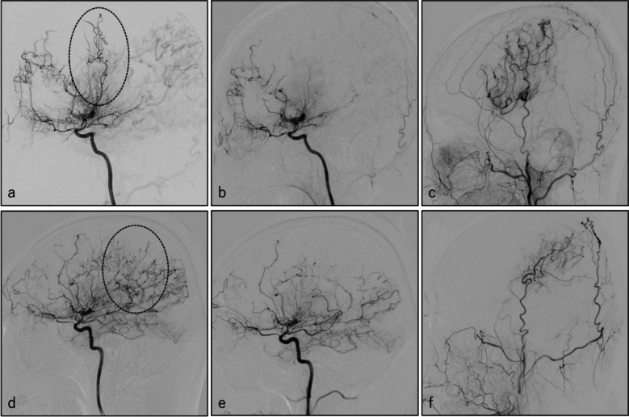
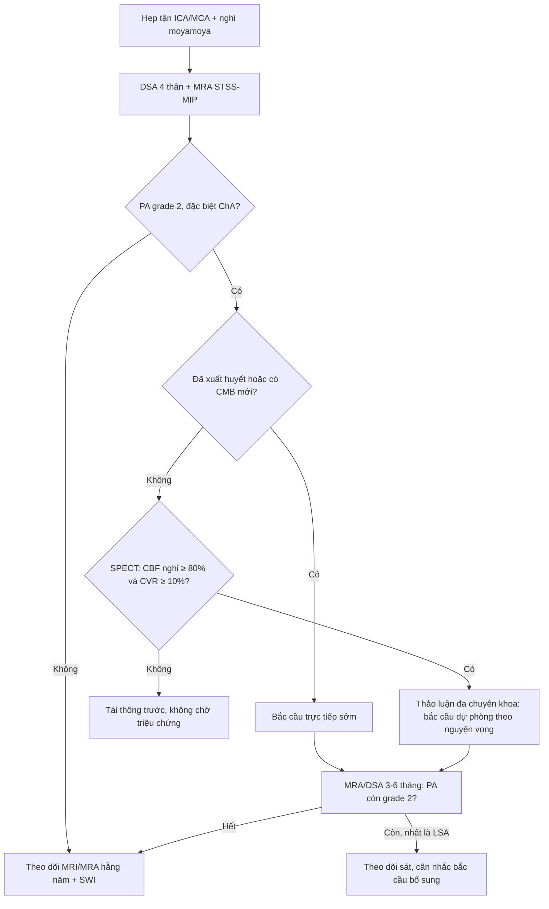
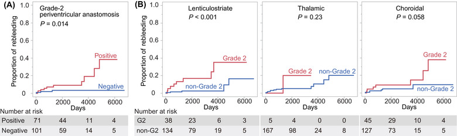
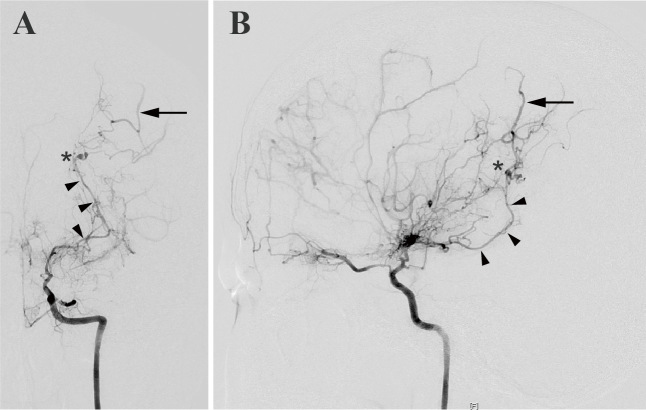
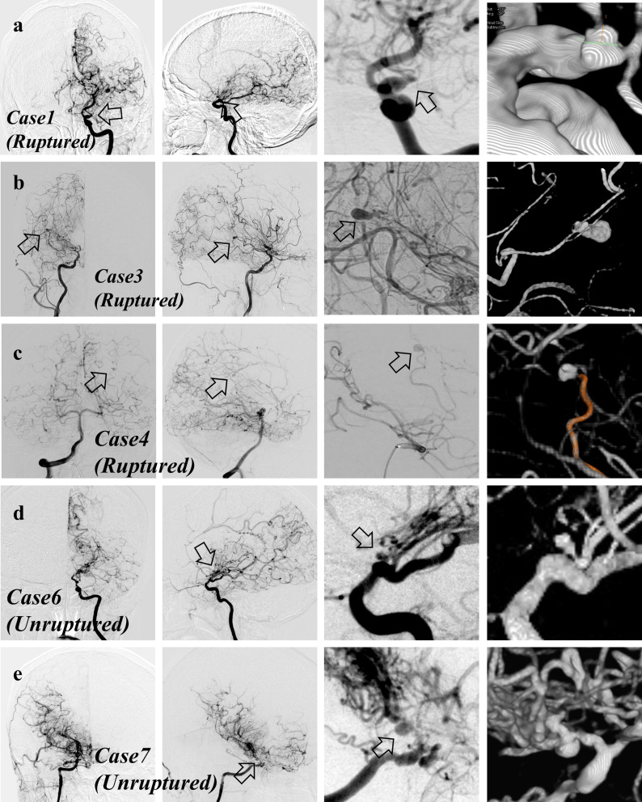
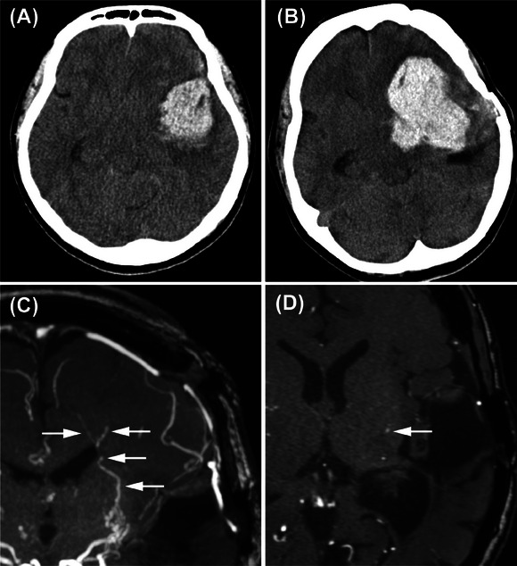

# 1798 — Phân độ bàng hệ quanh não thất (Funaki) & giãn động mạch màng mạch trước: đọc MRA/DSA, nguy cơ xuất huyết và khi nào tái thông / Periventricular anastomosis grading and choroidal anastomosis in moyamoya disease

**Tags:** `pattern:bang-he-quanh-nao-that` `pattern:hep-mach` `pattern:xuat-huyet-nao` `pattern:phinh-mach` `vung:nao` `vung:quanh-nao-that` `score:Funaki` `score:Suzuki` `protocol:MRA-TOF` `protocol:DSA` `protocol:SWI-3T`

**Mức chắc chắn (certainty):** tổng hợp y văn (literature synthesis) — ghép 4 nguồn chính: phân tích **đoàn hệ không mổ của thử nghiệm JAM** và **đoàn hệ AMORE** (dẫn lại trong bài tổng quan PMC11538803), đoàn hệ 172 bán cầu sau bắc cầu trực tiếp (PMC12671628), 126 bán cầu đánh giá hồi quy bàng hệ theo vị trí miệng nối (PMC12328485), và 301 bán cầu tìm phình mạch bàng hệ (PMC11573815). Đây **không phải ca nguyên văn**; số nào nguồn không nêu thì ghi "chưa rõ".

> **Câu chốt:** bàng hệ quanh não thất (periventricular anastomosis — PA) **không phải "mạch bàng hệ lành"**. Trong cùng một bệnh moyamoya, **thể màng mạch (choroidal anastomosis — ChA) grade 2** làm tái xuất huyết **13,1%/người–năm so với 1,3%/người–năm** ở nhóm ChA âm (P = 0,008), và bắc cầu trực tiếp giảm tái xuất huyết với **aHR 0,33** ở chính nhóm ChA dương. Vì vậy câu hỏi lâm sàng không phải "có bàng hệ không" mà là **"bàng hệ kiểu nào, grade mấy, còn tồn tại sau mổ không"**.

## 1. Tổng quan bệnh học – cơ chế hình ảnh

### 1.1 Vì sao có mạng bàng hệ quanh não thất — và vì sao nó nằm sát não thất (TẠI SAO)

- **Nền bệnh:** hẹp – tắc tiến triển **đoạn cuối động mạch cảnh trong (internal carotid artery — ICA)** và đoạn gần động mạch não giữa (middle cerebral artery — MCA) → giảm áp lực tưới máu vỏ não. Não bù bằng **mạch xuyên (perforators)** và **mạch màng mạch (choroidal arteries)**: các mạch này giãn, chạy ra sau vào chất trắng quanh não thất và **nối với động mạch tủy (medullary arteries)**. Khi đã nối, **dòng trong động mạch tủy bị đảo ngược** để nuôi vỏ não — đây là định nghĩa của PA (Funaki 2016; dẫn qua PMC12671628, PMC11538803).
- **Vì sao sát não thất:** PA đi theo **động mạch dưới nội mạc hướng não thất (ventriculofugal subependymal artery)** mà Van den Bergh và de Reuck mô tả — mạch này chạy từ bề mặt não thất ra chất trắng. Vì vậy PA luôn hiện ở **góc bên sừng chẩm (trigone)** và vùng quanh não thất, không phải ở vỏ não (PMC11538803).
- **Ba kiểu PA (phân loại Funaki):**
  1. **Thể vân (lenticulostriate anastomosis — LSA):** từ nhánh thể vân của MCA.
  2. **Đồi thị (thalamic anastomosis — THA):** từ nhánh đồi thị – đồi thị trên (thalamotuberal, thalamoperforating) của động mạch não sau (posterior cerebral artery — PCA)/thông sau.
  3. **Màng mạch (choroidal anastomosis — ChA):** từ **động mạch màng mạch trước (anterior choroidal artery — AChA)** và **màng mạch sau (posterior choroidal artery — PChA)**. ChA đổ ra vỏ **phía sau rãnh trung tâm** (PMC11538803).
- **Vì sao dễ vỡ (vật lý + mô bệnh):** đây là mạch **nhỏ (đường kính dưới 1 mm), thành mỏng, thiếu lớp cơ trơn và màng đàn hồi**, lại phải chịu áp lực hệ thống thay cho vùng não thiếu máu. Theo **định luật Laplace**, ứng suất thành σ ≈ P·r/(2t): áp lực P cao + bán kính r tăng khi giãn + độ dày thành t giảm → **ứng suất tăng theo cấp số nhân**, vỡ ở kích thước rất nhỏ, không cần phình.
- **Vì sao máu vào não thất:** AChA chạy sát **não thất bên**; ChA vỡ đổ trực tiếp vào não thất. Trong đoàn hệ trẻ moyamoya thể xuất huyết, **xuất huyết não thất (intraventricular hemorrhage — IVH) chiếm 43,8%** và **giãn AChA gặp ở 70,8%** (bài **1795**, PMC13540288).
- **Vì sao thấy được trên DSA nhưng dễ mất trên MRA TOF:** DSA có **độ phân giải không gian dưới milimét** và **không phụ thuộc tốc độ dòng**, nên là chuẩn tham chiếu (JAM Angiographic Criteria). MRA TOF tạo tín hiệu bằng **hiệu ứng dòng chảy (flow-related enhancement)**; mạch bàng hệ nhỏ, **dòng chậm và chạy trong mặt phẳng lát cắt** bị **bão hòa tín hiệu** → mất đoạn, đứt mạch giả. Vì vậy PA được đọc trên **MRA dựng lát mỏng trượt (sliding-thin-slab maximum-intensity projection — STSS-MIP) mặt phẳng vành, độ dày 10 mm**, với **trường nhìn vượt bờ trên não thất bên** (PMC11538803).
- **Vì sao PA quan trọng hơn "mức độ hẹp":** mức hẹp (Suzuki) nói về **giai đoạn tắc**, còn PA nói về **mạch nào đang gánh và có nguy cơ vỡ**. Hai bán cầu có cùng Suzuki stage vẫn có thể khác nhau hoàn toàn về grade PA và nguy cơ xuất huyết.

### 1.2 Ngưỡng định lượng nằm lòng (bắt buộc nhớ)

| Chỉ số | Con số | Nguồn |
|---|---|---|
| Tái xuất huyết khi **ChA dương, không mổ** | **13,1%/người–năm** so với **1,3%/người–năm** khi ChA âm (P = 0,008) | JAM không mổ, dẫn qua PMC11538803 |
| Bắc cầu ở nhóm ChA dương | **aHR 0,33** cho tái xuất huyết | JAM, dẫn qua PMC11538803 |
| Xuất huyết mới ở **bán cầu chưa xuất huyết** (thể xuất huyết) | **20% (3/15) sau 5 năm** nếu ChA dương không mổ, **0% (0/10)** nếu đã bắc cầu | JAM, dẫn qua PMC11538803 |
| Moyamoya **không triệu chứng** (AMORE) | ChA dương: **3,2%/bán cầu–năm** so với **0,4%** khi âm (P = 0,0054); **HR 7,05** | AMORE, dẫn qua PMC11538803 |
| Tái xuất huyết **sau** bắc cầu trực tiếp | **2,0%/người–năm** (16/172 bán cầu, theo dõi trung vị 6,3 năm); PA còn grade 2: **2,0%/năm** so với **0,46%/năm**; **aHR 4,11** (1,07–15,82) | PMC12671628 |
| Kiểu PA dai dẳng nhất sau mổ | **LSA: 34/62 mạch còn lại**, gây **8/16** ca tái xuất huyết | PMC12671628 |
| Giảm ChA sau bắc cầu trực tiếp | **70–85%** | PMC11538803 (tổng hợp) |
| Phình mạch bàng hệ (PA aneurysm) | **2,7%** (8/301 bán cầu); xuất huyết **12,2%** vs thiếu máu **1,9%** vs không triệu chứng **0,9%** (P = 0,002); **HR 8,29** cho xuất huyết về sau | PMC11573815 |
| Đồng thuận giữa 2 người đọc PA | **κ = 0,860 (LSA) · 0,927 (ChA) · 0,881 (THA)** | PMC11573815 |
| Bắc cầu trước rãnh trung tâm → hồi quy LSA | **30,3%** so với **14,0%** khi miệng nối sau rãnh (p = 0,06) | PMC12328485 |
| Bắc cầu sau rãnh trung tâm → hồi quy ChA | **41,9%** so với **18,2%** khi miệng nối trước rãnh (p = 0,02) | PMC12328485 |
| Grade 2 trước → sau mổ (126 bán cầu) | **LSA 34,9% → 18,3%**; **ChA 54,8% → 19,0%** | PMC12328485 |

## 2. Mẫu hình + chẩn đoán phân biệt theo vị trí (gamut)

**Mẫu hình cần nhận ra:** bệnh nhân **hẹp – tắc đoạn cuối ICA/MCA** (thường hai bên, tuổi 30–50, Đông Á) → trên **MRA STSS-MIP vành** thấy **chùm mạch nhỏ đi từ bè mạch nền (basal ganglia) hoặc từ màng mạch ra chất trắng quanh não thất**, **đảo chiều dòng ở động mạch tủy** đổ về vỏ. Ba biến thể theo vị trí: **thể vân** (bè mạch nền, hướng lên), **đồi thị** (quanh đồi thị), **màng mạch** (từ sừng thái dương/sừng chẩm, đổ ra vỏ sau rãnh trung tâm).

**Gamut theo vị trí (mnemonic "QUANH NÃO THẤT – NHÂN XÁM – RÃNH – NÃO THẤT"):**

1. **QUANH NÃO THẤT (chất trắng quanh não thất):** PA của moyamoya (LSA/THA/ChA), **vi chảy máu (cerebral microbleed — CMB)** trên SWI, **phình mạch bàng hệ** (2,7%). Đây là vị trí **quyết định xuất huyết não thất**.
2. **NHÂN XÁM (bè mạch nền, đồi thị):** LSA/THA; xuất huyết nhu mô; ở người trẻ **đừng mặc định tăng huyết áp** — phải loại moyamoya và phình bàng hệ.
3. **RÃNH – VỎ (leptomeningeal):** **dấu ivy (ivy sign)** trên FLAIR — mạch mềm trong rãnh, **không phải PA**; bàng hệ màng não từ động mạch cảnh ngoài sau tái thông gián tiếp.
4. **NÃO THẤT:** ChA vỡ → IVH; **u đám rối mạch mạc** (khối ngấm thuốc, không phải mạng nối); **giãn đám rối** (biến thể).
5. **THÙY CHẨM – ĐỒI THỊ SAU:** PChA; **tổn thương PCA** (34,4% trong thể xuất huyết trẻ, bài 1795) — bàng hệ sau thường đi kèm xuất huyết đồi thị/não thất.

## 3. Bảng so sánh phân biệt (ma trận đối chiếu)

| Thực thể (entity) | Hình ảnh điển hình (DSA/MRA) | Chốt vào (rule-in) | Chốt loại (rule-out) | Gợi ý xác nhận |
|---|---|---|---|---|
| **PA do moyamoya** (LSA/THA/ChA) | Chùm mạch nhỏ quanh não thất nối với động mạch tủy, **grade 0–2** theo từng kiểu; hẹp tận ICA hai bên | **Hẹp tận ICA/MCA hai bên + PA grade ≥ 1** ở đúng vị trí giải phẫu; đảo chiều dòng động mạch tủy trên DSA | Không hẹp tận ICA, không PA, mạch bình thường | DSA 4 thân là chuẩn; MRA STSS-MIP 10 mm để theo dõi |
| **ChA grade 2 (thể nguy hiểm nhất)** | AChA/PChA **giãn rõ + vượt bờ trên não thất bên**, đổ ra vỏ sau rãnh trung tâm | **Grade 2** trên DSA/MRA + bối cảnh moyamoya | Chỉ giãn nhẹ, **dừng dưới bờ trên não thất** = grade 1 | Đo trên STSS-MIP vành; đối chiếu DSA |
| **Phình mạch bàng hệ (PA aneurysm)** | **Túi phình khu trú** tại điểm nối mạch bàng hệ – động mạch tủy (không phải giãn đều) | Túi khu trú + PA grade cao (PA score ≥ 3 ở **87,5%** ca có phình) | Giãn đều, không có túi; không thấy trên 3D | DSA 3D/VR; CTA độ phân giải cao |
| **Hẹp xơ vữa ICA/MCA có bàng hệ kiểu moyamoya** | Hẹp **một bên**, có mảng xơ vữa/vôi hóa, tuổi > 50, yếu tố nguy cơ | Hẹp kèm mảng xơ vữa + bàng hệ cùng bên | **PA hai bên + hẹp tận ICA không vôi** ở người trẻ → nghi moyamoya | MRA/CTA thành mạch; xét *RNF213* p.R4810K nếu phù hợp |
| **Moyamoya do nguyên nhân thứ phát** (xạ trị, NF1, thiếu máu hồng cầu hình liềm, Down) | Cùng hình thái PA nhưng **một bên/không đối xứng**, có bối cảnh | Bệnh nền + hẹp tận ICA + PA | Không có bệnh nền, hẹp đối xứng hai bên điển hình | Hỏi tiền sử xạ, bệnh hồng cầu, da; MRI sọ |
| **AVM/dò động – tĩnh mạch màng não** | **Nidus + tĩnh mạch dẫn lưu sớm**, động mạch nuôi to | Shunt động – tĩnh mạch sớm thì động mạch | Không có shunt sớm, không nidus | DSA có thì sớm; CTA 3 thì |
| **U đám rối mạch mạc / tổn thương ngấm thuốc** | **Khối choán chỗ ngấm thuốc**, không nối với động mạch tủy | Khối + hiệu ứng khối | Không khối, chỉ mạng mạch | MRI T1 sau tiêm; không cần DSA |

*Hình 1 — (a) **grade 2 LSA** trước mổ (vòng nét đứt): mạch thể vân giãn, **vượt qua mức động mạch quanh thể chai**; (b) sau bắc cầu: mạch thoái triển; (c) vùng tưới máu sau mổ. (d) **grade 2 ChA** trước mổ: mạch màng mạch **giãn rõ và vượt bờ trên não thất bên**; (e) sau bắc cầu **sau rãnh trung tâm**: ChA thoái triển; (f) vùng tưới máu tương ứng. Nguồn: Ozaki S et al., Acta Neurochir 2025 (PMC12328485), **CC BY-NC-ND 4.0** — nguyên bản, không crop.*

## 4. Protocol chụp + hệ phân độ/điểm chuẩn hóa

### 4.1 Protocol (theo P-ChoC Registry và các đoàn hệ Nhật)

- **MRA 3D TOF ≥ 1,5T** (3T tốt hơn): **trường nhìn phải vượt bờ trên não thất bên** (hoặc toàn não); xuất **ảnh nguồn + STSS-MIP mặt phẳng vành, độ dày 10 mm** — đây là chuỗi xung quyết định để thấy PA (PMC11538803).
- **DSA 4 thân (hai ICA + hai đống–sống)** là chuẩn để **phân độ** và phát hiện phình bàng hệ; đánh giá thêm **LSA, THA, ChA và tổn thương PCA**.
- **SWI/T2\*** cho **vi chảy máu**; **FLAIR** cho dấu ivy và nhồi máu im lặng.
- **SPECT nghỉ + acetazolamide** (hoặc PET/CTP) đo **dự trữ tưới máu (cerebrovascular reserve — CVR)**: P-ChoC loại trừ bệnh nhân có **CBF nghỉ < 80% so với tiểu não cùng bên** hoặc **CVR < 10%** vì nguy cơ nhồi máu chu phẫu (PMC11538803). Phân loại **Powers stage 0** khi CVR ≥ 30%, **stage 1** khi < 30%.
- **Theo dõi sau mổ:** MRI/MRA + DSA **3–6 tháng** sau bắc cầu để chấm PA còn tồn tại; sau đó MRI hằng năm (PMC12671628).

### 4.2 Phân độ Funaki (grade 0–2 cho từng kiểu PA)

| Grade | Nguyên tắc chung | LSA (cụ thể) | ChA (cụ thể) |
|---|---|---|---|
| **0** | Mạch xuyên **không giãn, không lan** | Không giãn/không vượt | Không giãn/không vượt |
| **1** | Giãn hoặc lan **tới mức não thất bên** | Dừng **dưới mức động mạch quanh thể chai (pericallosal artery)** | Dừng **dưới bờ trên não thất bên** |
| **2** | Giãn hoặc lan **vượt qua mức não thất bên** | **Vượt qua mức động mạch quanh thể chai** | **Giãn rõ + vượt bờ trên não thất bên** |

Nguồn định nghĩa: PMC12328485 (LSA, ChA) và PMC13263247 (nguyên tắc chung grade 0/1/2). **Ngưỡng grade 2 riêng của THA** không được mô tả đủ trong các nguồn mở đã đọc — **chưa rõ, cần tra Funaki 2016 bản gốc**; không tự suy ra.

**Cách tính điểm PA — có hai thang, đừng trộn:**

- **Thang 3 kiểu (Funaki):** mỗi kiểu LSA/THA/ChA chấm 0–2 → **PA score 0–6** (tổng grade) hoặc **0–3** (đếm số kiểu grade 2).
- **Thang 5 mạch (dùng trong một số đoàn hệ Trung Quốc):** LSA, **động mạch đồi thị – củ (thalamotuberal — TTA)**, **động mạch xuyên đồi thị (thalamoperforating — TPA)**, **AChA**, **PChA**; mỗi mạch **1 điểm nếu grade 2** → **0–5** (PMC13263247). PA score của PMC11573815 theo thang khác, **không so trực tiếp** với thang này.

### 4.3 Khi nào theo dõi, khi nào tái thông

**Cơ sở của từng nhánh:**

- **Đã xuất huyết:** bắc cầu trực tiếp — JAM cho thấy giảm tái xuất huyết ở nhóm ChA dương (**aHR 0,33**); tái xuất huyết sau mổ còn **2,0%/người–năm** (PMC11538803, PMC12671628).
- **Chưa xuất huyết nhưng ChA dương:** AMORE cho **3,2%/bán cầu–năm** (HR 7,05) — tương đương nguy cơ của phình động mạch hoặc AVM chưa vỡ; đây là lý do **P-ChoC Registry** đang thử nghiệm giả thuyết bắc cầu dự phòng (20–65 tuổi, mRS 0–2, **CVR ≥ 10%**, theo dõi 5 năm, **cần 118 bệnh nhân** với HR giả định 0,4).
- **Sau mổ:** PA **còn grade 2** (nhất là **LSA**) là yếu tố nguy cơ tái xuất huyết (**aHR 4,11**) → phải chấm lại trên MRA/DSA 3–6 tháng, không được coi "đã mổ là xong".
- **Chọn vị trí miệng nối:** muốn giảm **ChA** → miệng nối **sau rãnh trung tâm** (hồi quy 41,9% vs 18,2%); muốn giảm **LSA** → miệng nối **trước rãnh** (30,3% vs 14,0%) (PMC12328485). Vùng tưới máu rộng hơn giúp LSA hồi quy (**0% → 20% → 25,7%** khi vùng tưới < 1/3, 1/3–2/3, > 2/3; p = 0,03), nhưng **ChA không phụ thuộc vùng tưới** (p = 0,07) — ChA cần **đúng chỗ**, không cần rộng.

*Hình 2 — 172 bán cầu sau bắc cầu trực tiếp: (A) nhóm **còn PA grade 2** có đường tái xuất huyết dốc hơn rõ rệt so với nhóm không còn (**2,0% vs 0,46%/năm**; aHR 4,11); (B) tách theo từng kiểu, **LSA grade 2** là kiểu dai dẳng và gây tái xuất huyết nhiều nhất. Nguồn: Hamano E et al., Stroke Vasc Interv Neurol 2025 (PMC12671628), **CC BY-NC 4.0**.*

## 5. Biến thể bình thường và cạm bẫy

- **Cạm bẫy 1 — tin MRA TOF tuyệt đối:** dòng chậm trong PA bị bão hòa → **âm giả grade 0**. Chỉ chấp nhận "không có PA" khi đã xem **STSS-MIP vành 10 mm** với trường nhìn vượt não thất; trước mổ vẫn cần **DSA**.
- **Cạm bẫy 2 — đọc PA trên lát cắt ngang dày:** mạch chạy trong mặt phẳng lát → đứt đoạn giả; luôn dựng lại **mặt phẳng vành** và **MIP mỏng**.
- **Cạm bẫy 3 — trộn hai thang điểm:** PA score 0–6 (3 kiểu, tổng grade), 0–3 (đếm grade 2), 0–5 (5 mạch) là **ba thang khác nhau**. Ghi rõ thang nào khi trích dẫn, nếu không sẽ so sánh sai giữa các nghiên cứu.
- **Cạm bẫy 4 — gọi mọi AChA giãn là "phình":** phình bàng hệ chỉ **2,7%**, cần **túi khu trú** trên DSA 3D; giãn đều là PA grade 2, không phải phình. Ngược lại, **bỏ sót túi phình nhỏ** là bỏ mất **HR 8,29** cho xuất huyết về sau.
- **Cạm bẫy 5 — lẫn dấu ivy với PA:** ivy sign là **mạch mềm trong rãnh trên FLAIR**, phản ánh bàng hệ màng não; PA nằm **quanh não thất** và cần DSA/MRA mạch để chấm grade. Hai dấu hiệu có thể cùng tồn tại.
- **Cạm bẫy 6 — "mổ rồi thì hết nguy cơ":** tái xuất huyết sau mổ vẫn **2,0%/người–năm**; PA dai dẳng (LSA 34/62) làm tăng nguy cơ **aHR 4,11** → phải chấm lại và theo dõi.
- **Cạm bẫy 7 — quy mọi xuất huyết đồi thị ở người trẻ cho tăng huyết áp:** ở bệnh nhân < 50 tuổi không tăng huyết áp, phải tìm **hẹp tận ICA + PA**, đặc biệt **ChA** và **tổn thương PCA**.
- **Biến thể bình thường:** **động mạch thông sau thai nhi (fetal posterior communicating artery)** to, chạy thẳng – cong mềm, **không có hẹp tận ICA** và **không nối với động mạch tủy quanh não thất**; **giãn nhẹ đám rối mạch mạc** đối xứng theo tuổi. Cả hai **không phải PA** và không cần can thiệp.
- **Cạm bẫy 8 — bỏ sót bán cầu đối bên:** moyamoya thường hai bên; bán cầu không triệu chứng vẫn có thể **ChA dương** (AMORE: 3,2%/bán cầu–năm) → luôn chấm **cả hai bán cầu** trên cùng một lần DSA.

## 6. Tự lượng giá — Blind Quiz ngay trên trang tĩnh

**Ca 1 — Nữ 38 tuổi, yếu nửa người phải tái diễn, hẹp tận ICA trái hai bên. Chụp mạch cảnh trái (A: thẳng, B: nghiêng):**

- Câu hỏi: (1) Đầu mũi tên đen chỉ mạch gì, đi về đâu? (2) Dấu sao (\*) là gì và vì sao nó quan trọng? (3) Chẩn đoán và bước xử trí tiếp theo?

<b>Bấm để hiện đáp án (findings + chẩn đoán)</b>

- **Findings:** (A,B) Bơm ICA trái: **động mạch màng mạch (choroidal artery) giãn, chạy dọc quanh não thất** (đầu mũi tên đen) rồi **nối với động mạch vỏ não** phía sau (mũi tên). Tại chỗ nối có **túi phình nhỏ** (dấu \*).
- **Chẩn đoán:** **bàng hệ màng mạch (choroidal anastomosis) grade 2 kèm phình mạch bàng hệ** — kiểu PA nguy cơ xuất huyết cao nhất.
- **Vì sao quan trọng:** ChA dương làm tái xuất huyết **13,1%/người–năm** (so với 1,3% khi âm); có phình bàng hệ làm nguy cơ xuất huyết về sau **HR 8,29**. Đây là chỉ định **bắc cầu trực tiếp** và cân nhắc xử lý túi phình, không phải "theo dõi định kỳ".
- **Nguồn ảnh:** Funaki T et al., Neurol Med Chir 2024 (PMC11538803), **CC BY-NC-ND 4.0** — nguyên bản, không crop.

**Ca 2 — Nam 45 tuổi, xuất huyết não thất; DSA thấy mạng bàng hệ quanh não thất. Các panel a–e là 5 bệnh nhân moyamoya có bất thường tại chỗ nối mạch bàng hệ:**

- Câu hỏi: (1) Mũi tên chỉ tổn thương gì, khác gì với "giãn mạch bàng hệ" thông thường? (2) Tỷ lệ gặp trong moyamoya và yếu tố nào đi kèm? (3) Hệ quả tiên lượng?

<b>Bấm để hiện đáp án (findings + chẩn đoán)</b>

- **Findings:** Mỗi hàng là một ca (a–e), từ trái sang phải: DSA thẳng, DSA nghiêng, **phóng đại vùng nối** và **dựng 3D**. Mũi tên chỉ **túi phình khu trú tại điểm nối giữa mạch bàng hệ và động mạch tủy** — không phải đoạn giãn đều. Ca 1, 3, 4 đã **vỡ** (ruptured); ca 6, 7 chưa vỡ.
- **Tần suất:** **2,7%** (8/301 bán cầu). Gặp **12,2%** ở thể xuất huyết, **1,9%** thể thiếu máu, **0,9%** không triệu chứng (P = 0,002). Đi kèm **PA score cao** (OR 1,60) và **mRS ban đầu cao** (OR 2,61).
- **Tiên lượng:** phình mạch bàng hệ là yếu tố nguy cơ **xuất huyết về sau (HR 8,29; 1,44–47,7)** và kết cục xấu hơn trong nhóm khởi phát xuất huyết (P = 0,008).
- **Nguồn ảnh:** Sato D et al., Neurosurg Rev 2024 (PMC11573815), **CC BY 4.0**.

**Ca 3 — Nam 52 tuổi, xuất huyết đồi thị – não thất trái; đã bắc cầu trực tiếp 1 năm. Ảnh A/B là CT lúc khởi phát và lúc tái xuất huyết; C/D là MRA lát mỏng trước tái xuất huyết:**

- Câu hỏi: (1) Mũi tên trắng trên C chỉ gì? (2) Vì sao bệnh nhân vẫn tái xuất huyết dù đã mổ? (3) Theo dõi tiếp theo nên làm gì?

<b>Bấm để hiện đáp án (findings + chẩn đoán)</b>

- **Findings:** (A) CT lúc khởi phát: **xuất huyết đồi thị trái** lan vào não thất. (B) CT lúc tái xuất huyết: **khối máu lớn hơn nhiều**, phù xung quanh. (C) MRA STSS-MIP vành: **nhiều mạch thể vân (LSA) còn giãn, chạy quanh não thất** (mũi tên trắng). (D) Lát cắt ngang tương ứng xác nhận mạch còn tồn tại.
- **Chẩn đoán:** **PA grade 2 tồn tại sau bắc cầu (chủ yếu LSA) → tái xuất huyết**. Trong đoàn hệ này, PA còn grade 2 sau mổ có tái xuất huyết **2,0%/năm** so với **0,46%/năm** (aHR 4,11); **LSA dai dẳng nhất (34/62)** và gây **8/16** ca tái xuất huyết.
- **Vì sao vẫn tái xuất huyết:** bắc cầu làm giảm nhưng **không xóa** dòng retrograde trong động mạch tủy ở một số bán cầu; mạch bàng hệ còn chịu áp lực hệ thống. Đây là lý do **phải chấm lại PA 3–6 tháng sau mổ**, không dựa vào "miệng nối thông".
- **Theo dõi:** MRA/DSA 3–6 tháng rồi hằng năm; kiểm soát huyết áp; cân nhắc **bắc cầu bổ sung** hoặc can thiệp vào kiểu PA còn lại (LSA) nếu tái xuất huyết.
- **Nguồn ảnh:** Hamano E et al., Stroke Vasc Interv Neurol 2025 (PMC12671628), **CC BY-NC 4.0**.

## Bài liên quan chéo
- [1795 – Xuất huyết & vi chảy máu trong moyamoya ở trẻ: SWI/T2*](../1795-xuat-huyet-vi-chay-mau-moyamoya-o-tre/lesson.md)
- [1782 – Phình mạch nội sọ trong moyamoya: thân vs bàng hệ](../1782-phinh-mach-trong-moyamoya/lesson.md)
- [1780 – Chọn kỹ thuật tái thông moyamoya: EDAS/EDAMS vs STA–MCA](../1780-chon-ky-thuat-tai-thong-moyamoya-o-tre/lesson.md)
- [262 – Bệnh mạch máu LỚN do xạ trị não: hẹp dài, không vôi, kiểu moyamoya](../262-benh-mach-mau-lon-do-xa-tri-moyamoya/lesson.md)
- [652 – Đột quỵ mạch máu não ở trẻ: moyamoya & viêm mạch](../652-dot-quy-mach-mau-nao-nhi-moyamoya-viem-mach/lesson.md)
- [200 – Tổng quan hệ Thần kinh](../200-tong-quan-he-than-kinh/lesson.md)
- [207 – Phình mạch nội sọ chưa vỡ: nguy cơ vỡ & chỉ định can thiệp](../207-phinh-mach-noi-so-chua-vo/lesson.md)

## Ảnh
- `1798_phan-do-Funaki_DSA_PMC12328485-Fig1.jpg` — Ozaki S et al., Acta Neurochir 2025 (PMC12328485), **CC BY-NC-ND 4.0**.
- `1798_tai-xuat-huyet_bieu-do-KM_PMC12671628-Fig2.jpg` — Hamano E et al., Stroke Vasc Interv Neurol 2025 (PMC12671628), **CC BY-NC 4.0**.
- `1798_tai-xuat-huyet_CT-MRA_PMC12671628-Fig3.jpg` — cùng bài, **CC BY-NC 4.0**.
- `1798_bang-he-mang-mach_DSA-PMC11538803-Fig1.jpg` — Funaki T et al., Neurol Med Chir 2024 (PMC11538803), **CC BY-NC-ND 4.0**.
- `1798_phi-dinh-mach-bang-he_DSA_PMC11573815-Fig1.jpg` — Sato D et al., Neurosurg Rev 2024 (PMC11573815), **CC BY 4.0**.
- Chi tiết nguồn/giấy phép từng ảnh: `images/CREDITS.md`.

> Không dùng để chẩn đoán độc lập khi chưa có người hướng dẫn.
