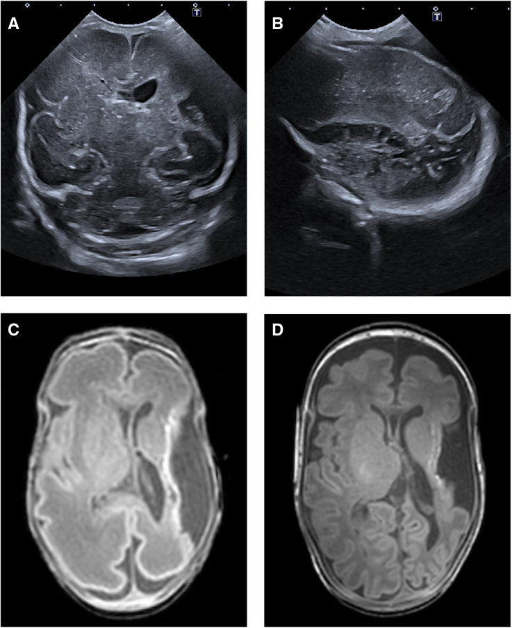
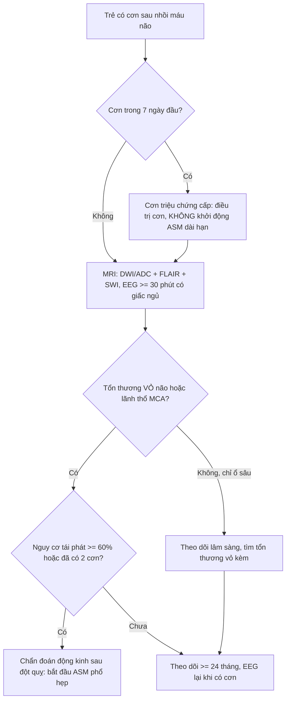
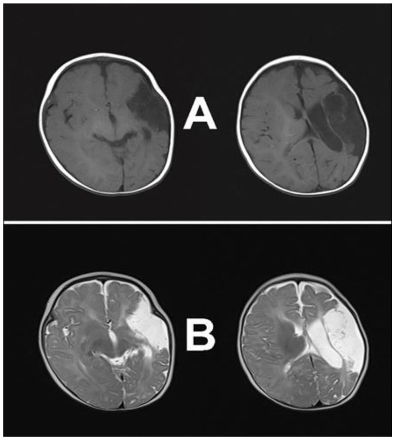

# 1799 — Động kinh sau đột quỵ ở trẻ: cơn sớm ≤ 7 ngày KHÔNG phải động kinh, và ai cần dùng thuốc dài hạn / Post-stroke epilepsy in children

**Tags:** `pattern:dong-kinh` `pattern:thieu-mau-nao` `pattern:vo-nao` `pattern:hoai-tu-nao` `vung:nao-nhi` `vung:vo-nao` `vung:mach-nao` `protocol:EEG` `protocol:MRI` `protocol:MRI-DWI` `score:ILAE-2014`
**Mức chắc chắn (certainty):** tổng hợp y văn (literature synthesis) — số liệu lấy từ toàn văn/abstract gốc của **hệ thống 16 nghiên cứu, 3.198 trẻ** (Front Neurol 2025, PMC12888228), **đoàn hệ 218 trẻ của CHOP** (Neurology 2017, PMC5317388), **đăng ký đột quỵ nhi Thụy Sĩ 315 trẻ** (2025, PMID 40435763), **126 trẻ nhồi máu não** (Front Neurol 2025, PMC12005998) và ca nguyên văn có ảnh (PMC12551421, PMC10814911). Chỗ chưa có số thì ghi "chưa rõ".

> **Câu chốt:** cơn trong **7 ngày đầu** sau nhồi máu não là **cơn triệu chứng cấp (acute symptomatic seizure)** — do phù, rối loạn chuyển hóa, mất cân bằng ion và hàng rào máu–não vỡ, **không phải động kinh**. Động kinh sau đột quỵ (post-stroke epilepsy, PSE) chỉ được chẩn đoán khi có **≥ 2 cơn không kích thích, cách > 24 giờ**, hoặc **1 cơn với nguy cơ tái phát ≥ 60% trong 10 năm** (ILAE 2014). Việc phân biệt này quyết định **có dùng thuốc chống động kinh (anti-seizure medication, ASM) suốt đời hay không**, chứ không phải chỉ định chụp hình.
> Nối tiếp [1785 – Động kinh sau tái thông moyamoya](../1785-dong-kinh-sau-tai-thong-moyamoya-o-tre/lesson.md); dùng chung nền hình ảnh với [1781 – Huyết khối xoang tĩnh mạch ở trẻ](../1781-huyet-khoi-tinh-mach-nao-tre-thieu-mau-huyet-tan/lesson.md).

## 1. Tổng quan bệnh học – cơ chế hình ảnh

### 1.1 Vì sao một ổ nhồi máu lại sinh ra cơn (và vì sao phải chờ nhiều tháng)

- **Giai đoạn cấp (0–7 ngày) — cơn do "môi trường", không do mô sẹo:** thiếu máu cục bộ làm **giảm dự trữ năng lượng ATP**, bơm Na⁺/K⁺ thất bại → **khử cực màng tế bào thần kinh**; đồng thời **glutamate** ứ ngoại bào (ức chế tái hấp thu) gây **độc tế bào kích thích (excitotoxicity)**. Thêm vào đó là **phù não, toan chuyển hóa, tăng K⁺ ngoại bào** và **hàng rào máu–não vỡ** cho phép albumin/cytokine vào mô. Tổng hợp các yếu tố "tạm thời" này đủ gây cơn mà **chưa có tổn thương mạng lưới thường trực** → cơn sớm **thường không lặp lại**.
- **Giai đoạn muộn (> 7 ngày, thường 3–24 tháng) — động kinh hóa (epileptogenesis):** vùng mô chết được thay bằng **sẹo thần kinh đệm (gliosis) và nang hóa (encephalomalacia)**; các **neuron sống sót quanh bờ ổ** bị **mất đầu vào ức chế (deafferentation)** và **tăng sinh chồi sợi trục (axonal sprouting)**; **hemosiderin** từ chuyển dạng xuất huyết giải phóng sắt tự do → stress oxy hóa. Kết quả là **mạng lưới tăng kích thích** — trên MRI thấy **tín hiệu T2/FLAIR tăng ở bờ ổ + teo mô + giãn não thất bù trừ**. Đây là **cơ chất (substrate)** thật của động kinh, nên **phải mất tháng mới hình thành đủ** để gây cơn tái diễn.
- **Hệ quả thực hành:** cơn sớm là **dấu hiệu tổn thương nặng** (dự báo PSE về sau) nhưng **không đồng nghĩa động kinh**; còn **hình ảnh sẹo hóa trên MRI muộn** giải thích vì sao **đoàn hệ nào theo dõi ngắn sẽ báo tỉ lệ PSE thấp**.

### 1.2 Ngưỡng định lượng nằm lòng

| Chỉ số | Con số | Nguồn |
|---|---|---|
| Nguy cơ PSE gộp ở trẻ đột quỵ | **27,6% (95% CI 19,8–37,2)**; 16 nghiên cứu, **3.198 trẻ** | PMC12888228 |
| Cơn triệu chứng cấp — nhồi máu sơ sinh (NAIS) | **94% (70/74)** | PMC5317388 |
| Cơn triệu chứng cấp — nhồi máu tuổi lớn (CAIS) | **17% (18/105)** | PMC5317388 |
| Cơn triệu chứng cấp — đăng ký Thụy Sĩ | **23,8% (75/315)**; là triệu chứng đầu tiên ở **58,7%**; **trạng thái động kinh 16,0%** (12/75) | PMID 40435763 |
| Động kinh tích lũy 2 năm — NAIS | **11%** (RSS 19%) | PMC5317388 |
| Động kinh tích lũy 2 năm — nhồi máu chu sinh giả định (PPAIS) | **19%** (RSS 24%) | PMC5317388 |
| Động kinh tích lũy 2 năm — CAIS | **7%** (RSS 7%) | PMC5317388 |
| Động kinh hoạt động — Thụy Sĩ | **4,5% lúc 6 tháng**, **5,4% lúc 24 tháng** | PMID 40435763 |
| Tuổi nhỏ hơn = nguy cơ cao hơn | Cơn cấp: **1,1 tuổi (0,4–6,0) so với 7,2 tuổi (3,8–12,2)**; mỗi năm tăng thêm **OR 0,838 (0,796–0,883)** | PMID 40435763, PMC12888228 |
| **Tổn thương vỏ não** | **OR 3,3 (1,8–6,0)** và **OR 3,151 (1,132–8,772)** | PMID 40435763, PMC12888228 |
| **Lãnh thổ động mạch não giữa (MCA)** | **OR 3,541 (1,068–11,738)** | PMC12888228 |
| Có cơn triệu chứng cấp | **HR 3,924 (2,580–5,967)** | PMC12888228 |
| Cơn cấp **kéo dài/trạng thái** | **OR 4,7 (2,286–9,662)** | PMC12888228 |
| Cơn cấp dự báo động kinh theo thời điểm | 6 tháng **OR 1,5 (0,5–5,1), p = 0,47**; 24 tháng **OR 3,2 (1,0–10,7), p = 0,047** | PMID 40435763 |
| Động kinh kháng thuốc | **2,2% (7/315)**, kèm bệnh nền nặng (tim bẩm sinh, nhiễm khuẩn huyết) | PMID 40435763 |
| Kết cục thần kinh khi có PSE | **PSOM 3,0 so với 0,5 (p < 0,001)** | PMID 40435763 |
| Vị trí nhồi máu sơ sinh so với tuổi lớn | **chỉ vỏ não 52,94% so với 20,19%**; tuần hoàn trước **79,34%** | PMC12005998 |

### 1.3 Vì sao trên MRI cơn sớm và sẹo muộn trông khác nhau (vật lý chuỗi xung)

- **DWI/ADC (giờ đầu – ngày 7):** thiếu máu → **bơm Na⁺/K⁺ ngừng** → nước chuyển từ ngoại bào vào nội bào (**phù tế bào độc, cytotoxic edema**) → **giảm khuếch tán nước** → **DWI tăng tín hiệu, ADC giảm**. Đây là dấu hiệu **sớm nhất** và **nhạy nhất**, không phụ thuộc cơn.
- **T2/FLAIR (sau 6–24 giờ):** phù lan rộng làm **tăng nước tự do** → T2/FLAIR tăng; vì vậy **FLAIR có thể bình thường trong vài giờ đầu** — không được dùng FLAIR âm để loại nhồi máu ở trẻ đang cơn.
- **SWI/T2* (chuyển dạng xuất huyết):** hemoglobin thoái giáng → **hemosiderin (superparamagnetic)** làm **mất tín hiệu (blooming)**. Xuất huyết trong ổ nhồi máu vừa là **yếu tố nguy cơ co giật**, vừa là nguồn sắt gây epileptogenesis — cần ghi rõ có/không trong báo cáo.
- **Muộn (≥ 3 tháng):** mô chết được thay bằng **dịch não tủy** → **T1 tối, T2 sáng đồng tín hiệu CSF, FLAIR tối (giảm tín hiệu — "nang hóa")**, bờ có **viền gliosis FLAIR tăng**; **DWI âm**, **ADC tăng** (khuyếch tán tự do). Phân biệt với nhồi máu mới: **nhồi máu mới DWI sáng + ADC tối**, **sẹo cũ DWI tối + ADC sáng**.
- **Giãn não thất bù trừ (ex-vacuo ventriculomegaly)** và **lệch đường giữa** ở bán cầu tổn thương là dấu hiệu **mất thể tích mô**, thường thấy rõ ở tháng thứ 3–6 — đúng lúc nguy cơ cơn muộn bắt đầu tăng.

## 2. Mẫu hình + chẩn đoán phân biệt theo vị trí (gamut)

**Mẫu hình:** trẻ **đã có nhồi máu não** (chu sinh hoặc tuổi lớn) xuất hiện **cơn co giật cục bộ** (một chi, nửa mặt, có thể toàn thể hóa) hoặc **cơn toàn thể**, kèm **yếu nửa người kiểu Todd** sau cơn.

**Gamut theo thời điểm — trục quyết định:**

- **Cơn triệu chứng cấp (≤ 7 ngày):** do phù – chuyển hóa – xuất huyết chuyển dạng. **Không phải động kinh**; điều trị cơn, tìm nguyên nhân cấp.
- **Cơn muộn (> 7 ngày) lần đầu:** xét **động kinh** nếu nguy cơ tái phát ≥ 60% (ổ vỏ não, EEG có phóng điện, tổn thương lớn).
- **Động kinh sau đột quỵ (PSE):** ≥ 2 cơn không kích thích cách > 24 giờ. Đây là nhóm **cần ASM dài hạn**.

**Gamut theo vị trí tổn thương (vì sao vỏ não quan trọng hơn ổ sâu):**

- **Vỏ não (cortical) — nguy cơ cao nhất (OR ~3,2–3,3):** neuron vỏ là nguồn phóng điện; ổ vỏ làm **mất cả lớp ức chế liên vỏ** → dễ sinh cơn.
- **Lãnh thổ MCA (OR ~3,5):** vùng vỏ rộng + vùng ngôn ngữ/vận động, tổn thương lớn → mạng lưới lớn bị phá vỡ.
- **Chỉ hạch nền/đồi thị (deep-only):** nguy cơ thấp hơn; nếu có cơn **phải tìm tổn thương vỏ kèm** hoặc bệnh nền khác.
- **Nhồi máu sơ sinh (NAIS/PPAIS):** tỉ lệ **động kinh tích lũy 2 năm 11% và 19%** — cao hơn CAIS (7%) dù nhồi máu nhỏ hơn, vì não non đang trong giai đoạn **tạo synapse** nên dễ bị "lập trình lại" mạng lưới.
- **Huyết khối xoang tĩnh mạch (CVST):** cơn thường **do xuất huyết vỏ và phù**, không phải do ổ nhồi máu động mạch; xem bài 1781.
- **Bắt chước (mimics):** **tư thế mất vỏ (decerebrate posturing)**, **rung lắc do TIA (limb-shaking TIA)**, **hạ đường huyết**, **cơn giả động kinh (PNES)**, **đau nửa đầu có aura**, **rét run** — không có phóng điện ictal trên EEG.

**Mnemonic "CORTEX":** **C**ortical (vỏ não), **O**ld stroke territory lớn, **R**ecurrent/prolonged acute seizures (cơn cấp kéo dài), **T**erritory MCA, **E**EG epileptiform, **X**-hemorrhage (chuyển dạng xuất huyết).

## 3. Bảng so sánh phân biệt (ma trận đối chiếu)

| Thực thể (entity) | Hình ảnh/lâm sàng điển hình | Chốt vào (rule-in) | Chốt loại (rule-out) | Gợi ý xác nhận |
|---|---|---|---|---|
| **Cơn triệu chứng cấp (≤ 7 ngày)** | Cơn trong tuần đầu, kèm **DWI sáng/ADC tối** đúng lãnh thổ, có phù hoặc chuyển dạng xuất huyết | **Cơn trong 7 ngày + tổn thương cấp trên DWI** | Cơn khi DWI/ADC đã bình thường và tổn thương đã thành sẹo → không phải cơn cấp | MRI DWI/ADC ≤ 24 giờ, điện giải, đường huyết |
| **Động kinh sau đột quỵ (PSE)** | ≥ 2 cơn không kích thích cách > 24 giờ; MRI có **sẹo vỏ + teo + giãn não thất bù trừ**, EEG có phóng điện khu trú | **≥ 2 cơn muộn + ổ vỏ não/MCA** | Cơn đơn độc trong tuần đầu, không phóng điện → chưa gọi động kinh | EEG ≥ 30 phút có giấc ngủ, MRI muộn 3–6 tháng |
| **Tư thế mất vỏ / thân não** | Duỗi cứng tay chân, co cứng, **không có pha co giật–giãn cơ**, thường sau tổn thương lan tỏa | **Không có phóng điện ictal + tổn thương hai bán cầu/thân não** | Có phóng điện ictal rõ → cơn thật | Video + EEG tại giường |
| **TIA rung lắc chi (limb-shaking TIA)** | Rung lắc một chi **1–2 phút**, không mất ý thức, khởi phát khi khóc/vận động, hẹp mạch đáng kể | **Video + EEG trong cơn KHÔNG có phóng điện** | Phóng điện ictal → động kinh | MRI/MRA, ASL tìm hạ tưới máu |
| **Hạ đường huyết / rối loạn điện giải** | Cơn toàn thể hoặc cục bộ, **glucose máu thấp**, không tổn thương cấp trên DWI | **Glucose < 2,6 mmol/L (47 mg/dL) hoặc Na⁺ bất thường + cơn hết khi sửa** | Glucose/điện giải bình thường → tìm nguyên nhân khác | Glucose mao mạch, điện giải, khí máu |
| **Xơ hóa hồi hải mã (hippocampal sclerosis)** | Teo + **T2/FLAIR tăng** hồi hải mã, giãn sừng Amon; có thể **kèm ổ vỏ não (dual pathology)** | **Teo hồi hải mã một bên + T2 tăng + cơn thùy thái dương** | Hồi hải mã bình thường → cơn do ổ vỏ não đơn thuần | MRI 3D T1/T2 coronal mỏng 1 mm; tỉ lệ sau đột quỵ trẻ: chưa rõ |

*Bốn ô của cùng một bệnh nhi sinh đôi: (A) siêu âm qua thóp mặt cắt vành ngày 1 — mất mô bán cầu trái, giãn não thất bên trái; (B) mặt cắt dọc — nhiều nang trong nhu mô bán cầu trái; (C) MRI T1 ngày 34 — nhồi máu nhánh chính MCA trái, mất vỏ, bất thường chất trắng quanh nắp và đảo; (D) T2 tuổi chỉnh tháng — myelin hóa không đối xứng bao trong sau. Stroke 2025 (PMC12551421), CC BY 4.0.*

### Ba dấu hiệu quyết định

- **Cortical + MCA = nguy cơ cao:** hai đặc điểm này xuất hiện trong mọi mô hình nguy cơ (OR 3,15 và 3,54) — nếu có cả hai, **nguy cơ PSE đủ cao để theo dõi sát và hạ ngưỡng điều trị**.
- **Cơn cấp kéo dài/trạng thái = tín hiệu xấu:** **OR 4,7** — trạng thái động kinh không chỉ là cấp cứu mà còn là **dấu ấn của epileptogenesis**.
- **Cơn cấp KHÔNG dự báo sớm:** OR chỉ 1,5 (không có ý nghĩa) lúc 6 tháng nhưng **3,2 lúc 24 tháng** — nghĩa là **phải theo dõi ít nhất 2 năm**, không được "kết luận an toàn" sau 6 tháng.

## 4. Protocol chụp + hệ phân độ/điểm chuẩn hóa

### 4.1 Chụp hình khi trẻ đột quỵ có cơn

1. **Cấp cứu (0–24 giờ):** **MRI sọ không cản quang có DWI/ADC + FLAIR + SWI/T2*** là lựa chọn đầu tay nếu trẻ hợp tác/đủ điều kiện; nếu không — **CT không cản quang** để loại xuất huyết (nhưng **CT có thể bình thường trong 60% nhồi máu trẻ em trong 6 giờ đầu**, nên **CT âm không loại trừ**; con số "60%" là ước lệ từ y văn người lớn–trẻ, chưa có nghiên cứu riêng đủ lớn — ghi "chưa rõ" nếu trích dẫn chính thức).
2. **Mạch máu:** **MRA TOF cổ–não** hoặc **CTA** nếu nghi bóc tách, hẹp nội sọ, moyamoya (bài 1785), hoặc chuẩn bị can thiệp.
3. **Giai đoạn muộn (3–6 tháng, và khi có cơn muộn):** **MRI 3D T1 + T2/FLAIR mỏng 1 mm** đánh giá **sẹo vỏ, teo, giãn não thất bù trừ** và **hồi hải mã**; thêm **SWI** tìm hemosiderin.
4. **Siêu âm qua thóp (neonate):** tiện tại giường, nhưng **không thay MRI** — độ nhạy phụ thuộc người làm và vị trí ổ; hình trên (A–B) cho thấy **cùng một ổ đã thấy rõ trên siêu âm ngày 1** nhưng độ tương phản mô kém hơn MRI.

### 4.2 EEG: bắt buộc khi có cơn hoặc tri giác không hồi phục

- **EEG thường ≥ 30 phút, có giai đoạn ngủ** — tìm **phóng điện khu trú (spike/polyspike)**, **chậm khu trú**, và **phản ứng khi mở mắt**.
- **EEG liên tục (cEEG)** khi: cơn lặp lại, **trẻ thở máy**, tri giác không hồi phục sau cơn, hoặc nghi **trạng thái động kinh không co giật (non-convulsive status epilepticus)**.
- **Giá trị tiên lượng:** phóng điện khu trú trên EEG tăng nguy cơ tái phát; **EEG bình thường không loại trừ PSE** (âm tính giả khi cơn ở vỏ sâu/thùy thái dương).

### 4.3 Chẩn đoán theo ILAE 2014 và chỉ định thuốc

- **Động kinh (ILAE 2014):** **≥ 2 cơn không kích thích cách > 24 giờ**, hoặc **1 cơn không kích thích với nguy cơ tái phát ≥ 60% trong 10 năm**, hoặc **hội chứng động kinh đã biết**. Ở trẻ có **ổ nhồi máu vỏ não** (nguy cơ tái phát rất cao), **một cơn muộn đã đủ để chẩn đoán động kinh** — đây là lý do bài này nhấn mạnh **vị trí tổn thương**, không chỉ số cơn.
- **Khi nào bắt đầu ASM (suy luận từ dữ liệu nguy cơ):** cơn **muộn** đầu tiên + **ổ vỏ não/MCA** hoặc **EEG có phóng điện** → bắt đầu. Cơn **sớm đơn thuần** → **không** khởi động ASM dài hạn; điều trị cơn cấp và đánh giá lại sau 3–6 tháng.
- **Dự phòng thường quy sau nhồi máu: KHÔNG** có bằng chứng giảm tỉ lệ PSE (không có thử nghiệm đối chứng; khuyến cáo AHA/ASA 2019 cho đột quỵ trẻ, PMID 30686119, không đưa ra chỉ định dự phòng thường quy — đọc bản gốc khi trích dẫn chính thức).
- **Chọn thuốc:** ưu tiên thuốc **phổ hẹp cho cơn cục bộ** (levetiracetam, oxcarbazepine/carbamazepine, lamotrigine); **tránh valproate ở trẻ gái tuổi sinh sản**; **tránh carbamazepine/oxcarbazepine trong hội chứng động kinh toàn thể** (làm nặng cơn myoclonic/absence).
- **Thời gian điều trị:** **≥ 2 năm không cơn + EEG không còn phóng điện** rồi mới giảm liều từ từ; **không ngừng đột ngột** ở trẻ có sẹo vỏ lớn (nguy cơ cơn dội).
- **Trạng thái động kinh:** benzodiazepine (midazolam/diazepam) → thuốc bậc 2 (levetiracetam/fosphenytoin/valproate) → **đặt nội khí quản + thuốc gây mê** nếu kháng trị; luôn **kiểm tra glucose, Na⁺, Ca²⁺** trước khi kết luận "kháng trị".

### 4.4 Sơ đồ tiếp cận

> **Phản biện nguồn:** hệ thống PMC12888228 định nghĩa PSE là cơn **sau 2 tuần**, trong khi ILAE 2014 lấy mốc **7 ngày**. Vì vậy **27,6%** không thể so trực tiếp với **11%/19%/7%** của PMC5317388 (định nghĩa 7 ngày, chỉ 2 năm theo dõi). Đây là lý do bài này đưa **cả hai mốc** thay vì chọn một con số "đẹp".

## 5. Biến thể bình thường và cạm bẫy

- **Siêu âm qua thóp "bình thường" ở trẻ sơ sinh:** vùng **đỉnh–chẩm và vỏ gần xương** khó thấy; **âm tính giả** thường gặp — không loại trừ nhồi máu nhỏ ở vỏ.
- **CT bình thường trong giờ đầu:** nhồi máu non không thấy trên CT; **CT âm không loại trừ** — MRI DWI là chuẩn.
- **Sẹo cũ đọc thành nhồi máu mới:** nang hóa có **T2 sáng như CSF + FLAIR tối + ADC tăng**; nếu chỉ nhìn T2 sẽ tưởng "phù mới". Luôn so **DWI/ADC** và **phim cũ**.
- **Giãn não thất bù trừ đọc thành tràn dịch não thất:** giãn **một bên**, cùng phía ổ teo, không tăng áp lực — không đặt van.
- **Cơn mắt/nửa người thoáng qua (TIA) đọc thành động kinh:** không có phóng điện, thường **1–2 phút**, có hẹp mạch — điều trị **mạch**, không phải ASM.
- **Trạng thái động kinh không co giật ở trẻ thở máy:** chỉ có **chậm/loạn nhịp EEG** và tri giác không hồi phục — bỏ sót nếu không làm cEEG; đây là cạm bẫy chết người trong PICU.
- **Ghi đè "động kinh" lên mọi cơn sớm:** dẫn tới **dùng ASM nhiều năm không cần thiết**, trong khi vấn đề là phù/chuyển hóa.
- **Bỏ qua hồi hải mã:** trẻ có cơn thùy thái dương sau đột quỵ **có thể có xơ hóa hồi hải mã kèm** (dual pathology); MRI coronal mỏng 1 mm bắt buộc khi có cơn thùy thái dương.

## 6. Tự lượng giá — Blind Quiz ngay trên trang tĩnh

**Ca 1 — Sơ sinh 34 ngày, nhồi máu bán cầu trái, chưa có cơn. Đọc 4 ô ảnh trước khi mở đáp án.**

- Gợi ý lâm sàng: trẻ sinh đôi, được can thiệp bào thai; sau sinh yếu nửa người phải nhẹ.
- Câu hỏi: (1) Tổn thương nằm ở lãnh thổ nào? (2) Vì sao có giãn não thất bên cùng phía? (3) Nguy cơ động kinh 2 năm của nhóm bệnh này khoảng bao nhiêu?

<b>Bấm để hiện đáp án (findings + chẩn đoán)</b>

- Dấu hiệu: **mất mô vỏ + chất trắng bán cầu trái theo lãnh thổ nhánh chính MCA**, nhiều nang trong nhu mô, **giãn não thất bên trái bù trừ**; T2 tuổi chỉnh tháng cho thấy **myelin hóa bao trong sau không đối xứng**.
- Chẩn đoán: **nhồi máu não chu sinh (PAIS) thể nhánh chính MCA**, đã chuyển sang giai đoạn **nang hóa + mất thể tích**. Vì **vỏ não + MCA** (OR 3,15 và 3,54), đây là nhóm **nguy cơ PSE cao nhất**; nhóm NAIS có **động kinh tích lũy 2 năm 11%** (RSS 19%).
- Xử trí: **không dùng ASM dự phòng**; theo dõi ≥ 24 tháng, dạy gia đình quay video cơn, chụp MRI muộn + EEG nếu có cơn.
- Nguồn ảnh: Stroke 2025 (PMC12551421), Hình 3, CC BY 4.0.

**Ca 2 — Trẻ 6 tháng, tiền sử nhồi máu chu sinh, nay khám định kỳ. Nhìn T1 và T2.**

- Câu hỏi: (1) Tín hiệu trong ổ tổn thương trên T1/T2 nói lên điều gì về thành phần mô? (2) Có phải "phù mới" không? (3) Dấu hiệu nào trên ảnh giúp phân biệt sẹo cũ với nhồi máu mới?

<b>Bấm để hiện đáp án (findings + chẩn đoán)</b>

- Dấu hiệu: **ổ mất mô lớn bán cầu trái, T1 tối, T2 sáng đồng tín hiệu dịch não tủy**, bờ rõ, giãn não thất bên trái, teo bán cầu.
- Chẩn đoán: **nang hóa sau nhồi máu (encephalomalacia)** — mô đã chết thay bằng dịch, **không phải phù mới**. Chốt loại phù mới bằng **DWI âm + ADC tăng** (nếu chụp) và **so phim cũ**; phù mới sẽ có **DWI sáng/ADC tối** và bờ không rõ.
- Ý nghĩa: vùng sẹo vỏ này là **cơ chất epileptogenesis** — giải thích vì sao cơn muộn có thể xuất hiện **nhiều tháng sau** dù trẻ hoàn toàn không triệu chứng giai đoạn đầu.
- Nguồn ảnh: Children (Basel) 2023 (PMC10814911), Hình 2, CC BY 4.0.

**Ca 3 — Trẻ 7 tuổi, nhồi máu MCA trái 4 ngày trước, nay co giật nửa người phải 3 phút rồi tự hết, sau cơn yếu tay phải.**

- Câu hỏi: (1) Đây là động kinh hay cơn triệu chứng cấp? (2) Có khởi động ASM dài hạn ngay không? (3) Cần làm gì trước khi kết luận?

<b>Bấm để hiện đáp án (findings + chẩn đoán)</b>

- Chẩn đoán: **cơn triệu chứng cấp (ngày thứ 4, trong 7 ngày)** — không phải động kinh theo ILAE 2014. Yếu sau cơn là **liệt Todd**, không phải nhồi máu mới.
- Xử trí: **không khởi động ASM dài hạn chỉ vì cơn này**; làm **EEG ≥ 30 phút có giấc ngủ** (tìm phóng điện), **MRI DWI/ADC** để loại nhồi máu mới/xuất huyết chuyển dạng; dặn gia đình quay video và theo dõi ≥ 24 tháng.
- Vì sao vẫn phải theo dõi sát: cơn cấp + **ổ vỏ não MCA** → **HR 3,92** cho PSE về sau; theo dõi 24 tháng vì OR chỉ có ý nghĩa ở mốc này (3,2; p = 0,047).

## Bài liên quan chéo
- [1785 – Động kinh sau tái thông moyamoya ở trẻ](../1785-dong-kinh-sau-tai-thong-moyamoya-o-tre/lesson.md)
- [1781 – Huyết khối xoang tĩnh mạch ở trẻ thiếu máu/huyết tán](../1781-huyet-khoi-tinh-mach-nao-tre-thieu-mau-huyet-tan/lesson.md)
- [1786 – Dị dạng tĩnh mạch Galen sơ sinh](../1786-di-dang-tinh-mach-galen-so-sinh/lesson.md)
- [208 – Rò dịch não tủy qua xương đá ở trẻ](../208-ro-dich-nao-tuy-xuong-da/lesson.md)

## Ảnh
- `images/1799_dong-kinh-sau-dot-quy_US-MRI_PMC12551421.jpg` — Stroke 2025 (PMC12551421), Hình 3, CC BY 4.0.
- `images/1799_dong-kinh-sau-dot-quy_MRI-T1-T2_PMC10814911.jpg` — Children (Basel) 2023 (PMC10814911), Hình 2, CC BY 4.0.
- Nguồn + giấy phép từng ảnh: `images/CREDITS.md`; nguồn bài: `sources.md`.

> Không dùng để chẩn đoán độc lập khi chưa có người hướng dẫn.
