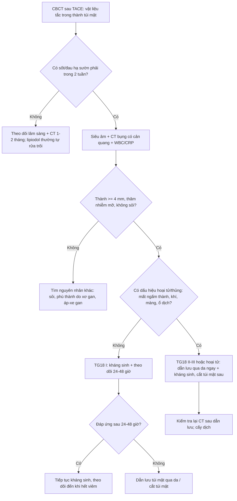
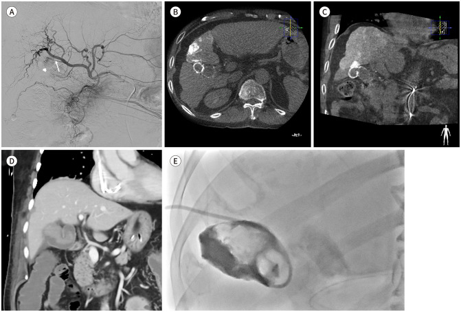
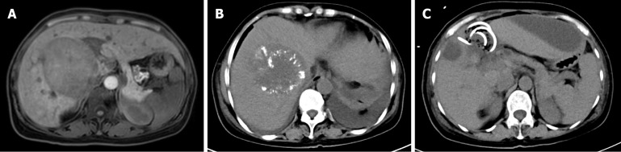
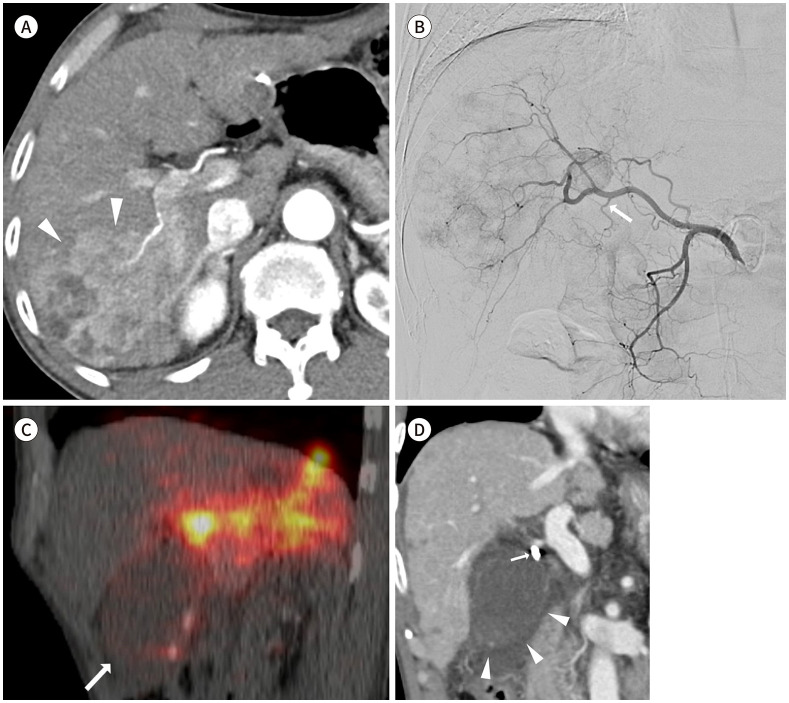

# 180 — Viêm túi mật THIẾU MÁU sau TACE (và sau TARE): lipiodol trong thành túi mật trên CBCT, ngưỡng thành 4 mm & khi nào phải can thiệp

**Tags:** `pattern:thanh-day` `pattern:viem-tui-mat` `vung:tui-mat` `protocol:TACE-CBCT` `score:TG18`
**Mức chắc chắn (certainty):** tổng hợp y văn (literature synthesis) — cohort 2.633 lần TACE có CBCT (Kim JY, *J Korean Soc Radiol*, PMC11009127), ca + tổng quan y văn 2025 (Chen YF, *World J Gastrointest Oncol*, PMC11866240), mô hình điểm CT cho viêm túi mật phức tạp (Chen Y, *Diagnostics*, PMC12293178), tổng quan biến chứng TARE (Kim GM, *J Korean Soc Radiol*, PMC12328914). Số liệu trích trực tiếp; chỗ chưa có số ghi "chưa rõ".

## 1. Tổng quan bệnh học – cơ chế hình ảnh

- **Vì sao túi mật "không có vốn dự phòng":** gan có **nguồn máu kép** (75% tĩnh mạch cửa + 25% động mạch gan), còn **túi mật chỉ có MỘT nguồn: động mạch túi mật** (thường từ **động mạch gan phải**, chia nhánh trước–sau). Vì vậy **tắc động mạch túi mật = thiếu máu toàn bộ thành túi mật** (Chen YF 2025), khác hẳn nhu mô gan chịu được tắc động mạch khu trú.
- **Cơ chế sau TACE:** vật liệu tắc (**lipiodol + gelatin, hoặc vi cầu DEB**) **trào ngược** vào động mạch túi mật khi đặt catheter ở **động mạch gan phải gần gốc/động mạch gan chung** → **thiếu máu thành túi mật** → viêm → **hoại tử/gangrene → thủng → viêm phúc mạc mật**. Đặt catheter **siêu chọn lọc** làm giảm nguy cơ nhưng **không loại trừ** (vẫn có trào ngược).
- **Cơ chế sau TARE khác:** không phải thiếu máu mà là **xạ lên thành túi mật** (túi mật nằm trong vùng chiếu xạ) → viêm túi mật do xạ; tổn thương thường **tự giới hạn** nhưng có thể **thủng thành**.
- **Số liệu định lượng (bắt buộc nhớ):**
  - Tần suất viêm túi mật cấp sau TACE: **0,3–10%** (tổng quan y văn, Chen YF 2025).
  - Cohort 2.633 lần TACE: **12 ca cần can thiệp/mổ = 0,45%**; nhưng nếu **CBCT ngay sau TACE thấy vật liệu tắc đọng trong thành túi mật** thì **12/120 = 10%** cần can thiệp/mổ (Kim JY 2024).
  - **Đặt catheter trực tiếp vào động mạch túi mật: OR 52** (95%CI 10,92–247,8; p < 0,001) cho viêm túi mật phải mổ — yếu tố nguy cơ mạnh nhất (Kim JY 2024).
  - **27/120** có hình ảnh CT điển hình; **15/27** tự hết bằng nội khoa; **12** phải can thiệp (9 cắt túi mật, 3 dẫn lưu qua da rồi cắt muộn); mổ trung bình **15 ngày** sau TACE (3–31 ngày) (Kim JY 2024).
  - Ở nhóm không mổ, **lipiodol được "rửa trôi" trên CT sau 1–2 tháng**, dày thành cũng giảm (Kim JY 2024) → **tồn tại lipiodol đơn thuần không phải chỉ định mổ**.
  - Sau TARE: biến chứng túi mật **2,4–24%**; viêm túi mật cần cắt **0,6%**, **1,8%** dày/tăng ngấm thành túi mật không triệu chứng, **0,9%** rách thành không triệu chứng (Atassi, dẫn trong Kim JY 2024).
- **Ngưỡng hình ảnh (để không đọc cảm tính):**
  - **Độ dày thành túi mật ≥ 4 mm** là ngưỡng phân biệt viêm túi mật phức tạp (giá trị trung bình **4,22 mm** ở nhóm nhẹ so với **6,74 mm** ở nhóm vừa/nặng) (Chen Y 2025).
  - **Đậm độ thành túi mật > 80 HU**, **thể tích túi mật > 125 cm³**, **biến đổi hoại tử (gangrene)**, **CRP > 3 mg/dL**, **WBC > 11.000/µL** → mỗi yếu tố 1–2 điểm, **tổng ≥ 2 điểm** gợi ý viêm túi mật phức tạp (AUC 0,775) (Chen Y 2025).
  - **Dấu hiệu hoại tử/thủng trên CT:** **ngấm thuốc thành không liên tục**, **khí trong thành/lòng túi mật**, **màng trong lòng**, **gián đoạn thành + ổ dịch/khí quanh túi mật** (Chen YF 2025).
- **TẠI SAO hình ảnh trông như vậy:** phù dưới niêm mạc → **dày thành kiểu "bánh sandwich" (lớp sáng–tối–sáng)**; viêm lan ra mỡ quanh túi mật → **thâm nhiễm mỡ (stranding)** và **mờ ranh giới túi mật–gan**; thiếu máu → **niêm mạc ngấm thuốc mạnh lúc đầu** rồi **mất ngấm từng vùng** khi hoại tử; lipiodol cản quang đọng lại trong thành → **điểm/từng đám tăng đậm độ rất cao (> 200 HU) trên CT không cản quang**.

## 2. Mẫu hình + chẩn đoán phân biệt theo vị trí (gamut)

**Mẫu hình cần nhận ra:** bệnh nhân **vừa TACE 3–14 ngày**, **sốt + đau hạ sườn phải**, CT có **thành túi mật dày ≥ 4 mm, thâm nhiễm mỡ quanh túi mật, có thể tăng đậm độ lipiodol trong thành**; **không sỏi** (thường).

**Gamut theo vị trí và bối cảnh:**

1. **Thân/đáy túi mật, không sỏi, sau can thiệp động mạch:** **viêm túi mật thiếu máu sau TACE/TARE** (chốt: lipiodol trong thành trên CBCT, catheter ở ĐM gan phải gần gốc).
2. **Cổ túi mật, có sỏi:** viêm túi mật do sỏi (calculous) — nguyên nhân phổ biến nhất ngoài can thiệp.
3. **Thành dày lan tỏa, không viêm:** **phù thành túi mật** do xơ gan/tăng áp cửa, suy tim, giảm albumin, viêm gan cấp, sốc — **không có thâm nhiễm mỡ, không sốt**.
4. **Hoại tử/thủng (mọi vị trí):** viêm túi mật **gangrenous**, **emphysematous**, thủng khu trú — biến chứng của cả 1–3.
5. **Thành dày khu trú, bờ không đều, xâm lấn gan:** **ung thư túi mật** (thường > 1 cm, mất lớp niêm mạc, hạch).
6. **Thành dày + nang nhỏ trong thành ("dấu chuỗi ngọc"):** **adenomyomatosis** — lành tính, không sốt.
7. **Thành dày + nốt/đại bào:** **viêm túi mật xanthogranulomatous** — giả u, khó phân biệt với ung thư bằng hình ảnh.
8. **Túi mật to, thành mỏng, xoắn cuống:** **xoắn túi mật (torsion)** — thường ở người già, đau đột ngột, không mạch cuống.

## 3. Bảng so sánh phân biệt (ma trận đối chiếu)

| Thực thể (entity) | Hình ảnh điển hình | Chốt vào (rule-in) | Chốt loại (rule-out) | Gợi ý xác nhận |
|---|---|---|---|---|
| **Viêm túi mật thiếu máu sau TACE** | Thành dày **≥ 4 mm**, thâm nhiễm mỡ quanh túi mật, **lipiodol tăng đậm độ trong thành**, không sỏi, xuất hiện **3–14 ngày** sau TACE | **CBCT sau TACE có vật liệu tắc trong thành túi mật + sốt/đau + thành dày** | Không có can thiệp gần đây, có sỏi cổ túi mật → nghĩ nguyên nhân khác | CBCT completion; US rồi CT; WBC/CRP; theo dõi 1–2 tuần |
| **Viêm túi mật do sỏi** | Sỏi **cổ túi mật**, thành dày, thâm nhiễm mỡ, dấu Murphy siêu âm | **Sỏi cổ túi mật + dày thành + thâm nhiễm mỡ** | Không sỏi, không thâm nhiễm mỡ → không điển hình | Siêu âm (sỏi, dấu Murphy), CT |
| **Phù thành túi mật (xơ gan/suy tim/giảm albumin)** | Thành dày **đều, đối xứng**, **không thâm nhiễm mỡ**, có dịch ổ bụng, TM cửa giãn | **Dày đều + bệnh nền + không sốt/không đau khu trú** | Có thâm nhiễm mỡ + sốt → viêm thật | CT 4 thì; albumin; siêu âm tim |
| **Viêm túi mật hoại tử (gangrenous)** | **Ngấm thuốc thành không liên tục**, **khí trong thành/lòng**, màng trong lòng, ổ dịch quanh túi mật | **Mất ngấm thuốc từng vùng + khí + màng trong lòng** | Thành ngấm đều, không khí → chưa hoại tử | CT có cản quang; mổ/dẫn lưu cấp |
| **Viêm túi mật do xạ (sau TARE)** | Thành dày/tăng ngấm **trong vùng chiếu xạ**, có thể **rách thành không triệu chứng**, thường tự giới hạn | **TARE gần đây + tổn thương khu trú vùng xạ + không sỏi** | Có vật liệu tắc trong thành trên CBCT sau TACE → thiếu máu, không phải xạ | So phim; theo dõi 4–8 tuần |
| **Ung thư túi mật** | Thành dày **khu trú, không đều, > 1 cm**, mất lớp niêm mạc, xâm lấn gan, hạch | **Khối thay thế thành + xâm lấn gan + hạch** | Thành dày đối xứng, giữ lớp → không phải u | MRI/CT 4 thì; sinh thiết khi còn nghi |
| **Adenomyomatosis** | Dày thành **khu trú**, **nang nhỏ trong thành**, "dấu chuỗi ngọc", không viêm | **Nang trong thành + không thâm nhiễm mỡ** | Có thâm nhiễm mỡ/sốt → viêm cấp | US (dày thành + nang), MRI |
| **Xoắn túi mật** | Túi mật **to, thành mỏng**, **không mạch cuống** trên Doppler, túi mật nằm ngoài giường gan | **Không có tín hiệu mạch cuống + túi mật di lệch** | Còn mạch cuống → không xoắn | Doppler; CT |

## 4. Protocol chụp + hệ phân độ/điểm chuẩn hóa

**Trong và ngay sau TACE — phòng ngừa + phát hiện sớm:**
- **CBCT trước và sau TACE là tiêu chuẩn:** CBCT "completion" phát hiện **vật liệu tắc trong thành túi mật** — nhóm nguy cơ **10%** viêm túi mật cần can thiệp (Kim JY 2024).
- **Kỹ thuật:** đặt catheter **siêu chọn lọc** vào nhánh nuôi u, tránh vị trí gần gốc **động mạch gan phải/động mạch gan chung**; **không** embolize động mạch túi mật trừ khi u được nuôi rõ từ nhánh này và đã cân nhắc.
- **Khi thấy lipiodol trong thành túi mật:** ghi vào hồ sơ, **theo dõi sát 2 tuần** (không mặc định phải mổ).

**Khi có triệu chứng (sốt/đau hạ sườn phải sau TACE):**
- **Siêu âm là bước đầu** (nhanh, tại giường) — nhưng **siêu âm có thể bình thường** trong ca đã có hoại tử (Chen YF 2025) → **không loại trừ bằng siêu âm bình thường**.
- **CT bụng có cản quang** là chuẩn để phân biệt **viêm đơn thuần vs phức tạp** (thành ≥ 4 mm, > 80 HU, khí, màng, gián đoạn thành, ổ dịch quanh túi mật).
- **Xét nghiệm:** WBC, CRP, bilirubin, men gan; **WBC > 11.000/µL** và **CRP > 3 mg/dL** là mốc gợi ý phức tạp (Chen Y 2025).
- **Phân độ TG18 (Tokyo Guidelines 2018):** **Grade I** — viêm nhẹ, không suy cơ quan; **Grade II** — WBC **> 18.000/mm³**, khối hạ sườn phải sờ thấy, triệu chứng **> 72 giờ**, viêm tại chỗ rõ (hoại tử, áp-xe, viêm phúc mạc); **Grade III** — **rối loạn chức năng cơ quan** (tim mạch, thần kinh, hô hấp, thận…).

**Điều trị (theo nguồn):**
- **Đa số tự hết:** 15/27 ca có hình ảnh viêm túi mật chỉ cần nội khoa (Kim JY 2024).
- **Chỉ định can thiệp:** triệu chứng không giảm sau 24–48 giờ kháng sinh, **TG18 II–III**, **hoại tử/thủng**, túi mật căng to. Lựa chọn: **dẫn lưu qua da (PTGBD)** ở bệnh nhân nặng/nguy cơ mổ cao, **cắt túi mật** (nội soi hoặc mở) khi ổn định.
- **Sau TARE:** phần lớn **theo dõi bảo tồn**; chỉ can thiệp khi có triệu chứng kéo dài/thủng.

## 5. Biến thể bình thường và cạm bẫy

- **Cạm bẫy số 1 — "hội chứng sau thuyên tắc" che mất chẩn đoán:** sốt + đau sau TACE gặp ở **20–90%** bệnh nhân và thường tự hết; nhưng **sốt/đau kéo dài > 1 tuần hoặc tăng dần** phải chụp CT tìm viêm túi mật/áp-xe (Chen YF 2025).
- **Cạm bẫy số 2 — siêu âm bình thường:** trong ca kinh điển của Chen YF, **siêu âm đầu tiên không bất thường**, CT ngày 10 mới thấy ổ giảm tỷ trọng + khí + dịch quanh túi mật. **Không loại trừ viêm túi mật bằng siêu âm âm tính.**
- **Cạm bẫy số 3 — thấy lipiodol trong thành là mổ:** **90%** trường hợp đọng vật liệu tắc trong thành túi mật **không cần can thiệp**; lipiodol tự rửa trôi sau **1–2 tháng**. Chỉ điều trị khi **có triệu chứng/hình ảnh phức tạp**.
- **Cạm bẫy số 4 — dày thành do xơ gan/cổ trướng:** bệnh nhân HCC thường có xơ gan, cổ trướng → thành túi mật dày **đều, không thâm nhiễm mỡ**. Đừng gọi viêm túi mật nếu thiếu **thâm nhiễm mỡ + sốt + đau khu trú**.
- **Cạm bẫy số 5 — bỏ sót hoại tử:** thành dày thoáng qua không sao, nhưng **mất ngấm thuốc từng vùng, khí trong thành, màng trong lòng** là dấu hiệu **phải can thiệp ngay** — đừng chờ đỡ sốt.
- **Cạm bẫy số 6 — nhầm với áp-xe gan/nhồi máu gan:** ổ dịch/khí sau TACE ở **gan** (không trong túi mật) là biến chứng khác, xử trí dẫn lưu + kháng sinh; xác định vị trí bằng mọi mặt phẳng, không chỉ một lát cắt.
- **Biến thể bình thường:** sau TARE, **tăng ngấm thành túi mật nhẹ, không triệu chứng** gặp ở **1,8%** và **rách thành không triệu chứng 0,9%** (Atassi, dẫn trong Kim JY 2024) — theo dõi, không mổ.

## 6. Tự lượng giá — Blind Quiz ngay trên trang tĩnh

**Ca 1 — Nam 64 tuổi, HCC phân thùy 4, TACE trực tiếp vào động mạch túi mật. (A) Chụp mạch; (B, C) CBCT sau TACE; (D) CT ngày 5; (E) chụp túi mật qua ống dẫn lưu.**

- Gợi ý lâm sàng: đau hạ sườn phải, sốt sau thủ thuật.
- Câu hỏi: (1) Ảnh B/C cho thấy gì trong thành túi mật? (2) Ảnh D có dấu hiệu gì? (3) Vì sao phải theo dõi sát nhóm này?

<b>Bấm để hiện đáp án (findings + chẩn đoán)</b>

- **Findings:** (A) u nhỏ ngấm thuốc (đầu mũi tên) được nuôi bởi **động mạch túi mật** (mũi tên); (B, C) CBCT sau TACE: **vật liệu tắc cản quang đọng trong thành túi mật** và trong u; (D) CT ngày 5: **thành túi mật dày, thâm nhiễm mỡ quanh túi mật** — viêm túi mật cấp; (E) tubogram qua ống dẫn lưu: **tắc ống túi mật + máu trong lòng túi mật**.
- **Chẩn đoán:** **viêm túi mật thiếu máu sau TACE** (do embolize trực tiếp động mạch túi mật).
- **Vì sao:** lipiodol trong thành trên CBCT + CT điển hình; nhóm này có **10%** nguy cơ cần can thiệp/mổ, và **đặt catheter trực tiếp động mạch túi mật làm tăng nguy cơ OR 52** (Kim JY 2024).
- **Nguồn ảnh:** Kim JY et al., *J Korean Soc Radiol* 2024, PMC11009127 Fig. 1 (CC BY-NC 4.0).

**Ca 2 — Nữ 51 tuổi, HCC + xơ gan HBV, sau lần TACE thứ 3: sốt cao, đau bụng, chướng bụng. Siêu âm bình thường. CT ngày 10.**

- Gợi ý lâm sàng: WBC 8,53 × 10⁹/L, neutrophil 80,9%, bilirubin 11,29 µmol/L.
- Câu hỏi: (1) Mô tả bất thường ở hố túi mật? (2) Chẩn đoán? (3) Bước xử trí?

<b>Bấm để hiện đáp án (findings + chẩn đoán)</b>

- **Findings:** (A) khối lớn vùng gan phải trước TACE; (B) **ổ giảm tỷ trọng hình tròn trong hố túi mật + khí + dịch thâm nhiễm quanh** = viêm túi mật **hoại tử/thủng khu trú**; (C) sau **chọc hút–dẫn lưu túi mật qua da** (ống pigtail).
- **Chẩn đoán:** **viêm túi mật thiếu máu sau TACE tiến triển hoại tử**, biến chứng viêm phúc mạc mật.
- **Vì sao:** bệnh cảnh sau TACE lần 3 + sốt/đau; **siêu âm bình thường không loại trừ**; khí trong hố túi mật + dịch quanh là dấu hiệu phức tạp, cần **dẫn lưu cấp** rồi cắt túi mật.
- **Nguồn ảnh:** Chen YF et al., *World J Gastrointest Oncol* 2025, PMC11866240 Fig. 1 (CC BY-NC 4.0). *Lưu ý: ảnh là ca nguyên văn, không điển hình ở chỗ siêu âm đầu tiên âm tính.*

**Ca 3 — Nam 65 tuổi, HCC xâm lấn, TARE Y-90 qua động mạch gan phải gần gốc. (D) CT sau TARE.**

- Gợi ý lâm sàng: đau hạ sườn phải sau TARE, không sỏi.
- Câu hỏi: (1) Bất thường túi mật trên ảnh D? (2) Cơ chế khác gì sau TACE? (3) Thái độ xử trí?

<b>Bấm để hiện đáp án (findings + chẩn đoán)</b>

- **Findings:** (D) **túi mật căng, thành dày** (đầu mũi tên), có **điểm cản quang cao** trong thành/vùng cổ túi mật (mũi tên) — hạt vi cầu.
- **Chẩn đoán:** **viêm túi mật sau TARE** (do xạ + một phần do phân bố vi cầu vào động mạch túi mật).
- **Vì sao:** sau TARE, biến chứng túi mật **2,4–24%** nhưng **đa số tự giới hạn**; khác TACE ở chỗ **không có hiệu ứng tắc mạch mạnh** nên ít hoại tử hơn — vẫn phải theo dõi vì có thể thủng thành.
- **Nguồn ảnh:** Kim GM, *J Korean Soc Radiol* 2025, PMC12328914 Fig. 4 (CC BY-NC 4.0).

## Bài liên quan chéo
- [179 – Hoại tử ống mật & cholangiopathy thiếu máu sau TACE/TARE/RFA](../179-bien-chung-duong-mat-sau-can-thiep-u-gan/lesson.md)
- [1801 – REILD sau TARE Y-90](../1801-benh-gan-do-thuyen-tac-phong-xa-reild/lesson.md)
- [130 – Túi mật: giải phẫu, sỏi, viêm & biến chứng](../130-tui-mat/lesson.md)
- [102 – Viêm túi mật & viêm tụy sau ERCP: TG18, PEP & cạm bẫy khí trong đường mật](../102-viem-tui-mat-va-viem-tuy-sau-stent-mat-ercp/lesson.md)
- [930 – Ung thư gan: TACE, RFA và nguyên lý can thiệp](../930-hepatic-oncology-tace-rfa/lesson.md)
- [910 – Dẫn lưu áp-xe & đường mật/niệu qua da](../910-abscess-biliary-nephrostomy/lesson.md)

## Ảnh
- `180_viem-tui-mat-thieu-mau_CT-CBCT_JKSRadiol2024-f1.jpg` — Kim JY et al., *J Korean Soc Radiol* 2024, PMC11009127 Fig. 1, **CC BY-NC 4.0**.
- `180_viem-tui-mat-hoai-tu_CT_WJGO2025-f1.jpg` — Chen YF et al., *World J Gastrointest Oncol* 2025, PMC11866240 Fig. 1, **CC BY-NC 4.0**.
- `180_viem-tui-mat-sau-TARE_CT_JKSRadiol2025-f4.jpg` — Kim GM, *J Korean Soc Radiol* 2025, PMC12328914 Fig. 4, **CC BY-NC 4.0**.
- Chi tiết nguồn/giấy phép: `images/CREDITS.md`.

> Không dùng để chẩn đoán độc lập khi chưa có người hướng dẫn.
