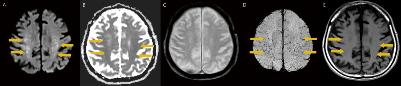
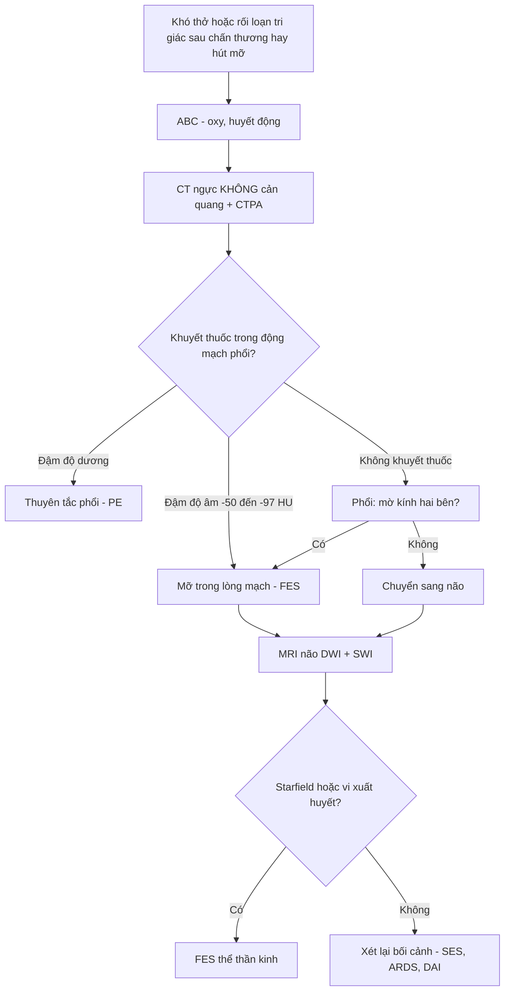
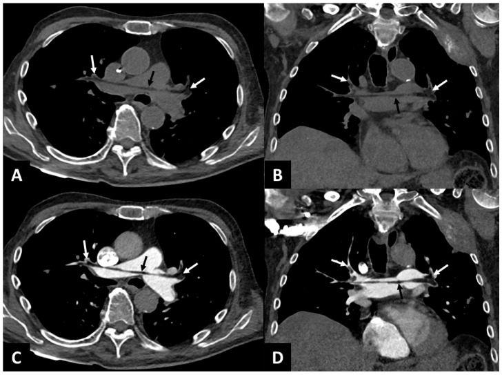
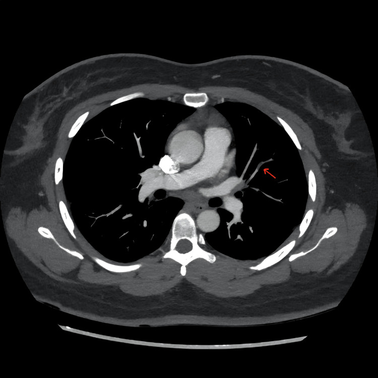

# 1800 — Tắc mạch mỡ (fat embolism syndrome, FES) sau chấn thương và sau hút mỡ – ghép mỡ mông

**Tags:** `pattern:mo-kinh-lan-toa` `pattern:starfield` `pattern:han-che-khuếch-tan` `pattern:tac-mach` `pattern:xuat-huyet-diem` `vung:phoi` `vung:nao` `vung:mo-mem` `protocol:CT-nguc-khong-can-quang` `protocol:CTA-phoi` `protocol:MRI-so-nao-DWI` `score:Gurd-Wilson`

**Mức chắc chắn (certainty):** tổng hợp y văn (literature synthesis) — ghép 1 đoàn hệ **3.475 ca gãy xương dài** (Eur J Trauma Emerg Surg 2026, PMC13046669, CC BY-NC-ND), 1 tổng quan (Trauma Surg Acute Care Open 2026, PMC13311676, CC BY-NC), 1 ca **tắc mạch mỡ động mạch phổi đo đậm độ −50 đến −97 HU** (Diagnostics 2025, PMC12523309, CC BY 4.0), 1 ca **FES ưu thế thần kinh có "starfield"** (BMC Neurol 2026, PMC13019804, CC BY 4.0) và 1 ca **sau hút mỡ** (Cureus 2026, PMC13227903, CC BY 4.0). Số nào nguồn không đưa thì ghi "chưa rõ".

> **Bài này trả lời 4 câu hỏi của ca "khó thở/rối loạn tri giác sau chấn thương hoặc sau hút mỡ":**
> (1) **Vì sao mỡ lại thấy được trên CT và MRI — và tại sao phải chụp KHÔNG cản quang?** (2) **Tam chứng Gurd thiếu một chân thì còn chẩn đoán được không?** (3) **Phân biệt với tắc mạch silicone (SES), thuyên tắc phổi (PE), ARDS nhiễm trùng và tổn thương sợi trục lan tỏa (DAI) bằng gì?** (4) **Điều trị nào thực sự đổi tiên lượng?**
> Đây là **bài riêng của FES**; [1698 – SES sau tiêm silicone mông](../1698-hoi-chung-tac-mach-silicone/lesson.md) phủ thể **silicone lỏng**, khác nguồn và khác đậm độ; [098](../098-barotrauma-tran-khi-ap-luc-tho-may/lesson.md) phủ khí ngoài phế nang.

## 1. Tổng quan bệnh học – cơ chế hình ảnh

### 1.1 Mỡ vào tuần hoàn bằng đường nào

- **Gãy xương dài/khung chậu:** tủy xương chứa mỡ và **xoang tĩnh mạch**; ổ gãy làm rách tĩnh mạch tủy → **giọt mỡ tự thân** vào tĩnh mạch → tim phải → **mao mạch phổi**. Giọt mỡ lớn hơn mao mạch (**~7–10 µm**) nên **bít cơ học**, sau đó **lipase** thủy phân triglycerid thành **acid béo tự do** → độc tế bào nội mô, hoạt hóa bạch cầu → phù và **mờ kính** hai bên.
- **Hút mỡ/ghép mỡ mông (liposuction, fat grafting):** đầu cannula đưa vào **mô mỡ dưới da** — nơi có đám rối tĩnh mạch; mỡ bị bơm/hút dưới áp lực có thể vào thẳng tĩnh mạch. Đây là đường vào **hoàn toàn ngoài xương**, nên **không có gãy xương** vẫn có FES (ca Cureus 2026, PMC13227903).
- **Vì sao có dạng "ưu thế thần kinh" không khó thở:** một phần vi giọt mỡ **qua shunt phải–trái (PFO)** hoặc qua **giường mao mạch phổi bị vượt** → vào tuần hoàn hệ thống → **vi nhồi máu não**. Ca PMC13019804: bệnh nhân **82 tuổi**, chỉ **rối loạn tri giác tiến triển**, **không triệu chứng hô hấp**, MRI mới lộ "starfield".
- **Thời điểm:** điển hình **24–72 giờ** sau chấn thương; thể sau hút mỡ có thể **rất sớm, trong vài giờ đầu** (PMC13227903 mô tả khởi phát sớm bất thường).

### 1.2 TẠI SAO mỡ "nhìn thấy được" trên CT — con số quyết định

- Trên **CT không cản quang**, mỡ có **đậm độ âm**: ca PMC12523309 đo trong lòng động mạch phổi **−50 HU** (ROI 5 mm²), nhánh phải **−84 HU** (ROI 10 mm²), nhánh trái **−97 HU** (ROI 21 mm²), các nhánh thùy trên **−95 HU**. Đây là **khuyết thuốc "âm"** — không phải huyết khối (thường dương, khoảng **+30 đến +50 HU**).
- **Trên CTPA (có cản quang)**, iod trộn vào làm mỡ **gần như đồng đậm với máu**, nên giọt mỡ chỉ còn hiện là **khuyết thuốc mềm** — **dễ bỏ** hoặc gọi nhầm là PE. Vì vậy **luôn giữ thì không cản quang** khi nghi FES; đó là điểm "chốt" của bài.
- **Phổi:** mờ kính **hai bên, đối xứng**, có thể "bão tuyết" (snowstorm); đông đặc phụ thuộc ở thể nặng; **không có bít tắc động mạch phổi lớn**.
- **Não:** vi nhồi máu → **phù tế bào** → **hạn chế khuếch tán** (DWI sáng, ADC tối) thành **nhiều nốt nhỏ rải rác** ở chất trắng, **thể chai**, **nhân xám trung ương**, **tiểu não** — mẫu hình **"starfield" (bầu trời sao)**. **SWI** thấy **vi xuất huyết** (đốm tối) và **nhạy hơn DWI** trong thể muộn; ca PMC13019804 ghi rõ **"imaging–clinical dissociation"**: MRI nặng lên trong khi bệnh nhân cải thiện.

### 1.3 Con số phải nhớ

- Trong **3.475 ca gãy xương dài**: FES **4,3% (148 ca)**, **tử vong trong viện 5,4%**; **gãy xương đùi** là yếu tố nguy cơ mạnh nhất (**aOR 4,63; KTC 95% 2,99–7,22**); **béo phì aOR 2,63 (1,33–4,93)**; **cố định xương sớm < 24 giờ bảo vệ (aOR 0,42; 0,25–0,71)**; **93,9%** ca FES cần hỗ trợ thông khí nâng cao (PMC13046669).
- **5%** bệnh nhân chấn thương năng lượng cao (gãy chậu/đùi) có **tắc mạch mỡ não trên MRI** dù không thành "hội chứng" đầy đủ (PMC13311676).
- **Tối đa 44%** ca FES cần **thông khí xâm nhập**; ECMO là cứu cánh trong ARDS nặng (PMC13311676).

## 2. Mẫu hình + chẩn đoán phân biệt theo vị trí (Gamut)

### 2.1 Gamut theo đường vào

- **Sau gãy xương dài/khung chậu** (thường nhất): gãy đùi, gãy nhiều xương, đóng đinh tủy.
- **Sau thủ thuật thẩm mỹ:** hút mỡ, **ghép mỡ mông (BBL)**, bơm mỡ tự thân; không có gãy xương.
- **Không do chấn thương:** thiếu máu hồng cầu hình liềm (hoại tử tủy), viêm tụy cấp, hoại tử tủy do steroid, truyền lipid, ghép tủy.

### 2.2 Gamut theo cơ quan — "ba tầng" của FES

- **Phổi (sớm nhất):** mờ kính hai bên → đông đặc; giảm oxy máu; **khuyết thuốc mỡ trong động mạch phổi** trên CT không cản quang.
- **Não (muộn hơn, tiên lượng):** "starfield" trên DWI, vi xuất huyết trên SWI, hôn mê/co giật; có thể **đơn độc**.
- **Da – mắt – thận:** **ban xuất huyết điểm** vùng cổ/ngực/nách (tiêu chuẩn chính), **đốm Purtscher** ở võng mạc, mỡ trong nước tiểu.

## 3. Bảng so sánh phân biệt (ma trận đối chiếu)

| Thực thể (entity) | Hình ảnh điển hình | Chốt vào (rule-in) | Chốt loại (rule-out) | Gợi ý xác nhận |
|---|---|---|---|---|
| **Tắc mạch mỡ (FES)** | CT không cản quang: **khuyết thuốc âm −50 đến −97 HU** trong động mạch phổi; phổi **mờ kính hai bên**; MRI não **starfield** (DWI sáng/ADC tối, SWI vi xuất huyết) | **Bối cảnh gãy xương dài/hút mỡ + giảm oxy + rối loạn tri giác ± ban điểm**; **đậm độ mỡ trong lòng mạch** trên CT không cản quang | Khuyết thuốc **dương** + không có nguồn mỡ → PE; tiêm silicone → SES; mờ phổi một thùy + sốt mủ → viêm phổi | Gurd–Wilson (≥ 2 chính hoặc 1 chính + 4 phụ); Schonfeld **> 5 điểm**; MRI DWI + SWI |
| **Tắc mạch silicone (SES)** | Phổi: **GGO + xuất huyết phế nang**, đông đặc phụ thuộc; **không có mỡ âm trong lòng mạch**; CT vùng tiêm: dày mỡ/dịch, khí dưới da | **Tiêm silicone lỏng 0–72 giờ** + suy hô hấp; đại thực mào chứa thể vùi trong BAL | Có **nguồn mỡ tự thân** (gãy xương/hút mỡ) → FES | BAL, mô học; bối cảnh thủ thuật |
| **Thuyên tắc phổi (PE)** | CTPA: **khuyết thuốc dương** trong động mạch phổi, có thể giãn thất phải; **không có mỡ âm** | **Khuyết thuốc dương + DVT/nguy cơ ung thư**; D-dimer cao | Khuyết thuốc **âm** (−50 đến −97 HU) → mỡ; ban điểm + tam chứng → FES | CTPA, siêu âm Doppler chi dưới |
| **ARDS nhiễm trùng** | Đông đặc phụ thuộc + GGO, **một ổ nhiễm rõ**, tràn dịch; tim bình thường | **Ổ nhiễm + sốt + bạch cầu + cấy dương**; Berlin ≤ 7 ngày | Bối cảnh gãy xương/hút mỡ không ổ nhiễm → FES | Cấy, BAL, procalcitonin |
| **DAI (tổn thương sợi trục lan tỏa)** | MRI: tổn thương **thể chai, cuống não, chất trắng sâu**, có thể vi xuất huyết; **không có mờ phổi** | **Chấn thương đầu nặng + cơ chế tăng-giảm tốc** | Có **GGO phổi + ban điểm + nguồn mỡ** → FES | MRI DWI/SWI, bối cảnh chấn thương |
| **Ngộ độc CO/thiếu oxy toàn thể** | Hai bên **nhân bèo**, vỏ não; DWI hạn chế khuếch tán | **Phơi nhiễm CO/ngạt**; không mỡ trong mạch phổi | Bối cảnh mỡ + ban điểm → FES | COHb, bối cảnh |

*Mẫu hình "starfield": DWI và ADC xác nhận hạn chế khuếch tán thật; SWI thấy vi xuất huyết nhiều hơn. Nguồn: BMC Neurol 2026 (PMC13019804), Fig. 1, CC BY 4.0.*

## 4. Protocol chụp + hệ tiêu chuẩn

### 4.1 Trình tự hình ảnh

1. **CT ngực không cản quang + CTPA trong cùng lần chụp** (lát **1 mm**): đo **ROI trong khuyết thuốc** — âm là mỡ; dương là huyết khối. Không bỏ thì không cản quang.
2. **MRI não** (không cần cản quang): **DWI + ADC + SWI/T2\*** + FLAIR. Chụp khi tri giác không giải thích được, kể cả khi không khó thở.
3. **Không dùng X-quang ngực để loại trừ** — X-quang có thể bình thường 24–48 giờ đầu.
4. **Siêu âm tim** nếu huyết động không ổn: tìm giãn/thất phải, shunt.

### 4.2 Tiêu chuẩn chẩn đoán

- **Gurd–Wilson:** **chính** = suy hô hấp (giảm oxy), rối loạn thần kinh, **ban xuất huyết điểm**; **phụ** = sốt, nhịp nhanh, vàng da, thay đổi huyết học (thiếu máu, giảm tiểu cầu). Chẩn đoán khi **≥ 2 tiêu chuẩn chính** hoặc **1 chính + 4 phụ**.
- **Schonfeld:** thang điểm định lượng; **> 5 điểm** ủng hộ FES (ban điểm lan tỏa 5 điểm, thâm nhiễm phế nang 4, giảm oxy 3; mỗi dấu không đặc hiệu 1 điểm).
- **Điều trị:** **hỗ trợ là chính** (oxy, thông khí bảo vệ phổi, huyết động); **cố định xương sớm < 24 giờ** là biện pháp dự phòng hiệu quả nhất; **corticoid còn tranh cãi**, không có lợi về tử vong; **ECMO** khi ARDS nặng thất bại thông khí.

## 5. Biến thể bình thường và cạm bẫy

- **Cạm bẫy 1 — bỏ thì không cản quang:** trên CTPA, mỡ **gần đồng đậm với iod** và chỉ còn là khuyết thuốc mềm; không đo ROI thì **không phân biệt được với PE** — và điều trị sẽ đi sai hướng (kháng đông đơn thuần thay vì hỗ trợ + cố định xương).
- **Cạm bẫy 2 — CT phổi bình thường 24 giờ đầu:** FES là bệnh **vi mạch**; GGO xuất hiện muộn hơn triệu chứng. **Không loại trừ** bằng CT sớm âm.
- **Cạm bẫy 3 — thể thần kinh đơn độc:** người già sa sút tri giác sau ngã được gán cho **delirium/đột quỵ/DAI**; nếu có gãy xương và **không giải thích được**, phải chụp **MRI DWI + SWI**.
- **Cạm bẫy 4 — "imaging–clinical dissociation":** MRI có thể **nặng lên** trong khi lâm sàng cải thiện (PMC13019804) — không đổi điều trị chỉ vì ảnh xấu hơn, và ngược lại không xuất viện sớm chỉ vì ảnh đẹp.
- **Cạm bẫy 5 — nhầm với SES:** cùng bệnh cảnh sau thủ thuật thẩm mỹ, nhưng **SES do silicone** có **khí/dịch tại chỗ tiêm** và **không có mỡ âm trong lòng mạch phổi**; hỏi kỹ **loại chất** đã tiêm/bơm.
- **Cạm bẫy 6 — coi ban xuất huyết điểm là bắt buộc:** ban điểm có thể **không có** hoặc khu trú khó thấy (nách, cổ, ngực); thiếu ban không loại trừ FES.
- **Biến thể bình thường:** **đốm tối trên SWI** ở người già có thể là **vi xuất huyết do tăng huyết áp/bệnh mạch nhỏ**; phải đối chiếu **phân bố** (thể chai, ranh giới chất trắng–vỏ, tiểu não) và bối cảnh.

## 6. Tự lượng giá — Blind Quiz

**Ca 1 — Nam 85 tuổi, gãy cổ xương đùi, ngừng tim trong mổ thay khớp, hồi phục sau 20 phút.**

- Gợi ý: không sốt, không đau ngực trước mổ; sau hồi phục tim vẫn khó thở.
- Câu hỏi: Khuyết thuốc trong động mạch phổi là gì? Đo gì để chứng minh? Vì sao CTPA có thể bỏ sót?

<b>Bấm để hiện đáp án (findings + chẩn đoán)</b>

- Findings: khuyết thuốc **âm** trong động mạch phổi và các nhánh: **−50 HU** (ROI 5 mm²), nhánh phải **−84 HU**, nhánh trái **−97 HU**, nhánh thùy trên **−95 HU**.
- Chẩn đoán: **tắc mạch mỡ động mạch phổi** trong mổ thay khớp — mỡ từ tủy xương vào tĩnh mạch tủy.
- Vì sao CTPA bỏ sót: iod trộn làm mỡ **gần đồng đậm**, chỉ còn khuyết thuốc mềm; **phải có thì không cản quang + ROI**.
- Nguồn ảnh: Diagnostics 2025 (PMC12523309), Fig. 1, CC BY 4.0.

**Ca 2 — Nam 82 tuổi, sa sút tri giác tiến triển sau gãy cổ xương đùi, KHÔNG khó thở.**

- Câu hỏi: Ba chẩn đoán phân biệt của "sa sút tri giác đơn độc sau ngã"? Chuỗi xung nào chốt? Vì sao không có triệu chứng hô hấp?

<b>Bấm để hiện đáp án (findings + chẩn đoán)</b>

- Findings: **nhiều ổ nhỏ hạn chế khuếch tán** (DWI sáng, ADC tối) ở chất trắng hai bán cầu, **thể chai**, **nhân xám trung ương**, **tiểu não**; **SWI nhiều đốm tối** (vi xuất huyết); T2/FLAIR tăng tín hiệu.
- Chẩn đoán: **FES thể ưu thế thần kinh** — vi giọt mỡ qua shunt phải–trái vào tuần hoàn hệ thống, gây vi nhồi máu não.
- Phân biệt: DAI (cơ chế tăng-giảm tốc, không mờ phổi), đột quỵ (theo lãnh thổ), delirium do thuốc/nhiễm.
- Nguồn ảnh: BMC Neurol 2026 (PMC13019804), Fig. 1, CC BY 4.0.

**Ca 3 — Nữ 38 tuổi, 6 giờ sau hút mỡ bụng–mông, khó thở, nhịp nhanh, đau ngực.**

- Câu hỏi: Vì sao khởi phát sớm không loại trừ FES? Cần chụp thêm gì? Điều trị nào đổi tiên lượng?

<b>Bấm để hiện đáp án (findings + chẩn đoán)</b>

- Findings: **khuyết thuốc rất mờ, giảm đậm độ** ở nhánh phân thùy động mạch phổi trái, rõ nhất ở **chỗ gấp khúc**; kèm nhịp nhanh, thiếu máu tiến triển 4 ngày (tan máu do mảnh mỡ), không giảm tiểu cầu.
- Chẩn đoán: **tắc mạch mỡ sau hút mỡ** — thể khởi phát sớm (vài giờ), khác mốc kinh điển 24–72 giờ.
- Chụp thêm: **MRI não DWI + SWI** (tìm starfield), **CT không cản quang** để đo đậm độ; theo dõi oxy, huyết động.
- Điều trị: hỗ trợ oxy/thông khí; **không có thuốc đặc hiệu**; corticoid chưa chứng minh giảm tử vong.
- Nguồn ảnh: Cureus 2026 (PMC13227903), Fig. 5, CC BY 4.0.

## Bài liên quan chéo
- [1698 – Hội chứng tắc mạch silicone sau tiêm mông](../1698-hoi-chung-tac-mach-silicone/lesson.md) (thể silicone, khác nguồn và đậm độ)
- [1688 – Siliconoma lan xa ngoài vú](../1688-siliconoma-lan-xa-ngoai-vu/lesson.md) (thể mạn)
- [098 – Barotrauma & tràn khí màng phổi áp lực](../098-barotrauma-tran-khi-ap-luc-tho-may/lesson.md) (chẩn đoán phân biệt cấp cứu hô hấp)
- [020 – Nốt phổi](../020-not-phoi/lesson.md) (mờ kính/nốt — không phải FES)
- [216 – Dị dạng mạch não & huyết khối xoang](../216-di-dang-mach-CVST/lesson.md) (phân biệt với vi nhồi máu do mỡ)

## Ảnh
- `images/1800_tac-mach-mo_CT_PMC12523309-Fig1.jpg` — CT ngực không cản quang, **CC BY 4.0**.
- `images/1800_tac-mach-mo_MRI_PMC13019804-Fig1.jpg` — MRI não DWI/ADC/T2/SWI/T1, **CC BY 4.0**.
- `images/1800_tac-mach-mo_CTPA_PMC13227903-Fig5.jpg` — CTPA nhánh phân thùy, **CC BY 4.0**.
- Chi tiết nguồn + giấy phép: `images/CREDITS.md`; link gốc trong `sources.md`.

> Không dùng để chẩn đoán độc lập khi chưa có người hướng dẫn.
