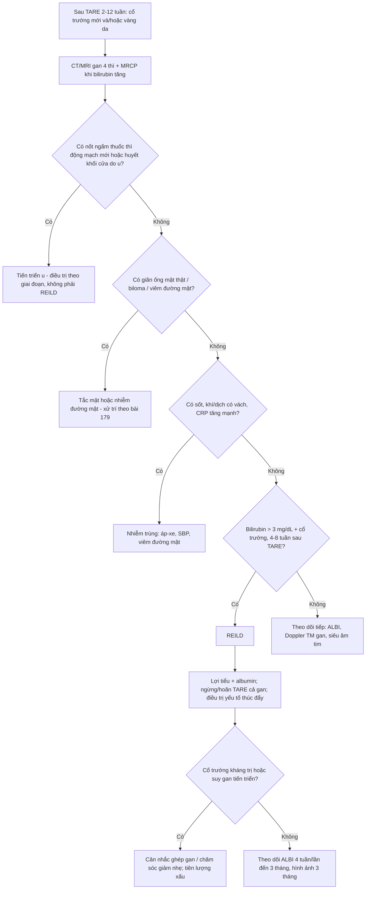
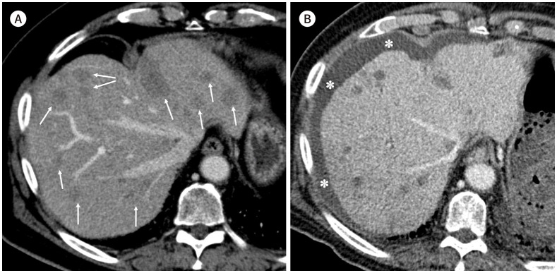
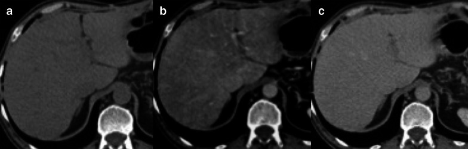

# 1801 — Bệnh gan do thuyên tắc phóng xạ (REILD) sau TARE Y-90: cổ trướng – vàng da 4–8 tuần, teo gan & phân biệt với tiến triển u

**Tags:** `pattern:co-truong` `pattern:suy-gan-sau-can-thiep` `vung:gan` `score:ALBI` `protocol:TARE-Y90` `protocol:CT-MRI-dong-hoc`
**Mức chắc chắn (certainty):** tổng hợp y văn (literature synthesis) — tổng quan biến chứng TARE 2025 (Kim GM, *J Korean Soc Radiol*, PMC12328914), tổng quan liều Y-90 2025 (Lee IJ, *Korean J Radiol*, PMC12235541), cohort TARE hai thùy 2023 (Jeschke M, *Cancers*, PMC10486761), định nghĩa REILD & ALBI 2021 (Lescure C, *Cancers*, PMC8345032), liều mô gan lành 2021 (Sankhla T, *Cancers*, PMC8508412). Số liệu trích trực tiếp; chỗ chưa có số ghi "chưa rõ".

## 1. Tổng quan bệnh học – cơ chế hình ảnh

- **Vì sao gọi là "bệnh gan do thuyên tắc phóng xạ":** TARE (transarterial radioembolization) đưa **vi cầu gắn Y-90** vào nhánh động mạch nuôi u. Tia β của Y-90 chỉ đi được **trung bình 2,5 mm, tối đa 10 mm** trong mô (Kim GM 2025) → tác dụng chủ yếu tại chỗ, nhưng **nhu mô gan lành quanh u vẫn nhận liều** (nhất là khi điều trị cả thùy/cả gan).
- **Chuỗi mô bệnh:** liều xạ lên **tế bào nội mô xoang gan** → **tắc xoang gan – tĩnh mạch nhỏ (veno-occlusive disease/SOS)** → ứ máu xoang + thiếu máu cục bộ tiểu thùy → **hoại tử tế bào gan** → giảm tổng hợp albumin, ứ mật trong tiểu quản, **tăng áp cửa sau xoang** → **cổ trướng**. Đây chính là **cùng cơ chế SOS/VOD** của bài [124](../124-benh-mach-mau-gan/lesson.md), chỉ khác tác nhân (xạ thay vì hóa chất/ghép tế bào gốc).
- **Định nghĩa thực hành (Sangro, dùng trong hầu hết nghiên cứu):** **vàng da với bilirubin > 3 mg/dL (51,3 µmol/L) + cổ trướng mới**, xuất hiện **4–8 tuần** sau TARE, **không có tiến triển u và không có tắc đường mật** (Lee IJ 2025; Lescure 2021). Thể muộn có thể tới **6 tháng** và dễ bị bỏ sót vì không còn mang nhãn "REILD" (Lee IJ 2025).
- **Tần suất — vì sao số liệu dao động rất rộng:**
  - Tổng quan 2025: **1,0–5,4%** (Kim GM 2025).
  - Tổng quan khác: **2,2–31%** tùy định nghĩa, kỹ thuật và nền bệnh gan (Jeschke 2023).
  - **Điều trị CẢ GAN một lần (single-session bilobar): 20/33 = 60,6%** có suy gan, trung vị **106 ngày** sau TARE (75,6 ngày sau thùy thứ hai); **chỉ bệnh nhân xơ gan** mới gặp; trung vị sống **5,2 tháng** so với **22,1 tháng** ở nhóm không suy gan (Jeschke 2023). → **Kỹ thuật quyết định nguy cơ hơn cả liều.**
  - Theo chức năng gan nền: **ALBI 1 → 3,4%** so với **ALBI 2–3 → 16,8%** REILD sau lần TARE đầu (OR **5,7**; 95%CI 1,6–19,5) (Lescure 2021).
  - Di căn đại tràng dùng vi cầu nhựa: **2/45 = 4,4%** REILD (Sankhla 2021).
- **Yếu tố nguy cơ định lượng (dùng để chọn bệnh nhân):**
  - **Bilirubin > 2 mg/dL hoặc cổ trướng không do u → không nên TARE** (Lee IJ 2025).
  - **Hoạt độ trên thể tích đích > 0,8 GBq/L** làm tăng biến cố gan (Gil-Alzugaray, dẫn trong Lee IJ 2025).
  - **Liều mô gan lành toàn bộ:** xơ gan Child–Pugh A chịu được **40–70 Gy với vi cầu thủy tinh**, nhưng chỉ **< 30–40 Gy với vi cầu nhựa** (đồng thuận chuyên gia, Lee IJ 2025). Mô hình NTCP: **75 Gy toàn gan lành → 15% nguy cơ suy gan**; ngưỡng hạ xuống **< 50 Gy nếu bilirubin > 1,1 mg/dL** và **< 90 Gy nếu bilirubin < 1,1 mg/dL** (Chiesa, dẫn trong Lee IJ 2025).
  - **Phần gan còn lại (FLR) ≥ 30% + giữ ít nhất 2 phân thùy liền nhau** (Lee IJ 2025).
  - **Hóa trị đồng thời/trước đó** (5-FU, capecitabine, oxaliplatin, irinotecan) làm tăng nhạy xạ của nhu mô gan (Kim GM 2025).
- **TẠI SAO hình ảnh trông như vậy:** cổ trướng là **dịch tỷ trọng nước (0–15 HU)**, nằm ở khoang phúc mạc quanh gan lách; gan **teo lại** vì hoại tử + xơ hóa tiểu thùy (đo được bằng giảm thể tích thùy được điều trị); vùng nhu mô tổn thương **ngấm thuốc không đồng nhất** do rối loạn tưới máu xoang; **không có ống mật giãn** vì tổn thương không phải tắc mật. Hình ảnh **không đặc hiệu** — chẩn đoán là **chẩn đoán loại trừ** dựa trên thời điểm + xét nghiệm + không có u sống.

## 2. Mẫu hình + chẩn đoán phân biệt theo vị trí (gamut)

**Mẫu hình cần nhận ra:** bệnh nhân **ổn định trước TARE**, sau **4–8 tuần (tới 6 tháng)** xuất hiện **cổ trướng mới ± vàng da**, trên nền **gan teo dần ở vùng được chiếu xạ**, **không có ống mật giãn, không có nốt ngấm thuốc mới**.

**Gamut theo cơ chế (mnemonic "U–MẬT–THUỐC–TIM–NHIỄM"):**

1. **U (progression):** u gan tiến triển, huyết khối tĩnh mạch cửa do u, di căn phúc mạc gây cổ trướng ác tính. Chốt: **nốt ngấm thuốc thì động mạch mới / LR-TR Viable** (bài [121](../121-khoi-gan-LIRADS/lesson.md)).
2. **MẬT (biliary):** hoại tử ống mật/cholangiopathy thiếu máu, hẹp đường mật, biloma, viêm đường mật (bài [179](../179-bien-chung-duong-mat-sau-can-thiep-u-gan/lesson.md)). Chốt: **giãn ống mật trong gan + bilirubin tăng trước**, sốt/đau.
3. **THUỐC (drug/chemotherapy):** SOS do oxaliplatin (bệnh cảnh "gan xanh"/tăng áp cửa), viêm gan do thuốc miễn dịch, TACE trước đó. Chốt: **tiền sử hóa chất + loang lổ bắt thuốc dạng bản đồ** (bài [124](../124-benh-mach-mau-gan/lesson.md)).
4. **TIM (cardiac/portal):** suy tim phải, huyết khối tĩnh mạch cửa, xơ gan mất bù tự nhiên. Chốt: **TM cửa giãn + đảo chiều dòng, TM gan giãn, phù chi, JVP cao** (bài [127](../127-gan-tim-suy-tim-phai/lesson.md)).
5. **NHIỄM (infection):** áp-xe gan, viêm phúc mạc nhiễm khuẩn nguyên phát (SBP), viêm đường mật. Chốt: **sốt + bạch cầu/CRP tăng, khí/dịch có vách trong ổ**.

**Mẫu hình "hội chứng sau thuyên tắc" (post-embolization syndrome)** hay bị đặt nhầm vào gamut này: **sốt, đau, buồn nôn trong 1–7 ngày đầu**, **không cổ trướng, không tăng bilirubin đáng kể**, tự hết — khác hẳn REILD về **thời điểm**.

## 3. Bảng so sánh phân biệt (ma trận đối chiếu)

| Thực thể (entity) | Hình ảnh điển hình | Chốt vào (rule-in) | Chốt loại (rule-out) | Gợi ý xác nhận |
|---|---|---|---|---|
| **REILD** | Cổ trướng **mới**; gan teo vùng xạ; ngấm thuốc không đồng nhất; **không giãn ống mật**; không nốt mới | **Cổ trướng/vàng da 4–8 tuần sau TARE + bilirubin > 3 mg/dL + loại trừ u tiến triển & tắc mật** | Có nốt ngấm mạnh thì động mạch mới → tiến triển u; có giãn ống mật → tắc mật | LFT/ALBI mỗi 2–4 tuần; CT/MRI 4 thì; đối chiếu liều & thể tích gan xạ |
| **Tiến triển u (LR-TR Viable)** | Nốt/tổn thương **ngấm thuốc thì động mạch**, bờ không đều, có thể xâm lấn TM cửa | **Ngấm thuốc điển hình u sống + tăng AFP** | Nhu mô ngấm không đồng nhất **không có nốt** + AFP ổn định → không phải tiến triển | MRI gadoxetic 4 thì; so phim trước; AFP |
| **Tắc/hẹp đường mật (BDN, stricture)** | **Giãn ống mật trong gan** thuôn ngoại vi; có thể biloma/hẹp rốn gan | **Giãn ống mật thật trên MRCP/US + bilirubin tăng sớm** | Không giãn ống mật → loại tắc mật | MRCP; ALP tăng sớm (bài 179) |
| **SOS do hóa chất (oxaliplatin)** | **Loang lổ bắt thuốc dạng bản đồ** thì cửa; gan to; tăng áp cửa; nốt FNH-like | **Tiền sử oxaliplatin + mô hình bản đồ + lách to** | Không có tiền sử hóa chất, tổn thương khu trú theo vùng xạ → nghĩ REILD | MRI: phù quanh TM cửa, tăng tín hiệu T2 vùng rìa; đánh giá lách |
| **Suy tim phải / bệnh gan tim** | **TM gan giãn**, TM cửa giãn, gan to "nutmeg", phù, tràn dịch màng phổi | **TM gan giãn + JVP cao + BNP** | TM gan bình thường, không phù → loại | Doppler TM gan (phổ 3 pha), siêu âm tim |
| **Huyết khối tĩnh mạch cửa** | Khuyết thuốc trong lòng TM cửa, **cavernous transformation** nếu mạn | **Khuyết thuốc lòng mạch + bàng hệ** | Lòng TM cửa thông tốt → loại | CT động học; Doppler |
| **Áp-xe / SBP / viêm đường mật** | Ổ dịch bờ dày ± khí; dịch phúc mạc có vách/khí; dày thành túi mật | **Sốt + bạch cầu/CRP tăng + khí/dịch có vách** | Không sốt, dịch trong, không khí → không nhiễm | Chọc hút/cấy dịch; CT |
| **Hội chứng sau thuyên tắc** | Không có cổ trướng; CT gần như bình thường | **Sốt/đau trong 7 ngày đầu, tự hết** | Triệu chứng sau 2–4 tuần + cổ trướng → không phải hội chứng này | Theo dõi lâm sàng, không cần hình ảnh lặp |

## 4. Protocol chụp + hệ phân độ/điểm chuẩn hóa

**Trước TARE — chọn bệnh nhân (phòng REILD là chính):**
- **Bilirubin ≤ 2 mg/dL**, không cổ trướng không do u; **Child–Pugh A–B7**, **ALBI 1** là nhóm an toàn nhất.
- **Thể tích u < 50% gan**, **FLR ≥ 30%** và giữ **≥ 2 phân thùy liền nhau**.
- **Lập kế hoạch liều:** đánh giá phân bố vi cầu (MAA scan), tính liều **mô gan lành (NTL)** — mục tiêu **< 30–40 Gy với vi cầu nhựa**, **40–70 Gy với vi cầu thủy tinh** ở Child–Pugh A; hạ ngưỡng khi bilirubin > 1,1 mg/dL.
- **Ưu tiên điều trị theo thùy/phân thùy, tuần tự** thay vì cả gan một lần — đây là can thiệp làm giảm REILD rõ nhất (Jeschke 2023).

**Sau TARE — theo dõi:**
- **Xét nghiệm gan (bilirubin, albumin, ALBI, INR) lúc nền, 2 tuần, 4 tuần, rồi mỗi 4 tuần đến 3 tháng**, sau đó mỗi 3 tháng. **ALBI đổi trước bilirubin** (37,2% bệnh nhân xấu đi ALBI sau một lần TARE — Lescure 2021).
- **Hình ảnh:** CT/MRI gan 4 thì **1 tháng, 3 tháng**, sau đó mỗi 3 tháng; đọc **cả đáp ứng u (LI-RADS treatment response) lẫn nhu mô gan lành** (thể tích, cổ trướng, phù quanh TM cửa).
- **Siêu âm** khi nghi cổ trướng/tắc mật; **MRCP** nếu bilirubin tăng để loại tắc mật trước khi gán cho REILD.
- **Đo thể tích gan** trên cùng mặt phẳng/cùng thì để phát hiện teo tiến triển (không đo bằng mắt).

**Điều trị (theo nguồn):**
- **Không có thuốc đặc hiệu.** Điều trị hỗ trợ: **lợi tiểu + albumin**, kiểm soát nhiễm trùng, ngừng thuốc gây độc gan.
- **Dự phòng bằng ursodeoxycholic acid + methylprednisolone giảm liều trong 2 tháng** (bắt đầu ngày TARE) chỉ từ **một nghiên cứu một nhánh**, **chưa được xác nhận tiền cứu** (Kim GM 2025) — không dùng thường quy.
- **Không lặp TARE cả gan** khi đã có REILD; nếu cần điều trị tiếp, chọn **vùng đích nhỏ hơn** hoặc phương thức khác.
- **Tiên lượng:** REILD làm tăng nguy cơ tử vong **HR 3,5** (95%CI 1,4–8,6) và rút ngắn sống còn rõ rệt (5,2 so với 22,1 tháng — Jeschke 2023).

## 5. Biến thể bình thường và cạm bẫy

- **Cạm bẫy số 1 — "teo gan là đáp ứng tốt":** teo thùy được xạ **có thể là dấu hiệu tổn thương**, không phải lúc nào cũng là điều trị hiệu quả. Phải đọc **kèm cổ trướng, albumin, bilirubin, thể tích gan lành còn lại**.
- **Cạm bẫy số 2 — gán cổ trướng cho xơ gan nền:** bệnh nhân TARE thường có xơ gan; cổ trướng **mới** sau 4–8 tuần ở người **trước đó không có cổ trướng** phải coi là REILD cho đến khi loại trừ.
- **Cạm bẫy số 3 — bilirubin bình thường ở tuần 2:** REILD có thể khởi phát **sau 4–8 tuần**, thậm chí **tới 6 tháng**; một lần xét nghiệm bình thường không loại trừ. **ALBI/albumin đổi sớm hơn**.
- **Cạm bẫy số 4 — nhầm với tiến triển u:** nhu mô ngấm thuốc **loang lổ, không tạo khối** khác với **nốt ngấm mạnh thì động mạch** của u sống. Đừng đổi điều trị vì "bắt thuốc không đều" mà chưa so phim và đo AFP.
- **Cạm bẫy số 5 — hội chứng sau thuyên tắc:** sốt/đau trong tuần đầu là **bình thường**; nhưng **sốt + đau kéo dài > 2 tuần** phải loại áp-xe/viêm đường mật, không được mặc định là hội chứng sau thuyên tắc.
- **Cạm bẫy số 6 — bỏ sót tắc mật:** bilirubin tăng do REILD **không kèm giãn ống mật**; nếu **có giãn ống mật**, nguyên nhân là tắc mật (bài 179) và điều trị khác hoàn toàn.
- **Biến thể bình thường:** sau TARE, **vùng rìa thùy được xạ giảm ngấm thuốc nhẹ, đều, không tạo khối** và **không kèm cổ trướng** — theo dõi, không can thiệp.

## 6. Tự lượng giá — Blind Quiz ngay trên trang tĩnh

**Ca 1 — Nam 75 tuổi, di căn gan đa ổ của u thần kinh nội tiết, TARE Y-90 liều đích 120 Gy cho TOÀN GAN. Trước thủ thuật chức năng gan bình thường, Child–Pugh A. Ảnh (A) trước, (B) sau 11 tuần.**

- Gợi ý lâm sàng: không sốt, không đau bụng; bilirubin 5,5 mg/dL, albumin 2,2 g/dL, Child–Pugh C.
- Câu hỏi: (1) Hai dấu hiệu chính trên ảnh B là gì? (2) Vì sao không nghĩ tiến triển u? (3) Chẩn đoán và yếu tố nguy cơ chính?

<b>Bấm để hiện đáp án (findings + chẩn đoán)</b>

- **Findings:** (A) nhiều ổ di căn giảm tỷ trọng rải rác hai thùy (mũi tên); (B) sau 11 tuần: **thể tích gan giảm** và **cổ trướng mới** (dấu *) quanh gan/lách. Nhu mô gan **không có nốt ngấm thuốc mới**, **không giãn ống mật**.
- **Chẩn đoán:** **REILD** sau TARE **toàn gan một lần**.
- **Vì sao:** đúng **thời điểm 4–8 tuần (ở đây 11 tuần)**, bilirubin **5,5 mg/dL** (> 3 mg/dL) + cổ trướng mới, **không có u sống/tắc mật**. Yếu tố nguy cơ chính là **điều trị cả gan trong một lần** — trong cohort bilobar, 60,6% bệnh nhân suy gan (Jeschke 2023).
- **Nguồn ảnh:** Kim GM, *J Korean Soc Radiol* 2025, PMC12328914 Fig. 1 (CC BY-NC 4.0).

**Ca 2 — Nam 64 tuổi, ung thư đại tràng di căn gan, đang dùng oxaliplatin. CT (a) trước tiêm, (b) thì tĩnh mạch cửa, (c) thì muộn.**

- Gợi ý lâm sàng: không vàng da; xét nghiệm gan tăng nhẹ; lách to.
- Câu hỏi: (1) Mô tả kiểu bắt thuốc ở thì cửa? (2) Cơ chế? (3) Vì sao đây là hàng phân biệt của REILD?

<b>Bấm để hiện đáp án (findings + chẩn đoán)</b>

- **Findings:** thì cửa **bắt thuốc loang lổ, dạng bản đồ (map-like/patchy)**, xen vùng giảm và tăng ngấm, không tạo khối; thì muộn cân bằng dần.
- **Chẩn đoán:** **tắc xoang gan (SOS/VOD) do oxaliplatin** — cùng cơ chế tổn thương nội mô xoang như REILD.
- **Vì sao quan trọng:** khi bệnh nhân sau TARE có **tiền sử oxaliplatin**, hình ảnh "bản đồ" này có thể **cộng thêm** vào tổn thương xạ; ngược lại, REILD thuần túy thường chỉ có **cổ trướng + teo gan**, không có mảng bản đồ rõ. Phân biệt bằng **bối cảnh thuốc + phân bố theo vùng tưới máu**.
- **Nguồn ảnh:** Albano D et al., *Insights Imaging* 2021, PMC8192650 Fig. 15 (CC BY 4.0).

## Bài liên quan chéo
- [124 – Bệnh mạch máu gan: Budd-Chiari, tắc xoang gan (SOS/VOD) & huyết khối tĩnh mạch cửa](../124-benh-mach-mau-gan/lesson.md)
- [179 – Hoại tử ống mật & cholangiopathy thiếu máu sau TACE/TARE/RFA](../179-bien-chung-duong-mat-sau-can-thiep-u-gan/lesson.md)
- [121 – LI-RADS: đọc đáp ứng điều trị (LR-TR) trên CT/MRI](../121-khoi-gan-LIRADS/lesson.md)
- [127 – Gan tim & tăng áp cửa do tắc nghẽn dòng ra](../127-gan-tim-suy-tim-phai/lesson.md)
- [930 – Ung thư gan: TACE, RFA và nguyên lý can thiệp](../930-hepatic-oncology-tace-rfa/lesson.md)
- [1806 – Viêm phổi do xạ sau TARE: kính mờ quanh rốn phổi & ngưỡng liều phổi](../1806-viem-phoi-do-xa-sau-tare/lesson.md)

## Ảnh
- `1801_REILD_CT_JKSRadiol2025-f1.jpg` — Kim GM, *J Korean Soc Radiol* 2025, PMC12328914 Fig. 1, **CC BY-NC 4.0**.
- `1801_SOS-loang-lo_CT_InsightsImaging2021-f15.jpg` — Albano D et al., *Insights Imaging* 2021, PMC8192650 Fig. 15, **CC BY 4.0**.
- Chi tiết nguồn/giấy phép: `images/CREDITS.md`.

> Không dùng để chẩn đoán độc lập khi chưa có người hướng dẫn.
