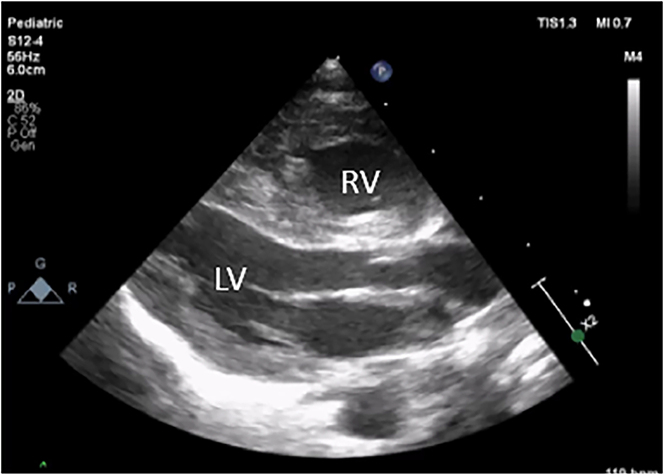
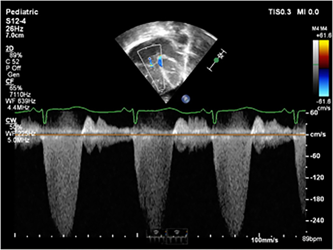
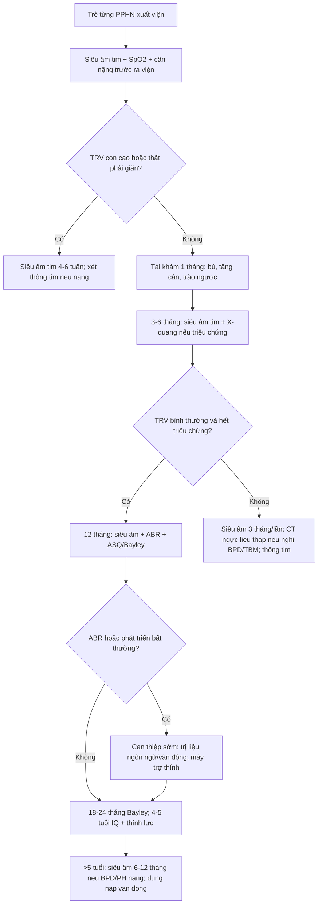

# 1802 — Theo dõi dài hạn sau PPHN: tăng áp phổi tái phát, phát triển thần kinh & nghe kém / Long-term follow-up after persistent pulmonary hypertension of the newborn

**Tags:** `pattern:tang-ap-phoi` `pattern:phi-dai-that-phai` `vung:phoi-nhi` `vung:tim` `anatomy:tim-phai` `protocol:Sieu-am-tim` `protocol:CT-nguc-lieu-thap` `protocol:MRI-nao` `protocol:ABR` `incidentaloma:khong`
**Mức chắc chắn (certainty):** tổng hợp y văn (literature synthesis) — ghép **đoàn hệ 55 trẻ PPHN 1–5 tuổi** (Front Pediatr 2024, PMC11538055), **tổng quan biến chứng muộn của tăng áp phổi sơ sinh** (Clin Perinatol 2024, PMC10850767), **ca PPHN do đóng ống động mạch sớm** (Case Rep Perinat Med 2024, PMC12048142), **tổng quan hình ảnh BPD** (Pediatr Radiol 2022, PMC8921108), **đoàn hệ HRCT BPD** (Front Pediatr 2022, PMC9530466), **khảo sát liều bức xạ ở trẻ tăng áp phổi** (Pulm Circ 2023, PMC10442605) và **protocol siêu âm tim trong tăng áp phổi nhi** (Pulm Circ 2016, PMC4860554). Không có ca do nhóm tự chụp.

> **Câu hỏi thực hành:** bé gái **34 tuần**, PPHN nặng phải dùng **iNO 4 ngày**, xuất viện tuần thứ 5. Cha mẹ hỏi: *“Bệnh đã khỏi chưa, có phải tái khám không, và vì sao bác sĩ hẹn đo thính lực?”*
> Bài chốt **bốn quyết định**: **(1) PPHN không phải bệnh “khỏi khi ra viện” — 25% trẻ có di chứng phát triển thần kinh ở 18–24 tháng và 6,4% có nghe kém tiếp nhận ở tuổi đi học; (2) siêu âm tim là công cụ theo dõi tăng áp phổi, đo TRV → RVSP, không chỉ “xem tim có to không”; (3) CT ngực liều thấp + MRI/CT động chỉ khi có chỉ định rõ, vì mỗi trẻ tăng áp phổi nhận trung bình 73 lần chụp có bức xạ; (4) nghe kém sau PPHN xuất hiện muộn và tiến triển — phải đo ABR lại, không dựa vào sàng lọc sơ sinh.** Nối [607 – PPHN cấp](../607-tang-ap-phoi-so-sinh-pphn/lesson.md), [686 – Tăng áp phổi trong bệnh phổi mạn nhi](../686-tang-ap-luc-dong-mach-phoi-benh-phoi-man-nhi/lesson.md), [602 – TBM ở trẻ BPD](../602-tracheobronchomalacia-o-tre-bpd/lesson.md), [654 – Tổn thương não sơ sinh không do ngạt](../654-ton-thuong-nao-so-sinh-khong-do-ngat/lesson.md).

## 1. Tổng quan bệnh học – cơ chế hình ảnh: vì sao PPHN để lại di chứng ở phổi, não và tai

- **Bản chất PPHN:** sau sinh, sức cản mạch phổi (pulmonary vascular resistance, PVR) phải **giảm nhanh** để máu qua phổi. Khi PVR **không giảm** (hoặc tăng lại), máu đi tắt qua **ống động mạch (ductus arteriosus)** và **lỗ bầu dục (foramen ovale)** từ phải sang trái → **giảm oxy máu** dù thông khí bình thường. Tần suất **~0,2% trẻ đủ tháng (2/1.000)** và **2–8% trẻ sinh non** (Clin Perinatol 2024, PMC10850767).
- **Vì sao phải theo dõi lâu dài — bốn trục tổn thương:**
  - **Tim–phổi:** tăng áp phổi tồn tại/tái phát, phì đại thất phải, suy tim phải; ở trẻ sinh non là **BPD-PH**.
  - **Não:** thiếu oxy–tưới máu não không đều trong giai đoạn cao điểm bệnh → **chậm phát triển, bại não, giảm IQ, rối loạn ngôn ngữ–hành vi**.
  - **Tai:** **nghe kém tiếp nhận (sensorineural hearing loss, SNHL)**, thường **xuất hiện muộn và tiến triển**.
  - **Dinh dưỡng–tăng trưởng:** bú kém, trào ngược, chậm tăng cân, tái nhập viện vì hô hấp.
- **Con số phải nhớ (đủ tháng/đủ gần tháng):**
  - **Di chứng phát triển thần kinh (neurodevelopmental impairment, NDI) ~25%** ở 18–24 tháng; **bại não (cerebral palsy) trung bình–nặng 3,8%** (Clin Perinatol 2024, PMC10850767).
  - Ở tuổi đi học (109 trẻ): **IQ < 70: 9,2%**, **IQ 70–84: 7,4%**, **SNHL: 6,4%**, **24%** có vấn đề hô hấp/ăn uống kéo dài (Clin Perinatol 2024, PMC10850767).
  - Đoàn hệ Pháp 55 trẻ 1–5 tuổi: **47,3%** có điểm ASQ-3 ở mức **ranh giới/nghi bệnh** (**18% nghi bệnh**, **29% ranh giới**); **72%** trẻ 12–24 tháng có điểm bất thường, nhưng **85,7%** trẻ 48–60 tháng đã bình thường (Front Pediatr 2024, PMC11538055).
- **Yếu tố dự báo NDI — định lượng:** mỗi **1% giảm SpO₂ trước ống (preductal)** làm **tăng 10%** nguy cơ điểm ASQ-3 bất thường (**OR 1,1; 95% CI 1,04–1,18**); nhóm bất thường có SpO₂ tối thiểu **75,4 ± 13,4%** so với **82,2 ± 9,8%** ở nhóm bình thường (P = 0,02). Đây là lý do **phải ghi lại SpO₂ xấu nhất trong đợt cấp** vào hồ sơ theo dõi (Front Pediatr 2024, PMC11538055).
- **TẠI SAO hình ảnh phản ánh đúng mức nặng:** tăng áp phổi → **thất phải dày/giãn**, **vách liên thất phẳng thì tâm thu (D-shaped LV)**, **giãn động mạch phổi**; trên CT, phổi BPD mất đàn hồi, ứ khí và xơ hóa quanh đường thở → **giảm thể tích chức năng, tăng áp lực đường thở**, càng nuôi dưỡng vòng xoắn tăng áp phổi. Trên MRI não, tổn thương **chất trắng/vỏ–hạch nền** do thiếu oxy–tưới máu giải thích NDI; mức nặng trên hình ảnh **tỉ lệ thuận** với di chứng.
- **Ngưỡng tiên lượng bằng hình ảnh (ECMO):** NDI **57%** nếu tổn thương nặng trên neuroimaging, **33%** mức trung bình, **13%** mức nhẹ, **10%** khi không có tổn thương (Clin Perinatol 2024, PMC10850767). Nghĩa là **hình ảnh âm tính không loại trừ NDI**, nhưng hình ảnh nặng là **cờ đỏ** cần can thiệp sớm.
- **BPD-PH — nhánh song song:** tử vong trong viện **6–38%**, **gấp ~5 lần** nguy cơ tử vong trước xuất viện so với BPD đơn thuần; tử vong tích lũy **40% ở 2 năm**; nhưng **phần lớn trẻ sống sót hết tăng áp phổi trước 2,5 tuổi** (Clin Perinatol 2024, PMC10850767). Điều này quyết định **thời điểm ngừng theo dõi**, không phải ngừng ngay khi hết triệu chứng.

## 2. Mẫu hình + chẩn đoán phân biệt theo thời điểm (Gamut)

- **0–6 tháng — “tăng áp phổi còn tồn tại”:** khó cai oxy, tăng nhu cầu thở, bú kém; siêu âm tim thấy **TRV còn cao, thất phải giãn, vách phẳng**. Phân biệt với **shunt trái–phải còn tồn tại (PDA/VSD)**, **hẹp tĩnh mạch phổi (pulmonary vein stenosis)**, **bệnh phổi nhu mô nặng**.
- **6–24 tháng — “tái phát theo đợt”:** tăng áp phổi bùng lên khi **nhiễm virus, hít sặc, xẹp phổi, thiếu máu**; ở trẻ non tháng là **BPD-PH + TBM** — đây là giai đoạn tử vong cao nhất của BPD-PH.
- **2–5 tuổi — “di chứng phát triển”:** ngôn ngữ, vận động tinh, hành vi; nghe kém; đo Bayley/ASQ-3.
- **> 5 tuổi — “di chứng học tập & tăng áp phổi khi gắng sức”:** IQ, học hòa nhập, khả năng dung nạp vận động, tăng áp phổi khi gắng sức ở trẻ từng BPD nặng.
- **Gợi nhớ H.E.A.R. (bốn việc của mỗi lần tái khám):** **H**earing (thính lực/ABR) · **E**chocardiography (TRV, RVSP, chức năng thất phải) · **A**irway & lung (triệu chứng, SpO₂, X-quang/CT khi cần) · **R**ehabilitation & growth (Bayley/ASQ-3, dinh dưỡng, can thiệp sớm).
- **Gamut nguyên nhân tăng áp phổi “mới xuất hiện” ở trẻ từng PPHN:** PH tồn tại · BPD-PH · shunt trái–phải · hẹp tĩnh mạch phổi · bệnh cơ tim · tắc mạch phổi (hiếm) · **tăng áp phổi do mất thanh thải khí (TBM)** · thiếu máu/loạn sản phổi.

## 3. Bảng so sánh phân biệt (ma trận đối chiếu)

| Thực thể | Hình ảnh điển hình | Chốt vào (rule-in) | Chốt loại (rule-out) | Gợi ý xác nhận |
|---|---|---|---|---|
| **PH tồn tại sau PPHN** | Siêu âm: TRV cao, RVSP tăng, thất phải dày/giãn, vách phẳng thì tâm thu, PAAT ngắn | **TRV ≥ 2,8 m/s kéo dài nhiều lần khám + RVSP > 35 mmHg + thất phải giãn** | TRV thấp, vách không phẳng, PAAT bình thường, RVSP < 30 mmHg khi trẻ khỏe | Siêu âm tim lặp lại ở trạng thái ổn định; thông tim khi cần PVR |
| **BPD-PH** | Trẻ non tháng, BPD độ 2–3; tim to phải, ĐM phổi giãn; CT phổi ứ khí + xơ quanh đường thở | **BPD + TRV cao sau 36 tuần PMA + tăng nhu cầu oxy** | BPD đơn thuần, TRV thấp, không giãn thất phải | Siêu âm tim định kỳ; thông tim trước mổ/trach |
| **Shunt trái–phải (PDA/VSD)** | Luồng qua ống động mạch/thông liên thất, ĐM phổi giãn, nhĩ trái giãn | **Luồng shunt thấy rõ trên Doppler + nhĩ trái giãn + tăng lưu lượng phổi** | Không thấy luồng shunt, không giãn nhĩ trái | Siêu âm tim màu + đo Qp/Qs |
| **Hẹp tĩnh mạch phổi** | Dòng tĩnh mạch phổi hẹp/tăng tốc độ, phù phổi không cân xứng, thất phải giãn | **Gradient dòng tĩnh mạch phổi + phù phổi một bên/thùy** | Dòng tĩnh mạch phổi bình thường, không gradient | Siêu âm + CT tĩnh mạch phổi; thông tim |
| **TBM gây “PH giả”** | Xẹp đường thở thì thở ra, phổi ứ khí; xẹp phổi tái diễn cùng vị trí | **Xẹp > 50% lòng đường thở khi thở ra/bronchoscopy + khó cai máy** | Đường thở mở đều khi thở ra, không xẹp động | Nội soi phế quản ống mềm; CT động (bài 602) |
| **Di chứng não do thiếu oxy** | MRI: tổn thương vỏ–hạch nền/chất trắng; siêu âm: tăng âm quanh não thất | **MRI bất thường + co giật + bất thường trương lực** | MRI bình thường ở trẻ không triệu chứng | MRI sọ không cản quang ở tuổi tương đương đủ tháng |

*Trẻ sơ sinh PPHN do đóng ống động mạch sớm: **thất phải (RV) dày rõ** so với thất trái (LV) trên mặt cắt cạnh ức trục dài — đây là thông số hình thái cần **ghi lại ở mỗi lần siêu âm theo dõi**, không chỉ đo áp lực. Nguồn: Case Rep Perinat Med 2024 (PMC12048142), **CC BY 4.0**, nguyên bản.*

*Cùng bệnh nhân: Doppler liên tục qua dòng hở ba lá (tricuspid regurgitation) đạt **3,5 m/s** → RVSP ≈ **4 × 3,5² + 10 = 59 mmHg**, tức tăng áp phổi nặng. Công thức này là “thước đo” của mọi lần tái khám. Nguồn: Case Rep Perinat Med 2024 (PMC12048142), **CC BY 4.0**, nguyên bản.*

### Ngưỡng siêu âm tim dùng khi theo dõi

| Thông số | Cách đo | Ngưỡng / ý nghĩa | Nguồn |
|---|---|---|---|
| **RVSP** | 4 × TRV² + RAP (RAP 5–10 mmHg) | TRV **> 3,4 m/s** ≈ sPAP **> 50 mmHg** (người lớn); trẻ: đối chiếu tuổi + bối cảnh | Pulm Circ 2016 (PMC4860554) |
| **PAAT** | PW Doppler đường ra thất phải | **< 100 ms** gợi ý tăng áp lực (người lớn); trẻ: **> 120 ms** phân biệt PAH với trẻ khỏe | Pulm Circ 2016 (PMC4860554) |
| **TRV/RVOT VTI** | CW + PW Doppler | **0,14** → PVR **6 WU**: độ nhạy **96%**, độ đặc hiệu **93%** | Pulm Circ 2016 (PMC4860554) |
| **Chỉ số lệch tâm (EI)** | Đường kính trục ngắn/trục dài thất trái | **EI tâm trương > 1** + vách phẳng = tăng áp lực thất phải | Pulm Circ 2016 (PMC4860554) |
| **TAPSE** | M-mode vòng ba lá | Giảm = suy chức năng thất phải theo trục dọc | Pulm Circ 2016 (PMC4860554) |

## 4. Protocol theo dõi – lịch khám, hình ảnh và ngưỡng can thiệp

- **Lịch tối thiểu (đủ tháng/đủ gần tháng từng PPHN):**

| Thời điểm | Việc làm | Mục tiêu |
|---|---|---|
| **Trước xuất viện** | Siêu âm tim (TRV, RVSP, hình thái thất phải), SpO₂ trước/sau ống, cân nặng, ABR nếu có chỉ định | Đặt **mốc nền** để so sánh |
| **1 tháng** | Khám lâm sàng, tăng trưởng, bú/trào ngược | Phát hiện suy dinh dưỡng, tái phát sớm |
| **3–6 tháng** | **Siêu âm tim**, X-quang ngực nếu còn triệu chứng | TRV về bình thường? thất phải nhỏ lại? |
| **12 tháng** | Siêu âm tim + **ABR** + đánh giá phát triển (ASQ-3/Bayley) | Bắt nghe kém muộn, chậm vận động |
| **18–24 tháng** | Bayley-III, khám thần kinh, thính lực | Chốt NDI, vào can thiệp sớm |
| **4–5 tuổi** | IQ, ngôn ngữ, thính lực, dung nạp vận động | Di chứng học tập |
| **> 5 tuổi** | Siêu âm tim **6–12 tháng/lần** nếu từng PH/BPD nặng | PH muộn, tăng áp khi gắng sức |

- **Siêu âm tim — cách đo chuẩn:** đo **TRV ở nhiều nhát cắt**, lấy giá trị **cao nhất** khi trẻ **thở đều, không khóc**; nếu không có dòng hở ba lá, dùng **dòng hở phổi (PR)** để ước lượng áp lực trung bình và **PAAT**. Ghi **cả hình thái** (RV/LV, EI, TAPSE/FAC) — vì **áp lực ước lượng có thể sai, hình thái ít sai hơn**.
- **Khi nào chụp CT ngực:** chỉ khi **cần phân loại BPD/TBM** hoặc **nghi hẹp đường thở, xẹp tái diễn, chèn ép mạch máu**, không dùng để “theo dõi định kỳ”. Protocol tham chiếu ở trẻ BPD: **80 kV, 0,625 mm, CTDIvol 0,89 ± 0,22 mGy, DLP 15,40 ± 5,09 mGy·cm**, chụp thì **hít vào** (Front Pediatr 2022, PMC9530466). Với TBM cần **CT động/2 thì hít–thở**, độ nhạy **75–100%** (riêng tracheomalacia **37,5%**), độ đặc hiệu **48–97%**, liều **< 2 mSv** (Pediatr Radiol 2022, PMC8921108).
- **Khi nào MRI não:** trẻ có **co giật, bất thường thần kinh, hoặc PPHN nặng/ECMO** → MRI sọ **ở tuổi tương đương đủ tháng** (T1/T2/DWI/SWI), tìm tổn thương **vỏ–hạch nền, chất trắng, xuất huyết**. Mức nặng trên hình ảnh dùng để **tư vấn tiên lượng** (NDI 57% / 33% / 13% / 10% theo mức nặng) và **lên lịch can thiệp sớm**.
- **Thính lực:** **ABR (auditory brainstem response)** trước xuất viện nếu có yếu tố nguy cơ, và **lặp lại ở 2–3 tuổi** vì SNHL sau PPHN **xuất hiện muộn/tiến triển**; yếu tố nguy cơ: **tăng thông khí/hạ CO₂, thở máy kéo dài, toan máu, furosemide kéo dài, ECMO** (Clin Perinatol 2024, PMC10850767).
- **Kiểm soát bức xạ (ALARA):** trong một đoàn hệ 249 trẻ tăng áp phổi, mỗi trẻ nhận trung bình **73 lần chụp có bức xạ** (SD 88) và **12 lần/năm** (SD 32) (Pulm Circ 2023, PMC10442605). Vì vậy **mỗi lần CT phải có câu hỏi lâm sàng cụ thể**, ưu tiên **siêu âm → MRI/UTE** khi trả lời được câu hỏi.

*Bé gái sinh **25 tuần**, 36 tuần tuổi sau kinh, **BPD nặng**, còn đặt nội khí quản: phổi **ứ khí toàn bộ** xen vùng đậm đặc và mờ nhỏ — hình thái “phổi BPD” điển hình. Trẻ BPD nặng là nhóm có nguy cơ **BPD-PH** cao nhất, phải siêu âm tim định kỳ. Nguồn: Pediatr Radiol 2022 (PMC8921108), **CC BY 4.0**, nguyên bản.*

*(a) X-quang và (b) CT coronal minIP cùng bệnh nhân: **ứ khí + dày thành phế quản + vùng đông đặc rải rác**. Khi trẻ còn khó cai oxy kéo dài, CT giúp phân biệt **bệnh nhu mô** với **bệnh đường thở (TBM)** — hai nguyên nhân có hướng xử trí khác nhau. Nguồn: Pediatr Radiol 2022 (PMC8921108), **CC BY 4.0**, nguyên bản.*

## 5. Biến thể bình thường và cạm bẫy

- **Bẫy 1 — “siêu âm tim bình thường là khỏi bệnh”:** TRV có thể **không đo được** ở 10–20% trẻ (không có dòng hở ba lá đủ), và áp lực có thể **bình thường lúc nghỉ nhưng tăng khi gắng sức/nhiễm trùng**. Không có TRV thì phải dùng **PR jet, PAAT, hình thái thất phải** và **ghi rõ “không đánh giá được RVSP”**, không ghi “bình thường”.
- **Bẫy 2 — đo lúc trẻ khóc:** khóc làm **tăng áp lực lồng ngực và TRV giả**; đo khi trẻ **ngủ/thở đều**, và ghi lại trạng thái lúc đo.
- **Bẫy 3 — bỏ qua tăng áp phổi “theo đợt”:** trẻ từng PPHN có thể **ổn định nhiều tháng** rồi tăng áp phổi khi **nhiễm RSV, xẹp phổi, thiếu máu**. Mỗi đợt nhập viện hô hấp nên **đo lại SpO₂ trước/sau ống và siêu âm tim**.
- **Bẫy 4 — mặc định BPD-PH tự hết:** phần lớn hết trước **2,5 tuổi**, nhưng **tử vong tích lũy 40% ở 2 năm** trong nhóm BPD-PH; **không ngừng theo dõi trước 2 tuổi** và không ngừng khi trẻ còn phụ thuộc oxy.
- **Bẫy 5 — sàng lọc thính lực sơ sinh “qua” là yên tâm:** SNHL sau PPHN **xuất hiện muộn và tiến triển**, liên quan **hạ CO₂, thở máy kéo dài, furosemide** — phải **ABR lại ở 2–3 tuổi** và kiểm tra thính lực học đường.
- **Bẫy 6 — dùng ASQ-3 như chẩn đoán:** ASQ-3 là **công cụ sàng lọc** (độ nhạy 86,1%, độ đặc hiệu 85,6%); điểm bất thường cần **đánh giá chuyên khoa**, không tự gắn nhãn “chậm phát triển”.
- **Bẫy 7 — “MRI não bình thường thì không có di chứng”:** **10%** trẻ không có tổn thương trên neuroimaging vẫn có NDI; hình ảnh dùng để **phân tầng**, không để loại trừ.
- **Bẫy 8 — chụp CT lặp lại không cần thiết:** mỗi trẻ tăng áp phổi nhận **~12 lần chụp có bức xạ/năm**; một CT ngực “kiểm tra cho chắc” ở trẻ 6 tháng là **liều tích lũy suốt đời**, không phải một lần.

## 6. Tự lượng giá — Blind Quiz

**Ca 1 — Bé trai 34 tuần, PPHN dùng iNO, nay 3 tháng, còn thở nhanh khi bú. Nhìn hình, mô tả trước.**

- Hỏi: hình thái nào bất thường? Cần đo thêm gì để định lượng mức tăng áp phổi?

<b>Bấm để hiện đáp án (findings + chẩn đoán)</b>

- Dấu hiệu (findings): mặt cắt cạnh ức trục dài, **thất phải dày** (thành tự do dày, buồng thất phải lớn tương đương/áp đảo thất trái), vách liên thất bị đẩy.
- Chẩn đoán (diagnosis): **phì đại thất phải do tăng áp lực động mạch phổi** — cần xác định mức áp lực.
- Đo thêm: **TRV (CW Doppler) → RVSP = 4×TRV² + RAP**; **PAAT**, **EI**, **TAPSE**; ghi SpO₂ trước/sau ống.
- Nguồn ảnh: Case Rep Perinat Med 2024 (PMC12048142), CC BY 4.0.

**Ca 2 — Cùng bệnh nhân, Doppler dòng hở ba lá.**

- Hỏi 1: Vận tốc đỉnh bao nhiêu và RVSP ước tính?
- Hỏi 2: Nếu TRV đo được 2,6 m/s ở trẻ 6 tháng khỏe, có gọi tăng áp phổi không?

<b>Bấm để hiện đáp án</b>

- Vận tốc đỉnh **3,5 m/s** → gradient **4 × 3,5² ≈ 49 mmHg**, cộng RAP 10 → **RVSP ≈ 59 mmHg** = tăng áp phổi nặng.
- TRV **2,6 m/s** → **RVSP ≈ 37 mmHg**; ở trẻ nhỏ, **RVSP 30–40 mmHg** có thể gặp trong bệnh cảnh cấp (khóc, nhiễm trùng) — phải **đo lại khi ổn định**, kết hợp hình thái và bối cảnh, không chẩn đoán chỉ bằng một lần đo.
- Ngưỡng tham chiếu người lớn: **TRV > 3,4 m/s ≈ sPAP > 50 mmHg**.
- Nguồn ảnh: Case Rep Perinat Med 2024 (PMC12048142), CC BY 4.0.

**Ca 3 — Bé gái sinh 25 tuần, 36 tuần tuổi sau kinh, còn thở máy, nghi BPD nặng.**

- Hỏi: Mô tả hai hình. Vì sao trẻ này phải **siêu âm tim định kỳ** và **khi nào** mới cần CT động?

<b>Bấm để hiện đáp án</b>

- Dấu hiệu: X-quang **ứ khí lan tỏa** + vùng đậm đặc rải rác; CT coronal minIP **ứ khí, dày thành phế quản, đông đặc từng vùng** — phù hợp **BPD**.
- Vì sao siêu âm tim: BPD nặng là nhóm **BPD-PH** — tử vong trong viện **6–38%**, gấp **~5 lần** BPD đơn thuần; cần phát hiện TRV tăng sớm.
- Khi nào CT động: khi nghi **TBM** (khó cai máy, thở rít thì thở ra, xẹp phổi tái diễn) — CT 2 thì hít–thở hoặc nội soi phế quản (bài 602); CT tĩnh chỉ để mô tả nhu mô.
- Nguồn ảnh: Pediatr Radiol 2022 (PMC8921108), CC BY 4.0.

## Bài liên quan chéo

- [607 – Tăng áp phổi sơ sinh (PPHN): điều trị cấp](../607-tang-ap-phoi-so-sinh-pphn/lesson.md)
- [686 – Tăng áp lực động mạch phổi trong bệnh phổi mạn nhi](../686-tang-ap-luc-dong-mach-phoi-benh-phoi-man-nhi/lesson.md)
- [602 – Tracheobronchomalacia ở trẻ BPD](../602-tracheobronchomalacia-o-tre-bpd/lesson.md)
- [654 – Tổn thương não sơ sinh không do ngạt](../654-ton-thuong-nao-so-sinh-khong-do-ngat/lesson.md)
- [612 – Cấp cứu đường thở trên ở trẻ em](../612-cap-cuu-duong-tho-tren-tre-em/lesson.md)
- [600 – Tổng quan Hệ Nhi khoa](../600-tong-quan-nhi-khoa/lesson.md)

> Không dùng để chẩn đoán độc lập khi chưa có người hướng dẫn.
