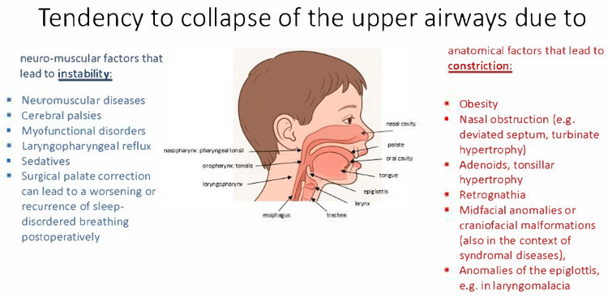
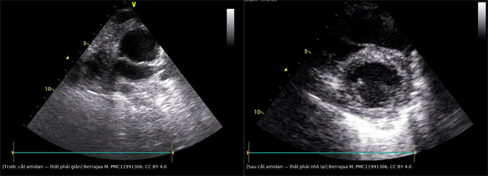
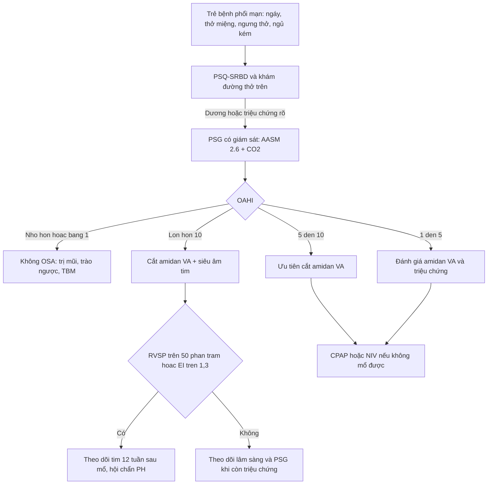
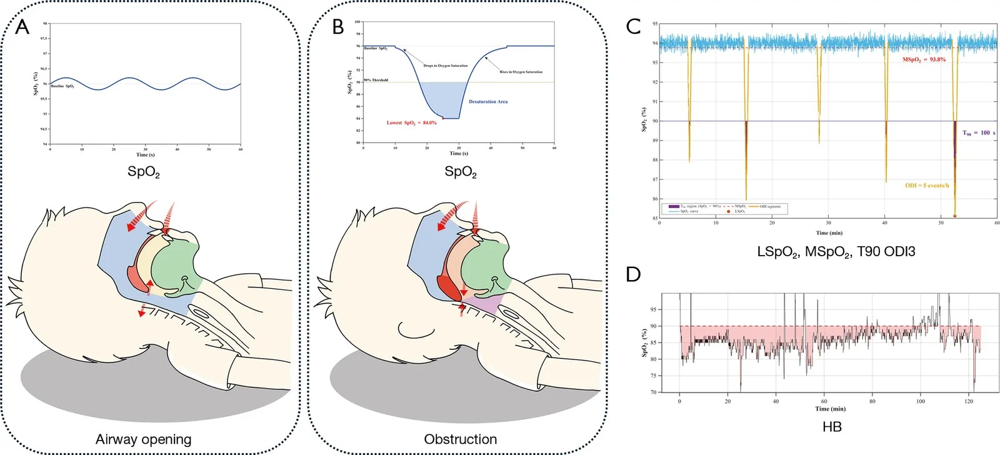

# 1803 — Ngưng thở khi ngủ do tắc nghẽn ở trẻ bệnh phổi mạn (BPD, PIBO, giãn phế quản) / Obstructive sleep apnoea in children with chronic lung disease

**Tags:** `pattern:ngung-tho-khi-ngu` `pattern:ha-oxy-khi-ngu` `pattern:phi-dai-amidan` `vung:duong-tho-tren` `vung:phoi-nhi` `score:AASM-2.6` `protocol:PSG` `protocol:sieu-am-tim`
**Mức chắc chắn (certainty):** tổng hợp y văn (literature synthesis) — tổng hợp từ y văn mở 2017–2026 (Europe PMC: Klusza R, *Pediatr Allergy Immunol Pulmonol* 2026, PMC13640027; Ortiz LE, *Pediatr Pulmonol* 2017, PMC5693767; Stuck BA, *Children* 2025, PMC12839698; Berrajaa M, *Pan Afr Med J* 2025, PMC11991306; Nasir M, *Sage Open Pediatr* 2026, PMC13129280; Zhong L, *Transl Pediatr* 2026, PMC13559076; Yang Q, *Nat Sci Sleep* 2024, PMC11012695; Elias DA, *Laryngoscope* 2026, PMC13569636; Wei P, *Eur Respir Rev* 2026, PMC13439383; Kirkham EM, *J Clin Sleep Med* 2026, PMC13341984). Số nào chưa kiểm chứng ghi "chưa rõ".

> Bài này trả lời **"trẻ đã có bệnh phổi mạn thì OSA khác gì trẻ khoẻ, và khi nào cần chụp/đo gì"**. Tăng áp lực động mạch phổi do bệnh phổi mạn đã có ở [686](../686-tang-ap-luc-dong-mach-phoi-benh-phoi-man-nhi/lesson.md); BPD ở [606](../606-bpd-tre-sinh-non/lesson.md); PIBO ở [669](../669-theo-doi-dai-han-BO-Swyer-James/lesson.md).

## 1. Tổng quan bệnh học – cơ chế hình ảnh

- **Định nghĩa & ngưỡng (khác người lớn):** OSA ở trẻ khi **chỉ số ngưng thở–giảm thở do tắc nghẽn (obstructive apnoea–hypopnoea index, OAHI) > 1 biến cố/giờ**; phân độ **nhẹ 1–5**, **vừa 5–10**, **nặng > 10**; tài liệu phẫu thuật còn dùng **rất nặng khi AHI ≥ 25** (Yang Q 2024, PMC11012695; Elias DA 2026, PMC13569636). **Không áp ngưỡng người lớn (AHI ≥ 5)** cho trẻ.
- **Tần suất nền và tần suất ở nhóm nguy cơ:** OSA ảnh hưởng **1–5%** trẻ nói chung (Klusza R 2026, PMC13640027). Ở **142 trẻ 6–12 tuổi có BPD**, **34%** có điểm sàng lọc PSQ-SRBD > 0,33; **hen làm tăng 4 lần** khả năng có SDB (**OR 3,75; 95% CI 1,33–10,58**) và **6 lần** khả năng ngáy (**OR 6,22; 1,13–34,36**).
- **Vì sao trẻ BPD dễ OSA (TẠI SAO, không chỉ liệt kê):**
  1. **Đường thở trên nhỏ + giảm trương lực:** sinh non, hẹp dưới thanh môn, mềm sụn thanh quản/khí phế quản (TBM), phì đại amidan–VA; **trong REM**, cơ giãn đường thở trên mất trương lực → tắc nghẽn dài nhất.
  2. **Dự trữ oxy thấp:** BPD có **FRC thấp, phổi kém giãn nở, nhiều vùng V/Q thấp** → cùng một thời gian ngưng thở, **SpO₂ tụt nhanh và sâu hơn** trẻ khoẻ.
  3. **Giảm đáp ứng hoá cảm** sau thiếu oxy/tăng CO₂ mạn → **nhiều ngưng thở trung ương và giảm thông khí**, không chỉ tắc nghẽn. Trong đoàn hệ BPD (n = 140), **RDI trung bình 9,9/giờ, OAHI 6,5/giờ, biến cố trung ương 3,0/giờ**; RDI **giảm 22% (1,5 biến cố/giờ) mỗi năm tuổi** nhưng **vẫn cao ở 4 tuổi**; bệnh hô hấp nặng hơn → **nhiều biến cố trung ương hơn 38%** (Ortiz LE 2017, PMC5693767).
  4. **Viêm mũi dị ứng, trào ngược, béo phì** (hay gặp ở BPD/PIBO) làm hẹp thêm và tăng gánh hô hấp.
- **Vì sao OSA làm nặng tăng áp phổi (chuỗi nhân quả):** ngưng thở → **giảm oxy phế nang từng đợt** → co mạch phổi; **áp lực trong lồng ngực âm mạnh** khi cố thở → tăng hậu gánh thất phải; **hoạt hoá giao cảm và stress oxy hoá** → tái cấu trúc mạch. Hệ quả định lượng: trong **1500 trẻ cắt amidan vì phì đại amidan–VA**, **tăng áp phổi 5,9%**; các yếu tố dự báo gồm **tỷ lệ VA/mũi hầu (AN ratio) > 0,75**, thở miệng ban ngày, ngáy, OSA, suy dinh dưỡng hoặc thừa cân; **tăng áp phổi và rối loạn chức năng thất phải hồi phục sau 12 tuần** ở nhóm được mổ (Nasir M 2026, PMC13129280). Ca nguyên văn: bé trai 3 tuổi, phì đại amidan hai bên → **suy tim phải + tăng áp phổi**, hồi phục hoàn toàn sau cắt amidan (Berrajaa M 2025, PMC11991306).
- **Cơ chế hình ảnh – vì sao phải đo chứ không "nhìn" (vật lý):**
  - **PSG** đo **dòng khí** (áp lực mũi + thermistor), **nỗ lực hô hấp** (đai ngực–bụng), **SpO₂**, **CO₂ qua da/EtCO₂**, điện não–mắt–cơ, tư thế và video. Tắc nghẽn = **có nỗ lực nhưng không có dòng khí**; trung ương = **không nỗ lực**.
  - **Oximetry** chỉ là **hệ quả**, không phải biến cố: một đêm có thể **nhiều ngưng thở ngắn không tụt ≥ 3%** → AHI cao mà oximetry "sạch"; ngược lại BPD nền SpO₂ 92–93% làm **ngưỡng giảm 3% chỉ còn 89–90%**, dễ bị đọc là "dao động bình thường".
  - **Chỉ số thiếu oxy tích luỹ (hypoxic burden, HB)** = **diện tích dưới đường cong SpO₂** (độ sâu × thời gian), khác AHI chỉ **đếm số biến cố**. Ở 115 trẻ, **HB tương quan với OAHI r = 0,801** và **AUC 0,888** để chẩn đoán OSA, tốt hơn **ODI3 (AUC 0,857)**, **T90 (0,701)**, **SpO₂ thấp nhất (0,689)**, **SpO₂ trung bình (0,614)** (Zhong L 2026, PMC13559076).
  - **Siêu âm tim** ước lượng áp lực phổi bằng **Bernoulli rút gọn: RVSP = 4 × V(TR)² + áp lực nhĩ phải**; dấu quá tải **vách liên thất dẹt (EI ≥ 1,3)**, **PAAT:RVET < 0,30**, **TAPSE thấp** (ngưỡng và cách đo ở bài 686).

## 2. Mẫu hình + chẩn đoán phân biệt theo cơ chế (gamut)

- **Tắc nghẽn giải phẫu:** **phì đại amidan–VA** (hay nhất, amidan độ III–IV "hôn nhau"), **béo phì**, **bất thường sọ mặt** (Pierre Robin, Treacher–Collins, Down, mucopolysaccharidosis), **hẹp mũi/hẹp dưới thanh môn**, **hẹp khí quản sau đặt nội khí quản**.
- **Tắc nghẽn động học:** **mềm sụn thanh quản (laryngomalacia)**, **mềm sụn khí–phế quản (TBM)**, **liệt dây thanh**, **hẹp thanh môn** — đặc biệt ở BPD; tắc nghẽn **tăng khi ngửa và trong REM**.
- **Giảm trương lực/thần kinh–cơ:** bại não, bệnh cơ–thần kinh, hội chứng Down, thuốc an thần; **giảm thông khí khi ngủ** nhiều hơn ngưng thở thuần tuý.
- **Trung ương:** ngưng thở trung ương của trẻ non tháng (giảm dần theo tuổi), **giảm thông khí do béo phì (OHS)**, **hội chứng giảm thông khí trung ương bẩm sinh (CCHS)** — hiếm, nhưng **không được gọi là OSA**.
- **Bệnh phổi mạn (nhóm chính của bài):** BPD, **PIBO/BO**, giãn phế quản, **BOS sau ghép** — thường **OSA hỗn hợp + giảm thông khí + thiếu oxy khi ngủ**, và **tăng áp phổi** là biến chứng cần chủ động tìm.
- **Gamut "trẻ bệnh phổi mạn ngáy/ngủ kém":** OSA do amidan–VA, OSA hỗn hợp BPD, TBM/laryngomalacia, viêm mũi dị ứng, trào ngược, béo phì, thiếu oxy khi ngủ không do ngưng thở, và **tăng áp phổi tiến triển** — mỗi nhánh xử trí khác nhau.

## 3. Bảng so sánh phân biệt (ma trận đối chiếu)

| Thực thể (entity) | Hình ảnh / PSG điển hình | Chốt vào (rule-in) | Chốt loại (rule-out) | Gợi ý xác nhận |
|---|---|---|---|---|
| **OSA do phì đại amidan–VA** | Amidan độ III–IV, VA **AN ratio > 0,75**; PSG **OAHI > 1**, tắc nghẽn từng đợt, SpO₂ tụt cuối biến cố | **OAHI > 1 + phì đại amidan–VA + ngáy/thở miệng** | **PSG bình thường (OAHI ≤ 1) + không tắc nghẽn** → không mổ vì "amidan to" đơn thuần | PSG; soi mũi họng; X-quang sọ nghiêng khi cần |
| **OSA hỗn hợp ở BPD** | **OAHI 6,5/giờ + biến cố trung ương 3,0/giờ**; RDI 9,9/giờ; giảm theo tuổi nhưng còn cao ở 4 tuổi | **BPD + OAHI > 1 + nhiều biến cố trung ương + thiếu oxy khi ngủ** | **Chỉ có ngáy, PSG không tắc nghẽn/không giảm oxy** → không phải OSA | PSG có **CO₂ qua da** và đai bụng–ngực; lặp PSG khi lớn |
| **Giảm thông khí khi ngủ / OHS** | **Tăng CO₂ mạn** (tcCO₂/EtCO₂), SpO₂ thấp kéo dài, **không nhiều biến cố tắc nghẽn** | **PaCO₂/tcCO₂ tăng khi ngủ + OAHI thấp** | **CO₂ bình thường khi ngủ + OAHI cao** → OSA đơn thuần | PSG + khí máu/thông khí; đánh giá béo phì, thần kinh–cơ |
| **Ngưng thở trung ương** | Không nỗ lực ngực–bụng, không dòng khí; hay gặp ở trẻ non tháng | **Biến cố trung ương > 5/giờ hoặc kéo dài > 20 giây + không nỗ lực** | **Có nỗ lực + không dòng khí** → tắc nghẽn | PSG đai ngực–bụng; loại trừ CCHS nếu kéo dài ngoài nhũ nhi |
| **TBM / laryngomalacia** | Xẹp đường thở **> 50% khi thở ra**; rít thì hít vào; CT động/nội soi | **Xẹp > 50% + hết khi hít vào** (TBM); **sa nắp thanh môn** (LM) | **Đường thở không xẹp khi thở ra** → không TBM | Nội soi/CT động thì thở ra; cross-link [602](../602-tracheobronchomalacia-o-tre-bpd/lesson.md) |
| **OSA có tăng áp phổi** | **RVSP ≥ 50% áp lực hệ thống**, **EI ≥ 1,3**, **PAAT:RVET < 0,30**, giãn thất phải | **OSA nặng + ≥ 1 dấu quá tải thất phải** | **Siêu âm tim bình thường + không shunt** → chưa có PH | Siêu âm tim lúc chẩn đoán và **12 tuần sau cắt amidan** |
| **OSA nhẹ — theo dõi được** | **OAHI < 3**, amidan nhỏ/vừa, không giảm oxy nặng | **OAHI < 3 + triệu chứng nhẹ + gia đình theo dõi được** | **Triệu chứng nặng, giảm oxy, PH, bệnh phổi mạn** → không theo dõi đơn thuần | PSQ-SRBD + PSG lặp; 13% tiến triển OAHI ≥ 3 sau 12 tháng |

*Bên trái: **yếu tố thần kinh–cơ gây mất ổn định** (bệnh cơ–thần kinh, bại não, rối loạn chức năng cơ, trào ngược thanh quản, thuốc an thần, **phẫu thuật vùng hầu họng làm nặng thêm**). Bên phải: **yếu tố giải phẫu gây hẹp** (béo phì, hẹp mũi, phì đại VA–amidan, hồi não, bất thường sọ mặt, bất thường nắp thanh môn). Đây là lý do **cùng một "ngáy" ở trẻ BPD có thể do 2–3 cơ chế chồng nhau**. Nguồn: Stuck BA & Schneider B, *Children* 2025 (PMC12839698), CC BY 4.0.*

### Ảnh ghép: tăng áp phổi do OSA hồi phục sau cắt amidan

*Trái: **mặt cắt cạnh ức trục ngắn** — thất phải giãn, chèn thất trái (ca bé trai 3 tuổi có suy tim phải + tăng áp phổi do phì đại amidan). Phải: **sau cắt amidan**, thất phải nhỏ lại, hình dạng thất trái trở về bình thường. Ảnh ghép letterbox, **không crop/kéo giãn**. Nguồn: Berrajaa M et al., *Pan Afr Med J* 2025 (PMC11991306), CC BY 4.0.*

## 4. Protocol chụp/đo + phân độ & ngưỡng điều trị

**4.1. Ai cần PSG (không chỉ hỏi "có ngáy không")**

- **Chỉ định PSG:** ngáy/thở miệng kéo dài, **ngưng thở được người nhà thấy**, ngủ không yên, đổ mồ hôi khi ngủ, đau đầu sáng, ban ngày buồn ngủ/kém tập trung, **tăng trưởng chậm**, **tăng áp phổi hoặc tim phải giãn**, **bệnh phổi mạn (BPD/PIBO/giãn phế quản)**, hội chứng Down/sọ mặt, béo phì, thần kinh–cơ.
- **Sàng lọc trước:** **PSQ-SRBD > 0,33** là dương (Klusza R 2026; Kirkham EM 2026) — **nhạy nhưng không thay PSG**; điểm bình thường **không loại trừ** ở trẻ có bệnh phổi mạn.
- **Thời điểm:** PSG khi trẻ **ổn định, thở khí trời hoặc với hỗ trợ hô hấp thường dùng**; ở BPD, nhiều trung tâm làm **trước xuất viện và lặp lại khi lớn** — **chưa có ngưỡng tuổi thống nhất trong nguồn đã đọc**, ghi "chưa rõ".
- **Kỹ thuật:** PSG có giám sát (attended) theo **AASM Scoring Manual v2.6**; tối thiểu gồm EEG/EOG/EMG, ECG, **áp lực mũi + thermistor**, **đai ngực–bụng**, **SpO₂ kèm plethysmography**, **tcCO₂/EtCO₂**, video, tư thế. **Ghi rõ quy tắc chấm điểm giảm thở (3% hay 4% + arousal)** vì **cùng một đêm có thể ra hai AHI khác nhau**.
- **Oximetry tại nhà:** chỉ là **sàng lọc/theo dõi**, không chẩn đoán OSA. Báo cáo **ODI3, T90, SpO₂ thấp nhất, SpO₂ trung bình**; nếu có, tính **HB**. **Oximetry bình thường không loại trừ OSA** (Zhong L 2026).

**4.2. Phân độ & xử trí theo OAHI**

| OAHI (biến cố/giờ) | Phân độ | Hướng xử trí ở trẻ bệnh phổi mạn |
|---|---|---|
| ≤ 1 | Không OSA | Điều trị nguyên nhân khác (mũi, trào ngược, TBM); lặp PSG nếu triệu chứng |
| 1–5 | Nhẹ | **Cắt amidan–VA nếu phì đại có triệu chứng**; theo dõi sát nếu chọn quan sát (13% tiến triển OAHI ≥ 3 sau 12 tháng) |
| 5–10 | Vừa | **Ưu tiên cắt amidan–VA**; CPAP nếu không mổ được/không đáp ứng; tìm PH |
| > 10 | Nặng | **Cắt amidan–VA + đánh giá tim (siêu âm tim)**; CPAP/NIV cầu; theo dõi hậu phẫu |
| ≥ 25 | Rất nặng | Như trên + **gây mê–hậu phẫu có kế hoạch**; **không làm "bộ xét nghiệm tim" tràn lan** |

- **Vì sao "rất nặng" không đồng nghĩa "phải làm tim ngay":** trong **144 trẻ AHI ≥ 25** cắt amidan, **26,4% được làm workup tim trước mổ**, chỉ **7,9% bất thường** (đều **béo phì 13–16 tuổi, AHI > 50**) và **không ca nào đổi xử trí** (Elias DA 2026, PMC13569636) → **chọn theo nguy cơ (PH đã biết, Down, béo phì nặng, tim phải giãn), không làm hàng loạt**.

**4.3. Điều trị & theo dõi**

- **Bậc 1 — cắt amidan–VA** khi phì đại có triệu chứng: cải thiện AHI, triệu chứng ban ngày, chất lượng sống; **phần cắt amidan (partial tonsillectomy)** hiệu quả tương đương, ít biến chứng hơn (Stuck BA 2025, PMC12839698).
- **CPAP/NIV** khi: không mổ được, OSA tồn dư sau mổ, **giảm thông khí khi ngủ**, hoặc cầu nối trước mổ. **Thất bại CPAP/NIV** phải **soi lại giao diện – rò miệng – thông số – vị trí** trước khi kết luận "không dung nạp"; sau đó xét **phẫu thuật tai mũi họng, giãn hàm nhanh (RME), giảm cân, phẫu thuật sọ mặt, kích thích thần kinh hạ thiệt** ở ca chọn lọc (Amaddeo A 2020, PMC7649204).
- **Kiểm soát bệnh nền:** tối ưu **oxy/thông khí**, điều trị **viêm mũi dị ứng**, **trào ngược**, **béo phì**, **TBM**; **tránh an thần ức chế hô hấp**.
- **Theo dõi sau điều trị:** đánh giá lại **triệu chứng + PSQ-SRBD**, **PSG** khi còn triệu chứng/dùng CPAP, và **siêu âm tim 12 tuần sau cắt amidan** nếu có PH (Nasir M 2026). Lịch PSG lặp cụ thể **chưa có đồng thuận** trong nguồn đã đọc — ghi "chưa rõ".

## 5. Biến thể bình thường và cạm bẫy

- **PSG âm không loại trừ OSA:** trẻ có thể **chỉ tắc nghẽn trong REM** hoặc đêm đầu ngủ ít REM; nếu nghi cao, **lặp PSG** hoặc theo dõi dài.
- **Oximetry "đẹp" ở trẻ BPD:** nền SpO₂ 92–93% → **ngưỡng 3% chỉ còn 89–90%**, biến cố ngắn bị bỏ; phải đọc **T90, ODI3, HB** và **PSG**.
- **Biến cố trung ương ở trẻ non tháng/BPD** (trung bình **3,0/giờ**) dễ bị gộp nhầm vào "OSA" → điều trị (CPAP, caffeine, đánh giá thần kinh) khác.
- **Giảm thông khí không có ngưng thở:** trẻ béo phì/thần kinh–cơ có thể **CO₂ tăng mà AHI thấp**; **thiếu tcCO₂ là bỏ sót**.
- **"Amidan to" không phải chỉ định mổ:** chỉ mổ khi **có triệu chứng + OAHI > 1** hoặc biến chứng; ngược lại, **amidan nhỏ vẫn có OSA** do TBM/sọ mặt.
- **AHI không phải tất cả:** cùng AHI, **HB** khác nhau và tương quan với OAHI **r = 0,801**, AUC **0,888**; **huyết áp 24 giờ và biến chứng tim mạch** có thể xuất hiện ở trẻ AHI "nhẹ" (Wei P 2026, PMC13439383).
- **Theo dõi nhẹ: triệu chứng dai dẳng dù PSG không xấu** — 57% trẻ theo dõi 12 tháng vẫn còn/tăng triệu chứng, dù chỉ **13% tiến triển OAHI ≥ 3**; **hen (OR 2,70)** và **phơi nhiễm khói thuốc (OR 2,41)** dự báo triệu chứng dai dẳng (Kirkham EM 2026).
- **Cắt amidan không chữa được bệnh phổi:** sau mổ vẫn phải **tối ưu oxy, dinh dưỡng, điều trị TBM**; **OSA tồn dư** gặp ở trẻ Down/béo phì — cần PSG lại.
- **Cạm bẫy mặt cắt:** trên **CT ngực**, "khí quản hẹp" ở thì hít vào có thể **giả** do **TBM chỉ lộ khi thở ra**; phải chụp **thì thở ra/động** (bài 602).

## 6. Tự lượng giá — Blind Quiz

**Ca 1 — Bé trai 3 tuổi, ngáy to, thở miệng, ngủ ngắt quãng, phù nhẹ và gan to. Siêu âm tim dưới đây: bạn thấy gì và vì sao?**

- Gợi ý lâm sàng: không bệnh tim bẩm sinh; amidan hai bên độ IV; SpO₂ khi ngủ có nhiều đợt tụt.
- Câu hỏi: Dấu hiệu chính trên ảnh trái? Cơ chế nào nối OSA với thất phải? Sau điều trị nguyên nhân, bạn kỳ vọng gì trên siêu âm?

<b>Bấm để hiện đáp án (findings + chẩn đoán)</b>

- Dấu hiệu: **thất phải giãn, chèn thất trái** trên mặt cắt cạnh ức trục ngắn; ảnh phải sau **cắt amidan** cho thấy **thất phải nhỏ lại**, thất trái trở về hình dạng bình thường.
- Chẩn đoán: **tăng áp phổi + suy tim phải do OSA từ phì đại amidan**. Cơ chế: **thiếu oxy từng đợt → co mạch phổi**, **áp lực lồng ngực âm → tăng hậu gánh thất phải**, tái cấu trúc mạch khi kéo dài.
- Kỳ vọng: **hồi phục sau 12 tuần** ở phần lớn ca (1500 trẻ: PH 5,9%, hồi phục sau mổ) — nhưng **phải theo dõi siêu âm tim**, không mặc định "mổ là xong".
- Nguồn ảnh: Berrajaa M et al., *Pan Afr Med J* 2025 (PMC11991306), **CC BY 4.0**.

**Ca 2 — Trẻ 5 tuổi, BPD, SpO₂ nền 93% khi thở khí trời. Đêm có nhiều đợt tụt xuống 88–90%. Nhìn hình, bạn chọn chỉ số nào để mô tả "nặng" và vì sao?**

- Câu hỏi: (A) đường SpO₂ bình thường; (B) cách tính **diện tích giảm bão hoà**; (C) **LSpO₂, MSpO₂, T90, ODI3**; (D) **HB**. Chỉ số nào tương quan nhất với OAHI? Vì sao AHI có thể đánh giá thấp?

<b>Bấm để hiện đáp án (findings + chẩn đoán)</b>

- (A) dao động sinh lý; (B) **HB = diện tích phần dưới đường nền**, phản ánh **độ sâu × thời gian**; (C) các chỉ số rời rạc; (D) **HB**.
- **HB tương quan với OAHI r = 0,801; AUC 0,888** — tốt hơn ODI3 (0,857), T90 (0,701), LSpO₂ (0,689), MSpO₂ (0,614). Vì AHI **chỉ đếm biến cố**, không cộng dồn **mức độ và thời gian thiếu oxy**.
- Ở trẻ BPD, **nền SpO₂ thấp** làm ngưỡng 3% "ngắn" hơn và dễ bỏ sót biến cố ngắn → **phải đọc cùng PSG, không chỉ oximetry**.
- Nguồn ảnh: Zhong L et al., *Transl Pediatr* 2026 (PMC13559076), **CC BY-NC-ND 4.0** (nguyên bản, không crop).

**Ca 3 — Trẻ 4 tuổi bại não, trương lực cơ giảm, ngáy và thở miệng; amidan độ II. Bạn phân loại cơ chế nào và bước tiếp theo?**

- Câu hỏi: Trẻ này có mấy nhóm yếu tố? Vì sao **amidan độ II vẫn có thể OSA nặng**? Cần đo gì trước khi quyết định mổ?

<b>Bấm để hiện đáp án (findings + chẩn đoán)</b>

- Có **cả yếu tố thần kinh–cơ (bại não, giảm trương lực)** và **yếu tố giải phẫu (thở miệng, có thể hẹp mũi)** — không chỉ amidan.
- Amidan độ II **không loại trừ** OSA: tắc nghẽn có thể do **giảm trương lực cơ hầu + TBM + hẹp mũi**, và **nặng hơn trong REM**.
- Trước mổ: **PSG có CO₂ qua da** (tìm giảm thông khí + biến cố trung ương), **đánh giá đường thở dưới/TBM**, **siêu âm tim** nếu OAHI nặng; hội chẩn **hô hấp – tai mũi họng – gây mê**.
- Nguồn ảnh: Stuck BA & Schneider B, *Children* 2025 (PMC12839698), **CC BY 4.0**.

## Bài liên quan chéo
- [600 – Tổng quan Nhi khoa](../600-tong-quan-nhi-khoa/lesson.md)
- [606 – BPD: bệnh phổi mạn ở trẻ sinh non](../606-bpd-tre-sinh-non/lesson.md)
- [686 – Tăng áp lực động mạch phổi trong bệnh phổi mạn nhi](../686-tang-ap-luc-dong-mach-phoi-benh-phoi-man-nhi/lesson.md)
- [602 – Tracheobronchomalacia ở trẻ BPD](../602-tracheobronchomalacia-o-tre-bpd/lesson.md)
- [669 – Theo dõi dài hạn PIBO & Swyer–James](../669-theo-doi-dai-han-BO-Swyer-James/lesson.md)
- [694 – Mềm sụn thanh quản ở nhũ nhi](../694-mem-sun-thanh-quan-o-nhu-nhi/lesson.md)
- [612 – Cấp cứu đường thở trên trẻ em](../612-cap-cuu-duong-tho-tren-tre-em/lesson.md)
- [082 – Bại não & an toàn nuốt ở trẻ](../082-bai-nao-an-toan-nuot/lesson.md)

## Ảnh
- `images/1803_co-che-tac-nghen-duong-tho_Minhhoa_PMC12839698.jpg` — CC BY 4.0.
- `images/1803_composite_suy-tim-phai-truoc-sau_ECHO_PMC11991306.jpg` — CC BY 4.0 (ảnh ghép letterbox, không crop).
- `images/1803_spo2-thieu-oxy_Dothi_PMC13559076.jpg` — CC BY-NC-ND 4.0 (nguyên bản).
- Nguồn + giấy phép từng ảnh: `images/CREDITS.md`; link gốc: `sources.md`.

> Không dùng để chẩn đoán độc lập khi chưa có người hướng dẫn.
