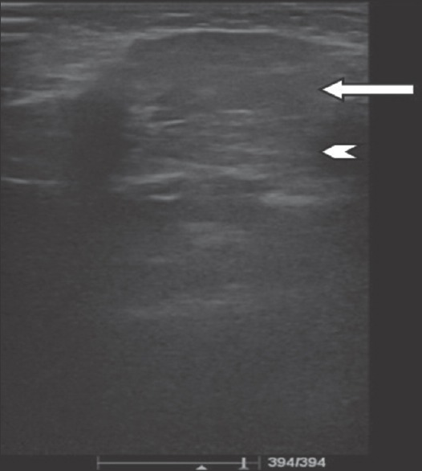
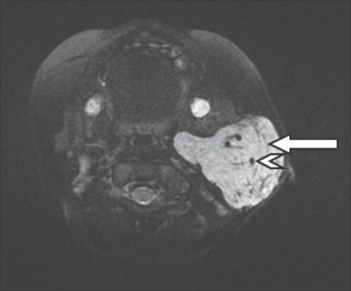
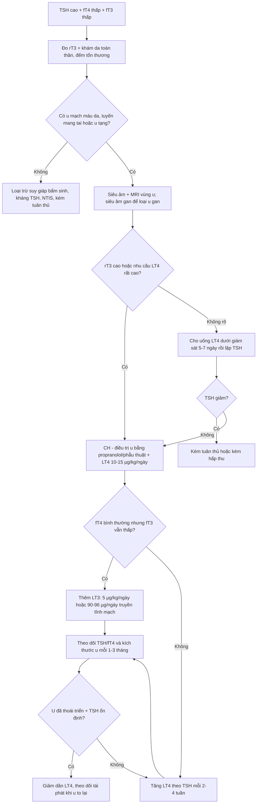
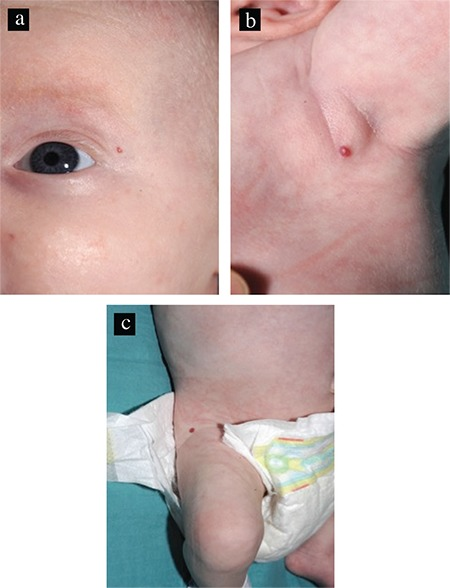
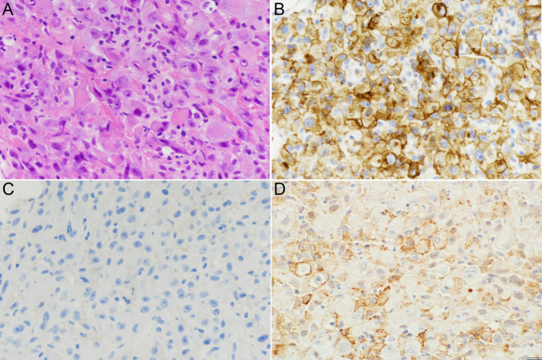

# 1804 — Suy giáp tiêu thụ do D3 LẠC VỊ (u mạch máu ngoài gan & u thận biệt hoá rhabdoid) / Ectopic-D3 consumptive hypothyroidism without a liver mass

**Tags:** `pattern:suy-giap-tieu-thu` `pattern:u-mau-ngoai-gan` `vung:tuyen-mang-tai` `vung:than` `score:lieu-LT4` `protocol:TSH-fT4-rT3`
**Mức chắc chắn (certainty):** tổng hợp y văn (literature synthesis) — cơ chế và ngưỡng sinh hoá lấy từ tổng quan D3 (Luongo C và cs., *Front Endocrinol* 2013, PMC3761349), loạt ca + tổng quan hệ thống 48 bệnh nhân (Siano MA và cs., *JPGN Reports* 2022, PMC10158424), ca u thận biệt hoá rhabdoid có hoá mô miễn dịch D3 dương (Fiore R và cs., *Eur Thyroid J* 2022, PMC9578057), ca u mạch máu tuyến mang tai (Chaubal A, Tavri S, *J Clin Imaging Sci* 2017, PMC5288954) và ca u mạch máu da + gan (Campbell V và cs., *JCRPE* 2018, PMC6083462). Chưa có thử nghiệm ngẫu nhiên nào cho **liều LT4/LT3** trong thể ngoài gan — các con số dưới đây đều là mô tả ca/loạt ca.

## 1. Tổng quan bệnh học – cơ chế hình ảnh

- **Bản chất:** *suy giáp tiêu thụ* (consumptive hypothyroidism, CH) là hội chứng cận ung thư do mô u **tăng biểu hiện men khử iod loại 3 (type 3 iodothyronine deiodinase, D3/DIO3)**. D3 khử **vòng trong**: **T4 → reverse T3 (rT3)** và **T3 → 3,3′-diiodothyronine (T2)** — cả hai **mất hoạt tính**. Tuyến giáp vẫn tổng hợp bình thường, nhưng tốc độ phá huỷ ngoại vi **vượt tốc độ tổng hợp** → TSH tăng, fT4/fT3 giảm.
- **TẠI SAO "lạc vị" lại quan trọng:** hoạt tính D3 **tỉ lệ với khối lượng u và hoạt độ đặc hiệu của u, KHÔNG phụ thuộc vị trí** (Luongo 2013; Siano 2022). Vì vậy **không có khối gan không loại trừ CH** — u mạch máu tuyến mang tai, u mạch máu da lớn, thậm chí u **đặc không mạch** (u mô đệm đường tiêu hoá — GIST, u xơ, ung thư biểu mô tế bào thận biệt hoá rhabdoid) đều gây được.
- **Ngưỡng định lượng của "tốc độ phá huỷ":** hoạt tính D3 đo trực tiếp trong mô u mạch máu gan ở ca nguyên bản đầu tiên là **0,78 pmol T3 bị khử/phút/mg protein — gấp 7,5 lần nhau thai**, mô giàu D3 sinh lý nhất ở người (Luongo 2013). Trẻ không có tuyến giáp cần **7–10 µg/kg/ngày LT4**; ca CH đầu tiên cần liều **cao gấp ~9 lần** con số đó.
- **TẠI SAO đáp ứng LT4 kém:** mỗi microgam LT4 đưa vào đều bị D3 chuyển thành rT3 trước khi tới nhân tế bào đích. Đây là lý do **tăng LT4 đơn thuần có trần**: một ca người lớn chỉ đạt **fT4 8,2 pmol/L, T4 toàn phần 46 nmol/L (BT 66–181)** dù đã **300 µg/ngày (≈ 4,3 µg/kg/ngày)** — khởi đầu **100 µg/ngày (≈ 1,3 µg/kg/ngày)** làm TSH còn **72,7 mU/L** sau 4 tuần (Fiore 2022).
- **Phổ u ngoài gan trong y văn (loạt hệ thống 42 bài/48 bệnh nhân, Siano 2022):** **u máu tuyến mang tai 2 ca**, **u mạch máu da lành tính đa ổ ở trẻ sơ sinh (benign neonatal haemangiomatosis) 1 ca**, **u máu ống tai trong + u máu da 1 ca**, **u máu da khổng lồ 12 × 10 cm 1 ca** — nhóm này phát hiện muộn hơn (tuổi trung bình **7 tháng** so với **1 tháng** ở nhóm có u gan), **TSH trung bình 150,3 mU/L**, và **5/5 ca đều phải dùng T4**.
- **Phổ u đặc (người lớn):** tổng quan 2017 gộp **42 ca CH**, trong đó **36 ca trẻ** (97% là u mạch máu/u mạch máu nội mô) và **6 ca người lớn** với **4/6 là u đặc không mạch** — **GIST 2 ca**, **u xơ 2 ca** (dẫn trong Fiore 2022). Ca Fiore bổ sung **ung thư biểu mô tế bào thận biệt hoá rhabdoid** — tác giả nhấn mạnh đây là **u biểu mô đầu tiên** gây CH, mở rộng giả thuyết "chỉ u mạch máu" là sai.
- **TẠI SAO hình ảnh trông như vậy (và vì sao hình ảnh chỉ là "bước tìm u"):** u mạch máu nhũ nhi là u nội mô GLUT-1 dương, nhiều hồ máu → siêu âm **đồng âm, bờ tiểu thuỳ, có vách tăng âm**, Doppler **nhiều kênh mạch giãn**; MRI **T2 fat-sat tăng tín hiệu mạnh, có "flow void"** trong u và **ngấm thuốc đồng nhất** (Chaubal 2017). U thận biệt hoá rhabdoid là khối **đặc, không đồng nhất, xâm lấn** — hình ảnh **không đặc hiệu**, chẩn đoán là **mô bệnh học + hoá mô miễn dịch** (D3 dương ở **~40% tế bào u**, Fiore 2022). Nói cách khác: **hình ảnh tìm ra "ổ D3", xét nghiệm chứng minh "đang tiêu thụ hormone"**.

*Siêu âm tuyến mang tai trái (đầu dò linear 4–7 MHz), nhũ nhi 4 tháng: khối **đồng âm** thay gần toàn bộ tuyến, bờ tiểu thuỳ, **vách tăng âm** bên trong (mũi tên trắng: bờ khối; đầu mũi tên: vách). Nguồn: Chaubal A, Tavri S, J Clin Imaging Sci 2017;7:5 (PMC5288954), Fig. 2, CC BY-NC-SA 3.0.*

## 2. Mẫu hình + chẩn đoán phân biệt theo vị trí (gamut)

**Mẫu hình cần nhận ra:** bệnh nhi (hoặc người lớn có u) với **TSH cao kéo dài, fT4 thấp, fT3 thấp, rT3 cao**, **không đáp ứng với liều LT4 thông thường** (10–15 µg/kg/ngày ở trẻ; 1,6 µg/kg/ngày ở người lớn), **và không có khối gan**.

**Gamut theo vị trí "ổ D3" (mnemonic "DA–MANG–THẬN–RUỘT"):**

1. **DA (skin):** u mạch máu da đơn độc lớn (tới **12 × 10 cm**), u mạch máu da đa ổ, u mạch máu da + u máu ống tai trong. Khám **toàn thân, có đếm số tổn thương** — vì **≥ 5 u mạch máu da** là ngưỡng khuyến cáo siêu âm gan.
2. **MANG (parotid):** u máu/u mạch máu nội mô tuyến mang tai — **u tuyến mang tai hay gặp nhất ở trẻ em**, sưng không đau, tiến triển nhanh (Chaubal 2017).
3. **THẬN (kidney):** ung thư biểu mô tế bào thận **biệt hoá rhabdoid** (u nguyên bào cơ vân ác tính — malignant rhabdoid tumour, MRTK ở trẻ), **u xơ**, **GIST** (đường tiêu hoá) — nhóm u **đặc**.
4. **RUỘT/GAN (visceral):** u mạch máu gan (đã phủ ở [689](../689-suy-giap-tieu-thu-do-u-mach-mau-o-tre/lesson.md)) — chỉ vào gamut này khi **có khối gan**; không có khối gan thì **không được dừng lại ở đây**.

**Gamut "TSH cao + fT4 thấp" khi KHÔNG có u (phải loại trước khi gán CH):**

- **Suy giáp bẩm sinh** (loạn sản/bất sản tuyến giáp, rối loạn tổng hợp hormone): sàng lọc sơ sinh dương tính, tuyến giáp nhỏ/không thấy trên siêu âm.
- **Kháng TSH (TSHR đột biến):** TSH cao nhưng **fT4 bình thường**, tuyến giáp bình thường, thường có người trong gia đình.
- **Viêm giáp tự miễn / viêm giáp do thuốc ức chế điểm kiểm soát (ICI):** có thể **trùng lặp** với CH — trong ca Fiore, viêm giáp do ipilimumab **làm mất khả năng bù** của tuyến giáp, để lộ CH vốn đã âm ỉ.
- **Bệnh nặng không do tuyến giáp (non-thyroidal illness, NTIS):** T3 thấp, **TSH thấp/bình thường**, rT3 cao — không phải suy giáp nguyên phát.
- **Giả xét nghiệm & tuân thủ:** macro-TSH, kháng thể heterophile, **không tuân thủ điều trị**, **kém hấp thu** (bệnh celiac, PPI, cắt ruột). Fiore nhấn mạnh: **chỉ nghĩ CH sau khi đã loại tuân thủ và hấp thu** — nhưng ở người **đã uống thuốc dưới giám sát mà TSH vẫn không giảm**, đó là chốt vào của CH.

## 3. Bảng so sánh phân biệt (ma trận đối chiếu)

| Thực thể (entity) | Hình ảnh điển hình | Chốt vào (rule-in) | Chốt loại (rule-out) | Gợi ý xác nhận |
|---|---|---|---|---|
| **CH do u mạch máu ngoài gan (da/tuyến mang tai)** | US: khối **đồng âm**, bờ tiểu thuỳ, vách tăng âm, Doppler **nhiều kênh mạch**; MRI T2 fat-sat **tăng tín hiệu mạnh + flow void**, ngấm đồng nhất; **không có khối gan** | **TSH cao + fT4/fT3 thấp + rT3 cao + u mạch máu thấy được + đáp ứng kém với LT4 10–15 µg/kg/ngày** | Không thấy u mạch máu nào sau khi khám da + siêu âm phần mềm/tuyến mang tai → tìm nguyên nhân khác | TSH/fT4/fT3/rT3; US + MRI vùng u; đáp ứng TSH sau 2 tuần LT4 |
| **CH do u đặc (u thận rhabdoid/MRTK, GIST, u xơ)** | Khối **đặc không đồng nhất**, xâm lấn; hình ảnh **không đặc hiệu** | **U đặc + nhu cầu LT4 tăng dần không giải thích + D3 dương trên hoá mô miễn dịch** | Nhu cầu LT4 ổn định ở liều thay thế thường → không phải CH | Sinh thiết + IHC D3; rT3; đối chiếu thể tích u với nhu cầu LT4 |
| **Suy giáp bẩm sinh** | Tuyến giáp nhỏ/không thấy; không u | **Sàng lọc sơ sinh dương tính**, TSH cao ngay tuần đầu, fT4 thấp | Sàng lọc bình thường + **u mạch máu + rT3 cao** → không phải suy giáp bẩm sinh đơn thuần | TSH/fT4, siêu âm tuyến giáp, xạ hình |
| **Kháng TSH (TSHR)** | Tuyến giáp bình thường, không u | **TSH cao nhẹ, fT4 bình thường**, gia đình tương tự | **fT3 thấp + rT3 cao + u** → không phải kháng TSH | Giải trình tự TSHR; theo dõi tăng trưởng |
| **Viêm giáp do ICI** | Tuyến giáp teo/nhỏ, giảm ngấm; không u mạch máu | **Tiền sử ức chế điểm kiểm soát + kháng Tg/TPO + TSH tăng sau pha nhiễm độc** | Nhu cầu LT4 **rất cao kéo dài** dù đã bù đủ viêm giáp → nghĩ CH phối hợp | Kháng thể, siêu âm tuyến giáp, rT3, diễn biến nhu cầu LT4 |
| **NTIS** | Không u | **T3 thấp + TSH thấp/bình thường + rT3 cao**, hồi phục khi hết bệnh | TSH rất cao kéo dài + u + fT4 thấp → không phải NTIS | Đánh giá bệnh nền; lặp xét nghiệm sau hồi phục |
| **Không tuân thủ / kém hấp thu** | Không u; hình ảnh bình thường | **Uống thuốc dưới giám sát mà TSH vẫn cao** → loại trừ được kém tuân thủ | **TSH giảm rõ sau khi uống thuốc có giám sát** → là kém tuân thủ, không phải CH | Cho uống thuốc quan sát trực tiếp 5–7 ngày rồi lặp TSH |

*Cùng bệnh nhi: MRI 1,5 T, axial T2 fat-sat — khối **tăng tín hiệu** thay tuyến mang tai trái, **vách mảnh** (mũi tên trắng) và **flow void** (đầu mũi tên mở) trong u. Nguồn: Chaubal A, Tavri S, J Clin Imaging Sci 2017;7:5 (PMC5288954), Fig. 5, CC BY-NC-SA 3.0.*

## 4. Protocol chụp + hệ phân độ/điểm chuẩn hóa

**Ai cần tầm soát (ngưỡng, không đoán):**
- **Nhũ nhi có ≥ 5 u mạch máu da → siêu âm bụng** (ngưỡng khuyến cáo hiện hành); nhưng CH ngoài gan có thể có **0–1 tổn thương da**, nên **siêu âm bụng + TSH/fT4 khi có bất kỳ u mạch máu da + dấu hiệu toàn thân** (bú kém, chậm tăng cân, gan to, suy tim cung lượng cao, thiếu máu).
- **U máu tuyến mang tai hoặc u máu da lớn đơn độc → vẫn phải làm TSH/fT4** dù không có khối gan: đây chính là nhóm "lạc vị" phát hiện trung bình lúc **7 tháng** (Siano 2022).
- **Người lớn có u đặc (thận/GIST/u xơ) + nhu cầu LT4 tăng dần không giải thích → đo rT3 và xét nhu cầu thực tế** (Fiore 2022).

**Chụp gì, thứ tự nào:**
- **Siêu âm là đầu tay** (ALARA): gan–lách, tuyến mang tai, phần mềm; Doppler màu đánh giá mạch trong u.
- **MRI có tiêm thuốc khi cần bản đồ u và mạch nuôi**: T2 fat-sat (không cần gadolinium ở trẻ nếu chỉ cần xác định u), T1 sau tiêm khi cần phân biệt u mạch máu với u đặc; **không dùng CT trừ khi cần đánh giá xương/phổi**.
- **Siêu âm tim** tìm shunt/suy tim cung lượng cao (NT-proBNP **1492 ng/L** ở ca Campbell 2018).
- **Xét nghiệm lõi:** TSH, fT4, fT3, **rT3** (chốt sinh hoá), AFP + AFP-L3 (phân biệt u gan), công thức máu + đông máu (Kasabach–Merritt), kháng thể giáp.
- **Khi có u đặc:** hoá mô miễn dịch **D3** trên mô u là tiêu chuẩn vàng (Fiore: dương ở **~40% tế bào u**, tế bào mô đệm âm tính).

**Điều trị — bậc thang có số:**
- **Điều trị u là điều trị gốc:** propranolol **1 mg/kg/ngày**, tăng **2 mg/kg/ngày** sau 5 ngày, có thể **3 mg/kg/ngày**; theo dõi nhịp tim, huyết áp, đường huyết. Phẫu thuật/cắt u khi u khu trú hoặc biến chứng; với u đặc ác tính là điều trị ung thư (hóa trị/đích) — **CH lui khi khối u giảm**.
- **LT4:** khởi đầu **10–15 µg/kg/ngày** ở trẻ (ca Campbell dùng **9,6 µg/kg/ngày**, TSH **115,4 → 5,33 mU/L sau 11 ngày**), tăng dần theo TSH/fT4; y văn ghi nhận các mức **15 – 20 – 25 – 75 µg/kg/ngày**, và **300 µg/ngày (4,3 µg/kg/ngày)** ở người lớn; cá biệt **1000 µg/ngày** ở một ca u xơ ác tính (Luongo 2013, bảng 1). **Không có trần liều cố định** — trần là khi TSH/fT4 bình thường.
- **LT3:** thêm khi **fT4 đã bình thường mà fT3 vẫn thấp** (vì LT4 tiếp tục bị chuyển thành rT3). Liều trong bảng ca của Luongo: **5 µg/kg/ngày** (ca sơ sinh), **90 µg/ngày** và **96 µg/ngày** truyền tĩnh mạch ở ca nặng; **chưa có ngưỡng liều chuẩn hoá** cho thể ngoài gan.
- **Theo dõi:** TSH/fT4 **sau 10–14 ngày** khi đang chỉnh liều, rồi **mỗi 2–4 tuần** trong pha u tăng sinh, sau đó **mỗi 1–3 tháng**; chụp lại u **mỗi 1–3 tháng**. Ngừng LT4 chỉ khi **u đã thoái triển và TSH ổn định**, và vẫn theo dõi tiếp: có ca **tái phát suy giáp lúc 32 tháng** khi u to lại.
- **Mục tiêu:** giữ **fT4 ở nửa trên bình thường** và **TSH < 5 mU/L** trong giai đoạn phát triển não — vì tổn thương thần kinh do thiếu hormone là **không hồi phục** (ca Campbell có NT-proBNP cao, thiếu máu nặng, nhưng phát triển bình thường sau điều trị đúng).

## 5. Biến thể bình thường và cạm bẫy

- **Cạm bẫy 1 — "không có khối gan thì không phải CH":** đây là lỗi hay gặp nhất. Hoạt tính D3 **không phụ thuộc vị trí**; u máu tuyến mang tai hay u máu da lớn **một mình** đã đủ gây CH. Trong loạt 48 ca, nhóm ngoài gan phát hiện muộn hơn **6 tháng** (7 tháng so với 1 tháng).
- **Cạm bẫy 2 — sàng lọc sơ sinh bình thường:** CH hình thành **sau sinh** khi u tăng sinh; **13/43 ca** trong loạt hệ thống có sàng lọc sơ sinh bình thường. **Sàng lọc âm tính không loại trừ**.
- **Cạm bẫy 3 — gán cho "không tuân thủ":** ở người lớn, nhu cầu LT4 **1,3 → 4,3 µg/kg/ngày** mà fT4 vẫn **8,2 pmol/L** thường bị gọi là kém tuân thủ. Nếu **đã uống dưới giám sát** mà vẫn vậy → **nghĩ CH**, đo rT3 (Fiore 2022).
- **Cạm bẫy 4 — hai nguyên nhân cùng lúc:** viêm giáp do ICI + u tiến triển (**thể tích u +57%: 557,01 → 878,73 cm³**) cùng lúc làm sụp nhu cầu hormone. Đừng dừng ở "viêm giáp do thuốc" khi **nhu cầu LT4 cao bất thường và kéo dài**.
- **Cạm bẫy 5 — chẩn đoán hình ảnh u thận:** MRTK/u thận biệt hoá rhabdoid **không phân biệt được với Wilms/clear cell sarcoma bằng hình ảnh**; cần mô bệnh học (mất INI1) + IHC D3. Đừng gọi "u Wilms" trên CT rồi bỏ qua nhu cầu hormone.
- **Cạm bẫy 6 — u máu tuyến mang tai vs các khối tuyến mang tai khác ở nhũ nhi:** u mạch máu **đồng âm, đặc, nhiều mạch, có flow void**; **dị dạng bạch huyết** (lymphatic malformation) **dạng nang, không có mạch trong nang**; **u nguyên bào tuyến mang tai (sialoblastoma)** đặc, có thể vôi hoá; **rhabdomyosarcoma** xâm lấn nhanh, không co theo propranolol. Xử trí khác nhau hoàn toàn.
- **Biến thể bình thường:** trẻ nhỏ có **T3 thấp thoáng qua** khi bệnh nặng (NTIS) — **rT3 cao nhưng TSH không tăng**; không điều trị hormone, điều trị bệnh nền.
- **Cạm bẫy hình ảnh:** ảnh MRI **T2 fat-sat** dễ bị coi là "phù mô mềm" nếu không đặt ROI trong u; luôn đo **kích thước 3 chiều** để so sánh giữa các lần (u mạch máu co theo propranolol là bằng chứng CH đang lui).

## 6. Tự lượng giá — Blind Quiz ngay trên trang tĩnh

**Ca 1 — Nhũ nhi 4 tháng, sưng không đau vùng góc hàm trái, da trên u bình thường. Xem ảnh trước, mô tả trước.**

- Gợi ý lâm sàng: bú kém, chậm tăng cân 2 tuần nay; mẹ kể có "nốt đỏ nhỏ" ở đùi.
- Câu hỏi: (1) Mô tả khối trên siêu âm và Doppler? (2) Ba chẩn đoán phân biệt cho khối tuyến mang tai ở nhũ nhi? (3) Cần xét nghiệm gì **ngoài** hình ảnh?

<b>Bấm để hiện đáp án (findings + chẩn đoán)</b>

- **Findings:** khối **đồng âm**, gần như thay toàn bộ tuyến mang tai trái, **bờ tiểu thuỳ**, **vách tăng âm** trong u; Doppler màu nhiều **kênh mạch giãn**; MRI T2 fat-sat **tăng tín hiệu mạnh + flow void**, ngấm thuốc đồng nhất.
- **Chẩn đoán:** **u máu/u mạch máu nội mô tuyến mang tai (infantile parotid haemangioma)** — u tuyến mang tai hay gặp nhất ở trẻ em.
- **Vì sao quan trọng:** đây là **ổ D3 ngoài gan**; phải làm **TSH, fT4, fT3, rT3** và **siêu âm gan** vì có thể kèm u gan. Nếu TSH cao + rT3 cao → **CH** và cần LT4 liều cao hơn thường.
- **Nguồn ảnh:** Chaubal A, Tavri S, *J Clin Imaging Sci* 2017;7:5 (PMC5288954), Fig. 2 — CC BY-NC-SA 3.0.

**Ca 2 — Nhũ nhi 8 tuần, bú kém, gan to, có 3 nốt đỏ nhỏ ở đùi/cánh mũi/nách. Nhìn ảnh lâm sàng trước.**

- Gợi ý lâm sàng: NT-proBNP 1492 ng/L, Hb 6,4 g/dL; siêu âm gan nhiều nốt giảm âm.
- Câu hỏi: (1) Ba tổn thương da nói gì về nguy cơ nội tạng? (2) Ngưỡng số tổn thương da để chỉ định siêu âm gan? (3) Bộ xét nghiệm tuyến giáp nào chốt CH?

<b>Bấm để hiện đáp án (findings + chẩn đoán)</b>

- **Findings:** 3 u mạch máu da nhỏ (đường kính **3 mm** ở đùi phải, thêm ở góc mắt ngoài trái và nách trái) — tổn thương da **nhỏ nhưng là "cửa sổ"** vào bệnh nội tạng.
- **Chẩn đoán:** **u mạch máu gan lan toả (diffuse infantile hepatic haemangioma) + suy giáp tiêu thụ**: fT4 **7,1 pmol/L** (BT 9–20), TSH **115,4 mU/L** (BT 0,35–4,94), lần sau fT4 **5,0**, fT3 **2,3**, TSH **102,5**; LT4 **9,6 µg/kg/ngày** → TSH **5,33 mU/L sau 11 ngày**.
- **Vì sao:** u mạch máu càng lớn → hoạt tính D3 càng cao → hormone bị phá huỷ càng nhanh. Điều trị u bằng propranolol + bù hormone là **hai chân** của điều trị.
- **Nguồn ảnh:** Campbell V và cs., *J Clin Res Pediatr Endocrinol* 2018;10:294–8 (PMC6083462), Fig. 1 — CC BY 2.5.

**Ca 3 — Nam 46 tuổi, ung thư biểu mô tế bào thận biệt hoá rhabdoid đã di căn; TSH 81,5 mU/L, fT4 9 pmol/L, fT3 1,5 pmol/L dù đã LT4 300 µg/ngày (4,3 µg/kg/ngày).**

- Gợi ý lâm sàng: đã uống thuốc dưới giám sát 1 tuần, không tiêu chảy, không dùng thuốc cản trở hấp thu.
- Câu hỏi: (1) Vì sao TSH không giảm dù liều LT4 cao? (2) Xét nghiệm nào chốt chẩn đoán? (3) Điều gì trên hoá mô miễn dịch chứng minh cơ chế?

<b>Bấm để hiện đáp án (findings + chẩn đoán)</b>

- **Findings:** (A) H&E: tế bào lớn, nhân lệch, bào tương ái toan, **cấu trúc globule cạnh nhân** — dáng rhabdoid; (B) CD10 dương mạnh; (C) CK7 âm; (D) **D3 dương dạng hạt bào tương ở ~40% tế bào u**.
- **Chẩn đoán:** **suy giáp tiêu thụ do D3 lạc vị từ u thận biệt hoá rhabdoid** — u **biểu mô** đầu tiên được báo cáo gây CH. rT3 **0,79 nmol/L** (BT 0,14–0,54) là chốt sinh hoá; thể tích u tăng **57%** (557,01 → 878,73 cm³) song song với nhu cầu LT4 tăng.
- **Vì sao:** D3 trong u khử vòng trong T4/T3 thành rT3/T2; nhu cầu vượt khả năng tổng hợp của tuyến giáp (đã bị viêm giáp do ipilimumab làm suy thêm).
- **Nguồn ảnh:** Fiore R và cs., *Eur Thyroid J* 2022;11:e220006 (PMC9578057), Fig. 1 — CC BY 4.0.

## Bài liên quan chéo
- [689 – Suy giáp tiêu thụ do u mạch máu ở trẻ (thể có khối gan)](../689-suy-giap-tieu-thu-do-u-mach-mau-o-tre/lesson.md)
- [667 – U mạch máu gan ở trẻ và điều trị](../667-u-mach-mau-gan-o-tre-va-dieu-tri/lesson.md)
- [639 – Khối thận ở trẻ: Wilms, CMN, RCC và u biệt hoá rhabdoid](../639-khoi-than-o-tre-wilms-cmn-rcc/lesson.md)
- [193 – Ung thư vỏ thượng thận ở trẻ](../193-ung-thu-vo-thuong-than-o-tre/lesson.md)

## Ảnh
- `1804_u-mau-tuyen-mang-tai_US_JCIS2017-f2.jpg` — Chaubal A, Tavri S, *J Clin Imaging Sci* 2017;7:5 (PMC5288954), Fig. 2, **CC BY-NC-SA 3.0**.
- `1804_u-mau-tuyen-mang-tai_MRI_JCIS2017-f5.jpg` — cùng bài, Fig. 5, **CC BY-NC-SA 3.0**.
- `1804_u-mau-da_Anh_JCRPE2018-f1.jpg` — Campbell V và cs., *J Clin Res Pediatr Endocrinol* 2018;10:294–8 (PMC6083462), Fig. 1, **CC BY 2.5**.
- `1804_D3-mo-benh-thanh-rhabdoid_IHC_EurThyroidJ2022-f1.jpg` — Fiore R và cs., *Eur Thyroid J* 2022;11:e220006 (PMC9578057), Fig. 1, **CC BY 4.0**.
- Chi tiết nguồn/giấy phép: `images/CREDITS.md`.

> Không dùng để chẩn đoán độc lập khi chưa có người hướng dẫn.
