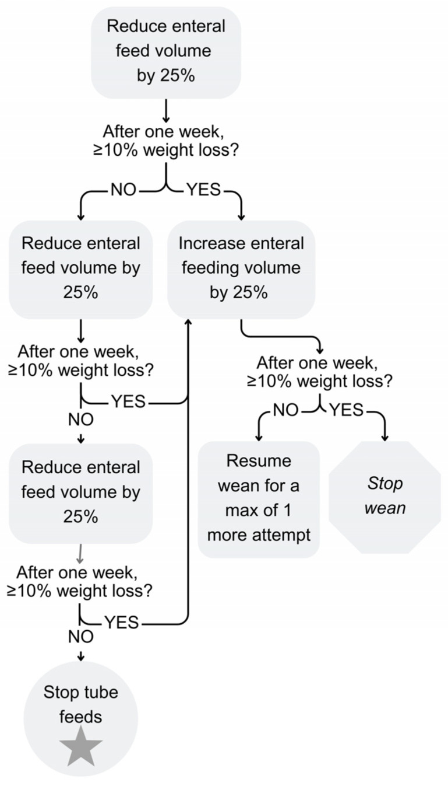
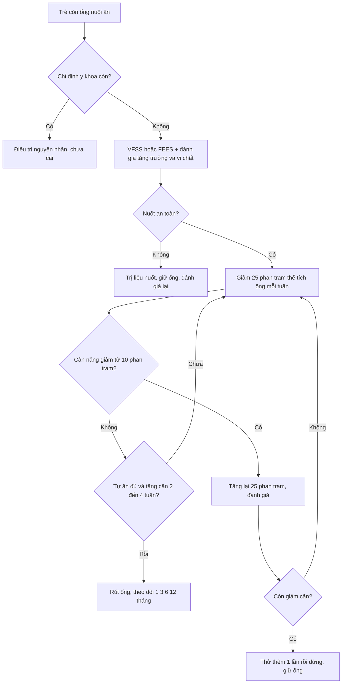
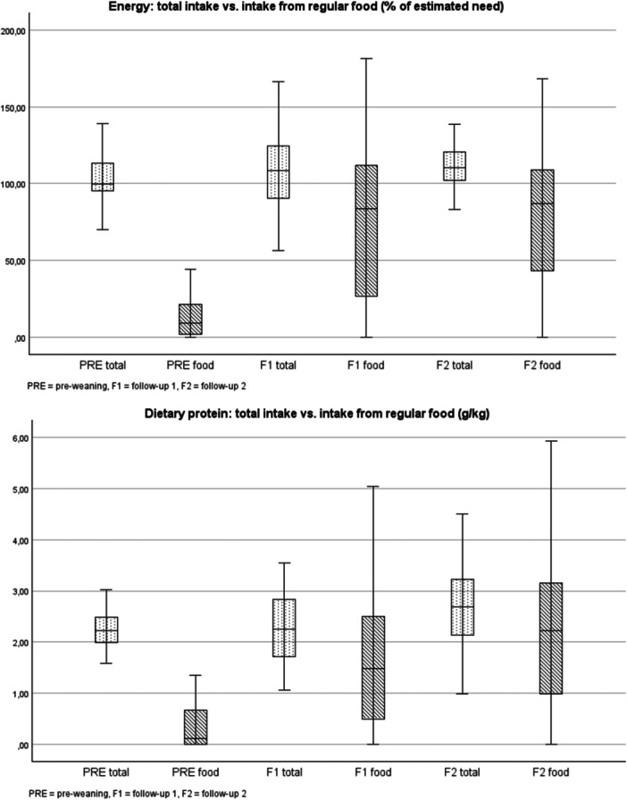

# 1805 — Rút ống mở thông dạ dày & cai nuôi ống ở trẻ / Weaning and removal of feeding tubes in children

**Tags:** `pattern:cai-ong-nuoi` `pattern:phu-thuoc-ong` `vung:da-day` `vung:thanh-bung` `protocol:VFSS-FEES` `protocol:theo-doi-tang-truong`
**Mức chắc chắn (certainty):** tổng hợp y văn (literature synthesis) — tổng hợp từ y văn mở 2020–2026 (Europe PMC: Edwards ST, *Nutrients* 2026, PMC13029489; Keski-Kuha M, *J Pediatr Gastroenterol Nutr* 2026, PMC13446614; Goldstein A, *J Pediatr Gastroenterol Nutr* 2025, PMC12314580; Papagni ME, *Croat Med J* 2025, PMC12426866; Marinschek S, *Eur J Pediatr* 2020, PMC7547996; Patel DD, *World J Radiol* 2025, PMC12210205; Gestels T, *Pediatr Gastroenterol Hepatol Nutr* 2023, PMC10192589). Số chưa kiểm chứng ghi "chưa rõ".

> Bài này là **"chuyện sau khi đã có ống"**: khi nào đủ điều kiện cai, cai theo nhịp nào, theo dõi gì, và khi nào **không** được cai. Biến chứng ống, buried bumper và kiểm tra vị trí đã có ở [083](../083-nuoi-an-qua-sonde/lesson.md); an toàn nuốt ở [081](../081-sac-va-roi-loan-nuot/lesson.md) và [082](../082-bai-nao-an-toan-nuot/lesson.md).

## 1. Tổng quan bệnh học – cơ chế hình ảnh

- **Phụ thuộc ống (tube dependency) khác "còn chỉ định y khoa":** trẻ **ăn được bằng miệng an toàn nhưng vẫn phụ thuộc ống** vì **sợ ăn, thiếu kỹ năng ăn miệng, mất cảm giác đói, hành vi né tránh và lo lắng của gia đình**. Ngược lại, trẻ **có chỉ định thật** (sặc, hẹp, bệnh tiêu hoá hoạt động, suy dinh dưỡng nặng) **không được cai** cho tới khi xử lý nguyên nhân.
- **Vì sao "để đói có kiểm soát" lại hiệu quả (TẠI SAO, không phải mẹo):**
  1. **Tín hiệu đói nội sinh** (ghrelin, giảm leptin) tạo **động lực ăn** mà trẻ chưa từng trải nghiệm khi được nuôi ống liên tục.
  2. **Giảm dần lượng qua ống** làm trẻ **đói đúng lúc bữa ăn** → **học lại phản xạ ăn miệng** (bú/nhai/nuốt) và **giảm né tránh** qua nhiều lần tiếp xúc trung tính, không ép.
  3. **Khung hành vi + huấn luyện cha mẹ** làm giảm **lo lắng và ép ăn** — yếu tố duy trì vòng xoáy biếng ăn.
- **Vì sao phải có ngưỡng cân nặng:** giảm 25% thể tích ống mỗi tuần tạo **cân bằng năng lượng âm**; cơ thể huy động mỡ nhưng **không được vượt quá khả năng bù**. Trong các chương trình, **giảm cân 3,5–9,3%** là thường gặp và **≤ 10% cân nặng** được coi là chấp nhận (Papagni ME 2025, PMC12426866). Vượt **10%** → **tăng lại 25%** và chỉ thử **thêm 1 lần** rồi dừng (Edwards ST 2026, PMC13029489).
- **Kết quả định lượng (để tư vấn, không hứa hẹn):**
  - Gộp các chương trình: **67–69%** trẻ cai được ống; mô hình **Graz (hunger provocation)** đạt **80–90%** (Keski-Kuha M 2026, PMC13446614).
  - **Helsinki, 51 trẻ, 3 tuần ngoại trú:** **72,5%** cai ống ở lần theo dõi cuối; năng lượng từ thức ăn thường **6,2% → 77,2%**; đạm **2,2 → 2,7 g/kg**; **giảm cân trung vị −6,8%** (IQR −8,4 đến −3,9), **13,7% giảm > 10%**.
  - **Zagreb, 30 trẻ khó (đã thất bại cai trước đó):** **90%** tăng ăn miệng, **33,3%** cai hẳn ngay cuối chương trình, **78%** cai ở lần theo dõi trung bình **40,5 tháng**.
  - **Sau mổ teo thực quản–rò khí–thực quản (EA/TEF), mô hình Graz:** **95,3%** cai hẳn, **4,7%** cai một phần; giảm cân **2,42%**; thời gian điều trị trung vị **62,5 ngày** (Marinschek S 2020, PMC7547996).
  - **Theo dõi từ xa (RPM):** **90% (34/38)** cai thành công so với **41% (7/17)** ở nhóm chứng hồi cứu — cỡ mẫu nhỏ, **không ngẫu nhiên**.
- **Cơ chế hình ảnh – vì sao phải "nhìn động" trước khi cai:**
  - **VFSS (videofluoroscopic swallow study)** dùng **barium động** để thấy **thời điểm sặc/ứ đọng** theo từng thì nuốt; **FEES** dùng ống soi mềm, thấy **ứ đọng và sặc sau nuốt** nhưng **không thấy toàn bộ thì hầu–thực quản**. Không có một phương pháp nào thấy hết — **chọn theo câu hỏi lâm sàng**.
  - **X-quang cản quang qua ống** xác nhận **đầu ống/bóng trong dạ dày** trước khi dùng để cai; **bóng chứa nước** thấy được trên siêu âm.
  - **Đường hầm ống mở thông dạ dày (G-tube tract) cần 2–4 tuần để "mature"**; rút/tuột sớm → **viêm phúc mạc, thủng**; đây là lý do **không rút ống ngay sau đặt** dù trẻ đã ăn được (Patel DD 2025, PMC12210205).
- **Biến chứng ống còn lại sau cai:** ở trẻ dùng **low-profile button**, **kích ứng da 47,8%** trong 6 tháng, **mô hạt 29,9%**, **đau bụng 38,8%**, **nôn 43,4%**; biến chứng nặng hiếm (Gestels T 2023, PMC10192589) — hữu ích khi tư vấn "rút ống không có nghĩa hết vấn đề".

## 2. Mẫu hình + chẩn đoán phân biệt theo cơ chế (gamut)

**Câu hỏi trung tâm: "vì sao trẻ còn ống?"** — trả lời đúng thì mới biết cai được hay không.

- **Hành vi – phụ thuộc ống:** ăn miệng được nhưng sợ/ né; hay gặp sau **sinh non, nằm ICU dài, đặt ống lâu, trào ngược, ép ăn**.
- **Rối loạn vận động miệng – hầu (oral-motor):** sinh non, bại não, hội chứng Down, teo thực quản, u não; **nhai/nuốt chậm, chảy nước miếng**.
- **Nuốt mất an toàn (dysphagia có sặc):** sặc im lặng, viêm phổi tái diễn, ho khi ăn; **phải VFSS/FEES trước khi cai**.
- **Bệnh tiêu hoá hoạt động:** **trào ngược nặng, viêm thực quản eosinophil, chậm rỗng dạ dày, táo bón, xoắn ruột/ malrotation, hẹp thực quản**.
- **Bệnh hô hấp mạn:** **BPD/PIBO** — thở nhanh, co kéo, **tụt SpO₂ khi bú/ăn** → ăn miệng "tốn oxy" hơn; cần **tối ưu oxy và thời điểm ăn**.
- **Tim mạch:** tim bẩm sinh, suy tim — **tăng nhu cầu năng lượng + mệt khi bú**; cai ống khi chưa ổn định huyết động dễ thất bại.
- **Chuyển hoá – nội tiết:** suy giáp, bệnh chuyển hoá, thiếu máu — gây **chậm tăng trưởng** và biếng ăn.
- **Giải phẫu:** hẹp thực quản, **rò khí–thực quản**, **khe hở thanh quản**, vòng mạch chèn ép — **không cai trước khi sửa**.
- **Tâm lý – xã hội:** gia đình kiệt sức, lo sợ cân nặng, thiếu hỗ trợ → **can thiệp gia đình là một phần điều trị**, không phải "yếu tố phụ".

## 3. Bảng so sánh phân biệt (ma trận đối chiếu)

| Thực thể (entity) | Hình ảnh / lâm sàng điển hình | Chốt vào (rule-in) | Chốt loại (rule-out) | Gợi ý xác nhận |
|---|---|---|---|---|
| **Phụ thuộc ống do hành vi** | Nuốt an toàn trên VFSS/FEES; không bệnh tiêu hoá hoạt động; ăn miệng **rất ít nhưng không sặc**; lớn tuổi hơn, đã đặt ống lâu | **Nuốt an toàn + không có bệnh lý cấp + hành vi né ăn** | **Sặc/ứ đọng rõ hoặc bệnh tiêu hoá hoạt động** → không phải hành vi thuần | VFSS/FEES + đánh giá OT/tâm lý; thử chương trình có giám sát |
| **Rối loạn vận động miệng–hầu** | Yếu cơ nhai, chảy nước miếng, thức ăn rơi; bại não/Down/sinh non; **nuốt chậm nhưng không sặc** | **Giảm sức cơ miệng–lưỡi + chậm thì miệng** | **Nuốt bình thường, chỉ né ăn** → hành vi | Khám miệng–hầu, FEES; OT/ngôn ngữ trị liệu |
| **Nuốt mất an toàn (aspiration)** | **Sặc khi uống/ăn, ho, viêm phổi tái diễn**; VFSS thấy **thuốc vào đường thở**; FEES thấy **ứ đọng rõ sau nuốt** | **Sặc xác nhận trên VFSS/FEES hoặc viêm phổi hít sặc tái diễn** | **Không sặc, không ứ đọng** → cai được | VFSS (barium) hoặc FEES; đánh giá lại sau điều trị |
| **Trào ngược / viêm thực quản eosinophil** | Nôn, đau khi ăn, **ứ đọng**, nội soi thực quản; eosinophil tăng trong niêm mạc (ngưỡng chuẩn 15/HPF — chưa đối chiếu nguồn trong bài) | **Triệu chứng + đáp ứng PPI/điều trị + nội soi** | **Không triệu chứng, nội soi bình thường** | Nội soi ± sinh thiết; thử PPI có kiểm soát |
| **Chậm rỗng dạ dày / tắc nghẽn** | Nôn dịch cũ, chướng bụng, **ứ đọng thức ăn**; X-quang/CT/SMA–SMV | **Hình ảnh tắc nghẽn hoặc chậm rỗng xác nhận** | **Bụng mềm, không nôn, tăng cân** | Siêu âm/CT bụng; đánh giá ngoại khoa |
| **Bệnh hô hấp mạn (BPD/PIBO)** | Thở nhanh, co kéo, **SpO₂ tụt khi bú/ăn**, khò khè; HRCT ứ khí thì thở ra | **Tụt SpO₂ khi ăn + bệnh phổi mạn** | **SpO₂ ổn định khi ăn, không co kéo** | Theo dõi SpO₂ trong bữa ăn; tối ưu oxy; cross-link [1803](../1803-ngung-tho-khi-ngu-tac-nghen-tre-benh-phoi-man/lesson.md) |
| **Tim bẩm sinh / suy tim** | Mệt khi bú, ra mồ hôi, gan to, suy dinh dưỡng; siêu âm tim bất thường | **Suy tim/ shunt lớn còn gánh huyết động** | **Huyết động ổn định, siêu âm bình thường** | Siêu âm tim; hội chẩn tim mạch trước cai |
| **Sau rút ống: rò da–dạ dày tồn tại** | Dịch dạ dày chảy qua lỗ mở thông **nhiều tuần**; kích ứng da | **Rò kéo dài + viêm da** | **Lỗ đóng trong vài ngày** | X-quang cản quang qua lỗ; tiêu hoá/ngoại |

*Giảm thể tích ống **25%**; sau 1 tuần nếu **giảm cân ≥ 10%** → **tăng lại 25%**, chỉ cho **thêm 1 lần thử** rồi **dừng cai**; nếu **< 10%** → tiếp tục giảm 25% cho tới khi **bỏ hẳn ống**. Nguồn: Edwards ST et al., *Nutrients* 2026 (PMC13029489), CC BY 4.0.*

## 4. Protocol cai ống + theo dõi dinh dưỡng

**4.1. Trước khi bắt đầu — 7 việc bắt buộc**

1. **Xác nhận chỉ định ống không còn:** bệnh tiêu hoá/hô hấp/tim **ổn định**, không còn đợt cấp.
2. **Đánh giá nuốt:** **VFSS** khi nghi sặc/ứ đọng hoặc có bệnh thần kinh–cơ; **FEES** khi cần đánh giá tại giường/theo dõi. **Không cai nếu chưa chứng minh nuốt an toàn.**
3. **Tăng trưởng:** cân, cao, **z-score cân/cao/BMI** ít nhất 3 điểm theo thời gian; ghi **đường cong**, không chỉ một con số.
4. **Vi chất:** **ferritin/CBC, vitamin D, B12, folate, kẽm** — vì sau cai **năng lượng có thể đủ nhưng vi chất thiếu** (Keski-Kuha M 2026).
5. **Đường tiêu hoá:** đánh giá **trào ngược, táo bón, chậm rỗng**; điều trị trước.
6. **Đường thở:** trẻ **BPD/PIBO** cần **SpO₂ khi ăn**, tối ưu oxy; trẻ có **TBM** ăn chậm hơn.
7. **Gia đình & tâm lý:** giải thích **giảm cân là dự kiến**, có **kế hoạch liên lạc 24/7**, **không ép ăn**; đánh giá **trầm cảm/lo âu của cha mẹ** và khả năng theo dõi.

**4.2. Chương trình & nhịp cai**

- **Mô hình:** nội trú, **bán trú/ngày**, ngoại trú, **theo dõi từ xa**, hoặc kết hợp. Bằng chứng: **đa mô hình đều hiệu quả**, nhóm **bán trú/nội trú tăng năng lượng miệng nhiều hơn** ngoại trú (**82,6% vs 70,5%** trong tổng quan) (Goldstein A 2025, PMC12314580).
- **Đội ngũ:** bác sĩ nhi, **chuyên gia dinh dưỡng**, **ngôn ngữ trị liệu/OT**, **tâm lý**, điều dưỡng — **≥ 3 người** ở hầu hết chương trình.
- **Nhịp giảm:** **25% thể tích ống mỗi tuần**; cân **hàng ngày** (nội trú) hoặc **2–3 lần/tuần** (ngoại trú).
- **Quy tắc an toàn (theo lưu đồ):**
  - **Giảm cân < 10%** → tiếp tục giảm 25%.
  - **Giảm cân ≥ 10%** → **tăng lại 25%**, đánh giá lại; nếu vẫn tiếp tục giảm → **thử thêm 1 lần** rồi **dừng**.
  - **Dừng ngay** khi: **mất nước** (tiểu ít, Na tăng), **hạ đường huyết**, **sặc/viêm phổi**, **suy hô hấp**, **giảm cân > 10% không bù được**, hoặc **gia đình không còn theo dõi được**.
- **Bù nước – năng lượng:** không "bù bằng sữa cao năng lượng qua ống" trong lúc cai nếu mục tiêu là **học ăn**; ưu tiên **bữa nhỏ, đậm năng lượng, thức ăn yêu thích**, **không kéo dài bữa quá lâu**, **không ép**.
- **Thời điểm rút ống:** khi trẻ **ăn đủ và tăng cân** qua **nhiều lần khám liên tiếp** (theo chương trình; **chưa có ngưỡng thời gian thống nhất** trong nguồn đã đọc), **nuốt an toàn**, không còn dùng ống cho thuốc/dịch; **kiểm tra vị trí ống** trước lần dùng cuối; **đường hầm đã mature ≥ 2–4 tuần** nếu là G-tube.

**4.3. Theo dõi sau cai (quan trọng ngang lúc cai)**

| Thời điểm | Việc làm | Ngưỡng/quyết định |
|---|---|---|
| **1 tháng** | Cân, chiều cao, nhật ký ăn 3 ngày, triệu chứng tiêu hoá | **Giảm cân liên tiếp qua 2 lần khám** hoặc tụt z-score → tăng mật độ năng lượng/hỗ trợ dinh dưỡng |
| **3–6 tháng** | Lặp **z-score**, **ferritin/vitamin D/B12/kẽm**, đánh giá hành vi ăn | Vi chất thấp → **bổ sung**, không chờ triệu chứng |
| **12 tháng** | Tăng trưởng, ăn đa dạng, chất lượng sống | **44%** trẻ cai ống từng bị **suy dinh dưỡng sau 1 năm** trong một đoàn hệ → tiếp tục theo dõi |
| **Bất kỳ lúc nào** | Nôn tái diễn, sặc, sụt cân, mệt | **Đánh giá lại nuốt**; cân nhắc **đặt lại ống** — không coi là "thất bại" |

## 5. Biến thể bình thường và cạm bẫy

- **"Giảm 10%" là giới hạn an toàn, không phải mục tiêu:** nhiều trẻ chỉ giảm **3,5–9,3%**; cố đạt 10% là **hại**.
- **Cai ống ≠ ăn đủ:** ở Helsinki, **72,5% cai ống** nhưng chỉ **36,4%** đạt **≥ 100% nhu cầu năng lượng** hoàn toàn từ thức ăn ở lần theo dõi cuối → **phải theo dõi dài**, không dừng khi "đã rút ống".
- **Vi chất thiếu dù năng lượng đủ:** sắt, vitamin D, kẽm, B12 thường **không đạt** sau cai → **bổ sung có kế hoạch** (Keski-Kuha M 2026).
- **Chiều cao có thể giảm z-score** dù cân hồi phục (**−1,5 → −1,7 SD**, p = 0,045) — đừng chỉ nhìn cân.
- **Nôn/ọe có thể còn:** **17,6%** vẫn tăng nôn/ọe, **23,5%** táo bón sau cai; đây là lý do **không hứa "hết bệnh"**.
- **Không cai trong đợt cấp:** nhiễm trùng, mất nước, suy hô hấp, mổ gần đây → **hoãn**.
- **Đường hầm G-tube 2–4 tuần:** rút/tuột sớm → **viêm phúc mạc/thủng**; **không thử rút sớm để "xem sao"** (Patel DD 2025).
- **Button/PEG có bóng:** trước khi rút phải **loại trừ buried bumper** (bài 083), kiểm tra **bóng còn nguyên/không di trú**; nếu có biến chứng → xử lý trước.
- **Trẻ BPD/PIBO:** ăn miệng **tăng công hô hấp** → **tụt SpO₂ khi ăn** dễ bị coi là "biếng ăn"; phải đo SpO₂ trong bữa và tối ưu oxy.
- **Sặc im lặng:** không ho không có nghĩa an toàn — **VFSS/FEES** mới trả lời; bỏ qua bước này là nguyên nhân thất bại và viêm phổi.
- **"Cai một lần là xong":** một số trẻ **phải đặt lại ống** — tổng quan ghi nhận **thiểu số** cần đặt lại; **đặt lại không phải thất bại của gia đình**.

## 6. Tự lượng giá — Blind Quiz

**Ca 1 — Bé 2 tuổi, đặt PEG 18 tháng vì sinh non + trào ngược. Đã điều trị trào ngược, nuốt an toàn trên VFSS. Tuần 1 giảm 25% lượng ống, cân giảm 8%. Tuần 2 giảm tiếp 25%, cân giảm 11%. Bước tiếp theo?**

- Câu hỏi: Tuần 1 bạn làm gì? Tuần 2 có tiếp tục giảm không? Khi nào dừng hẳn?

<b>Bấm để hiện đáp án (findings + chẩn đoán)</b>

- Tuần 1: **giảm 8% < 10%** → **tiếp tục giảm 25%** (theo lưu đồ).
- Tuần 2: **giảm 11% ≥ 10%** → **tăng lại 25%**, đánh giá lại; nếu vẫn giảm cân → **thử thêm 1 lần** rồi **dừng cai**.
- Dừng hẳn khi trẻ **tự ăn đủ + tăng cân 2–4 tuần**, nuốt an toàn; **không** dựa vào một lần cân.
- Nguồn ảnh: Edwards ST et al., *Nutrients* 2026 (PMC13029489), **CC BY 4.0**.

**Ca 2 — Bé 3 tuổi cai ống 3 tháng, cân nặng ổn định theo z-score, nhưng ferritin thấp và vitamin D thấp. Mẹ hỏi "đã ăn đủ sao còn thiếu?".**

- Câu hỏi: Đọc biểu đồ: năng lượng/đạm từ thức ăn thay đổi thế nào? Vì sao **năng lượng đủ mà vi chất vẫn thiếu**? Xử trí?

<b>Bấm để hiện đáp án (findings + chẩn đoán)</b>

- Biểu đồ: **năng lượng từ thức ăn tăng mạnh** (trung vị **6,2% → 77,2%** tổng năng lượng), **đạm 2,2 → 2,7 g/kg**; nhưng **khoảng IQR rất rộng** — nhiều trẻ ăn dưới nhu cầu.
- Năng lượng đủ **không bảo đảm đủ sắt/kẽm/vitamin D/B12**: thức ăn ít đa dạng, hấp thu kém, nhu cầu cao khi đang bắt kịp tăng trưởng.
- Xử trí: **bổ sung theo xét nghiệm**, tư vấn **đa dạng thực phẩm**, lặp xét nghiệm sau **3 tháng**; không tự dừng theo dõi vì "cân ổn".
- Nguồn ảnh: Keski-Kuha M et al., *J Pediatr Gastroenterol Nutr* 2026 (PMC13446614), **CC BY-NC-ND 4.0** (nguyên bản).

**Ca 3 — Bé 18 tháng sau mổ teo thực quản, ho và thở khò khè sau mỗi bữa, đã 2 lần viêm phổi. Gia đình xin "cai ống luôn cho gọn". Bạn làm gì?**

- Câu hỏi: Có chỉ định cai ngay không? Cần làm gì trước? Dấu hiệu nào chống chỉ định cai?

<b>Bấm để hiện đáp án (findings + chẩn đoán)</b>

- **Không cai ngay:** ho + khò khè sau ăn + **viêm phổi tái diễn** gợi ý **sặc/ứ đọng** hoặc **hẹp/rò thực quản** — cần **VFSS/FEES** và đánh giá ngoại khoa trước.
- Chống chỉ định tạm thời: **sặc xác nhận**, **viêm phổi đang hoạt động**, **hẹp thực quản chưa xử lý**, **suy dinh dưỡng nặng**, **gia đình không theo dõi được**.
- Nếu nuốt an toàn và không hẹp: mới vào chương trình **giảm 25%/tuần**, theo dõi cân **hàng ngày/tuần**.
- Nguồn số liệu: Marinschek S et al., *Eur J Pediatr* 2020 (PMC7547996), CC BY 4.0; Goldstein A et al., *J Pediatr Gastroenterol Nutr* 2025 (PMC12314580), CC BY-NC-ND 4.0.

## Bài liên quan chéo
- [600 – Tổng quan Nhi khoa](../600-tong-quan-nhi-khoa/lesson.md)
- [083 – Nuôi ăn qua sonde & mở thông dạ dày: biến chứng, kiểm tra vị trí](../083-nuoi-an-qua-sonde/lesson.md)
- [082 – Bại não & an toàn nuốt ở trẻ](../082-bai-nao-an-toan-nuot/lesson.md)
- [081 – Sặc & rối loạn nuốt](../081-sac-va-roi-loan-nuot/lesson.md)
- [606 – BPD: bệnh phổi mạn ở trẻ sinh non](../606-bpd-tre-sinh-non/lesson.md)
- [1803 – OSA ở trẻ bệnh phổi mạn](../1803-ngung-tho-khi-ngu-tac-nghen-tre-benh-phoi-man/lesson.md)

## Ảnh
- `images/1805_hunger-provocation_Luudo_PMC13029489.jpg` — CC BY 4.0.
- `images/1805_nang-luong-protein-sau-cai_Bieudo_PMC13446614.jpg` — CC BY-NC-ND 4.0 (nguyên bản).
- Nguồn + giấy phép từng ảnh: `images/CREDITS.md`; link gốc: `sources.md`.

> Không dùng để chẩn đoán độc lập khi chưa có người hướng dẫn.
