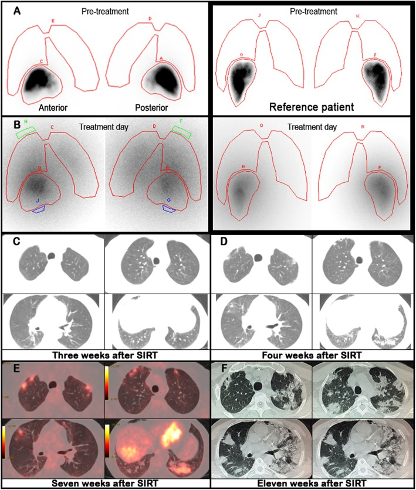
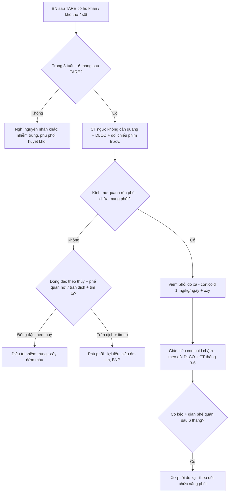
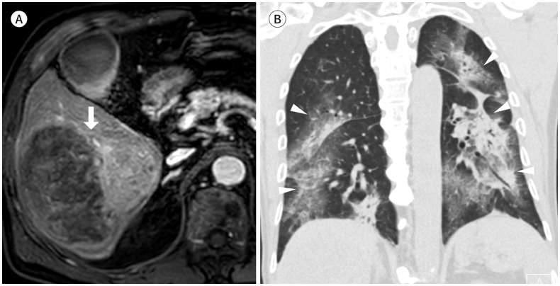
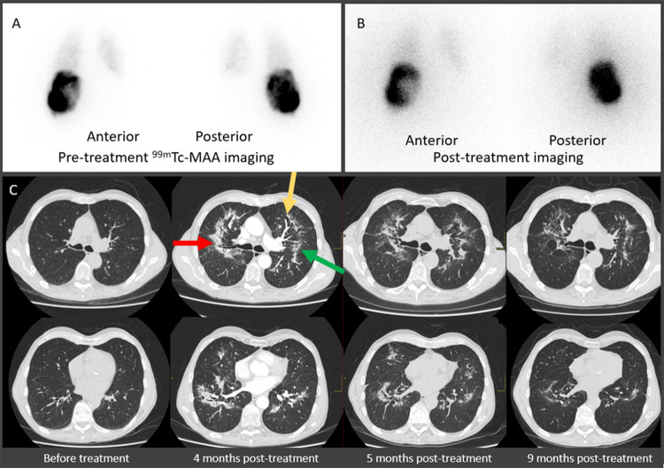

# 1806 — Viêm phổi do xạ sau TARE (radiation pneumonitis after transarterial radioembolization): kính mờ quanh rốn phổi, ngưỡng liều phổi và cái bẫy "LSF thấp"

**Tags:** `pattern:kinh-mo` `pattern:dong-dac` `pattern:vien-phoi-do-xa` `vung:phoi` `score:lung-dose` `protocol:CT-nguc` `protocol:MAA-scout` `incidentaloma:khong`
**Mức chắc chắn (certainty):** tổng hợp y văn (literature synthesis) — tổng quan biến chứng TARE 2025 (PMC12328914), 2 ca nguyên văn có ảnh (PMC7236282, PMC12234408) và số liệu từ văn bản gốc; số liệu không đối chiếu được ghi "chưa rõ", không suy diễn.

## 1. Tổng quan bệnh học – cơ chế hình ảnh

- **Bản chất:** TARE (transarterial radioembolization) bơm vi cầu mang đồng vị phóng xạ (**90Y** hoặc **166Ho**) vào động mạch gan. Vi cầu **20–60 µm** mắc lại ở tiểu động mạch – mao mạch phổi nếu có **shunt gan–phổi** (hepatopulmonary shunt); mô phổi nhận liều xạ **cục bộ rất cao** quanh mỗi vi cầu.
- **Vì sao tổn thương là "quanh rốn phổi" và chừa màng phổi:** hạt mắc ở nơi **lòng mạch lớn và tưới máu cao nhất** (vùng rốn phổi); tia β của 90Y chỉ đi được **trung bình 2,5 mm, tối đa 10 mm** trong mô, nên tổn thương dừng ngay quanh hạt và **không lan tới 1–2 cm sát màng phổi** (nơi có ít mao mạch lớn). Đây là cơ sở vật lý của mẫu hình **"kính mờ/đông đặc không sát màng phổi"** — dấu hiệu mô tả trong tổng quan 2025 và thấy trên ca Fig. 3.
- **Ngưỡng định lượng (bắt buộc nhớ):**
  - **LSF (lung shunt fraction) > 10%** = shunt đáng kể; nguy cơ viêm phổi do xạ **tăng khi > 15%** hạt đi vào phổi.
  - **Liều phổi cho phép: 30 Gy cho 1 lần điều trị; 50 Gy tích lũy cho nhiều lần** — ngưỡng này **vay từ xạ trị ngoài** (EBRT), không phải dữ liệu riêng của TARE.
  - Tổng quan Hàn Quốc **782 bệnh nhân: viêm phổi do xạ có triệu chứng 1,7% (13 ca), 6 ca tử vong**; **4 ca xảy ra dù liều phổi < 29 Gy** → nhóm tác giả đề nghị hạ ngưỡng còn **25 Gy (nam) / 20 Gy (nữ)** với vi cầu thủy tinh, và **15 Gy** với vi cầu nhựa (nhựa cần nhiều vi cầu hơn cho cùng liều → độc tính phổi cao hơn).
  - Tây phương: tỷ lệ **< 1%** trong nghiên cứu tiến cứu và hồi cứu.
- **Thời điểm:** triệu chứng **3–12 tuần** sau thủ thuật (tổng quan), thực tế gặp **1–6 tháng** (ca nguyên văn). Bệnh cảnh: **ho khan, sốt, khó thở**; có thể tự khỏi, kéo dài **> 6 tháng**, tiến triển **xơ hóa**.
- **Vì sao DLCO là dấu hiệu sớm hơn CT:** tổn thương nội mô mao mạch – phế nang làm giảm diện tích khuếch tán trước khi có đủ dịch/tế bào để tạo kính mờ. Ca nguyên văn: **DLCO 98% → 79% ở tuần 3 khi CT còn bình thường và bệnh nhân không triệu chứng**, **77% ở tuần 4** mới xuất hiện kính mờ. Vì vậy **DLCO là marker theo dõi rẻ và sớm**, không thay thế CT nhưng báo trước.

## 2. Mẫu hình + chẩn đoán phân biệt theo vị trí (gamut)

- **Mẫu hình A — kính mờ/đông đặc quanh rốn phổi, "cánh dơi", chừa 1–2 cm sát màng phổi:** viêm phổi do xạ sau TARE; **phù phổi cấp** (có tim to, tràn dịch, phân bố phụ thuộc); **viêm phổi do Pneumocystis** (kính mờ lan tỏa, chừa màng phổi nhưng **không có bờ rõ quanh rốn**); **xuất huyết phế nang** (kính mờ + thiếu máu, hemoptysis); **viêm phổi quá mẫn/do thuốc**.
- **Mẫu hình B — kính mờ/đông đặc khu trú đáy phổi sát vòm hoành:** xẹp phổi đĩa/do tràn dịch dưới hoành sau thủ thuật, viêm phổi hít, **tổn thương do xạ trực tiếp từ khối gan sát hoành** (liều cao tại u).
- **Mẫu hình C — đông đặc + giãn phế quản co kéo, giảm thể tích, muộn > 6 tháng:** **xơ phổi do xạ** (radiation-induced pulmonary fibrosis).
- **Gamut theo thời gian (mấu chốt lâm sàng):** **< 1 tháng** → phù phổi, nhiễm trùng, xuất huyết, xẹp; **1–6 tháng** → viêm phổi do xạ; **> 6 tháng** → xơ hóa. Hỏi đúng **ngày TARE** là bước 1 của mọi ca kính mờ mới.
- **Gợi nhớ:** **R**adioembolization → **R**adiation pneumonitis: **P**erihilar, **S**paring subpleura, **L**ow LSF vẫn có thể xảy ra, **D**LCO giảm sớm.

## 3. Bảng so sánh phân biệt (ma trận đối chiếu)

| Thực thể (entity) | Hình ảnh điển hình (CT) | Chốt vào (rule-in) | Chốt loại (rule-out) | Gợi ý xác nhận |
|---|---|---|---|---|
| **Viêm phổi do xạ sau TARE** | Kính mờ/đông đặc **quanh rốn phổi**, có thể "cánh dơi", **chừa màng phổi**; xuất hiện 3 tuần–6 tháng sau TARE; có thể FDG tăng | **Tiền sử TARE + đúng cửa sổ 3 tuần–6 tháng + kính mờ chừa màng phổi + LSF/liều phổi đã biết** | Kính mờ **sát màng phổi lan tỏa** + tràn dịch + tim to → phù phổi; đông đặc **một thùy có phế quản hơi** → nhiễm trùng | CT ngực không cản quang + so phim trước; DLCO; đáp ứng corticoid |
| **Tiến triển/di căn phổi** | Nốt/khối đặc, bờ tròn, có thể nhiều nốt; **không theo bờ mạch** | **Nốt đặc định hình + đối chiếu phim cũ + bối cảnh ung thư** | Kính mờ lan tỏa **không tạo nốt**, chừa màng phổi → không phải di căn | So phim trước TARE; PET/CT (cả hai đều có thể FDG tăng) |
| **Viêm phổi nhiễm trùng** | Đông đặc **một thùy/phân thùy**, phế quản hơi, có thể tràn dịch; phân bố không đối xứng | **Sốt cao, đờm mủ, CRP/bạch cầu tăng, đông đặc theo thùy** | Kính mờ **đối xứng quanh rốn**, không phế quản hơi, không tràn dịch → nghĩ do xạ | Cấy đờm/máu, kháng sinh thử |
| **Phù phổi cấp** | Kính mờ hai bên, **dày vách, tràn dịch màng phổi, tim to**, phân bố phụ thuộc | **BNI cao, tràn dịch hai bên, tim to, đáp ứng lợi tiểu** | **Không tràn dịch, không tim to, chừa màng phổi** → nghĩ do xạ | Siêu âm tim, BNP, cân nặng |
| **Xuất huyết phế nang** | Kính mờ/đông đặc lan tỏa hoặc vá, có thể tam chứng thiếu máu – ho máu – kính mờ | **Hemoglobin tụt, ho ra máu, kính mờ mới + rối loạn đông máu** | Kính mờ **ổn định nhiều tuần**, không thiếu máu → không phải xuất huyết | CT + Hb nối tiếp, nội soi phế quản |
| **Xơ phổi do xạ** | Đông đặc co kéo, **giãn phế quản trong tổn thương**, giảm thể tích, bờ thẳng theo vùng chiếu xạ | **> 6 tháng + giãn phế quản co kéo + giảm thể tích** | Kính mờ **mới, chưa co kéo** → còn giai đoạn viêm | CT lớp mỏng, so phim 6–12 tháng |

*Ca 54 tuổi, HCC, vi cầu nhựa 90Y **32 mCi**, **LSF 5%**. (A) xạ hình MAA trước điều trị; (B) xạ hình bremsstrahlung sau điều trị cho thấy shunt phổi **không dự kiến**; (C) **tuần 3**: CT bình thường dù DLCO đã giảm còn 79%; (D) **tuần 4**: kính mờ hai bên; (E) **tuần 7**: FDG PET/CT tăng thuốc trong vùng kính mờ; (F) **tuần 11**: đông đặc/kính mờ lan tỏa, SpO₂ 82%, tử vong tuần 12. Nguồn: BMC Med Imaging 2020 (PMC7236282), CC BY 4.0.*

## 4. Protocol chụp + hệ phân tầng liều

- **Trước TARE (bắt buộc):** chụp mạch + **99mTc-MAA** (hoặc 166Ho-Scout) planar **và SPECT/CT** → tính **LSF** và liều phổi dự kiến. Nếu **LSF > 10–15%** hoặc liều phổi dự kiến **> 30 Gy**: giảm hoạt độ, **nút mạch nhánh shunt**, hoặc **bóng chèn tĩnh mạch gan** tạm thời; nếu vẫn không đạt → **không điều trị**.
- **Cảnh báo kỹ thuật:** **planar thường cao hơn SPECT**. Ca 166Ho: LSF **11% (planar) vs 6,5% (SPECT)** lúc lập kế hoạch; sau điều trị **16% vs 9,8%**, liều phổi trung bình **25 Gy vs 13 Gy**. Dùng planar đơn thuần có thể **ước lượng quá liều** (giảm hoạt độ không cần thiết) hoặc **bỏ sót shunt thật** khi phân bố không đều — luôn đọc **cả hai**.
- **Sau TARE:** hỏi ho khan/khó thở mỗi lần tái khám; **DLCO nền và lặp lại** (tuần 3–4, tháng 3, tháng 6); **CT ngực không cản quang** khi có triệu chứng hoặc DLCO giảm > 10% so với nền. Không chụp CT định kỳ cho mọi ca không triệu chứng (chưa có bằng chứng đổi kết cục).
- **Điều trị:** corticoid toàn thân (ca nguyên văn: **prednisone 1 mg/kg/ngày**), oxy, giảm ho; **không có thử nghiệm so sánh** chứng minh phác đồ nào ưu việt. Giảm liều corticoid **chậm** — bệnh có thể bùng lại.
- **Theo dõi nguy cơ cao:** bệnh phổi kẽ có sẵn, xạ trị phổi trước đó, nhiều lần TARE, vi cầu nhựa, LSF sát ngưỡng.

## 5. Biến thể bình thường và cạm bẫy

- **Cạm bẫy 1 — "LSF thấp nên an toàn":** ca tử vong có **LSF 5%** (dưới mọi ngưỡng) và **liều phổi ước tính 12,3 Gy** vẫn viêm phổi do xạ nặng. LSF là **ước lượng**, không phải bảo đảm; **phân bố vi cầu không đều** có thể dồn liều vào một vùng phổi nhỏ.
- **Cạm bẫy 2 — planar vs SPECT:** chênh gần **2 lần** về liều phổi (25 Gy vs 13 Gy). Ghi rõ phương pháp khi đọc "liều phổi".
- **Cạm bẫy 3 — FDG PET:** vùng kính mờ do xạ **bắt FDG** (viêm), dễ đọc thành **tiến triển/di căn**. Không chẩn đoán tiến triển chỉ dựa vào PET trong 6 tháng đầu sau TARE; cần so hình thái + thời điểm.
- **Cạm bẫy 4 — gọi là "phù phổi":** mẫu hình cánh dơi bị điều trị bằng lợi tiểu → **mất thời gian vàng của corticoid**. Ba dấu hiệu loại phù phổi: **không tràn dịch, không tim to, chừa màng phổi**.
- **Cạm bẫy 5 — bỏ sót vì CT 3 tuần bình thường:** CT có thể **âm tính** khi DLCO đã giảm; một CT bình thường không loại trừ, phải **chụp lại tuần 4–6** nếu lâm sàng/DLCO xấu đi.
- **Biến thể bình thường:** kính mờ **thoáng qua, một vài ổ nhỏ dưới 1 cm**, không triệu chứng, tự mất trong 2–4 tuần — theo dõi, không sinh thiết.
- **Cạm bẫy 6 — corticoid giảm nhanh:** tái phát sau ngừng; giảm liều theo tuần, không theo ngày.

## 6. Tự lượng giá — Blind Quiz

**Ca 1 — Nam 72 tuổi, HCC 10 cm, TARE 4 tháng trước, nay khó thở khi gắng sức. Nhìn CT, mô tả trước.**

- Gợi ý lâm sàng: LSF trước thủ thuật **5,5%**, liều u **269 Gy**, liều phổi ước tính **12,3 Gy**.
- Câu hỏi: Mẫu hình tổn thương? Có sát màng phổi không? 3 chẩn đoán phân biệt và dấu hiệu nào loại phù phổi?

<b>Bấm để hiện đáp án (findings + chẩn đoán)</b>

- Dấu hiệu (findings): kính mờ/đông đặc **đối xứng quanh rốn phổi**, mẫu hình **"cánh dơi"**, **chừa 1–2 cm sát màng phổi**, không tràn dịch, không tim to.
- Chẩn đoán (diagnosis): **viêm phổi do xạ sau TARE** — xuất hiện 4 tháng sau thủ thuật, dù **LSF chỉ 5,5%** và liều phổi ước tính **12,3 Gy** (dưới ngưỡng 30 Gy). Bệnh nhân tử vong 1 tháng sau khởi phát dù đã dùng corticoid + kháng sinh.
- Phản biện: đây là ca **không điển hình về liều** — nhắc rằng ngưỡng liều là **công cụ lập kế hoạch, không phải ngưỡng an toàn tuyệt đối**.
- Nguồn ảnh: J Korean Soc Radiol 2025 (PMC12328914), Fig. 3, CC BY-NC 4.0 — nguyên bản, không chỉnh sửa.

**Ca 2 — Nam 77 tuổi, TARE 166Ho lần 2, 4 tháng sau chụp CT tầm soát di căn phổi.**

- Gợi ý lâm sàng: khó thở nhẹ thoáng qua; **DLCO còn 47%**; LSF lập kế hoạch **11% planar / 6,5% SPECT**.
- Câu hỏi: Tổn thương ở đâu, có đặc điểm gì? Vì sao hai phương pháp LSF cho kết quả khác nhau?

<b>Bấm để hiện đáp án (findings + chẩn đoán)</b>

- Dấu hiệu (findings): **đông đặc quanh rốn phổi lan tỏa nhiều thùy** (mũi tên đỏ/vàng/xanh), kèm kính mờ và **giãn phế quản co kéo** ở tháng 4–9; xạ hình MAA trước và sau điều trị cho thấy shunt phổi.
- Chẩn đoán (diagnosis): **viêm phổi do xạ ± khởi đầu xơ hóa** sau TARE 166Ho. Bệnh nhân **không dùng corticoid**, triệu chứng nhẹ và tự hết — cho thấy phổ bệnh từ không triệu chứng đến tử vong.
- Bài học kỹ thuật: **planar 11% vs SPECT 6,5%**; liều phổi trung bình **25 Gy vs 13 Gy** — planar **ước lượng cao hơn**, nên đọc cả hai để không giảm hoạt độ quá mức hoặc bỏ sót.
- Nguồn ảnh: EJNMMI Reports 2025 (PMC12234408), Fig. 1, **CC BY-NC-ND 4.0** — nguyên bản, không crop/ghép.

**Ca 3 — Bệnh nhân sau TARE, tuần 3: CT phổi bình thường nhưng DLCO giảm từ 98% còn 79%.**

- Câu hỏi: CT bình thường có loại trừ viêm phổi do xạ? Bước tiếp theo là gì?

<b>Bấm để hiện đáp án (findings + chẩn đoán)</b>

- Trả lời: **Không**. DLCO giảm **19 điểm phần trăm** khi chưa có bất thường trên CT và chưa có triệu chứng; kính mờ xuất hiện **tuần 4**, FDG tăng **tuần 7**, đông đặc lan tỏa **tuần 11**.
- Bước tiếp theo: chụp lại CT **tuần 4–6**, theo dõi DLCO, cảnh báo bệnh nhân quay lại ngay khi ho khan/khó thở; **không chờ đến khi CT dương tính** mới theo dõi sát.
- Nguồn ảnh: BMC Med Imaging 2020 (PMC7236282), Fig. 1, CC BY 4.0.

## Bài liên quan chéo
- [1801 – Bệnh gan do thuyên tắc phóng xạ (REILD)](../1801-benh-gan-do-thuyen-tac-phong-xa-reild/lesson.md) — cùng nhóm biến chứng TARE, khác cơ quan đích
- [180 – Viêm túi mật thiếu máu sau TACE](../180-viem-tui-mat-thieu-mau-sau-tace/lesson.md) — biến chứng do trào ngược vi cầu không đích
- [040 – Tràn dịch màng phổi](../040-tran-dich-mang-phoi/lesson.md) — phân biệt dịch màng phổi với đông đặc ngoại vi
- [030 – Đông đặc/xẹp phổi](../030-dong-dac-xep-phoi/lesson.md) — học thuyết thể tích, phân biệt đông đặc với xẹp
- [083 – Nuôi ăn qua sonde & mở thông dạ dày](../083-nuoi-an-qua-sonde/lesson.md) — không liên quan trực tiếp, dùng cho ca hít sặc sau thủ thuật
- [025 – Tổn thương phổi tạo hang](../025-ton-thuong-phoi-tao-hang/lesson.md) — mẫu hình hang, không nhầm với kính mờ do xạ

> Không dùng để chẩn đoán độc lập khi chưa có người hướng dẫn.
