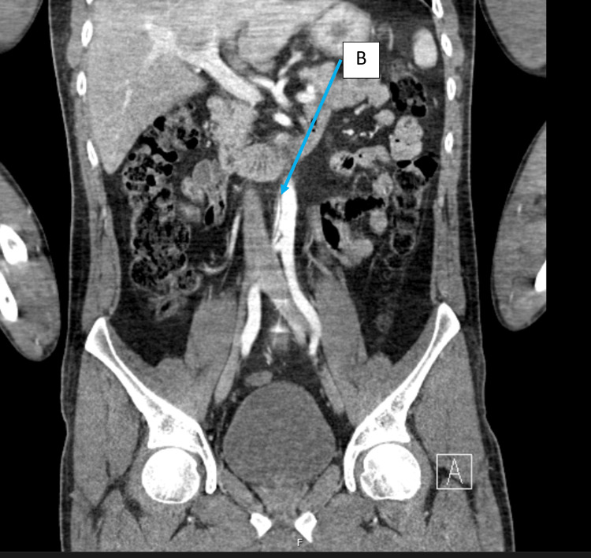
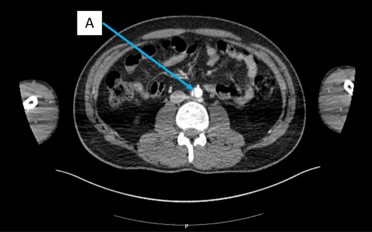
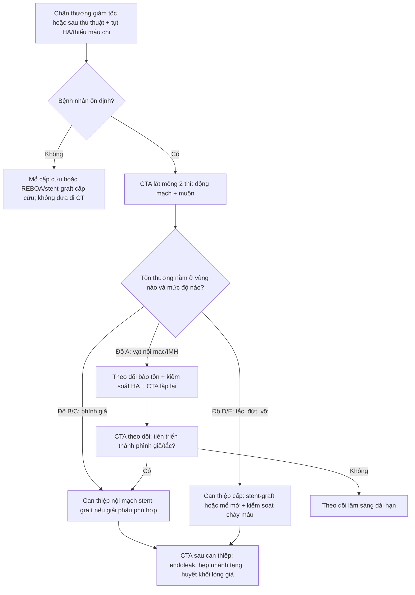
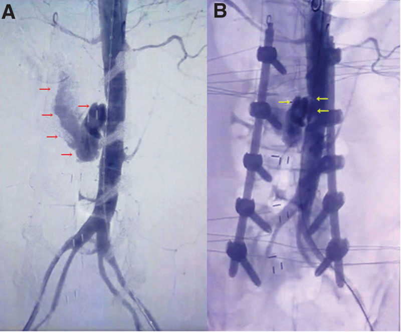

# 1807 — Bóc tách động mạch chủ bụng do chấn thương & sau thủ thuật / Traumatic and iatrogenic abdominal aortic injury

**Tags:** `pattern:boc-tach` `pattern:vat-noi-mac` `vung:DMC-bung` `score:Shalhub-Rabin` `protocol:CTA-2-thi`
**Mức chắc chắn (certainty):** tổng hợp y văn (literature synthesis) — số liệu chủ yếu từ tổng quan hệ thống 133 bệnh nhân chấn thương ĐMC bụng kín (tổng quan *Biomol Biomed* 2024, PMC11088888), ca nguyên văn có ảnh CT (Cureus 2024, PMC11261995), ca tổn thương ĐMC bụng **do phẫu thuật cột sống** có ảnh DSA (Medicine 2022, PMC9439786) và tổng quan chiến lược xử trí chấn thương mạch bụng (Front Surg 2018, PMC5826055). Đây là **bệnh hiếm, không có thử nghiệm ngẫu nhiên** — mọi ngưỡng điều trị dưới đây là đồng thuận từ loạt ca, ghi rõ khi chưa có số.

## 1. Tổng quan bệnh học – cơ chế hình ảnh

- **Tần suất:** chấn thương ĐMC bụng kín (blunt abdominal aortic injury, BAAI) chiếm **4–6% tổng số chấn thương ĐMC** và **< 1%** tổng số chấn thương kín (PMC11088888). Trong chấn thương kín nói chung, **bóc tách ĐMC do chấn thương gặp ở 1,79%** bệnh nhân, và **tới 80% tử vong trước khi tới viện** (PMC11261995).
- **Vì sao hiếm nhưng chết người:** đoạn ĐMC bụng **cố định** giữa cột sống và phúc mạc, động mạch được "neo" bởi các nhánh tạng — lực giảm tốc và lực ép **không giải toả được** mà truyền trực tiếp vào thành mạch. Tử vong trong y văn **17–92%**; trong loạt hệ thống 133 ca, **tử vong tối thiểu 15,3% (19/133)** (PMC11088888).
- **Cơ chế tổn thương theo thứ tự:** **rách nội mạc** → máu vào lớp áo giữa tạo **vạt nội mạc (intimal flap)** và lòng giả; hoặc **máu tụ trong thành (intramural haematoma)** không có vạt; hoặc **phình giả (pseudoaneurysm)** khi vết rách bị mô quanh mạch bọc lại; nặng nhất là **đứt/viêm tắc hoàn toàn** gây **thiếu máu chi cấp**. Máu tụ hậu phúc mạc có thể tự cầm (tamponade) — vì thế bệnh nhân **có thể tới viện với huyết áp bình thường rồi sụp**.
- **TẠI SAO vị trí hay gặp là hạ vị (infrarenal):** **88,3%** tổn thương nằm ở **vùng III (từ dưới động mạch thận đến chỗ chia đôi)** trong loạt 133 ca (PMC11088888); vùng I (cơ hoành → động mạch mạc treo tràng trên) và vùng II (mạc treo tràng trên → động mạch thận) **khó kiểm soát hơn khi mổ mở** nên tử vong cao hơn.
- **TẠI SAO hình ảnh trông như vậy:** vạt nội mạc là **đường mảnh giảm tỷ trọng (< 100 HU, không ngấm thuốc) nằm trong lòng mạch đã ngấm thuốc**, chia lòng thật/lòng giả — nguyên nhân là **màng nội mạc bị bóc, không có mạch nuôi**. Máu tụ trong thành/hậu phúc mạc là **khối 35–70 HU không ngấm thuốc**; **phình giả** là túi ngấm thuốc **song song và muộn hơn** lòng mạch (không "rửa trôi" cùng lòng thật) — chính là dấu hiệu dùng để phân biệt với **thoát mạch hoạt động (active extravasation)**, vốn **đổi hình giữa các thì và lan rộng ra ngoài**.
- **TẠI SAO bỏ sót (con số):** **11,8%** bệnh nhân có biểu hiện **muộn sau 24 giờ**, **4,2%** hoàn toàn không có biểu hiện cấp; có 3 ca chỉ được chẩn đoán sau **7 tháng, 8 năm và 9 năm** (PMC11088888). Lý do: đau do gãy cột sống/khung chậu **che lấp** đau do mạch, và CT được đọc tập trung vào xương.
- **Nhánh "sau thủ thuật" (iatrogenic):** tổn thương mạch lớn trong **phẫu thuật cột sống thắt lưng** gặp **~0,04%**, tử vong **15–61%**, và **phần lớn ở tầng L4–L5** vì đĩa đệm sát ĐMC/ĐM chậu (PMC9439786). Nguồn khác: **dụng cụ can thiệp (guidewire, catheter, stent-graft)** và **vết rách do bơm bóng** ở ĐMC/ĐM chậu; cần phân biệt với **bóc tách tự phát (bài [171](../171-boc-tach-dong-mach-chu-bung-va-IMH/lesson.md))**, nơi **không có tiền sử chấn thương/thủ thuật**.

*Nam 30 tuổi, ngã từ độ cao 3 m, gãy mâm trên L1–L3: CT có cản quang, mặt phẳng **coronal** — **vạt nội mạc** (mũi tên xanh, B) trong ĐMC **dưới động mạch thận**; **không có máu tụ hậu phúc mạc**, không thoát thuốc. Nguồn: Cureus 2024;16(6):e62899 (PMC11261995), Fig. 2, CC BY 4.0.*

## 2. Mẫu hình + chẩn đoán phân biệt theo vị trí (gamut)

**Mẫu hình gợi ý:** bệnh nhân **chấn thương giảm tốc/đai an toàn** (tai nạn xe, ngã cao, đè ép), **gãy cột sống thắt lưng hoặc khung chậu**, huyết áp **không ổn định không giải thích được** hoặc **thiếu máu chi dưới**, trên CT bụng có **vạt nội mạc/phình giả/máu tụ quanh ĐMC**.

**Gamut theo cơ chế (mnemonic "CHẤN–THỦ–TỰ–VIÊM"):**

1. **CHẤN (traumatic):** rách nội mạc đơn thuần, máu tụ trong thành, phình giả, đứt/viêm tắc. Đi kèm **tổn thương tạng bụng 66,9%**, **cột sống thắt lưng 25,6%**, **ống tiêu hoá 49,6%** (PMC11088888).
2. **THỦ (iatrogenic):** sau **phẫu thuật cột sống** (dụng cụ/đĩa đệm), sau **đặt catheter/stent-graft**, sau **bơm bóng nong**, sau **sinh thiết/phẫu thuật sau phúc mạc**. Cơ chế: **chọc trực tiếp** hoặc **rách do lực kéo** ở chỗ mạch bị cố định.
3. **TỰ (spontaneous):** bóc tách ĐMC bụng đơn độc (IAAD) — **không** có chấn thương, thường đau lưng/đau bụng, tăng huyết áp; xem bài [171](../171-boc-tach-dong-mach-chu-bung-va-IMH/lesson.md).
4. **VIÊM/khác:** loét xuyên mảng xơ vữa (PAU) tiến triển, nhiễm khuẩn động mạch (mycotic), bệnh mô liên kết (Marfan/Ehlers–Danlos mạch).

**Gamut theo hình thái trên CT (quyết định xử trí):**

- **Chỉ vạt nội mạc, không hẹp lòng, không máu tụ** → thể nhẹ nhất, thường theo dõi.
- **Máu tụ trong thành** → nguy cơ tiến triển thành phình giả/đứt.
- **Phình giả < 50% / > 50% chu vi** → tăng dần nguy cơ vỡ, thường cần can thiệp.
- **Tắc/đứt lòng mạch + thiếu máu chi** → cấp cứu, tử vong và mất chi cao.

## 3. Bảng so sánh phân biệt (ma trận đối chiếu)

| Thực thể (entity) | Hình ảnh điển hình | Chốt vào (rule-in) | Chốt loại (rule-out) | Gợi ý xác nhận |
|---|---|---|---|---|
| **Rách nội mạc do chấn thương** | **Đường mảnh giảm tỷ trọng trong lòng mạch ngấm thuốc**, hạ vị; ± máu tụ hậu phúc mạc | **Tiền sử giảm tốc/đai an toàn + vạt nội mạc + gãy cột sống/thận–lách đi kèm** | Không tiền sử chấn thương, vạt nội mạc ở người tăng huyết áp → nghĩ IAAD tự phát | CTA lát mỏng thì động mạch; so sánh 2 thì |
| **Phình giả do chấn thương/thủ thuật** | Túi ngấm thuốc **song song lòng mạch**, cổ rõ, có thể vôi hoá viền | **Túi thuốc giữ nguyên hình giữa các thì + cổ tiếp nối lòng mạch** | Thoát thuốc **lan rộng, đổi hình giữa các thì** → thoát mạch hoạt động, cấp cứu | CTA 2 thì (động mạch + muộn 60–70 giây); DSA khi cần can thiệp |
| **Máu tụ trong thành (IMH)** | Dày thành **đồng/tăng tỷ trọng không ngấm thuốc**, dạng liềm, ± vạt mảnh | **Dày thành dạng liềm, không ngấm thuốc, ± vôi hoá bị đẩy vào trong** (ngưỡng mm chưa thống nhất — ghi *chưa rõ*) | Có vạt nội mạc rõ + lòng giả → bóc tách thực sự | CTA không cản quang + có cản quang; MRI T1 không fat-sat |
| **Bóc tách tự phát (IAAD)** | Vạt nội mạc, thường kèm **huyết khối lòng giả**, không máu tụ quanh mạch | **Đau lưng/bụng + tăng HA + không chấn thương, không thủ thuật** | Có chấn thương/đụng dập thành bụng → không gọi tự phát | CTA; theo dõi bài 171 |
| **Tổn thương do phẫu thuật cột sống** | Máu tụ quanh ĐMC/ĐM chậu, **thoát thuốc hoạt động** trên DSA, hoặc phình giả tại tầng mổ | **Tụt HA + giảm Hb sau mổ cột sống, đặc biệt L4–L5** | HA ổn định, Hb không đổi, CT sạch → không phải | DSA chẩn đoán + điều trị một thì (stent-graft/coil) |
| **Đứt/viêm tắc ĐMC (seat-belt)** | **Mất tín hiệu lòng mạch** dưới chỗ tắc, thành mạch đụng dập, chi dưới thiếu máu | **Thiếu máu chi dưới cấp + đai an toàn + mất liên tục lòng mạch** | Lòng mạch thông suốt hai bên chỗ hẹp → không phải tắc | CTA; DSA; đo áp lực chi |
| **Giả ảnh do chuyển động/vật liệu** | Đường thẳng sắc nét **không theo trục mạch**, lặp lại ở nhiều lớp | **Đường không đổi giữa 2 thì, không thấy trên mặt phẳng trực giao** | Đường **thấy trên cả 3 mặt phẳng và giữa các thì** → vạt thật | Dựng lại MPR; chụp lại nếu nghi |

*Cùng bệnh nhân: mặt phẳng **axial** — ĐMC bụng nhỏ (giảm thể tích tuần hoàn), **vạt nội mạc** (mũi tên A) chia lòng mạch; không có máu tụ hậu phúc mạc. Nguồn: Cureus 2024;16(6):e62899 (PMC11261995), Fig. 1, CC BY 4.0.*

## 4. Protocol chụp + hệ phân độ/điểm chuẩn hóa

**Protocol CTA (chấn thương):**
- **Lát cắt ≤ 1 mm**, dựng MPR **axial + coronal + sagittal** và **MPR theo trục mạch (curved planar)**.
- **Hai thì:** thì **động mạch (bolus track, ~25–35 giây)** để thấy vạt/phình giả, và thì **muộn 60–70 giây** để phát hiện **thoát mạch hoạt động** (khác phình giả).
- **FOV từ cơ hoành đến dưới chỗ chia đôi** ít nhất 5 cm (không cắt mất phần chậu khi đã thấy tổn thương hạ vị).
- **Không cản quang** vẫn cần để phát hiện **máu tụ trong thành/vôi hoá bị đẩy**; nếu bệnh nhân không chụp được 2 thì, ưu tiên **thì động mạch**.
- **Bệnh nhân không ổn định:** không đưa đi CT. Siêu âm FAST + **mổ cấp cứu**, hoặc **phòng can thiệp (DSA)** nếu nghi tổn thương mạch và bệnh nhân chịu được vận chuyển ngắn.

**Phân độ (dùng trong loạt 133 ca — Shalhub cho vị trí, Rabin cho mức độ):**

| Hệ | Phân loại | Ý nghĩa thực hành |
|---|---|---|
| **Shalhub (vị trí)** | **I:** cơ hoành → ĐM mạc treo tràng trên; **II:** mạc treo tràng trên → ĐM thận; **III:** dưới ĐM thận → chỗ chia đôi | **88,3%** là vùng III; vùng I–II khó kiểm soát khi mổ mở, tử vong cao hơn |
| **Rabin (mức độ)** | **A:** rách nội mạc/máu tụ trong thành; **B:** phình giả **< 50%** chu vi; **C:** phình giả **> 50%** chu vi; **D:** tắc/đứt lòng mạch; **E:** vỡ | **47,0%** là độ A trong loạt; độ D–E gây **thiếu máu chi** và là chỉ định can thiệp cấp |

**Điều trị theo mức độ (ngưỡng lấy từ loạt ca, không có RCT):**
- **Độ A không biến chứng:** **theo dõi bảo tồn** + kiểm soát huyết áp + **CTA lặp lại** để phát hiện tiến triển (khoảng cách chụp lại **chưa được chuẩn hoá** trong y văn — ghi "chưa rõ"). Trong loạt 133 ca, **47%** ở độ A và **một phần đáng kể được điều trị bảo tồn**.
- **Phình giả (B/C), rách có triệu chứng, hoặc thiếu máu chi:** **can thiệp nội mạch (stent-graft)** là lựa chọn đầu tay khi giải phẫu cho phép; **mổ mở** khi có chỉ định kiểm soát ổ bụng (chấn thương tạng phối hợp, nhiễm trùng, không có túi phình cổ).
- **Độ D/E hoặc tụt huyết áp do chảy máu:** **kiểm soát chảy máu ngay** (bóng chèn nội mạch/REBOA + mổ hoặc stent-graft cấp cứu). Trong loạt, **55,2% mổ mở, 24,0% can thiệp nội mạch**, và **64,5% được điều trị trong 3 ngày đầu**; can thiệp (mở hoặc nội mạch) **giảm tử vong** ở nhóm có **thiếu máu chi** hoặc **tổn thương phối hợp** (P < 0,05).
- **Sau can thiệp:** theo dõi **CTA** (endoleak, hẹp nhánh tạng, huyết khối lòng giả) theo bài [172](../172-theo-doi-sau-can-thiep-boc-tach-dmc-bung/lesson.md); biến chứng không tử vong **27,1%**, trong đó **suy thận cấp 47,8%** các biến chứng; di chứng **thiếu máu chi mạn 5,0%**, **rối loạn thần kinh 10,0%**.

*Nữ 73 tuổi, tụt HA 2 giờ sau mổ hàn cột sống L2–S1: (A) DSA — **thoát thuốc hoạt động** từ ĐMC bụng tại tầng L2–L3 (mũi tên đỏ); (B) sau đặt **stent-graft** phủ lỗ rách (mũi tên vàng), lưu thông tốt, bệnh nhân ra viện sau 2 tuần. Nguồn: Medicine (Baltimore) 2022;101(31):e30216 (PMC9439786), Fig. 1, CC BY 4.0.*

## 5. Biến thể bình thường và cạm bẫy

- **Cạm bẫy 1 — "không có máu tụ hậu phúc mạc nên không phải chấn thương mạch":** ca Cureus **không có máu tụ hậu phúc mạc và không thoát thuốc**, vẫn có vạt nội mạc thật. **Vắng máu tụ không loại trừ**.
- **Cạm bẫy 2 — thoả mãn tìm kiếm (satisfaction of search):** thấy **gãy L1–L3** rồi dừng đọc mạch. Tỷ lệ chẩn đoán muộn **11,8%**, có ca **7 tháng – 8 năm – 9 năm**. Luôn đọc **ĐMC/ĐM chậu** trên mọi CT bụng chấn thương có **gãy cột sống thắt lưng, đai an toàn, hoặc tụt HA không giải thích**.
- **Cạm bẫy 3 — vạt nội mạc giả do chuyển động:** đường giả **thẳng, sắc, không đổi giữa các thì và không thấy trên mặt phẳng trực giao**; đường thật thấy trên **cả 3 mặt phẳng**. Dựng MPR trước khi kết luận.
- **Cạm bẫy 4 — ĐMC nhỏ ở người trẻ:** giảm thể tích tuần hoàn làm ĐMC **nhỏ, thành mỏng** — dễ bỏ vạt nội mạc; ngược lại đừng nhầm **co thắt do giảm thể tích** với **đụng dập thành mạch** (thành dày không đều mới là bất thường).
- **Cạm bẫy 5 — bỏ qua nhánh "thủ thuật":** sau mổ cột sống, **tụt HA + giảm Hb** phải nghĩ **tổn thương mạch lớn** (0,04%, tử vong 15–61%); **DSA vừa chẩn đoán vừa điều trị**. Đừng chờ CT nếu bệnh nhân không ổn định.
- **Cạm bẫy 6 — đai an toàn gây tắc hoàn toàn:** hình ảnh **mất tín hiệu lòng mạch** kèm **chi dưới lạnh, mất mạch**; đây là **cấp cứu mạch máu**, không phải "bóc tách nhẹ theo dõi".
- **Biến thể bình thường:** **vôi hoá thành ĐMC** ở người lớn tuổi tạo **đường giảm tỷ trọng không đều** — phân biệt bằng việc vôi hoá **nằm ở thành, ngấm thuốc xung quanh**, không tạo lòng giả; **nếp gấp thành mạch (infolding)** ở ĐMC ngực thoái hoá cũng giả vạt nội mạc, nhưng ở **ngực** và có **bờ tròn đều**.

## 6. Tự lượng giá — Blind Quiz ngay trên trang tĩnh

**Ca 1 — Nam 30 tuổi, ngã từ cửa sổ tầng 1 (3 m), đau ngực + đau lưng; CT bụng "không bất thường". Xem 2 ảnh trước, mô tả trước.**

- Gợi ý lâm sàng: huyết áp 123/77, mạch 88, bụng mềm; CT cột sống có gãy mâm trên L1–L3.
- Câu hỏi: (1) Dấu hiệu bất thường nằm ở đâu? (2) Ba chẩn đoán phân biệt? (3) Vì sao "không có máu tụ hậu phúc mạc" không loại trừ chấn thương mạch?

<b>Bấm để hiện đáp án (findings + chẩn đoán)</b>

- **Findings:** **vạt nội mạc** (mũi tên B) trong **ĐMC dưới động mạch thận**; mặt phẳng axial xác nhận **vạt chia lòng mạch** (mũi tên A); thành ĐMC nhỏ do giảm thể tích; **không** máu tụ hậu phúc mạc, **không** thoát thuốc.
- **Chẩn đoán:** **bóc tách ĐMC bụng do chấn thương (rách nội mạc, Rabin A, Shalhub III)** sau ngã cao, kèm gãy L1–L3.
- **Vì sao:** màng nội mạc bị bóc tạo **đường giảm tỷ trọng trong lòng mạch ngấm thuốc**; máu tụ hậu phúc mạc có thể **tự cầm** nên không thấy.
- **Nguồn ảnh:** Cureus 2024;16(6):e62899 (PMC11261995), Fig. 2 — CC BY 4.0.

**Ca 2 — Nữ 73 tuổi, 2 giờ sau mổ hàn cột sống L2–S1, tụt HA 60/40 mmHg dù truyền máu. Xem DSA trước.**

- Gợi ý lâm sàng: trong mổ có chảy máu nhiều ở khoang L2–L3, đã cầm tạm bằng gạc; sau mổ Hb tụt.
- Câu hỏi: (1) Nguồn chảy máu? (2) Vì sao chọn DSA thay vì mổ lại ngay? (3) Tầng tổn thương hay gặp trong phẫu thuật cột sống?

<b>Bấm để hiện đáp án (findings + chẩn đoán)</b>

- **Findings:** (A) **thoát thuốc hoạt động** từ ĐMC bụng tầng **L2–L3** (mũi tên đỏ), không thấy túi phình có cổ → đây là **rách thành mạch đang chảy**, không phải phình giả; (B) **stent-graft** phủ lỗ rách (mũi tên vàng), lòng mạch kín, chi dưới tưới máu tốt.
- **Chẩn đoán:** **tổn thương ĐMC bụng do phẫu thuật cột sống (iatrogenic)**, điều trị nội mạch một thì.
- **Vì sao:** tổn thương mạch lớn sau mổ cột sống gặp **0,04%** nhưng tử vong **15–61%**; phần lớn ở **L4–L5** vì đĩa đệm sát ĐMC/ĐM chậu. Ca này ở **L2–L3** (vị trí ít gặp).
- **Nguồn ảnh:** Medicine (Baltimore) 2022;101(31):e30216 (PMC9439786), Fig. 1 — CC BY 4.0.

**Ca 3 — Nam 24 tuổi, tai nạn xe có đai an toàn, vào viện với hai chi dưới lạnh, mất mạch bẹn; CT bụng thấy ĐMC mất liên tục dưới ĐM thận, không thấy máu tụ lớn.**

- Gợi ý lâm sàng: HA 90/60, lactat 6,2 mmol/L.
- Câu hỏi: (1) Cơ chế tổn thương? (2) Mức độ theo Rabin? (3) Xử trí trong 60 phút đầu?

<b>Bấm để hiện đáp án (findings + chẩn đoán)</b>

- **Findings:** **mất tín hiệu lòng mạch** ĐMC dưới ĐM thận; chi dưới thiếu máu cấp; không có ổ máu tụ lớn vì máu chảy vào **khoang sau phúc mạc kín**.
- **Chẩn đoán:** **viêm tắc/đứt ĐMC bụng do đai an toàn — Rabin D**, tương đương độ nặng **thiếu máu chi cấp**.
- **Vì sao:** đai an toàn ép ĐMC vào cột sống; tổn thương nội mạc lan chu vi rồi huyết khối bít lòng mạch — hình ảnh **không có máu tụ** nhưng lâm sàng **nặng nhất**.
- **Xử trí:** **can thiệp cấp** (stent-graft xuyên qua ổ tắc sau khi mở lòng, hoặc mổ bắc cầu); **không chờ** vì mỗi giờ thiếu máu tăng nguy cơ mất chi và tử vong (**tử vong chung 15,3%, tới 92% trong các loạt cũ**). Theo dõi hội chứng tái tưới máu (kali, myoglobin, suy thận).
- **Nguồn:** cơ chế đai an toàn + tần suất **1,79%** bóc tách do chấn thương (PMC11261995); phân độ Rabin (PMC11088888).

## Bài liên quan chéo
- [171 – Bóc tách ĐMC bụng & khối máu tụ trong thành (thể tự phát)](../171-boc-tach-dong-mach-chu-bung-va-IMH/lesson.md)
- [172 – Theo dõi & biến chứng sau can thiệp bóc tách ĐMC bụng](../172-theo-doi-sau-can-thiep-boc-tach-dmc-bung/lesson.md)
- [170 – Phình ĐMC bụng: chỉ định can thiệp & theo dõi](../170-phinh-DMC-bung/lesson.md)
- [645 – Vỡ khung chậu ở trẻ: chảy máu, nút mạch và cố định](../645-vo-khung-chau-o-tre/lesson.md)
- [930 – Ung thư gan: TACE, RFA và nguyên lý can thiệp](../930-hepatic-oncology-tace-rfa/lesson.md)

## Ảnh
- `1807_boc-tach-hau-than_CT-dung_Cureus2024-i02.jpg` — Cureus 2024;16(6):e62899 (PMC11261995), Fig. 2, **CC BY 4.0**.
- `1807_boc-tach-hau-than_CT-truc_Cureus2024-i01.jpg` — cùng bài, Fig. 1, **CC BY 4.0**.
- `1807_ro-dmc-do-phau-thuat-cot-song_DSA_Medicine2022-g001.jpg` — *Medicine (Baltimore)* 2022;101(31):e30216 (PMC9439786), Fig. 1, **CC BY 4.0**.
- Chi tiết nguồn/giấy phép: `images/CREDITS.md`.

> Không dùng để chẩn đoán độc lập khi chưa có người hướng dẫn.
