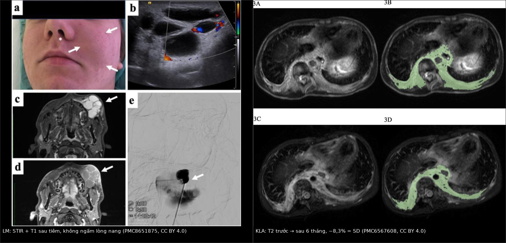
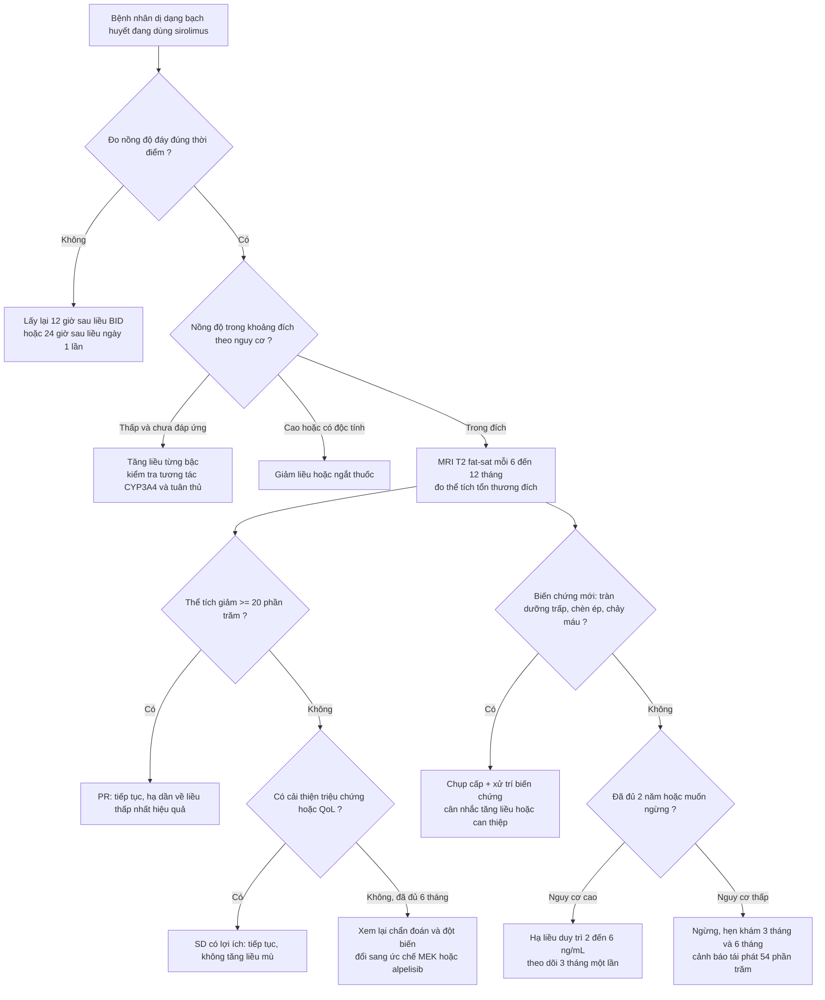
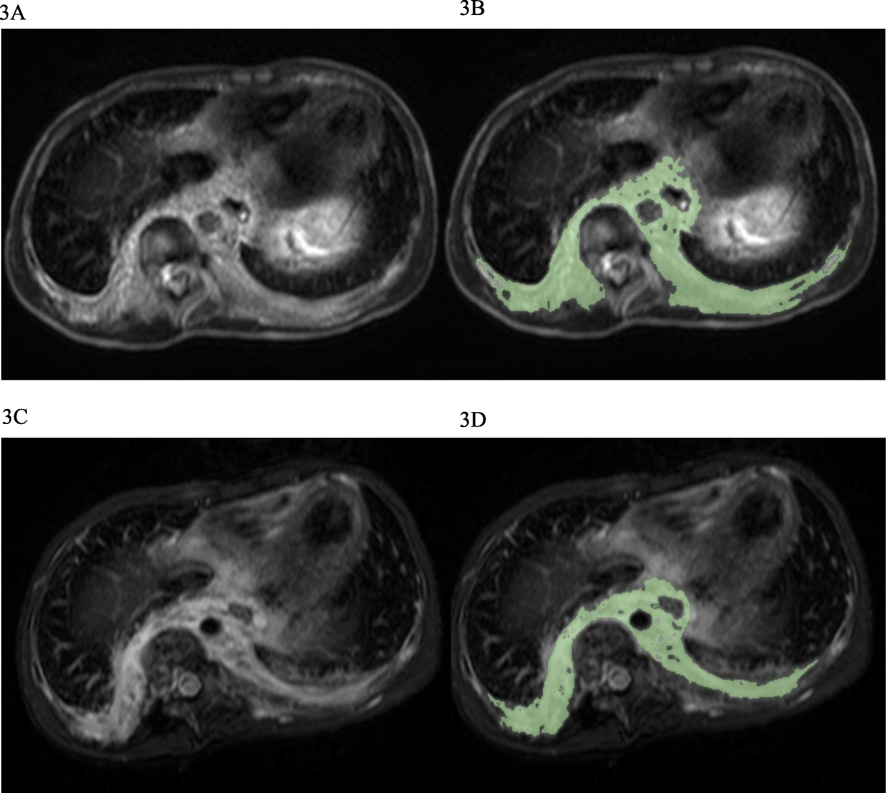
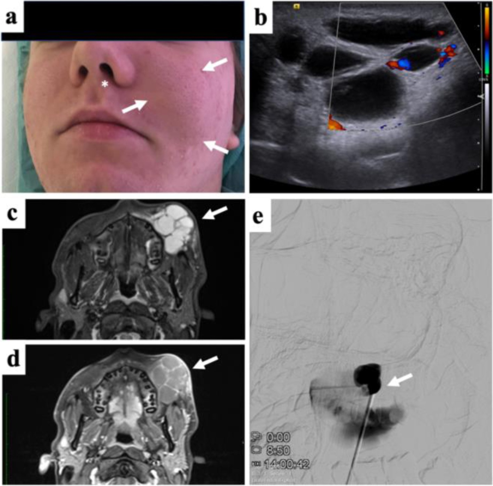

# 1808 — Sirolimus trong dị dạng bạch huyết phức tạp: theo dõi nồng độ đáy, độc tính và khi nào ngừng / Sirolimus monitoring and discontinuation in complex lymphatic anomalies (GLA, GSD, KLA)

**Tags:** `pattern:loansan-bach-huyet` `pattern:dap-ung-dieu-tri` `pattern:doc-tinh-thuoc` `pattern:tran-duong-trap` `vung:da-he` `vung:trung-that` `vung:phoi` `vung:xuong` `score:CTCAE` `score:dap-ung-the-tich` `protocol:MRI-T2-fatsat` `protocol:the-tich-3D` `incidentaloma:khong`
**Mức chắc chắn (certainty):** tổng hợp y văn (literature synthesis) — số liệu lấy từ **thử nghiệm pha III VASE** (132 bệnh nhân, PMC10721262, CC BY 4.0), **thử nghiệm pha II** (19 bệnh nhân, PMC6206885, CC BY 4.0), **đoàn hệ 20 bệnh nhân GLA/GSD/KLA/CCLA** (PMC6567608, CC BY 4.0), **đoàn hệ 20 trẻ** (PMC10687411, CC BY 4.0), **tổng quan có hệ thống 105 trẻ** (PMC9249683, CC BY 4.0), **khuyến cáo thực hành "how we approach"** (PMC13019703, CC BY 4.0), **tổng quan hình ảnh dị dạng mạch** (PMC8651875, CC BY 4.0) và **ca KLA đáp ứng trametinib** (PMC7539180, CC BY 4.0).

> **Bài này là phần "sau khi bắt đầu thuốc" của [077](../077-loat-san-mach-bach-huyet-gla-gorham-stout/lesson.md).** 077 dạy **nhận diện** GLA/GSD/KLA, tiêu xương "bệnh xương biến mất", tràn dưỡng trấp và đưa sirolimus vào như một lựa chọn. Bài này trả lời ba câu hỏi mà 077 dừng lại: **(1) theo dõi bằng nồng độ đáy nào, ở ai, bao lâu một lần; (2) phân biệt đáp ứng thật – ổn định bệnh – độc tính trên MRI và xét nghiệm; (3) khi nào giảm liều, khi nào ngừng, và ngừng rồi thì điều gì xảy ra.**

## 1. Tổng quan bệnh học – cơ chế hình ảnh

- **Sirolimus (rapamycin) ức chế cái gì:** thuốc gắn **FKBP12** rồi ức chế **mTORC1**, làm giảm phosphoryl hóa **S6K1 và 4EBP1** → giảm tổng hợp protein, giảm tăng sinh **tế bào nội mô bạch huyết**, giảm **lymphangiogenesis** và giảm biểu hiện **VEGF-C/VEGFR-3**. Trong mô hình lymphangiectasia, sirolimus **làm thoái triển một phần** tổn thương kèm giảm **Prox1** và **VEGFR-3**, nhưng **không gây apoptosis** tế bào nội mô bạch huyết — đây là lý do hình ảnh cải thiện **chậm và không bao giờ "sạch"** (PMC6567608).
- **Vì sao thuốc này hợp lý về mặt phân tử:** **PIK3CA** đột biến hoạt hóa có ở **tới 75%** dị dạng bạch huyết (LM) và ở CLOVES/KTS/CLVM; **TIE2** ở **tới 60%** dị dạng tĩnh mạch (PMC10721262). KLA lại thiên về đường **RAS/MAPK**: **NRAS p.Q61R ở 10/11 ca** trong một loạt giải trình tự, và ca **CBL** cắt cụt protein dưới đây — chính là cơ sở để **đổi sang ức chế MEK** khi mTOR thất bại (PMC7539180).
- **TẠI SAO tổn thương sáng trên T2 và không ngấm thuốc:** dịch bạch huyết giàu protein nhưng **không phải mô đặc**, nên **T1W giảm hoặc trung gian**, **T2W/T2 fat-sat/STIR tăng rất mạnh**, có thể có **mức dịch–dịch (fluid–fluid level)**, và **chỉ vách/bao ngấm thuốc**, lòng nang **không ngấm** (PMC8651875). Trên DWI, nước tự do trong nang **không hạn chế khuếch tán** (ADC cao) — khác áp-xe (ADC thấp) và khác u đặc.
- **TẠI SAO thể tích giảm nhưng không về 0:** sirolimus làm giảm **hoạt tính** tế bào nội mô và lượng dịch thoát, còn **thành nang xơ đã giãn thì tồn tại**. Vì vậy "còn nang trên MRI" **không đồng nghĩa thuốc thất bại**: trong thử nghiệm pha II, **16/16 bệnh nhân đạt đáp ứng một phần (PR) trên lâm sàng**, nhưng chỉ **7/16 (43,7%)** giảm kích thước trên T2W, và **3/16 (18,7%)** còn **tiến triển về hình ảnh** dù lâm sàng tốt hơn (PMC6206885).
- **TẠI SAO thuốc vừa chữa vừa gây độc:** mTORC1 có mặt ở **tế bào T**, **biểu mô miệng–ruột**, **tủy xương**, **nguyên bào sợi** và **tế bào ống thận**. Ức chế mTOR vì thế kéo theo **suy giảm miễn dịch**, **viêm miệng**, **giảm dòng tủy**, **tăng lipid**, **chậm liền vết thương**. Trong VASE, **96% (127/132)** có ít nhất một độc tính, dù **88%** chỉ ở độ 1–2; **18% (24 ca)** có độc tính **độ 3–4** và **tất cả đều hồi phục sau khi ngắt hoặc ngừng thuốc** (PMC10721262).
- **TẠI SAO nồng độ đáy dao động mạnh ở trẻ nhỏ:** sirolimus chuyển hóa qua **CYP3A4/P-glycoprotein**. Enzyme **CYP3A4 chưa trưởng thành ở sơ sinh** → cùng mg/m² cho nồng độ cao hơn; sốt và nhiễm trùng **làm chậm chuyển hóa** → nồng độ vọt lên; thuốc ức chế CYP3A4 (macrolid, azol kháng nấm) **đẩy nồng độ lên**, thuốc cảm ứng (rifampicin, phenytoin, St John's wort) **kéo xuống**. Vì thế VASE **loại trừ** bệnh nhân đang dùng chất cảm ứng/ức chế CYP3A4 (PMC10721262), và khuyến cáo thực hành đề nghị **đo nồng độ mỗi 3 ngày** ở trẻ nhỏ cho tới khi ổn định (PMC13019703).
- **Định lượng phải nhớ:**
  - **Dịch tễ:** LM gặp ở **1/2.000 trẻ sinh sống** (PMC9249683).
  - **Hiệu quả:** VASE **85% (112/132)** cải thiện lâm sàng; **74%** trong số bệnh nhân có đau cải thiện ngay **tháng đầu**; **77%** trong **101 ca đau hằng ngày** giảm đau; **73%** trong **106 ca hạn chế chức năng** cải thiện (PMC10721262). Pha II: **PR 16/16**, QoL cải thiện **16/16** (PMC6206885). Đoàn hệ GLA/GSD/KLA: **PR 10/20 (50%)** lúc **6 tháng**, **35%** lúc 3 tháng, **không ca nào** tăng ≥ 20% (PMC6567608). Tổng quan **105 trẻ** LM vùng đầu cổ: **91,4% (96/105)** đáp ứng, trong đó **95 PR + 1 CR** (PMC9249683).
  - **Liều:** **0,8 mg/m² × 2 lần/ngày** (dung dịch uống, trẻ < 12 tuổi); **2 mg/ngày** dạng viên cho người lớn/trẻ lớn (PMC10721262, PMC6206885). **Sơ sinh 0–1 tháng: 0,4–0,45 mg/m²/lần × 2 lần/ngày** (PMC13019703).
  - **Nồng độ đáy:** mục tiêu **10–15 ng/mL** trong pha II/VASE và **5–15 ng/mL** ở **19/25 (76%)** nghiên cứu (PMC6567608); thực tế VASE ghi nhận **1,8–23,4 ng/mL** ở nhóm cải thiện và **4,3–15,2 ng/mL** ở nhóm nặng lên tạm thời (PMC10721262) — **con số không dự báo đáp ứng**.
  - **Độc tính:** viêm miệng **66% (độ 1–2)** + **8% (độ 3–4)**; mệt **70%/4%**; tiêu chảy **40%/2%**; đau đầu **25%/5%**; phát ban **31%/1%**; trào ngược **21%**; ngắt thuốc vì độc tính **8% (10 ca)**; thời gian ngắt trung vị **7 ngày (2–108)** (PMC10721262).
  - **Sau khi ngừng:** trong **61 ca** hoàn thành 2 năm, **33 (54%)** tái phát triệu chứng, **19 ca tái phát trong 6 tháng đầu**; **22 (36%)** phải dùng lại, trung vị **6 tháng (1–18)** sau ngừng và **tất cả đều đáp ứng lại** (PMC10721262). Đột biến **PIK3CA** tái phát sớm (**3 tháng**, 8/9 ca), **TIE2** muộn hơn (**9 tháng**, 5/6 ca).

## 2. Mẫu hình + chẩn đoán phân biệt theo vị trí (gamut)

- **Bốn câu hỏi bắt buộc mỗi lần đọc phim theo dõi:**
  1. **Tổn thương đích (target lesion) có đo được không?** — chọn **một** khối/nang lớn nhất, đo được trên **T2 fat-sat/STIR**, ghi **thể tích cm³**, không đổi tổn thương giữa các lần.
  2. **Thể tích đổi bao nhiêu %?** — **PR: giảm ≥ 20%**; **PD: tăng ≥ 20%**; còn lại là **SD** (PMC6567608, PMC10687411).
  3. **Có biến chứng mới không?** — tràn dưỡng trấp, tràn màng tim, chèn ép đường thở, chảy máu trong nang, nhiễm trùng nang.
  4. **Bất thường này là bệnh hay là thuốc?** — hạch, thâm nhiễm, tràn dịch có thể do **tiến triển** hoặc do **độc tính/bội nhiễm** (mục 3).
- **Mẫu hình 1 — LM đa nang (macrocystic/mixed), đáp ứng tốt:** nhiều nang **T2 sáng**, vách mảnh ngấm thuốc, lòng nang **không ngấm**; sau 6–12 tháng **thể tích giảm ≥ 20%**, vách mỏng đi, đôi khi **dịch đặc hơn** (T1 sáng lên do protein/máu cũ) nhưng tổng thể tích giảm. Đây là nhóm dễ đo nhất và cũng là nhóm **tiên lượng đáp ứng tốt nhất**.
- **Mẫu hình 2 — LM vi nang/lan tỏa, "SD nhưng tốt lên":** tổn thương **thấm mỡ/diện rộng**, không vẽ được ROI tin cậy; trên MRI gần như **không đổi** nhưng bệnh nhân **giảm đau, giảm chảy dịch, tăng cân**. Trong đoàn hệ trẻ Hàn Quốc, **83,3%** ca có tổn thương **đo được** nằm trong nhóm CR/PR, so với **12,5%** ở nhóm SD (**p = 0,005**) — tức **khả năng đo được** tự nó dự báo "đáp ứng" theo tiêu chí hình ảnh (PMC10687411).
- **Mẫu hình 3 — GLA/GSD/KLA lan tỏa, "bệnh hệ thống":** tổn thương **trung thất – phổi – xương – lách** cùng lúc; trên MRI ngực là **dày vách tiểu thùy + dịch màng phổi**, trên xương là **nhiều ổ ly giải** hoặc **tiêu vỏ tiến triển**. Nhóm này cần **liều/đích cao hơn** vì nguy cơ tử vong: **KLA sống sót toàn bộ 34%** dù điều trị đa mô thức (PMC7539180).
- **Mẫu hình 4 — CCLA (dị dạng ống dẫn lưu trung tâm):** bất thường **ống ngực và mạng bạch huyết trung tâm**, chẩn đoán bằng **DCMRL** (chụp cộng hưởng từ bạch huyết động học); sirolimus **ít hiệu quả hơn**, và đây là nhóm **chuyển sang ức chế MEK** nếu đột biến KRAS (PMC10243805, PMC7539180).
- **Gamut theo vị trí tổn thương đích:** **cổ–mặt** (đo trên STIR trục/vành, nguy cơ chèn đường thở) → **trung thất** (T2 trục, kèm màng phổi–màng tim) → **sau phúc mạc/lách** (T2 trục, dễ nhầm nang tụy/thận) → **xương** (T1/T2 + CT, đánh giá tiêu vỏ) → **mô mềm chi** (STIR, đo chu vi chi).
- **Gợi nhớ 4 chữ — TARGET–VOLUME–COMPLICATION–CAUSE:** **Target** (một tổn thương đích) · **Volume** (% theo ngưỡng 20%) · **Complication** (dưỡng trấp/chèn ép/chảy máu) · **Cause** (bệnh hay thuốc). Trả lời đủ 4 chữ là ra được quyết định giữ – giảm – ngừng thuốc.

## 3. Bảng so sánh phân biệt (ma trận đối chiếu)

| Thực thể (entity) | Hình ảnh điển hình | Chốt vào (rule-in) | Chốt loại (rule-out) | Gợi ý xác nhận |
|---|---|---|---|---|
| **Đáp ứng một phần (PR)** | Tổn thương đích trên T2 fat-sat **nhỏ lại**, vách mỏng, không có ổ dịch mới | **Thể tích giảm ≥ 20%** so với baseline cùng chuỗi xung + triệu chứng giảm | Thể tích giảm < 20% nhưng bệnh nhân tốt rõ → gọi **SD có lợi ích lâm sàng**, không phải PR | Đo thể tích 3D (ROI bán tự động) trên T2 FS/STIR; ghi cm³ + % |
| **SD có lợi ích lâm sàng** | Hình ảnh **gần như không đổi**; đôi khi nang **đặc lên** trên T1 do protein | **Thể tích thay đổi < 20%** + **giảm đau/giảm chảy dịch/tăng QoL** | Nếu **không** cải thiện lâm sàng và **không** giảm thể tích → **không có lợi ích** | Thang đau VAS, số ngày chảy dịch, PedsQL; so ảnh cùng thì |
| **Bệnh tiến triển (PD)** | Tổn thương đích **to lên**, nang mới, **dịch màng phổi/màng tim mới**, thâm nhiễm mô mềm | **Thể tích tăng ≥ 20%** hoặc **biến chứng mới** (tràn dưỡng trấp, chèn ép) | Chỉ **một** ổ nang căng do **chảy máu trong nang** (T1 sáng, không tăng thể tích tổng) → biến chứng, không phải PD | So sánh cùng mặt phẳng; DCMRL nếu nghi rò mới; cấy dịch nếu sốt |
| **Tái phát sau ngừng thuốc (rebound)** | Tổn thương **quay về kích thước cũ** sau khi ngừng; **tràn dịch tái xuất hiện** sau 3–9 tháng | **Triệu chứng + hình ảnh tái phát sau khi ngừng**, đáp ứng lại khi dùng lại **cùng liều cũ** | Nhiễm trùng mới gây tràn dịch (sốt, dịch đục, cấy dương) → không phải rebound | Mốc thời gian ngừng thuốc; PIK3CA tái phát ~**3 tháng**, TIE2 ~**9 tháng** |
| **Giảm dòng tủy do thuốc** | Không có hình ảnh đặc hiệu; **không** có tổn thương tủy mới trên MRI | **Giảm bạch cầu/tiểu cầu/Hb sau khi tăng liều hoặc tăng nồng độ đáy**, hồi phục khi ngắt thuốc | Tiểu cầu giảm **kèm khối trung thất, D-dimer cao, chảy máu** → do **KLA**, không phải thuốc | CTM + nồng độ đáy trước/sau chỉnh liều; **27%** trẻ LM có độc tính tủy độ 3 trong một đoàn hệ 60 trẻ |
| **Viêm miệng do sirolimus** | Không cần chẩn đoán hình ảnh; loét **niêm mạc miệng lan tỏa**, không có mảng trắng bong | **Loét đối xứng, xuất hiện sau tăng liều**, giảm khi hạ liều/ngắt | Loét **một bên + mảng trắng + sốt** → HSV/Candida, cần nhuộm/cấy | Soi miệng; thử hạ liều 1 bậc; **8%** độ 3–4 trong VASE |
| **Viêm phổi do sirolimus** | **Thâm nhiễm mô kẽ/kính mờ đối xứng** hai bên, không theo thùy, có thể kèm tràn dịch nhỏ | **Kính mờ/vách tiểu thùy mới sau khởi thuốc**, **không sốt**, cải thiện khi ngừng thuốc | **Đông đặc khu trú + sốt + tăng CRP** → nhiễm trùng; **PJP**: kính mờ rộng + LDH cao + **CD4 thấp** | HRCT; công thức máu; **BAL/PCR PJP** khi nghi; thử ngừng thuốc có kiểm soát |
| **Tràn dưỡng trấp tái phát** | Dịch màng phổi **lượng lớn, T2 rất sáng**, có thể **mức dịch–dịch**; không đặc | **Triglyceride dịch > 110 mg/dL** hoặc có **chylomicron**, tái phát sau ngừng thuốc | Dịch **đục/mủ, pH thấp, glucose thấp, cấy dương** → tràn mủ, không phải dưỡng trấp | Chọc dò + triglyceride/creatinine; DCMRL tìm ổ rò; đừng chỉ tăng liều |
| **Đáp ứng với ức chế MEK (trametinib)** | **Giảm nhanh dịch màng phổi + dày vách tiểu thùy trong 3 tháng**; DCMRL giảm tưới bạch huyết phổi | **Thất bại/không dung nạp sirolimus + đột biến KRAS/NRAS/CBL**, hình ảnh cải thiện trong **3 tháng** | Đột biến **PIK3CA** đơn thuần → cân nhắc **alpelisib**, không phải MEK | Giải trình tự mô/tế bào; theo dõi **rhabdomyolysis**, phát ban, chức năng tim–mắt |

*Trái: **LM hỗn hợp vùng mặt ở trẻ vị thành niên** — (c) STIR: nang **tăng tín hiệu rất mạnh**, nhiều thùy; (d) T1 sau tiêm: **chỉ vách ngấm thuốc, lòng nang không ngấm**; (b) siêu âm Doppler: **không có dòng trong nang**. Phải: **KLA ở bé trai 8 tuổi** — (A,B) T2 trục trước điều trị với ROI thể tích; (C,D) sau **6 tháng sirolimus**: tổn thương **gần như không đổi**, thể tích **−8,3%** → **SD**. Nguồn: *Front Pediatr* 2021 (PMC8651875) Fig. 3 và *Orphanet J Rare Dis* 2019 (PMC6567608) Fig. 3, CC BY 4.0; ghép bằng `tools/make_composite.py` (letterbox, không crop/kéo giãn).*

### Ba dấu hiệu đọc kỹ trên ảnh theo dõi
- **So sánh đúng chuỗi xung:** T2 fat-sat/STIR cùng mặt phẳng, cùng độ dày lát cắt. So T2 không fat-sat với STIR là so hai thứ khác nhau — mỡ dưới da sẽ làm sai cả thể tích lẫn mức tín hiệu.
- **Nang "đặc lên" không phải xấu:** sau điều trị, dịch bạch huyết có thể cô đặc (T1 sáng hơn) trong khi tổng thể tích giảm; đừng đọc T1 sáng là "chảy máu mới" nếu không có triệu chứng và không tăng thể tích.
- **Đo cả hậu quả, không chỉ khối:** tràn dịch màng phổi/màng tim, dày vách tiểu thùy, chèn ép đường thở mới là thứ **quyết định sống còn** ở GLA/KLA — một khối trung thất "SD" nhưng **tràn dưỡng trấp tái phát** vẫn là **thất bại điều trị**.

## 4. Protocol chụp + phân độ + sơ đồ xử trí

- **MRI — giao thức tối thiểu (dùng cho cả baseline và theo dõi):** **T1W không cản quang** + **T2W fat-sat hoặc STIR ở 2 mặt phẳng trực giao**; thêm **T1 sau tiêm** khi cần phân biệt thành phần tĩnh mạch/dị dạng hỗn hợp; **DCE-MRA** nếu nghi thành phần nhanh (AVM/AVF). VASE chụp **MRI lúc baseline và mỗi 12 tháng** bằng **T1 không gadolinium + T2 fat-sat/STIR 2 mặt phẳng** (PMC10721262) — đây là mức tối thiểu, không cần cản quang thường quy cho LM thuần.
- **Kỹ thuật đo thể tích:** vẽ **ROI bán tự động** trên từng lát T2 FS (OsiriX/ITK-SNAP), nhân với độ dày lát để ra **cm³**; báo cáo **cm³ + % thay đổi** so baseline. Trong pha II, **7/16 ca** không đo được vì tổn thương **quá thấm/lan tỏa** — nếu không đo được, phải ghi rõ **"không đánh giá được bằng thể tích"** và dựa vào tiêu chí lâm sàng (PMC6206885).
- **Ngưỡng đáp ứng (dùng thống nhất trong hồ sơ):** **CR** = không còn tổn thương trên hình ảnh; **PR** = **giảm ≥ 20% thể tích**; **PD** = **tăng ≥ 20%**; **SD** = còn lại. Bổ sung thang 3 bậc cho nghiên cứu: **tốt > 70%**, **trung bình 30–70%**, **kém < 30%** (PMC10687411).
- **Theo dõi nồng độ đáy — chia theo nguy cơ (khuyến cáo thực hành):**
  - **Nguy cơ cao** (KHE có KMP, GSD, GLA, KLA, PROS nặng): đích **10–13 ng/mL**.
  - **Nguy cơ trung bình** (có biểu hiện đáng kể nhưng chưa đe dọa tính mạng): **6–10 ng/mL**.
  - **Nguy cơ thấp** (LM một vị trí, triệu chứng nhẹ) hoặc **đã đáp ứng tốt**: **2–6 ng/mL** (liều duy trì thấp nhất có hiệu quả).
  - **Lấy mẫu:** **12 giờ** sau liều cuối nếu dùng **2 lần/ngày**, **24 giờ** nếu dùng **1 lần/ngày**. Trẻ nhỏ: **đo mỗi 3 ngày** cho tới khi ổn định; sau đó **xét nghiệm mỗi 1–3 tháng** (PMC13019703).
- **Theo dõi an toàn tối thiểu mỗi 1–3 tháng:** **CTM, creatinine, AST/ALT, lipid (cholesterol, triglyceride), glucose**, huyết áp, cân nặng/chiều cao ở trẻ; khám da niêm mạc mỗi lần; **nhãn khoa và siêu âm tim** khi dùng phối hợp ức chế MEK.
- **Dự phòng Pneumocystis:** cân nhắc **TMP-SMX** khi **< 2 tuổi**, **CD4 lymphopenia**, **nồng độ đáy > 10 ng/mL**, hoặc **dùng đồng thời corticoid**; VASE **không** dự phòng thường quy và **không ghi nhận ca PJP nào**, nhưng đoàn hệ trẻ Hàn Quốc có **1 ca PJP độ 3** ở bệnh nhân dùng kèm prednisolone, sau đó họ dự phòng cho **7/20 ca** (PMC10721262, PMC10687411, PMC13019703).
- **Vắc-xin:** vắc-xin **sống** (MMR, varicella) nên hoàn thành **trước** khi bắt đầu sirolimus; vắc-xin **bất hoạt** an toàn trong thời gian điều trị (PMC13019703).
- **Quanh mổ/thủ thuật:** thuốc **làm chậm liền vết thương** nhưng **không nhất thiết ngừng** — với tổn thương đường thở hoặc phẫu thuật giảm khối, **tiếp tục sirolimus** thường có lợi vì giảm phù và giảm chảy dịch; quyết định theo từng ca (PMC13019703). Nếu ngừng, cân nhắc **tái phát sớm** (mục 5).
- **Khi nào ngừng — theo ba nhóm lý do:**
  1. **Không có lợi ích:** đã đạt đích nồng độ và dùng đủ **6 tháng** mà **không giảm thể tích ≥ 20%** *và* **không cải thiện triệu chứng** → đổi thuốc (MEK inhibitor nếu KRAS/NRAS; alpelisib nếu PIK3CA/PROS).
  2. **Độc tính:** độ **3–4** → **ngắt** tới khi hồi phục ≤ độ 1, dùng lại **cùng hoặc giảm liều**; độc tính **tái diễn** hoặc không dung nạp → **ngừng hẳn**. Trong VASE, **8%** phải ngừng hẳn vì độc tính, dù **8/10 ca vẫn có lợi ích** (PMC10721262).
  3. **Hoàn thành liệu trình:** VASE dùng **2 năm** rồi đánh giá lại; **54%** tái phát sau ngừng, **36%** phải dùng lại (PMC10721262). Vì vậy ở **nhóm nguy cơ cao** (đường thở, tràn dưỡng trấp, KLA/GSD), cân nhắc **hạ xuống liều duy trì thấp (đích 2–6 ng/mL)** thay vì ngừng hoàn toàn, và **hẹn tái khám 3 tháng/lần trong năm đầu sau ngừng**.

## 5. Biến thể bình thường và cạm bẫy

- **Cạm bẫy 1 — "MRI không đổi = thuốc thất bại":** sai trong phần lớn ca. Trong pha II, **100% đạt PR lâm sàng** nhưng chỉ **43,7%** giảm kích thước trên T2; **18,7%** còn "tiến triển" về hình ảnh dù tốt hơn (PMC6206885). Đánh giá phải gồm **triệu chứng + QoL + thể tích**, không chỉ một con số.
- **Cạm bẫy 2 — nặng lên tạm thời trong tháng đầu:** **11%** bệnh nhân có đau liên tục tăng, **24%** tăng tần suất cơn đau, **13–19%** tăng hạn chế chức năng trong tháng đầu; đa số giảm khi tiếp tục thuốc (PMC10721262). **Đừng ngừng thuốc ngay trong 4 tuần đầu** chỉ vì bệnh nhân "thấy tệ hơn" — trừ khi có độc tính độ 3–4.
- **Cạm bẫy 3 — tin rằng "sirolimus không độc tủy":** VASE **không** ghi nhận độc tính huyết học, nhưng chính bài đó dẫn một đoàn hệ **60 trẻ LM** với **27% độc tính tủy độ 3** (PMC10721262). Khác biệt do quần thể và cách chỉnh liều — vì vậy **vẫn phải làm CTM định kỳ**, nhất là khi tăng liều.
- **Cạm bẫy 4 — dùng nồng độ đáy để tiên đoán đáp ứng:** trong VASE, **45/67 ca cải thiện** có nồng độ **< 10 ng/mL**, và đoàn hệ trẻ Hàn Quốc **không** thấy liên quan giữa nồng độ trung bình và đáp ứng (**7,9 vs 7,0 ng/mL**, p = 0,49) (PMC10721262, PMC10687411). Nồng độ dùng để **tránh độc**, không phải để **đo hiệu quả**.
- **Cạm bẫy 5 — "SD" bị đọc thành thất bại và ngừng thuốc:** trong đoàn hệ GLA/GSD/KLA, **10/20 ca SD** không cải thiện điểm nặng/QoL, nhưng **4 ca trong số đó vẫn cải thiện** triệu chứng; và ở nhóm SD, thuốc có thể **giữ bệnh không tiến triển** (PMC6567608, PMC10687411). Ngừng thuốc ở nhóm này có thể mất tác dụng "kiểm soát nền".
- **Cạm bẫy 6 — bỏ sót PJP vì "thuốc đơn trị ít gây PJP":** đã có ca PJP ở trẻ dùng sirolimus cho dị dạng mạch, đặc biệt khi **dùng kèm corticoid** (PMC10687411). Hình ảnh **kính mờ rộng + LDH cao** ở bệnh nhân đang dùng sirolimus phải nghĩ **PJP**, không chỉ "viêm phổi do thuốc".
- **Cạm bẫy 7 — nhầm tái phát sau ngừng với nhiễm trùng:** tràn dịch/tổn thương to lại sau **3–9 tháng** ngừng thuốc là **rebound** điển hình (PIK3CA ~3 tháng, TIE2 ~9 tháng); dùng lại **đúng liều cũ** thường đáp ứng. Nếu sốt, dịch đục, cấy dương thì là nhiễm trùng — điều trị khác hoàn toàn.
- **Cạm bẫy 8 — đo trên chuỗi xung khác nhau:** T2 không fat-sat, STIR và T2 FS cho thể tích khác nhau 10–20% ở cùng một bệnh nhân; đổi chuỗi xung giữa các lần có thể tạo ra "PR" hoặc "PD" giả.
- **Biến thể bình thường dễ nhầm:** **mô mỡ quanh tổn thương** có thể dày lên sau điều trị (do giảm phù, không phải teo); **hạch nhỏ sau phúc mạc** ở trẻ là bình thường; **giãn nhẹ ống ngực** sau ăn nhiều mỡ trên MRI là sinh lý.

## 6. Tự lượng giá — Blind Quiz

**Ca 1 — Bé trai 8 tuổi, KLA: vẹo cột sống, đau, tiểu cầu thấp, rối loạn đông máu. Đang sirolimus, nồng độ đáy 8 ng/mL. Xem ảnh T2 trục ngực trước và sau 6 tháng (A,B → C,D) rồi trả lời.**

- Hỏi: (1) Thể tích tổn thương thay đổi bao nhiêu và xếp loại gì? (2) Có nên tăng liều ngay không? (3) Bước tiếp theo hợp lý nhất là gì?

<b>Bấm để hiện đáp án (findings + chẩn đoán)</b>

- **Findings:** (A) T2 trục trước điều trị: **dày vách tiểu thùy lan tỏa + khối mô mềm cạnh cột sống/trung thất**; (B) ROI thể tích. (C,D) sau **6 tháng**: tổn thương **gần như không đổi**, thể tích **−8,3%** — dưới ngưỡng **20%**, nên xếp **SD**.
- **Không tăng liều mù:** nồng độ **8 ng/mL** đã trong khoảng đích trung bình–cao; tăng liều thêm chỉ tăng độc tính mà **không** chứng minh thêm hiệu quả (nồng độ không dự báo đáp ứng).
- **Bước tiếp theo:** xem lại **triệu chứng và QoL** (đau, vẹo tiến triển, tiểu cầu, chảy dịch). Nếu **không cải thiện** sau **6 tháng** đủ liều → **tìm đột biến** (KLA thường **NRAS/CBL** → **trametinib**) và cân nhắc phối hợp can thiệp bạch huyết. Nếu triệu chứng **ổn định** → tiếp tục và theo dõi, vì SD vẫn có thể là "kiểm soát bền".
- **Phản biện:** ca này là **SD điển hình của KLA** — thể bệnh lan tỏa, tổn thương dạng thâm nhiễm nên **khó giảm thể tích**; đừng dùng ca này để kết luận "sirolimus không hiệu quả ở LM", vì LM đa nang thường đáp ứng tốt hơn nhiều.
- Nguồn: *Orphanet J Rare Dis* 2019 (PMC6567608), Fig. 3, CC BY 4.0.

**Ca 2 — Nữ 16 tuổi, sưng má trái nhiều năm, không đau. MRI mặt: STIR vành và T1 sau tiêm dưới đây. Trước khi bắt đầu sirolimus, cần chốt gì trên hình?**

- Hỏi: (1) Mô tả hai chuỗi ảnh và nêu chẩn đoán. (2) Chọn tổn thương đích để đo thể tích ở đâu? (3) Dấu hiệu nào trên ảnh sẽ khiến bạn nghĩ **không phải** LM thuần?

<b>Bấm để hiện đáp án (findings + chẩn đoán)</b>

- **Findings:** ảnh (a) là **ảnh lâm sàng** (sưng má, lệch cánh mũi); (b) siêu âm Doppler: **nang không có dòng**, chỉ có mạch ở vách; (c) **STIR vành: khối nhiều thùy tăng tín hiệu rất mạnh trong mô dưới da/cơ má**; (d) **T1 sau tiêm: chỉ vách và bao ngấm, lòng nang không ngấm**; (e) chụp bơm thuốc qua da cho thấy **các nang thông một phần** với nhau.
- **Chẩn đoán:** **dị dạng bạch huyết hỗn hợp (mixed lymphatic malformation)** vùng mặt — T2/STIR sáng, không ngấm lòng nang, không có dòng chảy trong nang.
- **Chọn tổn thương đích:** khối **lớn nhất, đo được trọn vẹn trên STIR vành** (hoặc trục), vẽ ROI bán tự động từng lát, nhân độ dày lát → **cm³**; ghi lại mặt phẳng và chuỗi xung để lần sau so đúng.
- **Dấu hiệu "không phải LM thuần":** **ngấm thuốc dạng nốt/đặc trong lòng nang** (gợi ý thành phần tĩnh mạch hoặc u), **flow void** (dị dạng động–tĩnh mạch), **vôi hóa** (u khác), **dày vỏ xương/tiêu xương** (GSD hoặc u xương), hoặc **ngấm màng não–hốc mắt** (lan nội sọ).
- Nguồn: *Front Pediatr* 2021 (PMC8651875), Fig. 3, CC BY 4.0.

**Ca 3 — Bé gái 3 tuổi, GLA có tràn dưỡng trấp màng phổi tái diễn, đã dùng sirolimus 2 năm, nồng độ đáy 10–12 ng/mL, ổn định 8 tháng. Gia đình muốn ngừng thuốc. Không cần ảnh mới: bạn tư vấn gì?**

<b>Bấm để hiện đáp án (findings + chẩn đoán)</b>

- **Nguy cơ tái phát cao:** trong **61 bệnh nhân** hoàn thành 2 năm sirolimus, **54%** tái phát sau ngừng, **19 ca tái phát trong 6 tháng đầu**, **36%** phải dùng lại (trung vị **6 tháng**) và **tất cả đều đáp ứng lại** (PMC10721262).
- **Ở nhóm nguy cơ cao (tràn dưỡng trấp, tổn thương đường thở, GLA/GSD/KLA):** không ngừng đột ngột — **hạ xuống liều duy trì thấp** (đích **2–6 ng/mL**) và theo dõi **3 tháng/lần trong năm đầu**; nếu ngừng, hẹn khám và **chụp MRI/T2 FS** ngay khi có triệu chứng.
- **Cảnh báo cụ thể cho gia đình:** khó thở, ho, sưng mặt/cổ, đau ngực, mệt mới xuất hiện trong **3–9 tháng** đầu sau ngừng là dấu hiệu tái phát, cần khám ngay — đừng chờ tới lần hẹn.
- **Nếu tái phát:** dùng lại **đúng liều đã hiệu quả trước đó** (không cần tăng liều), kèm đánh giá lại đột biến nếu muốn chuyển thuốc.
- Nguồn: *JCI Insight* 2023 (PMC10721262) và khuyến cáo thực hành (PMC13019703), CC BY 4.0.

## Bài liên quan chéo
- [077 – Loạn sản mạch bạch huyết lan tỏa (GLA) & Gorham–Stout: tiêu xương, tràn dưỡng trấp, sirolimus](../077-loat-san-mach-bach-huyet-gla-gorham-stout/lesson.md)
- [076 – Tràn dưỡng trấp niệu (chyluria) & can thiệp bạch huyết](../076-duong-trap-nieu-chyluria/lesson.md)
- [696 – Giãn nang bạch huyết phổi lan tỏa (lymphangiectasia) & tràn dưỡng trấp](../696-lam-nang-phoi-lan-toa/lesson.md)

## Ảnh
- `images/1808_sirolymus_LM-MRI_PMC8651875.jpg` — STIR + T1 sau tiêm của LM vùng mặt — *Front Pediatr* 2021 (PMC8651875), Fig. 3, CC BY 4.0.
- `images/1808_sirolymus_KLA-MRI_PMC6567608.jpg` — T2 trục ngực trước/sau 6 tháng sirolimus ở KLA — *Orphanet J Rare Dis* 2019 (PMC6567608), Fig. 3, CC BY 4.0.
- `images/1808_sirolymus_volumetry-chart_PMC6567608.jpg` — biểu đồ % thay đổi thể tích sau 6 tháng — cùng bài, Fig. 1, CC BY 4.0 (dùng đối chiếu, không nhúng vào quiz).
- `images/composite_1808_sirolymus.jpg` — ảnh ghép đối chiếu LM ↔ KLA, tạo bằng `tools/make_composite.py`.
- Không ghi tên tác giả khi chưa đối chiếu trực tiếp với PMCID: dùng dạng `Tạp chí Năm (PMCID)`.

> Không dùng để chẩn đoán độc lập khi chưa có người hướng dẫn. Liều và ngưỡng nồng độ trong bài là **dữ liệu nghiên cứu**, phải đối chiếu phác đồ của đơn vị điều trị.
