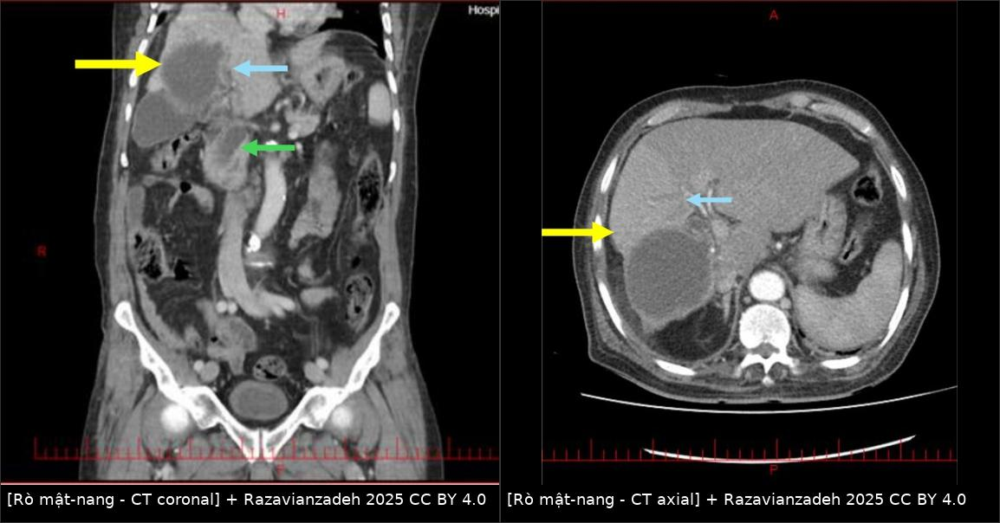
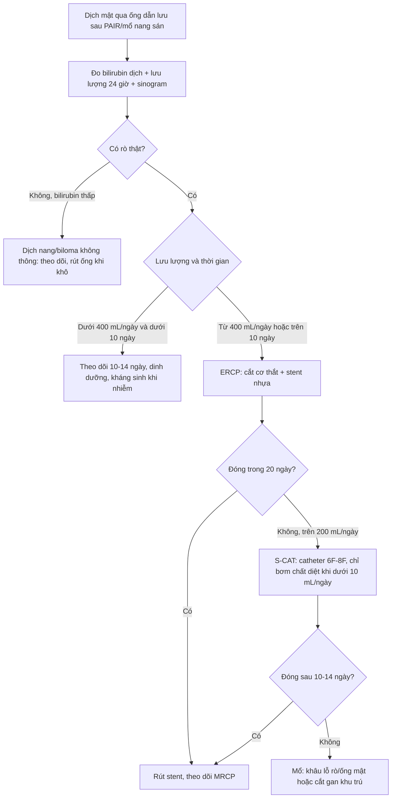
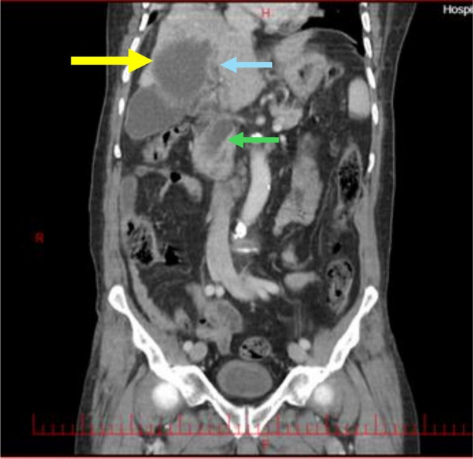
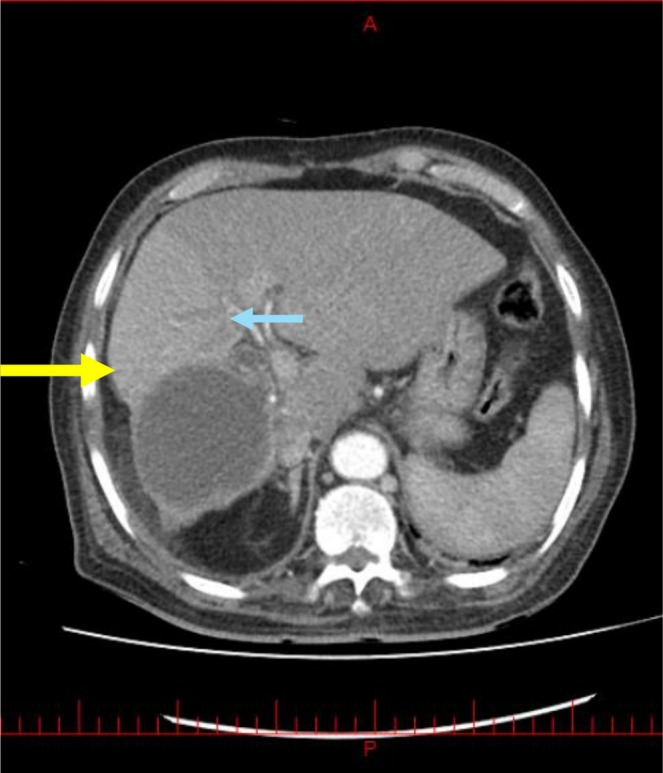
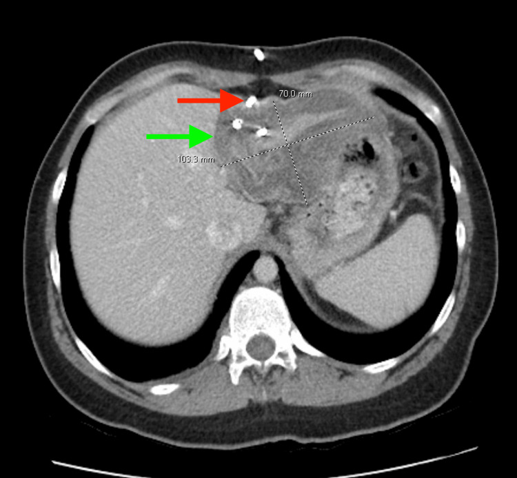

# 1809 — Rò mật–nang dai dẳng sau PAIR: ngưỡng lưu lượng, S-CAT/PEVAC, ERCP cắt cơ thắt + stent & khi nào mổ

**Tags:** `pattern:ro-mat` `pattern:thong-mat-nang` `vung:gan` `vung:duong-mat` `protocol:PAIR` `protocol:ERCP` `protocol:MRCP` `score:ISGLS` `incidentaloma:ro-sau-can-thiep`
**Mức chắc chắn (certainty):** tổng hợp y văn (literature synthesis) — 2 nghiên cứu đoàn hệ lớn (88 ca ERCP; 106 ca phẫu thuật), 1 tổng quan kỹ thuật can thiệp 2026 và 3 ca bệnh có ảnh gốc; mọi con số truy được về `sources.md`, chỗ chưa có dữ liệu ghi rõ "chưa rõ".

## 1. Tổng quan bệnh học – cơ chế hình ảnh

- **Định nghĩa:** rò mật–nang (cystobiliary fistula/communication — CBC) là **thông giữa lòng nang sán và một nhánh đường mật trong gan**. Sau **PAIR** (chọc hút – bơm chất diệt – hút lại) hoặc sau mổ, nang xẹp xuống nhưng lỗ thông vẫn còn → dịch mật chảy ngược vào khoang nang rồi ra **ống dẫn lưu** (hoặc tụ lại thành biloma). Rò **dai dẳng** = còn chảy sau khi khoang nang đã dẫn lưu tốt, thường quá **10–14 ngày**.
- **Vì sao có lỗ thông:** thành nang sán là mô xơ mỏng **dính và ăn mòn ống mật nhỏ**; khi áp lực trong nang cao (nang lớn) hoặc khi đầu kim/chất diệt làm hoại tử thành nang, lỗ thông mở ra. Nang **lớn ≥ 8,85 cm** và **bilirubin trực tiếp ≥ 0,7 mg/dL** là 2 yếu tố dự báo độc lập của CBC (OR **1,29** và **16,35**; n = 106 — `PMC13342622`).
- **Tần suất:** CBC gặp **42%** ở người mổ nang sán gan (**16% rò rõ** — frank, **26% rò ẩn** — occult, chỉ phát hiện khi thử nghiệm trong mổ); trong **26% rò ẩn** có tới **25%** tiến triển thành **rò mật lưu lượng cao sau mổ**, một số phải ERCP (`PMC13342622`). Ở trẻ, rò mật–nang gặp **2–42%**; nang có rò trung vị **100 mm** so với **80 mm** không rò, nằm viện **32 ngày vs 7 ngày** (`PMC12084229`).
- **Sau can thiệp, rò mật được báo cáo 50–63%** ở người mổ/PAIR nang sán gan — nhưng phần lớn **tự đóng** khi áp lực đường mật giảm; chỉ nhóm **lưu lượng cao/kéo dài** mới cần can thiệp (`PMC12679019`).
- **TẠI SAO hình ảnh trông như vậy (vật lý + mô bệnh):**
  - **CT:** mật có đậm độ **0–20 HU**, gần nước; vì vậy **không phân biệt được mật với dịch nang trên CT thường**. Dấu hiệu chốt là **đường hầm giảm đậm độ nối khoang nang với nhánh mật**, hoặc **thuốc cản quang trong nang xuất hiện ở đường mật thì muộn** (nếu đã bơm cản quang vào nang). Trong ca minh họa, **CT ban đầu đã có dấu hiệu nhưng bị bỏ sót**, chỉ lộ ra khi soi lại sau ERCP (`PMC12669071`).
  - **MRCP:** mật và dịch nang đều **T2 rất sáng** → hình “hai túi sáng nối nhau”; giá trị nằm ở **hình thái liên tục của ống mật**, không phải tín hiệu. Rò **thấp lưu lượng** có thể không thấy trên MRCP vì lòng rò xẹp.
  - **Chụp qua ống dẫn lưu (fistulography/sinogram):** bơm thuốc tan trong nước vào khoang nang; nếu thuốc **hiện lên đường mật** = còn thông. Đây là phép đo trực tiếp “có rò hay không”, rẻ hơn MRCP.
  - **Lưu lượng dịch:** theo **Poiseuille**, lưu lượng ∝ **bán kính lỗ rò⁴ × chênh áp**; vì vậy **rò ≥ 400 mL/ngày** gần như chắc chắn là thông với **đường mật lớn/trung tâm**, còn rò **< 10 mL/ngày** chỉ là lỗ nhỏ ở ngoại vi. Đây là cơ sở của mọi ngưỡng trong bài.
  - **Vì sao ERCP làm rò đóng:** cắt cơ thắt Oddi ± đặt stent làm **giảm chênh áp đường mật–tá tràng**, dòng mật đi theo đường có trở lực thấp xuống ruột thay vì qua lỗ rò → lỗ rò tự xẹp. Vì vậy **ERCP là điều trị cơ học, không phải “bịt lỗ”**.

## 2. Mẫu hình + chẩn đoán phân biệt theo vị trí (gamut)

- **Theo vị trí nang:**
  - **Nang trung tâm/rốn gan (segments IV, V, VIII gần đường mật chính)** → rò **lưu lượng cao**, dễ vàng da – cholangitis, thường cần ERCP sớm.
  - **Nang ngoại vi** → rò **lưu lượng thấp**, khoang nang tự xẹp; theo dõi 10–14 ngày là đủ nếu không nhiễm trùng.
  - **Nang đã vỡ vào đường mật (intrabiliary rupture)** → mảnh màng/mảnh nang **trong ống mật chủ**, tắc mật + cholangitis; đây là thể **khác** với rò qua khoang nang.
- **Theo thời điểm:**
  - **Sớm (< 10 ngày):** rò sau PAIR/mổ, còn dịch mật qua ống dẫn lưu — đa số tự đóng.
  - **Dai dẳng (> 10–14 ngày, hoặc > 400 mL/ngày):** cần ERCP ± S-CAT; nếu thất bại → mổ.
  - **Muộn (> 1 tháng):** nghĩ **hẹp đường mật do xơ hóa** (nhất là nếu đã bơm chất diệt vào đường mật — xem bài [106](../106-xo-hoa-duong-mat-do-chat-diet-dau-san/lesson.md)), hoặc khoang nang nhiễm trùng/biloma.
- **Gamut “dịch trong khoang nang sau PAIR”:** mật (rò) · dịch nang còn lại · biloma · áp-xe khoang nang · máu tụ · dịch tiêu hóa (rò ruột — hiếm).
- **Gamut “vàng da + sốt sau can thiệp nang sán”:** rò mật–nang có cholangitis · mảnh nang làm tắc ống mật · sỏi mật thông thường (ca minh họa có **sỏi 10 mm** ống mật chủ kèm rò) · hẹp đường mật do xơ hóa · áp-xe gan.

## 3. Bảng so sánh phân biệt (ma trận đối chiếu)

| Thực thể (entity) | Hình ảnh điển hình | Chốt vào (rule-in) | Chốt loại (rule-out) | Gợi ý xác nhận |
|---|---|---|---|---|
| **Rò mật–nang lưu lượng thấp** | Khoang nang xẹp dần; ống dẫn lưu ra dịch **vàng nhạt < 400 mL/ngày**; CT/MRCP có thể **không thấy** đường hầm | **Dịch dẫn lưu có bilirubin cao + lưu lượng < 400 mL/ngày + không sốt** | Ra **mủ, khí trong khoang, sốt cao** → áp-xe, không phải rò đơn thuần | Đo bilirubin dịch dẫn lưu; theo dõi 10–14 ngày |
| **Rò mật–nang lưu lượng cao** | **≥ 400 mL/ngày**, dịch xanh–vàng đậm; nang trung tâm; có thể vàng da | **Lưu lượng ≥ 400 mL/ngày + nang gần đường mật chính + hình ảnh đường hầm** | Lưu lượng thấp, tự giảm sau 3–5 ngày → không cần can thiệp | ERCP: thấy thuốc thoát từ nhánh mật vào khoang nang |
| **Rò ẩn (occult CBC)** | Nang lớn, thành dày; **không** thấy đường hầm trên CT; thử nghiệm trong mổ âm tính giả | **Nang ≥ 8,85 cm + bilirubin trực tiếp ≥ 0,7 mg/dL** (OR 1,29 và 16,35) | Nang nhỏ, bilirubin bình thường → nguy cơ thấp | Theo dõi sát hậu phẫu; 25% rò ẩn thành rò lưu lượng cao |
| **Vỡ nang vào đường mật (intrabiliary rupture)** | **Mảnh màng/nang trong ống mật chủ**; ống mật chủ giãn (ca: **25 mm**, sỏi **10 mm**, nang **70 × 63 mm**) | **Vàng da + cholangitis + mảnh màng trong lòng ống mật** | Không có mảnh trong lòng, chỉ dịch quanh nang → rò qua khoang | ERCP gắp mảnh + cắt cơ thắt; CT lại sau ERCP |
| **Rò mật sau cắt gan (ISGLS)** | Dịch ổ bụng/dẫn lưu, có thể biloma; **không** có nang sán | **Bilirubin dịch ≥ 3× huyết thanh từ ngày 3 sau mổ** | Sau PAIR, không mổ cắt gan → không áp dụng ISGLS | CE-MRCP, ERCP (bài [1814](../1814-ro-mat-sau-cat-gan/lesson.md)) |
| **Biloma không thông** | Tụ dịch khu trú, bờ rõ, **không** thấy thuốc vào đường mật khi bơm qua ống dẫn lưu | **Bơm cản quang qua dẫn lưu: thuốc KHÔNG vào đường mật** | Có thuốc vào đường mật → rò thật | Sinogram qua ống dẫn lưu; MRCP |
| **Áp-xe khoang nang** | Thành dày, **khí trong khoang**, dịch đục; sốt, CRP cao | **Sốt + khí trong khoang + mủ qua dẫn lưu** | Dịch trong, không khí, không sốt → không phải áp-xe | Cấy dịch; dẫn lưu; kháng sinh |
| **Hẹp đường mật do xơ hóa (caustic)** | Hẹp **lan tỏa/chuỗi hạt** sau bơm chất diệt; giãn đường mật trong gan | **Tiền sử bơm scolicidal + hẹp khu trú/lan tỏa + không khối** | Hẹp đơn độc tại lỗ rò, không lan → lành tính sau rò | MRCP; ERCP; xem bài [106](../106-xo-hoa-duong-mat-do-chat-diet-dau-san/lesson.md) |

*Trái: CT coronal — nang sán thùy phải (vàng) + đường hầm (xanh) vào nhánh mật trung tâm + ống mật chủ (xanh lá). Phải: CT axial cùng bệnh nhân, cùng ba mốc. Nguồn: *Clin Case Rep* 2025 (PMC12669071), Fig. 1–2 — CC BY 4.0; ảnh ghép letterbox, không crop.*

### Đọc đúng “dịch vàng qua ống dẫn lưu”
- **Xác nhận là mật, không phải dịch nang:** đo **bilirubin dịch dẫn lưu** (hoặc dipstick bilirubin); dịch nang sán điển hình **không có bilirubin**. Dịch vàng sẫm + bilirubin cao = mật.
- **Đo lưu lượng đúng cách:** ghi **mL/24 giờ** trên cùng một ống, cùng tư thế; ống **gập/tắc** làm lưu lượng tụt giả tạo — kiểm tra bằng siêu âm khoang nang và bơm rửa thử.
- **Đừng bơm chất diệt khi chưa loại rò:** bơm ethanol/hypertonic saline vào đường mật gây **viêm xơ đường mật (caustic sclerosing cholangitis)** — biến chứng nặng, không hồi phục (bài 106).

## 4. Protocol chụp + hệ phân độ/điểm chuẩn hóa

- **Chuỗi hình ảnh:**
  1. **Siêu âm bụng** tại giường: kích thước khoang nang, vách, khí, dịch quanh gan.
  2. **CT bụng có cản quang (3 thì)** khi nghi nhiễm trùng/biến chứng: đo nang, thành, khí, dịch quanh gan, giãn đường mật. **Không dùng CT để loại trừ rò** — ca minh họa đã bỏ sót trên CT.
  3. **MRCP (T2 lát mỏng 1–2 mm)** khi nghi rò mà CT không rõ: tìm **đường hầm nối khoang nang – nhánh mật**, mảnh màng trong ống mật, hẹp đường mật. Rò lưu lượng thấp có thể **âm tính** — không loại trừ.
  4. **Sinogram/fistulography qua ống dẫn lưu** (thuốc tan trong nước): phép đo trực tiếp nhất “còn thông hay không”; làm trước khi quyết định rút ống.
  5. **ERCP**: vừa chẩn đoán (thấy thuốc thoát vào khoang nang, mảnh màng trong ống mật) vừa điều trị.
- **Ngưỡng hành động (theo `PMC12679019`, `PMC13122038`, `PMC13342622`):**
  - **ERCP được chỉ định** khi dịch mật **> 100 mL/ngày kéo dài > 10 ngày** sau can thiệp; thực tế các đoàn hệ dùng **≥ 400 mL/ngày** để gọi “lưu lượng cao”.
  - **ERCP cắt cơ thắt + stent nhựa** là mô thức hiệu quả nhất: đóng rò **100%**, trung vị **20 ngày** (dao động 8–93); riêng nhóm **ES + stent** đóng trung vị **18 ngày**. **ES đơn thuần** thất bại **6/15 ca** (rò > 20 ngày, **> 200 mL/ngày**) và phải đặt stent lại (đóng sau **15,5 ngày**) (`PMC12679019`).
  - **Yếu tố dự báo đóng trong 20 ngày:** ES + stent (**OR 5,27**; 95% CI 1,30–21,37) và lưu lượng **< 400 mL/ngày** (**OR 3,43**; 1,37–8,55).
  - **S-CAT (standard catheterization technique)** — đặt catheter pigtail **6F/8F** vào khoang nang: nếu **24 giờ ra > 10 mL dịch mật** → **giữ catheter, KHÔNG bơm chất diệt**; khi **< 10 mL/24 giờ** mới bơm chất diệt, có thể nhiều lần trước khi rút. S-CAT chỉ định cho CE1/CE3a **> 10 cm**, hoặc khi PAIR phát hiện rò mật–nang (`PMC13122038`).
  - **PEVAC** (hút liên tục, không dùng chất diệt): dùng cho CE2/CE3b, kể cả có rò; nhược điểm **thời gian lưu catheter trung bình 53,6 ngày**, tăng nguy cơ rò và nhiễm trùng thứ phát (`PMC13122038`).
  - **Khi ERCP thất bại:** rò **> 10 mL/ngày kéo dài 10–14 ngày** sau S-CAT/MoCAT → ERCP cắt cơ thắt/stent; nếu vẫn thất bại (hẹp, đứt ống mật, khoang nang nhiễm trùng dai dẳng) → **mổ** (dẫn lưu + khâu lỗ rò/khâu ống mật, hoặc cắt gan nếu tổn thương khu trú).

## 5. Biến thể bình thường và cạm bẫy

- **Khoang nang sau PAIR xẹp chậm là bình thường:** khoang có thể còn dịch **nhiều tháng**, thành dày, vôi hóa dần; **không** gọi là thất bại nếu không có mật, không sốt, không lớn lên.
- **Khí trong khoang sau PAIR:** thường do thao tác/ống dẫn lưu — **không đồng nghĩa áp-xe** nếu không sốt, không mủ.
- **Bẫy bỏ sót trên CT:** ca minh họa cho thấy **đường hầm đã có trên CT đầu nhưng bị đọc sót** vì “thỏa mãn tìm kiếm” với sỏi ống mật chủ; khi có cholangitis + nang sán, phải **chủ động tìm lỗ thông**, không dừng ở sỏi.
- **Bẫy “lưu lượng thấp giả”:** ống dẫn lưu gập/tắc hoặc đầu ống nằm ngoài khoang → lưu lượng tụt; kiểm tra bằng siêu âm và bơm thử.
- **Bẫy “rò không thấy trên MRCP”:** rò lưu lượng thấp có thể **không hiện**; MRCP âm không loại trừ — dùng sinogram và theo dõi lâm sàng.
- **Bẫy chết người:** bơm chất diệt (ethanol, hypertonic saline) khi **chưa loại trừ CBC** → **viêm xơ đường mật** lan tỏa, vàng da tiến triển, phải đặt stent/ghép gan (bài 106). Luôn kiểm tra **màu dịch + bilirubin dipstick + cản quang** trước khi bơm.
- **Phân biệt với rò sau cắt gan:** ISGLS dựa trên **bilirubin dịch ≥ 3× huyết thanh từ ngày 3**, không áp dụng cho rò qua khoang nang sau PAIR (bài 1814).

## 6. Tự lượng giá — Blind Quiz

**Ca 1 — Nữ, sốt + vàng da sau can thiệp nang sán gan. Nhìn CT coronal trước, mô tả ba mốc mũi tên.**

- Gợi ý lâm sàng: Charcot triad + tụt huyết áp; ống mật chủ giãn **20 mm**, sỏi **10 mm** ở đoạn xa, nang **70 × 63 mm** phân thùy VI.
- Câu hỏi: Mũi tên vàng/xanh/xanh lá là gì? Vì sao CT đầu bị đọc sót? Bước xử trí tiếp theo?

<b>Bấm để hiện đáp án (findings + chẩn đoán)</b>

- **Dấu hiệu:** nang sán thành dày, vôi hóa (vàng); **đường hầm** nối khoang nang với nhánh mật trung tâm (xanh); ống mật chủ giãn chứa sỏi (xanh lá).
- **Chẩn đoán:** **rò mật–nang (CBC) + sỏi ống mật chủ + cholangitis**; ERCP gắp sỏi **3 × 1 cm**, lấy mảnh nang, cắt cơ thắt; bệnh nhân hồi phục.
- **Vì sao sót:** “thỏa mãn tìm kiếm” — thấy sỏi là dừng; đường hầm chỉ được nhận ra khi soi lại CT sau ERCP.
- **Nguồn:** *Clin Case Rep* 2025 (PMC12669071), Fig. 1 — CC BY 4.0.

**Ca 2 — Dùng lại ảnh CT của ca 1 trong bối cảnh khác: sau PAIR 12 ngày, ống dẫn lưu ra 450 mL dịch vàng/ngày, không sốt. Nhìn CT axial và trả lời.**

- Câu hỏi: Dịch vàng này là gì? Có phải rò lưu lượng cao? Hai lựa chọn điều trị và ngưỡng quyết định?

<b>Bấm để hiện đáp án (findings + chẩn đoán)</b>

- **Dịch vàng 450 mL/ngày** = mật (bilirubin cao); **≥ 400 mL/ngày** → rò lưu lượng cao, thông với đường mật lớn.
- **Điều trị:** **ERCP cắt cơ thắt + stent nhựa** (đóng 100%, trung vị 20 ngày; ES+stent OR 5,27 so với ES đơn thuần). Nếu thất bại và còn **> 10 mL/ngày sau 10–14 ngày** → **S-CAT** (catheter 6F/8F; chỉ bơm chất diệt khi **< 10 mL/ngày**).
- **Cạm bẫy:** bơm chất diệt lúc còn rò → viêm xơ đường mật.
- **Nguồn:** *Clin Case Rep* 2025 (PMC12669071), Fig. 2 — CC BY 4.0; ngưỡng từ *World J Gastrointest Surg* 2025 (PMC12679019) và *World J Radiol* 2026 (PMC13122038).

**Ca 3 — Sau PAIR, CT kiểm tra có ống pigtail trong khoang nang. Lưu lượng 8 mL mật/ngày. Làm gì tiếp?**

- Gợi ý: nang ban đầu **11,8 × 8,8 × 5,2 cm**, sau dẫn lưu còn **10 × 7 cm**; bệnh nhân không sốt.
- Câu hỏi: Lưu lượng này nói gì? Có được bơm chất diệt chưa? Khi nào rút ống?

<b>Bấm để hiện đáp án (findings + chẩn đoán)</b>

- **Dấu hiệu:** catheter pigtail trong khoang nang đã xẹp một phần; **8 mL mật/ngày < 10 mL/ngày**.
- **Ý nghĩa:** lỗ rò nhỏ/đang đóng; theo S-CAT, **< 10 mL/24 giờ** mới được bơm chất diệt (nhiều lần nếu cần), sau đó rút catheter khi khoang xẹp và không còn mật.
- **Theo dõi:** siêu âm/CT xác nhận khoang xẹp; **không rút ống chỉ vì lưu lượng thấp** nếu chưa kiểm tra ống thông và chưa có sinogram âm tính.
- **Nguồn:** *Cureus* 2026 (PMC12884859), Fig. 2 — CC BY 4.0; ngưỡng 10 mL/ngày từ *World J Radiol* 2026 (PMC13122038).

## Bài liên quan chéo

- [100 – Tổng quan hệ Bụng](../100-tong-quan-he-bung/lesson.md)
- [106 – Xơ hóa đường mật do chất diệt đầu sán (caustic sclerosing cholangitis)](../106-xo-hoa-duong-mat-do-chat-diet-dau-san/lesson.md)
- [139 – Sán lá gan (fasciliasis) & nang sán gan](../139-san-la-gan/lesson.md)
- [144 – Sán thể hang ở gan (AE): vi nang, vôi hóa, PNM](../144-san-the-hang-o-gan/lesson.md)
- [1810 – Cắt gan & ghép gan trong sán thể hang (AE)](../1810-cat-ghep-gan-trong-san-the-hang/lesson.md)
- [1814 – Rò mật sau cắt gan: ISGLS A/B/C, CE-MRCP, ERCP/PTBD](../1814-ro-mat-sau-cat-gan/lesson.md)
- [107 – MRCP & gadoxetic acid thì gan–mật (HBP)](../107-mrcp-gadoxetic-acid-hbp/lesson.md)
- [105 – Theo dõi ống dẫn lưu mật qua da (PTBD)](../105-theo-doi-ong-dan-luu-mat-qua-da/lesson.md)
- [137 – Theo dõi sau stent/dẫn lưu đường mật](../137-theo-doi-stent-dan-luu-duong-mat-di-tru-tac-nhiem-trung/lesson.md)
- [133 – Hẹp miệng nối đường mật sau ghép](../133-hep-mieng-noi-duong-mat-sau-ghep/lesson.md)

## Ảnh

- Tên file: `1809_ro-mat-nang_<Modality>_<SourceID>.jpg`; nguồn + giấy phép từng ảnh ở `images/CREDITS.md`.
- Ảnh ghép `composite_1809_ro-mat-nang.jpg` tạo bằng `tools/make_composite.py` (letterbox nền đen, **không crop/kéo giãn**).

> Không dùng để chẩn đoán độc lập khi chưa có người hướng dẫn.
