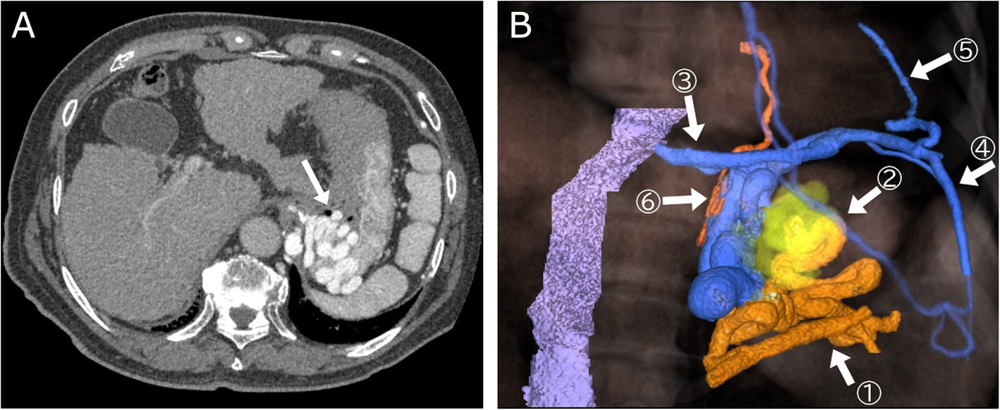
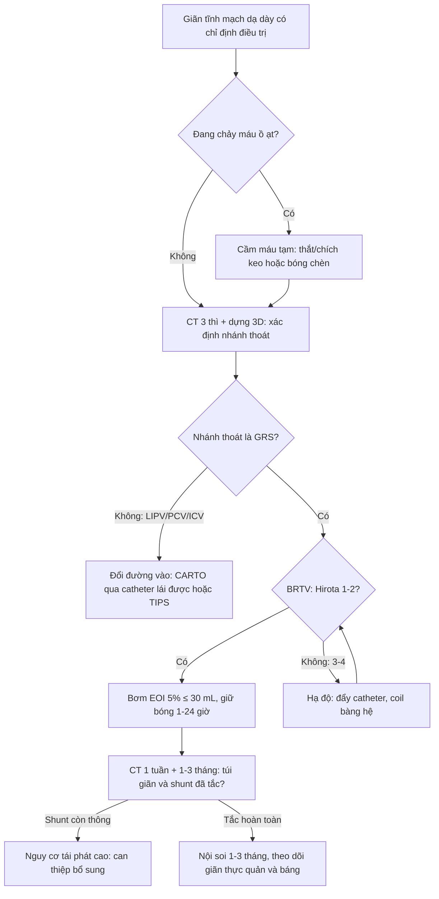
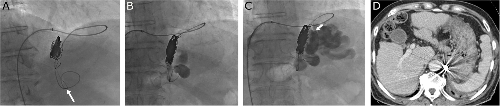
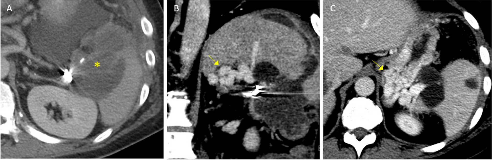

# 181 — BRTO/RTO: thuyên tắc NGƯỢC dòng tĩnh mạch thận trái cho giãn tĩnh mạch dạ dày / Balloon-occluded retrograde transvenous obliteration

**Tags:** `pattern:gian-tinh-mach` `vung:da-day` `vung:mach-cua` `score:Kiyosue` `protocol:DSA-BRTV`
**Mức chắc chắn (certainty):** tổng hợp y văn (literature synthesis) — tổng hợp từ bài tổng quan mở + 2 cohort/báo ca có ảnh gốc (Interv Radiol 2026 PMC13086557; BMC Med Imaging 2010 PMC2820437; CVIR Endovasc 2020 PMC7293971; CVIR Endovasc 2024 PMC11283442; CVIR Endovasc 2025 PMC12696224; World J Gastrointest Pathophysiol 2026 PMC13598455).

> **Câu hỏi gốc của bài:** bệnh nhân xơ gan có **giãn tĩnh mạch đáy vị (gastric varices — GV)** vừa chảy máu (hoặc có chỉ định dự phòng) — khi nào đi **đường NGƯỢC qua shunt dạ dày–thận (BRTO)**, khi nào **TIPS** hay **keo/chích nội soi**, và trên phim **CT/DSA phải trả lời 3 câu** nào trước khi quyết định?
> **Điểm tựa:** GV khác giãn tĩnh mạch thực quản ở chỗ **máu thoát ra theo một ống lớn (shunt cửa–chủ)**. BRTO **bịt đầu ra rồi bơm chất xơ hóa ngược vào túi giãn** — nghĩa là "chữa bằng cách khóa cửa thoát", **ngược hoàn toàn** với TIPS ("mở van xả"). Hiểu đúng chiều dòng là hiểu cả chỉ định, kỹ thuật và biến chứng.

## 1. Tổng quan bệnh học – cơ chế hình ảnh

**A. Vì sao GV khác giãn thực quản (và vì sao chảy máu nguy hiểm hơn):**
- GV gặp ở **~20%** người tăng áp lực cửa. Theo Sarin: **GOV1 ~70%**, **GOV2 ~21%**, còn lại IGV1/IGV2 (PMC13086557). **Nguy cơ chảy máu cao nhất là IGV1, sau đó GOV2** — tức nhóm **đáy vị đơn thuần**, không kèm giãn thực quản.
- Vỡ GV có **tử vong 25–55%** vì lưu lượng lớn và khó cầm (PMC2820437) — cao hơn vỡ giãn thực quản trong nhiều báo cáo.
- **TẠI SAO có shunt:** tăng áp cửa làm mở các đường nối sẵn có. Đường thoát chính của GV: **shunt dạ dày–thận (gastrorenal shunt — GRS) 80–85%**, **tĩnh mạch hoành dưới trái (LIPV) 10–15%**, **tĩnh mạch quanh tim (PCV) ~5%**, đôi khi **tĩnh mạch liên sườn (ICV)** (PMC13086557). Chính ống thoát này là "cửa" để can thiệp ngược dòng.

**B. Vì sao BRTO hiệu quả – vật lý và huyết động:**
- Đưa **bóng (balloon)** vào GRS → bơm căng → **chặn dòng ra**, rồi bơm **chất xơ hóa (sclerosant)** ngược vào túi giãn. Thuốc **lưu lại trong túi** vì đã khóa cửa thoát → gây **tổn thương nội mạc và huyết khối** cả **túi giãn LẪN ống shunt**.
- **Ngưỡng/kỹ thuật (theo bài gốc):** **ethanolamine oleate–iopamidol (EOI) 5%, tối đa 30 mL**; giữ bóng **1–24 giờ** sau bơm; có thể rút trong ngày nếu ổn định (PMC13086557). Chất xơ hóa **tốt hơn gelatin sponge** vì gelatin chỉ gây đông cơ học, còn sclerosant gây **huyết khối cả các nhánh nhỏ** — PARTO dùng gelfoam + STS cho tỷ lệ tái phát **tiệm cận 0%** (PMC13086557).
- **Hiệu quả định lượng:** thành công lâm sàng **97,3%** (phân tích gộp); **huyết khối hoàn toàn túi giãn trên CT ngày 90: 93,0% (40/43)** (PMC13086557). Cohort 47 bệnh nhân: **tỷ lệ không tái phát 90% ở 5 năm**; **tái phát chỉ xảy ra ở 2 ca còn shunt thông (8 ca shunt thông, 29 ca shunt đã tắc)** (PMC2820437) → **chốt là phải tắc được CẢ ống shunt**, không chỉ túi giãn.
- **So với chích keo (cyanoacrylate — CA):** sống không tái xuất huyết 1 năm **96,3% (BRTO) vs 77% (CA)**, p = 0,004; BRTO ít nhập viện và rẻ hơn (PMC13086557).
- **So với TIPS:** phân tích gộp cho thấy BRTO **ít tái xuất huyết hơn, ít bệnh não gan sau thủ thuật hơn và sống tốt hơn** (PMC13086557); cohort so sánh chi phí: trung vị tổng chi phí **AUD 3.632 (BRTO) vs AUD 11.922 (TIPS)**, chi phí để tránh 1 ca tái xuất huyết **AUD 3.896 vs 14.803** (PMC12696224).

**C. Cái giá phải trả – dồn áp lực về phía cửa:**
- Bịt đường thoát → **áp lực trong hệ cửa tăng lại** → **nặng thêm giãn thực quản, báng bụng (kể cả báng kháng trị), suy gan**. Đây là lý do phải chọn bệnh nhân theo **chức năng gan và độ xơ hóa**: **LSM (Fibroscan) ~22–25 kPa được xem là "điểm không thể quay lại"** — trên ngưỡng này BRTO ít cải thiện chức năng gan và dễ làm nặng tăng áp cửa (PMC13086557).
- **Hội chứng shunt cửa–chủ (portosystemic shunt syndrome — PSSS):** shunt lớn gây **suy gan tiến triển + bệnh não gan**. CT/MRI phát hiện shunt cửa–chủ ở **60%** bệnh nhân; có shunt là yếu tố độc lập cho tử vong/ghép gan (**HR 1,26; 95%CI 1,06–1,49**); PSSS giai đoạn cuối: sống 1 năm **42%**, 3 năm **23%** sau cơn bệnh não gan đầu tiên. BRTO chính là điều trị **bịt shunt** trong bối cảnh này (PMC13086557).

**D. TẠI SAO ảnh trông như vậy:**
- **DSA:** bóng cản quang nằm trong GRS; bơm thuốc **ngược chiều** thấy thuốc chảy vào túi giãn đáy vị (và các nhánh bàng hệ). Thuốc cản quang nặng hơn máu → **tư thế bệnh nhân và hướng bơm quyết định thuốc có vào được túi giãn** (kỹ thuật "oblique" của bài gốc, PMC13086557).
- **CT sau BRTO:** trong túi giãn là **khối tăng đậm độ do EOI/keo + huyết khối** — **KHÔNG phải máu đang chảy**; đừng đọc thành "xuất huyết tiêu hóa" hay "huyết khối tĩnh mạch cửa".
- **3D volume rendering từ CTAP (CT during arterial portography):** dựng được **nhánh nuôi (tĩnh mạch vị sau, vị ngắn) – túi giãn – nhánh thoát (LIPV/GRS)**; đây là bản đồ để chọn đường vào (PMC7293971).

## 2. Mẫu hình + chẩn đoán phân biệt theo vị trí (Gamut)

**Gamut theo ĐƯỜNG THOÁT (Kiyosue — quyết định làm được BRTO hay không):**
- **Type 1 — một nhánh thoát duy nhất (thường GRS):** điển hình nhất, **BRTO chuẩn** dễ thành công.
- **Type 2 — nhiều nhánh thoát:** phải **bịt các nhánh phụ** (coil/bóng) trước khi bơm sclerosant, nếu không thuốc trôi đi.
- **Type 3 — vào gián tiếp qua mạng bàng hệ:** khó, thường **phải "hạ độ" (downgrading)** bằng cách đẩy catheter sâu hơn hoặc bịt bàng hệ.
- **Type D — KHÔNG có nhánh thoát lớn:** **không có đường ngược để làm BRTO** → chuyển **TIPS** hoặc can thiệp trước–xuôi dòng (BATO/qua da xuyên lách).

**Gamut theo VỊ TRÍ (Sarin — quyết định nguy cơ chảy máu):**
- **GOV1** (dọc bờ cong nhỏ, liên tục với giãn thực quản) — hay gặp nhất, thường xử lý như giãn thực quản (thắt/keo).
- **GOV2** (qua tâm vị tới đáy vị) — nguy cơ cao, hay có GRS.
- **IGV1** (đáy vị đơn thuần, không giãn thực quản) — **nguy cơ chảy máu cao nhất**, chỉ định BRTO rõ nhất.
- **IGV2** (giãn lạc chỗ: tá tràng, ruột non, trực tràng) — BRTO vẫn dùng được nhưng giải phẫu mỗi ca một khác, phải cá thể hóa.

**Gamut theo BỐI CẢNH (vì sao "đáy vị giãn" chưa chắc là GV xơ gan):**
- **Tăng áp cửa trái (sinistral/left-sided portal hypertension)** do **tắc tĩnh mạch lách** (u đuôi tụy, viêm tụy mạn): **GV đơn độc, KHÔNG xơ gan, không giãn thực quản**, lách to. Điều trị có thể là **cắt lách** hoặc **nút mạch keo xuyên lách** khi không tiếp cận được shunt (PMC11283442).
- **U/giả u đáy vị** (ung thư biểu mô tuyến, GIST, nếp gấp dày) — cần nội soi trước khi gọi là GV.
- **Giãn tĩnh mạch do huyết khối tĩnh mạch cửa** (cavernoma) — BRTO vẫn làm được nhưng đường vào/shunt phức tạp hơn.

## 3. Bảng so sánh phân biệt (ma trận đối chiếu)

| Thực thể (entity) | Hình ảnh điển hình | Chốt vào (rule-in) | Chốt loại (rule-out) | Gợi ý xác nhận |
|---|---|---|---|---|
| **GV có GRS — ứng viên BRTO chuẩn** | CT thì cửa: túi giãn đáy vị + **tĩnh mạch thận trái/GRS lớn**; DSA: bóng trong GRS, thuốc vào túi giãn ngược dòng | **Thấy rõ 1 nhánh thoát lớn đổ vào TM thận trái + BRTV (Hirota 1–2) làm đầy được túi giãn** | **Kiyosue type D (không nhánh thoát) → không có cửa vào ngược** | CT 3 thì + 3D VR (PMC7293971); BRTV tại bàn chụp |
| **GV thoát qua LIPV/PCV/ICV** | Nhánh thoát đổ về **TM hoành dưới trái/TM quanh tim/TM liên sườn**, không qua TM thận | **Thấy nhánh thoát "lạ" trên CT + venography xác nhận** | Đường vào qua TM thận sẽ **không tiếp cận được** | Chọn đường vào khác (CARTO/xuyên lách) hoặc TIPS |
| **Tăng áp cửa trái (do tắc TM lách)** | **GV đơn độc + lách to + tắc/không thấy TM lách**, gan bình thường | **Không xơ gan + không giãn thực quản + tắc TM lách có nguyên nhân (u đuôi tụy)** | Có xơ gan + giãn thực quản → tăng áp cửa toàn hệ | CT bụng 3 thì; **nút keo xuyên lách 21G** khi không có shunt (PMC11283442) |
| **Chích keo nội soi (cyanoacrylate)** | Nội soi: túi giãn đáy vị; sau chích thấy keo cản quang trong túi | **Cầm máu ngay được, làm được ở tuyến không có DSA** | **Tái xuất huyết 1 năm 23%** (77% không tái) + nguy cơ **keo trôi theo GRS** | So sánh: BRTO 96,3% không tái ở 1 năm (PMC13086557) |
| **TIPS** | Stent nối TM gan–TM cửa, **giảm PPG < 12 mmHg** | **Cần hạ áp cửa toàn hệ (báng kháng trị, giãn thực quản nặng) + shunt không làm BRTO được** | **Không có chỉ định hạ áp toàn hệ** → làm TIPS chỉ thêm bệnh não gan | Đo PPG; xem bài 176 |
| **PARTO / CARTO (biến thể BRTO)** | **Nút mạch bằng plug (PARTO)** hoặc **coil (CARTO)** thay bóng; sau đó bơm sclerosant/gelfoam | **Shunt lớn, bóng không giữ được, hoặc cần rút catheter sớm** | **Gelfoam đơn thuần** → nguy cơ **trôi → thuyên tắc phổi/TM cửa** | Chụp kiểm tra kín shunt trước khi bơm (PMC7293971) |
| **Hirota 3–4 (thuốc không vào túi giãn)** | BRTV: bàng hệ lớn, thuốc **chỉ đầy một phần/không đầy** túi giãn | **Bàng hệ lớn + túi giãn không đầy** | **Hirota 1–2** (đầy túi giãn) → bơm ngay được | "Hạ độ": đẩy catheter sâu, bịt bàng hệ, xoay tư thế (PMC13086557) |

*Bản đồ trước can thiệp: (a) CT trong thì động mạch–cửa cho thấy túi giãn (mũi tên trắng); (b) dựng 3D tách riêng **nhánh nuôi** (tĩnh mạch vị sau, vị ngắn ①), **túi giãn** (②) và **nhánh thoát** (tĩnh mạch hoành dưới trái ③). Đây là hình mẫu để chọn đường vào BRTO. Nguồn: CVIR Endovasc 2020 (PMC7293971), CC BY 4.0.*

### Ba câu hỏi phải trả lời trước khi bơm thuốc
1. **Đường thoát là gì?** GRS (80–85%) → BRTO qua TM đùi/TM thận trái; LIPV/PCV/ICV → phải đổi đường vào.
2. **Bơm ngược có đầy túi giãn không (Hirota)?** Không đầy → phải "hạ độ" hoặc đổi chiến lược, **không được bơm mù** (thuốc sẽ trôi vào tuần hoàn).
3. **Có shunt cửa–phổi (PPVA) không?** Có shunt lớn → **bịt chọn lọc trước**, vì bọt/thuốc đi vào phổi gây **nhồi máu phổi/nhồi máu não** (PMC13086557).

## 4. Protocol chụp + phân độ & quyết định điều trị

- **Trước can thiệp:**
  - **Nội soi tiêu hóa trên** xác nhận GV, phân loại Sarin, tìm dấu hiệu nguy cơ (thể nốt, đốm đỏ).
  - **CT bụng 3 thì (không cản quang – động mạch – cửa) lát 1–2 mm + dựng 3D**: đo đường kính GRS/nhánh thoát, phát hiện **shunt cửa–phổi**, huyết khối cửa/lách, kích thước túi giãn.
  - **Xét nghiệm**: công thức máu, đông máu, chức năng gan–thận; **LSM/Fibroscan** để ước lượng "điểm không thể quay lại" (**~22–25 kPa**).
- **Trong can thiệp:** tiếp cận TM đùi → TM thận trái → GRS; **BRTV (balloon-occluded retrograde transvenous venography)** phân độ **Hirota 1–5**; nếu cần thì **hạ độ** (đẩy catheter/coil bàng hệ); bơm **EOI 5% ≤ 30 mL** (hoặc STS/polidocanol), giữ bóng **1–24 giờ**; chụp kiểm tra trước khi rút.
- **Sau can thiệp:** CT bụng có cản quang **~1 tuần và 1–3 tháng** (đánh giá huyết khối túi giãn + shunt); nội soi lại **1–3 tháng** rồi mỗi **6–12 tháng** (theo dõi giãn thực quản nặng lên); theo dõi **báng, bệnh não gan, hemoglobin niệu, đau bụng**.
- **Ba tình huống chống chỉ định / thận trọng** (theo bài tổng quan): **rối loạn đông máu nặng chưa điều chỉnh**, **huyết khối TM lách**, **huyết khối TM cửa**, **đang chảy máu giãn thực quản không kiểm soát**; và **đang chảy máu GV ồ ạt chưa cầm** — vì BRTO **bịt đường thoát làm tăng áp lực trong túi giãn**, phải **cầm máu tạm bằng nội soi/bóng chèn trước** (PMC13086557).

## 5. Biến thể bình thường và cạm bẫy

- **Nếp gấp đáy vị dày / niêm mạc phù nề** trên CT không cản quang dễ đọc thành "túi giãn" — luôn đối chiếu **thì cửa + nội soi**, và tìm **nhánh thoát** (không có nhánh thoát thì rất khó là GV đáng can thiệp).
- **CT ngay sau BRTO:** khối **tăng đậm độ trong túi giãn** là **EOI/keo + huyết khối**, không phải máu đang chảy; đừng gọi là "huyết khối tĩnh mạch cửa" nếu chất tăng đậm độ **nằm trong thành dạ dày**.
- **Shunt cửa–phổi (PPVA):** bơm thuốc/bọt khi có PPVA lớn → **nhồi máu phổi, nhồi máu não**. Luôn tìm trên CT trước và bịt chọn lọc.
- **Gelfoam trôi:** PARTO/GERTO dùng gelatin có thể trôi gây **thuyên tắc phổi hoặc tắc TM cửa** — ưu tiên **plug/coil + sclerosant** và kiểm tra kín shunt trước khi bơm.
- **Tăng áp cửa trái không do xơ gan:** GV đơn độc + tắc TM lách → **đừng đi tìm "xơ gan"**, và cân nhắc **cắt lách/nút keo xuyên lách** thay vì BRTO (không có shunt lớn để đi ngược).
- **"Thành công kỹ thuật" ≠ "thành công lâm sàng":** CT ngày 90 còn **shunt thông** dù túi giãn đã xẹp → **nguy cơ tái phát**; cohort 47 ca cho thấy **chỉ 2 ca tái phát, cả 2 đều còn shunt thông** (PMC2820437).
- **Đừng quên mặt cắt ngang:** GV đáy vị nằm **sát thượng thận trái/tụy đuôi** — túi giãn lớn có thể bị đọc nhầm thành **u thượng thận/nang tụy**; dấu chốt là **nối liền với TM thận trái/shunt** và **đậm độ thuốc đồng thì với tĩnh mạch**.

## 6. Tự lượng giá — Blind Quiz ngay trên trang tĩnh

**Ca 1 — Nam 79 tuổi, xơ gan Child–Pugh A, giãn tĩnh mạch dạ dày dai dẳng (đã chích xơ 4 năm trước), đang chờ mổ HCC.**

- Gợi ý: nội soi: F3, Lg-CF, Cw; tiểu cầu 120.000/µL, INR 1,12.
- Câu hỏi: (1) Nhánh thoát chính là gì, có shunt dạ dày–thận không? (2) Vì sao **không** đặt được bóng theo kiểu BRTO chuẩn? (3) Chọn kỹ thuật nào?

<b>Bấm để hiện đáp án (findings + chẩn đoán)</b>

- Dấu hiệu: túi giãn đáy vị (a, mũi tên trắng). Dựng 3D: nhánh nuôi là **tĩnh mạch vị sau + vị ngắn (①)**, túi giãn (②), **nhánh thoát chính là tĩnh mạch hoành dưới trái (③)**; **KHÔNG có shunt dạ dày–thận**; các nhánh thoát khác: tĩnh mạch ngực trong trái (④), hoành–màng tim (⑤), **tĩnh mạch phổi dưới trái (⑥)**.
- Chẩn đoán: GV thể **Lg-CF** (từ tâm vị tới đáy vị) thoát qua **LIPV** — đây là lý do **không** đi được đường TM thận trái như BRTO kinh điển.
- Vì sao bóng khó: **hẹp nhẹ giữa TM chủ dưới và TM hoành dưới trái + góc shunt nhọn** → không đưa/giữ được bóng. Đã chọn **CARTO** (coil + 5% EOI, tổng **24 mL**) qua **một đường vào duy nhất** với catheter lái được.
- Nguồn ảnh: CVIR Endovasc 2020 (PMC7293971) Fig. 1, CC BY 4.0.

**Ca 2 — Cùng bệnh nhân, trong lúc can thiệp và 1 tuần sau.**

- Gợi ý: ca được làm bằng **CARTO** (coil + sclerosant) qua một đường vào duy nhất.
- Câu hỏi: (1) Vì sao phải **bịt nhánh thoát** trước khi bơm thuốc? (2) Trên ảnh D, chất tăng đậm độ trong thành dạ dày là gì? (3) Nếu bơm thuốc mà **không** thấy thuốc vào túi giãn thì xử trí?

<b>Bấm để hiện đáp án (findings + chẩn đoán)</b>

- Dấu hiệu: (A) catheter lái được lật ngược ra sau chỗ đặt coil (mũi tên trắng), coil rời được thả qua vi catheter 1,9 Fr; (B) **coil bít kín nhánh thoát**, TM hoành dưới trái không còn hiện hình; (C) bơm chậm **EOI 5%** (tổng 24 mL) làm đầy túi giãn và các nhánh nhỏ (mũi tên trắng); (D) **CT 1 tuần sau CARTO: túi giãn đã tắc hoàn toàn** (mũi tên trắng) — khối tăng đậm độ là **EOI + huyết khối**, không phải máu đang chảy.
- Vì sao bịt trước: nếu còn đường thoát, thuốc trôi vào tuần hoàn → **mất tác dụng + nguy cơ thuyên tắc phổi/nhồi máu não** (nhất là khi có PPVA).
- Không đầy túi giãn = **Hirota 3–4** → "hạ độ" (đẩy catheter sâu, coil bàng hệ, đổi tư thế) rồi chụp lại; **không bơm mù**.
- Nguồn ảnh: CVIR Endovasc 2020 (PMC7293971) Fig. 2, CC BY 4.0.

**Ca 3 — Nam 62 tuổi, đau bụng, sụt cân; nội soi thấy giãn đáy vị đơn độc, không giãn thực quản.**

- Gợi ý: không có bằng chứng xơ gan; có coil từ can thiệp cũ.
- Câu hỏi: (1) Cơ chế tăng áp cửa ở ca này? (2) Vì sao BRTO qua TM thận **không** thực hiện được? (3) Phương án thay thế?

<b>Bấm để hiện đáp án (findings + chẩn đoán)</b>

- Dấu hiệu: (A) u đuôi tụy xâm lấn rốn lách (dấu sao) + coil cũ; (B–C) **túi giãn đáy vị lớn** (mũi tên).
- Chẩn đoán: **tăng áp cửa trái (sinistral portal hypertension)** do **tắc tĩnh mạch lách** — gan bình thường, GV đơn độc.
- Vì sao không BRTO: nhiều ca **không có shunt dạ dày–thận** để đi ngược; ca này venography qua đường thường **không thấy thông nối với túi giãn** → đã dùng **chọc xuyên lách bằng kim 21G + bơm keo trực tiếp**.
- Nguồn ảnh: CVIR Endovasc 2024 (PMC11283442) Fig. 1, CC BY 4.0.

## Bài liên quan chéo
- [176 – TIPS/DIPS: chỉ định, kỹ thuật & theo dõi shunt](../176-tips-dips-theo-doi-shunt/lesson.md)
- [182 – Biến chứng sớm sau TIPS: thủng bao gan, hemobilia, endotipsitis](../182-bien-chung-som-sau-tips/lesson.md)
- [149 – Tăng áp cửa KHÔNG do xơ gan (PSVD/NCPF, sán máng)](../149-tang-ap-cua-khong-xo-gan/lesson.md)
- [146 – Huyết khối tĩnh mạch lách & nhồi máu lách](../146-huyet-khoi-tm-lach-va-nhoi-mau-lach/lesson.md)
- [100 – Tổng quan hệ Bụng](../100-tong-quan-he-bung/lesson.md)

> Không dùng để chẩn đoán độc lập khi chưa có người hướng dẫn.
