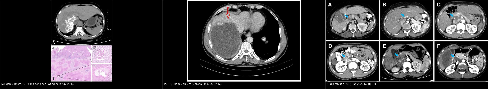
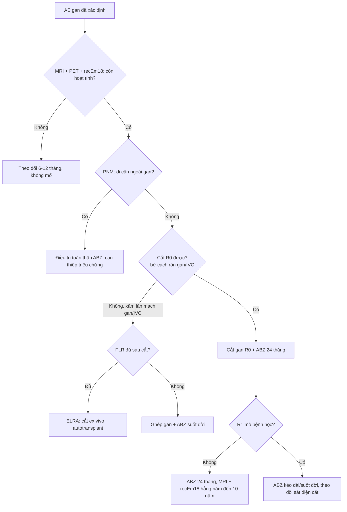
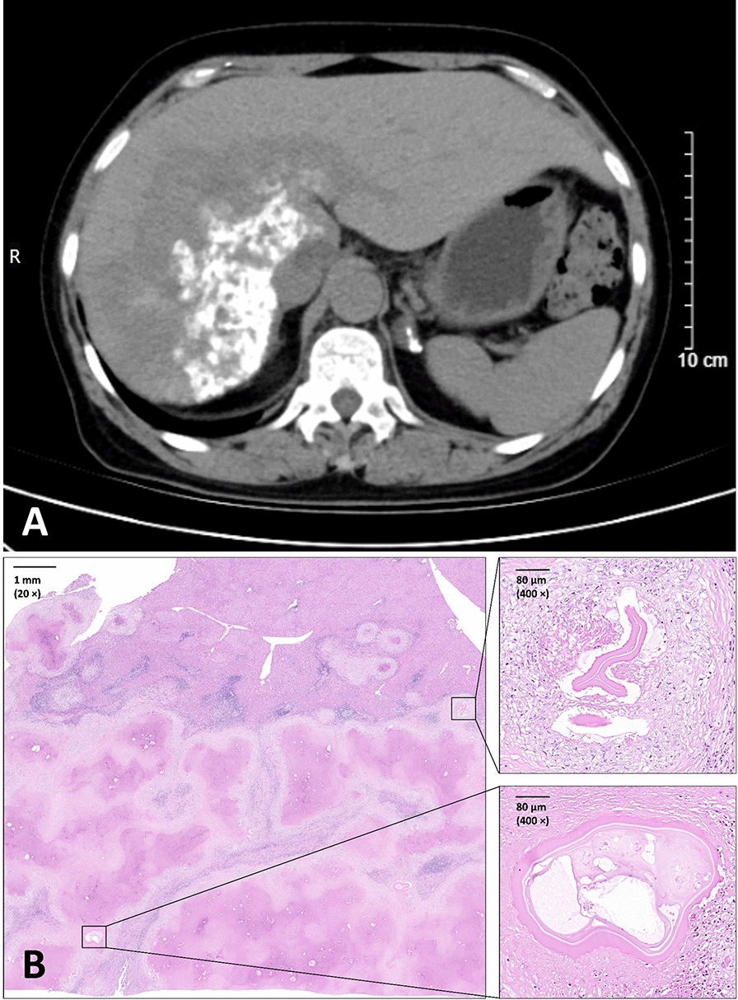
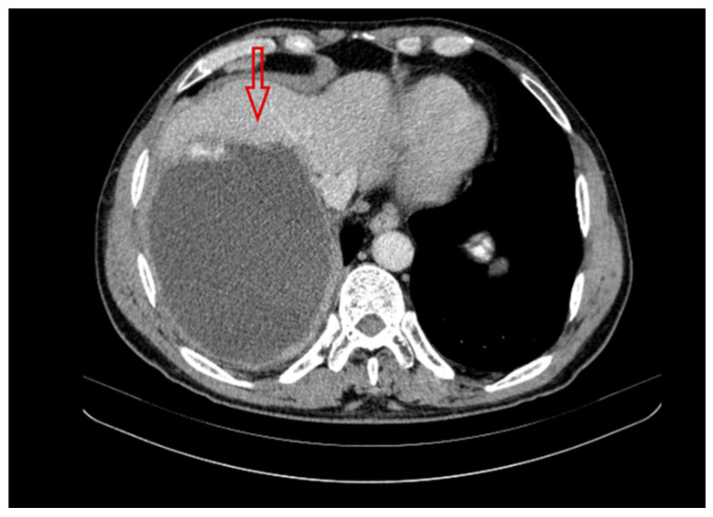
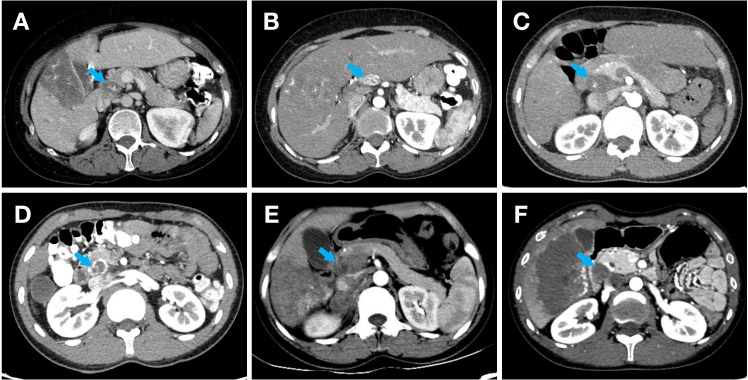

# 1810 — Cắt gan & ghép gan trong sán thể hang (AE): R0, biên cắt, chỉ định ghép, recEm18 + MRI 10 năm

**Tags:** `pattern:gia-u` `pattern:tieu-dang-nang` `vung:gan` `score:PNM` `protocol:CT-3-thi` `protocol:MRI-gan` `protocol:PET-CT` `incidentaloma:khong`
**Mức chắc chắn (certainty):** tổng hợp y văn (literature synthesis) — 2 đoàn hệ phẫu thuật (334 ca Zurich 1973–2022; 195 ca Lausanne–Bern 2000–2021), 1 đoàn hệ tiến cứu ngừng albendazole sớm (15 ca), 1 registry Pháp (906 ca), 1 loạt ghép/autotransplant (19 ca) và 3 ca có ảnh gốc; số nào chưa đối chiếu toàn văn ghi "chưa rõ".

## 1. Tổng quan bệnh học – cơ chế hình ảnh

- **Vì sao phải mổ:** *Echinococcus multilocularis* mọc thành **vô số vi nang xâm lấn theo khoảng kẽ**, không có vỏ xơ, phá hủy nhu mô và **lan theo đường mật – mạch máu như ung thư**. Thuốc benzimidazole **chỉ kìm ký sinh (parasitostatic)**, không diệt; vì vậy **cắt bỏ toàn bộ tổn thương (R0) + albendazole hậu phẫu** là cách duy nhất đạt khỏi bệnh. Không điều trị, **90% tử vong trong 10 năm**.
- **R0 nghĩa là gì:** mô bệnh học **không còn ký sinh ở diện cắt**. Vì tổn thương không có vỏ, “bóc nhân” là bất khả thi — phải cắt **gan kèm một viền nhu mô lành**, giống cắt u ác. Đây là lý do **R1 (còn ký sinh ở bờ) tái phát cao gấp nhiều lần R0**.
- **Số liệu chốt từ đoàn hệ Zurich (334 ca, 1973–2022)** (`PMC12044251`):
  - Mổ **151/334 (45,2%)**; trong đó **126 ca mổ với ý định chữa khỏi**, **R0 105 (83,3%)**, **R1 21 (16,7%)**.
  - **Tái phát 13/126 (10,3%)**: **8/21 ca R1 (38,1%)** so với **5/105 ca R0 (4,8%)**; tất cả tái phát **trong gan**, **10 ca tại diện cắt**.
  - **R1 kéo dài albendazole trung vị 79 tháng** so với **26 tháng** ở R0 (IQR 23–31,5).
  - **Ghép gan chỉ 3/334 (0,9%)**, trong đó **chỉ 1 ca vì AE**.
- **Đoàn hệ Lausanne–Bern (195 ca cắt gan, 2000–2021)** (`PMC13414700`): **R0 70–77%** (77% ở nhóm suy giảm miễn dịch, 70% nhóm còn lại); **albendazole sau mổ 24 tháng** nếu R0; **tái phát 10/195 (5,1%)**, **tỷ lệ tái phát 2 năm 1%**; sống không tái phát **212 vs 206 tháng**, sống toàn bộ **236 vs 210 tháng**; **rò mật sau mổ 8% vs 17%**; tử vong 90 ngày **2% vs 0%**. **Suy giảm miễn dịch không phải yếu tố nguy cơ tái phát** (HR 1,4; p = 0,626).
- **Registry Pháp (906 ca, 1982–2021)** (`PMC12355909`): mổ **44,4%**; **cắt gan chữa khỏi tăng từ 31,7% (1982–1999) lên 89,4% (2011–2021)**; **ghép gan giảm từ 17,4% xuống 2,4%**; dùng benzimidazole sau 2000 gắn với **giảm nguy cơ tử vong trong 10 năm (SHR 0,43; 0,28–0,66)**.
- **TẠI SAO hình ảnh quyết định mổ được hay không (vật lý + mô bệnh):**
  - **MRI T2 là chuỗi xung chủ lực:** vi nang chứa dịch → **T2 rất sáng**; dải xơ/collagen → **T2 tối**. Tổn thương “chùm nho sáng trong nền tối” cho biết **ranh giới ký sinh còn hoạt động** — chính là bờ cần cắt qua. **Vi nang còn sáng ở diện cắt dự kiến = nguy cơ R1.**
  - **CT:** trung tâm hoại tử/xơ **không ngấm thuốc** (không có lưới mạch nuôi như HCC); vôi hóa loạn dưỡng nằm trong vùng xơ. **Vôi hóa không chứng minh ký sinh đã chết**, và **không** dùng để xác định bờ cắt.
  - **PET/CT:** FDG tăng ở **vành viêm quanh tổn thương**, không trong nang; PET dùng để đánh giá **hoạt tính**, không dùng để đo kích thước hay bờ.
  - **recEm18 (kháng thể tái tổ hợp):** phản ánh **ký sinh còn sống**; sau cắt triệt để kháng thể **giảm nhanh**. Đây là mốc theo dõi song song với MRI, không thay thế hình ảnh.

## 2. Mẫu hình + chẩn đoán phân biệt theo vị trí (gamut)

- **Theo khả năng cắt R0 (quyết định điều trị):**
  - **Tổn thương ngoại vi, một thùy, không chạm rốn gan/tĩnh mạch gan/IVC** → **cắt gan R0** (segmentectomy/hemihepatectomy).
  - **Xâm lấn rốn gan/đường mật chính** → vàng da, cholangitis tái diễn; cắt R0 khó, thường cần **cắt gan mở rộng + tạo hình đường mật**, hoặc **ghép gan**.
  - **Xâm lấn tĩnh mạch gan/IVC** → hội chứng Budd–Chiari; **cắt gan ex vivo + autotransplant (ELRA)** hoặc ghép đồng loài.
  - **Hạch rốn gan di căn** → nếu không lấy hạch, **nguy cơ tái phát tăng**; cắt gan triệt căn + **nạo hạch rốn gan có hệ thống** (`PMC12867826`).
  - **Di căn xa (phổi, não, xương)** → không chữa khỏi bằng mổ gan; điều trị toàn thân, can thiệp triệu chứng.
  - **Xơ gan mật thứ phát/tăng áp cửa** do AE → **ghép gan** là lựa chọn.
- **Theo hình thái (Kodama) — nhắc lại từ bài 144:** type 1 vi nang thuần; type 2 vi nang + phần đặc (~40%); type 3 phần đặc + nang lớn bờ không đều (~46%); type 4 đặc thuần (dễ nhầm ung thư); type 5 nang lớn thuần (dễ nhầm nang lành).
- **Gamut “khối gan giả u có vôi hóa, không ngấm thuốc”:** AE · CE (vỏ xơ, vôi hóa vỏ) · iCCA (ngấm tiến triển) · HCC (ngấm động mạch + washout) · di căn niêm dịch · áp-xe xơ hóa · u máu thoái triển.

## 3. Bảng so sánh phân biệt (ma trận đối chiếu)

| Thực thể (entity) | Hình ảnh điển hình | Chốt vào (rule-in) | Chốt loại (rule-out) | Gợi ý xác nhận |
|---|---|---|---|---|
| **AE cắt được R0** | Khối vi nang T2 sáng, bờ không đều, **cách rốn gan/tĩnh mạch gan ≥ một viền nhu mô lành**, không xâm lấn IVC | **Vi nang + vôi hóa + không ngấm trung tâm + tổn thương khu trú một thùy** | Xâm lấn rốn gan/IVC, hạch rốn gan dương, di căn xa → không R0 | MRI gan + MRCP + CT ngực; PNM; hội chẩn |
| **AE không cắt được (rốn gan/IVC)** | Tổn thương chạm rốn gan, hẹp/giãn đường mật, huyết khối u trong tĩnh mạch gan | **Vàng da + giãn đường mật trong gan + tổn thương ôm rốn gan** | Tổn thương ngoại vi, không chạm mạch/mật lớn → cắt được | MRCP, CT 3 thì, PET; đánh giá ghép/ELRA |
| **AE đã điều trị, “bất hoạt”** | Vôi hóa dày, **không còn vi nang T2 sáng**, PET âm, recEm18 giảm | **PET âm + recEm18 âm + tổn thương ổn định ≥ 6–12 tháng** | Còn vi nang sáng/PET dương → còn hoạt tính | MRI + PET + recEm18; **không** dựa vào vôi hóa |
| **iCCA (ung thư đường mật trong gan)** | Khối đặc, **ngấm thuốc tiến triển thì muộn**, co kéo đường mật, teo thùy | **Ngấm tăng dần + xâm lấn đường mật + CA 19-9 tăng** | Không ngấm, vi nang, vôi hóa trong lòng → AE | CE-MRI/MRCP; sinh thiết |
| **HCC** | Ngấm mạnh thì động mạch, **washout** thì cửa/muộn, có vỏ bao | **APHE + washout** (LI-RADS 5) | Không washout, không ngấm → không HCC | CE-MRI/CT, AFP (bài [121](../121-khoi-gan-LIRADS/lesson.md)) |
| **CE (nang sán dạng nang)** | Nang **vỏ xơ rõ**, vôi hóa vỏ, có thể nang con “bánh xe” | **Vỏ xơ + vôi hóa vỏ + không xâm lấn mô kẽ** | Không vỏ, vi nang lan tỏa → AE | Siêu âm WHO CE 0–5; huyết thanh; **PAIR chỉ cho CE** |
| **Di căn gan** | Nhiều ổ, bờ rõ, ngấm vòng, có ổ nguyên phát | **Nhiều tổn thương + ổ nguyên phát đã biết** | Đơn độc, vi nang + vôi hóa → AE | CT ngực/bụng, PET, mô bệnh |
| **Áp-xe gan** | Ổ dịch vách, **khí trong ổ**, phù quanh | **Sốt + CRP cao + khí trong ổ** | Không sốt, mạn tính, vôi hóa → AE | Chọc hút/cấy, dẫn lưu |

*Trái: AE gan > 10 cm — CT và mô bệnh học (ca ghép gan, tử vong sau mổ). Giữa: AE sau 3 năm điều trị — còn thành phần dịch, bờ không đều, vôi hóa. Phải: hạch rốn gan 23 mm, vôi hóa nốt và giảm đậm độ — di căn hạch. Nguồn: *Infect Dis Poverty* 2025 (PMC12288280), *Pathogens* 2025 (PMC12567464), *Front Oncol* 2026 (PMC12867826) — CC BY 4.0; ảnh ghép letterbox, không crop.*

### Ba câu hỏi trước khi mổ
1. **Còn ký sinh sống không?** (MRI vi nang T2 + PET vành + recEm18) — tổn thương chết không cần mổ.
2. **Cắt được R0 không?** (bờ so với rốn gan, tĩnh mạch gan, IVC; hạch rốn gan; di căn ngoài gan).
3. **Cắt xong còn đủ gan không?** (thể tích gan còn lại — FLR; nếu không → ELRA/ghép).

## 4. Protocol chụp + hệ phân độ/điểm chuẩn hóa

- **Trước mổ:**
  - **CT bụng 3 thì + CT ngực** (tìm di căn phổi) — đo kích thước 3 chiều, quan hệ rốn gan/IVC, hạch.
  - **MRI gan** (T1 in/opposed, T2 fat-sat, DWI/ADC, T1 sau tiêm thì muộn) ± **MRCP** khi vàng da; MRI là chuỗi tốt nhất để **vẽ bờ vi nang**.
  - **PET/CT** khi cần phân biệt hoạt tính/ổn định hoặc tìm di căn ẩn.
  - **PNM (WHO-IWGE)** thay TNM: **P** (vị trí/số thùy trong gan), **N** (xâm lấn cơ quan lân cận/hạch), **M** (di căn xa).
  - **Huyết thanh 2 bước:** ELISA **Em2/Em2+/recEm18** → immunoblot; tổn thương sớm có thể **âm tính**.
- **Định nghĩa R0/R1 (dùng trong mọi đoàn hệ):** **R0** = diện cắt mô bệnh học **không có ký sinh**; **R1** = còn ký sinh ở diện cắt. **Không** dùng “cắt sạch trên hình ảnh” thay cho R0 mô bệnh học.
- **Albendazole (ABZ) quanh mổ:** **10–15 mg/kg/ngày chia 2 lần**, uống cùng bữa nhiều mỡ; **TDM albendazole sulfoxide** lấy máu **4 giờ sau uống** ở tuần **4 – 8 – 12**; ngừng/giảm khi **ALT > 3× giới hạn bình thường** hoặc suy tủy. Sau **R0: 24 tháng** (WHO: 2 năm); **R1/không mổ được: suốt đời**.
- **Rút ngắn ABZ có kiểm soát (đoàn hệ tiến cứu EchinoVISTA, 15 ca)** (`PMC12625319`): nếu **PET/CT âm + MRI âm ở năm thứ 1**, có thể ngừng ABZ sớm — **10/15 ca ngừng ở trung vị 14 tháng**, **không tái phát trong 47 tháng** theo dõi; **recEm18 âm không bắt buộc**, chỉ cần xu hướng giảm. Cỡ mẫu nhỏ — chưa phải chuẩn đại trà.
- **Ghép gan — chỉ định và giới hạn:**
  - **Chỉ định:** xâm lấn rốn gan/mạch máu **không thể R0**, **xơ gan mật thứ phát/tăng áp cửa**, cholangitis tái diễn do tổn thương rốn gan, Budd–Chiari do AE.
  - **Không phải “chữa khỏi sạch”:** **tổn thương tồn dư không phải chống chỉ định** ghép, nhưng phải **ABZ suốt đời** sau ghép và theo dõi tái phát; ghép là **biện pháp cuối** (`PMC13566459`).
  - **Ca minh họa:** nam 32 tuổi, AE rốn gan giống **Klatskin**, cholangitis tái diễn → **ghép gan đồng loài**, kết cục tốt (`PMC12459208`). Ngược lại, nữ 58 tuổi tổn thương **> 10 cm** được ghép nhưng **tử vong sau mổ** (`PMC12288280`) — nhắc rằng ghép trong AE tiến xa có nguy cơ cao.
  - **ELRA (cắt gan ex vivo + autotransplant)** là thay thế khi tổn thương xâm lấn IVC/mạch gan nhưng gan còn lại đủ: **19 ca**, biến chứng **84,2%**, tử vong chu phẫu **15,8%**, mổ **840 phút**, mất máu **2.000 mL**, không tái phát ở 16 ca sống trong **595 ngày** (`PMC12822204`).
- **Theo dõi sau mổ (10 năm):** hình ảnh **3 tháng** sau mổ, sau đó **mỗi năm đến 10 năm**; **MRI** là lựa chọn tốt nhất; **recEm18** song song (giảm nhanh sau cắt triệt để); ngừng ABZ khi **PET âm + recEm18 âm** và tổn thương ổn định (bài [144](../144-san-the-hang-o-gan/lesson.md)).

## 5. Biến thể bình thường và cạm bẫy

- **“Cắt sạch” trên MRI không bằng R0:** vi nang **< 1 mm** có thể nằm ngoài độ phân giải; vì vậy phải cắt **qua nhu mô lành**, và **R1 chỉ được xác định bằng mô bệnh học**. Ca R1 có **38% tái phát** so với **4,8%** ở R0 — khác biệt quyết định thời gian ABZ.
- **Vôi hóa ≠ khỏi bệnh:** vôi hóa tồn tại lâu trong khi ký sinh còn sống; đánh giá hoạt tính bằng **vi nang T2 + PET + recEm18** (bài 144).
- **PET âm ≠ ký sinh chết:** PET đo phản ứng viêm quanh tổn thương, không đo sức sống ký sinh.
- **Hạch rốn gan:** hạch **to, vôi hóa nốt, giảm đậm độ/không ngấm** gợi ý di căn; mô hình dự báo đạt **AUC 0,895** (tập huấn luyện) và **0,817** (kiểm định). Cắt gan + **nạo hạch rốn gan có hệ thống** cho sống không bệnh **tương đương** nhóm không di căn hạch (p = 0,920), nhưng **bỏ hạch nhiễm làm tăng tái phát** (`PMC12867826`).
- **Rò mật sau cắt gan 8–17%** — không phải biến chứng hiếm; phân độ **ISGLS** dựa trên **bilirubin dịch ≥ 3× huyết thanh từ ngày 3**, xử trí theo bài [1814](../1814-ro-mat-sau-cat-gan/lesson.md) (dẫn lưu → ERCP/PTBD → mổ).
- **Suy giảm miễn dịch:** không làm tăng tái phát sau cắt (HR 1,4; p = 0,626) nhưng làm **tăng tần suất AE** và có thể làm **huyết thanh âm giả** — không được loại trừ AE chỉ vì huyết thanh âm.
- **Bẫy “ghép gan là xong”:** phải ABZ suốt đời, theo dõi tái phát, và nguy cơ chu phẫu cao (ELRA: tử vong **15,8%**).
- **Bẫy hội chẩn muộn:** vàng da ở AE **không** đồng nghĩa khối u không mổ được — có thể chỉ do **mảnh hoại tử/ký sinh chèn đường mật**, xử trí bằng dẫn lưu/ERCP trước rồi mổ sau (ca của `PMC12643812`: dẫn lưu + ABZ **2,5 năm**, tổn thương thoái triển rồi **cắt gan trái R0**).

## 6. Tự lượng giá — Blind Quiz

**Ca 1 — Nữ 58 tuổi, chăn thả gia súc, khối gan > 10 cm. Nhìn CT kèm mô bệnh học, mô tả trước.**

- Gợi ý: bạch cầu ái toan **0,90 × 10⁹/L**, basophil **0,08 × 10⁹/L**; tổn thương **> 10 cm**; đã ghép gan.
- Câu hỏi: Ba chẩn đoán phân biệt của khối lớn có vôi hóa? Yếu tố nào quyết định “cắt được hay phải ghép”? Vì sao ca này tiên lượng nặng?

<b>Bấm để hiện đáp án (findings + chẩn đoán)</b>

- **Dấu hiệu:** khối **> 10 cm**, bờ không đều, thành phần đặc – nang hỗn hợp, vôi hóa; mô bệnh xác nhận **AE** (genotype Mongolian).
- **Chẩn đoán:** **AE gan tiến xa**; đã **ghép gan**, **tử vong sau mổ**.
- **Vì sao nặng:** tổn thương quá lớn/xâm lấn, ghép trong bệnh tiến xa có nguy cơ chu phẫu cao; nhấn mạnh **phát hiện sớm + R0** tốt hơn ghép muộn.
- **Nguồn:** *Infect Dis Poverty* 2025 (PMC12288280), Fig. 1 — CC BY 4.0.

**Ca 2 — Nam 50 tuổi, nông dân vùng dịch tễ, đã dùng albendazole 3 năm không đều. CT năm thứ 3:**

- Câu hỏi: Tổn thương còn hoạt tính không? Có chỉ định mổ ngay không? Cần thêm gì trước khi quyết định?

<b>Bấm để hiện đáp án (findings + chẩn đoán)</b>

- **Dấu hiệu:** tổn thương thùy phải còn **thành phần dịch chiếm ưu thế**, bờ không đều, **vôi hóa** — chưa chắc đã bất hoạt.
- **Đánh giá:** cần **MRI T2 (vi nang còn sáng?) + PET/CT + recEm18**; nếu còn hoạt tính và cắt được R0 → mổ + ABZ 24 tháng; nếu không cắt được → ABZ dài hạn/TDM.
- **Cạm bẫy:** vôi hóa và “đã dùng thuốc lâu” **không** đồng nghĩa khỏi.
- **Nguồn:** *Pathogens* 2025 (PMC12567464), Fig. 3 — CC BY 4.0.

**Ca 3 — Trước mổ AE, CT thấy hạch 23 mm cạnh tĩnh mạch cửa, có vôi hóa nốt và giảm đậm độ. Xử trí?**

- Câu hỏi: Hạch này là viêm hay di căn? Ảnh hưởng gì tới kế hoạch mổ và tiên lượng?

<b>Bấm để hiện đáp án (findings + chẩn đoán)</b>

- **Dấu hiệu:** hạch **23 mm**, **vôi hóa nốt**, **giảm đậm độ/không ngấm** — bộ ba dự báo di căn hạch (AUC **0,895/0,817**).
- **Xử trí:** **cắt gan + nạo hạch rốn gan có hệ thống**; bỏ hạch nhiễm làm tăng tái phát; sống không bệnh sau mổ tương đương nhóm không di căn (p = 0,920).
- **Nguồn:** *Front Oncol* 2026 (PMC12867826), Fig. 2 — CC BY 4.0.

## Bài liên quan chéo

- [100 – Tổng quan hệ Bụng](../100-tong-quan-he-bung/lesson.md)
- [144 – Sán thể hang ở gan (AE): vi nang, vôi hóa, PNM & albendazole](../144-san-the-hang-o-gan/lesson.md)
- [139 – Sán lá gan (fasciliasis) & nang sán gan](../139-san-la-gan/lesson.md)
- [106 – Xơ hóa đường mật do chất diệt đầu sán](../106-xo-hoa-duong-mat-do-chat-diet-dau-san/lesson.md)
- [1809 – Rò mật–nang dai dẳng sau PAIR](../1809-ro-mat-nang-sau-pair/lesson.md)
- [1814 – Rò mật sau cắt gan: ISGLS A/B/C, CE-MRCP, ERCP/PTBD](../1814-ro-mat-sau-cat-gan/lesson.md)
- [121 – LI-RADS: khối gan & ngấm thuốc](../121-khoi-gan-LIRADS/lesson.md)
- [173 – Ung thư đường mật trong gan trên nền Caroli](../173-ung-thu-duong-mat-trong-gan-caroli/lesson.md)
- [133 – Hẹp miệng nối đường mật sau ghép](../133-hep-mieng-noi-duong-mat-sau-ghep/lesson.md)
- [302 – Nang sán xương & cột sống ở trẻ](../302-nang-san-xuong-cot-song-o-tre/lesson.md)

## Ảnh

- Tên file: `1810_cat-ghep-gan_<Modality>_<SourceID>.jpg`; nguồn + giấy phép từng ảnh ở `images/CREDITS.md`.
- Ảnh ghép `composite_1810_cat-ghep-gan.jpg` tạo bằng `tools/make_composite.py` (letterbox nền đen, **không crop/kéo giãn**).

> Không dùng để chẩn đoán độc lập khi chưa có người hướng dẫn.
