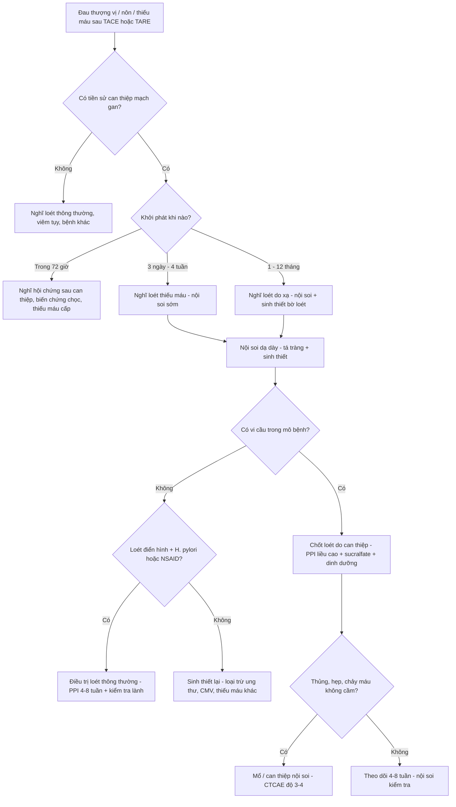
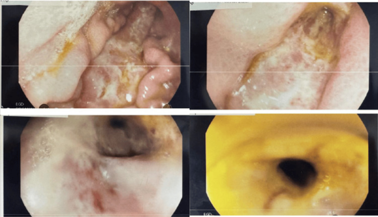
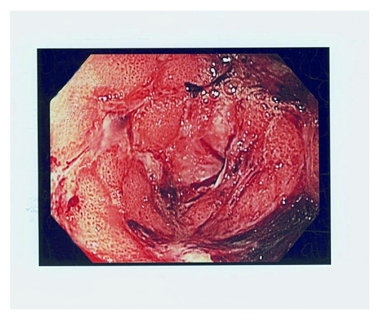
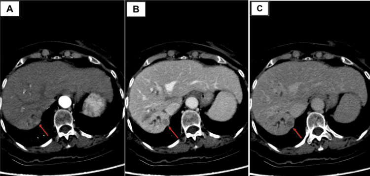
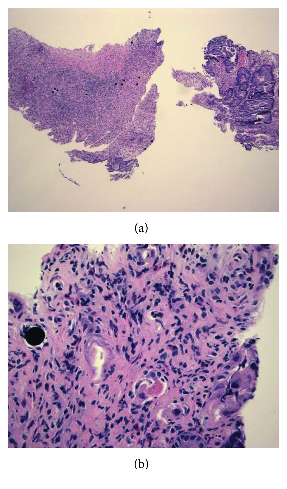

# 1811 — Loét dạ dày–tá tràng do trào ngược vi cầu KHÔNG ĐÍCH sau TACE/TARE: đọc vị trí loét để tìm nhánh động mạch tội phạm

**Tags:** `pattern:loet-da-day` `pattern:thieu-mau-niem-mac` `vung:da-day` `vung:ta-trang` `protocol:DSA-CBCT` `score:CTCAE` `incidentaloma:khong`
**Mức chắc chắn (certainty):** tổng hợp y văn (literature synthesis) — tổng quan biến chứng can thiệp mạch gan (PMC12328914, PMC12835986) + 2 ca nguyên văn có ảnh nội soi/mô bệnh (PMC12516094, PMC5925165). Số nào nguồn không nêu thì ghi "chưa rõ", không suy diễn; chỗ hai nguồn lệch nhau thì ghi cả hai.

## 1. Tổng quan bệnh học – cơ chế hình ảnh

- **Có HAI cơ chế khác nhau, và chúng cho hai kiểu loét khác nhau về thời điểm, hình thái và tiên lượng:**
  1. **TARE (radioembolization: 90Y hoặc 166Ho)** — vi cầu **20–60 µm** (nhựa 90Y: **25–45 µm**) gây tắc tiểu động mạch, nhưng tổn thương niêm mạc chủ yếu do **bức xạ β tại chỗ**: tia β của 90Y đi được **trung bình 2,5 mm, tối đa 10–11 mm**; chu kỳ bán rã **64 giờ**, **95% liều phát trong 11 ngày đầu**. Dải β ngắn giải thích vì sao tổn thương **khu trú đúng nơi vi cầu đậu** (thành dạ dày/tá tràng), không lan xa, và vì sao niêm mạc **mỏng, giảm tiết acid, phù – viêm mạn** rồi loét: các mao mạch nuôi niêm mạc bị chiếu xạ → **giảm tái tạo** → ổ loét **đáy sạch, bờ thiếu máu, chậm lành** dù đã ức chế acid.
  2. **TACE (cTACE / DEB-TACE)** — tổn thương chủ yếu do **thiếu máu**: hạt (gelatin, PVA, vi cầu giải phóng thuốc) + thuốc (doxorubicin/epirubicin) làm tắc và gây độc tế bào trực tiếp. Loét kiểu này **sớm hơn**, đáp ứng với tái tưới máu tốt hơn loét do xạ. Hạt DEB **không cản quang** → trào ngược **không thấy được** trên fluoroscopy, chỉ thấy **gián tiếp** qua vùng thiếu tưới máu trên CBCT/CT sau.
- **Vì sao trào ngược lại vào dạ dày–tá tràng:** xuất phát từ **giải phẫu cấp máu ngoài gan** và **áp lực bơm**. Các nhánh nguy cơ: **động mạch vị phải (right gastric)**, **động mạch vị–tá tràng (GDA)**, **động mạch trên tá tràng (supraduodenal)**, **động mạch vị trái / vị trái phụ (left gastric / accessory left gastric)**, **động mạch dây chằng liềm (falciform, cấp máu da quanh rốn)**. Trào ngược xảy ra khi bơm **quá nhanh/quá áp lực**, khi **tắc dòng (stasis)**, khi đặt catheter **ở thân chung/thân gan riêng** thay vì nhánh chọn lọc, hoặc khi có **tuần hoàn bàng hệ / biến thể giải phẫu** không thấy trên DSA thường.
- **Ngưỡng định lượng bắt buộc nhớ:**
  - **TARE:** biến chứng tiêu hóa **có triệu chứng 1,9–3,2%**; biến cố độ ≥ 3 (gồm loét) **1,4% với vi cầu nhựa vs 0,1% với vi cầu thủy tinh**; **6%** bệnh nhân bị ảnh hưởng cuối cùng **phải mổ**; triệu chứng sớm **2–3 tuần**, loét/hẹp muộn **1–12 tháng**; hội chứng sau can thiệp (post-radioembolization syndrome) gặp **20–70%** — đây là "bóng ma" che mất chẩn đoán.
  - **TACE:** biến chứng **động mạch** gộp **1,1–7,2%**, phân bố theo thời gian **62% trong 72 giờ đầu**, **28% trong 1–4 tuần**, **10% sau 1 tháng**; yếu tố nguy cơ gồm **lipiodol > 20 mL**, **u ≥ 5 cm**, **xơ gan Child–Pugh B/C**, **TACE lặp lại**, **tiền sử mổ bụng** (dính → bàng hệ) và **không dùng kỹ thuật siêu chọn lọc** (trung tâm dùng siêu chọn lọc có tỷ lệ biến chứng thấp hơn rõ).
  - **Không có ngưỡng liều hấp thụ thành dạ dày/tá tràng được kiểm chứng** để "bảo đảm an toàn": chưa rõ — cần tra. Vì vậy mọi khuyến cáo đều là **kỹ thuật** (chọn lọc, CBCT, coil, bơm chậm), không phải ngưỡng số.
- **Vì sao CT ít giá trị, nội soi là chuẩn:** niêm mạc mỏng, ổ loét nông nên CT thường chỉ thấy **dày thành khu trú**, **mất lớp niêm mạc**, ít dịch trong lòng, hoặc **hơi trong thành** khi đã hoại tử/thủng. Chẩn đoán xác định nằm ở **nội soi + sinh thiết**: vi cầu hiện trên H&E là **hạt tròn, đồng kích thước, bắt màu tím/đen**, nằm trong mao mạch của mô hoại tử — ca PMC12516094 thấy vi cầu trong **cả niêm mạc dạ dày và tá tràng**.

## 2. Mẫu hình + chẩn đoán phân biệt theo vị trí (gamut)

- **Mẫu hình A — loét dạ dày "sạch", đơn độc hoặc vài ổ, xuất hiện 1–12 tháng sau TARE, đau dai dẳng:** loét do xạ (nontarget radioembolization).
- **Mẫu hình B — loét/hoại tử niêm mạc sớm 3 ngày–4 tuần sau TACE hoặc DEB-TACE, có thể kèm chấm thiếu máu lan rộng:** loét thiếu máu do trào ngược hạt/thuốc.
- **Mẫu hình C — loét rộng gây hẹp lòng (luminal narrowing), ống soi chuẩn không qua được:** loét xơ hẹp muộn; ca PMC12516094 phải dùng **ống soi nhi** để tới tá tràng.
- **Mẫu hình D — dày thành + hơi trong thành + dịch tự do:** loét thủng/hoại tử — cấp cứu ngoại khoa.
- **Gamut theo VỊ TRÍ (đọc vị trí loét để đoán nhánh tội phạm):**
  - **Bờ cong nhỏ / thân vị** → **động mạch vị phải** (thường xuất phát từ động mạch gan riêng hoặc gan trái) — nhánh hay bị bỏ sót nhất khi lập kế hoạch.
  - **Hang vị + hành tá tràng / D1–D2** → **GDA**, **supraduodenal**, **nhánh tá tụy**.
  - **Cardia / bờ cong nhỏ trên** → **động mạch vị trái / vị trái phụ**.
  - **Nốt tím quanh rốn + hoại tử da, KHÔNG loét dạ dày** → **động mạch dây chằng liềm** (falciform) — cùng cơ chế, khác cơ quan.
  - **Loét + chảy máu ồ ạt, có "sentinel bleed"** → nghĩ **giả phình nhánh (GDA/pancreaticoduodenal)** do tổn thương mạch, không chỉ loét đơn thuần.
- **Gamut theo THỜI GIAN:** **≤ 72 giờ** → biến chứng chọc/tiêu mỡ/thiếu máu cấp; **1–4 tuần** → loét thiếu máu, giả phình, viêm tụy; **1–12 tháng** → loét do xạ, hẹp, xơ hóa.

## 3. Bảng so sánh phân biệt (ma trận đối chiếu)

| Thực thể (entity) | Hình ảnh / nội soi điển hình | Chốt vào (rule-in) | Chốt loại (rule-out) | Gợi ý xác nhận |
|---|---|---|---|---|
| **Loét do xạ sau TARE** | Loét lớn, đáy sạch/thiếu máu, niêm mạc xung quanh mỏng – phù – viêm mạn; 1–12 tháng sau can thiệp; có thể hẹp lòng | **Tiền sử TARE + loét muộn + vị trí khớp nhánh có nguy cơ + vi cầu trong mô bệnh** | Loét **đơn độc có H. pylori dương, bờ viêm đỏ rõ, đáp ứng PPI 4–8 tuần** → nghĩ loét thông thường | Nội soi + sinh thiết bờ loét (tìm vi cầu), đối chiếu bản đồ MAA/bremsstrahlung |
| **Loét thiếu máu sau TACE/DEB-TACE** | Loét nông/bờ hoại tử, có thể nhiều ổ, xuất hiện **3 ngày–4 tuần**; kèm đau nhiều hơn mức hội chứng sau can thiệp | **Tiền sử TACE + khởi phát sớm + vùng chiếu tia/catheter tương ứng + hạt thiếu tưới máu trên CBCT** | Khởi phát **> 3 tháng** hoặc loét đơn độc không liên quan vùng can thiệp → không quy kết | Nội soi sớm; CT bụng có cản quang tìm thiếu tưới máu/thủng |
| **Loét dạ dày–tá tràng thông thường (H. pylori / NSAID)** | Loét tròn, bờ đều, thường **< 2 cm**, hành tá tràng/bờ cong nhỏ; không liên quan lịch can thiệp | **H. pylori (+) / tiền sử NSAID + loét điển hình + lành sau 4–8 tuần PPI** | **Loét lớn, bờ không đều, kéo dài > 8 tuần dù PPI liều cao** → phải loại trừ nguyên nhân can thiệp/ác tính | Test H. pylori, hỏi NSAID, nội soi kiểm tra lành |
| **Ung thư dạ dày xâm lấn/loét ác tính** | Bờ nổi, đáy hoại tử, **dày thành > 1 cm** trên CT, hạch, mất lớp niêm mạc | **Bờ gồ, dày thành không đều + hạch + sinh thiết ác tính** | **Niêm mạc quanh loét mỏng – phù đều, không khối, sinh thiết âm tính** → không phải ung thư | Sinh thiết nhiều mảnh, CT/EUS |
| **Viêm tụy cấp do trào ngược** (cùng cơ chế, hay đi kèm) | Tụy phù/to, dịch quanh tụy, amylase/lipase **> 3× ULN** | **Đau lan sau lưng + enzyme tụy > 3× ULN + phù tụy** | Enzyme bình thường, đau khu trú thượng vị → không phải | Amylase/lipase, CT bụng |
| **Hội chứng sau can thiệp (post-embolization syndrome)** | Sốt nhẹ, buồn nôn, đau thượng vị **1–5 ngày**, tự hết; **20–70%** sau TARE | **Đau giảm dần trong 1 tuần + không thiếu máu + không nôn kéo dài** | **Đau tăng dần > 2 tuần, nôn, sụt cân, thiếu máu** → không phải hội chứng đơn thuần, phải nội soi | Theo dõi 1–2 tuần; nội soi nếu kéo dài |

## 4. Protocol chụp + phân độ

- **Trước can thiệp (phòng ngừa là chính):**
  - **DSA không chọn + chọn** để vẽ **động mạch vị phải, vị trái, vị trái phụ, GDA** và các biến thể; **CBCT (cone-beam CT)** để nhìn nhánh nhỏ mà DSA 2D bỏ sót.
  - **Nút coil nhánh có nguy cơ** (thường GDA và/hoặc vị phải) trước khi bơm MAA/vi cầu — nhưng nhớ: **coil không bảo đảm** (xem cạm bẫy 1).
  - **TARE:** bắt buộc **99mTc-MAA planar + SPECT/CT**; không chấp nhận hoạt độ ngoài gan ở dạ dày/ruột; nếu không khử được → **chống chỉ định**, chuyển TACE hoặc điều trị hệ thống.
  - **Vị trí catheter khi bơm vi cầu phải trùng vị trí lúc bơm MAA**; tránh bơm ở **thân chung/thân gan riêng** (yếu tố nguy cơ độc lập); **bơm chậm, đều, dừng trước khi tắc dòng (stasis)**.
- **Sau can thiệp:** **bremsstrahlung SPECT hoặc PET** để phát hiện phân bố ngoài gan; **đau thượng vị kéo dài 2–8 tuần sau TARE** (hoặc **3 ngày–4 tuần sau TACE**) → **nội soi dạ dày–tá tràng**, sinh thiết **bờ** ổ loét (không lấy đáy hoại tử) để tìm vi cầu và loại ác tính.
- **Phân độ CTCAE v5 (dùng để báo cáo và quyết định mức điều trị):** độ 2 = loét có triệu chứng cần can thiệp y khoa (PPI liều cao, dinh dưỡng); độ 3 = nhập viện, **nuôi ăn tĩnh mạch/qua ống xa**, can thiệp; độ 4 = thủng/đe dọa tính mạng, mổ cấp cứu; độ 5 = tử vong.
- **Điều trị:** **PPI liều cao + sucralfate**, tránh NSAID, hoãn hóa trị để loét lành; **nuôi ăn qua ống xuống đoạn ruột xa hoặc TPN** khi không ăn được; **mổ 6%** ca bị ảnh hưởng. **PPI dự phòng cho mọi ca KHÔNG có chỉ định** (không có bằng chứng giảm loét do xạ).
- **Không có thử nghiệm ngẫu nhiên** so sánh các phác đồ — mọi khuyến nghị điều trị hiện dựa trên ca bệnh và sinh lý bệnh: **chưa rõ**.

## 5. Biến thể bình thường và cạm bẫy

- **Cạm bẫy 1 — "đã nút GDA và vị phải là an toàn":** ca **57 tuổi** (PMC5925165) được **nút coil dự phòng cả GDA và động mạch vị phải**, MAA cho **7% phổi / 93% gan**, bremsstrahlung SPECT **không thấy hoạt độ ngoài gan** — vẫn loét hang vị lan tỏa 2 tháng sau. Coil chỉ chặn **đường đã biết**, không chặn **bàng hệ và biến thể**; và **vi cầu có thể đã đi qua trước khi coil**.
- **Cạm bẫy 2 — hình ảnh phân bố "bình thường" không loại trừ:** cùng ca trên, SPECT sau điều trị âm tính vẫn có loét. Độ phân giải và ngưỡng hiển thị của planar/SPECT **không đủ nhạy** với vài vi cầu đủ gây loét — **triệu chứng mới là chỉ định nội soi**, không phải hình ảnh.
- **Cạm bẫy 3 — hội chứng sau can thiệp che lấp:** **20–70%** bệnh nhân có đau – buồn nôn – sốt nhẹ sau TARE. Quy tắc an toàn: **đau tăng dần hoặc kéo dài > 2 tuần, nôn không giảm, sụt cân, thiếu máu** = không còn là hội chứng đơn thuần → nội soi.
- **Cạm bẫy 4 — gán ngay cho H. pylori/NSAID ở bệnh nhân ung thư gan:** hai nguyên nhân **có thể cùng tồn tại**; sinh thiết bờ loét + hỏi lịch can thiệp là cách duy nhất phân định. Ngược lại, đừng quy mọi loét cho can thiệp rồi **bỏ điều trị H. pylori**.
- **Cạm bẫy 5 — hạt DEB không cản quang:** trên fluoroscopy, trào ngược của DEB **không nhìn thấy**; chỉ đánh giá được bằng **CBCT/CT sau** (vùng thiếu tưới máu) và bằng lâm sàng.
- **Cạm bẫy 6 — tử vong không phải do loét mà do mất bù xơ gan:** ca PMC12516094 chết vì **Child–Pugh B → C, nhiễm trùng, DIC**, không phải vì chảy máu ổ loét. Ở bệnh nhân xơ gan, **nuôi ăn kém + loét = bệnh cảnh toàn thân**, cần dinh dưỡng và theo dõi chức năng gan song song.
- **Biến thể bình thường:** viêm dạ dày/loét nông **không triệu chứng**, tự lành trong **2–4 tuần**, chỉ thấy khi nội soi vì lý do khác — theo dõi, không can thiệp.
- **Lưu ý trung thực nguồn:** ca PMC12516094 ghi **72 tuổi ở phần tóm tắt** nhưng **74 tuổi ở phần ca bệnh** — bài gốc tự mâu thuẫn, không phải lỗi phiên giải; ghi cả hai khi trích.

## 6. Tự lượng giá — Blind Quiz

**Ca 1 — Nữ 72 tuổi, xơ gan do viêm gan C (Child–Pugh B), HCC tái phát sau đốt RFA; 3 tháng trước được TARE. Nay đau thượng vị tăng dần, ăn kém. Nhìn ảnh nội soi, mô tả trước.**

- Gợi ý lâm sàng: tổn thương HCC **11 mm phân thùy VII, LI-RADS 5**; không có tiền sử loét, không dùng NSAID.
- Câu hỏi: Ổ loét ở đâu, hình thái gì? Vì sao **u ở phân thùy VII** mà lại loét dạ dày? Ba chẩn đoán phân biệt và dấu hiệu nào chốt nguyên nhân?

<b>Bấm để hiện đáp án (findings + chẩn đoán)</b>

- Dấu hiệu (findings): **loét dài, rộng** từ thành sau trên bờ cong lớn, **lan thành vòng quanh ở hang vị**, gây **hẹp lòng** — ống soi chuẩn không qua được, phải dùng **ống soi nhi** để tới tá tràng; ranh giới niêm mạc dạ dày–tá tràng **mất rõ**.
- Chẩn đoán (diagnosis): **loét hoại tử do xạ sau TARE** — sinh thiết dạ dày và tá tràng thấy **vi cầu 90Y** trong mao mạch, **không có tế bào ác tính**, kèm **mất nhung mao tá tràng**. Vị trí u **không quyết định** vị trí loét: vi cầu đi theo **dòng chảy và trào ngược** vào nhánh nuôi dạ dày–tá tràng, không theo vị trí khối u.
- Diễn tiến: PPI + sucralfate + kháng acid + dịch truyền **thất bại**; nuôi ăn tĩnh mạch; nội soi lại vẫn loét nặng; xơ gan mất bù **B → C**, nhiễm trùng huyết, DIC, tử vong. Bài học: **loét do xạ không đáp ứng PPI** vì cơ chế là **thiếu máu – xơ hóa mao mạc**, không phải tăng tiết acid.
- Nguồn ảnh: Cureus 2025 (PMC12516094), Fig. 2, **CC BY 4.0** — nguyên bản.

**Ca 2 — Nữ 57 tuổi, ung thư vú giai đoạn IV di căn gan–phổi, được SIRT vi cầu nhựa 90Y. Hai tháng sau: buồn nôn, nôn tăng dần. Trước thủ thuật đã nút coil dự phòng GDA và động mạch vị phải.**

- Gợi ý lâm sàng: MAA cho **7% phổi / 93% gan**; bremsstrahlung SPECT sau điều trị **không thấy hoạt độ ngoài gan**.
- Câu hỏi: Mô tả tổn thương? Kết quả hình ảnh "âm tính ngoài gan" có loại trừ được loét do can thiệp? Làm gì để chốt?

<b>Bấm để hiện đáp án (findings + chẩn đoán)</b>

- Dấu hiệu (findings): **viêm dạ dày lan tỏa + loét hang vị rộng**; sinh thiết thấy **hạt tròn đen, đồng kích thước** trong mao mạch niêm mạc.
- Chẩn đoán (diagnosis): **loét dạ dày do vi cầu 90Y lạc chỗ (nontarget radioembolization)** — xác định bằng **mô bệnh học**, không bằng hình ảnh.
- Vì sao "coil đầy đủ" vẫn xảy ra: coil chặn **đường đã biết** (GDA, vị phải) nhưng **không chặn bàng hệ/biến thể**, và **không loại trừ vi cầu đã đi qua trước khi đặt coil**. MAA/bremsstrahlung âm tính **không loại trừ** vì độ phân giải hạn chế.
- Bước tiếp theo: **nội soi + sinh thiết bờ loét**, PPI liều cao, sucralfate, nuôi ăn qua ống xa; theo dõi sát vì loét do xạ **chậm lành**.
- Nguồn ảnh: Case Reports in Immunology 2018 (PMC5925165), Fig. 1, **CC BY** — nguyên bản.

**Ca 3 — Cùng bệnh nhân ca 1: ảnh CT gan 3 thì trước can thiệp. Câu hỏi dành cho người lập kế hoạch, không phải người đọc kết quả.**

- Gợi ý lâm sàng: u **11 mm**, bắt thuốc động mạch, thải thuốc thì cửa/muộn (LI-RADS 5).
- Câu hỏi: Trên ca này, **ba bước nào trong phòng can thiệp** có thể giảm nguy cơ loét dạ dày–tá tràng? Nếu bỏ qua bước nào thì hậu quả là gì?

<b>Bấm để hiện đáp án (findings + chẩn đoán)</b>

- Trả lời: (1) **DSA không chọn + chọn để vẽ đủ động mạch vị phải, vị trái/phụ, GDA và biến thể**, kèm **CBCT**; (2) **coil nhánh nguy cơ** trước khi bơm MAA/vi cầu và **đặt catheter chọn lọc trùng vị trí bơm MAA** — không bơm ở thân chung/thân gan riêng; (3) **bơm chậm, dừng trước khi tắc dòng**, rồi **bremsstrahlung/PET** kiểm tra phân bố.
- Hậu quả nếu bỏ: vi cầu trào ngược vào nhánh dạ dày–tá tràng → loét do xạ **1–12 tháng sau**, chậm lành, **6%** phải mổ, và ở bệnh nhân xơ gan có thể tử vong vì mất bù – nhiễm trùng (đúng ca 1).
- Ghi chú: **không có ngưỡng liều** nào thay thế được ba bước kỹ thuật trên (chưa rõ ngưỡng thành dạ dày/tá tràng).
- Nguồn ảnh: Cureus 2025 (PMC12516094), Fig. 1, **CC BY 4.0** — nguyên bản.

*Hạt vi cầu tròn, đồng kích thước, bắt màu đen trên H&E trong mao mạch niêm mạc — dấu hiệu **chốt nguyên nhân** khi nội soi thấy loét ở bệnh nhân đã can thiệp mạch gan. Nguồn: Case Reports in Immunology 2018 (PMC5925165), Fig. 2, CC BY.*

## Bài liên quan chéo
- [1807 – Bóc tách ĐMC bụng sau thủ thuật](../1807-boc-tach-dmc-bung-do-chan-thuong-va-sau-thu-thuat/lesson.md) — cùng nhóm biến chứng mạch sau can thiệp
- [180 – Viêm túi mật thiếu máu sau TACE](../180-viem-tui-mat-thieu-mau-sau-tace/lesson.md) — cùng cơ chế trào ngược vi cầu không đích, khác cơ quan
- [1801 – Bệnh gan do thuyên tắc phóng xạ (REILD)](../1801-benh-gan-do-thuyen-tac-phong-xa-reild/lesson.md) — tổn thương do xạ tại gan
- [1806 – Viêm phổi do xạ sau TARE](../1806-viem-phoi-do-xa-sau-tare/lesson.md) — cùng nhóm biến chứng TARE do phân bố ngoài gan
- [920 – Nút mạch chảy máu tiêu hóa](../920-vascular-embolization-gi-bleed/lesson.md) — xử trí chảy máu khi loét không cầm
- [910 – Áp-xe & dẫn lưu qua da](../910-abscess-biliary-nephrostomy/lesson.md) — xử trí ổ nhiễm trùng/thủng sau can thiệp

> Không dùng để chẩn đoán độc lập khi chưa có người hướng dẫn.
