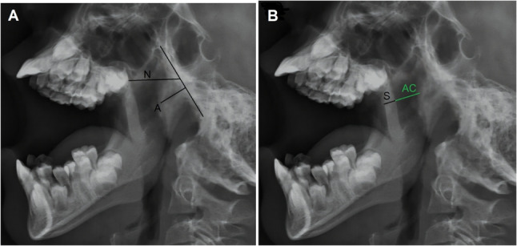
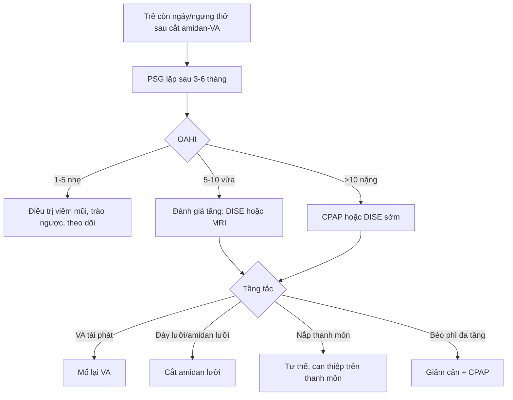
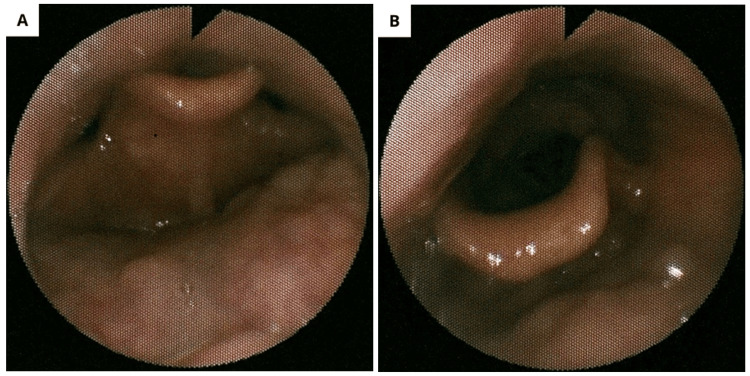
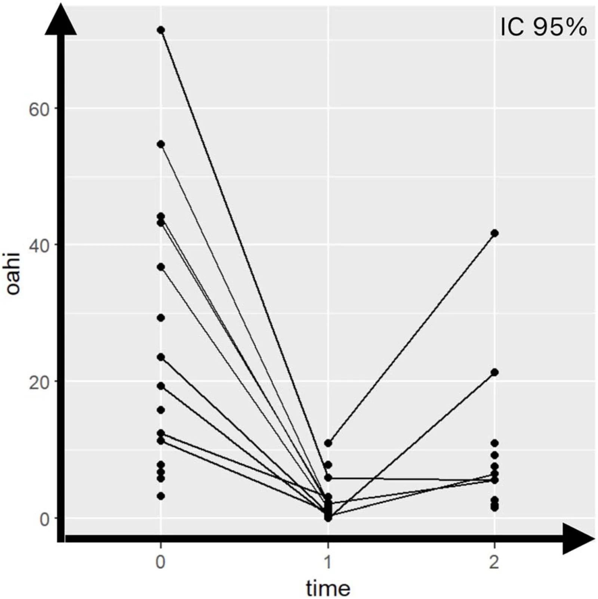

# 1812 — Ngưng thở khi ngủ tắc nghẽn TỒN DƯ sau cắt amidan–VA ở trẻ (Down, béo phì) / Residual obstructive sleep apnoea after adenotonsillectomy

**Tags:** `pattern:osa-ton-du` `pattern:tac-nghen-da-tang` `vung:duong-tho-tren` `vung:hau-mieng` `score:OAHI` `protocol:PSG` `protocol:DISE` `protocol:MRI-duong-tho`
**Mức chắc chắn (certainty):** tổng hợp y văn (literature synthesis) — tổng hợp từ y văn mở 2017–2026, đối chiếu PMCID từng bài (Europe PMC): Stockunaite P, *Medicina (Kaunas)* 2026, PMC13027964; Costa Gomes S, *Braz J Otorhinolaryngol* 2026, PMC13563574; Finnegan E, *Ann Otol Rhinol Laryngol* 2026, PMC13125704; Soršáková A, *Life (Basel)* 2025, PMC12387549; Zarei E, *BMC Pediatr* 2026, PMC12990599; Manycz PO, *J Clin Med* 2026, PMC13566038; Freitas S, *Cureus* 2026, PMC13378873. Số nào chưa kiểm chứng ghi "chưa rõ".

> Bài này trả lời **"đã cắt amidan–VA rồi mà trẻ vẫn ngáy/ngưng thở thì sao, và chụp gì để tìm tầng tắc nghẽn còn lại"**. OSA nguyên phát và OSA ở trẻ bệnh phổi mạn ở [1803](../1803-ngung-tho-khi-ngu-tac-nghen-tre-benh-phoi-man/lesson.md); tăng áp phổi do OSA ở [686](../686-tang-ap-luc-dong-mach-phoi-benh-phoi-man-nhi/lesson.md); mềm sụn thanh quản ở [694](../694-mem-sun-thanh-quan-o-nhu-nhi/lesson.md).

## 1. Tổng quan bệnh học – cơ chế hình ảnh

- **Định nghĩa tồn dư (residual OSA, rOSA):** sau cắt amidan–VA (adenotonsillectomy, AT), trẻ vẫn có **OAHI ≥ 1 sự kiện/giờ** khi đo lại bằng đa ký giấc ngủ (polysomnography, PSG). Các nghiên cứu dùng ngưỡng khác nhau — **AHI > 1**, **OAHI > 1**, **AHI > 1,5** hoặc **OAHI > 2** — nên tỷ lệ không so sánh tuyệt đối được (Stockunaite P 2026, PMC13027964). Phân độ vẫn theo trẻ: **nhẹ 1–5**, **vừa 5–10**, **nặng > 10 sự kiện/giờ** (Costa Gomes S 2026, PMC13563574).
- **Tần suất:** gộp **13 nghiên cứu (2010–2024)**, rOSA dao động **18,6–85,0%**; tổng quan chung ghi **tới ~40%** trẻ còn OSA sau AT, còn **nhóm nguy cơ cao (Down, béo phì, bất thường sọ mặt) 30–75%** (Stockunaite P 2026, PMC13027964; Manycz PO 2026, PMC13566038). Đây **không phải biến chứng hiếm** — là lý do phải có kế hoạch đo lại, không "mổ xong là khỏi".
- **Vì sao cắt amidan–VA không giải quyết hết (TẠI SAO, không chỉ liệt kê):**
  1. **Còn mô lympho ở tầng khác:** amidan lưỡi (lingual tonsil) và **amidan VA tái phát** nằm ngoài trường mổ. Trên 33 trẻ rOSA sau AT, nội soi giấc ngủ do thuốc (drug-induced sleep endoscopy, DISE) thấy **VA 54,5%**, **tầng trên thanh môn 48,5%**, **đáy lưỡi 45,5%** — tức là mổ amidan–VA chỉ giải quyết **một tầng** (Manycz PO 2026, PMC13566038).
  2. **Sụp vòm hầu – thành bên – nắp thanh môn** do **trương lực cơ hầu giảm** khi ngủ, đặc biệt trong **giấc ngủ REM**. Đây là tắc nghẽn **động**, không thấy khi trẻ thức; khám họng lúc thức có thể bình thường.
  3. **Béo phì** làm tăng mô mỡ quanh hầu, giảm dung tích cặn chức năng (functional residual capacity, FRC) → giảm lực kéo mở đường thở, tăng áp lực tới hạn đóng (critical closing pressure, Pcrit); kèm viêm hệ thống và thay đổi kiểm soát thần kinh–cơ. rOSA ở trẻ béo **23,0–72,8%**, có nghiên cứu **85%** ngay đêm đầu sau mổ (Stockunaite P 2026, PMC13027964).
  4. **Hội chứng Down:** giữa mặt kém phát triển, lưỡi to, hầu hẹp, giảm trương lực cơ, béo phì — nên **AT chỉ "khỏi" 6–33%** so với **~79%** trẻ nói chung; rOSA ở Down **54–68%** (Costa Gomes S 2026, PMC13563574; Stockunaite P 2026, PMC13027964).
  5. **Hen, viêm mũi dị ứng, trào ngược, bất thường sọ mặt, tuổi < 3 hoặc > 7** làm tăng nguy cơ; **khói thuốc và yếu tố kinh tế–xã hội** cũng được ghi nhận (Stockunaite P 2026, PMC13027964).
- **Vật lý đường thở — vì sao "hẹp 1 mm" đã đủ gây ngưng thở:** hầu là ống mềm, áp lực trong lòng (P_lumen) trong thì hít vào càng âm khi cố thở; khi **P_lumen < Pcrit** thì hầu xẹp. Ở trẻ béo, FRC thấp làm **Pcrit tăng**; ở Down, **giảm trương lực cơ giãn hầu** làm Pcrit tăng thêm. Vì vậy **cùng một lượng mô lympho còn lại**, trẻ béo/Down xẹp nhiều hơn trẻ cân đối — giải thích vì sao tỷ lệ rOSA khác nhau rất lớn giữa các nhóm.
- **Vì sao PSG không định vị được tầng tắc:** PSG đo **dòng khí, nỗ lực hô hấp, SpO₂, CO₂, điện não** — nó cho biết **có** tắc nghẽn và **nặng bao nhiêu**, nhưng **không cho biết tắc ở đâu**. Trong khi đó **DISE** nhìn động học **từ mũi đến thanh môn**, và **MRI động (cine MRI)** đo **diện tích lòng hầu** theo thì thở. Đây là lý do bài này đặt hình ảnh **sau** PSG, không thay PSG.
- **Vì sao đo lại phải đúng thời điểm:** sau mổ còn **phù niêm mạc và mô hạt**; PSG quá sớm dễ đọc "tồn dư" giả. Các nghiên cứu đo lại **3,25 ± 4,35 tháng** (ngắn hạn) và **53,25 ± 33,95 tháng** (dài hạn), tối thiểu 18 tháng (Costa Gomes S 2026, PMC13563574). **Ngưỡng tối ưu chưa có đồng thuận** — bài này khuyến cáo **3–6 tháng** sau mổ, sớm hơn nếu triệu chứng nặng hoặc có tăng áp phổi.
- **Con số tiên lượng đáng nhớ ở Down (đoàn hệ 25 trẻ, PSG trước – ngắn – dài hạn):** OAHI **25,55 ± 19,70** (3,2–71,4) → **3,20 ± 3,38** (0–11,0) → **10,37 ± 11,76** (1,5–41,7); **28%** còn rOSA ngắn hạn nhưng **44%** còn ở dài hạn; chênh ngắn–dài **9,437, p < 0,001** (Costa Gomes S 2026, PMC13563574). Nghĩa là **kết quả tốt lúc 3 tháng không bảo đảm 4 năm sau** — phải đo lại lần hai.
- **Kiểu hình "người lớn" ở trẻ:** 34 trẻ sau AT, rOSA **24/34 (70,6%)**; kiểu hình người lớn (béo, tắc nghẽn đa tầng) **16/20 (80,0%)** so với kiểu hình kinh điển **8/14 (57,1%)**; trong số rOSA, **nặng 17,6%**, **vừa 20,6%**, **nhẹ 32,4%**, AHI trung bình **6,67 ± 9,17** (Soršáková A 2025, PMC12387549). Đây là bằng chứng định lượng cho "béo phì đổi kiểu hình bệnh".

## 2. Mẫu hình + chẩn đoán phân biệt theo tầng (gamut)

**Câu hỏi trung tâm: "tắc còn lại ở tầng nào?"** — trả lời bằng DISE/MRI, không bằng cảm giác khi khám họng.

- **Tầng mũi – VA (nasal/adenoid):** VA tái phát, hẹp cửa mũi sau, phì đại cuốn mũi, polyp; trẻ ngạt mũi, ngủ há miệng, ngáy.
- **Tầng vòm hầu (velum):** sụp mềm vòm miệng, dài vòm; DISE thấy hẹp thì hít vào.
- **Tầng hầu bên (oropharyngeal lateral walls):** thành bên sụp vào trong, amidan còn to; hay gặp ở béo phì.
- **Tầng đáy lưỡi (tongue base):** phì đại amidan lưỡi, lưỡi to (Down, to đầu chi), tụt lưỡi; DISE **45,5%** ở trẻ rOSA sau AT.
- **Tầng trên thanh môn (supraglottis/epiglottis):** sụp nắp thanh môn kiểu "cửa sập" (trapdoor), sa thanh môn; **48,5%** trong loạt DISE sau AT (Manycz PO 2026, PMC13566038).
- **Không do tắc nghẽn:** giảm thông khí trung ương, ngưng thở trung ương, giảm thông khí do béo phì (obesity hypoventilation syndrome, OHS), động kinh/giật cơ — **không được gọi là rOSA** dù AHI cao.
- **Gamut theo nhóm bệnh:** (1) **Down** — đa tầng + giảm trương lực; (2) **béo phì** — thành bên + đáy lưỡi + OHS; (3) **bất thường sọ mặt** (Pierre Robin, Treacher Collins, Crouzon) — hẹp xương; (4) **hen/viêm mũi dị ứng** — viêm và phù niêm mạc; (5) **sau mổ** — VA tái phát, dính/sẹo vòm; (6) **thần kinh–cơ** — giảm trương lực, giảm thông khí.
- **Mnemonic "MALT":** **M**alformation (sọ mặt), **A**denoid regrowth, **L**ingual tonsil/tongue base, **T**one (giảm trương lực) — cộng thêm **O**besity và **E**piglottis.

## 3. Bảng so sánh phân biệt (ma trận đối chiếu)

| Thực thể (entity) | Hình ảnh điển hình | Chốt vào (rule-in) | Chốt loại (rule-out) | Gợi ý xác nhận |
|---|---|---|---|---|
| **VA tái phát** | X-quang cổ nghiêng: khối mô mềm lấp cửa mũi sau; **A/N > 1,5** (Fujioka); DISE: VA chặn > 50% cửa mũi sau | **Tiền sử AT + ngạt mũi tái phát + A/N > 1,5 + DISE thấy VA** | Cửa mũi sau thông thoáng trên DISE/MRI; tắc nghẽn chỉ ở đáy lưỡi | X-quang nghiêng (A/N), DISE, MRI T2 |
| **Phì đại amidan lưỡi** | MRI T2: khối mô lympho tăng tín hiệu ở đáy lưỡi; DISE: đáy lưỡi chặn | **DISE đáy lưỡi ≥ 2 (VOTE) + mô lympho dày trên MRI** | Đáy lưỡi thông thoáng; nguyên nhân ở tầng khác | DISE (chốt), MRI |
| **Sụp nắp thanh môn (epiglottic collapse)** | DISE: nắp thanh môn sụp ra sau kiểu trapdoor khi hít vào; **giảm khi xoay đầu sang bên** | **Sụp động thì hít vào, mất khi xoay đầu/nâng hàm** | Hẹp cố định (sẹo, u, màng) không đổi theo tư thế | DISE với nghiệm pháp tư thế |
| **Sụp vòm hầu/thành bên** | DISE: vòm mềm/thành bên sụp vào trong; MRI động: diện tích lòng hầu giảm | **Sụp ≥ 50% khi ngủ + tăng khi nằm ngửa** | Thành bên vững, không sụp | DISE, cine MRI |
| **rOSA do béo phì** | BMI z-score > 2; mỡ quanh hầu trên MRI; DISE đa tầng/concentric | **Béo + rOSA + đa tầng/concentric + FRC thấp** | BMI bình thường, tắc một tầng do VA | BMI, PSG có CO₂, DISE |
| **rOSA ở Down** | MRI/CT: hẹp mũi hầu, lưỡi to, hẹp sọ mặt; DISE đa tầng | **Down + OAHI còn cao + đa tầng + giảm trương lực** | Down nhưng PSG bình thường, không tắc khi ngủ | PSG lặp, DISE, MRI |
| **Bất thường sọ mặt** | Cephalogram/CT: hẹp xương hàm, tụt hàm, xương mũi thấp | **Phân tích sọ mặt thấy hẹp + rOSA** | Xương bình thường, mô mềm là chính | Cephalogram, CT sọ mặt |
| **Hen/viêm mũi dị ứng** | Phù niêm mạc mũi, VA to; không có tổn thương đặc hiệu trên CT | **Hen/viêm mũi + rOSA + cải thiện khi điều trị viêm** | Không viêm, không phù | Lâm sàng, test dị ứng |
| **Ngưng thở trung ương/giảm thông khí** | PSG: không có nỗ lực hô hấp; CO₂ tăng khi ngủ | **Không nỗ lực + CO₂ > 50 mmHg** | Có nỗ lực + tắc nghẽn → OSA | PSG có CO₂/EtCO₂ |
| **Sau mổ — sẹo/dính vòm hầu** | DISE: dải xơ, hẹp vòm; MRI: mô xơ giảm tín hiệu | **Tiền sử mổ + dải xơ + hẹp cố định** | Niêm mạc mềm, không xơ | DISE, MRI |

*Trái (A): phương pháp **Fujioka** — A = chiều dày VA, N = chiều rộng mũi hầu; tỷ lệ **A/N**. Phải (B): phương pháp **Cohen** — AC = khoảng khí sau vòm mềm, S = chiều dày vòm mềm. Nguồn: Zarei E et al., BMC Pediatr 2026, PMC12990599, CC BY-NC-ND 4.0 (nguyên bản, không chỉnh sửa).*

### Dấu hiệu hình ảnh chốt và ngưỡng
- **A/N (Fujioka) > 1,5:** độ nhạy **100%**, độ đặc hiệu **52,9%** so với DISE; **Cohen > 3,5:** Se **83,3%**, Sp **75,0%**; tương quan với DISE **r = 0,670** (Fujioka) và **r = 0,458** (Cohen), n = 48 (Zarei E 2026, PMC12990599). **Kết luận: phim nghiêng rất nhạy nhưng kém đặc hiệu — dương tính không chứng minh tắc nghẽn, âm tính cũng không loại trừ tầng dưới.**
- **DISE — VOTE:** **V**elum, **O**ropharynx (thành bên/amidan), **T**ongue base, **E**piglottic; mỗi tầng **0 = không sụp, 1 = sụp một phần, 2 = sụp hoàn toàn**; ghi thêm kiểu sụp (trước–sau, bên, đồng tâm). VOTE là hệ dùng nhiều nhất (**65,1%** chuyên gia trong khảo sát quốc tế), nhưng không có hệ chuẩn cho trẻ; các hệ trẻ gồm **Chan–Parikh, NAVOTEL, PedDISE-8, IPSES** (Manycz PO 2026, PMC13566038).
- **PedDISE-8:** 8 tầng (mũi, VA, vòm, amidan, amidan lưỡi, đáy lưỡi, nắp thanh môn, mô aryepiglottic); độ tin cậy giữa người đọc **ICC 0,67–0,88**, trong cùng người **0,71–0,87**; số tầng sụp nặng tương quan với OAHI **τ = 0,119, p = 0,004** (Manycz PO 2026, PMC13566038).
- **DISE đổi kế hoạch mổ 30–60%**; phẫu thuật đáy lưỡi theo DISE giảm AHI **~50%**, SpO₂ nadir tăng **~3%** (tổng quan trong Manycz PO 2026, PMC13566038).

## 4. Protocol chụp + hệ phân độ

- **Bước 1 — PSG (chuẩn vàng):** AASM phiên bản trẻ em (v2.6); ghi **dòng khí mũi–miệng, nỗ lực ngực–bụng, SpO₂, CO₂/EtCO₂, ECG, EEG/EMG, tư thế, video**. Tính **OAHI** (loại sự kiện trung ương) và **AHI**; ghi **SpO₂ nadir**, **T90**, **chỉ số ngưng thở trung ương**, **CO₂ cao nhất**. Lặp **3–6 tháng sau AT**; **≥ 18 tháng** nếu Down/nguy cơ cao (Costa Gomes S 2026, PMC13563574).
- **Bước 2 — đánh giá tầng bằng hình ảnh:**
  - **X-quang cổ nghiêng (lateral neck radiograph):** sàng lọc VA, đo **A/N** và **Cohen**; **không dùng để loại trừ tầng đáy lưỡi/nắp thanh môn**; chụp đúng tư thế, đầu trung tính, thì hít vào.
  - **DISE (drug-induced sleep endoscopy):** chỉ định khi **rOSA có kế hoạch mổ lần hai**, khám thức không khớp mức nặng, hoặc nguy cơ cao (Down, béo, sọ mặt). Ghi **VOTE/PedDISE-8** từng tầng, kèm **nghiệm pháp tư thế** (xoay đầu, nâng hàm) để phân biệt sụp động với hẹp cố định.
  - **MRI đường thở/cine MRI:** khi cần đánh giá **mô mềm, đáy lưỡi, thành hầu, sọ mặt**, hoặc trẻ không hợp tác DISE; **T2** thấy mô lympho tăng tín hiệu, **T1** thấy mỡ; **cine MRI** đo diện tích lòng hầu theo thì thở, không nhiễm xạ nhưng cần ngủ/giảm đau.
  - **Cephalogram/CT sọ mặt:** khi nghi bất thường xương (tụt hàm, hẹp xương hàm, Pierre Robin).
- **Bước 3 — quyết định:** nếu còn **mô lympho/VA** → mổ lại/adenoidectomy; nếu **đáy lưỡi/amidan lưỡi** → cắt amidan lưỡi (lingual tonsillectomy); nếu **nắp thanh môn** → điều trị tư thế/nội soi; nếu **béo phì** → giảm cân, CPAP; nếu **Down đa tầng** → CPAP ± phẫu thuật theo tầng, không hứa khỏi.
- **Ngưỡng hành động thực hành:** rOSA **nhẹ (1–5)** có thể theo dõi + điều trị viêm/trào ngược; **vừa–nặng (≥ 5)** hoặc có **tăng áp phổi/ngưng thở dài** → CPAP hoặc can thiệp tầng; **OAHI ≥ 10** ở Down/loạn sản sọ mặt → đánh giá DISE sớm.

## 5. Biến thể bình thường và cạm bẫy

- **Đo PSG quá sớm (< 6 tuần):** phù hậu phẫu làm OAHI cao giả; **đo quá muộn** bỏ lỡ giai đoạn tái phát mô lympho. Chọn **3–6 tháng** và ghi rõ thời điểm trong báo cáo.
- **AHI bình thường nhưng trẻ vẫn có triệu chứng:** AHI chỉ **đếm sự kiện**, không đo **gánh nặng thiếu oxy**. Ở trẻ, **hypoxic burden** (diện tích dưới đường cong SpO₂) tương quan với OAHI **r = 0,801**, **AUC 0,888** — tốt hơn ODI3/T90/nadir (bài [1803](../1803-ngung-tho-khi-ngu-tac-nghen-tre-benh-phoi-man/lesson.md)). Đừng "trấn an" chỉ vì AHI 1–2.
- **Ngưng thở trung ương tăng sau mổ:** trong đoàn hệ Down, **chỉ số ngưng thở trung ương tăng** ở cả ngắn và dài hạn so với trước mổ (Costa Gomes S 2026, PMC13563574). Có thể do **bộc lộ** ngưng thở trung ương khi tắc nghẽn được giải phóng, hoặc do giảm thông khí; đừng quy tất cả cho "còn tắc".
- **Sai số của phim cổ nghiêng:** xoay đầu, ngửa quá mức, thì thở ra, phim mờ → **A/N giả**. Độ đặc hiệu chỉ **52,9%** ở cutoff 1,5; **không dùng phim nghiêng để quyết định mổ lại**.
- **DISE dương tính giả:** an thần quá sâu (propofol liều cao) làm mất trương lực cơ hầu → sụp "giả"; **quá nông** lại âm giả. Dùng **dexmedetomidine ± ketamine**, giữ thở tự nhiên, **BIS hỗ trợ**, tránh thuốc co mạch/tê tại chỗ (Manycz PO 2026, PMC13566038).
- **Bỏ sót tầng thứ hai (satisfaction of search):** thấy VA tái phát là dừng, bỏ qua đáy lưỡi/nắp thanh môn — đúng loạt DISE sau AT với **45,5% đáy lưỡi** và **48,5% trên thanh môn**.
- **Down: đừng hứa "mổ là khỏi".** Tỷ lệ khỏi chỉ **6–33%**; **44%** còn rOSA dài hạn; kế hoạch phải gồm **PSG lặp, CPAP, đánh giá tầng**.
- **Béo phì: AHI có thể tăng lại dù mổ tốt** nếu trẻ tăng cân; theo dõi BMI z-score cùng PSG.
- **OHS vs OSA:** béo phì + **CO₂ > 50 mmHg khi ngủ** + không có tắc nghẽn tương xứng → nghĩ **giảm thông khí do béo phì**, cần CPAP/BiPAP và đánh giá trung tâm, không chỉ "cắt VA".

## 6. Tự lượng giá — Blind Quiz

**Ca 1 — Trẻ béo phì, ngáy to, đã được chỉ định cắt amidan–VA**

- **Bối cảnh:** bé gái 10 tuổi, 77,5 kg, **BMI 31,04 kg/m² (> 99th percentile)**, chậm phát triển nhận thức; ngáy, ngưng thở được chứng kiến, ngủ ngày nhiều. PSG: **OAHI 15/giờ**, **SpO₂ nadir 85%**. Khám thức: cuốn mũi to, amidan–VA độ II, Mallampati III.
- **Câu hỏi:** (1) Hình A cho thấy tầng tắc nào? (2) Vì sao không nên cắt amidan–VA ngay? (3) Nghiệm pháp nào trên hình B giúp phân biệt sụp động với hẹp cố định?

<b>Bấm để hiện đáp án (findings + chẩn đoán)</b>

- **Dấu hiệu:** (A) **nắp thanh môn sụp ra sau kiểu "cửa sập" (posterior trapdoor collapse)** khi hít vào, bít gần kín thanh môn; (B) **hết sụp khi xoay đầu sang bên** — sụp có thành phần **tư thế**.
- **Chẩn đoán:** **rOSA do sụp nắp thanh môn đơn độc** (VOTE: V0 O0 T0 **E2**), không phải do amidan–VA. Vì vậy **không cắt amidan–VA**; xử trí **giảm cân + điều trị tư thế**, theo dõi.
- **Vì sao:** DISE cho thấy tắc nghẽn **động, tầng trên thanh môn** mà khám thức bỏ sót; đây là ca nguyên văn minh họa **DISE đổi kế hoạch mổ**.
- **Nguồn ảnh:** Freitas S et al., *Cureus* 2026, PMC13378873, **CC BY 4.0**.

**Ca 2 — Trẻ Down, kết quả PSG thay đổi theo thời gian**

- **Bối cảnh:** bé trai 4 tuổi, hội chứng Down, OSA nặng, đã cắt amidan–VA. Trục 0 = trước mổ; 1 = **< 18 tháng** sau mổ; 2 = **> 18 tháng**.
- **Câu hỏi:** (1) Mô tả xu hướng OAHI; (2) vì sao nhiều đường vẫn nằm trên 1/giờ ở mốc 2? (3) Kế hoạch theo dõi?

<b>Bấm để hiện đáp án (findings + chẩn đoán)</b>

- **Dấu hiệu:** OAHI giảm mạnh từ trước mổ (**trung bình 25,55**) xuống ngắn hạn (**3,20**) nhưng **tăng lại** ở dài hạn (**10,37**); nhiều trẻ vẫn **> 1/giờ**, một số **> 20–40/giờ**.
- **Chẩn đoán:** **rOSA tái phát/tiến triển ở trẻ Down** — **28%** còn rOSA ngắn hạn, **44%** ở dài hạn; chênh ngắn–dài **9,437, p < 0,001**.
- **Vì sao:** Down có **hẹp sọ mặt, lưỡi to, giảm trương lực, béo phì**; AT chỉ giải quyết một tầng, mô lympho và giảm trương lực vẫn còn. **PSG lặp ở > 18 tháng** là bắt buộc; cân nhắc **CPAP**, **cắt amidan lưỡi** (OAHI giảm **−8,20**, KTC −13,46 đến −2,94), hoặc phẫu thuật theo DISE.
- **Nguồn ảnh:** Costa Gomes S et al., *Braz J Otorhinolaryngol* 2026, PMC13563574, **CC BY 4.0** (hình nguyên bản).

**Ca 3 — Trẻ 7 tuổi vẫn ngáy sau mổ, phim cổ nghiêng**

- **Bối cảnh:** bé trai 7 tuổi, cắt amidan–VA 1 năm trước, vẫn ngáy và thở miệng; phim cổ nghiêng được đo **A/N = 1,6**, **Cohen AC/S = 3,2**.
- **Câu hỏi:** (1) Các tỷ lệ này gợi ý gì? (2) Có đủ để mổ lại không? (3) Bước tiếp theo?

<b>Bấm để hiện đáp án (findings + chẩn đoán)</b>

- **Dấu hiệu:** **A/N 1,6 > 1,5** và **Cohen 3,2 < 3,5** — phim nghiêng gợi ý **VA còn to**, nhưng hai phương pháp **không đồng thuận**.
- **Chẩn đoán:** **nghi VA tái phát**, chưa đủ chốt. Ở cutoff 1,5, Fujioka **Se 100% nhưng Sp chỉ 52,9%**; Cohen cutoff 3,5 có **Se 83,3%/Sp 75,0%** — dương tính giả thường gặp do xoay đầu, thì thở, mô mềm.
- **Bước tiếp:** **DISE** (hoặc MRI) để xem VA có chặn thực sự và có tầng đáy lưỡi/nắp thanh môn kèm theo; chỉ mổ lại khi **DISE xác nhận** và triệu chứng/PSG tương xứng.
- **Nguồn ảnh:** Zarei E et al., *BMC Pediatr* 2026, PMC12990599, **CC BY-NC-ND 4.0** (nguyên bản).

## Bài liên quan chéo

- [1803 – Ngưng thở khi ngủ do tắc nghẽn ở trẻ bệnh phổi mạn](../1803-ngung-tho-khi-ngu-tac-nghen-tre-benh-phoi-man/lesson.md)
- [686 – Tăng áp lực động mạch phổi trong bệnh phổi mạn ở trẻ](../686-tang-ap-luc-dong-mach-phoi-benh-phoi-man-nhi/lesson.md)
- [694 – Mềm sụn thanh quản ở trẻ](../694-mem-sun-thanh-quan-o-nhu-nhi/lesson.md)
- [602 – Mềm sụn khí–phế quản ở trẻ](../602-tracheobronchomalacia-o-tre-bpd/lesson.md)
- [3047 – Hẹp khí quản mắc phải sau đặt nội khí quản ở trẻ](../3047-hep-khi-quan-sau-dat-noi-khi-quan-o-tre/lesson.md)

## Ảnh

- `images/1812_oahi-truoc-sau_Dothi_PMC13563574.jpg` — đồ thị OAHI trước/ngắn/dài hạn, Costa Gomes S et al., *Braz J Otorhinolaryngol* 2026, PMC13563574, **CC BY 4.0** (chuyển định dạng từ webp, không cắt/ghép).
- `images/1812_dise-sup-epiglot_Noisoi_PMC13378873.jpg` — DISE sụp nắp thanh môn, Freitas S et al., *Cureus* 2026, PMC13378873, **CC BY 4.0**.
- `images/1812_fujioka-cohen_Xquang_PMC12990599.jpg` — Fujioka A/N và Cohen AC/S, Zarei E et al., *BMC Pediatr* 2026, PMC12990599, **CC BY-NC-ND 4.0** (nguyên bản, không chỉnh sửa).

> **Disclaimer:** Bài học dùng cho mục đích giáo dục, không thay thế đánh giá của bác sĩ chuyên khoa. **Không dùng để chẩn đoán độc lập khi chưa có người hướng dẫn.**
