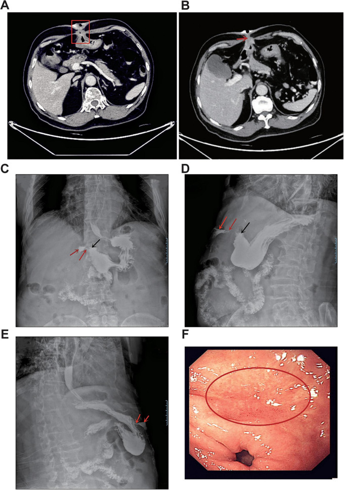
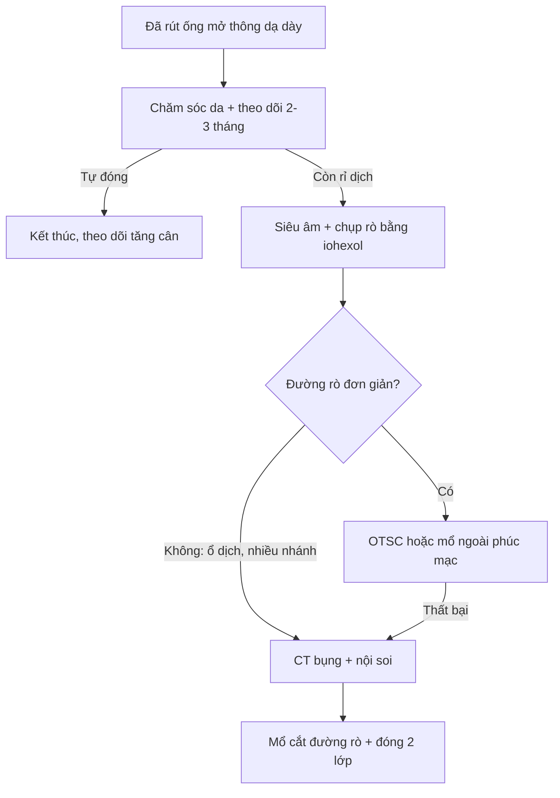
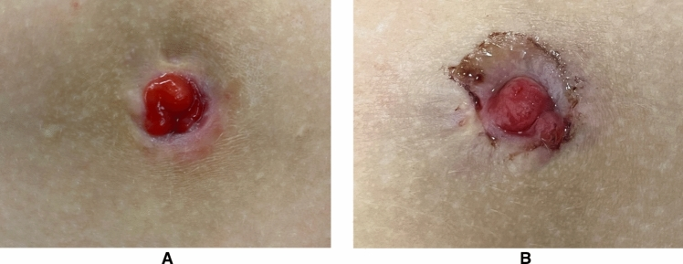
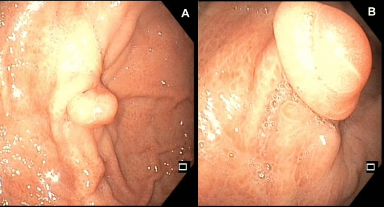

# 1813 — Rò da–dạ dày tồn tại sau rút ống mở thông ở trẻ / Persistent gastrocutaneous fistula after gastrostomy removal

**Tags:** `pattern:ro-da-day` `pattern:ro-sau-rut-ong` `vung:da-day` `vung:thanh-bung` `protocol:chup-ro-can-quang` `protocol:noi-soi` `protocol:CT-bung`
**Mức chắc chắn (certainty):** tổng hợp y văn (literature synthesis) — tổng hợp từ y văn mở 2011–2026, đối chiếu PMCID (Europe PMC): Alshafei A, *J Indian Assoc Pediatr Surg* 2017, PMC5615896; Bratu I & Bharmal A, *ISRN Gastroenterol* 2011, PMC3168482; Corsello A, *Surg Endosc* 2024, PMC11525288; Stringel G, *JSLS* 2013, PMC3662724; Tee Z, *Endosc Int Open* 2026, PMC12951039; Huang QS, *Front Med (Lausanne)* 2026, PMC13275214. Số chưa kiểm chứng ghi "chưa rõ".

> Bài này là **"chuyện sau khi rút ống"**: vì sao lỗ rò không đóng, khi nào chờ, chụp gì để thấy đường rò, và khi nào can thiệp. Cai nuôi ống và rút ống ở trẻ ở [1805](../1805-rut-ong-mo-thong-da-day-cai-ong-tre/lesson.md); biến chứng ống, buried bumper và kiểm tra vị trí ở [083](../083-nuoi-an-qua-sonde/lesson.md); an toàn nuốt ở [081](../081-sac-va-roi-loan-nuot/lesson.md).

## 1. Tổng quan bệnh học – cơ chế hình ảnh

- **Định nghĩa:** sau khi rút ống mở thông dạ dày (gastrostomy device, GD), đường hầm da–dạ dày thường **tự đóng trong vài giờ đến 1–2 tuần**. Khi đường thông **còn lại > 1 tháng**, gọi là **rò da–dạ dày tồn tại (persistent gastrocutaneous fistula, GCF)**; nhiều tác giả dùng mốc **> 1–3 tháng** (Bratu I 2011, PMC3168482; Corsello A 2024, PMC11525288).
- **Tần suất (con số rất khác nhau vì định nghĩa và dân số):**
  - **4,5% (49/1.083)** trẻ đặt gastrostomy trong 10 năm phải mổ đóng rò (Bratu I 2011, PMC3168482).
  - **16–45%** theo y văn; loạt tuyến ba **58% (34/59)** vì nhiều trẻ **< 2 tuổi** và **để ống > 2 năm** (Alshafei A 2017, PMC5615896).
  - Tổng quan đa trung tâm nhi: **4,5–44%**; định nghĩa "tồn tại" **> 1–3 tháng** (Corsello A 2024, PMC11525288).
  - Khoảng **5–45%** được dùng trong tư vấn trước khi rút ống (Bratu I 2011, PMC3168482; Stringel G 2013, PMC3662724).
- **Vì sao đường rò không đóng (TẠI SAO, không chỉ "do lâu ngày"):**
  1. **Biểu mô hóa đường hầm:** biểu mô da và niêm mạc dạ dày phát triển gặp nhau, **tốc độ ~7 mm/ngày**, tạo **ống có thành biểu mô** không thể dính liền. Đây là lý do **rò mạn không tự đóng** dù không còn ống.
  2. **Đường hầm ngắn ở trẻ nhỏ:** trẻ **< 2 tuổi** ít mô dưới da → khoảng cách da–dạ dày ngắn → **biểu mô hóa sớm và nhanh**; tuổi đặt ống trung bình **24,03 ± 39,59 tháng** ở nhóm rò so với **52,24 ± 67,89 tháng** ở nhóm đóng (Alshafei A 2017, PMC5615896).
  3. **Thời gian lưu ống:** nhóm rò **57,65 ± 39,42 tháng** so với **31,68 ± 30,19 tháng**; **80%** ca rò để ống **> 2 năm**, ngắn nhất **1,5 năm** (Alshafei A 2017, PMC5615896). Loạt khác: ống lưu trung bình **2,3 ± 2,2 năm** (Bratu I 2011, PMC3168482).
  4. **Nhiễm khuẩn lỗ mở tái diễn:** **91%** ca rò có **≥ 2 đợt nhiễm lỗ mở** cần kháng sinh; viêm–sẹo làm đường hầm xơ, không dính (Alshafei A 2017, PMC5615896).
  5. **Can thiệp làm rộng đường hầm:** **nâng cỡ ống (upsizing) 41%**, **đổi sang nút thấp (MIC-KEY button) 51%**, **mở bằng Stamm 29%** so với **PEG 71%** — tất cả liên quan tới rò tồn tại (Alshafei A 2017, PMC5615896).
  6. **Yếu tố không chứng minh được:** bệnh nền (GERD **65% vs 60%, p = 0,256**), bệnh thần kinh, tim bẩm sinh, suy giảm miễn dịch **không** dự báo rò trong loạt này (Alshafei A 2017, PMC5615896).
- **Diễn tiến tự nhiên:** đa số đóng **trong 1–2 tuần**; nếu còn sau **2–3 tháng**, khả năng tự đóng rất thấp. Trong loạt 49 ca phải mổ, rò tồn tại **2,0 ± 3,0 tháng** trước khi đóng (Bratu I 2011, PMC3168482). Chiến lược chờ **2–3 tháng** là hợp lý (Alshafei A 2017, PMC5615896).
- **Biến chứng của chính rò:** rỉ dịch dạ dày gây **viêm da bỏng acid**, đau, nhiễm trùng da, mất nước–điện giải, chậm tăng cân, mùi và ảnh hưởng tâm lý. Mổ đóng rò **không lành tính**: biến chứng sau mổ **12,2% (6/49)** — sốt/nhiễm trùng **4**, loét đỏ da **2**; nằm viện **2,0 ± 3,3 ngày** (Bratu I 2011, PMC3168482).
- **Vật lý hình ảnh — vì sao chụp cản quang thấy rò:**
  - **Thuốc cản quang tan trong nước (iohexol)** chảy theo **đường có trở lực thấp nhất** từ lòng dạ dày ra da; cột cản quang **liên tục từ hang vị qua thành bụng** là chốt. **Không dùng baryt** nếu có nguy cơ tràn vào phúc mạc: baryt gây **viêm phúc mạc hóa học** và không hấp thu.
  - **CT:** đường rò là **cấu trúc mô mềm 40–60 HU** xuyên qua lớp mỡ **−50 đến −100 HU**, mất mặt phẳng mỡ giữa dạ dày và thành bụng; cản quang trong lòng **100–300 HU**. Khí trong ổ **−1000 HU**. CT thấy **ổ dịch, áp-xe, hoại tử, tụ máu** mà chụp rò không thấy.
  - **Siêu âm:** đường rò là **dải giảm âm** từ da vào dạ dày, có thể bơm **nước muối vô khuẩn** qua lỗ rò để làm rõ; không nhiễm xạ, hợp với trẻ nhỏ.
  - **Nội soi:** thấy **lỗ trong ở dạ dày**, đánh giá viêm/loét/hẹp môn vị, và **sinh thiết** nếu nghi ác tính; **mô dạ dày ở lỗ da** (mucous bud) xác nhận nguồn gốc dạ dày.
- **Ca minh họa kỹ thuật (người lớn, hiếm):** bệnh nhân **81 tuổi**, nốt thành bụng **30 năm** rồi vỡ, rỉ **~500 mL/ngày**; CT: **mất mặt phẳng mỡ giữa hang vị trước và thành bụng, đường rò liên tục từ lòng dạ dày ra da**; chụp lưu thông dạ dày bằng **iohexol** thấy **thoát cản quang từ thành trước hang vị qua thành bụng ra da**; ổ trong **1,2 × 0,4 cm**, đường rò **4,5 × 2,5 cm** (Huang QS 2026, PMC13275214). **Đây là GCF tự phát do loét lành tính — cực hiếm, khác bối cảnh nhi sau gastrostomy**, nhưng minh họa rất rõ **nguyên lý chụp**.

## 2. Mẫu hình + chẩn đoán phân biệt theo vị trí và dịch tiết (gamut)

**Câu hỏi trung tâm: "dịch chảy ra là gì, và đường rò đi từ đâu tới đâu?"**

- **Theo tính chất dịch:**
  - **Dịch dạ dày:** trong/đục, lẫn **mảnh thức ăn**, pH thấp, chảy nhiều khi ăn — **rò dạ dày–da**.
  - **Dịch mật:** vàng–xanh, không mùi phân — rò **mật–da** hoặc **tá tràng–da**.
  - **Dịch phân/nhiễm khuẩn:** mùi phân, phân trong túi — nghĩ **rò dạ dày–đại tràng (gastrocolic)** hoặc **ruột non–da**, không phải GCF đơn thuần.
- **Theo nguyên nhân:** (1) **sau rút gastrostomy** — hay nhất ở trẻ; (2) **sau mổ** (cắt dạ dày, bariatric, tạo hình); (3) **chấn thương**; (4) **loét dạ dày xuyên thành** (hiếm); (5) **ác tính** xâm lấn; (6) **bệnh Crohn, dị vật, lưới nhân tạo**; (7) **bẩm sinh** (rất hiếm).
- **Theo hình thái đường rò:** **đơn giản** (một đường thẳng, không ổ dịch) → can thiệp nội soi/mổ nhỏ; **phức tạp** (ổ dịch, nhiều nhánh, dính tạng, hoại tử) → CT + mổ.
- **Gamut "lỗ da rỉ dịch vùng quanh rốn ở trẻ đã từng đặt gastrostomy":** GCF · **buried bumper** (nút bị vùi trong thành bụng, không thấy đầu ống) · **áp-xe thành bụng** · **viêm mô tế bào** · **rò dạ dày–đại tràng** · **thoát vị/da thừa** · **rò dịch tụy** (nếu có viêm tụy) · **u loét** (hiếm).
- **Mnemonic "GAS":** **G**astrostomy tract, **A**bscess, **S**urgical leak — cộng thêm **C**olon (gastrocolic) và **M**alignancy.

## 3. Bảng so sánh phân biệt (ma trận đối chiếu)

| Thực thể (entity) | Hình ảnh điển hình | Chốt vào (rule-in) | Chốt loại (rule-out) | Gợi ý xác nhận |
|---|---|---|---|---|
| **GCF sau gastrostomy** | Chụp rò: cột cản quang **liên tục từ dạ dày ra da**; CT: mất mặt phẳng mỡ, đường mô mềm xuyên thành bụng | **Tiền sử rút ống + rỉ dịch dạ dày + cột cản quang liên tục** | Không thấy đường thông; lỗ da khô, đã đóng | Chụp rò bằng iohexol; nội soi |
| **Buried bumper** | Không thấy đầu ống ngoài da; CT/nội soi: nút nằm trong thành dạ dày/thành bụng | **Không thấy nút/ống + đau, rỉ dịch quanh lỗ + nội soi thấy nút vùi** | Đầu ống nhìn thấy, di động bình thường | Nội soi, CT |
| **Áp-xe thành bụng** | CT: ổ dịch có vỏ ngấm thuốc, khí trong ổ; siêu âm: ổ hỗn hợp âm | **Ổ dịch + vỏ + sốt/đau + khí trong ổ** | Không ổ dịch, chỉ đường rò thẳng | CT có cản quang, siêu âm |
| **Thủng/thoát dạ dày tự do** | CT: khí tự do dưới hoành, dịch tự do; X-quang: liềm khí | **Khí tự do + đau bụng cấp + phản ứng phúc mạc** | Khí khu trú trong ổ rò, không tự do | CT bụng cấp |
| **Rò dạ dày–đại tràng** | Chụp cản quang: cản quang vào đại tràng; CT: đường rò tới colon; khí trong dạ dày | **Phân trong túi + cản quang vào colon** | Không có phân, cản quang chỉ ra da | Chụp cản quang, CT, nội soi |
| **Rò do ác tính** | CT: khối loét bờ không đều, hạch, dày thành; nội soi: tổn thương loét | **Khối + sụt cân + thiếu máu + sinh thiết ác** | Niêm mạc lành, không khối | Nội soi + sinh thiết, CT |
| **Viêm da/nhiễm khuẩn lỗ ra** | Da đỏ, trợt, mủ; không có đường sâu | **Đỏ/trợt/mủ nông, cải thiện với chăm sóc da** | Không rỉ dịch dạ dày, không đường rò | Lâm sàng, cấy da |
| **Rò tụy/tá tràng sau mổ** | Dịch tiêu hóa nhiều, men tụy cao; CT: ổ dịch quanh tụy | **Amylase dịch cao + bối cảnh mổ tụy/tá tràng** | Dịch dạ dày, pH thấp, không men tụy | Xét nghiệm dịch, CT |

*(A,B) CT có cản quang: mất mặt phẳng mỡ giữa hang vị trước và thành bụng, đường rò liên tục (khung/đỏ). (C–E) Chụp lưu thông dạ dày bằng **iohexol**: cản quang thoát từ hang vị (mũi tên đen) qua đường rò (mũi tên đỏ) ra da. (F) Nội soi: lỗ trong 1,2 × 0,4 cm. Nguồn: Huang QS et al., Front Med 2026, PMC13275214, CC BY 4.0.*

### Dấu hiệu chốt và ngưỡng
- **Thời gian:** rò **> 1 tháng** sau rút ống = tồn tại; **> 2–3 tháng** → khả năng tự đóng thấp, cân nhắc can thiệp (Bratu I 2011, PMC3168482; Alshafei A 2017, PMC5615896).
- **Kích thước:** không có ngưỡng tuyệt đối; đường rò **ngắn, rộng** dễ biểu mô hóa; **hẹp, dài** dễ ứ dịch/áp-xe. Ca minh họa: đường rò **4,5 × 2,5 cm**, lỗ trong **1,2 × 0,4 cm** (Huang QS 2026, PMC13275214).
- **Nội soi đóng bằng kẹp over-the-scope (OTSC):** kẹp **11–12 mm**, ống soi nhi **9–10 mm**; thành công **61,9% (13/21)** so với **mổ 100% (46/46)**, thời gian thủ thuật **25 vs 40 phút** (p = 0,002), biến chứng và sẹo tương đương (Corsello A 2024, PMC11525288).
- **Tổng quan 142 ca đóng rò không mổ:** thành công **~80%**, nội soi **75%**, không có biến cố nặng (dẫn trong Corsello A 2024, PMC11525288).
- **Kỹ thuật "rendez-vous" (OTSC + cắt đường rò ngoài phúc mạc):** **4/4 thành công**, không biến cố tức thì, **không tái phát trong 2 năm** (Tee Z 2026, PMC12951039) — cỡ mẫu rất nhỏ.

## 4. Protocol chụp + hệ phân độ

- **Bước 1 — chờ có kiểm soát:** sau rút ống, **chăm sóc da** (kẽm oxit, băng thấm), **ức chế acid** nếu trào ngược, điều trị nhiễm khuẩn lỗ mở; theo dõi **2–3 tháng**. Đa số đóng trong **1–2 tuần**; không can thiệp sớm chỉ vì còn rỉ ít.
- **Bước 2 — hình ảnh khi còn rò sau 2–3 tháng:**
  - **Siêu âm thành bụng** trước: xác định đường rò, ổ dịch, mối liên hệ dạ dày; có thể bơm nước muối qua lỗ rò.
  - **Chụp rò cản quang (fistulogram) bằng thuốc tan trong nước:** bơm qua lỗ rò hoặc qua ống còn lại; chụp **thẳng và nghiêng**; ghi **chiều dài, đường kính, có ổ dịch/nhánh phụ, có thông vào đại tràng**. **Không dùng baryt.**
  - **CT bụng có cản quang** khi nghi **áp-xe, rò phức tạp, tổn thương ác, hoặc đã can thiệp thất bại**: đánh giá thành dạ dày, mất mặt phẳng mỡ, ổ dịch, khí, tạng lân cận.
  - **Nội soi dạ dày** trước can thiệp: xác nhận lỗ trong, loại **hẹp môn vị/tắc đầu ra** (nếu còn tắc, rò sẽ không đóng), sinh thiết nếu loét bất thường.
- **Bước 3 — can thiệp:**
  - **Đơn giản, trẻ hợp tác:** **OTSC** (kẹp 11–12 mm) hoặc **kẹp + keo/fibrin**; thành công ~62% trong loạt nhi, thấp hơn mổ.
  - **Thất bại/ổ phức tạp:** **mổ cắt đường rò + đóng 2 lớp** (mổ mở hoặc nội soi); kỹ thuật **ngoài phúc mạc** (kéo đường rò bằng Foley, cắt, khâu toàn thành) cho **21 trẻ**, tái phát **1/21 (4,8%)**, nhiễm nông **1/21 (4,8%)**, ăn lại sau **6 giờ**, về trong ngày (Stringel G 2013, PMC3662724).
  - **Rò dạ dày–đại tràng/ác tính:** mổ mở, cắt đoạn, không đóng qua nội soi.
- **Theo dõi sau can thiệp:** đóng lỗ da, ăn lại theo dung nạp, kiểm tra **tái phát** (rỉ dịch lại), và **theo dõi tăng cân**; nội soi lại nếu nghi hẹp/tắc.

## 5. Biến thể bình thường và cạm bẫy

- **Rỉ dịch ít trong 2–4 tuần đầu là bình thường:** đường hầm còn mềm, chưa co; **đừng chụp rò ngay** rồi kết luận "rò tồn tại". Mốc **> 1 tháng** mới gọi tồn tại; chờ **2–3 tháng** trước can thiệp.
- **Baryt trong đường rò:** nếu tràn phúc mạc → **viêm phúc mạc hóa học**, dính, khó mổ; **luôn dùng iohexol/iodixanol tan trong nước**.
- **Bỏ sót tắc đầu ra dạ dày:** hẹp môn vị hoặc tắc tá tràng làm rò không đóng dù đóng lỗ tốt; phải **nội soi/CT** trước khi đóng.
- **Nhầm lỗ rò với nang/biểu mô da:** mô dạ dày ở lỗ da (mucous bud) trông như "u nhỏ" — **sinh thiết** nếu không chắc; đừng cắt bỏ mà không kiểm tra nguồn.
- **CT không cản quang/uống cản quang không đủ:** đường rò có thể xẹp, không thấy; cần **cản quang tĩnh mạch + uống** và **lát mỏng**, đọc đa bình diện.
- **Rò dạ dày–đại tràng bị bỏ sót:** dịch có mùi phân, khí trong dạ dày; chụp cản quang chỉ thấy "ra da" nếu không đủ thuốc/không chụp muộn.
- **OTSC không phải "một lần là xong":** thành công **61,9%** ở trẻ, thấp hơn mổ **100%**; tư vấn trước rằng có thể phải mổ.
- **Mổ đóng rò không lành tính:** biến chứng **12,2%**, gồm nhiễm trùng và loét da; trẻ có bệnh nền nặng, dinh dưỡng kém → tối ưu trước mổ.
- **Sẹo/da thừa sau đóng:** có thể còn "núm" da lành — không phải tái phát nếu khô, không rỉ dịch.

## 6. Tự lượng giá — Blind Quiz

**Ca 1 — Cụ ông 81 tuổi, nốt thành bụng 30 năm rồi rỉ dịch**

- **Bối cảnh:** nốt dưới da vùng thượng vị **30 năm**, không đau; 1 tháng trước bị va chạm → da vỡ, rỉ dịch **~500 mL/ngày** lẫn mảnh thức ăn; bụng mềm, không sốt.
- **Câu hỏi:** (1) Dấu hiệu chính trên CT (A,B) và trên phim cản quang (C–E)? (2) Vì sao phải dùng iohexol thay baryt? (3) Chẩn đoán?

<b>Bấm để hiện đáp án (findings + chẩn đoán)</b>

- **Dấu hiệu:** (A,B) **mất mặt phẳng mỡ** giữa hang vị trước và thành bụng, **đường mô mềm liên tục** từ lòng dạ dày xuyên thành bụng ra da; (C–E) **cản quang thoát từ hang vị qua đường rò ra da**, thấy rõ ở thẳng và nghiêng; (F) lỗ trong **1,2 × 0,4 cm**.
- **Chẩn đoán:** **rò da–dạ dày (gastrocutaneous fistula)** do **loét dạ dày lành tính xuyên thành** — nguyên nhân **cực hiếm**, khác GCF sau gastrostomy ở trẻ.
- **Vì sao iohexol:** thuốc tan trong nước, **không gây viêm phúc mạc hóa học** nếu tràn; baryt sẽ gây viêm phúc mạc/dính nếu thoát ra ngoài lòng.
- **Nguồn ảnh:** Huang QS et al., *Front Med (Lausanne)* 2026, PMC13275214, **CC BY 4.0**.

**Ca 2 — Trẻ 5 tuổi, rỉ dịch sau rút ống 4 tháng**

- **Bối cảnh:** bé trai 5 tuổi, đặt gastrostomy 3 năm vì bại não, đã rút ống **4 tháng**; lỗ da còn rỉ dịch dạ dày, da quanh đỏ, không sốt. (A) lúc đóng bằng OTSC; (B) sau **8 tháng**, sinh thiết "núm" thấy **niêm mạc dạ dày**.
- **Câu hỏi:** (1) Hình B chứng minh điều gì? (2) Vì sao rò không đóng? (3) Lựa chọn can thiệp và tỷ lệ thành công?

<b>Bấm để hiện đáp án (findings + chẩn đoán)</b>

- **Dấu hiệu:** (B) lỗ da vẫn mở, có **mô niêm mạc dạ dày** (mucous bud) lộ ra — xác nhận **đường rò biểu mô hóa**, không phải loét da đơn thuần.
- **Chẩn đoán:** **GCF tồn tại** sau rút gastrostomy. Vì ống lưu **3 năm** (> 2 năm) + trẻ nhỏ + nhiễm lỗ mở → **biểu mô hóa đường hầm**, không tự đóng.
- **Can thiệp:** OTSC **thành công 61,9%** ở trẻ; **mổ 100%**. Nếu OTSC thất bại → **cắt đường rò + đóng 2 lớp**; kỹ thuật ngoài phúc mạc tái phát **1/21 (4,8%)**.
- **Nguồn ảnh:** Corsello A et al., *Surg Endosc* 2024, PMC11525288, **CC BY 4.0** (Fig. 2).

**Ca 3 — Trẻ 3 tuổi, đóng rò bằng kẹp qua nội soi**

- **Bối cảnh:** bé gái 3 tuổi, GCF sau rút ống 6 tháng, đường rò ngắn, không ổ dịch; được đóng bằng **kẹp over-the-scope (OTSC)**.
- **Câu hỏi:** (1) Hình A/B cho thấy gì? (2) Kẹp OTSC hoạt động theo cơ chế nào? (3) Khi nào không nên chọn OTSC?

<b>Bấm để hiện đáp án (findings + chẩn đoán)</b>

- **Dấu hiệu:** (A) **kẹp OTSC** kẹp gấp niêm mạc quanh lỗ rò; (B) sau đóng, lỗ rò được khép, niêm mạc liền.
- **Cơ chế:** kẹp lớn **11–12 mm** gắn ở đầu ống soi, **kẹp toàn thành** mô quanh lỗ rò, gây dính và đóng đường thông; ưu điểm **25 phút** so với mổ **40 phút**.
- **Không nên chọn khi:** **ổ dịch/áp-xe**, đường rò **rộng > 1 cm**, **nhiều nhánh**, **rò dạ dày–đại tràng**, nghi **ác tính**, hoặc **hẹp môn vị** chưa xử lý; lúc đó cần **CT + mổ**.
- **Nguồn ảnh:** Corsello A et al., *Surg Endosc* 2024, PMC11525288, **CC BY 4.0** (Fig. 3).

## Bài liên quan chéo

- [1805 – Rút ống mở thông dạ dày & cai nuôi ống ở trẻ](../1805-rut-ong-mo-thong-da-day-cai-ong-tre/lesson.md)
- [083 – Nuôi ăn qua sonde và ống mở thông dạ dày](../083-nuoi-an-qua-sonde/lesson.md)
- [081 – Sặc và rối loạn nuốt ở trẻ](../081-sac-va-roi-loan-nuot/lesson.md)
- [135 – Viêm tụy cấp](../135-viem-tuy-Atlanta/lesson.md)

## Ảnh

- `images/1813_ct-va-luu-thong_CT-PMC13275214.jpg` — CT + chụp lưu thông dạ dày bằng iohexol, Huang QS et al., *Front Med (Lausanne)* 2026, PMC13275214, **CC BY 4.0**.
- `images/1813_lo-ro-sau-rut_Noisoi_PMC11525288.jpg` — lỗ rò và mô dạ dày ở da, Corsello A et al., *Surg Endosc* 2024, PMC11525288, **CC BY 4.0** (Fig. 2).
- `images/1813_otsc-dong-lo_Noisoi_PMC11525288.jpg` — kẹp OTSC đóng rò, Corsello A et al., *Surg Endosc* 2024, PMC11525288, **CC BY 4.0** (Fig. 3).

> **Disclaimer:** Bài học dùng cho mục đích giáo dục, không thay thế đánh giá của bác sĩ chuyên khoa. **Không dùng để chẩn đoán độc lập khi chưa có người hướng dẫn.**
