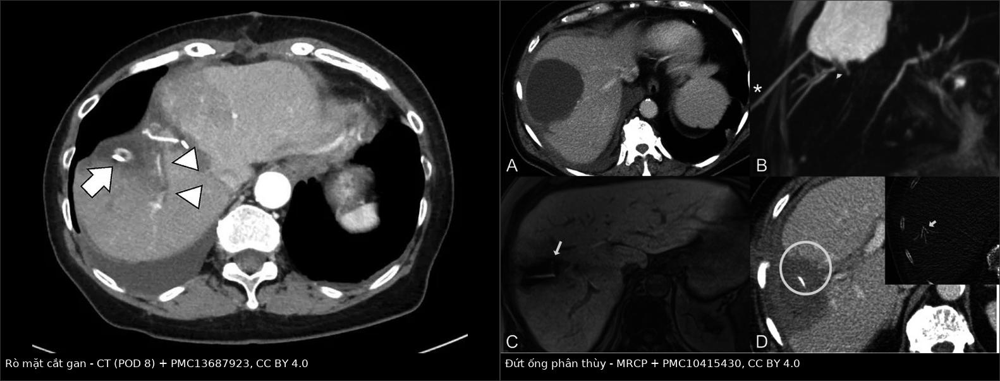
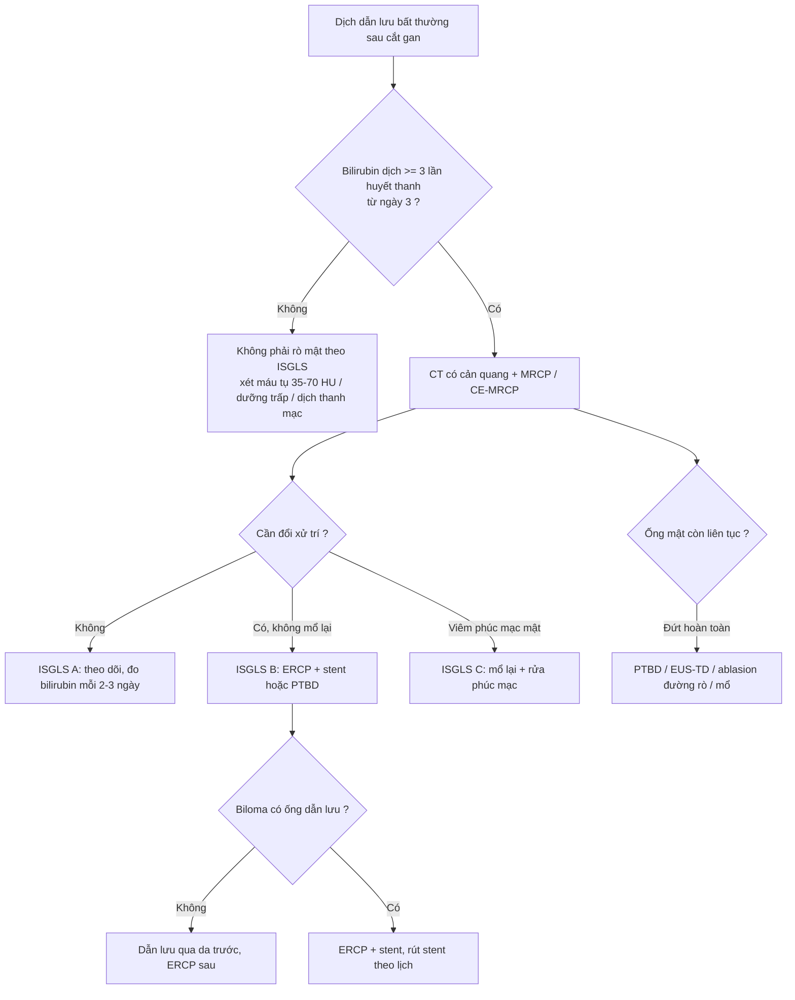
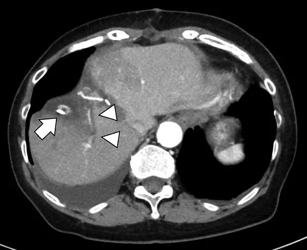
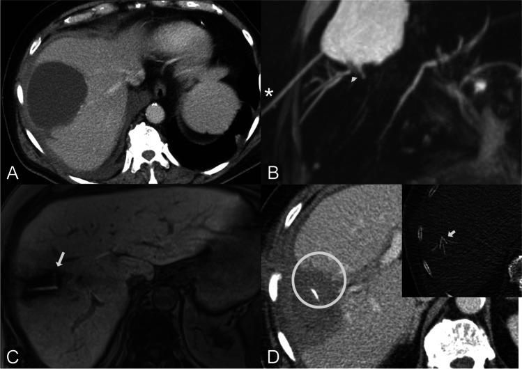

# 1814 — Rò mật sau cắt gan: ISGLS A/B/C, biloma – áp-xe – rò miệng nối, khi nào dẫn lưu / ERCP / mổ lại / Post-hepatectomy bile leak

**Tags:** `pattern:ro-mat` `pattern:dich-tu-sau-mo` `pattern:biloma` `vung:gan` `vung:duong-mat` `score:ISGLS` `score:Clavien-Dindo` `protocol:CE-MRCP` `protocol:ERCP` `protocol:PTBD` `incidentaloma:biloma`
**Mức chắc chắn (certainty):** tổng hợp y văn (literature synthesis) — số liệu lấy từ **đồng thuận E-AHPBA–ESSO–Innsbruck 2025** (PMC12750329, CC BY 4.0), **đoàn hệ 862 ca cắt gan** về ảnh hưởng sống còn (PMC11599820, CC BY-NC 4.0), **đoàn hệ 409 ca HCC** về yếu tố nguy cơ (PMC10553327, CC BY 4.0), **nghiên cứu 39 ca Gd-EOB-DTPA-MRCP** (PMC10415430, CC BY 4.0), **đoàn hệ 59 ca nội soi mật–tụy** (PMC12151791, CC BY 4.0), **đoàn hệ 107 ca miệng nối mật–ruột** (PMC12513953, CC BY-NC-ND 4.0), **loạt 24 ca PTBD** (PMC13280318, CC BY 4.0) và **một ca nguyên văn rò ống đứt hoàn toàn** điều trị bằng EUS-TD (PMC13687923, CC BY 4.0).

> **Bài này trả lời câu hỏi hẹp hơn bài 108.** [108](../108-ton-thuong-duong-mat-sau-cat-tui-mat/lesson.md) dạy **tổn thương đường mật sau cắt túi mật** (Strasberg–Bismuth); [107](../107-mrcp-gadoxetic-acid-hbp/lesson.md) dạy **kỹ thuật MRCP/HBP**; [133](../133-hep-mieng-noi-duong-mat-sau-ghep/lesson.md) dạy **hẹp miệng nối sau ghép**; [105](../105-theo-doi-ong-dan-luu-mat-qua-da/lesson.md) dạy **chăm sóc ống PTBD**; [137](../137-theo-doi-stent-dan-luu-duong-mat-di-tru-tac-nhiem-trung/lesson.md) dạy **theo dõi stent**. Sau **cắt gan**, cơ chế rò khác hẳn: mật thoát từ **mặt cắt nhu mô** hoặc **ống phân thùy bị đứt**, không phải từ một ống mật chính bị cắt nhầm. Vì vậy **phân độ ISGLS** — chứ không phải phân độ giải phẫu Strasberg — mới là thứ quyết định **theo dõi, ERCP/PTBD hay mổ lại**, và **rò ống đứt hoàn toàn** là nhóm ERCP thất bại điển hình.

## 1. Tổng quan bệnh học – cơ chế hình ảnh

- **Định nghĩa ISGLS (International Study Group of Liver Surgery, 2011 — PMID 21316725):** rò mật là **nồng độ bilirubin trong dịch dẫn lưu ≥ 3 lần bilirubin huyết thanh từ ngày hậu phẫu thứ 3 trở đi**, **hoặc** cần can thiệp vì **tụ mật (biliary collection)** hay **viêm phúc mạc mật (biliary peritonitis)**. Ba độ: **A** — không phải đổi cách xử trí; **B** — phải đổi xử trí (dẫn lưu qua da, ERCP/stent) nhưng **không mổ lại**; **C** — **phải mổ lại**. "Rò có ý nghĩa lâm sàng" (clinically relevant) = **B + C**. Định nghĩa này được các bài mở nhắc lại nguyên văn (PMC13457801) và được đồng thuận châu Âu dùng làm ngôn ngữ chung (PMC12750329).
- **Tần suất — con số phải nhớ:** đồng thuận 2025 ghi **5–15%**, **cao hơn sau cắt gan quanh rốn gan** (PMC12750329). Trong **862 ca cắt gan liên tiếp**: rò mật **146 ca (16,9%)**, trong đó **B/C 60 ca (7,0%)**; tử vong sau mổ **34 ca (3,9%)** (PMC11599820). Trong **409 ca HCC không nối mật–ruột**: **39 ca (9,5%)**, phân độ **A 27 (69%) · B 12 (31%) · C 0**; **không có tử vong 90 ngày** (PMC10553327).
- **Tần suất theo vị trí u (tính lại từ bảng của PMC11599820):** u **quanh rốn gan (perihilar) 16/42 ≈ 38%** so với **u trong gan 18/69 ≈ 26%** — đúng hướng "cao hơn sau cắt gan quanh rốn gan" mà đồng thuận nêu. Đây là lý do **ung thư đường mật** là nhóm phải cảnh giác nhất, không phải HCC.
- **TẠI SAO rò xảy ra ở mặt cắt gan:** mặt cắt nhu mô chứa **hàng trăm ống mật nhỏ**; ống **< 1–2 mm** chỉ được bịt bằng **đông protein do đốt điện/sóng siêu âm**, không bao giờ chắc như buộc chỉ. Bốn cơ chế: **(1)** đông tắc không kín ống nhỏ; **(2)** ống bị **thiếu máu** ở đầu cắt (huy động gan, Pringle kéo dài) → hoại tử muộn; **(3)** **ống phân thùy lạc chỗ/bị đứt** (hay gặp ống phân thùy **phải sau**, VI–VII, khi cắt phân thùy trước hoặc cắt gan phải); **(4)** **miệng nối mật–ruột** rò tại chỗ nối. Đồng thuận liệt kê đúng nhóm nguy cơ này: **mổ lớn/phức tạp, cắt gan trung tâm (mesohepatectomy), tái cắt, cắt ống mật trung tâm, thời gian mổ, mất máu, Pringle** (PMC12750329).
- **Số liệu nguy cơ định lượng:** mất máu trong mổ **≥ 370 mL → OR 2,25 (1,10–4,59)**; **béo phì sarcopenia → OR 4,08 (1,37–12,1)**; ở nhóm cắt gan lần đầu chỉ béo phì sarcopenia còn độc lập (**OR 3,61**) (PMC10553327). Nghĩa là **"mổ sạch, ít máu" là biện pháp dự phòng rò mạnh hơn mọi thứ khác**.
- **Vật lý — vì sao CT thường không gọi tên được "rò mật":** mật có **tỷ trọng 0–20 HU**, gần như trùng **dịch thanh mạc, dịch tụ sau mổ, nước tiểu và mủ loãng**; chỉ **máu tụ 35–70 HU** mới tách được. Trên CT, **biloma và nang thanh mạc/nang bạch mạch nhìn giống nhau**. Vì vậy "chất cản quang" đáng tin nhất trong giai đoạn đầu **không phải iod, mà là bilirubin trong dịch dẫn lưu** — một xét nghiệm sinh hóa, không phải hình ảnh.
- **TẠI SAO CE-MRCP nhìn được chỗ rò:** **gadoxetate (Gd-EOB-DTPA)** được tế bào gan hấp thu rồi **bài tiết vào lòng ống mật**; trên **MRCP T2 nặng**, mật trong và ngoài ống đều sáng như nhau (nên chỉ cho hình thái), nhưng ở **thì gan–mật 60–90 phút**, **chỉ mật mới sáng dần** — chỗ sáng **ngoài lòng ống** chính là rò đang hoạt động. Trong **39 ca nghi rò** (25 ca rò được xác nhận), đồng thuận liên đọc **κ = 0,85** cho phát hiện và **κ = 0,88** cho định vị; sau mổ, rò **trung tâm 58%**, **ngoại vi 42%**; **ống lạc chỗ 8%**, **ống đứt hoàn toàn 26%** (PMC10415430). Định vị đúng **đổi độ phức tạp của can thiệp** (rò trong nhu mô cần can thiệp ít phức tạp hơn, p = 0,002).
- **TẠI SAO rò mật có thể chết người:** mật là chất **kích thích hóa học** lên phúc mạc và là **môi trường nuôi khuẩn**; rò + ứ đọng → **viêm phúc mạc mật, áp-xe, nhiễm khuẩn huyết, suy gan**. Trong **107 ca miệng nối mật–ruột**, rò **28%**; tử vong **30 ngày 2,8%**, **90 ngày 4,7%**; **rò độ C (viêm phúc mạc mật) là yếu tố độc lập của tử vong 90 ngày với OR 35,7 (3,07–416,5)** (PMC12513953). Bài học: **độ C không phải "rò nặng hơn một chút" — nó là một bệnh cảnh khác**.
- **TẠI SAO phải xử lý sớm cả khi bệnh nhân "ổn":** ở **111 ca ung thư đường mật**, rò mật **34 ca (30,6%)** với **A/B/C = 12/19/3**; nhóm rò có **DFS trung vị 9,9 vs 24,9 tháng** (p = 0,013) và **HR 1,896** sau hiệu chỉnh nguy cơ; **chỉ 14,7%** bệnh nhân có rò nhận **hóa trị bổ trợ trong 4 tuần** so với **35,1%** ở nhóm không rò (PMC11599820). Rò mật **cướp mất cửa sổ điều trị ung thư**, không chỉ kéo dài nằm viện.
- **Thời gian:** phần lớn rò **biểu hiện ngày 3–7**; rò **ống đứt/miệng nối** có thể kéo dài **hàng tuần đến hàng tháng** — ca minh họa rút ống dẫn lưu **ngày 66** và ra viện **ngày 70** (PMC13687923).

## 2. Mẫu hình + chẩn đoán phân biệt theo vị trí (gamut)

- **Bốn câu hỏi bắt buộc, theo đúng thứ tự:**
  1. **Lưu lượng bao nhiêu mL/24 giờ?** (đồng thuận dùng **> 100 mL mật/24 giờ** làm ngưỡng "rò có ý nghĩa lâm sàng" để cân nhắc ERCP sớm — PMC12750329).
  2. **Bilirubin dịch/serum bao nhiêu lần?** (≥ 3 lần = rò theo ISGLS; **5–10 lần** gợi ý rò từ ống lớn/đứt ống).
  3. **Ống mật còn liên tục không?** (câu trả lời quyết định ERCP có khả thi hay không).
  4. **Có nhiễm trùng/áp-xe không?** (sốt, khí trong tụ dịch, vách ngấm, cấy dịch).
- **Mẫu hình 1 — rò mặt cắt gan "nhỏ":** dịch dẫn lưu tăng vừa, bilirubin **3–10 lần**, **không có tụ dịch lớn**, bệnh nhân không sốt. Đa số **tự khỏi** hoặc đáp ứng **ERCP + stent**; đây là nhóm **ISGLS A/B** điển hình.
- **Mẫu hình 2 — rò ống phân thùy (peripheral leak):** **biloma** cạnh mặt cắt, **ống phân thùy không giãn hoặc giãn nhẹ**, ERCP có thể **không thấy** ống rò nếu không làm **balloon occlusion cholangiography**. Nhóm này cần **định vị bằng CE-MRCP** trước khi can thiệp.
- **Mẫu hình 3 — ống đứt hoàn toàn (completely disconnected duct):** biloma **dai dẳng**, **ERCP không qua được chỗ đứt**, ống phân thùy **không thông với cây mật chính**. Đây là nhóm **ERCP thất bại điển hình**, cần **PTBD, EUS-TD, ablasion đường rò hoặc mổ**. Ca nguyên văn: **ống phân thùy phải sau đứt hoàn toàn**, đường kính chỉ **1,7 mm** nên **EUS-BD thất bại**, phải **EUS-TD dẫn lưu biloma nhiễm trùng** (PMC13687923).
- **Mẫu hình 4 — rò miệng nối mật–ruột:** sau **cắt gan quanh rốn gan/ghép gan**; lưu lượng **lớn**, bilirubin **rất cao**, dễ **viêm phúc mạc mật**; về sau là **hẹp miệng nối**. Đây là nhóm **ISGLS C** hay gặp nhất và có **tử vong cao** (OR 35,7 — PMC12513953).
- **Mẫu hình 5 — biloma nhiễm trùng/áp-xe:** tụ dịch **có khí**, **vách ngấm**, bệnh nhân **sốt/đau**, cấy dịch dương (ca minh họa: **Enterococcus faecium**). Điều trị **không chỉ dẫn lưu mật mà phải dẫn lưu ổ mủ + kháng sinh**.
- **Mẫu hình 6 — rò mật–da (biliary–cutaneous fistula):** mật chảy qua **vết mổ hoặc chân ống dẫn lưu**; đường hầm thành lập, khó đóng; nguyên tắc là **giảm áp lực trong ống mật (ERCP/stent/PTBD)** để đường hầm tự đóng, **không rút ống sớm**.
- **Mẫu hình 7 — máu thay mật (post-hepatectomy hemorrhage):** dịch dẫn lưu **ra máu đỏ**, Hb tụt, **35–70 HU** trên CT; **không phải rò mật**. Đừng đo bilirubin rồi kết luận rò trong khi bệnh nhân đang chảy máu.
- **Gamut theo vị trí:** **mặt cắt gan phải** (hay gặp nhất, ống phân thùy VI–VII) → **rốn gan/miệng nối** (rò miệng nối, hẹp muộn) → **màng phổi** (rò mật–màng phổi sau cắt gan trên cao, tràn dịch mật) → **vết mổ/chân ống** (rò mật–da).
- **Gợi nhớ 4 chữ — OUT–RATIO–DUCT–SEPSIS:** **Out**put (mL/24h) · **Ratio** (bilirubin dịch/serum) · **Duct** (còn liên tục?) · **Sepsis** (áp-xe/viêm phúc mạc). Trả lời đủ 4 chữ là chọn được **theo dõi, ERCP, PTBD hay mổ**.

## 3. Bảng so sánh phân biệt (ma trận đối chiếu)

| Thực thể (entity) | Hình ảnh điển hình | Chốt vào (rule-in) | Chốt loại (rule-out) | Gợi ý xác nhận |
|---|---|---|---|---|
| **ISGLS A — rò không đổi xử trí** | Dịch dẫn lưu vàng mật, lượng ít; CT không có tụ dịch lớn; ống mật liên tục | **Bilirubin dịch ≥ 3× serum từ ngày 3** + bệnh nhân không sốt, không đau, không tắc mật | Sốt/đau tăng + tụ dịch lớn → đã sang **B** | Đo bilirubin dịch mỗi 2–3 ngày; siêu âm/CT khi lâm sàng đổi |
| **ISGLS B — phải đổi xử trí, không mổ lại** | Biloma cạnh mặt cắt, ống mật còn liên tục; có thể hẹp nhẹ tại chỗ rò | **Rò + cần dẫn lưu qua da hoặc ERCP/stent**, không có viêm phúc mạc | Viêm phúc mạc mật, dịch tự do nhiều → **C** | CT có cản quang; ERCP balloon occlusion; PTBD nếu biloma không có ống |
| **ISGLS C — phải mổ lại** | Dịch tự do quanh gan/lách, dịch mức khí-dịch, bụng căng; có thể thiếu máu | **Viêm phúc mạc mật + rò**, hoặc rò không kiểm soát được bằng can thiệp | Rò khu trú, ổn định, đáp ứng dẫn lưu → **B** | CT bụng cấp; mổ lại + rửa phúc mạc; cấy mật |
| **Ống đứt hoàn toàn (disconnected duct)** | Biloma lớn, **ống phân thùy giãn tách khỏi cây mật chính**; ERCP **không hiện hình** ống bên tổn thương | **ERCP balloon occlusion không thấy ống phân thùy** + biloma dai dẳng + lưu lượng không giảm | Ống còn thông, chỉ rò mặt cắt → **A/B** | CE-MRCP/DIC-CT định vị; EUS-TD/PTBD/ablasion |
| **Biloma vô khuẩn** | Khối dịch **0–20 HU**, bờ rõ, **không khí**, không vách ngấm, không ngấm thuốc | **Dịch đồng nhất + không sốt + không khí** | Có khí/vách ngấm/sốt → **áp-xe** | CT; cấy dịch âm tính; theo dõi ± dẫn lưu |
| **Biloma nhiễm trùng/áp-xe** | Tụ dịch **khí**, **vách ngấm**, dịch không đồng nhất, mỡ quanh viêm | **Sốt + khí trong tụ dịch + vách ngấm**, cấy dương | Dịch thuần nhất, không khí, không sốt → biloma vô khuẩn | CT có cản quang; cấy dịch; dẫn lưu + kháng sinh |
| **Rò miệng nối mật–ruột** | Tụ dịch/quầng thấm quanh miệng nối, **khí trong ổ dịch**, giãn đường mật trên miệng nối | **Lưu lượng > 300 mL/ngày + sốt + bilirubin dịch rất cao** sau cắt gan quanh rốn gan | Rò mặt cắt lượng vừa, không sốt, ống còn thông → A/B | CT; MRCP; ERCP/PTBD; **nguy cơ viêm phúc mạc mật** |
| **Rò mật–da** | Đường hầm từ mặt cắt ra da, mật chảy qua vết mổ/chân ống | **Mật chảy ra da liên tục** + hình ảnh đường hầm trên fistulography/CT | Dịch thanh mạc/nhiễm trùng vết mổ → không phải rò mật | Fistulography qua ống; ERCP/PTBD để giảm áp |
| **Máu tụ/xuất huyết sau cắt gan (PHH)** | Dịch **35–70 HU**, có thể tăng đậm độ theo thời gian; Hb tụt, mạch nhanh | **Dịch ra máu đỏ + Hb giảm + 35–70 HU** | Dịch vàng mật 0–20 HU + bilirubin cao → rò mật | CT có cản quang thì động mạch; CTA/DSA nếu nghi giả phình |

*Trái: **CT có cản quang ngày 8 sau cắt phân thùy trước + cắt túi mật** — tụ dịch lớn sát mặt cắt (mũi tên: ống dẫn lưu trong ổ dịch; đầu mũi tên: ống mật phân thùy sau giãn nhẹ, nằm sát ổ dịch). Phải: **cùng bệnh cảnh "ống đứt"** trên 4 chuỗi — (A) CT: biloma lớn; (B) T2-MRCP: biloma + ống phân thùy cụt; (C) thì gan–mật: thuốc thoát ra ngoài lòng ống; (D) CT sau đặt dẫn lưu trong biloma. Nguồn: *DEN Open* 2026 (PMC13687923) Fig. 1 và *Eur Radiol* 2023 (PMC10415430) Fig. 6, CC BY 4.0; ghép bằng `tools/make_composite.py` (letterbox, không crop/kéo giãn).*

### Ba dấu hiệu đọc kỹ trên hình
- **"Ống không hiện hình" không phải "không có ống":** trên ERCP thường, ống phân thùy đứt có thể **không được bơm thuốc** vì thuốc đi theo đường ít cản nhất xuống tá tràng. Phải dùng **balloon occlusion cholangiography** (bóng chặn ống mật chủ) rồi bơm ngược dòng — ca minh họa chẩn đoán đúng nhờ bước này (PMC13687923).
- **Biloma + ống giãn khu trú = gợi ý ống đứt**, không phải "nang dịch đơn thuần"; đo **đường kính ống** (ca: **1,7 mm**) để tiên lượng khả năng can thiệp nội soi.
- **Vị trí tụ dịch so với mặt cắt:** sát mặt cắt + có ống dẫn lưu trong ổ → rò mặt cắt; quanh rốn gan/miệng nối → nghĩ rò miệng nối.

## 4. Protocol chụp + phân độ + sơ đồ xử trí

- **Theo dõi sinh hóa (bắt buộc trước khi chụp):** đo **bilirubin dịch dẫn lưu** song song **bilirubin huyết thanh** ngày **3 và 5**; ghi **lưu lượng mL/24h**. Ngưỡng đồng thuận: **> 100 mL mật/24h** khi có ống dẫn lưu → **ERCP + stent sớm**; nếu **biloma không có ống** → **dẫn lưu qua da trước**, ERCP sau (PMC12750329).
- **CT bụng có cản quang (3 thì):** xác định **vị trí/tính chất tụ dịch** (đo HU), **khí**, **vách ngấm**, **mạch máu** (giả phình, huyết khối tĩnh mạch cửa), **giãn đường mật**. Đồng thuận **không khuyến cáo CT/MR thường quy ở bệnh nhân nguy cơ cao nhưng không triệu chứng** (conditional, mức bằng chứng 3); nhưng khi **đã nghi rò** thì **ngưỡng chụp phải thấp**.
- **MRCP + CE-MRCP bằng gadoxetate:** MRCP T2 nặng cho **hình thái cây mật**; **thì gan–mật 60–90 phút** cho **vị trí rò hoạt động**. Giá trị: **κ 0,85–0,88**, phân biệt **trung tâm 58% / ngoại vi 42%**, phát hiện **ống lạc chỗ 8% / ống đứt 26%** (PMC10415430). Chỉ định khi CT chưa trả lời "rò ở đâu" hoặc trước khi chọn can thiệp.
- **ERCP:** vừa chẩn đoán vừa điều trị. Bắt buộc **balloon occlusion cholangiography**; đặt **stent nhựa 7–10 Fr** ± cắt cơ Oddi. Số liệu **59 ca rò sau mổ gan–mật–tụy** (23 cắt gan): độ **A/B/C = 17/40/2**; **37/40 ca độ B được dẫn lưu nội soi**, **100% lành**, **thời gian dẫn lưu trung vị 18 ngày (13–35)** (PMC12151791). **Tuổi** (UOR 1,09/1 tuổi) và **số ngày từ mổ đến khi rò** (UOR 1,18/ngày) dự báo **độ nặng** — rò xuất hiện muộn có xu hướng nặng hơn.
- **PTBD:** chỉ định khi **ERCP thất bại**, **ống đứt hoàn toàn**, hoặc **biloma không có ống dẫn lưu**. Loạt **24 ca**: **thành công kỹ thuật 100%**; **thành công lâm sàng 93,8% nếu PTBD là can thiệp đầu tay** nhưng chỉ **14,3% nếu PTBD sau khi mổ lại thất bại** (PMC13280318) — tức **đừng để "mổ lại thất bại" rồi mới chuyển can thiệp**.
- **EUS-TD (dẫn lưu xuyên thành qua nội soi siêu âm):** lựa chọn khi **ERCP và EUS-BD đều thất bại** vì ống **không giãn**; ca minh họa: đặt **stent pigtail 7 Fr/7 cm + ống mũi 7,5 Fr** qua đường hầm nội soi tạo, rút ống qua da **ngày 66**, ra viện **ngày 70** (PMC13687923).
- **Ba khuyến cáo "đừng" của đồng thuận 2025:** **(1)** **không dẫn lưu bụng thường quy** sau cắt gan không biến chứng (khuyến cáo mạnh, mức 1+); **(2)** **không đặt stent xuyên miệng nối thường quy** — nếu đặt thì **rút trong vòng 3 tháng**; **(3)** **không chụp CT/MR/SPECT thường quy** ở người nguy cơ cao không triệu chứng (PMC12750329).

## 5. Biến thể bình thường và cạm bẫy

- **Cạm bẫy 1 — bilirubin dịch "thấp giả" do pha loãng:** dịch dẫn lưu bị **rửa/pha loãng** hoặc lấy từ **ống đã tắc** cho bilirubin thấp, trong khi biloma vẫn đang rò. Ngược lại, **bilirubin huyết thanh cao** (suy gan, vàng da trước mổ) làm **tỷ lệ < 3** dù rò thật. Luôn đọc **tỷ lệ**, kèm **lưu lượng** và **hình ảnh**, không dùng một con số tuyệt đối.
- **Cạm bẫy 2 — tụ dịch "0–20 HU" không phải luôn là biloma:** dịch thanh mạc, nang bạch mạch, **nước tiểu** (nếu có tổn thương niệu quản), **dịch tụy** đều cùng dải HU. Cần **CE-MRCP** hoặc **đo bilirubin dịch chọc hút** để chốt; đừng gọi "rò mật" chỉ vì có tụ dịch.
- **Cạm bẫy 3 — ERCP "bình thường" ở bệnh nhân vẫn rò:** nếu **không làm balloon occlusion**, ống phân thùy đứt **không hiện hình** và bác sĩ kết luận "không rò". Đây là lý do ca minh họa phải chuyển **DIC-CT** mới thấy đường rò từ **ống phân thùy phải sau** (PMC13687923).
- **Cạm bẫy 4 — rò mặt cắt tự khỏi ≠ rò miệng nối:** rò mặt cắt **lưu lượng vừa, giảm dần**; rò miệng nối **lưu lượng lớn, không giảm**, kèm **sốt** và **đau** — nhóm sau **không được chờ**, vì **rò độ C có OR tử vong 35,7** (PMC12513953).
- **Cạm bẫy 5 — bỏ sót nhiễm trùng ổ dịch:** biloma "vô khuẩn" có thể **bội nhiễm** sau nhiều ngày (ca: **E. faecium** ở dịch dẫn lưu). **Sốt mới + khí trong ổ dịch** = chụp lại và **cấy dịch**, không chỉ tăng kháng sinh mù.
- **Cạm bẫy 6 — rút ống dẫn lưu quá sớm:** rút khi **lưu lượng còn nhiều** hoặc **chưa kiểm tra đường rò** → **rò mật–da dai dẳng**, phải đặt lại ống/PTBD. Nguyên tắc: **giảm áp lực trong ống mật trước, rút ống sau** khi lưu lượng giảm và hình ảnh hết tụ dịch.
- **Cạm bẫy 7 — nhầm máu với mật:** dịch ra **máu đỏ**, **Hb tụt**, **35–70 HU** = **xuất huyết sau cắt gan**, không phải rò mật; xử trí là **CTA/DSA ± nút mạch**, không phải ERCP.

## 6. Tự lượng giá — Blind Quiz

**Ca 1 — Nữ 78 tuổi, cắt phân thùy trước + cắt túi mật vì HCC tái phát. Ngày 3 dịch dẫn lưu vàng, bilirubin dịch 20,3 mg/dL; ngày 8 sốt, CT dưới đây. Nhìn ảnh trước, mô tả rồi trả lời.**

- Hỏi: (1) Có phải rò mật theo ISGLS không, độ mấy? (2) Ống mật nào bị tổn thương? (3) Bước tiếp theo và vì sao ERCP có thể thất bại?

<b>Bấm để hiện đáp án</b>

- **Có rò mật**: bilirubin dịch **20,3 mg/dL** cao hơn nhiều lần huyết thanh, xuất hiện **từ ngày 3** → đúng định nghĩa ISGLS. Bệnh nhân **sốt + dịch nhiễm *E. faecium*** và cần **dẫn lưu/kháng sinh** → **độ B**, kèm **biloma nhiễm trùng**.
- Trên CT: **tụ dịch lớn sát mặt cắt** (mũi tên = ống dẫn lưu trong ổ dịch), **ống mật phân thùy sau giãn nhẹ** (đầu mũi tên) nằm sát ổ dịch → nghi **rò từ ống phân thùy phải sau**.
- Bước tiếp: **ERCP có balloon occlusion** để chẩn đoán; nếu **không qua được chỗ đứt** → **DIC-CT/MRCP** định vị, rồi **PTBD/EUS-TD**. Ca thật: ERCP ngày 9 cho thấy **đứt hoàn toàn ống gan phải**, **EUS-BD thất bại vì ống chỉ 1,7 mm**, nên **EUS-TD dẫn lưu biloma** ngày 24; rút ống qua da **ngày 66**, ra viện **ngày 70**.
- Nguồn: *DEN Open* 2026 (PMC13687923), CC BY 4.0.

**Ca 2 — Bệnh nhân sau bóc u gan (enucleation) vì di căn đại trực tràng, có biloma. Xem 4 chuỗi ảnh dưới đây và trả lời.**

- Hỏi: (1) Ảnh nào chứng minh rò **đang hoạt động**? (2) Vì sao T2-MRCP một mình không đủ? (3) Can thiệp nên nhắm vào đâu?

<b>Bấm để hiện đáp án</b>

- **(A) CT:** biloma lớn sau bóc u. **(B) T2-MRCP:** biloma + **ống phân thùy cụt** (đầu mũi tên) — chỉ cho hình thái, vì mật trong và ngoài ống đều sáng. **(C) Thì gan–mật 60–90 phút:** thuốc **thoát ra ngoài lòng ống** (mũi tên) = **rò hoạt động**, đây là ảnh chốt. **(D) CT sau dẫn lưu:** đầu ống trong biloma.
- T2-MRCP **không phân biệt** mật trong ống với dịch ngoài ống; chỉ **gadoxetate bài tiết vào mật** mới đánh dấu được dòng mật thoát ra.
- Can thiệp nhắm **đúng ống phân thùy bị đứt** (hoặc biloma nếu ống không can thiệp được): **ERCP + stent** nếu còn thông, **PTBD/EUS-TD/ablasion** nếu đứt hoàn toàn.
- Nguồn: *Eur Radiol* 2023 (PMC10415430), CC BY 4.0.

**Ca 3 — Sau cắt gan quanh rốn gan có nối mật–ruột, ngày 3 dịch dẫn lưu 350 mL/ngày, bilirubin dịch 12 lần huyết thanh, bệnh nhân sốt 38,8 °C, bụng gồng. Chưa cần ảnh: quyết định gì trước tiên?**

<b>Bấm để hiện đáp án</b>

- **Rò miệng nối mật–ruột, nghi viêm phúc mạc mật** — lưu lượng **> 300 mL/ngày**, bilirubin **12 lần**, **sốt + bụng gồng**. Đây không phải "rò mặt cắt chờ tự khỏi".
- Hành động: **CT bụng có cản quang khẩn** (dịch tự do, khí, tụ dịch quanh miệng nối) + **cấy máu/dịch + kháng sinh**. Nếu **viêm phúc mạc mật** → **ISGLS C, mổ lại**; nếu ổ dịch khu trú, bệnh nhân ổn → **PTBD/ERCP** và theo dõi sát.
- Vì sao khẩn: trong đoàn hệ **107 ca miệng nối mật–ruột**, **rò độ C là yếu tố độc lập của tử vong 90 ngày, OR 35,7 (3,07–416,5)**; rò **28%**, tử vong 90 ngày **4,7%**.
- Nguồn: *Langenbecks Arch Surg* 2025 (PMC12513953), CC BY-NC-ND 4.0; định nghĩa độ theo ISGLS (PMID 21316725).

## Bài liên quan chéo
- [100 – Tổng quan hệ Bụng](../100-tong-quan-he-bung/lesson.md)
- [108 – Tổn thương đường mật sau cắt túi mật (Strasberg–Bismuth)](../108-ton-thuong-duong-mat-sau-cat-tui-mat/lesson.md)
- [107 – MRCP & gadoxetic acid thì gan–mật](../107-mrcp-gadoxetic-acid-hbp/lesson.md)
- [133 – Hẹp miệng nối & cholangiopathy sau ghép gan](../133-hep-mieng-noi-duong-mat-sau-ghep/lesson.md)
- [105 – Theo dõi ống dẫn lưu mật qua da (PTBD)](../105-theo-doi-ong-dan-luu-mat-qua-da/lesson.md)
- [137 – Theo dõi stent/dẫn lưu đường mật](../137-theo-doi-stent-dan-luu-duong-mat-di-tru-tac-nhiem-trung/lesson.md)
- [179 – Hoại tử ống mật sau can thiệp u gan](../179-bien-chung-duong-mat-sau-can-thiep-u-gan/lesson.md)

> Không dùng để chẩn đoán độc lập khi chưa có người hướng dẫn.
