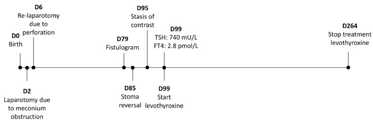
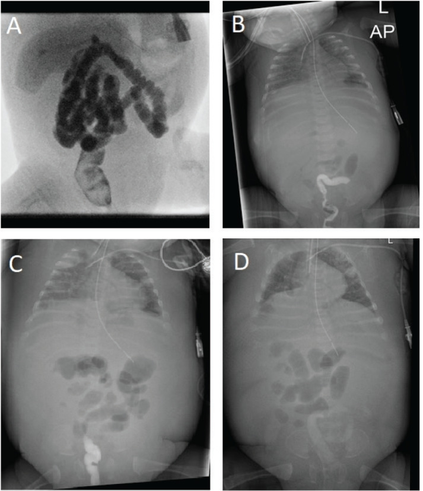
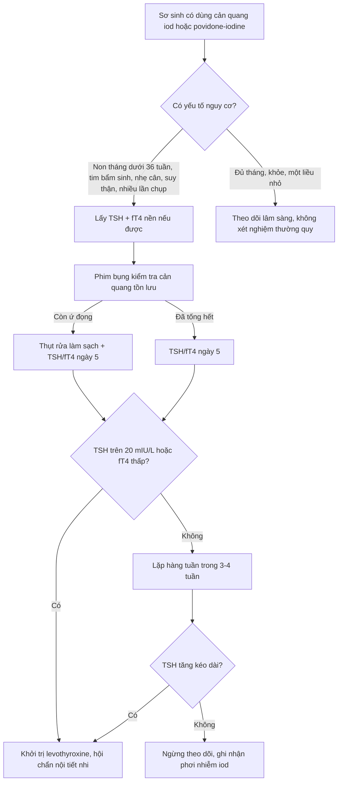

# 1815 — Suy giáp do quá tải iod ở sơ sinh: thuốc cản quang tồn lưu & hiệu ứng Wolff–Chaikoff / Iodine-induced hypothyroidism in neonates

**Tags:** `pattern:can-quang-ton-luu` `pattern:suy-giap` `pattern:cham-tang-truong` `vung:tuyen-giap` `vung:o-bung-nhi` `vung:so-sinh` `protocol:X-quang-bung` `protocol:chup-ro-can-quang` `protocol:xet-nghiem-chuc-nang-giap` `incidentaloma:can-quang-ton-luu`
**Mức chắc chắn (certainty):** tổng hợp y văn (literature synthesis) — ghép **1 ca nguyên văn** (*J Clin Res Pediatr Endocrinol* 2025, PMC12699077, CC BY-NC-ND; ca 26 tuần 6 ngày, 550 g, cản quang đường tiêu hóa tồn lưu 19 ngày) với **2 tổng quan**: tổng quan hệ thống về cản quang đường uống ở sơ sinh (cùng bài, 2 nghiên cứu/8 bệnh nhân) và tổng quan hệ thống về cản quang ở trẻ ≤ 18 tuổi (*Eur Thyroid J* 2026, PMC13386229, CC BY-NC; 17 nghiên cứu). Số nào nguồn không đưa thì ghi "chưa rõ".

> **Câu chốt:** trên phim bụng sơ sinh, **một "bóng đậm hình khung đại tràng" kéo dài 2–3 tuần sau chụp cản quang không phải là hình ảnh vô hại** — nó là **bể chứa iod đang hấp thu dần**. Một mL cản quang chứa **150–400 mg iod**, gấp **hơn 1.000 lần** nhu cầu iod/ngày (**90–290 µg**) (PMC13386229); ca dưới đây nhận **20 mL Omnipaque 240 = 4.800 mg iod**, tức **~17.000–53.000 lần** nhu cầu ngày, và **TSH đỉnh 740 mU/L** (tham chiếu 0,7–8,4). Điểm mấu chốt: **sàng lọc sơ sinh bình thường KHÔNG loại trừ** thể mắc phải này.

## 1. Tổng quan bệnh học – cơ chế hình ảnh

### 1.1 Cơ chế: vì sao iod thừa gây suy giáp (và vì sao trẻ non tháng không "thoát" được)

- **Hiệu ứng Wolff–Chaikoff:** iod thừa ức chế **thyroid peroxidase (TPO)** → giảm tổng hợp T3/T4, như một van an toàn chống nhiễm độc giáp. Ở người trưởng thành, tuyến giáp **thoát ức chế trong ~48 giờ** rồi tổng hợp trở lại bình thường (PMC13386229).
- **Trẻ non tháng mất van an toàn này:** khả năng thoát Wolff–Chaikoff chỉ **trưởng thành vào khoảng 36–40 tuần tuổi thai** (PMC12699077). Vì vậy **cùng một liều iod**, trẻ 26–30 tuần có thể suy giáp kéo dài hàng tuần đến hàng tháng, còn trẻ đủ tháng thường chỉ rối loạn thoáng qua.
- **Đường vào không chỉ tĩnh mạch:** iod đi qua **da (povidone-iodine), đường tiêu hóa (cản quang uống/thụt), tĩnh mạch (CT, can thiệp tim)**. Cản quang đường uống tưởng như "không toàn thân", nhưng niêm mạc ruột hấp thu iod tự do — và **ứ đọng kéo dài chính là yếu tố nguy cơ** (PMC12699077).
- **Hai mặt của iod:** thiếu iod → bướu cổ/suy giáp; thừa iod → **suy giáp (Wolff–Chaikoff)** hoặc **nhiễm độc giáp (Jod–Basedow)** ở người có bệnh giáp nền. Trong sơ sinh, mặt suy giáp mới là mặt nguy hiểm vì não đang phụ thuộc hormone giáp.

### 1.2 Vì sao cản quang "nhìn thấy được" và vì sao nó nói lên thời gian phơi nhiễm (TẠI SAO — vật lý)

- **Iod có Z = 53**, **K-edge 33,2 keV** — nằm đúng dải năng lượng của tia X chẩn đoán. Ở mức năng lượng này, **hấp thụ quang điện tăng vọt**, nên dung dịch iod **đậm hơn xương trên cửa sổ mô mềm** dù chỉ là chất lỏng.
- Hệ quả đọc phim: **độ đậm của cột cản quang trong lòng ruột tỉ lệ với nồng độ iod còn lại**, còn **vị trí cột cản quang** cho biết đoạn ruột đang ứ. Một **khuôn đại tràng đậm, liên tục, không thay đổi qua nhiều phim** = cản quang **không được tống ra**, tức **niêm mạc còn tiếp xúc với iod**.
- Ngược lại, **khí** (Z thấp) gần như trong suốt, **mỡ** giảm đậm nhẹ, **máu tụ** chỉ 45–70 HU — nên không có gì trên phim bụng "đậm như cản quang" mà lại lành tính dễ dàng.

### 1.3 Ngưỡng định lượng nằm lòng

| Đại lượng | Con số | Nguồn |
|---|---|---|
| Nhu cầu iod/ngày (trẻ – người lớn) | **90–290 µg** | PMC13386229 |
| Iod trong 1 mL cản quang | **150–400 mg** (Omnipaque 240 = 240 mg/mL; Gastrografin = 370 mg/mL; ioxitalamate loãng = 120 mg/mL) | PMC13386229, PMC12699077 |
| Liều trong ca nguyên văn | **20 mL × 240 mg/mL = 4.800 mg iod** (≈ 17.000–53.000 × nhu cầu/ngày) | PMC12699077 |
| Thời gian thoát Wolff–Chaikoff bình thường | **~48 giờ** | PMC13386229 |
| Tuổi thai "thoát" được | **36–40 tuần** | PMC12699077 |
| TSH ca nguyên văn (ngày điều trị D99) | **740 mU/L** (tham chiếu 0,7–8,4) | PMC12699077 |
| fT4 ca nguyên văn | **2,8 pmol/L** (tham chiếu 11,9–25,6) | PMC12699077 |
| fT4 trước đó (D58, bình thường) | **15,0 pmol/L** | PMC12699077 |
| Liều levothyroxine khởi đầu | **25 µg/ngày = 6,62 µg/kg/ngày** | PMC12699077 |
| Thời gian còn thấy cản quang trên phim | **D86, D95 (16 ngày), còn mờ ở D98 (19 ngày)** | PMC12699077 |
| Tần suất rối loạn giáp sau cản quang ở trẻ | **1% – 25%** tùy quần thể: 25% (thông tim), 24% (tuần 2) → 12% (tuần 4), 15,4%, 15,2% (đường uống), ~1–1,5% (đoàn hệ hồi cứu lớn) | PMC13386229 |
| Ngưỡng điều trị LT4 đề nghị | **TSH > 20 mIU/L**, hoặc **TSH > 10 mIU/L kèm triệu chứng/fT4 thấp**, hoặc tăng kéo dài | PMC13386229 |
| Suy giáp dưới lâm sàng ở trẻ nói chung | **~1,7%** | PMC13386229 |

*Dòng thời gian: D79 chụp rò (20 mL Omnipaque 240) → D95 còn ứ cản quang → D99 TSH 740 mU/L, fT4 2,8 pmol/L, bắt đầu levothyroxine → D264 ngừng thuốc, chức năng giáp bình thường. Nguồn: J Clin Res Pediatr Endocrinol 2025 (PMC12699077), Fig. 1, CC BY-NC-ND 4.0 — nguyên bản, không chỉnh sửa.*

## 2. Mẫu hình + chẩn đoán phân biệt theo vị trí (gamut)

### 2.1 Mẫu hình "cản quang tồn lưu" — đọc theo 3 câu hỏi

1. **Đậm độ có đúng là cản quang?** Đậm đồng nhất, đậm hơn xương, **nằm trong lòng ruột**, có thể thấy **van ruột/khuôn đại tràng** → cản quang. Vôi hóa thì **không đều, bờ nham nhở**; dị vật thì **có hình dạng nhân tạo**; bari cũ thì **đậm hơn và lợn cợn**.
2. **Ở đoạn nào?** Trực tràng – sigma (**ca nguyên văn**) = ứ ở đoạn thấp, dễ nhầm với khối tiểu khung; đại tràng lên = ứ do nhu động kém; ruột non = cản quang uống còn lưu.
3. **Có thay đổi theo thời gian?** So **≥ 2 phim cách nhau vài ngày**: khuôn cản quang **không đổi/không vơi** = **ứ đọng** = phơi nhiễm iod kéo dài = **chỉ định xét nghiệm giáp**.

### 2.2 Gamut suy giáp ở sơ sinh (khi đã có TSH cao)

- **Suy giáp bẩm sinh (CH) do loạn sản tuyến:** **1/3.000–4.000 trẻ sinh sống** (PMC12699077); tuyến **lạc chỗ/thiểu sản**, không có bướu; sàng lọc sơ sinh **bắt được**.
- **CH do rối loạn tổng hợp hormone (dyshormonogenesis):** tuyến **to (bướu)**, TSH cao, có thể **điếc** (hội chứng Pendred).
- **Suy giáp trung ương:** TSH **thấp/không tăng** cùng fT4 thấp; sàng lọc chỉ phát hiện nếu chương trình đo cả fT4.
- **Suy giáp mắc phải do iod (bài này):** **sàng lọc sơ sinh bình thường**, fT4 từng bình thường, rồi tụt sau phơi nhiễm iod; **tiền sử cản quang/povidone/amiodarone** là chìa khóa.
- **Hạ thyroxine thoáng qua của trẻ non tháng (THOP):** fT4 thấp **không kèm TSH tăng**, hay gặp **< 28 tuần** — cơ chế khác, xử trí khác.
- **Nhiễm độc giáp do iod (Jod–Basedow):** TSH bị ức chế, fT4 tăng; hiếm ở trẻ, có ca 12 tuổi sau ERCP với **TSH < 0,01 mIU/L, fT4 > 100 pmol/L** (PMC13386229).

*(A) D79 — chụp rò qua hậu môn nhân tạo bằng 20 mL Omnipaque 240: đại tràng đầy cản quang, **không hẹp/không giãn**. (B) D86 — bụng chướng, còn cản quang ở trực tràng–sigma. (C) D95 — **16 ngày sau vẫn còn** khuôn cản quang trong trực tràng. (D) D98 — sau thụt rửa, chỉ còn vết mờ. Nguồn: J Clin Res Pediatr Endocrinol 2025 (PMC12699077), Fig. 2, CC BY-NC-ND 4.0 — nguyên bản, không crop.*

## 3. Bảng so sánh phân biệt (ma trận đối chiếu)

| Thực thể (entity) | Hình ảnh / xét nghiệm điển hình | Chốt vào (rule-in) | Chốt loại (rule-out) | Gợi ý xác nhận |
|---|---|---|---|---|
| **Suy giáp do iod (cản quang tồn lưu)** | Phim bụng: khuôn cản quang **không vơi sau ≥ 2 tuần**; TSH rất cao, fT4 rất thấp; **sàng lọc sơ sinh trước đó bình thường** | **Tiền sử cản quang iod + cản quang tồn lưu trên phim + TSH tăng/fT4 giảm** | Sàng lọc sơ sinh bình thường **không loại trừ**; tuyến giáp trên siêu âm **có mặt, kích thước bình thường** | TSH/fT4 lặp lại; theo dõi đáp ứng LT4 và **ngừng được thuốc** là bằng chứng hồi cứu |
| **CH loạn sản tuyến (dysgenesis)** | Siêu âm: **không thấy tuyến/lạc chỗ**; TSH cao từ sơ sinh | **TSH cao ngay giai đoạn sàng lọc + tuyến không thấy/lạc chỗ** | Có tiền sử iod lớn + tuyến bình thường → nghi iod | Siêu âm tuyến giáp, xạ hình nếu cần |
| **CH rối loạn tổng hợp** | **Bướu giáp** (tuyến to), TSH cao, fT4 thấp | **Tuyến to + TSH cao từ đầu** | Tuyến không to, khởi phát muộn sau phơi nhiễm iod | Siêu âm, iod niệu, gen |
| **Suy giáp trung ương** | **TSH thấp/không tăng** cùng fT4 thấp; có thể kèm hạ đường huyết, vàng da kéo dài | **fT4 thấp + TSH không tăng** | TSH rất cao (740 mU/L) → **loại trừ trung ương** | MRI sọ khi nghi |
| **THOP (non tháng)** | fT4 thấp, **TSH không tăng**, < 28 tuần | **fT4 thấp không có TSH bù trừ** | TSH tăng mạnh → không phải THOP đơn thuần | Theo dõi 4–6 tuần |
| **Nhiễm độc giáp do iod (Jod–Basedow)** | **TSH bị ức chế**, fT4/fT3 tăng, tim nhanh, sụt cân | **TSH < 0,01 mIU/L + fT4 tăng** | TSH cao → loại trừ | TSH/fT4, TRAb nếu cần |

### 3.1 Bảng phụ: "đậm độ bất thường trong bụng sơ sinh" trên phim thẳng

| Hình ảnh | Chốt vào | Chốt loại | Ghi chú |
|---|---|---|---|
| **Cản quang iod tồn lưu** | Đậm > xương, trong lòng ruột, **không đổi qua nhiều phim**, tiền sử chụp cản quang | Mất dần nhanh trong 24–48 giờ → chỉ là cản quang thoáng qua | Luôn hỏi **ngày chụp cản quang** |
| **Bari cũ** | Đậm hơn, lợn cợn, có thể tồn tại **nhiều tuần–tháng** | Không có tiền sử dùng bari | Bari **không gây suy giáp** — nhưng dễ bị gọi nhầm là iod |
| **Vôi hóa** | Bờ nham nhở, không theo khuôn ruột | Đậm đồng nhất theo khuôn đại tràng → cản quang | Vôi hóa thượng thận, u quái, u nguyên bào thần kinh |
| **Dị vật / bóng khí** | Hình dạng nhân tạo, có quầng khí | Không theo giải phẫu ruột | Cân nhắc nuốt dị vật |
| **Máu tụ trong lòng ruột** | **45–70 HU** trên CT, không đậm bằng xương | Đậm như xương → cản quang | Hiếm ở sơ sinh |

## 4. Protocol chụp + hệ phân độ/điểm chuẩn hóa

### 4.1 Trước và trong khi dùng cản quang đường tiêu hóa ở sơ sinh

- **Chỉ định chặt:** trả lời đúng một câu hỏi giải phẫu (thông ruột? hẹp? rò?) — nếu siêu âm/khí đã đủ, **không dùng cản quang**.
- **Chọn thuốc và liều thấp nhất hiệu quả:** ghi rõ **nồng độ iod (mg I/mL)** và **tổng thể tích** vào phiếu chụp — đây là dữ liệu để tính nguy cơ về sau. Gastrografin (**370 mg I/mL**) trong điều trị bít phân su là **liều iod rất lớn** so với trẻ 1–2 kg.
- **Không phối hợp nhiều nguồn iod:** povidone-iodine sát khuẩn + cản quang + amiodarone cùng lúc làm tăng nguy cơ (PMC13386229).
- **Sau chụp: phim bụng kiểm tra ứ đọng** nếu lâm sàng chướng bụng/chậm tiêu; **thụt rửa làm sạch cản quang** khi còn ứ (ca nguyên văn thụt rửa D98).

### 4.2 Lịch xét nghiệm chức năng giáp sau phơi nhiễm (đề nghị của tổng quan)

| Thời điểm | Việc làm |
|---|---|
| **Trước phơi nhiễm** | TSH + fT4 nền (nếu có thể) |
| **Ngày 5** | TSH + fT4 — bắt sớm thay đổi sinh hóa |
| **Hàng tuần × 3–4 tuần** | Lặp TSH/fT4; đa số bất thường xuất hiện trong 3 tuần đầu |
| **Nếu bất thường** | Theo dõi tới khi bình thường hoặc tới khi khởi trị |
| **Ngưỡng điều trị LT4** | **TSH > 20 mIU/L**; **TSH > 10 mIU/L kèm triệu chứng hoặc fT4 thấp**; tăng kéo dài; suy giáp lâm sàng |

- **Chính sách hiện hành:** FDA (3/2022) khuyến cáo **kiểm tra giáp trong 3 tuần** ở trẻ **≤ 3 tuổi** sau cản quang tĩnh mạch; **PES và ACR phản biện** vì thiếu bằng chứng, và **FDA cập nhật 2023 sang cách tiếp cận cá thể hóa**; **ETA** cũng khuyến cáo **cá thể hóa** theo tuổi, triệu chứng, bệnh nền, **tổng liều iod tích lũy** (PMC13386229).
- **Đối tượng nguy cơ cao:** **sơ sinh và trẻ non tháng**, tim bẩm sinh, cân nặng sinh thấp, suy thận, fT4 nền thấp, **nhiều lần chụp/l iều cao**, đồng thời dùng nguồn iod khác (PMC13386229).
- **Bằng chứng còn yếu:** tổng quan chỉ có **1 RCT** (Rath) ở trẻ **< 30 tuần** dùng **0,3 mL iopamidol** để xác định đầu PICC — **không khác biệt TSH/fT4** dù iod niệu tăng mạnh. Đây là **phản biện quan trọng**: liều nhỏ, một lần, không ứ đọng thì nguy cơ thấp — **nguy cơ thật nằm ở liều lớn + ứ đọng + non tháng**.

## 5. Biến thể bình thường và cạm bẫy

- **"Sàng lọc sơ sinh bình thường" là cạm bẫy số 1:** sàng lọc chỉ chụp một thời điểm (thường ngày 3–5); ca nguyên văn có sàng lọc **bình thường**, fT4 **15,0 pmol/L ở D58**, rồi suy giáp nặng ở **D99**. Suy giáp **mắc phải** không thể loại trừ bằng phiếu sàng lọc.
- **TSH có thể tăng rất muộn:** ca 27 tuần sau thụt ioxitalamate chỉ được xét nghiệm **ngày 66** vì vàng da ứ mật kéo dài, TSH **368 µUI/mL** (PMC12699077). Đừng chờ "đủ 3 tuần" nếu trẻ có triệu chứng.
- **Cản quang trong trực tràng bị đọc thành khối tiểu khung:** trên phim thẳng, khuôn cản quang đậm ở tiểu khung **che mất** bàng quang/tử cung; luôn đối chiếu **phim trước đó** và **phim nghiêng**.
- **Cản quang "đã hết" trên lâm sàng nhưng vẫn còn trên phim:** D95 phim vẫn thấy cản quang dù bụng đã mềm hơn; **hình ảnh là bằng chứng khách quan của thời gian phơi nhiễm**.
- **Iod niệu đo muộn không loại trừ:** trong ca nguyên văn, iod niệu đo **26 ngày sau** đã **không còn cao** — âm tính giả vì thời điểm (PMC12699077).
- **Nhầm với THOP:** THOP có fT4 thấp **không kèm TSH tăng**; nếu TSH tăng mạnh thì **không được quy cho "non tháng"** rồi bỏ qua.
- **Điều trị quá tay:** suy giáp do iod **gần như luôn thoáng qua**; ca nguyên văn **ngừng LT4 ở D264** với chức năng giáp bình thường. Cần **kế hoạch thử ngừng** thay vì mặc định điều trị suốt đời như CH.
- **Bari không gây suy giáp:** nếu phim cho thấy bari (đậm hơn, lợn cợn) thì **không** quy suy giáp cho iod — nhưng vẫn phải tìm nguồn iod khác (sát khuẩn, cản quang tĩnh mạch).

## 6. Tự lượng giá — Blind Quiz

**Ca 1 — Trẻ 26 tuần, 550 g, bụng chướng 7 ngày sau chụp rò. Nhìn phim, mô tả trước.**

- Gợi ý lâm sàng: sinh 26 tuần 6 ngày, 550 g; D79 chụp rò qua hậu môn nhân tạo; D86 bụng chướng, không đại tiện.
- Câu hỏi: (1) Đậm độ bất thường nằm ở đâu và trong cấu trúc nào? (2) Nó nói gì về thời gian phơi nhiễm iod? (3) Xét nghiệm nào cần làm ngay và vì sao không thể dựa vào sàng lọc sơ sinh?

<b>Bấm để hiện đáp án (findings + chẩn đoán)</b>

- **Dấu hiệu:** khuôn cản quang **đậm đồng nhất trong trực tràng – sigma**, không thay đổi so với phim trước; bụng chướng, quai ruột giãn.
- **Ý nghĩa:** cản quang **không được tống ra** → niêm mạch tiếp xúc iod **liên tục 16–19 ngày** → nguy cơ suy giáp do iod rất cao.
- **Xét nghiệm:** **TSH + fT4 ngay**; ca thật có **TSH 740 mU/L, fT4 2,8 pmol/L** ở D99.
- **Vì sao sàng lọc không đủ:** sàng lọc sơ sinh bình thường; fT4 còn **15,0 pmol/L ở D58** — suy giáp xuất hiện **sau** phơi nhiễm.
- **Nguồn ảnh:** J Clin Res Pediatr Endocrinol 2025 (PMC12699077), Fig. 2B–C, CC BY-NC-ND 4.0.

**Ca 2 — Cùng trẻ, phim chụp rò ngày D79. Có tắc nghẽn không?**

- Gợi ý lâm sàng: trẻ non tháng, hậu môn nhân tạo, nghi hẹp/tắc đoạn xa trước khi đóng hậu môn nhân tạo.
- Câu hỏi: (1) Đại tràng có giãn/hẹp không? (2) Lượng cản quang dùng là bao nhiêu và tương đương bao nhiêu iod? (3) Nếu chụp này "bình thường" thì còn nguy cơ gì?

<b>Bấm để hiện đáp án (findings + chẩn đoán)</b>

- **Dấu hiệu:** đại tràng **đường kính bình thường, không hẹp, không giãn** — kết luận "không tắc".
- **Liều:** **20 mL Omnipaque 240 mg I/mL = 4.800 mg iod**, gấp **~17.000–53.000 lần** nhu cầu iod/ngày (90–290 µg).
- **Nguy cơ:** chính lần chụp "bình thường" này là **nguồn iod lớn nhất** đời bệnh nhân; cản quang tồn lưu 19 ngày → suy giáp nặng.
- **Bài học:** một chụp cản quang **âm tính** vẫn có thể để lại **bệnh nặng iatrogenic**; ghi liều iod vào hồ sơ.
- **Nguồn ảnh:** J Clin Res Pediatr Endocrinol 2025 (PMC12699077), Fig. 2A, CC BY-NC-ND 4.0.

**Ca 3 — Trẻ 27 tuần, vàng da ứ mật kéo dài 2 tháng sau thụt cản quang chẩn đoán.**

- Gợi ý lâm sàng: thụt **< 20 mL ioxitalamate 120 mg I/mL** lúc 27 tuần; 23 ngày sau vàng da, 66 ngày sau mới xét nghiệm giáp.
- Câu hỏi: (1) Vì sao TSH có thể tăng muộn đến vậy? (2) TSH 368 µUI/mL với fT4 thấp, fT3 bình thường gợi ý gì? (3) Điều trị và tiên lượng?

<b>Bấm để hiện đáp án (findings + chẩn đoán)</b>

- **Dấu hiệu:** **TSH 368 µUI/mL** (tham chiếu 0,2–4,2), **fT4 5,1 pg/mL** (tham chiếu 9,3–17,0), **fT3 bình thường 2 pg/mL** → **suy giáp nguyên phát** với chuyển hóa ngoại vi còn bù.
- **Vì sao muộn:** không có lịch theo dõi sau cản quang; triệu chứng (vàng da ứ mật) không đặc hiệu và bị quy cho bệnh gan mật.
- **Điều trị:** levothyroxine, **ngừng được sau 49 ngày**, các hormone giáp trở lại bình thường.
- **Bài học:** **thời điểm xét nghiệm** quan trọng hơn "có xét nghiệm hay không"; trẻ non tháng sau cản quang cần lịch chủ động.
- **Nguồn:** J Clin Res Pediatr Endocrinol 2025 (PMC12699077), tổng quan hệ thống (bảng 1), CC BY-NC-ND 4.0.

## Bài liên quan chéo
- [600 – Tổng quan Hệ Nhi khoa](../600-tong-quan-nhi-khoa/lesson.md)
- [1804 – Suy giáp tiêu thụ do u mạch máu ngoài gan](../1804-suy-giap-tieu-thu-do-u-mach-mau-ngoai-gan/lesson.md) (suy giáp "do bệnh khác", TSH cao + rT3 cao)
- [689 – Suy giáp tiêu thụ do u mạch máu ở trẻ](../689-suy-giap-tieu-thu-do-u-mach-mau-o-tre/lesson.md)
- [3045 – Catheter rốn ở sơ sinh: vị trí, biến chứng sớm và muộn](../3045-catheter-ron-so-sinh-uvc-uac/lesson.md) (nguồn iod khác: sát khuẩn, cản quang xác định đầu catheter)
- [630 – U bụng nhi: neuroblastoma vs Wilms](../630-u-bung-nhi-neuroblastoma-vs-wilms/lesson.md) (khối thượng thận có vôi hóa — phân biệt "đậm độ" trên phim bụng)

## Ảnh
- `images/1815_suy-giap-iod_XR_PMC12699077-f2.jpg` — 4 phim bụng cùng một trẻ (D79, D86, D95, D98), Fig. 2, **CC BY-NC-ND 4.0** (nguyên bản, không crop/không ghép).
- `images/1815_suy-giap-iod_Timeline_PMC12699077-f1.jpg` — dòng thời gian ca, Fig. 1, **CC BY-NC-ND 4.0**.
- Nguồn + giấy phép từng ảnh: `images/CREDITS.md`.

> Không dùng để chẩn đoán độc lập khi chưa có người hướng dẫn.
