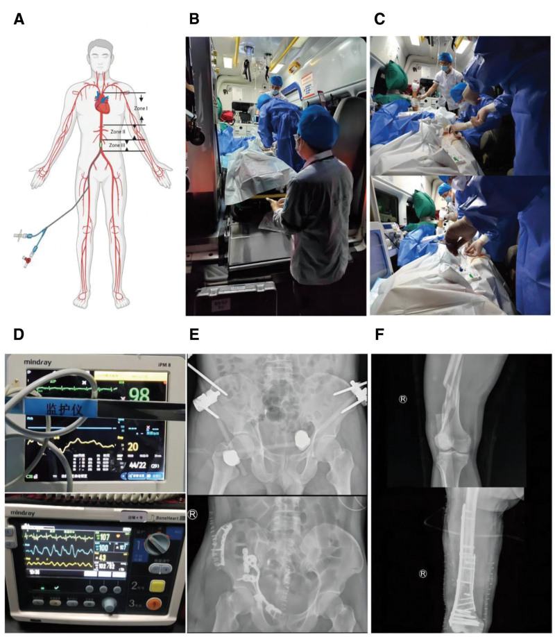
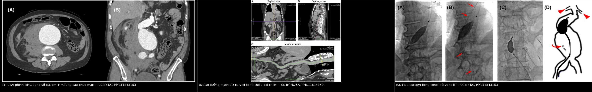
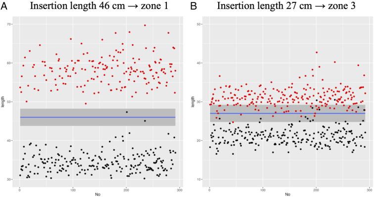
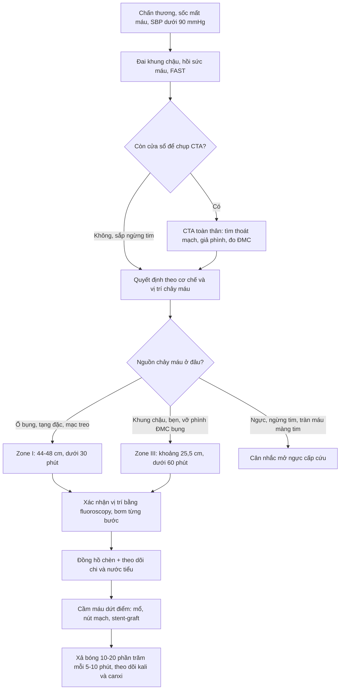
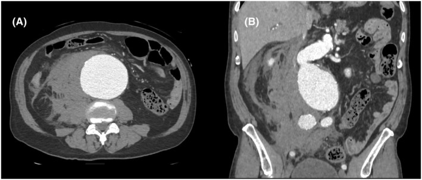
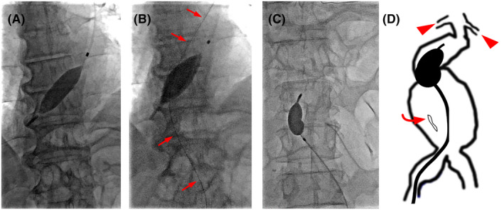
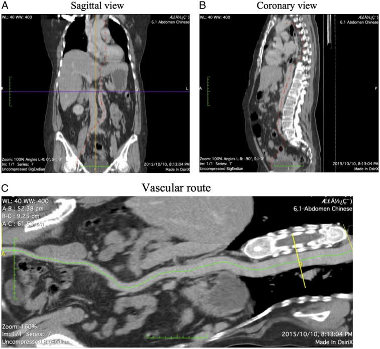

# 1816 — REBOA: bóng chèn nội mạch động mạch chủ trong chấn thương & vỡ khung chậu / Resuscitative Endovascular Balloon Occlusion of the Aorta

**Tags:** `pattern:chay-mau-khong-cam` `pattern:soc-mat-mau` `pattern:gia-phinh-dong-mach` `vung:dong-mach-chu` `vung:khung-chau` `vung:o-bung` `protocol:CTA-toan-than` `protocol:DSA` `protocol:REBOA` `protocol:sieu-am-mach-dui` `score:zone-REBOA`
**Mức chắc chắn (certainty):** tổng hợp y văn (literature synthesis) — ghép **2 ca nguyên văn** (chấn thương khung chậu mở, REBOA zone III trong xe cứu thương: *Medicine* 2026, PMC12928857, CC BY; phình ĐMC bụng vỡ, zone I qua đường cánh tay rồi chuyển zone III: *Acute Med Surg* 2025, PMC11843153, CC BY-NC), **1 nghiên cứu đo đạc trên CT** (223 bệnh nhân, *Int J Surg* 2024, PMC11634159, CC BY-NC-SA) và **1 tổng quan toàn diện** (*Chin J Traumatol* 2026, PMC12891851, CC BY-NC-ND). Số nào nguồn không đưa thì ghi "chưa rõ".

> **Câu chốt:** REBOA **không phải "bơm bóng là cứu"** — nó là **cầu nối 30–60 phút** mua thời gian tới cầm máu dứt điểm. Ba con số quyết định: **zone I < 30 phút, zone III < 60 phút** (chèn hoàn toàn), **đầu catheter cách điểm vào 44–48 cm** cho zone I, và **zone II là vùng cấm** (động mạch tạng). Bơm bóng sai zone hoặc quá thời gian = cứu được chảy máu nhưng **mất tạng, mất chi, hoặc tử vong vì toan–tăng kali sau xả bóng**.

## 1. Tổng quan bệnh học – cơ chế hình ảnh

### 1.1 Sinh lý: bóng chèn làm gì và phá gì

- **Mục tiêu:** chấn thương mất máu không cầm được (non-compressible torso hemorrhage, NCTH) là nguyên nhân tử vong **phòng được** hàng đầu; REBOA chặn dòng chảy xuôi → **tăng hậu tải và áp lực tưới máu não–vành**, giữ máu cho tim/não trong khi chờ mổ/nút mạch.
- **Hiệu quả huyết động có số:** loạt 6 ca đầu tiên tăng **huyết áp tâm thu 55 ± 20 mmHg**, thời gian chèn **18 ± 34 phút** (PMC12891851). Ca nguyên văn: **44/22 mmHg → 102/82 mmHg** sau bơm từng bước (PMC12928857).
- **Cái giá:** toàn bộ tạng dưới bóng **thiếu máu**. Thiếu máu – tái tưới máu (ischemia–reperfusion) gây **toan lactic, tăng kali, hạ canxi, suy thận cấp, hội chứng khoang, thiếu máu tủy sống**; tỉ lệ biến chứng chuyển hóa **5–20%** trên lâm sàng (tới **80%** ở mô hình động vật) (PMC12891851).
- **Vì sao "một phần" tốt hơn "hoàn toàn":** pREBOA giữ **dòng tâm thu ngoại vi** (đích **SBP thấp hơn 20–50 mmHg** so với trên bóng, hoặc **MAP ngoại vi > 30 mmHg**) → giảm thiếu máu trong khi vẫn giữ huyết áp trung tâm. So sánh registry: pREBOA-PRO dùng **87% zone I** (so với 33% ở ER-REBOA), thời gian chèn **59 vs 50 phút**, **AKI 19% vs 33%** (PMC12891851).

### 1.2 Giải phẫu ba zone — nền tảng của mọi quyết định

| Zone | Giới hạn giải phẫu | Chiều dài trung vị (223 ca) | Chỉ định | Trần thời gian (chèn hoàn toàn) |
|---|---|---|---|---|
| **I** | ĐMC xuống, từ **nguyên ủy ĐM dưới đòn trái** đến **thân tạng** | **24,06 cm** (22,64–25,42) | Chảy máu **ổ bụng** (gan, lách, thận, mạch mạc treo), vỡ phình ĐMC bụng | **< 30 phút** |
| **II** | ĐMC **cạnh tạng**, từ **thân tạng** đến **ĐM thận thấp nhất** | **2,94 cm** (2,46–3,63) | **Không dùng** — bóng che ĐM tạng → thiếu máu gan–ruột–thận | — |
| **III** | ĐMC **dưới thận**, từ **ĐM thận thấp nhất** đến **ngã ba chủ** | **9,95 cm** (9,29–10,76) | Chảy máu **khung chậu**, chấn thương **bẹn–đùi**, vỡ phình ĐMC bụng | **< 60 phút** |

- **Zone III ngắn (chỉ ~10 cm)** là lý do **đặt sai zone III dễ hơn nhiều**: độ chính xác của chiều dài chèn cố định chỉ **82,1%** ở zone III so với **99,43%** ở zone I (PMC11634159).
- **Zone II nguy hiểm kép:** vừa **che các động mạch tạng**, vừa **quá ngắn** để bóng 4 cm nằm gọn — bóng thường **vắt qua** thân tạng hoặc ĐM thận.

### 1.3 Ngưỡng định lượng nằm lòng

| Đại lượng | Con số | Nguồn |
|---|---|---|
| Chọn bệnh nhân (huyết áp) | **SBP < 80–90 mmHg** dù đã hồi sức | PMC12891851 |
| Chiều dài chèn tối ưu zone I | **47,5 cm** (chính xác 99,43%); khuyến cáo **44–48 cm** đối chiếu mốc **giữa xương ức** (chính xác 100%) | PMC11634159 |
| Chiều dài chèn tối ưu zone III | **25,5 cm** (chính xác 82,1%); mốc **rốn** + tỉ lệ **Xu/Up** (chính xác 94,6%) | PMC11634159 |
| Đường kính sheath | **7 Fr** (dùng tăng từ **2,9% → 54,8%**, AORTA 2014–2018); **4 Fr** (COBRA-OS) ít chấn thương mạch hơn | PMC12891851 |
| Đích pREBOA | **SBP ngoại vi thấp hơn 20–50 mmHg** so với trên bóng; **MAP ngoại vi > 30 mmHg** | PMC12891851 |
| Trần chèn pREBOA (theo thiết bị) | **Zone I ~2 giờ**, **zone III ~4 giờ** | PMC12891851 |
| Xả bóng | Giảm **10–20% thể tích mỗi 5–10 phút**, theo dõi điện giải | PMC12891851 |
| Tử vong theo zone (TQIP 2015–2016) | **Zone I 71,4% vs zone III 48,8%** (p = 0,002) | PMC12891851 |
| Biến chứng chi (đoàn hệ so khớp) | Hội chứng khoang **5,4% vs 1,1%** (OR ≈ 5,39); mở cân **5,8% vs 1,2%**; AKI **12,9% vs 7,4%** | PMC12891851 |
| Huyết khối | VTE **14,7% vs 10,0%**; PE **5,3% vs 2,7%** | PMC12891851 |
| Thiếu máu tủy sống | **1–5%** (zone I > 30 phút); **< 1–2%** trong loạt 684 bệnh nhân | PMC12891851 |
| Biến chứng ở chiến trường | **7/43 (16,3%)** người sống: 4 huyết khối/thuyên tắc (2 phải cắt cụt dưới gối) | PMC12891851 |

*(A) Ba zone trên sơ đồ: zone I ĐMC ngực, zone II cạnh tạng, zone III dưới thận. (B, C) Đội hồi sức đặt REBOA **trong xe cứu thương** dưới hướng dẫn siêu âm cầm tay. (D) So sánh sinh hiệu trước/sau: **44/22 → 102/82 mmHg**. (E, F) Phim sau cố định ngoài khung chậu và đinh nội tủy xương đùi. Nguồn: Medicine 2026 (PMC12928857), Fig. 2, CC BY 4.0.*

## 2. Mẫu hình + chẩn đoán phân biệt theo vị trí (gamut)

### 2.1 Chọn zone theo nguồn chảy máu (không chọn theo "thói quen")

- **Chảy máu trong ổ bụng / tạng đặc / mạch mạc treo → zone I.** Nhưng: **chấn thương gan độ cao, TBI nặng, chấn thương mạch xuyên thấu** là nhóm **không được lợi** (thậm chí tử vong cao hơn) → **hạn chế zone I, cân nhắc pREBOA** (PMC12891851).
- **Vỡ khung chậu, chấn thương bẹn–đùi, vỡ phình ĐMC bụng → zone III** (tránh thiếu máu tạng). Registry AORTA: dùng zone III tăng **14,7% → 40,6%** (PMC12891851).
- **Vỡ phình ĐMC bụng (rAAA):** có thể **bắt đầu zone I đường cánh tay** (tiếp cận nhanh khi bụng chướng, không đặt được bẹn) rồi **chuyển zone III** khi đã có đường vào bẹn và kiểm soát được — đúng ca nguyên văn thứ 2 (PMC11843153).
- **Ngừng tim do chấn thương / chảy máu dưới cơ hoành:** zone I, nhưng bằng chứng còn yếu; so sánh với **mở ngực cấp cứu (resuscitative thoracotomy)** vẫn chưa ngã ngũ (PMC12891851).

### 2.2 Gamut "sốc mất máu không cầm được" — ai cần bóng, ai cần bàn mổ

- **Vỡ khung chậu:** đai khung chậu + cố định ngoài ± **nút mạch** là nền tảng; **REBOA zone III** khi tụt áp liên tục và chưa tới được phòng can thiệp. So sánh với **nhồi gạc tiền phúc mạc (PPP)**: một số dữ liệu cho PPP tốt hơn (**52% vs 37%**, p = 0,048) → **REBOA không thay thế PPP** (PMC12891851).
- **Vỡ tạng đặc (gan/lách/thận):** CTA → **nút mạch** là điều trị; REBOA zone I chỉ để **cầm cự** trên đường tới angio-suite.
- **Vỡ phình ĐMC bụng:** REBOA zone I/III + **stent-graft hoặc mổ**; bóng giúp chặn dòng trong lúc mở bụng.
- **Chảy máu tiêu hóa ồ ạt:** REBOA zone I như cầu nối trước nội soi/nút mạch — chỉ định hiếm, chọn lọc.
- **Chảy máu sản khoa:** zone III ± zone I tùy nguồn; bằng chứng từ registry, không có RCT.
- **Chống chỉ định / không nên:** **TBI nặng** (zone I làm tăng áp lực nội sọ), **bệnh mạch chậu nặng–gập góc**, **nhiễm trùng vùng bẹn**, **không có khả năng cầm máu dứt điểm trong thời gian cho phép** — bóng chỉ kéo dài thời gian chết.

## 3. Bảng so sánh phân biệt (ma trận đối chiếu)

| Thực thể (entity) | Hình ảnh / kỹ thuật điển hình | Chốt vào (rule-in) | Chốt loại (rule-out) | Gợi ý xác nhận |
|---|---|---|---|---|
| **REBOA zone I** | Bóng dưới ĐM dưới đòn trái, **trên thân tạng**; trên phim/fluoroscopy bóng ở **ngang D7–D11** | **Thoát mạch ổ bụng trên CTA + tụt áp không đáp ứng hồi sức** | Bóng ngang **L1** (đã vào zone II) → **xả và rút lên** | Fluoroscopy hoặc phim giường; chiều dài chèn **44–48 cm** |
| **REBOA zone III** | Bóng **dưới ĐM thận**, trên ngã ba chủ; ngang **L3–L4** | **Vỡ khung chậu/thoát mạch vùng chậu–bẹn** + sốc | Bóng quá cao (che ĐM thận) hoặc quá thấp (trong ĐM chậu) | Mốc **rốn + Xu/Up**; chiều dài **~25,5 cm** |
| **Mở ngực cấp cứu (RT)** | Mở ngực, kẹp ĐMC xuống | **Ngừng tim, vết thương ngực, tràn máu màng tim** | Bệnh nhân còn huyết áp, chấn thương bụng–chậu đơn thuần | Chỉ định theo cơ chế; RT có nguy cơ nhiễm trùng, cần mổ |
| **Nhồi gạc tiền phúc mạc (PPP)** | Bụng dưới, nhồi gạc quanh bàng quang | **Vỡ khung chậu mở, bụng chướng, chưa có angio** | Chảy máu ổ bụng trên mạc treo → cần mổ/angio | Mở bụng dưới; so sánh tử vong với REBOA còn tranh luận |
| **Nút mạch (TAE)** | DSA: thoát mạch, giả phình; coil/keo/gelfoam | **Thoát mạch hoạt tính hoặc giả phình trên CTA** | Không có ổ thoát mạch → không nút mù | Angio-suite; thành công **> 85%** khi làm sớm (PMC13282293) |
| **Bóng trong lòng mạch chủ do gãy stent-graft** | Bóng/đoạn stent di lệch trong lòng ĐMC | Tiền sử EVAR + tụt áp | Không có stent, ĐMC bình thường | CTA; xử trí khác hoàn toàn |

*Trái → phải: **B1** CTA phình ĐMC bụng vỡ + máu tụ sau phúc mạc (CC BY-NC, PMC11843153); **B2** đo đường mạch bằng 3D curved MPR để tính chiều dài chèn (CC BY-NC-SA, PMC11634159); **B3** fluoroscopy xác nhận bóng zone I rồi zone III (CC BY-NC, PMC11843153). Ảnh ghép letterbox, không crop/kéo giãn.*

### 3.1 Bảng phụ: hai kiểu "bóng" dễ nhầm trên hình ảnh

| Hình ảnh | Chốt vào | Chốt loại |
|---|---|---|
| **REBOA đúng vị trí** | Bóng căng, hình thoi, **nằm trong lòng ĐMC**, có **đầu dẫn catheter** đi xuống từ bẹn/cánh tay | Bóng nằm ngoài lòng mạch, xẹp một phần → **bóng vỡ/di lệch** |
| **Bóng ngoài ý muốn (bóng Foley, bóng chèn thực quản)** | Hình dạng tròn, có catheter đặc trưng, **không theo trục ĐMC** | Theo trục ĐMC + có sheath mạch đùi → REBOA |

## 4. Protocol chụp + hệ phân độ/điểm chuẩn hóa

### 4.1 Trước thủ thuật: CTA là bắt buộc khi bệnh nhân còn "cửa sổ"

- **CTA toàn thân (whole-body) thì động mạch + tĩnh mạch cửa** ở bệnh nhân **ổn định hoặc tụt áp nhưng đáp ứng hồi sức**: tìm **thoát mạch hoạt tính, giả phình, tụ máu**, và **đo ĐMC** (đường kính, vôi hóa, gập góc) để chọn cỡ bóng (PMC13282293).
- **Đo chiều dài đường mạch trên CT bằng 3D curved MPR** từ **ĐM đùi chung ngang giữa chỏm xương đùi** tới các mốc (ngã ba chủ, ĐM thận, thân tạng, ĐM dưới đòn trái) — phương pháp của nghiên cứu 223 ca; **độ gập góc chậu** tăng theo tuổi (trung vị **1,21** ở người > 60 tuổi so với **1,095** chung) (PMC11634159).
- **Siêu âm mạch đùi** để chọc: giảm chọc mù, giảm biến chứng đường vào (PMC12891851).

### 4.2 Đặt bóng — các bước có số

1. **Chọc ĐM đùi chung** dưới siêu âm, đặt sheath **7 Fr** (hoặc **4 Fr** nếu có COBRA-OS).
2. **Đưa bóng tới zone đích**: zone I **44–48 cm** (đối chiếu **giữa xương ức**); zone III **~25,5 cm** (đối chiếu **rốn** + tỉ lệ **Xu/Up**).

*Mô phỏng 223 bệnh nhân: chèn cố định **46 cm** cho zone I (trái) và **27 cm** cho zone III (phải); đỏ = mép đầu bóng, đen = mép cuối, dải xám = khoảng zone. Zone III có nhiều điểm rơi ra ngoài dải hơn — giải thích vì sao độ chính xác chỉ 82,1%. Nguồn: Int J Surg 2024 (PMC11634159), Fig. 5, CC BY-NC-SA 4.0.*

3. **Xác nhận vị trí bằng fluoroscopy/phim giường** — **không bơm mù**; đầu bóng zone I ngang **D7–D11**, zone III ngang **L3–L4**.
4. **Bơm từng bước tới khi SBP đạt đích**; nếu dùng pREBOA, giữ **SBP ngoại vi thấp hơn 20–50 mmHg** so với trên bóng và **MAP ngoại vi > 30 mmHg**.
5. **Đồng hồ chạy**: ghi giờ bơm; **zone I < 30 phút, zone III < 60 phút** (chèn hoàn toàn); pREBOA có thể tới **~2 giờ (zone I)** / **~4 giờ (zone III)** theo thiết bị.
6. **Xả bóng từng bước**: giảm **10–20% mỗi 5–10 phút**, theo dõi **kali, canxi, lactat, huyết áp**; chuẩn bị canxi gluconat 10% và insulin–glucose khi tăng kali.
7. **Cầm máu dứt điểm**: mổ / nút mạch / stent-graft — **bóng không phải điều trị**.

### 4.3 Hình ảnh sau thủ thuật (phần bác sĩ CĐHA phải chủ động)

- **CTA chậu–đùi** khi nghi biến chứng đường vào: **bóc tách, giả phình, huyết khối ĐM đùi** — nhất là với sheath **≥ 12 Fr** hoặc chọc nhiều lần.
- **CT bụng** khi nghi **thiếu máu ruột/tạng** sau chèn zone I kéo dài: ruột thành mỏng, khí trong thành, mất ngấm thuốc.
- **Hội chứng khoang** là chẩn đoán **lâm sàng** (đau, căng, liệt) — đừng chờ hình ảnh; đo áp lực khoang khi nghi ngờ.

## 5. Biến thể bình thường và cạm bẫy

- **"Bơm bóng cho chắc" ở bệnh nhân còn huyết áp ổn định:** đây là **lạm dụng**; các đoàn hệ so khớp cho thấy REBOA **không cải thiện sống** và **tăng biến chứng** ở nhóm chọn sai (VTE, AKI, cắt cụt) (PMC12891851).
- **Đặt zone II:** bóng che **thân tạng/ĐM thận** → **thiếu máu gan–ruột–thận** mà **không cầm được máu khung chậu**. Zone II dài trung bình **2,94 cm** nên rất dễ "trượt" vào. **Luôn kiểm tra vị trí bằng fluoroscopy.**
- **Zone III đặt sai cao:** bóng che **ĐM thận** → vô niệu, AKI; sai thấp → bóng trong **ĐM chậu** → không chèn được ĐMC và có thể gây bóc tách.
- **Quên đồng hồ:** **zone I > 30 phút** hoặc **zone III > 60 phút** là ngưỡng thiếu máu nặng (PMC12891851). Trong ca vận chuyển, **tổng thời gian 80 phút** vẫn an toàn *vì* dùng **pREBOA + chu kỳ 30 phút chèn / 10 phút xả** (PMC12928857) — không phải vì "80 phút là an toàn".
- **Xả bóng đột ngột:** gây **hạ áp, toan, tăng kali, loạn nhịp**. Xả **10–20% mỗi 5–10 phút** và theo dõi điện giải.
- **TBI:** zone I làm **tăng áp lực nội sọ**; nếu buộc phải dùng, **theo dõi ICP** và ưu tiên pREBOA (PMC12891851).
- **Bóng trong lúc vận chuyển có thể di lệch:** rung lắc, thay đổi tư thế; phải **kiểm tra lại vị trí** sau di chuyển và theo dõi **mạch ngoại vi** liên tục.
- **Nhầm "không có thoát mạch trên CTA" = không cần bóng:** CTA có thể bỏ sót tổn thương mạch nhỏ hoặc bị nhiễu kim loại; quyết định theo **huyết động**, không chỉ theo ảnh.

## 6. Tự lượng giá — Blind Quiz

**Ca 1 — Nam 69 tuổi, đau lưng đột ngột, tụt áp. Nhìn CT, mô tả trước.**

- Gợi ý lâm sàng: nam 69 tuổi, tăng huyết áp không điều trị, đau lưng dữ dội, huyết áp thấp; bụng chướng.
- Câu hỏi: (1) Tổn thương chính là gì và kích thước? (2) Dấu hiệu nào chứng tỏ đã vỡ? (3) Vì sao REBOA được đặt **zone I qua đường cánh tay** trước, rồi chuyển **zone III**?

<b>Bấm để hiện đáp án (findings + chẩn đoán)</b>

- **Dấu hiệu:** phình ĐMC bụng **đường kính trước–sau ~8,6 cm**, thành có vôi hóa, **máu tụ sau phúc mạc lan rộng** bên trái, mất mặt phẳng mỡ quanh ĐMC.
- **Chẩn đoán:** **phình ĐMC bụng vỡ (rAAA)**.
- **Vì sao zone I đường cánh tay:** bệnh nhân béo, bụng chướng, **tiếp cận bẹn khó khăn**; đường cánh tay cho **chèn nhanh phía trên ổ vỡ**. Khi đã có đường vào bẹn và chuẩn bị mổ, chuyển sang **zone III** để **giảm thiếu máu tạng**, kèm **pREBOA + truyền máu đầy đủ**.
- **Nguồn ảnh:** Acute Med Surg 2025 (PMC11843153), Fig. 1, CC BY-NC 4.0.

**Ca 2 — Bóng đã bơm. Nhìn fluoroscopy, bóng nằm ở zone nào?**

- Gợi ý lâm sàng: cùng bệnh nhân rAAA; (A) bóng qua đường cánh tay trái; (C) bóng qua đường đùi phải.
- Câu hỏi: (1) Hai bóng nằm ở zone nào? (2) Làm sao xác nhận bằng mốc xương? (3) Vì sao không được để bóng ở giữa?

<b>Bấm để hiện đáp án (findings + chẩn đoán)</b>

- **Dấu hiệu:** (A) bóng **hình thoi ở ĐMC ngực dưới**, trên thân tạng → **zone I**; (B) dây dẫn đi từ **ĐM đùi phải** lên; (C) bóng **dưới ĐM thận** → **zone III**; (D) sơ đồ minh họa hai vị trí.
- **Mốc xương:** zone I ngang **D7–D11**; zone III ngang **L3–L4**; chiều dài chèn **44–48 cm** (zone I) và **~25,5 cm** (zone III).
- **Vì sao không ở giữa:** vùng giữa là **zone II** — che **thân tạng và ĐM thận**, gây thiếu máu gan–ruột–thận mà vẫn không cầm máu khung chậu.
- **Nguồn ảnh:** Acute Med Surg 2025 (PMC11843153), Fig. 2, CC BY-NC 4.0.

**Ca 3 — Bạn cần đặt bóng zone I mà không có fluoroscopy. Làm thế nào?**

- Gợi ý lâm sàng: bệnh nhân chấn thương, chuyển thẳng phòng mổ, không có C-arm; cần đặt bóng "mù" bằng mốc giải phẫu.
- Câu hỏi: (1) Ảnh này dùng để đo gì? (2) Chiều dài chèn nào cho zone I và độ chính xác? (3) Vì sao zone III khó hơn?

<b>Bấm để hiện đáp án (findings + chẩn đoán)</b>

- **Dùng để đo:** **đường tâm mạch (centerline)** từ **ĐM đùi chung ngang giữa chỏm xương đùi** tới **ngã ba chủ, ĐM thận, thân tạng, ĐM dưới đòn trái** — tức chiều dài chèn thực tế cho từng zone.
- **Con số:** zone I **47,5 cm** (chính xác **99,43%**), khuyến cáo **44–48 cm** đối chiếu **giữa xương ức** (**100%**); zone III **25,5 cm** (**82,1%**), mốc **rốn + Xu/Up** (**94,6%**).
- **Vì sao zone III khó:** đoạn zone III chỉ **9,95 cm** (so với **24,06 cm** ở zone I) → chỉ cần lệch vài cm là ra ngoài; thêm **gập góc mạch chậu** tăng theo tuổi.
- **Nguồn ảnh:** Int J Surg 2024 (PMC11634159), Fig. 3, CC BY-NC-SA 4.0.

## Bài liên quan chéo
- [1807 – Bóc tách ĐMC bụng do chấn thương & sau thủ thuật](../1807-boc-tach-dmc-bung-do-chan-thuong-va-sau-thu-thuat/lesson.md)
- [170 – Phình ĐMC bụng: chỉ định can thiệp & theo dõi](../170-phinh-DMC-bung/lesson.md)
- [171 – Bóc tách ĐMC bụng & khối máu tụ trong thành](../171-boc-tach-dong-mach-chu-bung-va-IMH/lesson.md)
- [645 – Vỡ khung chậu ở trẻ: chảy máu, nút mạch và cố định](../645-vo-khung-chau-o-tre/lesson.md)
- [920 – Nút mạch trong chảy máu tiêu hóa](../920-vascular-embolization-gi-bleed/lesson.md)
- [930 – Ung thư gan: TACE, RFA và nguyên lý can thiệp](../930-hepatic-oncology-tace-rfa/lesson.md)

## Ảnh
- `images/1816_reboa_Hinh-PT_PMC12928857-f2.jpg` — sơ đồ zone + triển khai trong xe cứu thương + phim sau cố định, Fig. 2, **CC BY 4.0**.
- `images/1816_reboa_CT_PMC11843153-f1.jpg` — CT phình ĐMC bụng vỡ + máu tụ sau phúc mạc, Fig. 1, **CC BY-NC 4.0**.
- `images/1816_reboa_Fluoroscopy_PMC11843153-f2.jpg` — fluoroscopy bóng zone I / zone III, Fig. 2, **CC BY-NC 4.0**.
- `images/1816_reboa_CT-3DMPR_PMC11634159-f3.jpg` — 3D curved MPR đo đường mạch, Fig. 3, **CC BY-NC-SA 4.0**.
- `images/1816_reboa_Bieu-do_PMC11634159-f5.jpg` — biểu đồ vị trí đầu/cuối bóng theo chiều dài chèn cố định 46 cm (zone I) và 27 cm (zone III), Fig. 5, **CC BY-NC-SA 4.0**.
- `images/composite_buoc-hinh-anh.jpg` — ảnh ghép 3 bước CT → đo 3D → fluoroscopy, **CC BY-NC-SA 4.0**.
- Nguồn + giấy phép từng ảnh: `images/CREDITS.md`.

> Không dùng để chẩn đoán độc lập khi chưa có người hướng dẫn.
