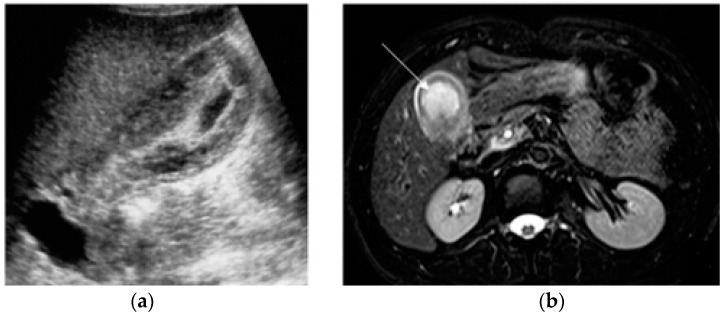
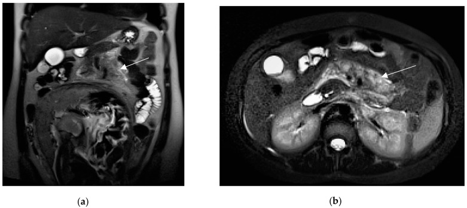
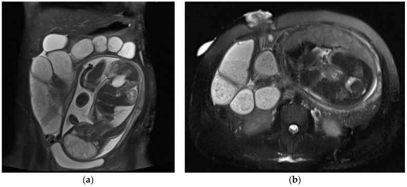
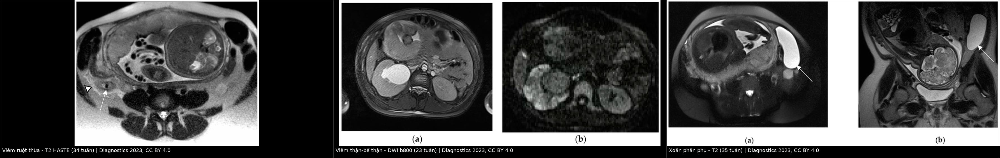
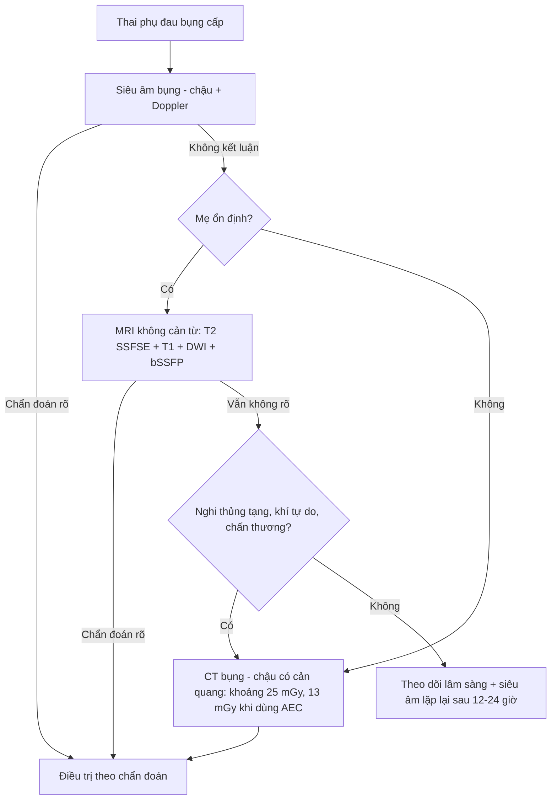
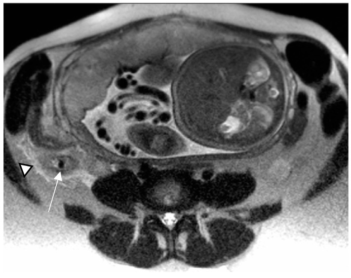
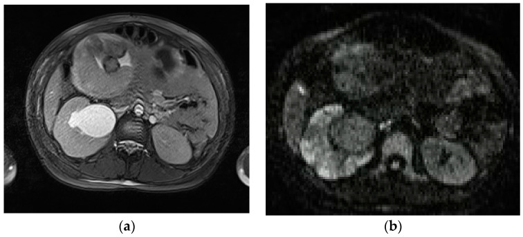
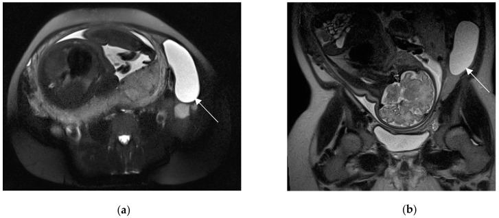

# 1817 — Đau bụng cấp ở thai phụ: protocol MRI không cản từ / Acute abdominal pain in pregnancy — non-contrast MRI protocol

**Tags:** `pattern:daubung-cap` `pattern:viem` `pattern:dich-tu-do` `pattern:xoan-phu-khoa` `vung:o-bung` `vung:tieu-khung` `vung:thai-nhi` `protocol:MRI-khong-can-tu` `protocol:sieu-am-bung` `protocol:CT-bung-co-can-quang` `score:ACR-AC`
**Mức chắc chắn (certainty):** tổng hợp y văn (literature synthesis) — ghép tổng quan hình ảnh 2 phần về đau bụng–chậu cấp trong thai và sau sinh (*Diagnostics* 2023, PMC10528445 phần sản khoa và PMC10528125 phần không sản khoa, CC BY 4.0), meta-analysis MRI cho viêm ruột thừa ở thai (19 nghiên cứu, *World J Emerg Surg* 2019, PMC6647167, CC BY) và tổng quan về liều xạ – gadolinium trong thai (*Int J Womens Health* 2019, PMC6371947, CC BY-NC). Số nào nguồn không đưa thì ghi "chưa rõ".

> **Câu chốt:** thai phụ đau bụng cấp **không phải "chống chỉ định chụp"** — mà là **đổi thứ tự**: siêu âm (SA) trước → **MRI không cản từ** khi SA không kết luận → **CT chỉ khi mẹ nguy kịch hoặc MRI không dùng được**. Ngưỡng nằm lòng: **ruột thừa > 7 mm, thành > 2 mm** là bất thường; **liều thai ≤ 50 mGy được coi là không đáng kể**, trong khi **CT bụng–chậu thường chỉ ~25 mGy (13 mGy khi dùng điều khiển phơi nhiễm tự động)** — tức **nỗi sợ CT thường lớn hơn nguy cơ thật**, còn **bỏ sót viêm ruột thừa vỡ làm thai mất tăng từ 1,5% lên ~6%**.

## 1. Tổng quan bệnh học – cơ chế hình ảnh

### 1.1 Vì sao "cùng một đau bụng" nhưng thứ tự chẩn đoán khác hẳn

- **Giải phẫu bị đẩy:** tử cung to đẩy **ruột thừa và manh tràng lên trên – ra ngoài**, nên điểm đau không còn ở hố chậu phải điển hình — **tới 25% thai phụ viêm ruột thừa không đau hố chậu phải** (PMC10528125). Vì vậy **field of view (FOV) MRI phải từ vòm hoành tới khớp mu**, không chỉ tiểu khung.
- **Sinh lý làm xét nghiệm nhiễu:** bạch cầu tăng sinh lý, pha loãng máu, tăng CRP không đặc hiệu → **hình ảnh là yếu tố quyết định**, không phải công thức máu.
- **Hậu quả của chậm trễ có số:** hoãn mổ **> 24 giờ** làm **tăng 66% tỉ lệ vỡ ruột thừa**; thai mất **~1,5%** khi chưa vỡ so với **~6%** khi vỡ (PMC10528125). Đây là lý do bài này tồn tại.

### 1.2 Vì sao MRI không cản từ "nhìn được" đau bụng cấp (TẠI SAO — vật lý)

- **T2 single-shot (SSFSE/HASTE) — xương sống của protocol:** nước tự do (phù thành ruột, dịch quanh ruột thừa, nước tiểu, dịch mật, máu loãng) có **T2 dài** nên **sáng**; cơ – xơ – khí **T2 ngắn** nên **tối**. Vì thế chỉ một chuỗi xung T2 nhanh đã tách được **"phù/dịch" (viêm, tắc, rò) khỏi "đặc"**, và hình học giải phẫu rõ vì SSFSE miễn nhiễm với chuyển động ruột và nhịp thở. **Sỏi mật, sỏi thận, appendicolith, khí trong lòng ruột đều là "lỗ tối" trên nền dịch sáng** — nguyên lý "vật cản tín hiệu" này là gốc của mọi dấu hiệu dưới đây.
- **T1 (kèm fat-sat) — máu và mỡ:** methemoglobin trong máu bán cấp làm **T1 ngắn → sáng**; mỡ sáng trên T1 nhưng **tắt khi fat-sat**. Do đó **thoái triển đỏ của u xơ** (huyết khối trong mạch u) hiện **T1 sáng ± viền sáng**, còn **nang nước** thì T1 tối – T2 rất sáng.
- **DWI/ADC — mủ và nhồi máu:** ứ mủ và thiếu máu làm **hạn chế khuếch tán** → **DWI b = 800–1000 sáng, ADC tối**; đây là cách phân biệt **ổ viêm thận – áp-xe** (ADC tối) với **ứ nước đơn thuần** (ADC không giảm). Ở viêm thận–bể thận, **DWI nhạy hơn CT không cản quang (95% vs 67%)** trong tổng quan PMC10528125.
- **bSSFP (trueFISP/FIESTA) — mạch máu không cần thuốc:** máu chảy nhanh cho tín hiệu **rất sáng**, nên nhìn được **huyết khối tĩnh mạch buồng trứng** như một **khuyết tín hiệu trong lòng mạch sáng** mà không cần gadolinium.
- **Không có bức xạ ion hóa:** đây là lợi ích duy nhất không thể thay bằng CT — nhưng **không phải lý do để chụp MRI khi bệnh nhân không ổn định**.

### 1.3 Ngưỡng định lượng nằm lòng (dùng ngay khi đọc)

| Đại lượng | Ngưỡng bất thường | Nguồn |
|---|---|---|
| Ruột thừa (đường kính ngoài) | **> 7 mm** | PMC10528125 |
| Thành ruột thừa | **> 2 mm** | PMC10528125 |
| Thành ruột non/đại tràng viêm | **> 3 mm** + phù dưới niêm mạc T2 sáng | PMC10528125 |
| Túi mật: đường kính ngắn / thành | **> 3 cm / > 3 mm** | PMC10528125 |
| Ruột thừa trên SA | **> 6–7 mm**, không xẹp được, thành **> 2 mm** = chẩn đoán xác | PMC10528125 |
| Liều thai "không đáng kể" | **≤ 50 mGy**; dị tật tăng rõ **> 150 mGy** | PMC6371947 |
| Liều thai CT bụng–chậu | **~25 mGy**, còn **~13 mGy** với điều khiển phơi nhiễm tự động | PMC6371947 |
| Tiếng ồn MRI cho thai | **≤ 90 dB** (khuyến cáo AAP) | PMC6371947 |

## 2. Mẫu hình + chẩn đoán phân biệt theo vị trí (gamut)

Thai phụ đau bụng cấp được chia theo **4 vùng định khu** — mỗi vùng có một "hàng đầu" riêng, và MRI đọc theo vùng chứ không đọc "cả bụng mờ mờ".

### 2.1 Hố chậu phải (right lower quadrant)

- **Viêm ruột thừa cấp (appendicitis)** — hàng đầu: **~0,07% thai kỳ (1/1.500)**, hay gặp nhất **quý II**; là **cấp cứu ngoại khoa không sản khoa phổ biến nhất** (PMC10528125).
- **Xoắn phần phụ (ovarian/adnexal torsion)** — **1/800 thai kỳ**, thường **cuối quý I – đầu quý II** khi tử cung lớn nhanh; là **cấp cứu phụ khoa thứ 5** nói chung (2–3%) (PMC10528125).
- **Sỏi niệu quản** — **1/2.000 thai kỳ**, là **nguyên nhân không sản khoa hàng đầu gây đau bụng và nhập viện** (PMC10528125).
- **Viêm túi thừa/viêm ruột non đoạn cuối (Crohn)**, **viêm phần phụ (PID)**, **u xơ thoái triển đỏ**, **huyết khối tĩnh mạch buồng trứng** (thể sau sinh).
- **Cạm bẫy đặc thù thai kỳ:** ruột thừa bị đẩy **lên cao/gần rốn** — nếu chỉ đặt FOV tiểu khung sẽ **"không thấy ruột thừa" và kết luận sai là bình thường**.

### 2.2 Hạ sườn phải (right upper quadrant)

- **Viêm túi mật cấp / sỏi mật:** sỏi mật gặp **> 12%** thai kỳ, nhưng **bệnh có triệu chứng chỉ 0,1–0,3%** (PMC10528125). Viêm túi mật cấp là **chỉ định mổ không sản khoa đứng thứ 2**.
- **Viêm tụy cấp:** **1/1.000–1/5.000** thai kỳ, thường **quý III**; nguyên nhân hay nhất là **sỏi mật**; tử vong mẹ giảm còn **3,3%**, thai **11,6%** (PMC10528125).
- **HELLP/nhồi máu gan, gan nhiễm mỡ cấp (AFLP), hội chứng HELLP** — bệnh cảnh **sản khoa** nhưng hình ảnh giống "bụng ngoại khoa"; phân biệt bằng HA, tiểu cầu, LDH, transaminase.

*Viêm túi mật cấp: axial T2 fat-sat — túi mật căng, thành dày, dịch/thâm nhiễm mỡ quanh túi mật (mũi tên). Nguồn: *Diagnostics* 2023 (PMC10528125) Fig. 5, CC BY 4.0.*

*Viêm tụy cấp: coronal + axial T2 — phù/dịch quanh tụy len giữa các tiểu thùy (mũi tên). Nguồn: *Diagnostics* 2023 (PMC10528125) Fig. 6, CC BY 4.0.*

### 2.3 Hông lưng (flank)

- **Ứ nước thận sinh lý:** gặp **tới 90%** thai phụ, **thường bên phải**, gần như chỉ ở **quý III** — do progesterone giãn cơ trơn niệu quản + tử cung chèn niệu quản (PMC10528125). **Đây là biến thể, không phải bệnh.**
- **Viêm thận–bể thận cấp:** **1%** thai kỳ; **DWI** là chuỗi xung quyết định.
- **Sỏi niệu quản tắc nghẽn**, **áp-xe thận** (ổ dịch thành dày, có khí), **ứ mủ thận (pyonephrosis)**.

### 2.4 Lan tỏa / mạch máu (diffuse & vascular)

- **Tắc ruột non (SBO):** **0,001–0,003%** thai kỳ nhưng **tử vong mẹ 2% và mất thai 17%**; nguyên nhân: **dính sau mổ ~60%**, thoát vị nội **15%**, lồng ruột **12%**, xoắn ruột **9%** (PMC10528125).
- **Huyết khối tĩnh mạch buồng trứng (OVT) sau sinh:** **0,05–0,18%** sinh đường âm đạo, **2%** sau mổ lấy thai, **1–2%** khi có viêm nội mạc tử cung; điển hình **trong 7 ngày đầu sau sinh**, sốt + đau bụng dưới/bên (PMC10528125).
- **Huyết khối tĩnh mạch cửa/mạc treo**, **thuyên tắc phổi**, **vỡ tử cung – nhau bong non** (nhóm sản khoa, xem bài 1604/560).

*Tắc ruột non: coronal + axial HASTE — quai ruột giãn chứa dịch phía trên ổ dính (mũi tên); tìm **transition point** để xác định nguyên nhân. Nguồn: *Diagnostics* 2023 (PMC10528125) Fig. 3, CC BY 4.0.*

## 3. Bảng so sánh phân biệt (ma trận đối chiếu)

| Thực thể (entity) | Hình ảnh điển hình trên MRI không cản từ | Chốt vào (rule-in) | Chốt loại (rule-out) | Gợi ý xác nhận |
|---|---|---|---|---|
| **Viêm ruột thừa cấp** | Ruột thừa **> 7 mm**, thành **> 2 mm**, dịch lòng T2 sáng, **appendicolith tối mọi chuỗi**, mỡ quanh ruột thừa T2 sáng (stranding), ít dịch | **Ruột thừa > 7 mm + thành > 2 mm + thâm nhiễm mỡ quanh** | **Ruột thừa bình thường thấy rõ ≤ 6 mm, xẹp, không thâm nhiễm** → loại trừ mạnh (NPV gần 100% trong một số loạt) | MRI là chốt khi SA không kết luận; **Se 91,8% / Sp 97,9%** (19 nghiên cứu) |
| **Xoắn phần phụ** | Khối phần phụ **lệch trục**, **phù buồng trứng**, nang lớn / u quái, **"whirlpool" cuống**, tử cung lệch về bên tổn thương, ít dịch | **Cuống xoắn + buồng trứng phù, tín hiệu giảm** | **Mô buồng trứng còn tín hiệu bình thường, có mạch** → ít khả năng xoắn hoàn toàn | MRI (không cản từ) + **ADC thấp hơn bên đối diện** hỗ trợ; ngưỡng ADC chưa thống nhất |
| **Sỏi niệu quản tắc** | **Lỗ tối** trong lòng niệu quản trên T2 lát mỏng **3 mm**, **ứ nước trên chỗ tắc**, **dấu "cột nước đứng"**, phù quanh niệu quản/thận | **Thấy sỏi + ứ nước trên mức sỏi** | **Ứ nước hai bên, không thấy sỏi, không chênh mức** → nghĩ **ứ nước sinh lý** (tới 90%) | T2 FSE 3 mm; DWI; SA bổ trợ (Se SA chỉ **11–24%**) |
| **Viêm thận–bể thận / áp-xe thận** | Thận **to, phù**, ổ **hạn chế khuếch tán** hình nêm; áp-xe = ổ dịch thành dày ± khí | **DWI sáng + ADC tối hình nêm** ở vùng thận đau | **Ứ nước đơn thuần: ADC không giảm**, không ổ khu trú | DWI/ADC (Se **95%** vs CT không cản quang **67%**) |
| **Viêm túi mật cấp** | Túi mật căng (**đường kính ngắn > 3 cm**), thành **> 3 mm**, dịch quanh túi mật, sỏi cổ túi mật (lỗ tối) | **Thành > 3 mm + căng + dịch quanh + sỏi cổ** | **Thành mỏng, không dịch quanh, không sỏi kẹt** → loại trừ | SA là first-line; MRI khi SA mờ/không kết luận |
| **Viêm tụy cấp** | Tụy **to, phù**, T2 sáng quanh tụy, **dịch quanh tụy** len giữa các tiểu thùy; DWI hạn chế ở thể sớm | **Phù + dịch quanh tụy + lâm sàng đau thượng vị/lipase** | **Tụy bình thường, không dịch** → loại trừ viêm tụy cấp | MRI/MRCP khi nghi sỏi ống mật chủ (Se **> 90%**) |
| **Huyết khối tĩnh mạch buồng trứng** | Tĩnh mạch buồng trứng **giãn, khuyết tín hiệu trong lòng** trên bSSFP/T1; viền viêm quanh tĩnh mạch | **Khuyết tín hiệu lòng mạch + giãn > bình thường + sốt sau sinh** | **Lòng mạch sáng đều, không giãn** → loại trừ | MRI không cản từ; CT tĩnh mạch khi cần nhanh |
| **U xơ thoái triển đỏ** | Khối cơ tử cung **T1 sáng ± viền sáng**, **T2 tín hiệu thay đổi**, không có cuống xoắn | **T1 sáng trong khối u xơ đã biết + đau khu trú** | **Cuống xoắn + buồng trứng phù** → xoắn phần phụ, không phải thoái triển | MRI; theo dõi giảm đau (thường tự giới hạn) |
| **Tắc ruột non** | Quai ruột **giãn > 2,5–3 cm**, mức dịch–hơi, **điểm chuyển tiếp (transition point)** với quai xẹp phía sau | **Tìm được transition point + quai trên giãn** | **Không có điểm chuyển tiếp, quai không giãn** → loại trừ | MRI SSFSE đa bình diện; CT khi nghi thiếu máu ruột |

*Trái → phải: viêm ruột thừa (T2 HASTE, 34 tuần), viêm thận–bể thận (DWI b800, 23 tuần), xoắn phần phụ (T2, 35 tuần). Nguồn: *Diagnostics* 2023, PMC10528125 (Fig. 2, 7, 9), CC BY 4.0; ảnh ghép letterbox, không crop.*

### 3.1 Đọc theo chuỗi xung — "mỗi chuỗi trả lời một câu hỏi"

| Chuỗi xung | Câu hỏi nó trả lời | Dấu hiệu chốt |
|---|---|---|
| **T2 SSFSE/HASTE (axial + coronal)** | Có **phù/dịch** không? Giải phẫu có bị đẩy lệch không? | Ruột thừa > 7 mm; thành > 2 mm; dịch quanh tụy/túi mật; quai ruột giãn |
| **T2 fat-sat** | Dịch có thật hay là mỡ? | Stranding mỡ vẫn sáng sau fat-sat = **phù**, không phải mỡ bình thường |
| **T1 dual-echo (in/out phase)** | Có **máu/mỡ** trong tổn thương không? | Thoái triển đỏ: T1 sáng; nang máu: T1 sáng – T2 sáng |
| **DWI b = 800–1000 + ADC** | Có **mủ/nhồi máu** (hạn chế khuếch tán) không? | Ổ viêm thận, áp-xe, ổ mủ quanh ruột thừa: **DWI sáng + ADC tối** |
| **bSSFP (trueFISP/FIESTA)** | **Mạch máu** có thông không? | OVT: khuyết tín hiệu trong lòng tĩnh mạch sáng; huyết khối mạc treo |
| **T2 FSE lát 3 mm (niệu quản)** | Có **sỏi** trong lòng niệu quản không? | Lỗ tối trong cột nước sáng, ứ nước phía trên |

## 4. Protocol chụp + đường đi quyết định

### 4.1 Chuẩn bị và tư thế

- **Nhịn ăn ngắn** nếu tình trạng cho phép (giảm nhu động ruột và dịch dạ dày); **không để bệnh nhân đau chờ đói**.
- **Bàng quang căng vừa** (không quá căng) để đánh giá tử cung – phần phụ; **tư thế nằm ngửa**, thêm **nghiêng trái** ở quý III nếu tử cung chèn IVC gây chóng mặt/tụt HA.
- **FOV: vòm hoành → khớp mu** (vì ruột thừa bị đẩy lên cao) — đây là điểm khác biệt lớn nhất so với protocol bụng thường quy.
- **1,5 T** là lựa chọn được khuyến cáo trong tổng quan 2019 ("pregnant women should be imaged at 1.5 T or less"; an toàn 3 T chưa được chứng minh) — **phản biện:** nhiều trung tâm hiện dùng 3 T với giới hạn SAR và chưa có bằng chứng hại; đây là **điểm chưa đồng thuận**, không phải chống chỉ định tuyệt đối.
- **Giới hạn tiếng ồn ≤ 90 dB** (khuyến cáo AAP) — dùng nút tai/ống nghe bảo vệ.
- **Không dùng gadolinium thường quy:** gadolinium **qua được nhau thai**, tồn lưu trong tuần hoàn thai; thí nghiệm trên động vật có nguy cơ dị tật, trên người **chưa có bằng chứng rõ** → **tránh**, chỉ dùng khi thật cần và sau tư vấn (PMC6371947).

### 4.2 Chuỗi xung tối thiểu (khoảng 20–30 phút, không cản từ)

| # | Chuỗi | Mặt phẳng | Mục đích |
|---|---|---|---|
| 1 | T2 SSFSE/HASTE | axial + coronal | Toàn cảnh; phù, dịch, quai ruột, ruột thừa |
| 2 | T2 fat-sat | axial | Tách phù mỡ thật; tổn thương phần phụ |
| 3 | T1 dual-echo | axial | Máu/mỡ; thoái triển đỏ; nang máu |
| 4 | DWI b800–1000 + ADC | axial | Mủ/áp-xe/nhồi máu thận, ổ mủ quanh ruột thừa |
| 5 | bSSFP | axial/coronal | Mạch máu không cần thuốc; OVT, huyết khối |
| 6 | T2 FSE 3 mm | coronal oblique theo niệu quản | Sỏi niệu quản nhỏ |

### 4.3 Khi nào buộc chuyển CT — và ngưỡng liều phải nói với mẹ

- **Chỉ định CT:** mẹ **không ổn định** (sốc, chấn thương nặng), **MRI không có/không dùng được** (máy tạo nhịp không tương thích, dị vật kim loại, sợ bí, không nằm được), cần **đánh giá khí ngoài lòng ruột/thủng tạng** (MRI kém nhạy với khí tự do), hoặc **MRI đã không kết luận mà chậm trễ gây hại**.
- **Ngưỡng để trấn an:** dị tật thai **không tăng rõ ở liều ≤ 50 mGy**, chỉ tăng rõ **> 150 mGy**; **CT bụng–chậu thường ~25 mGy** (còn **~13 mGy** khi dùng AEC) → **dưới ngưỡng 50 mGy**, tức **lợi ích chẩn đoán thường lớn hơn nguy cơ** (PMC6371947). **Đừng hứa "không ảnh hưởng gì"** — hãy nói đúng con số.
- **I-ốt cản quang:** có thể dùng khi cần thông tin không thể có nếu không cản quang; chưa có bằng chứng gây quái thai (PMC6371947).

### 4.4 Sơ đồ quyết định

## 5. Biến thể bình thường và cạm bẫy

### 5.1 Biến thể bình thường dễ gọi nhầm bệnh

- **Ứ nước thận sinh lý:** **tới 90%**, **bên phải**, **quý III**, không đau khu trú, **không thấy sỏi**, **không chênh mức nước hai bên rõ** → **không được gọi là "tắc nghẽn"**. Chỉ chụp thêm/đặt stent khi có **sỏi + đau + nhiễm trùng/ứ mủ**.
- **Ruột thừa "không thấy" không đồng nghĩa bình thường:** ở thai phụ, ruột thừa **bị đẩy lên cao**; nếu FOV chỉ tới rốn thì **âm tính giả**. Phải quét tới **vòm hoành** và tìm dọc manh tràng đã di chuyển.
- **Tĩnh mạch buồng trứng giãn sau sinh:** giãn nhẹ trong vài ngày đầu sau sinh là bình thường; **chỉ gọi OVT khi có khuyết tín hiệu trong lòng mạch + viền viêm + sốt**.
- **Dịch ổ bụng lượng ít quanh buồng trứng/ruột thừa** có thể sinh lý (nhất là sau rụng trứng); **chỉ có giá trị khi kèm phù thành/tổn thương khu trú**.

### 5.2 Cạm bẫy (pitfall)

- **Sai FOV là cạm bẫy số 1:** đặt FOV tiểu khung "cho nhanh" → bỏ sót ruột thừa lạc chỗ, tụy, ổ dưới hoành. **Luôn từ vòm hoành.**
- **DWI ở mặt phân cách khí – mô:** biến dạng hình học và **"sáng giả"** ở ruột non/quanh đại tràng; **luôn đối chiếu ADC** — sáng DWI mà **ADC không tối** thì không phải hạn chế khuếch tán thật.
- **3 T:** artifact điện môi/banding và **SAR cao hơn**; nếu ảnh kém, hạ về **1,5 T** thay vì tăng thời gian quét (bệnh nhân đau, thai máy).
- **Thoái triển đỏ vs xoắn phần phụ:** cả hai đều đau cấp + khối; **T1 sáng trong u xơ đã biết** nghiêng thoái triển đỏ; **cuống xoắn + buồng trứng phù** nghi xoắn — **đừng mổ u xơ "cấp cứu" khi thực ra là xoắn buồng trứng**.
- **Satisfaction of search:** thấy **sỏi mật** không loại trừ **viêm ruột thừa**; thấy **ứ nước thận** không loại trừ **viêm ruột thừa sau tử cung**. Đọc lại toàn bộ FOV trước khi kết luận.
- **Không dùng MRI để "chứng minh không có bệnh" ở bệnh nhân đang sốc:** ổn định trước, chẩn đoán sau.
- **Gadolinium "cho chắc":** không có chỉ định đặc biệt thì **không dùng**; thuốc qua nhau thai, và **không có ngưỡng an toàn đã chứng minh**.

## 6. Tự lượng giá — Blind Quiz

**Ca 1 — Đau bụng phải ở thai 34 tuần**

- Gợi ý lâm sàng: thai 34 tuần, đau bụng phải, sốt nhẹ; siêu âm không thấy ruột thừa.
- Câu hỏi: (1) Cấu trúc hình ống bất thường nằm ở đâu? (2) Dấu hiệu nào chốt viêm ruột thừa? (3) Vì sao "không thấy ruột thừa" trên siêu âm không loại trừ?

<b>Bấm để hiện đáp án (findings + chẩn đoán)</b>

- **Dấu hiệu:** ruột thừa **giãn, thành dày**, chứa **appendicolith tối tín hiệu** (mũi tên), **thâm nhiễm mỡ quanh ruột thừa** (đầu mũi tên) — tương ứng **> 7 mm**, thành **> 2 mm**.
- **Chẩn đoán:** viêm ruột thừa cấp trên thai 34 tuần. **Appendicolith = vật cản tín hiệu mọi chuỗi** (không có proton tự do) nên tối cả T1 lẫn T2; mỡ quanh ruột thừa sáng trên T2 vì **phù (nước tự do)**.
- **Vì sao SA âm không loại trừ:** tử cung đẩy ruột thừa lên cao, ruột non che lấp; tổng quan ghi nhận **Se SA 77% / Sp 75%** (1.593 bệnh nhân) và giảm theo tuổi thai (**Se 69% → 63% → 51%** ở 3 quý).
- **Nguồn ảnh:** *Diagnostics* 2023, PMC10528125, Fig. 2, CC BY 4.0.

**Ca 2 — Đau hông lưng + sốt ở thai 23 tuần**

- Gợi ý lâm sàng: thai 23 tuần, đau hông lưng phải, sốt; không có sỏi thấy trên siêu âm.
- Câu hỏi: (1) Hai ảnh (a) và (b) khác nhau ở chuỗi xung nào? (2) Tổn thương hình nêm tăng tín hiệu trên (b) nghĩa là gì? (3) Phân biệt với ứ nước thận sinh lý bằng gì?

<b>Bấm để hiện đáp án (findings + chẩn đoán)</b>

- **Dấu hiệu:** (a) T2 fat-sat: thận phải **to, phù**, bể thận giãn; (b) **DWI b800**: vùng **hình nêm tăng tín hiệu** ở nhu mô thận phải = **hạn chế khuếch tán** (viêm thận – bể thận cấp).
- **Chẩn đoán:** viêm thận–bể thận cấp. **DWI sáng + ADC tối** = phù tế bào/mủ; **ứ nước đơn thuần không làm ADC tối**.
- **Giá trị:** trong tổng quan, **DWI nhạy 95%** so với **CT không cản quang 67%** cho viêm thận; ứ nước sinh lý gặp **tới 90%** thai phụ nên **không được nhầm là nguyên nhân đau**.
- **Nguồn ảnh:** *Diagnostics* 2023, PMC10528125, Fig. 7, CC BY 4.0.

**Ca 3 — Đau bụng dưới ở thai 35 tuần, SA thấy nang**

- Gợi ý lâm sàng: thai 35 tuần, đau bụng dưới trái cấp; siêu âm thấy nang phần phụ trái.
- Câu hỏi: (1) Nang nằm ở đâu so với tử cung? (2) Dấu hiệu nào gợi **xoắn**? (3) Vì sao không nên chờ "hết đau rồi chụp lại"?

<b>Bấm để hiện đáp án (findings + chẩn đoán)</b>

- **Dấu hiệu:** nang **~8 cm** ở phần phụ trái, **bị ép giữa tử cung có thai và thành bụng**, **phù/lệch trục**, cuống xoắn; tử cung lệch nhẹ về bên tổn thương.
- **Chẩn đoán:** **xoắn phần phụ trái** trên thai 35 tuần — nang lớn + tử cung to tạo điều kiện xoắn; **1/800 thai kỳ**, thường cuối quý I – đầu quý II.
- **Vì sao không chờ:** xoắn kéo dài → **nhồi máu buồng trứng**, phải cắt phần phụ; **mổ giải xoắn sớm** bảo tồn được buồng trứng. Không cần gadolinium: **T2 + bSSFP/DWI** đủ đánh giá.
- **Nguồn ảnh:** *Diagnostics* 2023, PMC10528125, Fig. 9, CC BY 4.0.

## Bài liên quan chéo
- [500 – Tổng quan Hệ Vú & Sản phụ khoa](../500-tong-quan-vu-san-phu-khoa/lesson.md)
- [1796 – Chylomicronemia trong thai kỳ: viêm tụy cấp & MRI không cản từ](../1796-chylomicronemia-trong-thai-ky-va-tu-van-sinh-san/lesson.md)
- [1623 – Huyết khối tĩnh mạch buồng trứng sau sinh (POVT)](../1623-huyet-khoi-tinh-mach-buong-trung-sau-sinh/lesson.md)
- [1630 – Khối phần phụ nghi ác trong thai kỳ: MRI không gadolinium & thời điểm mổ](../1630-khoi-phan-phu-nghi-ac-trong-thai/lesson.md)
- [1640 – Xoắn tử cung trong thai kỳ: ngưỡng > 45° & dấu "whirlpool"](../1640-xoan-tu-cung-trong-thai-ky/lesson.md)
- [1604 – Thai kỳ sau điều trị chửa ở sẹo mổ lấy thai: PAS & kết cục sinh sản](../1604-thai-ky-sau-chua-seo-mo-lay-thai/lesson.md)
- [550 – Thai sớm: thai ngừng tiến triển & thai ngoài tử cung](../550-thai-som-say-thai-thai-ngoai-tu-cung/lesson.md)
- [566 – Song thai: chorionicity, TTTS & TAPS](../566-song-thai-chorionicity-TTTS-TAPS/lesson.md)

## Ảnh
- `images/1817_dau-bung-cap-thai-phu_MRI_PMC10528125-g002.jpg` — viêm ruột thừa, T2 HASTE (Fig. 2).
- `images/1817_dau-bung-cap-thai-phu_MRI_PMC10528125-g007.jpg` — viêm thận–bể thận, T2 + DWI (Fig. 7).
- `images/1817_dau-bung-cap-thai-phu_MRI_PMC10528125-g009.jpg` — xoắn phần phụ, T2 (Fig. 9).
- `images/1817_dau-bung-cap-thai-phu_MRI_PMC10528125-g005.jpg` — viêm túi mật, T2 fat-sat (Fig. 5).
- `images/1817_dau-bung-cap-thai-phu_MRI_PMC10528125-g006.jpg` — viêm tụy cấp, T2 (Fig. 6).
- `images/1817_dau-bung-cap-thai-phu_MRI_PMC10528125-g003.jpg` — tắc ruột do dính, T2 HASTE (Fig. 3).
- `images/composite_ba-nguyen-nhan.jpg` — ảnh ghép 3 nguyên nhân (tạo bằng `tools/make_composite.py`).
- Nguồn + giấy phép từng ảnh: `images/CREDITS.md`.

> Không dùng để chẩn đoán độc lập khi chưa có người hướng dẫn.
