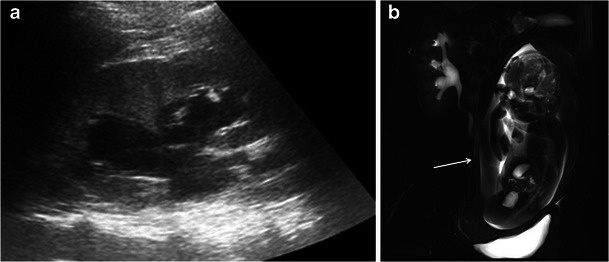
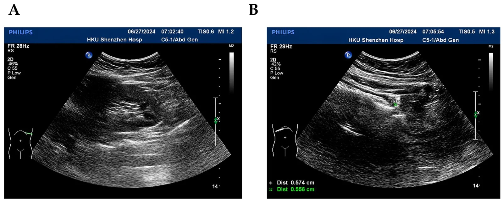
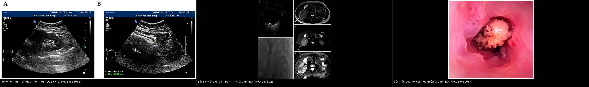
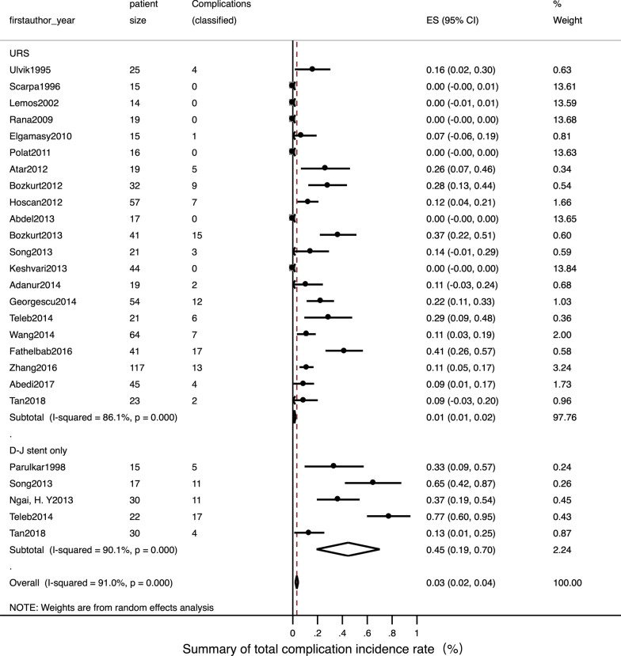
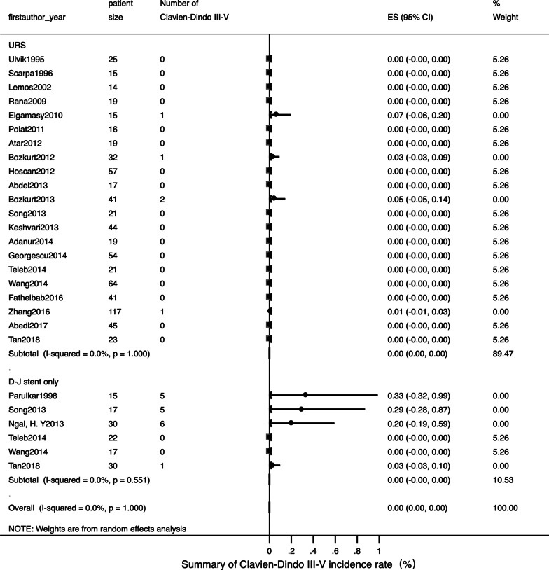
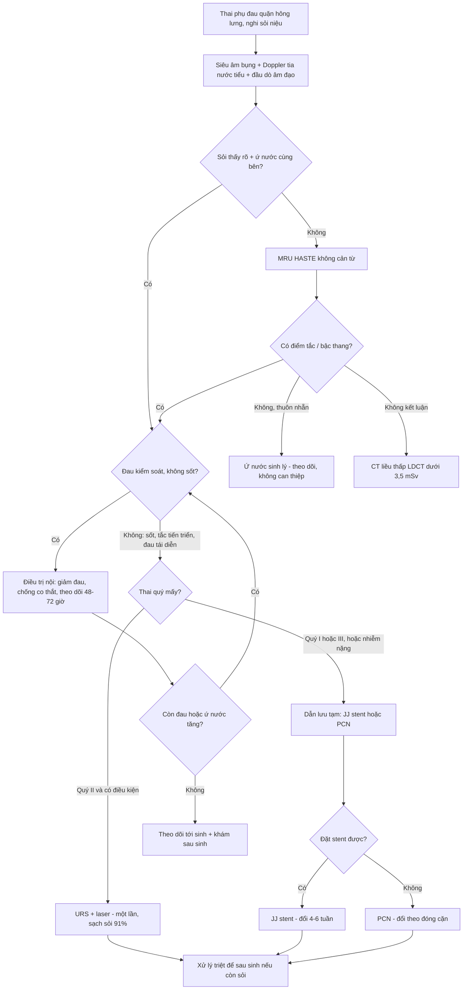
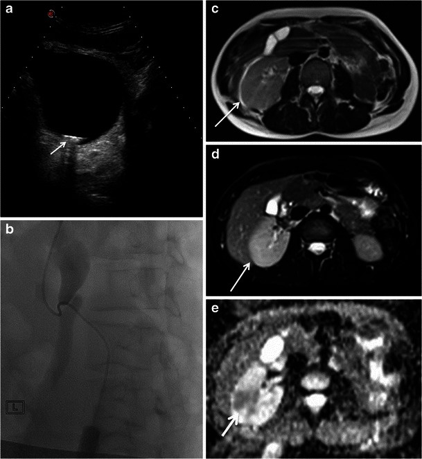
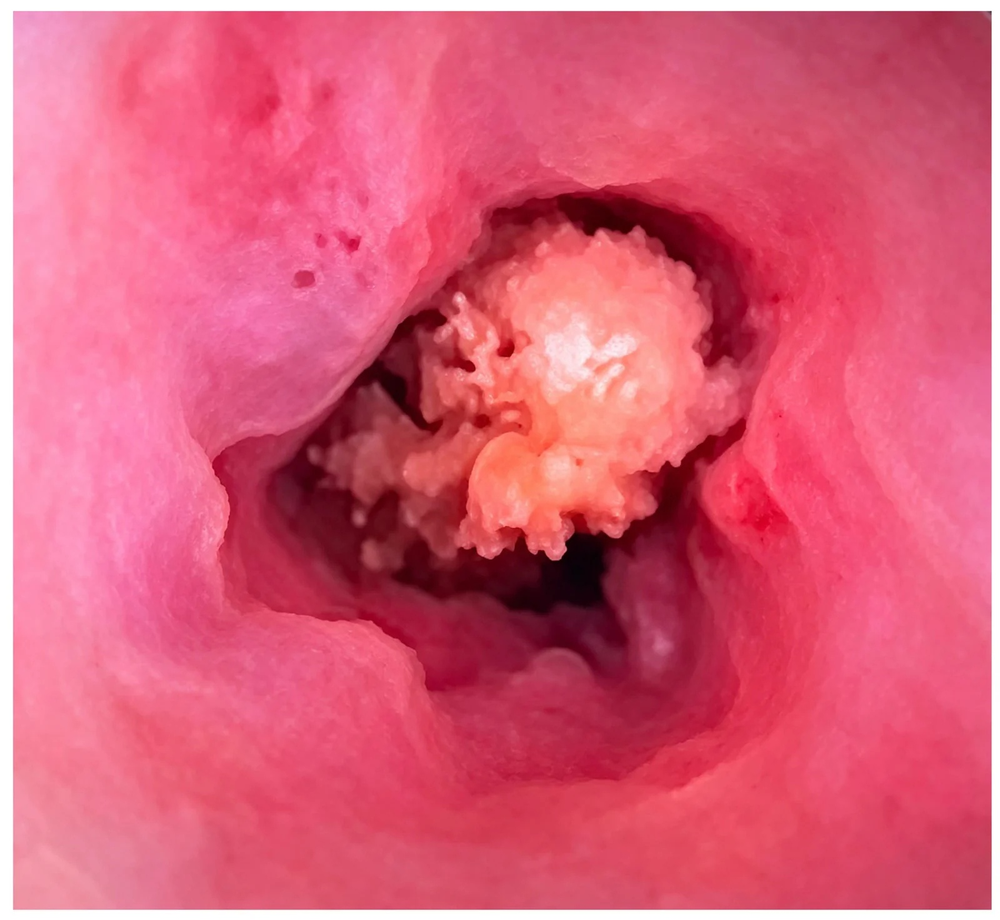

# 1818 — Sỏi niệu quản ở thai phụ: siêu âm – MRI, dẫn lưu tạm (JJ stent hay nephrostomy) và khi nào nội soi lấy sỏi / Ureteral stones in pregnancy

**Tags:** `pattern:soi` `pattern:tac-nghen` `pattern:u-nuoc` `vung:nieu-quan` `vung:thai-nhi` `protocol:sieu-am-bung` `protocol:MRI-khong-can-tu` `protocol:CT-lieu-thap` `score:EAU-2025`
**Mức chắc chắn (certainty):** tổng hợp y văn (literature synthesis) — ghép 5 nguồn mở: **tổng quan quản lý sỏi niệu ở thai** (*Curr Urol* 2023, PMC10487296, CC BY-NC-ND), **đoàn hệ đa trung tâm URS ở thai 146 ca** (EAU Section of Endourology, *Eur Urol Open Sci* 2025, PMC12159928, CC BY), **meta-analysis URS vs JJ stent** (25 nghiên cứu, *BMC Urol* 2022, PMC9476568, CC BY), **đoàn hệ 14 năm 120 thai phụ sỏi niệu quản** (*Front Med* 2026, PMC13668503, CC BY) và **ca minh họa hình ảnh sỏi + ứ nước trên US/MRU** (*Insights Imaging* 2014, PMC4263802, CC BY và *J Clin Med* 2026, PMC13566068, CC BY). Số nào nguồn không nêu ghi "chưa rõ".

> **Câu chốt:** **ứ nước ở thai phụ KHÔNG đồng nghĩa với tắc nghẽn** — ứ nước sinh lý xuất hiện từ tam cá nguyệt II, đỉnh **24–28 tuần**, và trong một đoàn hệ 2025 **siêu âm thấy ứ nước có độ đặc hiệu chỉ 1,5%** cho sỏi. Chẩn đoán đi theo **US → MRU → CT liều thấp**, và **điều trị không nhắm "lấy sạch sỏi" mà nhắm "giải phóng tắc nghẽn + kiểm soát nhiễm"**: **75–76% sỏi tự ra**, nhưng khi có **sốt, ứ nước tiến triển, đau tái diễn** thì phải can thiệp; **URS laser được EAU 2025 xem là lựa chọn hàng đầu khi điều trị nội thất bại**, còn **JJ stent/PCN là cầu nối**.

## 1. Tổng quan bệnh học – cơ chế hình ảnh

### 1.1 Vì sao thai phụ dễ có ứ nước và dễ bị sỏi "kẹt" (TẠI SAO)

- **Dịch tễ:** sỏi niệu gặp ở **0,49% thai kỳ (1/204)** theo meta-analysis 4,7 triệu thai (Kirubarajan 2022, dẫn qua PMC10487296); các nguồn khác nêu **1/125 – 1/2.000**; đây là **nguyên nhân đau bụng không sản khoa hay gặp nhất**, gây **1,7 ca nhập viện/1.000 lần sinh**; **~99% ở tam cá nguyệt II–III**, **~1/4 cần can thiệp** (PMC10487296).
- **Ứ nước sinh lý:** progesterone làm **giãn cơ trơn niệu quản**, tử cung to **chèn ép niệu quản** (phải nhiều hơn trái vì **đại tràng sigma** đẩy tử cung sang phải), thêm **táo bón** — nên ứ nước **bắt đầu tam cá nguyệt II và đỉnh 24–28 tuần** (PMC10487296). Vì vậy "ứ nước nhẹ hai bên, không thấy sỏi" là **bình thường**, không phải bệnh lý.
- **Vì sao sỏi gây đau dữ dội:** sỏi kẹt ở **1/3 niệu quản** làm tăng áp lực trong bể thận → **căng bao thận** và **co thắt niệu quản** — đau quặn từng cơn, lan xuống bẹn; nếu có nhiễm kèm tắc kín → **viêm thận–bể thận ứ mủ (pyonephrosis)** và **sốc nhiễm khuẩn**, đây là đường dẫn tới tử vong mẹ.
- **Vì sao thai kỳ làm nặng thêm hậu quả sản khoa:** đau – nhiễm – tắc nghẽn làm tăng **co bóp tử cung**. Meta-analysis **26.577 thai phụ** cho thấy sỏi niệu làm tăng **sinh non (OR 1,63; 1,37–1,95)**, **sinh rất non (OR 1,49)**, **tiền sản giật (OR 1,75)**, **tăng huyết áp (OR 2,97)**, **mổ lấy thai (OR 1,31)**, **đái tháo đường thai kỳ (OR 1,84)** — nên sỏi niệu ở thai là **bệnh có ảnh hưởng sản khoa**, không phải "chuyện nhỏ" (Zhou 2021).

### 1.2 Vì sao nhìn thấy (vật lý từng phương thức)

- **Siêu âm:** sỏi là **cấu trúc tăng hồi âm mạnh + bóng lưng sạch (posterior acoustic shadowing)** vì **cản âm gần như hoàn toàn** — không có sóng về đầu dò phía sau sỏi. **Không có tia xạ** nên là **bước 1 bắt buộc**. Hạn chế: **tử cung to, khí ruột, thành bụng dày**, và sỏi nhỏ/không cản quang; độ nhạy chẩn đoán sỏi chỉ **38–95%** (PMC10487296).
- **"Không thấy sỏi" ≠ không có sỏi:** trong đoàn hệ 146 thai phụ, **sỏi chỉ thấy trước mổ ở 30%**, kích thước trung vị 8 mm; **ứ nước có Se 85% nhưng Sp 1,5%**, còn **mất tín hiệu tia nước tiểu (absent ureteral jet) Se 34% / Sp 80%** (PMC12159928). Ngược lại, **tia nước tiểu có thể mất ở 13% thai phụ KHÔNG tắc** (nhất là tam cá nguyệt III) — nên **không dùng đơn độc** (PMC10487296).
- **Siêu âm đầu dò âm đạo:** với sỏi **1/3 dưới**, TVUS phát hiện **94%** so với **29%** khi chỉ quét qua bụng (PMC10487296) — đây là mẹo **có số**.
- **Chỉ số kháng lực (resistive index — RI) động mạch thận:** tắc cấp làm tăng RI, **RI > 0,70** được xem là bất thường; nhưng tuổi/tăng huyết áp/đái tháo đường cũng làm tăng RI nên **không đặc hiệu** (PMC10487296).
- **MRI/MRU:** sỏi **không có tín hiệu** (signal void) trên T2 — vì sỏi là mô rắn, không có proton linh động; ứ nước hiện **tăng tín hiệu T2**. MRU cho **Se 82% / Sp 98%** (PMC10487296). Vì vậy MRU **rất tốt để loại trừ tắc nghẽn** nhưng **không thấy sỏi trực tiếp** — đó là lý do độ nhạy chỉ 82%.
- **CT liều thấp (LDCT):** sỏi cản quang tự nhiên (calci) nên không cần thuốc; CTKUB chuẩn **4,5–5 mSv**, **LDCT < 3,5 mSv**, **ULCT < 1,9 mSv**; LDCT cho **Se 90–98% / Sp 88–100%** (độ chính xác 94,3%). Đây là **lựa chọn thứ 3**, khi US + MRU không kết luận (PMC10487296).
- **Vì sao thứ tự này:** EAU khuyến cáo **US → MRU → LDCT**; lý do không phải "sợ tia" mà là **tỉ lệ dương tính giả của US cao** và **gánh nặng của một ca nội soi âm (negative URS)**: **14%** ca URS ở thai **không tìm thấy sỏi**, với **PPV của US đơn thuần 77%**, **US + MRU 80%**, **US + LDCT 95,8%** (PMC10487296).

*Hình 1 — Thai 38 tuần, đau bụng cấp: (a) siêu âm — **giãn bể thận phải**, không thấy được niệu quản; (b) **MRU coronal** — niệu quản đoạn giữa **thuôn nhẵn (smooth tapering)** do **chèn ép của tử cung**, không có sỏi, không có điểm tắc đột ngột. Đây là **ứ nước sinh lý** — bài học: **"giãn" không phải "tắc"**; hình dạng **thuôn dài, không có bậc thang** giúp phân biệt. Nguồn: *Insights Imaging* 2014 (PMC4263802), **CC BY 4.0**.*

### 1.3 Ngưỡng định lượng nằm lòng (bắt buộc nhớ)

| Chỉ số | Con số | Nguồn |
|---|---|---|
| Tỉ lệ sỏi niệu trong thai | **0,49% (1/204)**; khoảng **1/125 – 1/2.000** | meta 4,7 triệu thai / PMC10487296 |
| Nhập viện vì sỏi niệu | **1,7/1.000 lần sinh**; **~1/4** cần can thiệp | PMC10487296 |
| Phân bố theo tam cá nguyệt | **~99% ở quý II–III** | PMC10487296 |
| Ứ nước sinh lý | Xuất hiện **quý II**, đỉnh **24–28 tuần** | PMC10487296 |
| Siêu âm chẩn đoán sỏi | **Se 38–95%**; sỏi thấy trước mổ **30%** | PMC10487296, PMC12159928 |
| Siêu âm: ứ nước / mất tia nước tiểu | ứ nước **Se 85% / Sp 1,5%**; mất tia **Se 34% / Sp 80%** | PMC12159928 |
| TVUS cho sỏi 1/3 dưới | **94%** (so với **29%** qua bụng) | PMC10487296 |
| Mất tia nước tiểu ở thai KHÔNG tắc | **13%** (hay gặp quý III) | PMC10487296 |
| RI động mạch thận | **> 0,70** = bất thường (không đặc hiệu) | PMC10487296 |
| MRU | **Se 82% / Sp 98%** | PMC10487296 |
| Liều CT | CTKUB **4,5–5 mSv**; LDCT **< 3,5**; ULCT **< 1,9 mSv** | PMC10487296 |
| LDCT / ULCT | Se **90–98%** / **72–99%**; Sp **88–100%** / **86–100%** | PMC10487296 |
| URS âm (không tìm thấy sỏi) | **14%**; PPV US **77%**, US+MRU **80%**, US+LDCT **95,8%** | PMC10487296 |
| Sỏi tự ra theo kích thước | **< 4 mm: 55%**; **4–8 mm: 42%**; **> 8 mm: 0%**; sỏi 1/3 trên chỉ **27%** | PMC10487296 |
| Điều trị nội thành công | **75%** (120 thai phụ), **76%** (112 thai phụ) | PMC13668503, PMC10487296 |
| URS: thành công / sạch sỏi | Thành công **99%**; sạch sỏi **91%**; biến chứng **~1%** | PMC9476568 (25 nghiên cứu, 789 ca) |
| JJ stent: thành công / biến chứng | Thành công **97%**; biến chứng **~45%** (đa số nhẹ) | PMC9476568 (131 ca) |
| URS đa trung tâm 146 ca | Sạch sỏi **65%** (0 mảnh) / **78%** (mảnh ≤ 2 mm); biến chứng sớm **13%**, muộn **2,1%** | PMC12159928 |
| Đặt JJ stent ở thai | Thành công **82,5%** (47/57); thất bại → PCN **8,3%** | PMC13668503 |
| Thời gian lưu stent | Đổi mỗi **4–6 tuần** (khuyến cáo cũ) / **1–3 tháng** | PMC10487296 / PMC13668503 |
| PCN | **30,6%** đổi ống khó do đóng cặn, trung bình **20,5 ngày/lần** | PMC10487296 |
| Biến chứng nặng (Clavien–Dindo III–V) | URS **< 1%**; stent **< 1%** | PMC9476568, PMC10487296 |

## 2. Mẫu hình + chẩn đoán phân biệt theo vị trí (gamut)

**Mẫu hình cần nhận ra:** thai phụ **đau quặn hông lưng một bên + buồn nôn + tiểu máu vi thể**, siêu âm có **ứ nước một bên nhiều hơn bên kia** (hoặc **mất tia nước tiểu**), **không sốt** → nghĩ **sỏi niệu quản**; nếu **sốt + ứ mủ** → **cấp cứu niệu khoa** (dẫn lưu trước, lấy sỏi sau).

**Gamut theo vị trí và cơ chế:**

1. **Ứ nước SINH LÝ (hai bên, phải > trái):** không sỏi, niệu quản **thuôn nhẵn**, đỉnh 24–28 tuần, **tự hết sau sinh** — không can thiệp.
2. **SỎI NIỆU QUẢN (1/3 trên – giữa – dưới/UVJ):** đau quặn, ứ nước **một bên**, sỏi ± bóng lưng; **1/3 dưới** dễ thấy nhất bằng **đầu dò âm đạo**.
3. **VIÊM THẬN–BỂ THẬN / Ứ MỦ (pyonephrosis):** **sốt, rét run**, ứ nước + **cặn lơ lửng trong bể thận**, mất ranh giới nhu mô; là **chỉ định dẫn lưu cấp**, không chờ xác định sỏi.
4. **CHÈN ÉP TỪ NGOÀI:** tử cung quá to, **thai đôi**, khối phần phụ, **thắt lưng hẹp/UPJ**, niệu quản sau tĩnh mạch chủ — ứ nước **không có sỏi**, hình **thuôn dài** trên MRU.
5. **TẮC DO CỤC MÁU / MẢNH MÔ:** tiểu máu đại thể, sau chấn thương/thủ thuật; **không có sỏi cản âm**.
6. **ĐAU HÔNG KHÔNG DO NIỆU:** **viêm ruột thừa** (hay bị đẩy lên cao do tử cung), **viêm túi mật**, **xoắn phần phụ**, **bong nhau/nhau bong non**, **sỏi mật** — các nguyên nhân này có **ứ nước âm tính** hoặc ứ nước nhẹ kèm tổn thương tạng (bài **1817**).

*Hình 2 — Thai đôi, siêu âm đường niệu: **sỏi 6 × 6 mm** (mũi tên) ở **giữa chỗ hẹp giải phẫu thứ 2 và thứ 3** của niệu quản phải, kèm **ứ nước nhẹ**; (A) mặt lưng, (B) mặt bụng; thước đo trên màn hình **5,74 × 5,56 mm**. Đây là mức "vừa": **4–8 mm chỉ 42% tự ra** → theo dõi sát, can thiệp khi đau tái diễn/tắc tiến triển. Nguồn: *J Clin Med* 2026 (PMC13566068), **CC BY 4.0**.*

## 3. Bảng so sánh phân biệt (ma trận đối chiếu)

| Thực thể (entity) | Hình ảnh điển hình | Chốt vào (rule-in) | Chốt loại (rule-out) | Gợi ý xác nhận |
|---|---|---|---|---|
| **Sỏi niệu quản** | **Tăng hồi âm + bóng lưng**, ứ nước **một bên**, sỏi ở 1/3 dưới thấy rõ qua **TVUS** | **Sỏi có bóng lưng** + ứ nước cùng bên + đau quặn | Ứ nước hai bên thuôn đều, không sỏi → sinh lý | US (bụng + âm đạo); MRU; **LDCT** nếu còn nghi |
| **Ứ nước sinh lý** | Ứ nước **hai bên**, phải > trái, **niệu quản thuôn nhẵn**, không sỏi | **Quý II–III + không đau điển hình + MRU thuôn đều** | **Sỏi/bậc thang đột ngột** trên MRU → bệnh lý | MRU; theo dõi sau sinh |
| **Viêm thận–bể thận ứ mủ** | **Sốt + ứ nước + cặn trong bể thận**, có thể khí trong đường niệu | **Sốt/rét run + ứ nước một bên + đau ấn** | Không sốt, không cặn → chỉ tắc đơn thuần | **Dẫn lưu cấp** (PCN/stent) + cấy nước tiểu; không chờ CT |
| **Hẹp khúc nối (UPJ) / chèn ép ngoài** | Ứ nước **không có sỏi**, chỗ hẹp **nhẵn**, ± mạch máu bắt ngang | **MRU: hẹp nhẵn, không sỏi**; tiền sử đã biết | **Sỏi cản âm + bóng lưng** → sỏi | MRU; LDCT; theo dõi sau sinh |
| **Cục máu / mảnh mô** | Tăng hồi âm **không bóng lưng rõ**, tiểu máu đại thể | **Tiểu máu + không có sỏi cản quang** | Sỏi có bóng lưng rõ + cản quang trên LDCT | US lặp; LDCT |
| **Viêm ruột thừa (thai)** | Ruột thừa **bị đẩy lên cao**, đường kính **> 6 mm**, không đè xẹp | **Đau hố chậu phải dịch lên + không đè xẹp** | Ứ nước một bên + sỏi → niệu | **MRI** (bài 1817); siêu âm |
| **Sỏi mật / viêm túi mật** | Sỏi + thành túi mật dày, Murphy siêu âm | **Thành túi mật > 3 mm** + sỏi túi mật | Đường niệu bình thường | US; MRCP nếu cần |

### 3.1 Ma trận điều trị (câu hỏi thực hành: chọn cái nào?)

| Chiến lược | Chỉ định | Ưu điểm | Hạn chế / cái giá | Số liệu |
|---|---|---|---|---|
| **Nội khoa (giảm đau, chống co thắt, kháng sinh khi nhiễm)** | **Không sốt, không tắc tiến triển**, sỏi nhỏ, đau kiểm soát được | Tránh thủ thuật; **75–76% tự ra** | Có thể đau tái diễn, nhiễm tiến triển; cần theo dõi sát | PMC13668503, PMC10487296 |
| **JJ stent niệu quản (ngược dòng/qua da)** | Cần giải phóng tắc **nhanh**, thai quý I/III, không có điều kiện URS | Ít xâm lấn, gây tê tại chỗ được; **thành công 97%** | **Đổi 4–6 tuần**; biến chứng **~45%** (đau, kích thích, nhiễm), **đóng cặn**; **82,5%** đặt được | PMC9476568, PMC13668503 |
| **PCN (dẫn lưu qua da)** | Đặt stent **thất bại**, nhiễm nặng/ứ mủ, thai lớn | Giải phóng tắc hiệu quả, không cần gây mê toàn thân | **30,6% đổi ống khó** do đóng cặn, **20,5 ngày/lần**; ảnh hưởng sinh hoạt | PMC10487296, PMC13668503 |
| **URS + laser (nội soi niệu quản lấy sỏi)** | Điều trị nội thất bại, **quý II**, có hậu thuẫn sơ sinh | **Sạch sỏi 91%**, biến chứng **~1%**, **giải quyết một lần** | Cần gây mê; **sỏi thấy trước mổ chỉ 30%**; **14% URS âm**; quý I/III thận trọng hơn | PMC9476568, PMC12159928, PMC10487296 |
| **Chờ sau sinh rồi xử lý** | Không tắc, không nhiễm, đau kiểm soát | Tránh can thiệp trong thai | **25% còn sỏi sau sinh** phải ESWL/URS | PMC13668503 |

*Hình 3 — **Trái:** sỏi 6 × 6 mm + ứ nước nhẹ (thai đôi). **Giữa:** sỏi **1 cm kẹt ở UVJ** gây ứ nước trái — (a) siêu âm, (b) **đặt PCN dưới huỳnh quang**, (c–e) MRI/DWI xác định mức tắc và mức ứ nước. **Phải:** hình **nội soi niệu quản** — sỏi nằm trong lòng niệu quản. Nguồn: PMC13566068 và PMC4263802, **CC BY 4.0**; ảnh ghép letterbox, không crop/kéo giãn.*

### 3.2 Bằng chứng meta-analysis: "stent nhẹ nhàng" là hiểu sai

*Hình 4 — Gộp **25 nghiên cứu (131 ca đặt JJ stent, 789 ca URS)**: **biến chứng chung ~45% ở nhóm stent** so với **~1% ở nhóm URS** — phần lớn là biến chứng **nhẹ** (đau, kích thích bàng quang, tiểu máu), nhưng đây là lý do **không nên "đặt stent cho xong"** rồi theo dõi thụ động. Nguồn: *BMC Urol* 2022 (PMC9476568), **CC BY 4.0**.*

*Hình 5 — Cùng meta-analysis, **biến chứng nặng (Clavien–Dindo III–V) < 1% ở CẢ HAI nhóm**, và **kết cục thai sản bình thường ~99%** ở cả hai — nghĩa là **stent và URS đều an toàn cho thai**; khác biệt nằm ở **biến chứng nhẹ và số lần phải can thiệp lại**. Nguồn: *BMC Urol* 2022 (PMC9476568), **CC BY 4.0**.*

## 4. Protocol chụp + hệ phân độ/điểm chuẩn hóa

### 4.1 Trình tự chẩn đoán (EAU 2022/2025 + ACOG)

### 4.2 Những con số phải ghi vào báo cáo/protocol

- **US:** mô tả **ứ nước theo độ** (nhẹ/trung bình/nặng), **kích thước sỏi (mm)**, **vị trí** (1/3 trên–giữa–dưới/UVJ), **tia nước tiểu**, **RI** nếu đo được.
- **MRU:** dùng **chuỗi T2 nhanh (HASTE/SSFSE)** — không cần gadolinium; báo **vị trí tắc**, **mức ứ nước**, có/không **sỏi (signal void)**, và **hình dạng chỗ hẹp** (thuôn nhẵn = sinh lý/chèn ép; bậc thang = sỏi/hẹp thực thể).
- **LDCT:** chỉ khi cần; ghi **mSv**, dùng **< 3,5 mSv** nếu có; không dùng thuốc cản quang.
- **Xét nghiệm bắt buộc:** **tổng phân tích nước tiểu + cấy nước tiểu** mọi ca (nhiễm khuẩn không triệu chứng ở thai vẫn phải điều trị), **creatinin** (thấp giả do pha loãng huyết tương trong thai), **công thức máu/CRP** khi nghi nhiễm.
- **Giảm đau:** **paracetamol** an toàn cả thai kỳ; **NSAID** dùng được **quý I–II** nhưng **tránh sau 30 tuần** (nguy cơ **đóng sớm ống động mạch**, vấn đề hô hấp sơ sinh); opioid tránh sau 30 tuần (ức chế hô hấp sơ sinh) (PMC10487296).

### 4.3 Quyết định can thiệp: 4 chỉ định không được chờ

1. **Sốt / nghi ứ mủ** → dẫn lưu ngay (PCN hoặc stent), **không chờ xác định sỏi**.
2. **Ứ nước tiến triển + đau không kiểm soát** dù đã giảm đau đủ.
3. **Suy thận / thận độc nhất / tắc hai bên** — giải phóng tắc khẩn.
4. **Nhiễm khuẩn huyết hoặc sốc nhiễm** — hồi sức + dẫn lưu + phối hợp sản khoa (nguy cơ tử vong của sốc nhiễm do sỏi niệu ở thai **> 20%** nếu xử trí chậm — PMC10375750).

## 5. Biến thể bình thường và cạm bẫy

- **Ứ nước sinh lý bị đọc là "tắc"** → đặt stent oan, rồi **đổi stent mỗi 4–6 tuần** suốt thai kỳ. Đối chiếu: ứ nước **hai bên**, **phải > trái**, **thuôn nhẵn trên MRU**, **không đau điển hình**.
- **Ngược lại, ứ nước nhẹ KHÔNG loại trừ sỏi:** trong đoàn hệ 146 ca, **ứ nước có Sp 1,5%** — tức gần như **luôn dương tính** ở thai phụ, kể cả không sỏi (PMC12159928). Đừng "yên tâm" vì ứ nước nhẹ, cũng đừng "hoảng" vì ứ nước.
- **"Siêu âm âm tính = không sỏi" là sai:** **30%** ca chỉ thấy sỏi trước mổ; **14%** URS âm; nếu đã quyết định URS mà chưa chắc, **LDCT** nâng PPV từ **80% lên 95,8%** (PMC10487296).
- **Đau hông ở thai ≠ sỏi:** luôn loại **viêm ruột thừa** (ruột thừa bị đẩy lên cao, có thể **âm trên siêu âm**, cần **MRI** — bài 1817), **bong nhau**, **xoắn phần phụ**; bỏ sót viêm ruột thừa ở thai có nguy cơ **vỡ + sinh non**.
- **Đặt stent rồi "quên":** stent ở thai **đóng cặn nhanh** vì **tăng calci niệu, tăng acid uric niệu, ứ trệ**; đổi **4–6 tuần** (một số trung tâm **1–3 tháng**) — quên là **stent encrusted**, phải can thiệp phức tạp sau sinh.
- **PCN không phải "đặt một lần là xong":** **30,6%** ca đổi ống khó do đóng cặn, trung bình **20,5 ngày/lần** (PMC10487296).
- **Nhiễm khuẩn không triệu chứng phải điều trị** trước mọi thủ thuật; **không lấy sỏi khi đang nhiễm chưa kiểm soát** — nguyên tắc "**drain first, treat later**".
- **Gây mê và sinh non:** các ca trong đoàn hệ 120 thai phụ được đặt stent/PCN dưới **tê tại chỗ** và **không ghi nhận sảy thai/sinh non liên quan thời điểm can thiệp** (PMC13668503) — nhưng đây là dữ liệu quan sát, không phải bằng chứng can thiệp; vẫn cần **phối hợp sản khoa + hồi sức sơ sinh** khi làm URS.

## 6. Tự lượng giá — Blind Quiz

**Ca 1 — Thai 35 tuần, đau quặn hông lưng trái, không sốt; siêu âm thấy ứ nước trái + sỏi 1 cm ở UVJ.**

- Câu hỏi: Vì sao không chờ tới sau sinh? Chọn dẫn lưu tạm hay nội soi lấy sỏi? Sau dẫn lưu cần làm gì?

<b>Bấm để hiện đáp án (findings + chẩn đoán)</b>

- Findings: **(a)** ứ nước trái do **sỏi 1 cm kẹt ở UVJ**; **(b)** **PCN dưới huỳnh quang** giải phóng tắc; **(c–e)** MRI/DWI xác định mức ứ nước, không có tổn thương khác.
- Chẩn đoán: **sỏi niệu quản 1/3 dưới tắc nghẽn ở thai 35 tuần**. Vì **sỏi > 8 mm gần như 0% tự ra** và đang **quý III** (URS khó hơn, nguy cơ sinh non), chọn **dẫn lưu tạm bằng PCN**, xử lý sỏi triệt để sau sinh.
- Nguyên tắc: **mục tiêu trong thai là giải phóng tắc + kiểm soát nhiễm**, không nhất thiết lấy sạch sỏi.
- Nguồn ảnh: *Insights Imaging* 2014 (PMC4263802), **CC BY 4.0**.

**Ca 2 — Thai đôi, đau hông phải; siêu âm có sỏi 6 mm + ứ nước nhẹ. Bạn có chỉ định can thiệp ngay?**

- Câu hỏi: Yếu tố nào quyết định can thiệp? Nếu phải can thiệp thì chọn gì?

<b>Bấm để hiện đáp án (findings + chẩn đoán)</b>

- Findings: **sỏi 6 × 6 mm** (thước đo 5,74 × 5,56 mm) ở niệu quản phải + **ứ nước nhẹ**, thai đôi.
- Quyết định: **chưa can thiệp ngay** vì không sốt, ứ nước nhẹ, đau kiểm soát được. Sỏi **4–8 mm chỉ 42% tự ra** → theo dõi sát **48–72 giờ**, hướng dẫn uống đủ nước, giảm đau; **can thiệp khi** sốt, đau tái diễn, ứ nước tăng, hoặc suy thận.
- Nếu can thiệp: ca này được đặt **JJ stent** (thai đôi, quý III) và theo dõi tới sinh; lưu ý **đổi stent 4–6 tuần**.
- Nguồn ảnh: *J Clin Med* 2026 (PMC13566068), **CC BY 4.0**.

**Ca 3 — Thai 24 tuần, sốt 39 °C, rét run, đau hông phải; siêu âm ứ nước phải + cặn trong bể thận, chưa thấy sỏi.**

- Câu hỏi: Chẩn đoán? Bước tiếp theo là gì — chụp thêm hay dẫn lưu? Kháng sinh bao lâu?

<b>Bấm để hiện đáp án (findings + chẩn đoán)</b>

- Findings: **sốt + rét run + ứ nước một bên + cặn lơ lửng trong bể thận** = **viêm thận–bể thận ứ mủ (pyonephrosis)** do sỏi tắc.
- Xử trí: **dẫn lưu NGAY** (PCN hoặc JJ stent) + **kháng sinh tĩnh mạch**; **không chờ tìm sỏi, không làm URS khi đang nhiễm chưa kiểm soát**. Sau khi hết nhiễm, nếu thai ở **quý II** có thể cân nhắc **URS laser**; nếu không, dẫn lưu tới sau sinh.
- Vì sao: sốc nhiễm khuẩn do sỏi niệu ở thai có **tử vong > 20%** khi xử trí chậm (PMC10375750); "**drain first, treat later**" là nguyên tắc sống còn.
- Nguồn ảnh: *J Clin Med* 2026 (PMC13566068), **CC BY 4.0**.

## Bài liên quan chéo
- [100 – Tổng quan hệ Bụng](../100-tong-quan-he-bung/lesson.md)
- [1817 – Đau bụng cấp ở thai phụ: MRI không cản từ](../1817-dau-bung-cap-thai-phu-mri/lesson.md)
- [152 – Sỏi niệu](../152-soi-nieu/lesson.md)
- [190 – Sỏi đường niệu trên & sỏi thận ghép](../190-soi-nieu-quan-than-ghep-bang-quang-than-kinh/lesson.md)
- [910 – Dẫn lưu áp-xe và mở thận ra da](../910-abscess-biliary-nephrostomy/lesson.md)

## Ảnh
- 6 ảnh + 1 composite; nguồn và giấy phép từng ảnh trong `images/CREDITS.md`.
- Tất cả ảnh dùng trong bài đều là **CC BY 4.0**.

> Không dùng để chẩn đoán độc lập khi chưa có người hướng dẫn.
