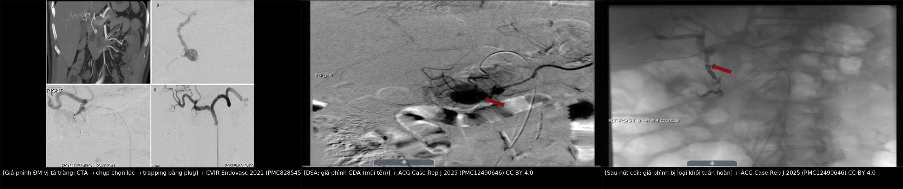
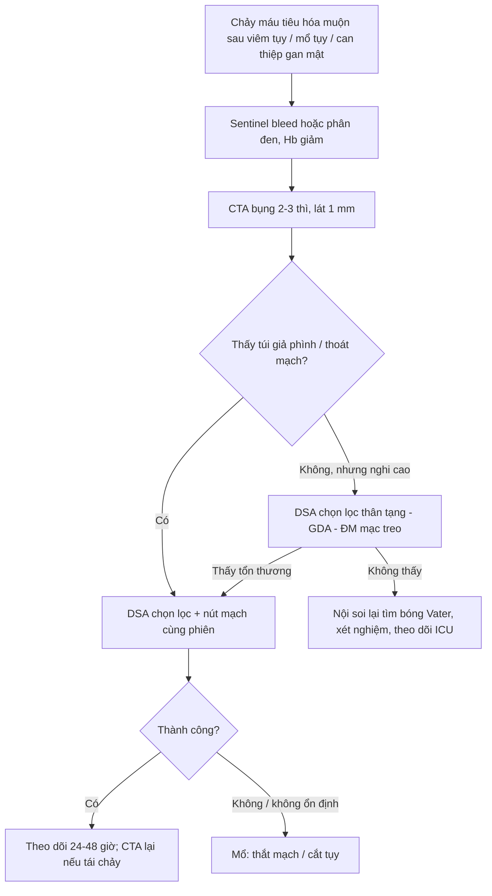
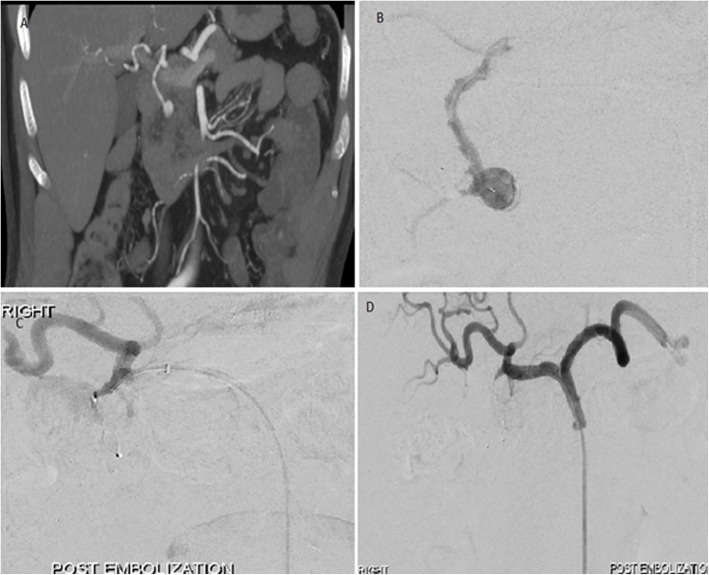
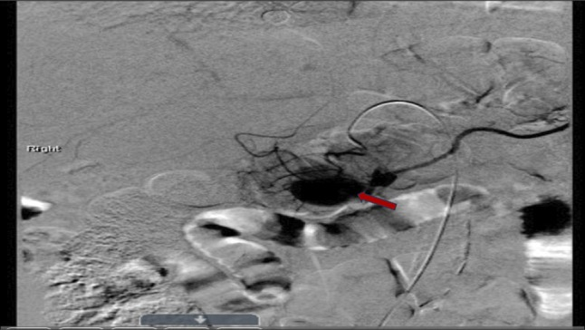
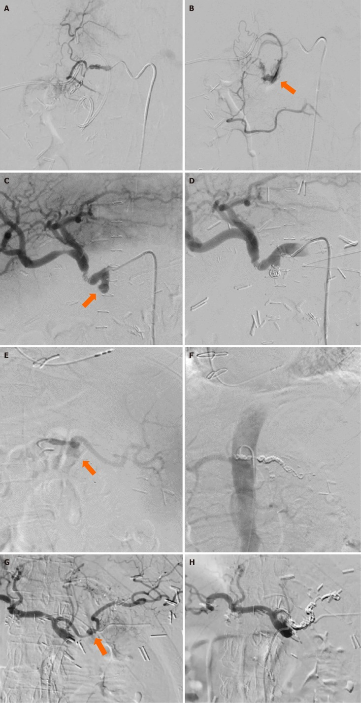

# 1819 — Chảy máu tiêu hóa MUỘN do giả phình động mạch tạng / Delayed GI bleeding from visceral artery pseudoaneurysm (GDA, pancreaticoduodenal)

**Tags:** `pattern:chay-mau-tieu-hoa` `pattern:gia-phinh-mach` `pattern:xuat-huyet-tieu-hoa` `vung:ta-trang` `vung:tuy` `vung:o-bung-tren` `score:ISGPS-PPH` `protocol:CTA-2-thi` `protocol:DSA` `protocol:noi-soi-tieu-hoa`
**Mức chắc chắn (certainty):** tổng hợp y văn (literature synthesis) — ghép tổng quan biến chứng mạch của viêm tụy (*World J Clin Cases* 2022, PMC9372863, CC BY-NC), loạt 46 giả phình động mạch tạng được nút mạch (*CVIR Endovasc* 2021, PMC8285451, CC BY 4.0), loạt 89 ca nút mạch (*CVIR Endovasc* 2024, PMC11400682, CC BY-NC-ND), 4 ca chảy máu muộn sau cắt tụy (*World J Clin Cases* 2024, PMC11438700, CC BY-NC) và tổng quan phình động mạch tạng (*2026*, PMC13554317, CC BY-NC-ND). Số nào nguồn không đưa thì ghi "chưa rõ".

> **Câu chốt:** chảy máu tiêu hóa ở bệnh nhân **viêm tụy hoặc vừa can thiệp gan–mật–tụy** phải được coi là **giả phình động mạch cho tới khi loại trừ**. Giả phình xuất hiện **~3,5 tuần** sau viêm tụy cấp, **không ngừng phát triển theo kích thước** — **nguy cơ vỡ cao bất kể đường kính**, nên **không có ngưỡng "chờ xem"**. **Nội soi âm tính không loại trừ** (máu có thể chảy qua **ống tụy** hoặc ngắt quãng kiểu **sentinel bleed**); **CTA có độ nhạy 95%** và **nút mạch là điều trị đầu tay** (thành công kỹ thuật **100%** trong loạt 46 ca).

## 1. Tổng quan bệnh học – cơ chế hình ảnh

### 1.1 Vì sao viêm tụy tạo ra "túi máu" không có thành thật

- **Cơ chế:** enzyme tiêu protein của tụy gây **viêm động mạch hoại tử (necrotizing arteritis)** quanh tụy → mất lớp áo giữa → máu đẩy thành **túi giả** được bao bởi **mô xơ – cục máu – nang giả**. Vì **không có thành mạch thật**, túi **không có cơ trơn co bóp** và **không tự cầm máu** được → dễ vỡ.
- **Số liệu:** **~1/4** bệnh nhân viêm tụy có biến chứng mạch máu; giả phình gặp **4–17%** trong các loạt đơn trung tâm, xuất hiện **~3,5 tuần** sau khởi phát viêm tụy cấp; **động mạch lách 30–50%**, sau đó **động mạch vị trái, GDA, động mạch tụy–tá tràng** (PMC9372863).
- **Bốn đường chảy máu (quyết định triệu chứng):** (1) vào **ổ dịch/hoại tử** quanh tụy → đau tăng, thiếu máu; (2) vào **ống tụy** → **hemosuccus pancreaticus** (máu ra **bóng Vater**, phân đen/đi cầu phân đen, nội soi dạ dày **có thể bình thường**); (3) vào **đường mật** → **hemobilia** (tam chứng Quincke: đau hạ sườn phải – vàng da – xuất huyết tiêu hóa); (4) **xói mòn vào tá tràng/dạ dày** → nôn máu/đi cầu phân đen ồ ạt.
- **TẠI SAO muộn và "hai thì":** túi giả lớn dần theo thời gian rồi **rò một lượng nhỏ (sentinel bleed)** — máu đọng trong lòng ruột/ổ dịch rồi **tự cầm**; sau **vài giờ đến vài ngày**, túi **vỡ tự do** gây **sốc mất máu**. Sentinel bleed là **dấu hiệu báo trước**, không phải "đã ổn".

### 1.2 Vì sao CTA/DSA thấy được (vật lý + huyết động)

- **Giả phình = túi thông với lòng mạch:** bơm cản quang **thì động mạch** → túi **đầy đồng thời và cùng đậm độ với động mạch chủ**; **thì tĩnh mạch** → **rửa trôi song song với động mạch**, **không đọng lại** như khối u. Đây là **chốt phân biệt giả phình với nang giả tăng ngấm (pseudocyst/enhancing collection)** và với **phình thật** (thành đều, có canxi).
- **Chảy máu hoạt động (active extravasation):** ổ cản quang **tăng dần kích thước/đậm độ ở thì muộn** — khác túi giả phình **đầy rồi xả**.
- **Vì sao CTA nhạy 95%** (PMC9372863) mà vẫn có ca âm: túi **nhỏ (< 5 mm)**, **huyết khối lấp đầy**, hoặc **chụp không đúng thì động mạch mỏng**. Vì vậy **CTA âm + nghi cao → DSA**, không dừng lại.
- **PHÂN LOẠI PANG (dùng để chọn cách nút):** **type 1** — động mạch nhỏ, **> 5 mm cách động mạch lớn**, không thông ống tiêu hóa, không lộ dịch tụy; **type 2** — động mạch lớn **có thể hy sinh**, có thông ống tiêu hóa/lộ dịch tụy; **type 3** — động mạch lớn **không thể hy sinh** → cần **stent-graft** thay vì nút (PMC9372863).

### 1.3 Ngưỡng định lượng nằm lòng

| Đại lượng | Ngưỡng / số liệu | Nguồn |
|---|---|---|
| Biến chứng mạch của viêm tụy | **~25%** bệnh nhân | PMC9372863 |
| Tỉ lệ giả phình trong viêm tụy | **4–17%**; xuất hiện **~3,5 tuần** | PMC9372863 |
| Vị trí | **lách 30–50%**; vị trái, **GDA**, tụy–tá tràng | PMC9372863 |
| Độ nhạy CTA | **95%** | PMC9372863 |
| Nút mạch giả phình tạng | thành công lâm sàng **70–90%** | PMC9372863 |
| Loạt 46 giả phình tạng | kỹ thuật **100%**, lâm sàng **93,48%**, biến chứng **15,22%**, tử vong 30 ngày **0%**, nút lại **2,17%**; coil **92,86%** vs NBCA **93,75%** | PMC8285451 |
| Loạt 89 ca nút mạch | lâm sàng **86,5%**, biến chứng nhẹ **12,4%**, tử vong 30 ngày **5,6%**, chảy máu hoạt động trên CT **34,8%** | PMC11400682 |
| Chảy máu sau cắt tụy (PPH) | **2–8%**; **sớm < 24 giờ** vs **muộn > 24 giờ**; grade **A/B/C** | PMC11438700 |
| Nguy cơ vỡ giả phình | **cao bất kể kích thước → can thiệp cấp** | PMC13554317 |

## 2. Mẫu hình + chẩn đoán phân biệt theo vị trí (gamut)

### 2.1 GDA (động mạch vị–tá tràng) — vị trí "kinh điển" sau viêm tụy đầu tụy và sau mổ tụy

- **Loét/xói mòn giả phình vào hành tá tràng** → **nôn máu, phân đen**; nội soi thấy **máu tươi trong tá tràng nhưng khó thấy ổ** vì nguồn nằm **ngoài lòng**.
- **Sau cắt tụy/Whipple:** chảy máu muộn **> 24 giờ** qua dẫn lưu hoặc ống tiêu hóa = **PPH muộn**, nguyên nhân hàng đầu là **giả phình GDA/động mạch gan** tại chỗ rò tụy (PMC11438700).
- **Sau TACE/TARE hoặc thủ thuật gan–mật:** tổn thương **catheter/guidewire** hoặc **viêm thành mạch do hóa chất** → giả phình **GDA/động mạch gan**; có thể biểu hiện **muộn** bằng **hemobilia** hoặc xuất huyết tiêu hóa.

### 2.2 Động mạch tụy–tá tràng (IPDA/PDA) — bẫy "nội soi âm tính"

- **Hemosuccus pancreaticus:** máu từ **bóng Vater**, **ngắt quãng**, kèm **đau bụng kiểu viêm tụy tái diễn**; **nội soi dạ dày – tá tràng thường âm** nếu không nhìn **bóng Vater đúng lúc đang chảy**.
- Chẩn đoán bằng **CTA thì động mạch mỏng 1 mm**; nếu âm → **DSA chọn lọc động mạch tạng**.

### 2.3 Động mạch lách — chảy vào ống tụy hoặc dạ dày

- Giả phình trong **nang giả/hoại tử đuôi tụy**; vỡ vào **dạ dày** (qua thành sau) gây **nôn máu**; vỡ vào ống tụy gây **hemosuccus**.
- **Bẫy:** túi giả nằm **trong** ổ dịch nên **dễ bị đọc là "nang giả tăng ngấm"** nếu chỉ xem một thì.

### 2.4 Động mạch gan — hemobilia sau can thiệp

- Sau **TACE/TARE, sinh thiết gan, PTBD, chấn thương**; biểu hiện **đau – vàng da – xuất huyết tiêu hóa**; CTA/CT 3 thì; nút mạch hoặc **stent-graft nếu cần giữ dòng gan**.

## 3. Bảng so sánh phân biệt (ma trận đối chiếu)

| Thực thể (entity) | Hình ảnh điển hình | Chốt vào (rule-in) | Chốt loại (rule-out) | Gợi ý xác nhận |
|---|---|---|---|---|
| **Giả phình GDA/tụy–tá tràng** | Túi **saccular** quanh tụy/tá tràng, đầy **thì động mạch**, rửa **cùng động mạch**, bờ **không đều** | **Túi + nhu mô tụy viêm/ổ dịch quanh + tiền sử viêm tụy/mổ/can thiệp** | Không thấy túi trên CTA **thì động mạch mỏng** → không loại trừ, cần DSA | CTA 2–3 thì lát 1 mm → DSA + nút |
| **Phình thật động mạch tạng** | Thành đều, có **canxi**, hình thoi/đối xứng | **Canxi thành + hình thái đều, không bối cảnh viêm** | Bờ không đều + bối cảnh viêm cấp → giả phình | CTA; theo dõi kích thước |
| **Nang giả tăng ngấm (pseudocyst)** | Ngấm **viền**, đậm độ **thấp hơn động mạch**, không rửa đồng thì | **Ngấm kiểu viền/mô hạt, không cùng đậm độ ĐMC** | Đầy **cùng đậm độ ĐMC ở thì động mạch** → giả phình | So đậm độ với ĐMC ở 3 thì |
| **Loét tiêu hóa chảy máu** | Ổ loét + máu trong lòng; không túi mạch | **Ổ loét thấy trên nội soi, không túi trên CTA** | Nội soi âm + máu tái phát → nghĩ nguồn ngoài lòng (giả phình) | Nội soi + CTA; nếu âm → DSA |
| **Giãn tĩnh mạch / Mallory–Weiss** | Búi giãn hoặc rách niêm mạc; **không túi động mạch** | **Bối cảnh tăng áp cửa, nôn nhiều** | Có túi mạch → giả phình | Nội soi cấp cứu |
| **U tụy/tá tràng chảy máu** | Khối + hạch, ngấm **không đồng thì với ĐMC** | **Khối đặc, hạch, ngấm kiểu u** | Túi đầy thì động mạch → giả phình | Sinh thiết sau khi cầm máu |
| **Hemobilia sau can thiệp gan** | Máu trong đường mật, giả phình **động mạch gan** | **Tam chứng Quincke + tiền sử PTBD/TACE/sinh thiết** | Không máu đường mật → nguồn khác | CT 3 thì, DSA |

*Trái: CTA coronal (A) túi giả phình GDA trong máu tụ, DSA chọn lọc (B), và trapping bằng plug (C, D). Giữa/phải: DSA trước và sau nút coil cùng ca. Nguồn: CVIR Endovasc 2021 (PMC8285451) CC BY 4.0; ACG Case Rep J 2025 (PMC12490646) CC BY 4.0. Ảnh ghép letterbox, không crop.*

### Dấu hiệu hình ảnh chốt (đọc nhanh)

- **"Hai dấu chấm" cạnh ổ dịch tụy:** một chấm là **lòng mạch**, chấm kia là **túi giả** nối bằng **cổ hẹp** — cổ hẹp giải thích **không tự cầm máu**.
- **Đậm độ:** so **trực tiếp với động mạch chủ** ở **cùng một thì**; giả phình **bằng**, nang giả **thấp hơn**.
- **Theo dõi:** túi **to lên nhanh giữa 2 lần chụp** (vài mm/ngày) = **nguy cơ vỡ tức thì**, can thiệp ngay.

## 4. Protocol chụp/can thiệp + hệ phân độ

### 4.1 Chẩn đoán: CTA trước, DSA để điều trị

- **CTA bụng 2–3 thì** (không cản quang – **động mạch** – tĩnh mạch cửa), **lát 0,5–1 mm**, **dựng MIP/coronal** dọc trục thân tạng – GDA – nhánh tụy–tá tràng. Ghi **vị trí, đường kính túi, cổ túi, mạch cho – mạch nhận, có chảy máu hoạt động hay không**.
- **DSA chọn lọc** thân tạng, động mạch gan, **GDA**, động mạch mạc treo tràng trên (nhánh tụy–tá tràng dưới) — **điều trị ngay trong cùng phiên** nếu thấy túi.
- **Nội soi tiêu hóa trên** trước/song song để loại trừ ổ loét và **tìm máu ở bóng Vater** (hemosuccus) — nhưng **không được trì hoãn CTA** vì nội soi âm.

### 4.2 Phân độ & quyết định (theo ISGPS cho bối cảnh sau mổ tụy)

| Grade | Định nghĩa | Hành động |
|---|---|---|
| **A** | Chảy máu nhỏ, không ảnh hưởng diễn tiến hậu phẫu | Theo dõi sát, **CTA ngay khi có sentinel bleed** |
| **B** | Cần truyền máu/nội soi/can thiệp, không sốc | **CTA → nút mạch** |
| **C** | Đe dọa tính mạng, cần xử trí tức thì, thường vào ICU | **Nút mạch khẩn ± mổ** |

- **Sentinel bleed** (máu nhỏ qua dẫn lưu hoặc ống tiêu hóa, **không triệu chứng**) là **dấu hiệu cảnh báo vỡ túi giả phình** — nghĩa là **CTA ngay**, không chờ sốc (PMC11438700).

### 4.3 Kỹ thuật nút mạch

- **Trapping:** đặt coil/vật liệu **phía xa túi trước, phía gần sau** để chặn **dòng ngược từ tuần hoàn bàng hệ** — kỹ thuật hay dùng cho **GDA** (PMC9372863, PMC8285451).
- **Sac packing:** nhồi đầy túi bằng coil/NBCA–Lipiodol khi cổ rộng hoặc không thể trapping.
- **Stent-graft (covered stent):** khi **không thể hy sinh mạch** (type 3 Pang — động mạch gan, mạc treo tràng trên).
- **Chất liệu:** coil (nhóm 28 ca: lâm sàng **92,86%**) hoặc **NBCA glue** (16 ca: **93,75%**) — khác biệt không rõ (PMC8285451).
- **Thất bại/lâm sàng xấu đi** → **mổ** (thắt mạch, cắt tụy/tá tràng) — chỉ định khi **không can thiệp được** hoặc **huyết động không ổn định**.

## 5. Biến thể bình thường và cạm bẫy

- **Nội soi âm tính không loại trừ:** nguồn có thể ở **ống tụy** (hemosuccus) hoặc **ngoài lòng**; máu **ngắt quãng**.
- **Chỉ chụp một thì:** giả phình **nhỏ** có thể **biến mất** ở thì tĩnh mạch; **bắt buộc thì động mạch mỏng**.
- **Đọc nang giả thành giả phình:** so **đậm độ với động mạch chủ cùng thì** là cách chốt.
- **Chờ đợi vì "túi nhỏ":** giả phình **vỡ bất kể kích thước** — không có ngưỡng theo dõi (PMC13554317).
- **Bỏ sót nguồn thứ hai:** viêm tụy có thể có **nhiều túi**; DSA phải khảo sát **cả thân tạng và mạc treo tràng trên**.
- **Coil lộ ra ngoài lòng (exposed coil):** vật liệu nút có thể **di trú/xuyên vào ổ hoại tử hoặc lòng tá tràng**; theo dõi bằng CT và nội soi khi có triệu chứng mới.
- **Bối cảnh TACE/TARE:** chảy máu có thể **do loét xạ** (bài 1818) **hoặc** giả phình — **hai cơ chế cùng tồn tại**, đừng dừng ở một chẩn đoán.
- **Nhiễm khuẩn:** giả phình **mycotic** sau nhiễm khuẩn huyết/viêm tụy nhiễm trùng — cần **kháng sinh dài** phối hợp, không chỉ nút mạch.

## 6. Tự lượng giá — Blind Quiz

**Ca 1 — Nam 55 tuổi, viêm tụy cấp 4 tuần trước, đau thượng vị tăng, Hb tụt 2 g/dL.**

- Hỏi: mô tả tổn thương trên CTA (A) và cách xử trí ở (B–D)? Vì sao phải chặn cả hai đầu?

<b>Bấm để hiện đáp án (findings + chẩn đoán)</b>

- **Findings:** (A) CTA coronal — túi **giả phình GDA** nằm trong **máu tụ/ổ dịch quanh tụy**; (B) DSA chọn lọc xác nhận; (C, D) **trapping** bằng **plug phía xa và phía gần** → túi bị loại khỏi tuần hoàn.
- **Chẩn đoán:** giả phình GDA sau viêm tụy — **nguy cơ vỡ cao**, cần can thiệp dù chưa sốc.
- **Vì sao hai đầu:** GDA có **tuần hoàn bàng hệ** (nhánh tá tụy, vị tá) → nút một đầu dễ **tái thông ngược dòng**.
- Nguồn ảnh: *CVIR Endovasc* 2021 (PMC8285451), Fig. 1 — CC BY 4.0.

**Ca 2 — Nữ 60 tuổi, viêm tụy hoại tử, phân đen tái diễn 2 đợt, nội soi dạ dày không thấy ổ loét.**

- Hỏi: vì sao nội soi âm? Dấu hiệu trên DSA là gì? Bước tiếp theo?

<b>Bấm để hiện đáp án (findings + chẩn đoán)</b>

- **Findings:** DSA động mạch vị–tá tràng — **túi giả phình** (mũi tên đỏ) đổ đầy ở thì động mạch.
- **Chẩn đoán:** giả phình GDA; nội soi âm vì **máu chảy qua ống tụy/ngắt quãng** (kiểu hemosuccus) hoặc nguồn **ngoài lòng**.
- **Bước tiếp:** **nút coil** (ảnh dưới) — kiểm tra loại trừ túi khỏi tuần hoàn.
- Nguồn ảnh: *ACG Case Rep J* 2025 (PMC12490646), Fig. 3 — CC BY 4.0.

**Ca 3 — Sau cắt tụy, ngày 8: máu ít qua dẫn lưu, bệnh nhân tỉnh, HA bình thường.**

- Hỏi: "máu ít" có được theo dõi? Hình DSA cho thấy gì?

<b>Bấm để hiện đáp án (findings + chẩn đoán)</b>

- **Findings:** DSA — **thoát mạch cản quang từ động mạch vị–tá tràng** (mũi tên); sau can thiệp, **không còn thoát mạch**.
- **Chẩn đoán:** **PPH muộn + sentinel bleed** do giả phình — **không được chờ**; CTA/DSA và nút mạch ngay.
- **Bài học:** chảy máu nhỏ **tự cầm** vẫn là **điềm báo vỡ**; tử vong của PPH liên quan **chậm trễ**, không phải lượng máu lúc đầu.
- Nguồn ảnh: *World J Clin Cases* 2024 (PMC11438700), Fig. 2 — CC BY-NC 4.0.

## Bài liên quan chéo
- [920 – Nút mạch cầm máu tiêu hóa](../920-vascular-embolization-gi-bleed/lesson.md)
- [135 – Viêm tụy cấp (Atlanta)](../135-viem-tuy-Atlanta/lesson.md)
- [930 – TACE/RFA/đốt u gan](../930-hepatic-oncology-tace-rfa/lesson.md)
- [1811 – Loét & hẹp thực quản–dạ dày–tá tràng do vi cầu lạc vị sau TACE/TARE](../1811-loet-da-day-ta-trang-sau-tace-tare/lesson.md)

## Ảnh & giấy phép
- `1819_gia-phinh-mach-tang_CTA-DSA_PMC8285451-f1.jpg` — *CVIR Endovasc* 2021 (PMC8285451), **CC BY 4.0**.
- `1819_gia-phinh-mach-tang_DSA_PMC12490646-f3.jpg`, `..._DSA-sau-nut_PMC12490646-f4.jpg` — *ACG Case Rep J* 2025 (PMC12490646), **CC BY 4.0**.
- `1819_gia-phinh-mach-tang_DSA_PMC11438700-f2.jpg` — *World J Clin Cases* 2024 (PMC11438700), **CC BY-NC 4.0**.
- `composite_gia-phinh-gda.jpg` — ghép bằng `tools/make_composite.py`, **CC BY 4.0** (chỉ gồm ảnh CC BY).
- Chi tiết từng file: `images/CREDITS.md`.

> Không dùng để chẩn đoán độc lập khi chưa có người hướng dẫn.
