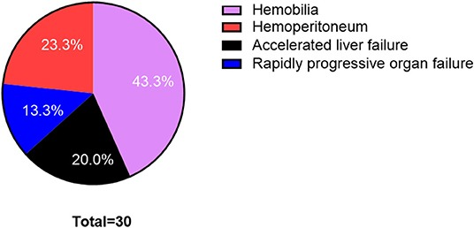
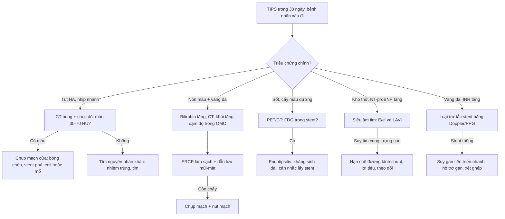
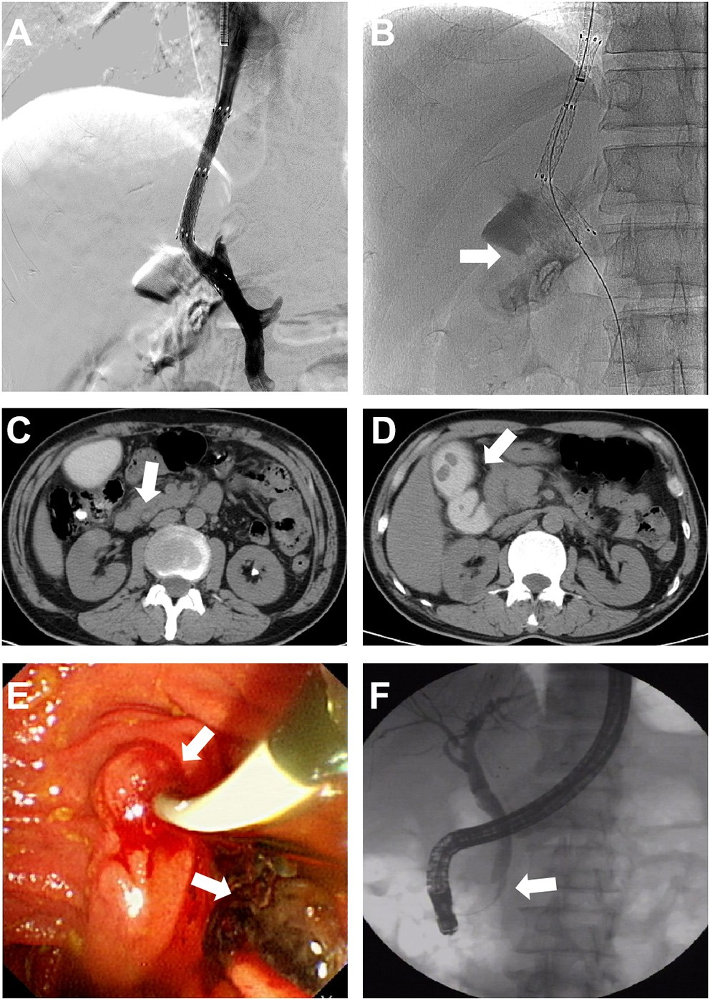
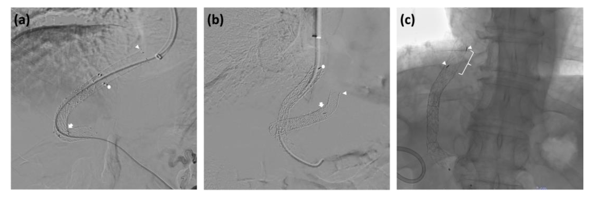

# 182 — Biến chứng SỚM sau TIPS: thủng bao gan, hemobilia, endotipsitis & suy tim cung lượng cao / Early complications of TIPS

**Tags:** `pattern:bien-chung-can-thiep` `vung:gan` `vung:duong-mat` `protocol:CT-3-thi` `protocol:ERCP`
**Mức chắc chắn (certainty):** tổng hợp y văn (literature synthesis) — cohort 948 ca có ảnh gốc (Front Med 2022 PMC9116508), bài kỹ thuật có ảnh thủng bao gan (Diagn Interv Radiol 2024 PMC10773176 — ảnh không tải được, chỉ dùng mô tả), ca endotipsitis (BJR Case Rep 2024 PMC10873906), tổng quan thiết bị (J Clin Med 2023 PMC10650044), tổng quan tim–thận (Gastroenterol Rep 2026 PMC13613062) và dữ liệu nguy cơ tim (World J Gastroenterol 2025 PMC12305093).

> **Câu hỏi gốc của bài:** bệnh nhân **vừa được đặt TIPS** (trong 24 giờ đến 30 ngày) **tụt huyết áp, đau bụng, nôn máu, vàng da, sốt hoặc khó thở** — trên **DSA/CT/ERCP** đâu là dấu hiệu phân biệt **5 nhóm biến chứng sớm**, và mỗi nhóm xử trí khác nhau thế nào?
> **Điểm tựa:** TIPS là **đâm xuyên nhu mô gan "mù"** từ tĩnh mạch gan sang tĩnh mạch cửa. Mọi biến chứng sớm đều quy về **cấu trúc bị kim/stent đi qua**: **bao gan (→ máu trong ổ bụng)**, **đường mật (→ hemobilia)**, **động mạch gan (→ nhồi máu/giả phình)**, **vị trí đặt stent (→ sai vị trí, huyết khối sớm)**, **tuần hoàn (→ suy tim cung lượng cao, suy gan cấp)** và **nhiễm trùng stent (→ endotipsitis)**.

## 1. Tổng quan bệnh học – cơ chế hình ảnh

**A. Vì sao biến chứng sớm xảy ra – "ba nút nguy hiểm" trên đường đi của kim:**
1. **Bao gan (liver capsule):** nếu đường hầm đi ra ngoài bao hoặc chọc vào **tĩnh mạch cửa ngoài gan** → **máu chảy vào ổ bụng (hemoperitoneum)**, thường **trong 24 giờ đầu**, biểu hiện **nhịp tim nhanh + tụt huyết áp đột ngột, sốc giảm thể tích** (PMC9116508).
2. **Đường mật trong gan:** kim đi qua ống mật là **không thể tránh tuyệt đối**; nong đường hầm bằng bóng làm tổn thương mật nặng thêm. Máu từ ống mật chảy vào tá tràng → **hemobilia** (nôn máu + đau quặn mật + vàng da = **tam chứng Quincke**). Câu gốc trong bài kỹ thuật: **"không được nong đường hầm đã chọc vào đường mật"** để tránh tổn thương mật lớn (PMC10773176).
3. **Động mạch gan:** chọc/nong vào nhánh động mạch → **giả phình, rò động–mật, nhồi máu gan**.

**B. Ngưỡng định lượng (Argon – cửa 1) — cohort 948 ca, stent phủ (PMC9116508):**

| Biến chứng | Tỷ lệ trong cohort | Tử vong | Ngưỡng chất lượng (Quality Improvement Guidelines) |
|---|---|---|---|
| Hemobilia | **13 ca (1,37%)** | **1 (7,6% ca hemobilia)** | ≤ **2%** |
| Hemoperitoneum | **7 ca (0,74%)** | 0 | ≤ **1%** |
| Suy gan tiến triển nhanh (accelerated liver failure) | **6 ca (0,63%)** | **4 (66,7%)** | — (bài gốc không đặt ngưỡng riêng) |
| Suy đa cơ quan tiến triển nhanh (organ failure: phổi–tim–thận) | **4 ca (0,42%)** | **3 (75%)** | ≤ **0,5%** |
| Stent sai vị trí (malposition) | 0 | 0 | ≤ **1%** |
| Tổn thương động mạch gan | 0 | 0 | ≤ **2%** |
| **Tổng biến chứng nặng** | **30 ca (3,2%)** | **8 (0,84%)** | ≤ 5% |

- **Thành công kỹ thuật 95,1% (902/948)**; tỷ lệ thành công **gần 100% khi tĩnh mạch cửa thông**, nhưng **< 90% khi có cavernoma** tĩnh mạch cửa (PMC9116508) → **cavernoma là yếu tố nguy cơ của cả thất bại lẫn biến chứng**.
- **Thời gian:** hemoperitoneum biểu hiện **trong 24 giờ**; **hemobilia có thể xuất hiện muộn hơn** (vàng da tăng dần sau vài ngày — đúng như ca trong hình); **suy gan cấp** tính trong **30 ngày** (định nghĩa: bilirubin **≥ 3 lần** và/hoặc INR **≥ 2 lần** kèm hậu quả lâm sàng).
- **Suy tim cung lượng cao:** **tới 25%** bệnh nhân có biến cố tim/suy tim mới sau TIPS; tổng hợp nhiều cohort cho **trung bình gia quyền ~8%**, dao động **0–44%** tùy tiêu chuẩn chẩn đoán (PMC12305093). Ngưỡng sàng lọc được dùng trong các nghiên cứu: **NT-proBNP > 125 pg/mL**, **BNP > 40 pg/mL**, **E/e' > 10**, **LAVI > 34 mL/m²**, **QTc > 440 ms** (PMC12305093).

**C. TẠI SAO ảnh trông như vậy:**
- **Hemobilia trên fluoroscopy/CT:** thuốc cản quang **đọng trong túi mật/đường mật** (bằng chứng đã chọc vào đường mật); CT sau đó thấy **ống mật giãn + khối tăng đậm độ trong ống mật chủ** = **cục máu đông**, không phải sỏi (sỏi có bờ rõ, thường thấy cả trước can thiệp).
- **Hemoperitoneum trên CT:** **dịch tự do quanh gan/lách, tăng đậm độ ở thì muộn** (máu đông ~**35–70 HU**), có thể thấy **vệt thuốc thoát mạch hoạt tính** nếu đang chảy; chẩn đoán xác nhận bằng **chọc dò ổ bụng** hoặc **chụp mạch cửa** (PMC9116508).
- **Endotipsitis:** stent nhiễm trùng → **huyết khối trong lòng stent + FDG avid trên PET/CT**; đây là dấu hiệu **nhiễm trùng mảnh ghép**, không phải huyết khối đơn thuần (PMC10873906).
- **Stent sai vị trí:** trên fluoroscopy stent **hình chữ C/gấp khúc**, đầu stent **không nằm sát hợp lưu tĩnh mạch gan–TM chủ dưới** → dễ hẹp/tắc sớm.

## 2. Mẫu hình + chẩn đoán phân biệt theo vị trí (Gamut)

**Gamut theo CẤU TRÚC BỊ TỔN THƯƠNG (nhớ nhanh "BAM-CHE"):**
- **B — Bao gan/phúc mạc:** hemoperitoneum (máu ổ bụng), **rò ổ bụng–tĩnh mạch cửa** (peritoneal shunt) khi chọc vào TM cửa ngoài gan.
- **A — Đường mật (biliary):** hemobilia, **viêm phúc mạc mật (biliary peritonitis)** do rò mật, **biloma**, hẹp đường mật muộn.
- **M — Mạch (arterial):** tổn thương **động mạch gan** (giả phình, rò động–mật), **nhồi máu gan**, vỡ TM cửa.
- **C — Cấu trúc shunt (stent):** **sai vị trí/gấp khúc**, **di trú**, **huyết khối sớm**, **endotipsitis** (nhiễm trùng stent).
- **H — Huyết động – toàn thân:** **suy tim cung lượng cao/phù phổi**, **suy gan tiến triển nhanh**, **suy đa cơ quan**, bệnh não gan nặng.

**Gamut theo THỜI ĐIỂM (quyết định thứ tự nghĩ tới):**
- **Trong lúc chọc/nong:** hemoperitoneum, tổn thương động mạch gan, chọc vào đường mật (thấy thuốc trong túi mật), sai vị trí stent.
- **0–24 giờ:** sốc mất máu (hemoperitoneum), thay đổi tri giác (bệnh não gan), khó thở (quá tải).
- **1–7 ngày:** **hemobilia** (nôn máu + vàng da), **suy gan tiến triển**, **suy tim cung lượng cao**, **sốt** (endotipsitis/viêm phúc mạc mật).
- **1–4 tuần:** huyết khối stent sớm, biloma/ổ dịch nhiễm trùng, suy thận.

**Gamut theo BỐI CẢNH nguy cơ cao:**
- **Huyết khối tĩnh mạch cửa/cavernoma** → kỹ thuật khó, **hemoperitoneum** (5/7 ca hemoperitoneum có PVT trong cohort) và thất bại kỹ thuật.
- **Rối loạn đông máu, giảm tiểu cầu nặng, báng lượng lớn** → chảy máu; cần **chọc hút báng/xiphông trước** khi làm TIPS.
- **Bệnh tim thực thể, rung nhĩ, hở van, tăng áp phổi, lớn tuổi** → **suy tim cung lượng cao**; cần siêu âm tim + NT-proBNP trước.
- **Suy gan Child–Pugh C, vàng da nặng** → **suy gan tiến triển nhanh** (tử vong 4/6 ca).

## 3. Bảng so sánh phân biệt (ma trận đối chiếu)

| Thực thể (entity) | Hình ảnh điển hình | Chốt vào (rule-in) | Chốt loại (rule-out) | Gợi ý xác nhận |
|---|---|---|---|---|
| **Hemoperitoneum (thủng bao gan)** | CT: **dịch tự do quanh gan, tăng đậm độ 35–70 HU**; chụp mạch cửa thấy thuốc thoát ra ổ bụng | **Tụt HA + nhịp nhanh trong 24 giờ đầu + dịch ổ bụng mới + chọc dò ra máu không đông** | Dịch **đậm độ thấp (< 20 HU)** + có từ trước = báng, không phải máu mới | Chụp mạch cửa tại bàn; nếu đang chảy: **bóng chèn/nong stent phủ qua chỗ thủng, coil, hoặc mổ** |
| **Hemobilia (tổn thương đường mật)** | Fluoroscopy: **thuốc đọng trong túi mật**; CT: **ống mật giãn + khối tăng đậm độ trong OMC**; nội soi: máu từ nhú Vater | **Nôn máu + đau quặn mật + vàng da (Quincke) sau TIPS + bilirubin tăng dần** | **Sỏi OMC** có bờ rõ và thường có trước; **loét dạ dày** không vàng da | **ERCP** (làm sạch cục máu + dẫn lưu mũi–mật), **CT-A/chụp mạch + nút mạch** nếu chảy tiếp |
| **Suy gan tiến triển nhanh** | Không có dấu hiệu hình ảnh đặc hiệu; gan teo, cổ trướng tăng | **Bilirubin ≥ 3 lần và/hoặc INR ≥ 2 lần trong 30 ngày + bệnh não gan không kiểm soát** | **Tắc stent** gây suy gan thứ phát (phải loại trừ bằng Doppler/PPG) | Xét nghiệm gan–đông máu mỗi 24–48 giờ; Doppler stent; hỗ trợ gan nhân tạo |
| **Suy tim cung lượng cao / phù phổi** | X-quang: tim to, mạch máu phổi tăng; siêu âm: **E/e' > 10, LAVI > 34 mL/m²**, tăng áp phổi | **Khó thở + tăng NT-proBNP sau TIPS + siêu âm tim giãn buồng/tăng áp lực đổ đầy** | **Thuyên tắc phổi** (D-dimer, CTPA) và **nhiễm trùng** (CRP, Procalcitonin) | Siêu âm tim, NT-proBNP; **hạn chế đường kính shunt** nếu nặng |
| **Endotipsitis (nhiễm trùng stent)** | CT: **huyết khối trong stent**, khí/tụ dịch quanh; **PET/CT: FDG avid trong stent** | **Sốt + cấy máu dương nhiều lần, không ổ nhiễm khác + huyết khối trong stent** | **Huyết khối vô khuẩn** (không sốt, không cấy dương) | Cấy máu nhiều lần; PET/CT; kháng sinh kéo dài ± **lấy stent/ghép gan** |
| **Stent sai vị trí / gấp khúc** | Fluoroscopy: stent **chữ C**, đầu stent xa hợp lưu TM gan–IVC; Doppler: dòng bất thường | **Chênh áp PPG còn cao + dòng Doppler bất thường ngay sau đặt** | **Hẹp muộn do tăng sinh** (thường sau nhiều tháng) | Đo PPG; đặt stent thứ hai phủ đúng đường hầm (PMC10650044) |
| **Tổn thương động mạch gan** | Chụp mạch: **thuốc thoát mạch/giả phình**; CT: ổ giảm đậm độ hình nêm (nhồi máu) | **Đau bụng + sốt + tăng transaminase sau TIPS + ổ ngấm thuốc bất thường thì động mạch** | **Nhồi máu do tắc tĩnh mạch cửa** (không có ổ ngấm động mạch) | Chụp mạch + **nút mạch chọn lọc**; tránh nong đường hầm đã chọc mật/động mạch |

*Tỷ lệ tương đối trong 30 ca biến chứng nặng: hemobilia 43,3%, hemoperitoneum 23,3%, suy gan tiến triển nhanh 20%, suy đa cơ quan 13,3%. Nguồn: Front Med 2022 (PMC9116508), CC BY 4.0.*

### Dấu hiệu "đắt giá" trên từng phương thức
- **Fluoroscopy tại bàn:** thuốc vào **túi mật** = đã chọc đường mật → **ngừng nong đường hầm**, đổi hướng; **stent gấp khúc** = nguy cơ hẹp sớm.
- **CT 3 thì sau TIPS:** phân biệt **máu (35–70 HU)** với **báng (< 20 HU)**; tìm **khí trong stent/ổ dịch quanh gan** (nhiễm trùng); đo **đường kính stent** (quá lớn → nguy cơ suy tim).
- **ERCP:** cục máu đông trong OMC (khuyết lòng) → **hút sạch + dẫn lưu mũi–mật**; đây là xử trí phổ biến nhất cho hemobilia (8/13 ca trong cohort).

## 4. Protocol chụp + xử trí theo bậc

**A. Trước TIPS (dự phòng):**
- **CT bụng 3 thì + dựng 3D tĩnh mạch cửa** để chọn vị trí chọc; **đo PPG** trước–sau.
- **Đánh giá tim:** ECG + **NT-proBNP/BNP** cho mọi ca chương trình; nếu bất thường → **siêu âm tim** (E/e', LAVI, áp lực động mạch phổi); ngưỡng tham khảo: **NT-proBNP > 125 pg/mL, E/e' > 10, LAVI > 34 mL/m², QTc > 440 ms** (PMC12305093). Cân nhắc **thông tim phải** khi NT-proBNP cao mà siêu âm không kết luận (PMC13613062).
- **Đông máu:** hiệu chỉnh INR/tiểu cầu; **chọc hút báng/xiphông màng phổi lượng lớn trước** để giảm nguy cơ chảy máu và cải thiện hô hấp.

**B. Trong thủ thuật (kỹ thuật "nhìn thấy đường đi"):**
- Định vị TM cửa bằng **portography gián tiếp (SMA)**, **chọc hình nêm + CO2**, **cone-beam CT**, **snare/wire làm đích**, hoặc **siêu âm trong tim (ICE)** (PMC10773176).
- **Nếu chọc vào đường mật (thấy thuốc trong túi mật): KHÔNG nong đường hầm** — đổi hướng; nong sẽ biến chọc nhỏ thành tổn thương mật lớn.
- Sau đặt stent: **đo PPG**, chụp kiểm tra, **theo dõi huyết áp/nhịp tim liên tục tại bàn**.

**C. Sau TIPS:**
- **24 giờ đầu:** theo dõi sát sinh hiệu, nước tiểu, đau bụng, nôn máu; **Hb/Hct, chức năng gan–thận, điện giải sau 24 giờ**; **siêu âm Doppler trước ra viện**.
- **Nghi hemoperitoneum:** hồi sức + **chọc dò ổ bụng** + **chụp mạch cửa**; xử trí **bóng chèn/nong stent phủ, coil, hoặc mổ** (2/7 ca trong cohort phải mổ khâu TM cửa).
- **Nghi hemobilia:** **ERCP** (làm sạch + dẫn lưu mũi–mật) là bước đầu; nếu chảy tiếp → **chụp mạch + nút mạch**; hiếm khi phải mổ.
- **Nghi suy gan tiến triển:** loại trừ **tắc stent** (Doppler/PPG), điều trị bệnh não gan, **hỗ trợ gan nhân tạo**, xét ghép.
- **Nghi endotipsitis:** **cấy máu nhiều lần + PET/CT**; kháng sinh dài ngày; nếu thất bại → **lấy stent/ghép gan** (PMC10873906).

## 5. Biến thể bình thường và cạm bẫy

- **Thuốc cản quang đọng trong túi mật** có thể **tồn tại vài ngày** — đừng nhầm với sỏi; và **không phải mọi ca chọc mật đều thành hemobilia** (phần lớn tự giới hạn).
- **Hemobilia muộn:** có ca **vàng da tăng dần sau nhiều ngày** rồi mới nôn máu; **đừng chờ tam chứng đủ** mới nghĩ tới.
- **Hemoperitoneum ở bệnh nhân có huyết khối TM cửa** đang **kháng đông/tiêu sợi huyết**: 5/7 ca trong cohort có PVT → **nguy cơ chảy máu tăng gấp đôi** (vừa can thiệp vừa thuốc).
- **"Dịch quanh gan" sau TIPS:** phân biệt **báng (đậm độ thấp, có từ trước)** với **máu mới (35–70 HU, tăng nhanh về lượng)**; đo HU trên CT **không cản quang** là bước rẻ và nhanh nhất.
- **Suy tim cung lượng cao bị bỏ sót** vì triệu chứng mơ hồ (mệt, khó thở khi gắng sức) — **NT-proBNP sau TIPS** nên được đo khi có triệu chứng, và **stent quá lớn** là yếu tố nguy cơ (xem bài 176: stent 7 mm giảm bệnh não gan so với 8 mm).
- **Endotipsitis ≠ huyết khối vô khuẩn:** khác biệt nằm ở **sốt + cấy máu**; PET/CT giúp nhưng **không thay thế cấy máu**.
- **Đừng quên "biến chứng của chính biến chứng":** nong đường hầm đã chọc vào mật/động mạch biến một vết chọc nhỏ thành **rò mật–máu hoặc giả phình**; kỹ thuật đúng là **dừng và đổi hướng**.

## 6. Tự lượng giá — Blind Quiz ngay trên trang tĩnh

**Ca 1 — Nam 58 tuổi, xơ gan rượu, TIPS vì xuất huyết giãn tĩnh mạch. Ngày thứ 4: nôn máu, đau hạ sườn phải, vàng da tăng.**

- Gợi ý: sinh hiệu ổn, không sốc; bilirubin tăng dần từ ngày 2.
- Câu hỏi: (1) Dấu hiệu nào trên hình chứng minh đường mật đã bị chọc? (2) Chẩn đoán? (3) Hai bước xử trí đầu tiên?

<b>Bấm để hiện đáp án (findings + chẩn đoán)</b>

- Dấu hiệu: (A–B) fluoroscopy tại bàn: **thuốc đọng trong túi mật** (mũi tên) = đã chọc vào đường mật; (C–D) CT: **ống mật giãn, túi mật còn thuốc, ống mật chủ có khối tăng đậm độ** (mũi tên) = **cục máu đông**; (E) nội soi: **máu từ nhú Vater**; (F) ERCP: khuyết lòng trong OMC, hút ra cục máu và đặt ống dẫn lưu mũi–mật.
- Chẩn đoán: **hemobilia sau TIPS** (1,37% trong cohort; **1/13 tử vong**).
- Xử trí: **ERCP làm sạch + dẫn lưu mũi–mật**; nếu còn chảy → **chụp mạch + nút mạch**; truyền máu/hồi sức.
- Nguồn ảnh: Front Med 2022 (PMC9116508) Fig. 2, CC BY 4.0.

**Ca 2 — Nam 50 tuổi, xơ gan, TIPS vì báng kháng trị. Sau thủ thuật PPG vẫn cao, Doppler dòng trong stent bất thường.**

- Gợi ý: không sốt, không đau bụng; chỉ còn cổ trướng và PPG cao.
- Câu hỏi: (1) Bất thường chính trên hình? (2) Vì sao tình trạng này gây "thất bại" TIPS? (3) Xử trí?

<b>Bấm để hiện đáp án (findings + chẩn đoán)</b>

- Dấu hiệu: (a) stent **gấp khúc hình chữ C**, đầu stent không áp sát hợp lưu TM gan–TM chủ dưới (mũi tên); (b) đặt **stent thứ hai** phủ lại đường hầm; (c) kiểm tra sau cùng: đường hầm thẳng, thông.
- Vì sao thất bại: gấp khúc + đầu stent lệch → **hẹp/tắc sớm, PPG không giảm**; đây là biến chứng do **kỹ thuật đặt**, không phải do tăng sinh muộn.
- Xử trí: **đặt stent thứ hai phủ toàn bộ đường hầm và tới hợp lưu**, đo lại PPG; theo dõi Doppler.
- Nguồn ảnh: J Clin Med 2023 (PMC10650044) Fig. 3, CC BY 4.0.

**Ca 3 — Hồi cứu 948 ca TIPS dùng stent phủ tại một trung tâm.**

- Gợi ý: 30 ca biến chứng nặng, 8 ca tử vong.
- Câu hỏi: (1) Biến chứng nặng **hay gặp nhất**? (2) Nhóm nào **chết nhiều nhất tính theo tỷ lệ trong nhóm**? (3) Ngưỡng chất lượng cho hemobilia và hemoperitoneum?

<b>Bấm để hiện đáp án (findings + chẩn đoán)</b>

- Hay gặp nhất: **hemobilia 43,3%** trong 30 ca (1,37% toàn cohort).
- Chết nhiều nhất theo tỷ lệ trong nhóm: **suy đa cơ quan 3/4 (75%)** và **suy gan tiến triển nhanh 4/6 (66,7%)**; hemobilia chỉ **1/13 (7,6%)** nhưng là biến chứng hay gặp nhất.
- Ngưỡng chất lượng: **hemobilia ≤ 2%**, **hemoperitoneum ≤ 1%**, **tổng biến chứng nặng ≤ 5%** — cohort đạt **3,2%** biến chứng nặng và **0,84%** tử vong.
- Nguồn ảnh: Front Med 2022 (PMC9116508) Fig. 1, CC BY 4.0.

## Bài liên quan chéo
- [176 – TIPS/DIPS: chỉ định, kỹ thuật & theo dõi shunt](../176-tips-dips-theo-doi-shunt/lesson.md)
- [181 – BRTO/RTO cho giãn tĩnh mạch dạ dày](../181-brto-thuyen-tac-nguoc-tm-than-trai-gian-tm-da-day/lesson.md)
- [105 – Theo dõi ống dẫn lưu mật qua da (PTBD): tắc, hemobilia](../105-theo-doi-ong-dan-luu-mat-qua-da/lesson.md)
- [179 – Hoại tử ống mật & cholangiopathy sau can thiệp u gan](../179-bien-chung-duong-mat-sau-can-thiep-u-gan/lesson.md)
- [127 – Gan tim & tăng áp cửa do tắc nghẽn dòng ra](../127-gan-tim-suy-tim-phai/lesson.md)
- [100 – Tổng quan hệ Bụng](../100-tong-quan-he-bung/lesson.md)

> Không dùng để chẩn đoán độc lập khi chưa có người hướng dẫn.
