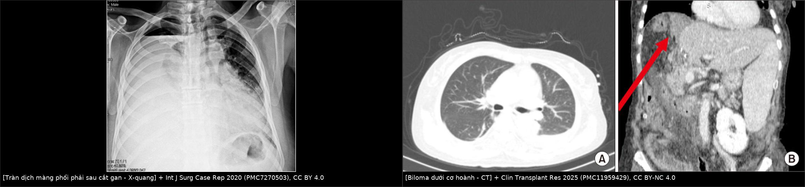
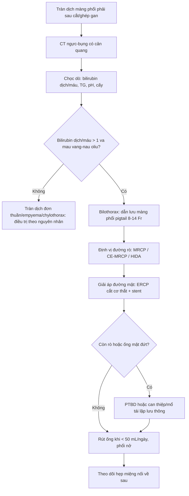
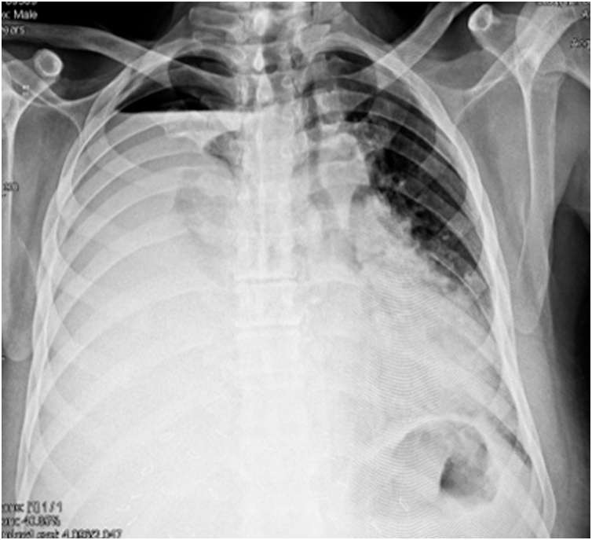
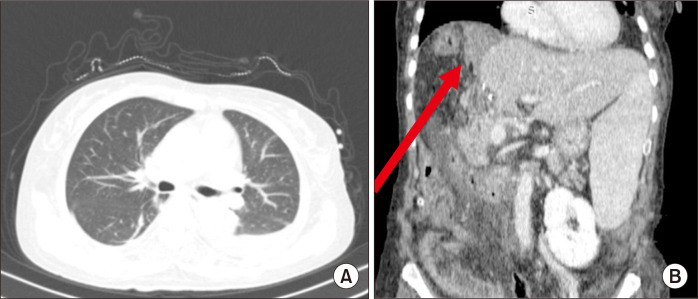
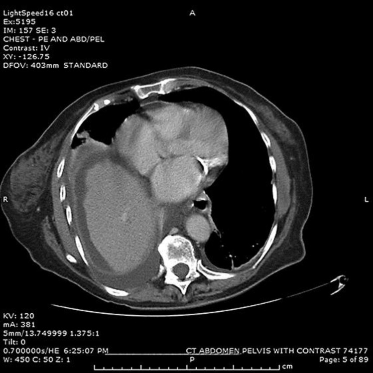

# 1820 — Rò mật–màng phổi sau cắt gan/ghép gan: bilothorax, tỷ lệ bilirubin dịch/huyết thanh, dẫn lưu màng phổi + giải áp đường mật và bẫy "tràn dịch đơn thuần" / Biliary–pleural fistula after hepatectomy and liver transplantation

**Tags:** `pattern:bilothorax` `pattern:tran-dich-mang-phoi` `pattern:ro-mat` `vung:gan` `vung:co-hoanh` `vung:mong-phoi` `score:ISGLS` `score:Clavien-Dindo` `protocol:CT-nguc-bung` `protocol:MRCP` `protocol:HIDA` `protocol:ERCP` `protocol:PTBD` `incidentaloma:biloma`

**Mức chắc chắn (certainty):** tổng hợp y văn (literature synthesis) — tự biên từ **đoàn hệ 4.715 ca cắt gan** về tràn dịch màng phổi nặng (PMC10727470, CC BY), **ca rò mật–màng phổi sau ghép gan sống cho** (PMC11959429, CC BY-NC 4.0), **ca sau cắt gan phân thùy VIII** (PMC7270503, CC BY 4.0), **ca sau nút mạch cửa (PVE)** (PMC5471797, CC BY-NC 4.0), **ca rò mật–màng phổi do túi mật thủng** (PMC12032970, CC BY 4.0), **tổng quan bilothorax sau ERCP** (PMC11442017, CC BY-NC) và **ca "bilothorax giả"** (PMC13282023, CC BY 4.0). Chưa gắn một ca nguyên văn đơn lẻ của riêng bài.

> **Bài này là nhánh "xuyên cơ hoành" của [1814 – Rò mật sau cắt gan](../1814-ro-mat-sau-cat-gan/lesson.md).** 1814 đã chốt **phân độ ISGLS**, **biloma – áp-xe – rò miệng nối**, **CE-MRCP định vị** và **ERCP/PTBD**. Nhưng khi mật **đi qua cơ hoành vào khoang màng phổi**, bệnh cảnh đổi tên và đổi cách xử trí: **triệu chứng hô hấp chi phối**, **chẩn đoán là sinh hóa chứ không phải hình ảnh**, và **bắt buộc vừa dẫn lưu màng phổi vừa giải áp đường mật** — chỉ làm một trong hai là rò tiếp tục.

> **Câu chốt:** **Tràn dịch màng phổi sau cắt gan là chuyện thường (18,4–54,5%), nhưng "tràn dịch đơn thuần" là chẩn đoán phải chứng minh, không phải mặc định.** Trong **4.715 ca cắt gan**, **5,3%** có tràn dịch màng phổi **nặng phải đặt ống** (trung vị **ngày 7**, 18,4% phát hiện **sau khi ra viện**) và **rò mật xuất hiện 4,0% ở nhóm này so với 1,3% ở nhóm không tràn dịch nặng (p < 0,001)** (PMC10727470). Sau ghép gan, **tràn dịch kéo dài > 4 tuần phải được coi là rò mật–màng phổi cho tới khi chứng minh ngược** (PMC11959429).

## 1. Tổng quan bệnh học – cơ chế hình ảnh

- **Định nghĩa:** **bilothorax (tràn dịch màng phổi mật)** là **mật trong khoang màng phổi**. Đường đi hay gặp nhất: **rò mật ở mặt cắt gan/miệng nối → tụ mật dưới cơ hoành (biloma) → qua khuyết nhỏ của cơ hoành hoặc đường bạch mạch vào khoang màng phổi**; ngoài ra **trực tiếp do thủ thuật xuyên cơ hoành** (dẫn lưu màng phổi, nút mạch cửa, đốt u) hoặc **vết thương xuyên hoành**. Vì gan nằm sát vòm hoành phải, **phần lớn ca là bên PHẢI** (PMC13282023).
- **TẠI SAO CT một mình KHÔNG gọi tên được bệnh — vật lý HU:** mật có **tỷ trọng 0–20 HU**, gần trùng **dịch thanh mạc, dịch tụ hậu phẫu, nước và mủ loãng**; chỉ **máu tụ 35–70 HU** mới tách được. Nghĩa là **"dịch đậm độ dịch" trên CT không loại trừ và cũng không chứng minh mật**. Chẩn đoán **là sinh hóa của dịch màng phổi**, không phải đậm độ.
- **Ngưỡng sinh hóa đang dùng:** tiêu chuẩn phổ biến nhất là **tỷ lệ bilirubin dịch màng phổi / bilirubin huyết thanh > 1** (PMC13282023). Ca sau ghép gan có **bilirubin dịch > 200 µmol/L**; ca sau ERCP có **170 µmol/L**, **bằng mức bilirubin huyết thanh trước can thiệp** (PMC11959429, PMC11442017).
- **TẠI SAO tỷ lệ > 1 KHÔNG đủ một mình — cơ chế dương tính giả:** bilirubin trong dịch màng phổi có thể đến từ **thoái giáng hồng cầu** trong **tràn máu/tràn dịch viêm**, chứ không phải mật tự do. Ca "bilothorax giả": **thoát vị hoành trái nghẹt + tắc ruột**, tràn dịch **máu** với **tỷ lệ bilirubin dịch/huyết thanh tăng** nhưng **không có mật thật**; tác giả nhấn mạnh **không được suy ra rò mật chỉ từ bilirubin** (PMC13282023). Vì vậy phải cộng: **màu dịch vàng–nâu ô liu**, **bối cảnh mổ gan/ghép/đường mật**, và **hình ảnh đường rò**.
- **TẠI SAO mật trong màng phổi lại nguy hiểm:** mật là **chất kích thích hóa học** lên màng phổi → **tràn dịch tiết, viêm, dày dính, màng phổi bị giam (trapped lung)**; là **môi trường nuôi khuẩn** → **empyema**, **nhiễm khuẩn huyết**, có thể **ARDS**. Trong ca sau cắt gan, dịch đầu tiên là **2.600 mL mủ**, **chỉ ngày hôm sau mới ra dịch màu vàng mật** — tức **nhiễm trùng có thể che mất chẩn đoán** (PMC7270503).
- **Tần suất và thời điểm — số phải nhớ:** tràn dịch màng phổi sau cắt gan **18,4–54,5%**; **tràn dịch nặng phải dẫn lưu 5,3% (250/4.715)**, **trung vị ngày 7 (IQR 5–14)**, **18,4% chẩn đoán sau khi ra viện**, **75,2% kèm biến chứng khác** (so với 46,8%), **tử vong 90 ngày 8,8% vs 2,9%** (PMC10727470). Ở nhóm ghép gan, mốc **> 4 tuần** là ngưỡng nghi rò (PMC11959429).
- **TẠI SAO thời điểm lại muộn:** rò mặt cắt thường **ngày 3–10**, nhưng rò **miệng nối/hẹp đường mật** có thể **âm thầm hàng tuần**: ca sau ghép có **rò mật từ ngày 5**, **CT ngày 10 chưa có tràn dịch màng phổi**, rồi **tràn dịch xuất hiện sau ERCP** (PMC11959429); ca sau PVE có tràn dịch **ngày 1**, nhưng **3 tuần sau mới thành empyema lớn** (PMC5471797).
- **TẠI SAO phải giải áp đường mật, không chỉ hút màng phổi:** áp lực trong cây mật cao hơn áp lực màng phổi; nếu **chênh áp còn**, mật **tiếp tục chảy qua lỗ rò** dù đã đặt ống. Giảm chênh áp bằng **cắt cơ thắt Oddi + stent** hoặc **PTBD** là điều kiện để lỗ rò **tự đóng**. Ca minh họa: sau cắt cơ thắt (dù **không làm được đầy đủ vì co thắt**), lưu lượng **giảm 300 → 150 → 100 mL/ngày**, ống ngực rút **ngày 23** (PMC7270503).
- **TẠI SAO HIDA vẫn cần dù đã có CT/MRCP:** **99mTc-PIPIDA/HIDA** được **tế bào gan bắt rồi bài tiết vào mật**; hoạt độ xuất hiện **trong khoang màng phổi hoặc trong ống dẫn lưu ngực** = **bằng chứng trực tiếp mật đang đi qua lỗ rò**. Ca túi mật thủng cho thấy **chất đánh dấu tích tụ trên thùy gan phải và trong ống ngực** (PMC12032970). Ngược lại **MRCP chỉ thấy dịch**, và đã có ca **MRCP ghi "không có rò mật–màng phổi"** trong khi bilirubin dịch **170 µmol/L** (PMC11442017) — **MRCP âm không loại trừ**.

## 2. Mẫu hình + chẩn đoán phân biệt theo bối cảnh (gamut)

- **Bối cảnh 1 — sau cắt gan (kể cả cắt phân thùy trên cao):** rò từ **mặt cắt nhu mô** hoặc **ống phân thùy bị đứt**, tụ mật dưới hoành rồi **xuyên hoành**. Đây là nhóm **hay gặp nhất**; liên quan **vùng "bare area"** nơi cơ hoành **không có phúc mạc che** → đường xuyên hoành ngắn nhất.
- **Bối cảnh 2 — sau ghép gan (đặc biệt sống cho):** rò **miệng nối mật–mật** hoặc **mật–ruột**; thường kèm **hẹp miệng nối** về sau. **Tràn dịch > 4 tuần = nghi rò** (PMC11959429).
- **Bối cảnh 3 — sau nút mạch cửa (PVE):** đầu kim xuyên qua **vòm hoành/đường mật**; tràn dịch xuất hiện **ngày 1**, có thể **thành empyema sau vài tuần** (PMC5471797).
- **Bối cảnh 4 — sau can thiệp đường mật qua da (PTBD/ERC):** ống có thể **gãy/gập** hoặc **đầu ống nằm trong khoang màng phổi** → mật bơm thẳng vào màng phổi; ca sau PTBD có **gập ống** gây ứ dịch màng phổi.
- **Bối cảnh 5 — sau đốt u (RFA/MWA/TACE/TARE):** hoại tử ống mật + rò; thường đi cùng **áp-xe/hoại tử** ở gan.
- **Bối cảnh 6 — chấn thương ngực–bụng/xuyên hoành:** vỡ gan + rách cơ hoành; **máu nhiều** trên CT nhưng **bilirubin dịch cao** mới xác nhận mật.
- **Bối cảnh 7 — "tự phát"/túi mật thủng:** viêm túi mật thủng → **áp-xe dưới gan sát cơ hoành** → rò; ca Cureus: ổ màng phổi **13,9 × 7,1 × 19,1 cm**, ổ dưới hoành **2,9 × 5,3 × 3,4 cm** "không tách được khỏi cơ hoành" (PMC12032970).
- **Bối cảnh 8 — bilothorax GIẢ:** **thoát vị hoành nghẹt/tắc ruột** hoặc **tràn máu** làm bilirubin dịch tăng mà **không có mật**; **không có bối cảnh gan–mật + không thấy đường rò** (PMC13282023).
- **Gợi nhớ 5 chữ — "D-R-A-I-N":** **D**iaphragm (khuyết hoành?) · **R**esection (cắt gan/ghép?) · **A**blation/PVE/PTBD (can thiệp xuyên hoành?) · **I**nfection (mủ/empyema che mật?) · **N**ot bile (bilothorax giả do máu/thoát vị?).

## 3. Bảng so sánh phân biệt (ma trận đối chiếu)

| Thực thể (entity) | Hình ảnh / dấu hiệu điển hình | Chốt vào (rule-in) | Chốt loại (rule-out) | Gợi ý xác nhận |
|---|---|---|---|---|
| **Rò mật–màng phổi sau cắt gan** | Tràn dịch phải **sau mổ 5–10 ngày**, kèm **biloma dưới hoành**; dịch **vàng–nâu ô liu** | **Bilirubin dịch/huyết thanh > 1 + biloma dưới hoành sát cơ hoành + bối cảnh cắt gan** | Dịch trong **0–20 HU**, không biloma, bilirubin dịch thấp → tràn dịch đơn thuần | CT ngực–bụng có cản quang + **chọc dò đo bilirubin** |
| **Tràn dịch màng phổi "đơn thuần" sau cắt gan** | Tràn dịch **lượng ít–vừa**, **tự giảm**, không sốt, không biloma | **Bilirubin dịch/huyết thanh ≤ 1** + không thấy rò trên HIDA/MRCP | Bilirubin dịch tăng hoặc biloma sát hoành → không phải đơn thuần | Theo dõi 48–72 giờ; chọc dò khi không giảm |
| **Empyema** | Dịch **vách, khí trong màng phổi**, màng phổi dày; sốt cao | **pH < 7,2, glucose thấp, LDH cao, cấy dương** | Dịch trong, không vách, cấy âm → chưa thành mủ | Dẫn lưu + cấy; **đo bilirubin song song** |
| **Chylothorax** | Dịch **trắng đục như sữa**, sau mổ ngực/bụng trên | **Triglyceride dịch rất cao (ngưỡng Light 110 mg/dL)** + không biloma | Dịch vàng–nâu, TG thấp → không phải dưỡng trấp | Điện di lipoprotein; nhịn ăn/MCT |
| **Hemothorax** | Dịch **máu**, Hct dịch cao, thiếu máu | **Hct dịch > 50% Hct máu** | Hct dịch thấp + bilirubin cao → nghĩ mật | CT + chọc dò; **đừng nhầm bilirubin từ máu tan là mật** |
| **Áp-xe dưới hoành gây tràn dịch phản ứng** | Ổ dịch **dưới hoành** + tràn dịch **lượng ít**, không có đường rò | **Bilirubin dịch/huyết thanh ≤ 1** + ổ dưới hoành không thông màng phổi | Bilirubin dịch cao, đường rò thấy trên HIDA → rò thật | HIDA/CE-MRCP; dẫn lưu ổ dưới hoành |
| **Bilothorax giả (thoát vị hoành/máu tan)** | **Tràn dịch TRÁI** + **quai ruột trong lồng ngực**, hoặc tràn máu | **Bối cảnh không có bệnh gan–mật + không đường rò + bilirubin từ hồng cầu** | Có biloma/đường rò/tiền sử mổ gan → rò thật | CT bụng–ngực; HIDA âm |
| **Biloma KHÔNG thông màng phổi** | Tụ dịch dưới hoành, **không tràn dịch** hoặc tràn dịch nhỏ | **HIDA không thấy hoạt độ trong màng phổi** + không triệu chứng hô hấp | Hoạt độ trong ống ngực/khoang màng phổi → đã thông | CE-MRCP/HIDA; dẫn lưu ổ dưới hoành |

*Trái: **X-quang ngực sau cắt phân thùy VIII** — tràn dịch phải **gần toàn bộ** làm **lệch trung thất sang trái** (hình ảnh của ca 2.600 mL dịch). Phải: **CT bụng–ngực** ở ca ghép gan — **(A) chưa có tràn dịch màng phổi**, **(B) biloma dưới cơ hoành phải** (mũi tên đỏ) là "nguồn" của rò. Ảnh ghép letterbox nền đen, không crop/kéo giãn. Nguồn: *Int J Surg Case Rep* 2020 (PMC7270503) Picture 3, CC BY 4.0 (trái); *Clin Transplant Res* 2025 (PMC11959429) Fig. 1, CC BY-NC 4.0 (phải).*

### Vì sao phải chụp **cả ngực và bụng** trong một lần
- **Ổ sinh bệnh ở bụng, hậu quả ở ngực:** nếu chỉ chụp ngực, thấy "tràn dịch" mà **không thấy biloma/dịch dưới hoành** → dễ dừng ở "tràn dịch sau mổ".
- **Đường rò là đường thẳng từ biloma lên khoang màng phổi:** trên **coronal** thấy rõ **ổ dịch dưới hoành áp sát vòm hoành** và **mất liên tục cơ hoành**; trên **axial** thấy **dịch hai bên cơ hoành**.
- **Ống dẫn lưu ngực nằm trong ổ mật** là bằng chứng gián tiếp mạnh — nhưng **phải đo bilirubin dịch** mới chốt.

## 4. Protocol chụp + xử trí theo bậc

- **Bước 1 — hình ảnh:** **X-quang ngực** (phát hiện tràn dịch, lệch trung thất) + **CT ngực–bụng có cản quang thì tĩnh mạch cửa (~70–80 giây)**: tìm **biloma, áp-xe, giãn đường mật, mất liên tục cơ hoành, đường đi ống dẫn lưu**. Không dùng đậm độ dịch để kết luận.
- **Bước 2 — chọc dò màng phổi (thoracentesis) là bước chẩn đoán quyết định:** gửi **bilirubin (dịch + máu cùng lúc)**, **triglyceride**, **tế bào + công thức**, **pH, glucose, LDH, protein**, **cấy**, **tế bào học**. Ngưỡng: **bilirubin dịch/huyết thanh > 1**; kèm **màu vàng–nâu ô liu**.
- **Bước 3 — xác định ĐƯỜNG RÒ khi cần:** **MRCP T2** (hình thái đường mật) ± **CE-MRCP với gadoxetate (thì gan–mật 60–180 phút)**; **HIDA (99mTc-PIPIDA)** khi MRCP âm mà vẫn nghi — **hoạt độ trong màng phổi/ống ngực = chốt**. **MRCP âm không loại trừ** (ca bilirubin 170 µmol/L với MRCP "không rò").
- **Bước 4 — dẫn lưu màng phổi:** **pigtail 8–14 Fr** dưới hướng dẫn siêu âm/CT; lý tưởng là **dẫn lưu kín, hút nhẹ**; **không mở ngực sớm** khi chưa giải áp đường mật. Theo dõi **lưu lượng, màu, bilirubin dịch**. Trong ca ghép, lưu lượng **về 0 vào ngày 15** sau đặt pigtail.
- **Bước 5 — giải áp đường mật (bắt buộc, song song):** **ERCP cắt cơ thắt + stent nhựa** là lựa chọn đầu tay (vừa chẩn đoán vừa điều trị); **PTBD** khi ERCP thất bại, ống mật bị đứt hoàn toàn hoặc giải phẫu không tiếp cận được. Ca sau ghép cần **PTBD muộn** vì **hẹp miệng nối** sau khi rò đã đóng.
- **Bước 6 — mổ:** chỉ khi **rách cơ hoành lớn**, **ống mật đứt hoàn toàn không tái lập được**, **màng phổi bị giam/dày dính (decortication)**, hoặc **thất bại sau 2–4 tuần** can thiệp tối ưu.
- **Kháng sinh:** **không dự phòng mù kéo dài**; dùng khi **empyema/nhiễm đường mật** theo cấy; **dẫn lưu là điều trị chính**.
- **Theo dõi:** siêu âm/CT lại **sau 48–72 giờ** nếu sốt hoặc lưu lượng không giảm; **rút ống** khi lưu lượng **< 50 mL/ngày**, dịch trong, phổi nở; **đo lại bilirubin dịch** trước khi rút nếu còn nghi.

## 5. Biến thể bình thường và cạm bẫy

- **Bẫy số 1 — gọi là "tràn dịch phản ứng sau mổ" rồi chờ:** tràn dịch **tăng dần**, **không giảm sau 72 giờ**, hoặc **tái phát sau rút ống** → **phải chọc dò đo bilirubin**, không chờ thêm.
- **Bẫy số 2 — tin MRCP âm:** đã có ca **MRCP báo "không có rò"** nhưng **bilirubin dịch 170 µmol/L** và dịch **vàng–nâu ô liu**. **HIDA/CE-MRCP** hoặc **chọc dò** mới là chốt.
- **Bẫy số 3 — để mủ che mật:** ca sau cắt gan có **2.600 mL dịch mủ** trước, **hôm sau mới ra dịch mật**. Nếu chỉ cấy mủ rồi dừng, sẽ bỏ sót rò.
- **Bẫy số 4 — bilirubin dịch cao nhưng KHÔNG có mật:** **tràn máu** hoặc **thoát vị hoành nghẹt** làm bilirubin tăng do **hồng cầu thoái giáng**. Cần **bối cảnh + đường rò + HIDA**.
- **Bẫy số 5 — chỉ dẫn lưu màng phổi, không giải áp đường mật:** rò sẽ **tiếp tục**; đây là lỗi phổ biến nhất. Hai việc phải làm **song song**.
- **Bẫy số 6 — cắt cơ thắt "không đủ" vẫn có tác dụng:** ca sau cắt gan **cơ thắt co thắt, không cắt được đầy đủ**, nhưng lưu lượng vẫn **giảm 300 → 150 → 100 mL/ngày** và ống rút **ngày 23** — **không vì thủ thuật chưa hoàn hảo mà bỏ theo dõi**.
- **Bẫy số 7 — tràn dịch xuất hiện SAU một can thiệp khác:** ca ghép có **CT ngày 10 không tràn dịch**, tràn dịch xuất hiện **sau ERCP** → **ngày tháng không quan trọng bằng chuỗi sự kiện**.

## 6. Tự lượng giá — Blind Quiz ngay trên trang tĩnh

**Ca 1 — Nam 60 tuổi, cắt phân thùy VIII lấy di căn đại tràng, không đặt dẫn lưu bụng. Ngày 7: khó thở, sốt, SpO₂ 84%. Nhìn phim trước.**

- Câu hỏi: Mô tả bất thường chính? **Hai** chẩn đoán hàng đầu? Xét nghiệm nào chốt nguyên nhân?

<b>Bấm để hiện đáp án (findings + chẩn đoán)</b>

- Dấu hiệu: **tràn dịch phải gần toàn bộ**, **lệch trung thất sang trái**, mất vòm hoành phải.
- Chẩn đoán: **tràn dịch màng phổi lượng lớn sau cắt gan** — hàng đầu là **empyema** và **bilothorax (rò mật–màng phổi)**; ca thật ra đã dẫn lưu **2.600 mL mủ**, hôm sau **dịch vàng mật**, **bilirubin dịch cao**, **bilirubin toàn phần 4,2 mg/dL** → **bilothorax + empyema**.
- Xử trí: **dẫn lưu kín** + **giải áp đường mật (ERCP)**; ống ngực rút **ngày 23**.
- Nguồn ảnh: *Int J Surg Case Rep* 2020 (PMC7270503) Picture 3, CC BY 4.0.

**Ca 2 — Bệnh nhân ghép gan sống cho, ngày 5 rò mật ở ống dẫn lưu bụng. Ngày 10 chụp CT.**

- Câu hỏi: **(A)** có tràn dịch màng phổi không? **(B)** mũi tên đỏ chỉ gì? Vì sao chưa kết luận được rò màng phổi ở thời điểm này?

<b>Bấm để hiện đáp án</b>

- (A) **Không có tràn dịch màng phổi**. (B) **Biloma dưới cơ hoành phải** — tụ mật từ rò miệng nối mật–mật.
- Chưa kết luận được vì **tràn dịch màng phổi xuất hiện MUỘN**, sau ERCP; **biloma là "nguồn"**, màng phổi là "đích" chưa bị chạm.
- Diễn tiến thật: sau ERCP **2 ngày** khó thở, tràn dịch phải, **pigtail**, **bilirubin dịch > 200 µmol/L**, lưu lượng **về 0 ngày 15**, ra viện **ngày 70**; sau đó **PTBD vì hẹp miệng nối**.
- Nguồn ảnh: *Clin Transplant Res* 2025 (PMC11959429) Fig. 1, CC BY-NC 4.0.

**Ca 3 — Bệnh nhân sau nút mạch cửa (PVE) cho ung thư đường mật rốn gan, đau ngực phải ngày 1, sau 3 tuần khó thở tăng.**

- Câu hỏi: Mô tả hai ổ dịch? Vì sao **không được chỉ hút màng phổi**? Ngưỡng thời gian nào khiến phải nghi rò?

<b>Bấm để hiện đáp án</b>

- Dấu hiệu: **tràn dịch màng phổi phải** (phổi phải xẹp) + **ổ dịch dưới hoành phải** sát cơ hoành — hai ổ **thông nhau qua cơ hoành** sau PVE.
- Không chỉ hút màng phổi vì **còn nguồn mật dưới hoành**; ca này đã đặt **ống ngực 28 Fr**, dịch **vàng nâu**, cấy **Gram âm đường tiêu hóa** (empyema), rồi cần **PTBD 10 Fr + đổi stent** — và **tử vong 6 tuần** vì nhiễm trùng/tiến triển.
- Ngưỡng nghi: **tràn dịch kéo dài > 4 tuần sau ghép** (ở đây là sau can thiệp gan) **phải coi là rò mật–màng phổi**.
- Nguồn ảnh: *Case Rep Gastroenterol* 2017 (PMC5471797) Fig. 2, CC BY-NC 4.0.

## Bài liên quan chéo
- [100 – Tổng quan hệ Bụng](../100-tong-quan-he-bung/lesson.md)
- [1814 – Rò mật sau cắt gan: ISGLS A/B/C, biloma, CE-MRCP, ERCP/PTBD](../1814-ro-mat-sau-cat-gan/lesson.md)
- [040 – Tràn dịch màng phổi & mủ màng phổi](../040-tran-dich-mang-phoi/lesson.md)
- [108 – Tổn thương đường mật sau cắt túi mật](../108-ton-thuong-duong-mat-sau-cat-tui-mat/lesson.md)
- [133 – Hẹp miệng nối đường mật sau ghép](../133-hep-mieng-noi-duong-mat-sau-ghep/lesson.md)
- [137 – Theo dõi stent dẫn lưu đường mật](../137-theo-doi-stent-dan-luu-duong-mat-di-tru-tac-nhiem-trung/lesson.md)

## Ảnh
- Tên file: `1820_ro-mat-mang-phoi_Modality_SourceID.jpg`; nguồn + giấy phép từng ảnh trong `images/CREDITS.md`.
- Ảnh **CC BY 4.0** (PMC7270503) và **CC BY-NC 4.0** (PMC11959429, PMC5471797), dùng nguyên bản; ảnh ghép tạo bằng `tools/make_composite.py` (letterbox, không kéo giãn).
- Không dùng ảnh từ AuntMinnie; không crawl Radiopaedia.

> Không dùng để chẩn đoán độc lập khi chưa có người hướng dẫn.
