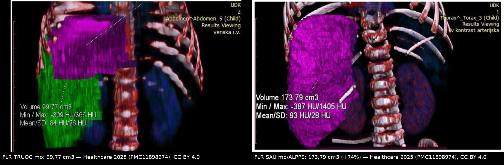
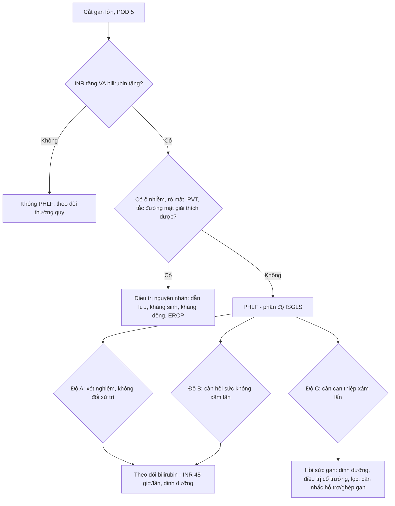
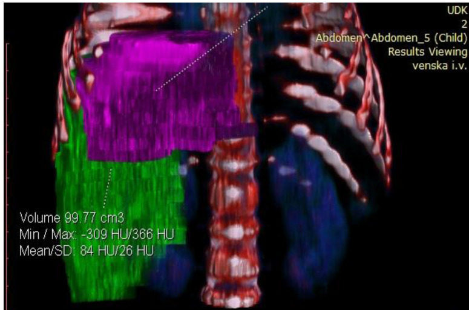
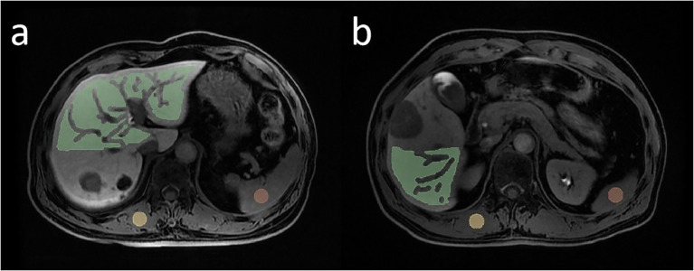

# 1821 — Suy gan sau cắt gan (post-hepatectomy liver failure, PHLF): thể tích gan còn lại, ISGLS, 50-50 và bẫy "còn ít gan ≠ suy gan" / Post-hepatectomy liver failure

**Tags:** `pattern:suy-gan` `pattern:teo-gan-con-lai` `vung:gan` `vung:hoanh-phai` `score:ISGLS` `score:PHLF-50-50` `score:FLIS` `score:HUI` `anatomy:FLR` `protocol:CT-volumetry` `protocol:Gd-EOB-DTPA` `protocol:PVE` `protocol:ALPPS` `incidentaloma:dich-o-bung`

**Mức chắc chắn (certainty):** tổng hợp y văn (literature synthesis) — tự biên từ **tổng quan định nghĩa PHLF** (PMC6120608), **tổng quan chiến lược tăng thể tích – tăng dòng** (PMC9714434), **tổng quan tăng FLR trước cắt gan lớn** (PMC12222409), **đoàn hệ 292 ca cắt gan lớn với Gd-EOB-DTPA** (PMC12120443, CC BY), **đoàn hệ 885 ca HCC với FLIS** (PMC12283857, CC BY-NC), **đoàn hệ 1.154 ca mô hình tiên lượng** (PMC12038414, CC BY-NC) và **ca ALPPS ở nhũ nhi 6,2 kg** (PMC11898974, CC BY 4.0) — ảnh lấy từ hai bài sau. Không gắn một ca nguyên văn đơn lẻ của riêng bài.

> **Bài này là nhánh "chức năng" của [1814 – Rò mật sau cắt gan](../1814-ro-mat-sau-cat-gan/lesson.md) và [1820 – Rò mật–màng phổi](../1820-ro-mat-mang-phoi/lesson.md).** Hai bài trước trả lời "dịch ở đâu, mật hay không, dẫn lưu thế nào". Bài này trả lời câu hỏi còn lại sau một ca cắt gan lớn: **vàng da – INR tăng – cổ trướng sau mổ là do gan còn lại không đủ, hay do rò mật/nhiễm khuẩn/huyết khối tĩnh mạch cửa?** Trả lời sai thì hoặc mổ lại vô ích, hoặc bỏ sót một nhiễm khuẩn ổ bụng đang tiến triển.

> **Câu chốt:** **"Còn ít gan" trên CT không phải là chẩn đoán.** PHLF là **hội chứng lâm sàng – xét nghiệm** (INR và bilirubin tăng từ ngày hậu phẫu 5 trở đi), với **tử vong 0% ở độ A và 54% ở độ C** (ISGLS, PMC6120608); còn **thể tích gan còn lại (FLR) chỉ là yếu tố nguy cơ** — ngưỡng **< 25%** ở gan lành và **> 40%** khi gan bệnh (PMC9714434), hay theo cách nói thực hành **20 / 30 / 40%** cho gan lành / sau hóa trị / xơ gan (PMC12222409).

## 1. Tổng quan bệnh học – cơ chế hình ảnh

- **Định nghĩa ISGLS (2011) — câu phải thuộc:** PHLF là **suy giảm khả năng tổng hợp – bài tiết – giải độc của gan xuất hiện sau mổ, đặc trưng bởi tăng INR và tăng bilirubin máu vào hoặc sau ngày hậu phẫu thứ 5 (POD 5)**, trên nền gan bình thường hoặc đã bệnh. Ba độ: **A** (chỉ bất thường xét nghiệm, không đổi xử trí), **B** (lệch khỏi diễn tiến thường, cần chăm sóc tích cực không xâm lấn), **C** (cần can thiệp xâm lấn), tử vong **0% → 54%** (PMC6120608).
- **TẠI SAO mốc POD 5 mà không phải ngày 1–2:** sau cắt gan, **INR và bilirubin tăng nhẹ là sinh lý** do **giảm khối tế bào gan chủ động + truyền máu + dịch**; cái phân biệt "đáp ứng viêm sau mổ" với "PHLF" là **quỹ dự trữ chức năng không hồi phục**. Đây cũng là lý do các tiêu chuẩn đều chốt ở **ngày 5**: 50-50 lấy **POD 5**, ISGLS lấy **"on or after POD 5"**, còn Hyder lấy **ngày 3** vì nhắm tới can thiệp sớm.
- **Ba tiêu chuẩn định lượng kinh điển — nhớ số, đừng nhớ tên:**
  - **50-50 (Balzan):** **PT < 50% (INR > 1,7) VÀ bilirubin > 50 µmol/L (> 2,9 mg/dL) ở POD 5** → tử vong sớm **59%** so với **1,2%** khi không đạt cả hai; độ chính xác dự báo tử vong trong viện **~97,7%** (775 ca cắt gan, PMC6120608).
  - **Mullen:** **bilirubin đỉnh > 120 µmol/L** dự báo tử vong 90 ngày (1.059 ca).
  - **ISGLS:** như trên, phân độ A/B/C — dùng để **so sánh và chỉ định can thiệp**, không dùng để phát hiện sớm.
- **TẠI SAO CT thể tích KHÔNG đo chức năng — vật lý HU:** CT chỉ đếm **thể tích hình học của nhu mô** (số voxel × thể tích voxel); nó **không biết** mật độ tế bào gan sống, **không biết** mức tưới máu, **không biết** ống mật có thông hay không. Một FLR 30% gồm **nhu mô vàng xơ + ứ mật** có chức năng thấp hơn nhiều FLR 22% lành. Vì vậy mọi ngưỡng thể tích đều là **ngưỡng sàng lọc**, không phải ngưỡng chẩn đoán.
- **TẠI SAO Gd-EOB-DTPA "đo được chức năng" — cơ chế phân tử:** gadoxetate được **OATP1B1/1B3** ở màng tế bào gan bắt vào trong tế bào rồi thải qua **MRP2** vào ống mật; **20 phút sau tiêm** khoảng **50%** liều nằm trong gan. Gan càng nhiều tế bào sống và càng thông mật thì **tín hiệu pha gan (hepatobiliary phase, HBP)** càng cao. Đó là lý do **HUI** (hepatic uptake index) và **FLIS** (functional liver imaging score) tách được bệnh nhân nguy cơ cao mà **thể tích đơn thuần bỏ sót**.
- **FLIS — 3 miền, 0–2 điểm mỗi miền, tổng 0–6:** (1) **chất lượng ngấm nhu mô gan** ở HBP, (2) **độ tồn lưu tín hiệu trong tĩnh mạch cửa**, (3) **mức bài tiết vào đường mật**. FLIS thấp = chức năng thấp. Trong **885 ca HCC**, mô hình **FLIS + cắt gan lớn + ALBI** dự báo PHLF có ý nghĩa lâm sàng (độ B–C) với **AUC 0,746** (phát triển) và **0,717** (nội kiểm); tỷ lệ biến cố **7,7% / 7,2%** (PMC12283857).
- **HUI — vì sao thắng thể tích:** trong **292 ca cắt gan lớn**, **8,6%** có PHLF nặng (B–C); **HUI AUC 0,758** so với **sFLR thể tích 0,628** (p < 0,001); **HUI + MELD 3 → 0,803** (PMC12120443). Nói cách khác: **cùng một thể tích, chức năng mới quyết định**.
- **TẠI SAO phải tăng thể tích trước mổ — sinh lý bù:** cắt gan làm **toàn bộ lưu lượng tĩnh mạch cửa dồn vào phần còn lại** → tăng áp lực xoang + ứng lực cắt (shear stress) + cytokine (HGF, IL-6) → **tăng sinh tế bào gan**. Chặn dòng cửa bên sẽ cắt (PVE/PVL) tạo đúng phản ứng đó ở bên còn. Vì vậy hình ảnh học của "chuẩn bị cắt gan" là **đo FLR trước – theo dõi FLR sau can thiệp**.
- **Ngưỡng thể tích hay dùng (phải ghi cùng bối cảnh nhu mô):**
  - **FLR/TLV < 25%** ở gan lành và **> 40%** khi có bệnh nền gan là ngưỡng nguy cơ (PMC9714434).
  - Cách nói thực hành: **sFLR tối thiểu 20% (gan lành) · 30% (sau hóa trị tân bổ trợ) · 40% (xơ gan)** (PMC12222409).
  - **Tốc độ tăng trưởng động học (kinetic growth rate, KGR) ≥ 2%/tuần** sau PVE gắn với **không có ca PHLF và không có biến cố gan** trong loạt của Shindoh — nên KGR quan trọng hơn con số tuyệt đối (PMC12222409).
  - **Chức năng đo bằng 99mTc-mebrofenin: ngưỡng FLR 2,69%/min/m²** (de Graaf 2010), được xác nhận lại ở **98 ca ALPPS** (Tomassini 2020) (PMC10927876).
- **Hai chiến lược tăng FLR — số để so:**
  - **PVE/PVL** đơn thuần: tăng **~36% ± 18** thể tích; **~20%** bệnh nhân không tới được cuộc mổ thứ hai vì FLR chưa đủ hoặc u tiến triển; biến chứng chung **2,2%**, tử vong do thủ thuật **0%** (PMC12222409).
  - **ALPPS:** tăng **68% ± 38** (p < 0,0001), **KGR 14,1 ± 6,0 vs 6,1 ± 5,4** (p < 0,0001), đạt sFLR 30% sau 28 ngày **92% vs 47%**, tỷ lệ mổ được **92% vs 57%**, nhưng **biến chứng Clavien–Dindo ≥ 3a 43% vs 43%** và **tử vong 90 ngày 8,3% vs 6,1%** (p = 0,68) (PMC12222409).
  - **LVD (portal + hepatic vein deprivation):** tăng **59% vs 48%** và **61% vs 29%** so với PVE ở hai loạt lớn; **KGR 3,5 vs 2,5 sFLR/tuần** (p < 0,001) (PMC9714434).
- **Ca minh họa định lượng (nhũ nhi 6,2 kg, 67 cm):** u gan ác tính lớn; **FLR 99,77 cm³ / ETLV 400,77 cm³ = 24%** → được đánh giá **quá nhỏ, sẽ dẫn tới suy gan**, nên làm **ALPPS**; **ngày 7 sau mổ FLR 173,79 cm³ (+74,1%), tỷ lệ 43%**; thì hai ngày 8; ra viện ngày 15; mô bệnh **u nguyên bào cơ vân ác tính (malignant rhabdoid tumor)**, bờ âm (PMC11898974).

## 2. Mẫu hình + chẩn đoán phân biệt theo bối cảnh (gamut)

- **Bối cảnh 1 — "vàng da + INR tăng + cổ trướng" ngày 3–10 sau cắt gan lớn:** gamut gồm **PHLF thật**, **rò mật/biloma** ([1814](../1814-ro-mat-sau-cat-gan/lesson.md)), **huyết khối tĩnh mạch cửa (PVT)**, **nhiễm khuẩn ổ bụng/viêm phổi**, **huyết khối/thiếu máu phần gan còn lại sau thắt động mạch**, **hội chứng gan nhỏ – dòng chảy (small-for-size syndrome, SFSS)**, **viêm gan do thuốc/truyền máu**.
- **Bối cảnh 2 — bệnh nhân đã PVE/PVL/ALPPS, đang chờ thì hai:** hình ảnh là **bài toán thể tích**: FLR có tăng đủ và **KGR** có đạt không; kèm kiểm tra **tắc tĩnh mạch cửa bên đã nút**, **giãn đường mật bên còn lại**, **huyết khối lan sang bên còn lại** (biến chứng làm hỏng cả kế hoạch).
- **Bối cảnh 3 — "gan còn lại rất nhỏ" trên CT nhưng bệnh nhân tỉnh, bilirubin giảm dần:** đây là **teo – tăng sinh sinh lý**, không phải PHLF; điều trị là dinh dưỡng và theo dõi, **không mổ lại**.
- **Bối cảnh 4 — vàng da tăng dần sau mổ, không sốt, men gan tăng nhẹ:** nghĩ **hẹp/rò đường mật** hoặc **thiếu máu đường mật (ischemic cholangiopathy)**; siêu âm/CT thấy **giãn ống mật** hoặc **biloma** → MRCP/ERCP chứ không phải "đợi gan hồi phục".
- **Bối cảnh 5 — sốc, toan chuyển hóa, vàng da nặng, gan còn lại ngấm thuốc kém:** **PHLF độ C** ± **nhiễm khuẩn huyết**; đây là nhóm xét **ghép gan cấp** (bridge) hoặc hệ thống hỗ trợ gan, tử vong rất cao.
- **Bối cảnh 6 — trẻ em/gan nhỏ tuyệt đối:** ngưỡng thể tích người lớn **không dùng nguyên**; ở trẻ, **tỷ lệ FLR/ETLV** vẫn là mốc thực hành (24% → 43% trong ca ALPPS nhũ nhi), nhưng **dự trữ chức năng tính theo bề mặt cơ thể** và **khả năng tăng sinh rất mạnh** — đây là lý do ALPPS khả thi ở trẻ 6,2 kg.

## 3. Bảng so sánh phân biệt (ma trận đối chiếu)

| Thực thể (entity) | Hình ảnh điển hình | Chốt vào (rule-in) | Chốt loại (rule-out) | Gợi ý xác nhận |
|---|---|---|---|---|
| **PHLF (ISGLS)** | Gan còn lại nhỏ, **ngấm thuốc đồng nhất nhưng mỏng**, cổ trướng, tràn dịch màng phổi phải; **không có ổ dịch khu trú** | **INR ↑ + bilirubin ↑ từ POD 5**, không có ổ nhiễm/rò giải thích được | Có **biloma/áp-xe** hoặc **PVT** giải thích được vàng da → không quy hết cho PHLF | ISGLS A/B/C, theo dõi bilirubin–INR 48 giờ/lần |
| **Rò mật / biloma** | Ổ dịch **dưới hoành/mặt cắt**, vỏ ngấm thì muộn; có thể lan màng phổi | **Ổ dịch mới + bilirubin dịch cao**; dịch mật qua dẫn lưu | Ổ dịch **không tăng theo thời gian**, không liên quan mặt cắt → không phải rò | CE-MRCP/ERCP; xem 1814, 1820 |
| **Huyết khối tĩnh mạch cửa (PVT)** | **Khuyết thuốc trong lòng tĩnh mạch cửa**, thành mạch ngấm, có thể **lan tới nhánh bên còn lại** | **Không ngấm thuốc lòng mạch thì cửa** + giãn nhánh trước tắc | Lòng mạch **ngấm đều**, phổ Doppler có dòng → loại trừ | CT thì cửa mỏng 1 mm, Doppler, cân nhắc kháng đông |
| **SFSS (gan nhỏ – dòng chảy)** | Gan còn lại **căng, phù, ngấm mạnh thì động mạch**, cổ trướng nhiều, **tĩnh mạch cửa giãn tốc độ cao** | **Cổ trướng kháng trị + bilirubin tăng sớm + lưu lượng cửa cao** sau cắt gan lớn/ghép | Bilirubin giảm sau 1 tuần, cổ trướng đáp trị liệu → không phải SFSS | Doppler (vận tốc cửa), đo áp lực; giảm dòng bằng thuốc/điều chỉnh |
| **Nhiễm khuẩn ổ bụng** | Ổ dịch **có khí**, thành dày, đông đặc quanh | **Khí trong ổ dịch** + sốt + bạch cầu tăng/procalcitonin | Ổ dịch đồng nhất, không khí, không sốt → ưu tiên theo dõi | Chọc hút, cấy; dẫn lưu |
| **Thiếu máu đường mật (ischemic cholangiopathy)** | **Giãn không tương xứng + hẹp rải rác** đường mật trong gan còn lại, không có khối | **Hẹp nhiều đoạn sau thắt/embolization động mạch gan** | Cây mật **đều, không hẹp**, chỉ giãn do thuốc → không phải | MRCP; ERCP can thiệp |
| **Gan còn lại "nhỏ sinh lý"** | Thể tích nhỏ **nhưng ngấm thuốc đều**, không cổ trướng nhiều | **Bilirubin giảm dần, INR về bình thường trong 7–10 ngày** | Bilirubin **tăng liên tục** → không phải sinh lý | Theo dõi xét nghiệm, không can thiệp |

*Trái: FLR trước mổ **99,77 cm³**, tỷ lệ FLR/ETLV **24%** — dưới ngưỡng an toàn. Phải: ngày 7 sau thì một, FLR **173,79 cm³ (+74,1%)**, tỷ lệ **43%** — đủ để cắt thì hai ngày 8. Nguồn: Healthcare 2025 (PMC11898974), CC BY 4.0; ảnh ghép letterbox của `tools/make_composite.py`, không crop.*

### Ba con số đọc đúng chỗ (đừng lẫn ngưỡng)
- **Ngưỡng nguy cơ (trước mổ):** FLR/TLV **< 25%** (gan lành) / **> 40%** yêu cầu (gan bệnh); sFLR **20 / 30 / 40%** theo nhu mô; chức năng mebrofenin **< 2,69%/min/m²**.
- **Ngưỡng chẩn đoán (sau mổ):** **INR và bilirubin tăng từ POD 5** (ISGLS) hoặc **PT < 50% + bilirubin > 50 µmol/L ở POD 5** (50-50).
- **Ngưỡng theo dõi can thiệp:** **KGR ≥ 2%/tuần** sau PVE; nếu **< 2%/tuần** mà FLR vẫn thấp → cân nhắc LVD/ALPPS thay vì chờ.

## 4. Protocol chụp + hệ phân độ/điểm chuẩn hóa

### 4.1 CT thể tích gan (CT volumetry) — quy trình tối thiểu
- **Chỉ định:** mọi ca dự kiến **cắt ≥ 3 hạ phân thùy (major hepatectomy)**, gan nền xơ/hóa trị nhiều đợt, hoặc FLR nghi ngờ thấp.
- **Kỹ thuật:** CT bụng **có cản quang, thì tĩnh mạch cửa (60–70 giây)**, lát **≤ 1 mm** (tái tạo 1–2 mm), **không uống cản quang** để không lẫn với nhu mô; trường nhìn phủ **toàn gan từ vòm hoành tới cực dưới**.
- **Đo:** vẽ **toàn bộ nhu mô gan** (trừ u, trừ đường mật giãn, trừ mỡ) và **FLR** theo giải phẫu dự kiến; **tính bằng cm³**, ghi cả **thể tích u** để không "thổi" FLR.
- **Chuẩn hóa:** **sFLR = FLR / TELV**, với **TELV ước tính theo bề mặt cơ thể (BSA)** (Vauthey) khi gan bị biến dạng bởi u to; dùng **FLR/TLV đo được** khi gan không biến dạng (PMC12222409).
- **Theo dõi sau PVE/PVL/ALPPS:** chụp lại **3–6 tuần** sau PVE (hoặc **ngày 5–8** sau thì một ALPPS), đo **cùng mặt phẳng, cùng phần mềm**, tính **KGR (%/tuần)** chứ không chỉ thể tích tuyệt đối.

### 4.2 MRI chức năng (Gd-EOB-DTPA) — khi thể tích "không đủ tin"
- **Chỉ định:** FLR sát ngưỡng, gan xơ, sau nhiều đợt hóa trị, nghi ứ mật/viêm đường mật làm thể tích "đẹp mà chức năng kém".
- **Kỹ thuật:** **T1 3D động (+20 phút) thì gan mật (HBP)** sau gadoxetate **0,025 mmol/kg**; đo **HUI** trên ROI nhu mô FLR và **tính FLIS 0–6**; đọc kèm **T2/ MRCP** để loại **ứ mật** (làm HBP giảm tín hiệu giả).
- **Diễn giải:** **FLIS thấp / HUI thấp** kèm FLR sát ngưỡng → **nguy cơ cao**, cân nhắc tăng thể tích trước mổ; **HUI là biến độc lập mạnh hơn thể tích** (AUC 0,758 vs 0,628) (PMC12120443).

### 4.3 Phân độ ISGLS và luồng xử trí

- **Điều trị nền tảng (không có thuốc đặc hiệu):** dinh dưỡng đủ đạm, kiểm soát nhiễm, tránh thuốc độc gan, điều trị cổ trướng; **không có chứng cứ cho "thuốc tái sinh gan"** trong PHLF độ B–C.
- **Vai trò của hình ảnh trong xử trí:** không phải để "chẩn đoán PHLF" mà để **loại các nguyên nhân chữa được** (ổ dịch, PVT, tắc mật) và **đo lại FLR** khi cân nhắc can thiệp tiếp.

## 5. Biến thể bình thường và cạm bẫy

- **Cạm bẫy 1 — đếm u vào FLR:** nếu phần "còn lại" dự kiến có **u thứ phát hoặc u xâm lấn**, thể tích đo được **cao hơn nhu mô lành thật**; phải trừ u và trừ **vùng sẽ cắt thêm**.
- **Cạm bẫy 2 — ứ mật làm sai cả thể tích lẫn chức năng:** đường mật giãn làm nhu mô **ngấm kém trên HBP** và **tăng thể tích ảo**; luôn đọc **MRCP/T2** trước khi kết luận "chức năng thấp".
- **Cạm bẫy 3 — lệch mặt phẳng đo:** so sánh hai lần chụp khác **thì, độ dày lát, mức hít vào** cho ra chênh 5–10% không thật; KGR tính trên số liệu lệch kiểu này tạo "tăng trưởng giả".
- **Cạm bẫy 4 — teo sinh lý sau cắt gan:** gan còn lại **tăng thể tích nhưng mô học có thể thoái hóa mỡ**, ngấm thuốc không đều; **không gọi là PHLF** nếu bilirubin/INR đã về bình thường.
- **Cạm bẫy 5 — "cổ trướng = suy gan":** cổ trướng đơn thuần sau cắt gan lớn gặp ở **18,4–54,5%** ca tràn dịch (nhóm màng phổi, PMC10727470 trong 1820); **cổ trướng không kèm INR/bilirubin tăng không phải PHLF**.
- **Cạm bẫy 6 — nhiễm trùng che PHLF và ngược lại:** sepsis gây **vàng da + INR tăng** y hệt PHLF; nếu không tìm ổ nhiễm, sẽ điều trị "suy gan" trong khi ổ áp-xe tiếp tục lan.
- **Biến thể bình thường dễ nhầm:** **thùy trái dài, thùy Riedel, rãnh phụ** làm thay đổi thể tích ±5%; **tĩnh mạch gan phải phụ (IRHV)** khiến ranh giới hạ phân thùy 6/7 khác — phải vẽ theo **mạch máu**, không theo "đường tưởng tượng".

## 6. Tự lượng giá — Blind Quiz

**Ca 1 — trẻ 6,2 kg, u gan lớn, trước mổ đo thể tích gan còn lại**

- Bối cảnh: nhũ nhi **6,2 kg, 67 cm**, u gan lớn chiếm gần toàn bộ gan phải; INR 1,38, albumin 24,5 g/L.
- Câu hỏi: (1) Vùng tím là gì và **con số 99,77 cm³** dùng để làm gì? (2) Với ETLV 400,77 cm³, tỷ lệ này nói gì? (3) Ba lựa chọn tiếp theo?

<b>Bấm để hiện đáp án (findings + chẩn đoán)</b>

- Dấu hiệu: vùng **tím** là **FLR (gan còn lại dự kiến)** được phân đoạn 3D; thể tích **99,77 cm³**, **ETLV 400,77 cm³ → FLR/ETLV 24%**.
- Chẩn đoán/ý nghĩa: **24% dưới ngưỡng an toàn** (25% cho gan lành, cao hơn nếu gan bệnh) → nếu cắt một thì, nguy cơ PHLF cao.
- Ba lựa chọn: **PVE/PVL ± LVD** rồi cắt hai thì; **ALPPS** (đã chọn ở ca này); hoặc **không cắt**/điều trị giảm nhẹ. Ca thật: ALPPS, ngày 7 FLR **173,79 cm³ (+74,1%)**, cắt thì hai ngày 8.
- Nguồn ảnh: *Healthcare* 2025 (PMC11898974), CC BY 4.0.

**Ca 2 — bệnh nhân cắt gan lớn, đánh giá chức năng bằng MRI gan mật**

- Bối cảnh: HCC, dự kiến cắt gan lớn; MRI Gd-EOB-DTPA 20 phút sau tiêm.
- Câu hỏi: (1) Vùng xanh là gì? (2) Vì sao đo tín hiệu ở **pha gan mật** lại phản ánh chức năng? (3) Nếu FLR 26% nhưng HUI thấp, bạn làm gì?

<b>Bấm để hiện đáp án (findings + chẩn đoán)</b>

- Dấu hiệu: ROI (xanh) vẽ trên **nhu mô gan còn lại** ở **pha gan mật** — dùng tính **HUI/FLIS**, không phải để đo thể tích.
- Vì sao: gadoxetate vào tế bào gan qua **OATP1B1/1B3** rồi thải qua **MRP2**; tín hiệu cao = **nhiều tế bào gan sống + đường mật thông**. Gan xơ/ứ mật làm tín hiệu giảm dù thể tích không đổi.
- Xử trí: FLR sát ngưỡng + HUI thấp → **nguy cơ PHLF cao**, cân nhắc **tăng thể tích trước mổ** (PVE/LVD/ALPPS) và tối ưu dinh dưỡng, thay vì mổ ngay.
- Nguồn ảnh: *Front Oncol* 2026 (PMC13357168), CC BY 4.0.

**Ca 3 — "gan còn lại nhỏ" sau cắt gan phải, ngày 7**

- Bối cảnh: cắt gan phải + cắt phân thùy IV; ngày 5 bilirubin 38 µmol/L, INR 1,5; ngày 7 bilirubin 30 µmol/L, INR 1,3; CT không có ổ dịch, tĩnh mạch cửa thông.
- Câu hỏi: (1) Có PHLF không? (2) Tiêu chuẩn nào quyết định? (3) Cần làm gì tiếp?

<b>Bấm để hiện đáp án (findings + chẩn đoán)</b>

- Dấu hiệu: bilirubin và INR **tăng nhẹ quanh POD 5 rồi giảm**; **không đạt 50-50** (PT không < 50%, bilirubin không > 50 µmol/L) và **không có nguyên nhân khác** trên CT.
- Chẩn đoán: **dao động sinh lý sau cắt gan lớn**, không phải PHLF độ B–C; theo ISGLS chỉ ở mức **độ A** nếu có tăng nhẹ.
- Việc làm: theo dõi xét nghiệm, dinh dưỡng, **không can thiệp xâm lấn**; chụp lại chỉ khi sốt, đau, hoặc xét nghiệm xấu đi.

## Bài liên quan chéo
- [1814 – Rò mật sau cắt gan: phân độ ISGLS, biloma, ERCP/PTBD](../1814-ro-mat-sau-cat-gan/lesson.md)
- [1820 – Rò mật–màng phổi (bilothorax)](../1820-ro-mat-mang-phoi/lesson.md)
- [135 – Viêm tụy cấp theo Atlanta](../135-viem-tuy-Atlanta/lesson.md)

## Ảnh
- Tên file: `1821_suy-gan-sau-cat-gan_<Modality>_<PMCID>-FigN.jpg`; nguồn + giấy phép từng ảnh ở `images/CREDITS.md`.
- Ảnh ghép `composite_1821_FLR-truoc-sau.jpg` tạo bằng `tools/make_composite.py` (letterbox nền đen, không crop/kéo giãn).

> Không dùng để chẩn đoán độc lập khi chưa có người hướng dẫn.
