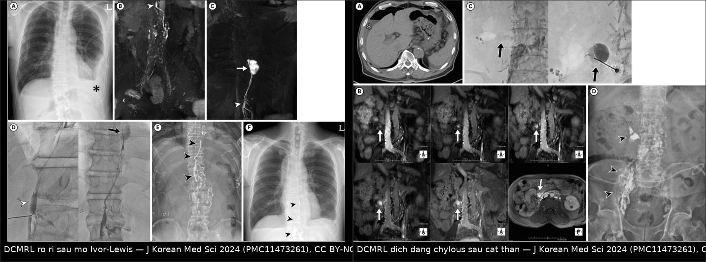
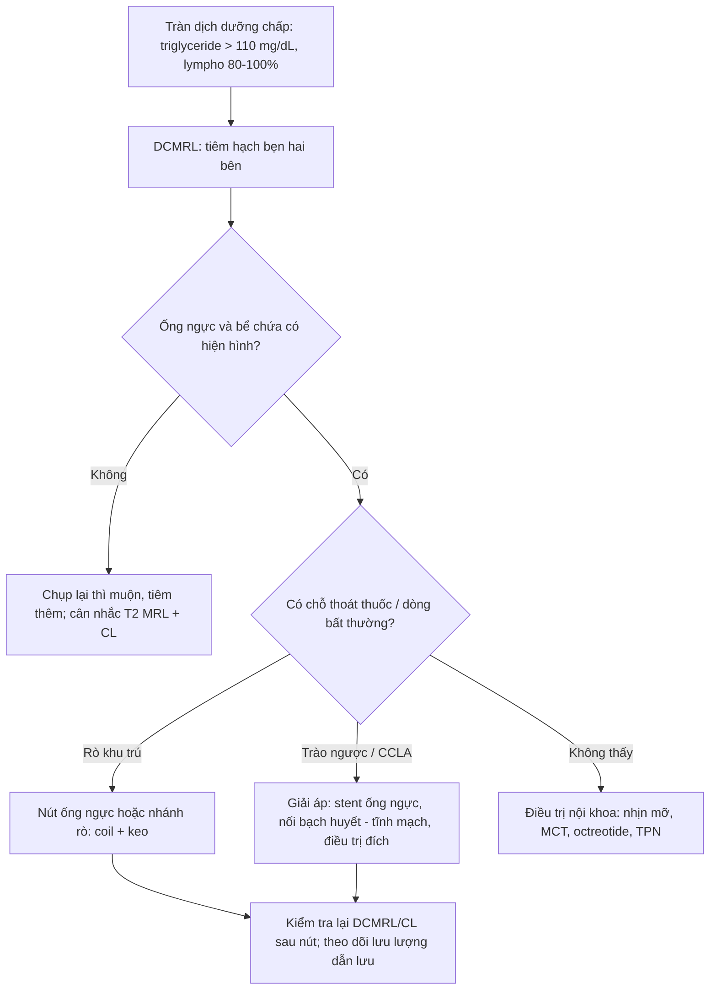
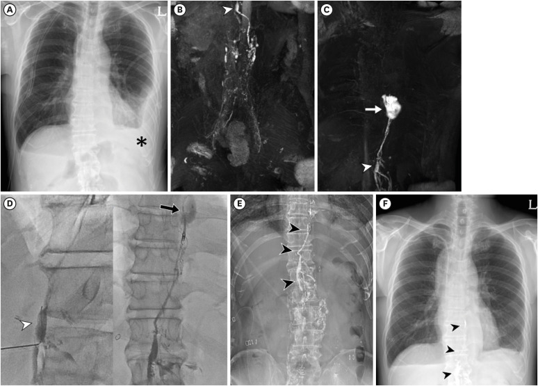
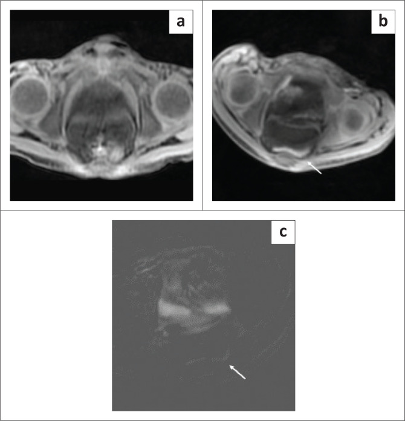
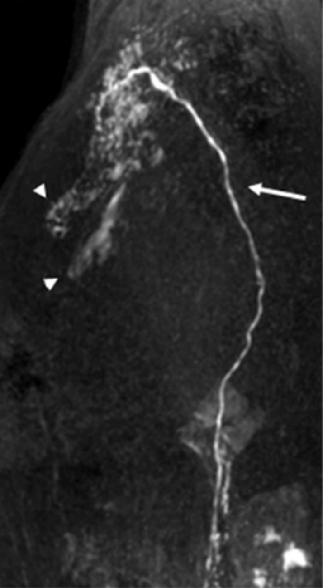

# 1822 — DCMRL (chụp bạch huyết bằng MRI động có cản quang): kỹ thuật, cách đọc ống ngực – rò bạch huyết – CCLA và khi nào nút ống ngực / Dynamic contrast-enhanced MR lymphangiography

**Tags:** `pattern:ro-bach-huyet` `pattern:chylothorax` `pattern:chylous-ascites` `vung:trung-that` `vung:o-bung` `vung:mong-tim` `anatomy:ong-nguc` `anatomy:cisterna-chyli` `protocol:DCMRL` `protocol:T2-MRL` `protocol:lymphangiography` `score:CCLA` `incidentaloma:chylous-effusion`

**Mức chắc chắn (certainty):** tổng hợp y văn (literature synthesis) — tự biên từ **đoàn hệ 70 ca DCMRL** (PMC11473261, CC BY-NC 4.0), **ca chylopericardium sau ghép tim** (PMC11233947, CC BY), **2 ca chylous ascites ở trẻ** (PMC10476230, CC BY), **tổng quan giải phẫu – kỹ thuật bạch huyết** (PMC9892216, CC BY-NC) và **tổng quan chẩn đoán – điều trị suy bạch huyết** (PMC9999027, CC BY). Ảnh lấy từ 3 bài đầu.

> **Bài này là "mắt nhìn" cho nhóm bạch huyết đã có trong repo:** [017 – Bạch mạch lan phổi](../017-bach-mach-lan-phoi/lesson.md), [077 – Gorham–Stout](../077-loat-san-mach-bach-huyet-gla-gorham-stout/lesson.md), [076 – Chyluria](../076-duong-trap-nieu-chyluria/lesson.md) và [1808 – Sirolimus trong dị dạng bạch huyết](../1808-sirolymus-di-dang-bach-huyet-theo-doi-ngung-thuoc/lesson.md). Bốn bài đó nói **bệnh và thuốc**; bài này trả lời câu hỏi thủ thuật: **rò ở đâu, dòng đi đường nào, có nút được không, và bằng chứng hình ảnh nào đủ để đưa bệnh nhân vào phòng can thiệp.**

> **Câu chốt:** **DCMRL không phải "MRI có cản quang" — nó là chụp mạch bạch huyết theo thời gian, sau khi tiêm gadolinium pha loãng vào hạch bẹn.** Giá trị thực dụng nằm ở ba câu trả lời: **ống ngực có hiện hình không** (78,6% ca so với **50%** của chụp bạch huyết huỳnh quang thông thường), **rò ở đoạn nào**, và **có đường can thiệp qua da được không** — trong **70 ca**, **47,7%** có giải phẫu can thiệp được, và **90,3%** trong số đó điều trị thành công, so với **62,5%** khi giải phẫu không thuận lợi (PMC11473261).

## 1. Tổng quan bệnh học – cơ chế hình ảnh

- **Bạch huyết trung tâm (central conducting lymphatics, CCL) là gì:** các **thân bạch huyết thắt lưng** từ chi dưới và tạng bụng đổ vào **bể chứa dưỡng chấp (cisterna chyli)** ở **T12–L2**, đường kính trung bình **6,7 mm**, dài **1–2 cm**; từ đó **ống ngực** đi lên qua khe cơ hoành giữa động mạch chủ và tĩnh mạch azygos, **bắt chéo sang trái ở ngang T5**, rồi đổ vào **góc tĩnh mạch cảnh trong – dưới đòn trái ở C7**. Nhiều **van hai lá** ở đoạn ống ngực xa ngăn máu trào ngược (PMC9892216).
- **TẠI SAO phải chụp ĐỘNG (dynamic) chứ không chỉ chụp hình thái:** bạch huyết chảy **rất chậm** (vài mm/giây) và **không đều**; một ảnh T2 dày (heavily T2-weighted) chỉ cho **bản đồ giải phẫu tĩnh** — thấy ống ngực to hay không, nhưng **không thấy mũi thuốc đi qua lỗ rò**. Chụp lặp lại mỗi **30 giây** biến "có ống ngực" thành "**dòng bạch huyết đi đâu, chỗ nào thoát ra ngoài**".
- **TẠI SAO gadolinium làm bạch huyết sáng — vật lý T1:** Gd³⁺ rút ngắn **T1** của proton nước xung quanh, nên dịch bạch huyết pha gadolinium **tăng tín hiệu trên chuỗi T1** trong khi mô đệm và mỡ bị **fat-sat** dập. Vì nồng độ trong bạch huyết rất loãng, phải dùng **dung dịch pha loãng 1:1** và **chuỗi 3D T1 nhanh (THRIVE)** — không dùng chuỗi T1 spin-echo thường vì thời gian quá dài so với tốc độ dòng.
- **TẠI SAO tiêm vào HẠCH chứ không tiêm tĩnh mạch:** gadolinium tiêm tĩnh mạch sẽ **bị đào thải qua thận** và làm sáng lòng mạch, không vào hệ bạch huyết đủ nồng độ. Tiêm **trực tiếp vào nhu mô hạch bẹn** đưa thuốc vào **xoang dưới vỏ** rồi theo mạch đi lên — đó là lý do kỹ thuật này cần **siêu âm dẫn đường** và kim nhỏ.
- **Phân biệt "rò" và "trào ngược" — hai cơ chế khác nhau, hai cách xử trí:**
  - **Rò (leak):** thành mạch bị đứt (sau mổ, sau chấn thương) → thuốc **thoát ra ngoài lòng mạch** thành ổ, thường **khu trú**, thấy rõ ở thì muộn.
  - **Trào ngược (reflux) / dòng bất thường:** van hỏng hoặc **tăng áp lực ống ngực** → bạch huyết **chảy ngược vào mô kẽ/tạng** (phổi, màng tim, ruột), gây **chylothorax, chylopericardium, protein-losing enteropathy**; hình ảnh là **mạng lưới/túi tăng tín hiệu** chứ không phải một ổ đơn độc.
- **Ngưỡng chẩn đoán dịch dưỡng chấp (phải có trước khi đọc hình):** **triglyceride > 110 mg/dL** ở bệnh nhân đang ăn (một số tài liệu dùng **> 100 mg/dL**) và **tỷ lệ tế bào lympho 80–100%**, có **chylomicron** (PMC9999027); loạt DCMRL dùng ngưỡng **> 100 mg/dL hoặc lympho > 70%** (PMC11473261). Không có ngưỡng này thì "dịch đục" trên MRI **không đủ gọi là dưỡng chấp**.
- **Số liệu hiệu quả của DCMRL (70 ca, 2017–2022):**
  - **Thành công kỹ thuật:** chylothorax sau chấn thương/mổ **92,9% (39/42)** · chylous ascites **81,8% (9/11)** · rò không do chấn thương **94,1% (16/17)** (PMC11473261).
  - **Ống ngực hiện hình:** **78,6% (33/42)** bằng DCMRL so với **50% (13/25)** bằng chụp bạch huyết huỳnh quang thông thường (CL).
  - **Giải phẫu can thiệp được:** **47,7% (31/65)** ca DCMRL thành công kỹ thuật.
  - **Thành công lâm sàng:** **90,3% (28/31)** khi can thiệp được, **62,5% (10/16)** khi giải phẫu không thuận lợi; riêng **chylothorax 92,0% (39/42)**.
- **Chylopericardium — ca dạy cách đọc thì muộn:** sau ghép tim, DCMRL tiêm hai hạch bẹn, **thì 30 giây/lần, tổng 30 phút**; đến **phút 20** mới thấy **trào ngược dưỡng chấp + rò vào khoảng quanh mạch và màng tim** → xác định **chylopericardium do chấn thương**; nút ống ngực bằng **coil + keo**, 3 tháng không tái phát (PMC11233947). **Bài học: rò chậm có thể chỉ hiện ở phút 15–20 — dừng sớm là âm giả.**
- **Ca trẻ — mốc thời gian để không bỏ sót:** bé 15 tuổi rò dưỡng chấp sau mổ; T2 dày cho **bể chứa dưỡng chấp bình thường**; sau tiêm: **phút 5** hai thân thắt lưng hợp lại, **phút 9** thấy dưỡng chấp ở bụng trên, và **phút 12** thấy **thuốc rò vào dịch tự do trong chậu** — ảnh trừ (subtraction) làm lỗ rò nổi bật (PMC10476230).

## 2. Mẫu hình + chẩn đoán phân biệt theo khoang (gamut)

- **Khoang màng phổi (chylothorax):** sau mổ ngực/thực quản/tim (hay gặp nhất), chấn thương, **CCLA** bẩm sinh, **hội chứng tưới bạch huyết phổi (pulmonary lymphatic perfusion syndrome)** sau Fontan, di căn/tắc ống ngực. Hình ảnh: **thuốc thoát vào khoang màng phổi ở thì muộn**, hoặc **mạng lưới bạch huyết dưới màng phổi (017)**.
- **Khoang phúc mạc (chylous ascites):** sau mổ bụng/cắt thận, xơ gan (dịch dưỡng chấp "giả"), lao, u lympho, **rò từ nhánh bạch huyết ruột**. Hình ảnh: **thuốc trong dịch tự do** hoặc **mạng lưới tăng tín hiệu quanh tạng**; cần **tiêm đường trong gan (intrahepatic)** khi nghi rò từ gan.
- **Khoang màng tim (chylopericardium):** sau ghép tim/đặt dây tạo nhịp, chấn thương, u; DCMRL thấy **trào ngược + rò quanh mạch vành/màng tim** ở **phút 20** (PMC11233947).
- **Phổi – phế quản (plastic bronchitis):** dòng bạch huyết bất thường đổ vào **trung thất/phế quản**, tạo **khuôn phế quản**; DCMRL thấy **nhánh bạch huyết xuyên qua nhu mô phổi** (017).
- **Ruột (protein-losing enteropathy):** mất protein qua ruột; DCMRL **đường trong màng treo (intramesenteric)** có thể định vị rò (báo cáo **93%** thành công ở 15 ca chọn lọc) (PMC9999027).
- **Nhiều khoang (multicompartment):** suy bạch huyết nặng, thường sau Fontan — cần **chụp toàn thân một lần**, không chụp từng vùng.
- **Mnemonic 4 câu hỏi khi đọc DCMRL:** **(1) Có ống ngực không? (2) Chỗ tắc ở đâu? (3) Có chỗ thoát ra ngoài không? (4) Có đường qua da tới chỗ đó không?**

## 3. Bảng so sánh phân biệt (ma trận đối chiếu — các phương pháp chụp bạch huyết)

| Phương pháp | Hình ảnh điển hình | Chốt vào (rule-in) | Chốt loại (rule-out) | Gợi ý xác nhận |
|---|---|---|---|---|
| **DCMRL (intranodal)** | Chuỗi 3D T1 động, thuốc đi từ hạch bẹn → thân thắt lưng → bể chứa → ống ngực; **thoát thuốc ở thì muộn** | **Thấy dòng + đúng vị trí rò** (thường phút 5–20), ống ngực hiện hình **78,6%** | Thuốc **không ra khỏi lòng mạch** tới phút 20 → **không phải rò hoạt động** (nhưng có thể rò rất chậm) | DCMRL + ảnh trừ; đo thời gian tới bể chứa |
| **T2 MR lymphangiography (không cản quang)** | Ống ngực/bể chứa **tăng tín hiệu mạnh**, ảnh tĩnh độ phân giải cao | **Giãn ống ngực/bể chứa**, dị dạng hình thái | **Không thấy ống ngực** không loại trừ rò; **không thấy dòng** | Dùng làm **bản đồ trước** DCMRL |
| **Chụp bạch huyết huỳnh quang (CL, Lipiodol)** | Kim vào hạch ± ống ngực, hình huỳnh quang độ phân giải cao | **Thấy ống ngực + thoát thuốc**, và **có thể nút ngay** | Không thấy ống ngực **50%** ca → không loại trừ | Dùng khi MRI không làm được; có bức xạ, dầu tồn lưu |
| **CT lymphangiography** | Thuốc cản quang trong hạch/ống ngực, MPR | Thấy **đường đi và tương quan xương–mạch** | Không đánh giá **động học dòng** | Khi cần bản đồ can thiệp nhanh |
| **Xạ hình bạch huyết (lymphoscintigraphy)** | Hạt nhân phóng xạ, hình 2D/SPECT | **Dòng chậm/mất dòng**, rò lan tỏa | Không định vị **chính xác lỗ rò** cho can thiệp | Sàng lọc chức năng |
| **Siêu âm cản quang (CEUS) đầu dò** | Vi bọt trong hạch/thân bạch huyết | **Đầu kim đúng trong hạch**, thông ống ngực | Không khảo sát trung thất sâu | Bước **xác nhận kim** trước khi tiêm gadolinium |

*Trái: sau mổ Ivor-Lewis, DCMRL thấy ống ngực và chỗ rò (mũi tên), kèm can thiệp nút. Phải: chylous ascites sau cắt thận — DCMRL chuỗi thì thấy dòng bất thường trước khi can thiệp. Nguồn: J Korean Med Sci 2024 (PMC11473261), CC BY-NC 4.0; ảnh ghép letterbox của `tools/make_composite.py`, không crop.*

### Đọc đúng ba dấu hiệu dễ nhầm
- **"Ống ngực không thấy" ≠ "không có ống ngực":** có thể do **dòng quá chậm**, **bể chứa nằm thấp**, hoặc **thuốc đi đường bên**; phải chụp thêm thì và có thể tiêm thêm thuốc (PMC11473261).
- **"Thuốc trong ổ dịch" ≠ rò:** thuốc có thể vào ổ dịch do **kim xuyên qua hạch rồi rò ra ngoài**, hoặc do **dịch tự do đã có sẵn**; ảnh trừ và hình dạng **dòng liên tục từ thân bạch huyết** mới là chốt.
- **"Trào ngược" ≠ "rò":** trào ngược cho **mạng lưới/túi** dọc theo ống ngực và tạng, không có **điểm đứt**; xử trí là **giải áp/đổi hướng dòng**, không phải nút một lỗ.

## 4. Protocol chụp + phân loại

### 4.1 Kỹ thuật DCMRL (theo loạt 70 ca)
- **Chuẩn bị:** nhịn ăn theo quy định gây mê nếu trẻ; **không cần nhịn mỡ** trước chụp (khác điều trị); kiểm tra chức năng thận và **dùng thuốc nhóm II** (gadobutrol, gadoterate) để giảm nguy cơ xơ hóa hệ thống do gadolinium.
- **Đường vào:** **siêu âm dẫn đường**, kim nhỏ vào **hạch bẹn hai bên** (hoặc hạch chậu); xác nhận đầu kim (có thể dùng **CEUS** với SonoVue pha thuốc tê — PMC9892216).
- **Thuốc:** **2–3 mL** hỗn hợp **1:1 gadolinium : nước muối**, tiêm tay **1–2 mL/phút**; liều tham chiếu **gadobutrol 1 mL/10 kg** hoặc **gadoterate 2 mL/10 kg** (PMC11473261).
- **Chuỗi:** **T2 TSE fat-sat** (bản đồ tĩnh, TR/TE 1744,8/650 ms, FOV 340 mm) rồi **T1 3D THRIVE** tự do thở (TR/TE **3,0/1,5 ms**, góc lật **15°**, FOV **340 mm**, ~**1 phút/chuỗi**), chụp **3–5 chuỗi liên tiếp** cho tới khi thấy bể chứa và ống ngực; ảnh bắt đầu **2–3 phút** sau khi tiêm.
- **Trường nhìn:** **toàn ngực – bụng** trong một lần đặt bệnh nhân; không cắt riêng "ngực" hay "bụng" vì rò có thể nằm ở ranh giới.
- **Thời gian đọc:** ghi **mốc phút** xuất hiện bể chứa, ống ngực, và **mốc phút rò** — đây là dữ liệu tiên lượng và là bằng chứng cho can thiệp.
- **Sau DCMRL:** nếu giải phẫu thuận lợi → **chụp bạch huyết huỳnh quang cùng đường vào** và **nút ống ngực (coil ± NBCA/keo)** ngay hoặc trong 1–2 ngày; nếu không → **chuyển hướng** (phẫu thuật nối bạch huyết – tĩnh mạch, đặt stent ống ngực, điều trị nội khoa).

### 4.2 Phân loại nguyên nhân – chọn can thiệp

- **Tiêu chuẩn thành công:** **ngưng rò + rút được ống dẫn lưu** (thành công lâm sàng), không chỉ "thấy thuốc hết thoát" (thành công kỹ thuật) (PMC11473261).
- **Theo dõi sau can thiệp:** lưu lượng dẫn lưu hằng ngày, triglyceride dịch, và **chụp kiểm tra** khi lưu lượng không giảm trong 5–7 ngày.

## 5. Biến thể bình thường và cạm bẫy

- **Cạm bẫy 1 — nhiễm bẩn tĩnh mạch (venous contamination):** gadolinium vào tuần hoàn qua ống ngực đổ vào tĩnh mạch cảnh trong; khi nồng độ cao, **lòng tĩnh mạch sáng** và che mất ống ngực — phải **trừ ảnh** và đọc **thì sớm** trước khi thuốc về tim (PMC11473261).
- **Cạm bẫy 2 — dừng chụp quá sớm:** rò chậm chỉ hiện ở **phút 15–20** (ca chylopericardium); giao thức tối thiểu **30 phút** ở ca nghi rò mạn.
- **Cạm bẫy 3 — thuốc thoát tại chỗ tiêm:** đầu kim nằm ngoài nhu mô hạch → thuốc vào mô mềm vùng bẹn, tạo "ổ rò giả" tại chỗ; luôn **xác nhận kim bằng siêu âm/CEUS** và đọc **hướng dòng từ hạch đi lên**.
- **Cạm bẫy 4 — bể chứa dưỡng chấp không điển hình:** bể chứa có thể **thấp, cao, hoặc tách đôi**; "không thấy bể chứa ở T12–L2" không có nghĩa là không có ống ngực.
- **Cạm bẫy 5 — chylous ascites trên nền xơ gan:** dịch có thể **dưỡng chấp giả** do tăng áp cửa và thoái giáng tế bào; đừng mặc định "rò bạch huyết" trước khi có DCMRL thấy **dòng thoát**.
- **Cạm bẫy 6 — gadolinium và thận:** dùng **nhóm II**; tránh nhóm I ở bệnh nhân suy thận nặng (nguy cơ xơ hóa hệ thống do gadolinium). Không dùng dầu Lipiodol cho MRI — đó là chất cản quang cho huỳnh quang, không có tín hiệu T1 dùng được.
- **Cạm bẫy 7 — ảnh trừ lệch (misregistration):** bệnh nhân thở/động trong 30 phút làm ảnh trừ tạo **viền giả** quanh mạch; đọc ảnh gốc từng thì để xác nhận.

## 6. Tự lượng giá — Blind Quiz

**Ca 1 — nam 58 tuổi, tràn dưỡng chấp hai bên sau mổ Ivor-Lewis**

- Bối cảnh: ngày 4 sau mổ, dẫn lưu màng phổi ra dịch đục, triglyceride cao, không đáp ứng nhịn mỡ.
- Câu hỏi: (1) Ảnh B và C cho thấy gì? (2) Lỗ rò ở ngang mức nào? (3) Vì sao phải chụp DCMRL thay vì chỉ chụp CT?

<b>Bấm để hiện đáp án (findings + chẩn đoán)</b>

- Dấu hiệu: (A) X-quang ngực có dẫn lưu và tràn dịch; (B) DCMRL coronal — ống ngực hiện hình, có nhánh bất thường; (C) ổ thuốc thoát khu trú (mũi tên) tại đoạn ống ngực ngang **T8–T9**; (D–F) chụp huỳnh quang và kiểm tra sau nút bằng **coil + NBCA**.
- Chẩn đoán: **rò ống ngực sau mổ** — nút ống ngực qua da đường xuyên bể chứa dưỡng chấp.
- Vì sao DCMRL: CT chỉ thấy **dịch**, không thấy **dòng và vị trí đứt**; DCMRL cho biết **có đường can thiệp được** (nhóm này thành công lâm sàng **92%**).
- Nguồn ảnh: *J Korean Med Sci* 2024 (PMC11473261), CC BY-NC 4.0.

**Ca 2 — bé 8 tuổi, chylous ascites sau lao lan tỏa**

- Bối cảnh: dịch bụng đục, triglyceride cao, hạch bẹn to; tiêm gadolinium pha loãng vào hạch bẹn.
- Câu hỏi: (1) Vì sao ảnh (b) quan trọng hơn ảnh (a)? (2) Dấu hiệu ở ảnh (b)/(c) nói gì? (3) Có cần can thiệp ngay không?

<b>Bấm để hiện đáp án (findings + chẩn đoán)</b>

- Dấu hiệu: (a) T1 trước tiêm — không phân biệt được dịch; (b) **12 phút sau tiêm**: thuốc **rò vào dịch tự do trong chậu** (mũi tên); (c) **ảnh trừ** làm lỗ rò nổi rõ.
- Chẩn đoán: **rò bạch huyết phúc mạc** — bằng chứng trực tiếp của dòng thoát, không chỉ "dịch dưỡng chấp".
- Xử trí: ca này **không có rò hoạt động đáng can thiệp** ở thì chụp; điều trị nội khoa (MCT/TPN) và theo dõi; chỉ can thiệp khi lưu lượng không giảm.
- Nguồn ảnh: *S Afr J Radiol* 2023 (PMC10476230), CC BY 4.0.

**Ca 3 — chylopericardium sau ghép tim**

- Bối cảnh: tràn dịch màng tim tái phát sau ghép tim, dịch dưỡng chấp, đã đặt dẫn lưu.
- Câu hỏi: (1) Mũi tên dài chỉ gì, đầu mũi tên chỉ gì? (2) Vì sao phải chụp tới 20 phút? (3) Can thiệp nào được thực hiện?

<b>Bấm để hiện đáp án (findings + chẩn đoán)</b>

- Dấu hiệu: **mũi tên dài** = **ống ngực**; **đầu mũi tên** = **vùng trào ngược và rò vào khoảng quanh mạch/màng tim**.
- Vì sao 20 phút: dòng bạch huyết chậm, rò chỉ hiện ở **phút 20** trong tổng **30 phút** chụp — dừng sớm sẽ âm giả.
- Can thiệp: **nút ống ngực bằng coil + keo** qua đường vào hạch bẹn; **3 tháng** không tái phát tràn dịch.
- Nguồn ảnh: *Methodist Debakey Cardiovasc J* 2024 (PMC11233947), CC BY 4.0.

## Bài liên quan chéo
- [017 – Bạch mạch lan phổi (pulmonary lymphatic perfusion)](../017-bach-mach-lan-phoi/lesson.md)
- [076 – Chyluria: chẩn đoán và can thiệp](../076-duong-trap-nieu-chyluria/lesson.md)
- [077 – Gorham–Stout: loạt sẵn mạch bạch huyết](../077-loat-san-mach-bach-huyet-gla-gorham-stout/lesson.md)
- [1808 – Sirolimus trong dị dạng bạch huyết: theo dõi nồng độ](../1808-sirolymus-di-dang-bach-huyet-theo-doi-ngung-thuoc/lesson.md)

## Ảnh
- Tên file: `1822_dcmrl_bach-huyet_<Modality>_<PMCID>-FigN.jpg`; nguồn + giấy phép từng ảnh ở `images/CREDITS.md`.
- Ảnh ghép `composite_1822_chylothorax-chylous-ascites.jpg` tạo bằng `tools/make_composite.py` (letterbox, không crop/kéo giãn) từ 2 ảnh CC BY-NC 4.0 — **giữ nguyên điều kiện phi thương mại**.

> Không dùng để chẩn đoán độc lập khi chưa có người hướng dẫn.
