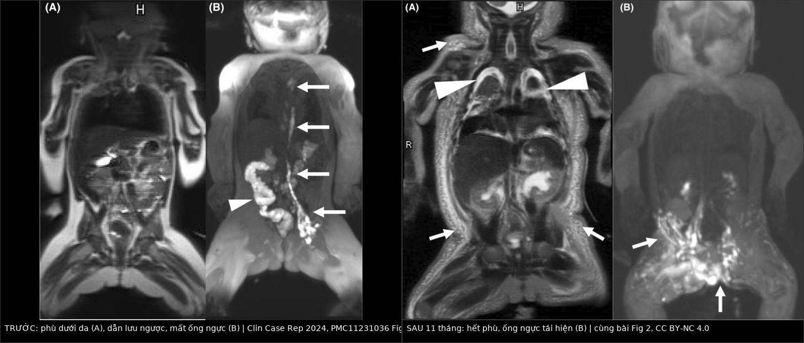
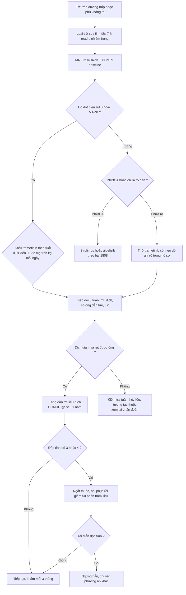
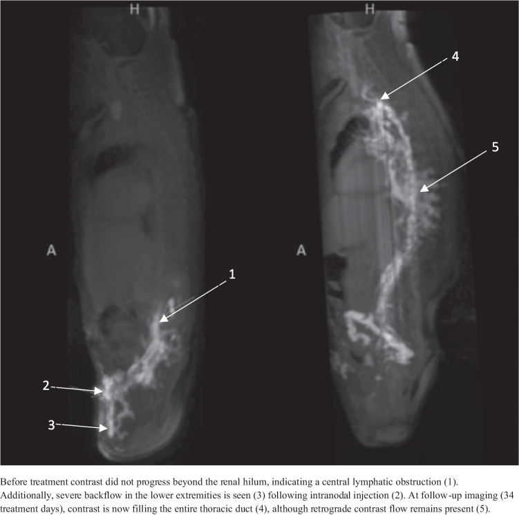
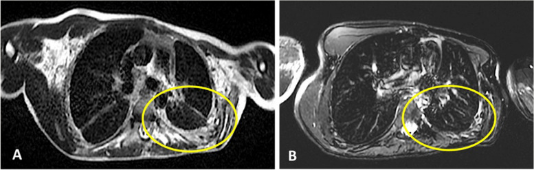

# 1823 — Trametinib (ức chế MEK) trong dị dạng bạch huyết do đột biến RAS/MAPK: chọn bệnh nhân theo gen, liều, theo dõi độc tính và đọc đáp ứng trên DCMRL / Trametinib for RAS/MAPK-driven lymphatic malformations

**Tags:** `pattern:loansan-bach-huyet` `pattern:tran-duong-trap` `pattern:dap-ung-dieu-tri` `pattern:doc-tinh-thuoc` `vung:da-he` `vung:trung-that` `vung:phoi` `score:CTCAE` `score:Likert-6` `protocol:DCMRL` `protocol:MRI-T2-mDixon` `incidentaloma:khong`
**Mức chắc chắn (certainty):** tổng hợp y văn (literature synthesis) — số liệu lấy từ **6 nhũ nhi Noonan dùng trametinib có DCMRL trước–sau 1 năm** (PMC13415930, CC BY 4.0), **7 nhũ nhi CCLA** (PMC12367942, CC BY 4.0), **ca trẻ đẻ non 31 tuần** (PMC11231036, CC BY-NC 4.0), **thử nghiệm pha II TRAM-01 ở NF1** (PMC13550690, CC BY 4.0 — dùng làm mốc an toàn/liều), **tổng quan có hệ thống 52 nghiên cứu nhi** (PMC13446942, CC BY-NC-SA 4.0), **loạt 5 trẻ KLA/GLA** (PMID 41116710) và **ca người lớn rhabdomyolysis** (PMC7041078, CC BY 4.0). Toàn bộ là **dữ liệu nghiên cứu**, không phải khuyến cáo thay thế phác đồ đơn vị.

> **Bài này là phần "thuốc đích" của [1808](../1808-sirolymus-di-dang-bach-huyet-theo-doi-ngung-thuoc/lesson.md).** 1808 dạy **theo dõi sirolimus** và chỉ nêu trametinib như một hàng "chuyển thuốc". Bài này trả lời bốn câu hỏi còn trống: **(1) chọn ai — gen nào, hình ảnh nào; (2) liều nào ở sơ sinh và trẻ nhỏ; (3) theo dõi độc tính gì, ngưỡng nào; (4) đọc "đáp ứng" thế nào khi ống ngực trên DCMRL vẫn bất thường.**

## 1. Tổng quan bệnh học – cơ chế hình ảnh

- **Trametinib ức chế cái gì:** thuốc ức chế **MEK1/2** (mitogen-activated protein kinase kinase), chặn phosphoryl hóa **ERK1/2** — điểm cuối của đường **RAS→RAF→MEK→ERK**. Trong hệ bạch huyết, ERK hoạt hóa quá mức làm **giãn mạch bạch huyết**, **ức chế trưởng thành van bạch huyết** và gây **thoái triển van**; trên mô hình chuột mang đột biến KRAS, ức chế MEK **ngăn van thoái triển và giảm đường kính mạch** (PMC11231036, phần bàn luận). Đây là lý do **hiệu quả lâm sàng đến trước, "hình thể" đến sau**: dòng chảy được phục hồi nhờ **chức năng van**, không phải nhờ mọc lại ống ngực mới.
- **TẠI SAO phải chọn theo gen:** hai đường song song cùng gây dị dạng bạch huyết — **PI3K/AKT/mTOR** (PIK3CA, TEK/TIE2) và **RAS/MAPK** (PTPN11, RIT1, SOS1, RAF1, KRAS, NRAS, BRAF, ARAF, CBL). **PIK3CA** chiếm **tới ~80%** dị dạng bạch huyết thông thường và là đích của **sirolimus/alpelisib**; **KLA** thiên về **NRAS p.Q61R** (10/11 ca trong một loạt giải trình tự) và là nhóm **thất bại sirolimus, phải chuyển ức chế MEK** (PMC7539180, trích trong 1808). Bệnh Noonan thể dịch bạch huyết: **PTPN11 ~50–60%**, sau đó **RIT1, SOS1, RAF1, KRAS** (PMC13415930).
- **TẠI SAO hình ảnh đổi theo kiểu "dịch trước, mô sau":** phù và tràn dịch là **nước tự do** → **T2/T2 mDixon (ảnh nước) tăng tín hiệu rất mạnh**, T1 giảm, **không hạn chế khuếch tán** (ADC cao); khi dòng chảy được tái lập, **nước rút trong vài tuần** nên **T2 là chỉ số đáp ứng sớm nhất**, trước khi bất kỳ thay đổi thể tích mô nào xuất hiện.
- **TẠI SAO DCMRL mới là "chìa khóa", không phải CT:** CT chỉ thấy **dịch**; DCMRL (dynamic contrast-enhanced MR lymphangiography) tiêm gadolinium **trực tiếp vào hạch bẹn** nên nhìn được **đường đi và chiều của dòng bạch huyết**: thuốc **dừng ở bể dưỡng trấp/ngang mức động mạch thận** = **tắc dẫn lưu trung tâm**; thuốc **đi ngược ra da, thành ngực, phế quản, màng phổi** = **dẫn lưu ngược (dermal backflow, chylo-lymphatic reflux)**; thuốc **lên tới tĩnh mạch dưới đòn/cảnh** = dẫn lưu trung tâm **đã thông** (PMC12367942, PMC13415930).
- **Định lượng phải nhớ:**
  - **Dịch tễ:** dị dạng bạch huyết **1/2.000 trẻ sinh sống** (PMC9249683, trích trong 1808); bệnh bạch huyết trong Noonan **37% trong đời** (dẫn trong PMC11231036).
  - **Liều:** khởi đầu ở **nhũ nhi 0,01 mg/kg/ngày** (PMC12367942), **0,0125 mg cách ngày** rồi tăng dần, liều hiệu quả ghi nhận **0,018 mg/kg/ngày** (PMC11231036), **0,02 mg/kg/ngày** ở 6 nhũ nhi Noonan (PMC13415930); liều chuẩn nhi khoa **0,025 mg/kg/ngày (≥ 6 tuổi)** và **0,032 mg/kg/ngày (< 6 tuổi)**, **tối đa 2 mg/ngày** (TRAM-01, PMC13550690).
  - **Hiệu quả ở nhũ nhi CCLA/Noonan:** **5/6** rút được ống dẫn lưu màng phổi sau **6 tuần** (PMC13415930); **6/7** rút trong **5–13 ngày**, không tái phát trong **10,3 tháng** theo dõi trung bình (PMC12367942); ca đẻ non rút 2 ống ngực **ngày 23 và 38** sau khởi thuốc, cai máy **ngày 42**, bỏ dinh dưỡng tĩnh mạch **ngày 45** (PMC11231036).
  - **Hiệu quả ở KLA/GLA:** **5 trẻ** (trung vị 9 tuổi) — **80% đáp ứng một phần trên hình ảnh**, tiểu cầu tăng **54–362%**, **D-dimer giảm > 91%**, chỉ **1 ca phát ban độ 2**; **80% có NRAS** nhưng vẫn có ca đáp ứng **không tìm thấy đột biến** (PMID 41116710).
  - **Mốc an toàn (NF1, cùng liều):** **46 ca**, đáp ứng **47,8%**, thể tích trung vị **−19,3%**, **32,6% phải giảm liều** vì độc tính da/niêm, **6,5% ngừng hẳn** (paronychia, phù toàn thân, **viêm phổi**), sau khi ngừng **32,6% cần can thiệp mới**, trung vị **10 tháng** mới phải dùng lại (TRAM-01, PMC13550690).

## 2. Mẫu hình + chẩn đoán phân biệt theo vị trí (gamut)

- **Mẫu hình 1 — CCLA ở nhũ nhi (Noonan/RAS):** thai có **hydrops, tràn dịch màng phổi hai bên, đa ối**; sau sinh **tràn dưỡng trấp kháng trị** dù đã MCT-diet + octreotide + propranolol. MRI: **phù dưới da + tràn dịch màng phổi/màng tim**, phổi **dày vách tiểu thùy**. DCMRL: **không thấy ống ngực**, thuốc dừng ở **bể dưỡng trấp**, **dẫn lưu ngược ra da/thành ngực/phế quản**. Đây là **nhóm đáp ứng trametinib rõ nhất** (PMC13415930, PMC12367942, PMC11231036).
- **Mẫu hình 2 — KLA/GLA lan tỏa:** trung thất – phổi – lách – xương cùng lúc; **tiểu cầu thấp, D-dimer cao, chảy máu**; MRI ngực **dày vách tiểu thùy + thâm nhiễm**; KLA có **sống sót toàn bộ chỉ 34%** dù điều trị đa mô thức (PMC7539180, trích trong 1808). Trametinib có vai trò khi **NRAS/KRAS** hoặc **thất bại sirolimus**.
- **Mẫu hình 3 — dị dạng bạch huyết sau tuần hoàn Fontan:** **phế quản dạng nhựa (plastic bronchitis)**, protein-losing enteropathy, tràn dưỡng trấp; DCMRL thấy **dẫn lưu ngược vào phế quản**. Xem [6126](../6126-plastic-bronchitis-ba-nhay-phe-quan-tre/lesson.md); nhóm này **không phải chỉ định trametinib thường quy** — phải loại trừ nguyên nhân huyết động trước.
- **Mẫu hình 4 — LM đa nang khu trú (cổ–mặt, sau phúc mạc):** nang **T2 rất sáng, không ngấm lòng nang**, không có dẫn lưu ngược trung tâm; đích điều trị là **sirolimus/alpelisib** và **chọc xơ hóa**, không phải ức chế MEK nếu **không có đột biến RAS**.
- **Gamut theo vị trí tổn thương đích (đo bằng T2 mDixon ảnh nước):** **trung thất** (dày vách, khối thâm nhiễm) → **màng phổi** (tràn dịch, độ dày màng phổi) → **phổi** (lymphangiectasia, dày vách tiểu thùy) → **màng tim** (tràn dịch) → **phúc mạc** (cổ trướng dưỡng trấp) → **mô mềm/thành ngực** (phù).
- **Gợi nhớ 4 chữ — GEN–DOSE–DRAIN–FLOW:** **Gen** (RAS/MAPK hay PIK3CA) · **Dose** (0,01 → 0,02 → 0,025 mg/kg/ngày) · **Drain** (số ống dẫn lưu, mL/ngày, ngày rút) · **Flow** (DCMRL: thuốc tới tĩnh mạch chưa). Trả lời đủ 4 chữ là ra quyết định **khởi – tăng – ngừng**.

## 3. Bảng so sánh phân biệt (ma trận đối chiếu)

| Thực thể (entity) | Hình ảnh điển hình | Chốt vào (rule-in) | Chốt loại (rule-out) | Gợi ý xác nhận |
|---|---|---|---|---|
| **CCLA đáp ứng ức chế MEK** | Phù dưới da + tràn dưỡng trấp; DCMRL **không thấy ống ngực**, thuốc dừng ở bể dưỡng trấp, **dẫn lưu ngược** ra da/phế quản | **Đột biến RAS/MAPK** (PTPN11, RIT1, SOS1, KRAS, NRAS, BRAF) **+** tràn dưỡng trấp kháng trị **+** DCMRL có dẫn lưu ngược, và **giảm dịch trong 6 tuần** sau khởi thuốc (PMC13415930) | **PIK3CA đơn thuần**, không có dẫn lưu ngược trung tâm, hoặc dịch do **suy tim/tăng áp phổi** → không phải đích MEK | Giải trình tự mô/dịch; DCMRL trước điều trị làm mốc; đếm mL dịch/ngày |
| **CCLA không rõ gen** | Cùng hình ảnh DCMRL, không tìm được đột biến | **Kiểu hình CCLA + không có biến thể** vẫn có thể đáp ứng — **80% ca KLA/GLA đáp ứng một phần** dù chỉ 80% có NRAS (PMID 41116710) | Nếu **không đáp ứng sau 6–8 tuần** ở liều đủ → xem lại chẩn đoán, không tăng liều mù | Thử điều trị có theo dõi (n-of-1), ghi rõ trong hồ sơ |
| **KLA (NRAS)** | Thâm nhiễm trung thất–phổi, **ly giải xương**, lách; **tiểu cầu thấp, D-dimer cao** | **NRAS p.Q61R** + **tiểu cầu giảm/đông máu rối loạn** + DCMRL bất thường | Chỉ nang lách đơn thuần, không rối loạn đông máu → GLA/LM, không phải KLA | Giải trình tự; CTM + D-dimer; DCMRL |
| **GLA (PIK3CA)** | Nhiều ổ ly giải tủy + nang lách, tràn dịch | **PIK3CA** hoặc không đột biến RAS, tổn thương **nhiều cơ quan** | Có **NRAS/KRAS** và rối loạn đông máu → nghĩ KLA | Gen; WB-MRI T2 fat-sat |
| **Dẫn lưu ngược do bệnh** vs **do kỹ thuật** | Cả hai đều làm thuốc ra da/thành ngực trên DCMRL | Dẫn lưu ngược **theo đường bạch huyết liên tục**, tái hiện ở thì muộn | **Ngấm thuốc tĩnh mạch sớm, hình ống thẳng, xuất hiện ngay** → kim nằm trong **tĩnh mạch**, không phải dẫn lưu ngược (**2,2%** ca, PMC12165905) | Xác nhận kim bằng **0,5–1 mL nước muối làm căng hạch** trên siêu âm; bơm chậm 0,5 mL/phút |
| **Đáp ứng thật** vs **thuốc chỉ làm hết phù** | T2 mDixon giảm phù, tràn dịch giảm | **Dịch ra ít đi + rút được ống dẫn lưu + DCMRL có thuốc tới tĩnh mạch** | **Ống ngực vẫn bất thường** không loại trừ đáp ứng: sau 1 năm, **1/6 vẫn mất ống ngực, 5/6 vẫn thiểu sản một phần** dù hết tràn dịch (PMC13415930) | So DCMRL **thì muộn** với baseline; đánh giá **chức năng**, không chỉ hình thể |
| **Độc tính da do thuốc** vs **nhiễm trùng da** | Ban đỏ, khô, nứt ở nếp gấp, quanh móng | **Ban đối xứng, xuất hiện sau tăng liều, không sốt**, đáp ứng corticoid bôi (viêm da cơ địa **3/6** ca, PMC13415930) | **Ban một bên + sốt + đau + bạch cầu tăng** → cellulitis/áp-xe, cần kháng sinh | Soi da; thử hạ 1 bậc liều; cấy nếu có mủ |
| **Men gan tăng do thuốc** vs **do bệnh/truyền máu** | AST/ALT tăng nhẹ, không vàng da | **Tăng sau khởi thuốc, tự về khi giảm liều/ngắt**, bilirubin bình thường (AST tối đa **91 U/L** ở ca 31 tuần, PMC11231036) | **Bilirubin tăng + INR tăng** → tổn thương gan thật, không phải "transaminase thoáng qua" | AST/ALT, bilirubin, INR mỗi 2–4 tuần giai đoạn đầu |

*Trái (A,B): **trước trametinib** — (A) T2 vành: **phù dưới da lan rộng**; (B) DCMRL: **dẫn lưu ngược ra da (đầu mũi tên)**, các **đường bạch huyết bất thường** ở bụng–chậu (mũi tên), **không thấy ống ngực**. Phải (A,B): **sau 11 tháng** — (A) **hết phù**, không còn tràn dịch; (B) **ống ngực và các mạch chậu hiện rõ**, **hết dẫn lưu ngược**. Nguồn: *Clin Case Rep* 2024 (PMC11231036), Fig. 1 và Fig. 2, **CC BY-NC 4.0**; ghép bằng `tools/make_composite.py` (letterbox, **không crop/kéo giãn**).*

### Ba dấu hiệu đọc kỹ trên DCMRL theo dõi
- **Điểm dừng của thuốc là dấu hiệu định vị tắc:** dừng ở **bể dưỡng trấp** = tắc ống ngực; dừng **ngang mức động mạch thận** = tắc cao hơn, thường kèm thiểu sản ống ngực (PMC12367942).
- **Dẫn lưu ngược có thứ tự:** **ngực → phế quản → màng phổi** ở CCLA; **bụng → bẹn → bìu/chi dưới** khi tắc cao. Ghi **mức độ theo thang 6 bậc** để so lần sau.
- **Thuốc tới tĩnh mạch = mốc thành công về chức năng:** trong ca CCLA, thuốc chỉ tới **bể dưỡng trấp** trước điều trị, sau **34 ngày** đã **đổ đầy toàn bộ ống ngực** — dù vẫn còn ít dòng ngược (PMC12367942).

## 4. Protocol chụp + phân độ + sơ đồ xử trí

- **DCMRL — kỹ thuật (theo 2 đơn vị có số liệu; phân loại CCLA chi tiết ở [1822](../1822-dcmrl-bach-huyet/lesson.md)):**
  - **Tiền mê/ngủ sâu:** **107/116 (92,2%)** ca nhi phải ngủ sâu — trẻ nhỏ không nằm yên đủ 45 phút (PMC12165905).
  - **Chọc hạch bẹn dưới siêu âm:** đầu dò **linear 18 MHz**, kim **22 G**, chọc vào **vùng chuyển tiếp vỏ–rốn hạch**; hạch trung bình **2,5 ± 1,2 mm**, **không đặt ngưỡng kích thước tối thiểu** (PMC12165905).
  - **Xác nhận vị trí kim:** bơm **0,5–1 mL nước muối sinh lý**, thấy **hạch căng lên** là đúng — **230/230 (100%)** ca căng hạch, **thành công kỹ thuật 229/230 (99,6%)**, **thành công ngay lần đầu 228/230 (99,2%)** (PMC12165905).
  - **Thuốc:** **gadobutrol 1,0 mmol/mL pha 1:1** (hoặc **1:4**) với nước muối, bơm **liên tục 0,5 mL/phút** (PMC13415930, PMC12165905).
  - **Chuỗi xung:** **3D T2 nặng T2 tự thở** (TR 3.000 ms, TE 600 ms, FA 90°, FOV 400 mm, voxel 1,2 mm đẳng hướng, thời gian 4:45) + **T1 3D gradient-echo đa echo động học** vành, lặp lại nhiều pha (PMC13415930). Hệ 1,5 T hoặc 3 T đều dùng được.
  - **Bẫy kỹ thuật:** **ngấm thuốc tĩnh mạch kèm theo ở 5/230 (2,2%)** — kim lạc vào tĩnh mạch; đừng đọc là "shunt" hay "rò" (PMC12165905).
- **MRI T2 — giao thức theo dõi (không cần cản quang):** **T2 mDixon ảnh nước** hoặc **T2 fat-sat/STIR** ngực–bụng, 2 mặt phẳng; đo **độ dày màng phổi, mức tràn dịch, phù thành ngực, lymphangiectasia phổi**. Chụp **baseline, 6 tuần, 3 tháng, rồi mỗi 3–6 tháng**; DCMRL lặp **sau 1 năm** hoặc khi quyết định ngừng (PMC13415930).
- **Thang đo đáp ứng (dùng thống nhất trong hồ sơ):** **Likert 6 bậc 0–5** (0 = không có, 5 = lan rộng) cho **phù thành ngực, lymphangiectasia phổi, tràn dưỡng trấp, cổ trướng, dẫn lưu ngược** — trong 6 nhũ nhi, trung vị **tràn dưỡng trấp và lymphangiectasia 3 (2–4)**, dẫn lưu ngược vào **liên sườn/trung thất/phế quản 3** đều giảm còn **1 – 1,5 – 1** sau 1 năm (PMC13415930). Với tổn thương đặc/đo được, dùng **thể tích 3D**: PR **giảm ≥ 20%**, PD **tăng ≥ 20%** (tiêu chí đã dùng ở 1808).
- **Theo dõi an toàn (lịch tối thiểu):**
  - **Trước và trong 2 tuần đầu:** CTM, **AST/ALT, bilirubin, INR**, **CK**, creatinine, điện giải, glucose; **siêu âm tim (LVEF)** làm mốc; khám da, móng, miệng.
  - **Mỗi 1–3 tháng:** CTM, AST/ALT, **CK**, siêu âm tim; **nhãn khoa** (thị lực, đáy mắt) khi có triệu chứng hoặc định kỳ; đo chiều cao/cân nặng.
  - **Ngưỡng độc tính (CTCAE):** **CK độ 3 = > 5–10 × ULN** kèm đau cơ; ca người lớn ghi nhận **CK 332 U/L (độ 1) → 2.247 U/L (độ 3)**, **myoglobin niệu 1.400 ng/mL** (bình thường < 10), **nước tiểu sẫm màu** — ngừng thuốc, truyền dịch, hồi phục, và **dùng lại liều giảm** an toàn (PMC7041078). Trẻ nhỏ **không tự báo đau cơ** → phải hỏi phụ huynh về **đi loạng choạng, không chịu đi, nước tiểu sẫm**.
  - **Da/niêm:** **viêm da cơ địa 3/6** (PMC13415930), **ban dạng trứng cá, paronychia, viêm miệng** là lý do **giảm liều ở 32,6%** và **ngừng thuốc ở 6,5%** trong TRAM-01 (PMC13550690). **Viêm phổi kẽ/pneumonitis** là một trong 3 lý do ngừng — hình ảnh **kính mờ mới hai bên, không sốt** trên HRCT.
- **Liều — bậc thang thực hành (dữ liệu nghiên cứu):** sơ sinh/nhũ nhi **0,01 mg/kg/ngày** → **0,0125 mg/ngày (có thể cách ngày 2 tuần đầu)** → **0,02 mg/kg/ngày**; trẻ ≥ 6 tuổi **0,025 mg/kg/ngày**, < 6 tuổi **0,032 mg/kg/ngày**, **tối đa 2 mg/ngày**; giảm **50%** khi độc tính độ 2 kéo dài, **ngắt** khi độ 3–4 (PMC12367942, PMC13415930, PMC13550690).
- **Khi nào phối hợp với sirolimus:** khi **hai đường cùng bị kích hoạt** (PIK3CA + RAS) hoặc **đơn trị thất bại**. Ca 16 tuổi CLA: **sirolimus** rồi **trametinib đơn trị** đều thất bại, **phối hợp liều thấp** mới cải thiện — **oxy 2 L/phút 24 giờ + BiPAP 8 giờ/đêm** → giảm nhu cầu oxy, **FEV1 600 mL (22%)** cải thiện, **dày màng phổi trên MRI giảm** sau 4 năm (PMC11097431). Phối hợp **không làm tăng độc tính** trong ca này nhưng **chưa có thử nghiệm**.

## 5. Biến thể bình thường và cạm bẫy

- **Cạm bẫy 1 — "không thấy ống ngực = không có ống ngực":** dòng chảy **quá chậm/quá ít** cũng làm ống ngực không hiện trên DCMRL; chính nhóm tác giả ca 31 tuần ghi rõ khả năng này và vẫn chẩn đoán CCLA dựa trên **dẫn lưu ngược + bối cảnh Noonan** (PMC11231036). Thiếu ống ngực trên một lần chụp **không** đủ để kết luận teo bẩm sinh.
- **Cạm bẫy 2 — đọc "ngấm thuốc tĩnh mạch" thành shunt:** **2,2%** ca có ngấm tĩnh mạch do **kim lạc vào tĩnh mạch** (PMC12165905). Dấu phân biệt: **xuất hiện ngay thì đầu, hình ống đều, đi thẳng lên tĩnh mạch chủ** — không phải dẫn lưu ngược theo đường bạch huyết.
- **Cạm bẫy 3 — chờ ống ngực "bình thường" mới tin thuốc có tác dụng:** sau **1 năm** trametinib, **1/6 vẫn mất ống ngực, 5/6 vẫn thiểu sản một phần**, nhưng **tràn dưỡng trấp gần hết** và dẫn lưu ngược giảm mạnh (PMC13415930). Đánh giá đáp ứng bằng **chức năng + dịch**, không bằng hình thể ống ngực.
- **Cạm bẫy 4 — tăng liều khi "chưa đáp ứng" trong 2 tuần đầu:** trong loạt 7 nhũ nhi, **6/7 rút được ống dẫn lưu trong 5–13 ngày** nhưng **1 ca tái phát đối bên** và cần **42 ngày dẫn lưu thêm** (PMC12367942). Tái phát một bên trong giai đoạn đầu **không** đồng nghĩa thất bại — đánh giá lại ở **6 tuần**.
- **Cạm bẫy 5 — bỏ sót rhabdomyolysis ở trẻ nhỏ:** trẻ **không báo đau cơ**; dấu hiệu duy nhất có thể là **nước tiểu sẫm, quấy, không chịu đi**. Ca người lớn cho thấy **CK chỉ 332 U/L** lúc đầu (độ 1) rồi **2.247 U/L** sau 4 tuần — **một lần CK bình thường không loại trừ** (PMC7041078). Phải hỏi triệu chứng mỗi lần khám và **đo CK khi có bất kỳ dấu hiệu cơ**.
- **Cạm bẫy 6 — nhầm viêm da cơ địa do thuốc với nhiễm trùng:** **3/6** nhũ nhi có **viêm da cơ địa** (kèm dị ứng đậu phộng/đậu nành ở 1 ca, keratosis pilaris ở 1 ca), **1 ca phải giảm còn 0,01 mg/kg/ngày**; không sốt, đối xứng, đáp ứng corticoid bôi (PMC13415930). Sốt + ban một bên + đau → **cellulitis**, xử trí khác.
- **Cạm bẫy 7 — dùng trametinib cho "mọi" dị dạng bạch huyết:** **PIK3CA** chiếm phần lớn LM thông thường; dùng MEK khi chưa có bằng chứng RAS **không có cơ sở sinh học** và bỏ lỡ **sirolimus/alpelisib**. Ngược lại, **80% ca KLA/GLA đáp ứng** dù chỉ 80% có NRAS (PMID 41116710) — nên **không loại trừ bệnh nhân chỉ vì không tìm thấy đột biến**, nhưng phải ghi rõ đây là **thử điều trị**.
- **Cạm bẫy 8 — ngừng thuốc đột ngột sau khi hết dịch:** sau 18 chu kỳ ở NF1, **32,6% cần can thiệp mới**, trung vị **10 tháng** sau ngừng (PMC13550690). Với CCLA, dữ liệu tái phát sau ngừng **chưa rõ** — nên **hạ liều và theo dõi 3 tháng/lần trong năm đầu**, không ngừng rồi biến mất khỏi theo dõi.
- **Biến thể bình thường dễ nhầm:** **hạch bẹn nhỏ 1–2 mm** vẫn chọc được và là **đích chuẩn** cho DCMRL (không phải bệnh lý); **giãn nhẹ ống ngực sau bữa ăn nhiều mỡ**; **phù thành ngực nhẹ sau tháo ống dẫn lưu** — đừng gọi là tiến triển.

## 6. Tự lượng giá — Blind Quiz

**Ca 1 — Bé trai đẻ non 31 tuần 4 ngày, bệnh Noonan (PTPN11), hydrops thai nhi, tràn dưỡng trấp hai bên kháng trị; 2 ống dẫn lưu, 300–350 mL/ngày. DCMRL ngày 23 và ảnh sau 11 tháng ở hình dưới. Bạn đọc gì, và điều gì chứng minh thuốc có tác dụng?**

- Hỏi: (1) Mô tả (A) và (B) trước điều trị. (2) Sau 11 tháng, dấu hiệu nào là **quan trọng nhất**? (3) T2 bình thường nhưng DCMRL còn bất thường thì kết luận thế nào?

<b>Bấm để hiện đáp án (findings + chẩn đoán)</b>

- **Findings trước:** (A) T2 vành — **phù dưới da lan rộng**, tràn dịch màng phổi; (B) DCMRL — **không thấy ống ngực**, **dẫn lưu ngược ra da** (đầu mũi tên), các **đường bạch huyết bất thường** ở bụng–chậu và **dòng ngược ra bìu**.
- **Sau 11 tháng:** **hết phù, hết tràn dịch**; DCMRL thấy **mạch chậu và ống ngực bình thường**, **không còn dẫn lưu ngược** — đây là **phục hồi chức năng dẫn lưu**, không phải "mọc lại giải phẫu".
- **Kết luận:** **CCLA do Noonan** đáp ứng trametinib. Điều **chứng minh tác dụng** là **dòng thuốc tới tĩnh mạch** trên DCMRL + **rút được ống dẫn lưu** (ngày 23 và 38 sau khởi thuốc) + **cai máy ngày 42**, không phải chỉ "hết phù".
- **Liều trong ca:** khởi **0,0125 mg cách ngày**, tăng **hằng ngày** sau 2 tuần, **tối đa 0,018 mg/kg/ngày**; ngừng ở **12 tháng**, **18 tháng không tái phát**; AST tối đa **91 U/L**, ALT **42 U/L**, không bệnh cơ tim phì đại (PMC11231036).
- Nguồn: *Clin Case Rep* 2024 (PMC11231036), Fig. 1–2, CC BY-NC 4.0.

**Ca 2 — Bé gái 2 tháng tuổi, CCLA, tràn dưỡng trấp kháng trị, khởi trametinib 0,01 mg/kg/ngày (ngày thứ 27 của đời). DCMRL trước và sau 34 ngày điều trị ở hình dưới. Thuốc có tác dụng chưa, và dựa vào đâu?**

- Hỏi: (1) Vì sao thuốc dừng ở ngang mức rốn thận? (2) Sau điều trị, cấu trúc nào xuất hiện? (3) Còn dòng ngược thì có phải thất bại?

<b>Bấm để hiện đáp án (findings + chẩn đoán)</b>

- **Findings trước:** thuốc chỉ tới **ngang mức rốn thận** (1) — **tắc dẫn lưu trung tâm**; **dẫn lưu ngược nặng ở chi dưới** (3) sau khi tiêm vào hạch bẹn (2). Không thấy ống ngực.
- **Sau 34 ngày:** thuốc **đổ đầy toàn bộ ống ngực** (4) — dẫn lưu trung tâm **đã thông**; vẫn còn **ít dòng ngược** (5).
- **Kết luận:** **có tác dụng** — tiêu chí là **thuốc tới được ống ngực/tĩnh mạch**, không phải "hết hoàn toàn dòng ngược". Trong loạt này, **thuốc tới tĩnh mạch dưới đòn/cảnh** ở 2 ca được chụp lại; **6/7 ca rút ống dẫn lưu trong 5–13 ngày** (PMC12367942).
- **Phản biện:** đây là **ca nguyên văn**, loạt rất nhỏ (7 nhũ nhi) — không dùng để khái quát tỉ lệ đáp ứng.
- Nguồn: *Eur J Pediatr* 2025 (PMC12367942), Fig. 2, CC BY 4.0.

**Ca 3 — Nam 16 tuổi, dị dạng bạch huyết phức tạp: ly giải xương sườn 4 và xương vai, tràn dưỡng trấp hai bên, hạn chế hô hấp nặng (FEV1 22% dự đoán), phụ thuộc oxy 2 L/phút 24 giờ. Sirolimus rồi trametinib đơn trị đều thất bại. MRI T2 ngực 2018 và 2022 ở hình dưới. Bạn làm gì tiếp?**

- Hỏi: (1) Khoanh vàng đánh dấu gì, thay đổi ra sao? (2) Vì sao đơn trị thất bại mà phối hợp lại hiệu quả? (3) Theo dõi gì khi dùng 2 thuốc?

<b>Bấm để hiện đáp án (findings + chẩn đoán)</b>

- **Findings:** (A) 2018 — **dày màng phổi + thâm nhiễm/dày vách** vùng đáy phổi trái (vòng vàng); (B) 2022 — **giảm rõ độ dày màng phổi và thâm nhiễm** cùng vùng, kèm giảm nhu cầu oxy.
- **Vì sao phối hợp:** tổn thương có **cả hai đường** (PI3K/AKT/mTOR và RAS/MAPK); ức chế một đường thì đường kia **bù trừ**. Ca này: sirolimus mất tác dụng dần, trametinib đơn trị không đủ, **phối hợp liều thấp** kiểm soát được bệnh mà **không tăng độc tính** (PMC11097431).
- **Theo dõi:** **T2 mDixon/STIR ngực mỗi 6–12 tháng**, **FEV1/TLC**, **nhu cầu oxy**, cộng lịch an toàn của **cả hai thuốc** (CTM, AST/ALT, lipid, CK, siêu âm tim, nhãn khoa) — xem mục 4 và [1808](../1808-sirolymus-di-dang-bach-huyet-theo-doi-ngung-thuoc/lesson.md).
- **Phản biện:** bằng chứng là **một ca**; phối hợp **chưa có thử nghiệm** — chỉ dùng khi có **hội chẩn chuyên khoa dị dạng mạch**.
- Nguồn: *Orphanet J Rare Dis* 2024 (PMC11097431), Fig. 3, CC BY 4.0.

## Bài liên quan chéo
- [1808 – Sirolimus ở dị dạng bạch huyết phức tạp: nồng độ đáy, độc tính, khi nào ngừng](../1808-sirolymus-di-dang-bach-huyet-theo-doi-ngung-thuoc/lesson.md)
- [1822 – DCMRL: kỹ thuật, cách đọc ống ngực – rò bạch huyết – CCLA, khi nào nút ống ngực](../1822-dcmrl-bach-huyet/lesson.md)
- [077 – Loạn sản mạch bạch huyết lan tỏa (GLA) & Gorham–Stout](../077-loat-san-mach-bach-huyet-gla-gorham-stout/lesson.md)
- [6126 – Viêm phế quản dạng nhựa (plastic bronchitis) ở trẻ](../6126-plastic-bronchitis-ba-nhay-phe-quan-tre/lesson.md)
- [696 – Giãn nang bạch huyết phổi lan tỏa (lymphangiectasia) & tràn dưỡng trấp](../696-lam-nang-phoi-lan-toa/lesson.md)
- [076 – Tràn dưỡng trấp niệu (chyluria) & can thiệp bạch huyết](../076-duong-trap-nieu-chyluria/lesson.md)

## Ảnh
- `images/1823_trametinib_DCMRL-truoc_PMC11231036-Fig1.jpg` — T2 vành + DCMRL trước trametinib — *Clin Case Rep* 2024 (PMC11231036), Fig. 1, **CC BY-NC 4.0**.
- `images/1823_trametinib_DCMRL-sau_PMC11231036-Fig2.jpg` — T2 vành + DCMRL sau 11 tháng — cùng bài, Fig. 2, **CC BY-NC 4.0**.
- `images/composite_1823_trametinib_DCMRL.jpg` — ảnh ghép đối chiếu trước/sau, tạo bằng `tools/make_composite.py` (letterbox, không crop/kéo giãn), giữ **CC BY-NC 4.0**.
- `images/1823_trametinib_CCLA-DCMRL_PMC12367942-Fig2.jpg` — DCMRL trước và sau 34 ngày — *Eur J Pediatr* 2025 (PMC12367942), Fig. 2, **CC BY 4.0**.
- `images/1823_trametinib_CCLA-DCMRL_PMC12367942-Fig3.jpg` — DCMRL bể dưỡng trấp → ống ngực sau 89 ngày — cùng bài, Fig. 3, **CC BY 4.0**.
- `images/1823_trametinib_MRI-T2-nguc_PMC11097431-Fig3.jpg` — MRI T2 ngực 2018 và 2022 (sirolimus + trametinib) — *Orphanet J Rare Dis* 2024 (PMC11097431), Fig. 3, **CC BY 4.0**.
- Ảnh lâm sàng **không** tải; hình có mặt trẻ chỉ dùng phần đầu–cổ trong ảnh MRI, không phải ảnh nhận dạng.

> Không dùng để chẩn đoán độc lập khi chưa có người hướng dẫn. Liều và ngưỡng độc tính trong bài là **dữ liệu nghiên cứu**: phải đối chiếu phác đồ của đơn vị và tờ hướng dẫn thuốc trước khi dùng ngoài chỉ định.
