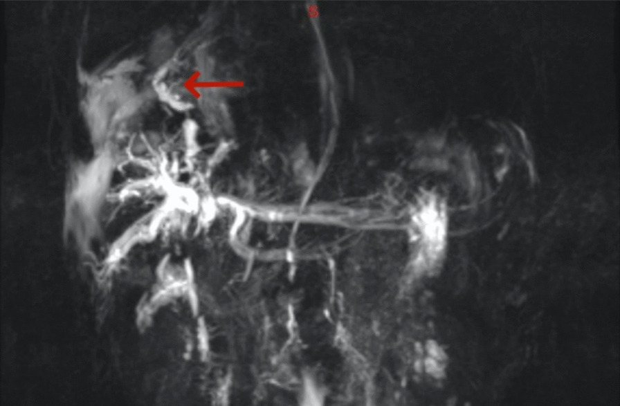
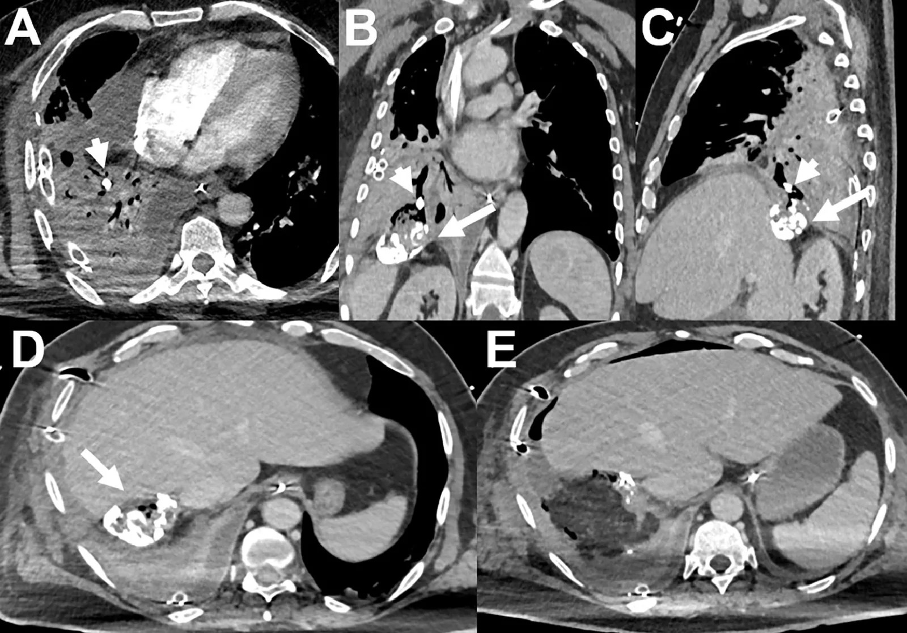
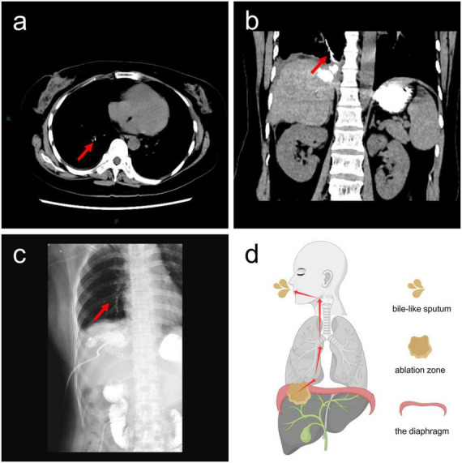
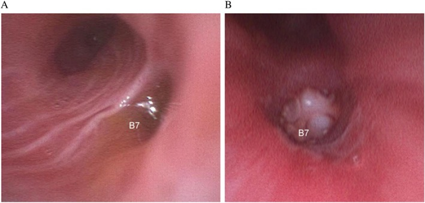
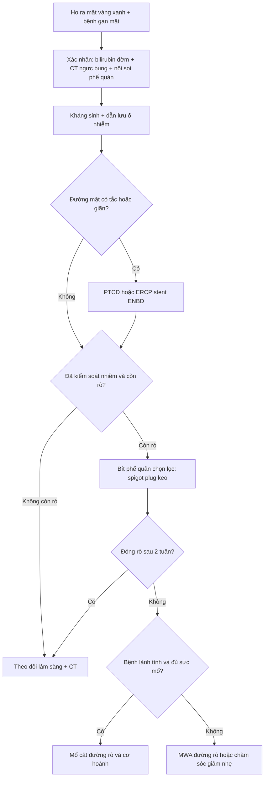
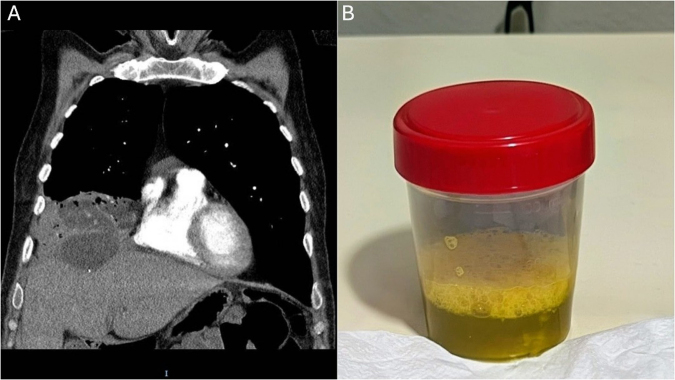

# 1824 — Rò mật–phế quản (bronchobiliary fistula): ho ra mật, MRCP/ERCP và bậc thang bít rò

**Tags:** `pattern:ro` `pattern:ho-ra-mat` `pattern:dong-dac` `pattern:xep-phoi` `vung:gan` `vung:phoi` `vung:co-hoanh` `protocol:CT-bung-nguc` `protocol:MRCP` `protocol:ERCP` `protocol:noi-soi-phe-quan`
**Mức chắc chắn (certainty):** tổng hợp y văn (literature synthesis) — ghép toàn văn 1 đoàn hệ **17 bệnh nhân trong 13 năm** (BMC Surg 2026, **PMC12781370**, CC BY-NC-ND), 1 đoàn hệ **9 bệnh nhân BBF sau MWA/1.885 ca MWA** (BMC Cancer 2025, **PMC12512725**, CC BY-NC-ND), 1 ca **can thiệp bít rò bằng MWA qua da** (Front Med 2026, **PMC12907328**, CC BY), 1 ca **bít bằng vascular plug** (Radiol Case Rep 2026, **PMC12743410**, CC BY-NC-ND), 1 loạt **4 ca bít phế quản chọn lọc** (Respirol Case Rep 2024, **PMC11289238**, CC BY-NC-ND), 1 ca **nút phế quản bằng Watanabe spigot** (Respirol Case Rep 2025, **PMC12566172**, CC BY), 1 ca **sán gan vỡ xuyên cơ hoành** (Radiol Case Rep 2026, **PMC13660178**, CC BY), 1 ca **biliptysis ẩn** (Open Respir Arch 2026, **PMC13196502**, CC BY-NC-ND), 1 ca **sau chấn thương gan** (J Med Case Rep 2024, **PMC11194872**, CC BY) và 1 bài về **HIDA Tc99m-mebrofenin** (World J Nucl Med 2017, **PMC5639450**, CC BY-NC-SA). Không có thử nghiệm ngẫu nhiên; mọi khuyến nghị điều trị là **hồi cứu/ca lẻ**.

> **Ca mở đầu — “viêm phổi” mãi không khỏi:** nam **62 tuổi**, HCC, cắt phân thùy trước 2 tháng trước; nhập ICU vì **viêm phổi nặng – suy hô hấp**; nội soi phế quản thấy **dịch mật vàng–xanh từ phế quản B7 phải**. Đặt **Watanabe spigot** tại lỗ rò qua ống soi dùng một lần ngay tại giường; bệnh nhân **cai máy ngày 12, ra viện ngày 25, không tái phát** (PMC12566172).
> **Bài chốt năm quyết định:** **(1) ho ra mật (biliptysis) là dấu hiệu đặc hiệu — nghĩ BBF trước khi nghĩ “viêm phổi”;** **(2) bộ ba ho + ho ra mật + sốt tái diễn gặp 100% ở 17 ca, nhưng CT/MRI chỉ thấy đường rò ở 52,9% — hình ảnh âm không loại trừ;** **(3) trung vị từ điều trị bệnh gan đến khi có triệu chứng là 10 tháng (0–64), và từ triệu chứng đến điều trị là 2 tháng — chậm trễ là nguyên nhân tử vong;** **(4) sau MWA gan, BBF gặp 0,48% (9/1.885), tất cả tổn thương ở VII/VIII sát vòm hoành;** **(5) nguyên tắc điều trị là GIẢI ÁP đường mật + bít lỗ rò: dẫn lưu mật (PTCD/ERCP) trước, bít phế quản (spigot/plug/keo) khi còn rò, mổ khi lành tính và bệnh nhân đủ sức.**

## 1. Tổng quan bệnh học – cơ chế hình ảnh: vì sao mật chảy vào phế quản lại nguy hiểm

### 1.1 Định nghĩa, nguồn gốc và sinh lý bệnh

- **BBF** là đường thông bất thường giữa **đường mật** và **cây phế quản**, thường qua một **khuyết cơ hoành phải**. Bẩm sinh rất hiếm; phần lớn là **mắc phải**: sán gan (đặc biệt sau vỡ vào đường mật), sau **cắt gan/ghép gan**, chấn thương gan–ngực, **TACE/RFA/MWA**, hẹp/tắc đường mật do sỏi hoặc u (PMC12781370; PMC5639450).
- **Vì sao rò không tự đóng:** (a) **chênh áp** giữa đường mật và đường thở + áp lực âm trong lồng ngực hút dịch lên; (b) **tắc nghẽn đường mật dưới chỗ rò** (sỏi, hẹp, stent hẹp) làm mật luôn tìm đường thoát qua lỗ rò; (c) **khuyết cơ hoành** không tự khép; (d) **ổ áp-xe/biloma** dưới hoành tiếp tục nuôi đường rò. Vì vậy chỉ kháng sinh không bao giờ đóng rò — phải **giải áp đường mật** và xử lý ổ nhiễm.
- **Vì sao mật gây tổn thương phổi nặng:** muối mật là chất hoạt động bề mặt, phá **surfactant**, gây **viêm phổi hóa học** và hoại tử biểu mô phế quản; sau đó là **bội nhiễm vi khuẩn đường mật** (70% cấy đờm dương tính trong loạt 17 ca). Hậu quả: xẹp phổi, áp-xe phổi, tràn dịch/tràn mủ màng phổi, suy hô hấp, nhiễm khuẩn huyết.
- **Vì sao chẩn đoán muộn:** triệu chứng giống viêm phổi/áp-xe; đờm vàng–xanh bị coi là “đờm mủ”; bệnh nhân ung thư gan lại đang có nhiều lý do khác để sốt và ho. Trong loạt 17 ca, **trung vị 10 tháng** từ điều trị bệnh gan đến triệu chứng BBF, và **2 tháng** từ triệu chứng đến điều trị (PMC12781370).

### 1.2 Ngưỡng định lượng nằm lòng

| Đại lượng | Số liệu | Ý nghĩa | Nguồn |
|---|---|---|---|
| BBF sau MWA gan | **9/1.885 = 0,48%** | Biến chứng hiếm nhưng có thật; cần biết để theo dõi | PMC12512725 |
| Vị trí u khi BBF sau MWA | **VII 33,3%, VIII 66,7%** — tất cả sát vòm hoành | U sát cơ hoành là yếu tố nguy cơ chính | PMC12512725 |
| Kích thước u trong loạt BBF sau MWA | **62,5% u 4–5 cm**; 87,5% đốt nhiều điểm; 62,5% dùng 2 kim | Đốt rộng + nhiều điểm → nguy cơ cao hơn | PMC12512725 |
| Thời gian từ điều trị gan đến triệu chứng | trung vị **10 tháng** (0–64) | Có thể xuất hiện rất muộn, sau khi đã “ổn định” | PMC12781370 |
| Thời gian từ triệu chứng đến điều trị | trung vị **2 tháng** (0–6) | Chẩn đoán muộn là điểm can thiệp được | PMC12781370 |
| Bộ ba triệu chứng | ho + ho ra mật + sốt tái diễn **100%** (17/17) | Tam chứng thực hành, không phải “hiếm gặp” | PMC12781370 |
| Sốt | **77,8%** (7/9) ở loạt sau MWA | Dễ bị quy cho viêm phổi | PMC12512725 |
| Tràn dịch màng phổi | **76,5%** (13/17); viêm phổi + tràn dịch **100%** (9/9) | Hình ảnh “viêm phổi” luôn kèm dịch | PMC12781370; PMC12512725 |
| Giãn đường mật | **94,1%** (16/17) | Dấu hiệu gián tiếp rất mạnh | PMC12781370 |
| Rò mật trên hình ảnh | **52,9%** (9/17) với CT/MRI; cholangiography **10/14 = 71,4%** khi được làm | Hình ảnh âm **không** loại trừ | PMC12781370 |
| Cấy đờm | **70%** (7/10) có vi khuẩn | Bội nhiễm thường gặp, không loại trừ BBF | PMC12781370 |
| Tử vong | **47,1%** (8/17); **2 ca chết trực tiếp do BBF** (nhiễm khuẩn huyết/suy gan) | Bệnh nặng, tiên lượng xấu | PMC12781370 |
| Sputum bilirubin | **3/3 dương tính**; dịch màng phổi bilirubin **2/2 dương tính** | Xét nghiệm rẻ, đặc hiệu, ít được làm | PMC12781370; PMC12512725 |

### 1.3 Vì sao hình ảnh lại “giống viêm phổi” và đâu là dấu hiệu chốt

- **Đông đặc/xẹp phổi thùy dưới phải** là hình ảnh thường gặp nhất, do mật gây viêm hóa học và xẹp phổi; có thể có **mức khí–dịch trong hang/áp-xe** hoặc **dày màng phổi**. Vì vậy phim/CT đầu tiên hay được đọc là “viêm phổi + tràn dịch”.
- **Dấu hiệu chốt trên CT:** **khuyết cơ hoành phải** + **đường rò** từ gan/đường mật xuyên qua cơ hoành vào phế quản thùy dưới phải; có thể thấy **khí trong ổ gan/biloma**, **dịch quanh gan**, **giãn đường mật trong gan**, và đôi khi **vật liệu cản quang/đờ mật trong lòng phế quản** (PMC13660178; PMC12907328).
- **Vì sao CT/MRI chỉ thấy 52,9%:** đường rò nhỏ, dính vào cơ hoành, bị che bởi xẹp phổi/áp-xe; cần **MPR mỏng theo mặt phẳng đứng dọc** và **thì tĩnh mạch cửa**, không chỉ đọc lát ngang. Ca sán gan vỡ cho thấy **bong bóng khí mới trong nang vôi hóa** + **mảnh vôi trong lòng phế quản** là dấu hiệu gián tiếp rất mạnh (PMC13660178).
- **Vì sao MRCP hữu ích:** dịch mật rất sáng trên chuỗi xung T2 nặng (heavily T2-weighted) → thấy **đường rò sáng nối đường mật với phế quản**, đồng thời đánh giá hẹp/tắc đường mật — yếu tố quyết định phải giải áp. Trong loạt sau MWA, MRI chỉ thấy rò ở 1/9, nên MRCP bình thường vẫn không loại trừ (PMC12512725).

*Ảnh MRCP (T2 nặng) sau chấn thương gan: đường rò sáng nối đường mật với cây phế quản (mũi tên đỏ). Nguồn: J Med Case Rep 2024, PMC11194872, CC BY 4.0.*
- **HIDA (99mTc-mebrofenin):** đồng vị bài tiết vào đường mật, nếu thấy **hoạt độ phóng xạ trong phổi** thì xác nhận rò mà không cần chọc; hữu ích khi bệnh nhân không làm được ERCP/PTC. Chưa có độ nhạy gộp đáng tin cậy — chỉ là bằng chứng định tính (PMC5639450).

## 2. Mẫu hình + chẩn đoán phân biệt theo vị trí (gamut)

- **Mẫu hình “đông đặc thùy dưới phải + tràn dịch + ho ra mật”:** BBF; áp-xe phổi; viêm phổi hít; áp-xe gan vỡ vào phổi; rò phế quản–màng phổi (bronchopleural fistula); vỡ nang sán vào phế quản.
- **Gamut theo nguồn gốc (rất thực dụng):**
  - **Sán gan (hydatid):** nang vôi hóa ở vòm gan, vỡ xuyên cơ hoành; đờm có thể “nước muối”/màng nang, sau đó mật vàng–xanh; nguy cơ sốc phản vệ nếu vỡ (bài 934).
  - **Sau cắt gan/ghép gan:** rò miệng nối đường mật hoặc mặt cắt gan, thường kèm biloma/áp-xe dưới hoành; thời gian có thể vài tuần đến vài năm.
  - **Sau đốt nhiệt (RFA/MWA):** tổn thương sát vòm hoành, đốt rộng/nhiều điểm; BBF xuất hiện sau 1–12 tháng.
  - **Sau TACE:** hoại tử u + thiếu máu đường mật → rò; thường ở HCC.
  - **Tắc mật do sỏi/hẹp/u:** áp lực đường mật cao “đẩy” mật qua lỗ rò; phải giải áp mới đóng được.
  - **Chấn thương gan–ngực:** vỡ gan + rách cơ hoành; trẻ em và người trẻ.
  - **Bẩm sinh:** rất hiếm, thường ở trẻ nhỏ, có thể kèm dị tật đường mật.
- **Gamut theo màu đờm:** **vàng–xanh, vị đắng** = mật; **nâu “sốt cà chua”** = áp-xe amip; **nước muối/màng trắng** = nang sán; **mủ hôi** = áp-xe phổi; **bọt hồng** = phù phổi.

## 3. Bảng so sánh phân biệt (ma trận đối chiếu)

| Thực thể (entity) | Hình ảnh điển hình | Chốt vào (rule-in) | Chốt loại (rule-out) | Gợi ý xác nhận |
|---|---|---|---|---|
| **Rò mật–phế quản (BBF)** | Đông đặc/xẹp thùy dưới phải + tràn dịch; **khuyết cơ hoành** + đường rò từ gan vào phế quản; giãn đường mật | **Ho ra mật vàng–xanh + bilirubin trong đờm/dịch rửa + đường rò trên CT/MRCP/cholangiography** | Đờm không có mật, không có bệnh gan mật → nghĩ nguyên nhân phổi | Sputum bilirubin, nội soi phế quản, MRCP, ERCP/PTC, HIDA |
| **Áp-xe phổi** | Hang + mức khí–dịch, thành dày, đông đặc quanh; không có đường rò xuyên hoành | **Sốt + đờm mủ hôi + hang có mức dịch** | Đờm vàng–xanh vị đắng + bệnh gan mật → nghĩ BBF | Cấy đờm, CT ngực; soi phế quản |
| **Rò phế quản–màng phổi / empyema** | Tràn dịch màng phổi có khí, dày màng phổi; đường rò trong khoang màng phổi | **Tràn mủ + khí trong khoang màng phổi** | Dịch màng phổi có bilirubin cao + tổn thương gan → nghĩ rò mật | Bilirubin dịch màng phổi, CT, dẫn lưu |
| **Áp-xe gan vỡ vào phổi** | Ổ giảm tỷ trọng trong gan + khí, dày cơ hoành, đông đặc phổi kề | **Ổ gan + sốt + đau hạ sườn phải** | Bệnh nhân không có ổ gan, đờm mật rõ → BBF | CT bụng, siêu âm, cấy máu |
| **Áp-xe amip vỡ vào phổi** | Ổ gan phải sát hoành, đờm nâu “sốt cà chua” | **Đờm nâu + huyết thanh amip + ổ gan** | Đờm vàng–xanh + tiền sử can thiệp gan → BBF | Huyết thanh/kháng nguyên amip, CT |
| **Vỡ nang sán vào phế quản** | Nang vôi hóa ở vòm gan, **khí trong nang**, mảnh vôi/màng trong phế quản | **Nang vôi + khí mới trong nang + mảnh màng/vôi trong đờm** | Không có nang/sán huyết thanh → loại | CT, ELISA sán, nội soi phế quản |
| **Viêm phổi hít** | Đông đặc phân thùy dưới, phụ thuộc tư thế; không có đường rò | **Bối cảnh sặc + đông đặc phụ thuộc** | Đờm mật + bệnh gan mật → không phải đơn thuần | Nuốt cản quang, nội soi |

*Hình 1 — (A) khí mới trong nang sán vôi hóa ở vòm gan + mảnh vôi trong lòng phế quản (đầu mũi tên); (B, C) MPR đứng dọc cho thấy đường rò xuyên khuyết cơ hoành phải; (D) khí trong nang sau khi rò; (E) sau mổ. Nguồn: Radiol Case Rep 2026, PMC13660178, CC BY 4.0; giữ nguyên nhãn A–E.*

- **Điểm chốt:** không có dấu hiệu hình ảnh nào đủ một mình; **màu/vị đờm + bilirubin trong đờm** là “chốt vào” rẻ nhất, còn **đường rò xuyên cơ hoành** là chốt định vị để can thiệp.

## 4. Protocol chụp + hệ phân độ/điểm chuẩn hóa

### 4.1 Chẩn đoán theo bậc thang

| Bước | Việc làm | Số liệu/ngưỡng | Cạm bẫy |
|---|---|---|---|
| 1 | Hỏi màu, vị, số lượng đờm; hỏi tiền sử gan mật/can thiệp | **vàng–xanh, đắng**; ho + sốt tái diễn | Coi là “đờm mủ” |
| 2 | **Bilirubin trong đờm/dịch rửa** (và dịch màng phổi nếu có) | Dương tính là chốt; 3/3 và 2/2 trong loạt | Ít được làm → bỏ sót |
| 3 | **CT ngực + bụng có cản quang**, lát ≤ 1 mm, MPR coronal/sagittal | Tìm khuyết cơ hoành, đường rò, giãn đường mật (**94,1%**), áp-xe/biloma | Chỉ đọc lát ngang → bỏ đường rò |
| 4 | **MRCP** (T2 nặng) hoặc **HIDA** nếu CT không rõ | Đường rò sáng; HIDA thấy đồng vị trong phổi | MRCP âm không loại trừ (1/9 ca sau MWA) |
| 5 | **Nội soi phế quản** | Thấy mật vàng–xanh chảy từ một phân thùy (thường B7/B8 phải) | Cần soi đúng lúc đang ho/rò |
| 6 | **ERCP/PTC** | Thấy cản quang từ đường mật vào phế quản; đồng thời giải áp | Chỉ thấy 71,4% khi làm; có thể bỏ sót đường rò nhỏ |

*Hình 2 — (a) CT ngang thấy đường rò (mũi tên đỏ); (b) MPR coronal thấy cản quang trong đường rò; (c) X-quang sau bơm cản quang qua dẫn lưu; (d) sơ đồ đường mật–phế quản. Nguồn: Front Med 2026, PMC12907328, CC BY 4.0; giữ nguyên nhãn a–d.*

### 4.2 Điều trị — bậc thang “giải áp trước, bít sau”

| Bậc | Can thiệp | Chỉ định | Kết quả đã báo | Lưu ý |
|---|---|---|---|---|
| 1 | **Kháng sinh + dẫn lưu ổ áp-xe/màng phổi** | Mọi ca; ổ nhiễm rõ | Giảm nhiễm trùng, tạo điều kiện đóng rò | Không đóng rò đơn thuần |
| 2 | **Giải áp đường mật: PTCD hoặc ERCP (ENBD/stent)** | Tắc mật, giãn đường mật, rò còn hoạt động | Loạt 17 ca: 10/11 ca can thiệp tối thiểu được giảm triệu chứng; loạt sau MWA: PTCD **3/5** hết triệu chứng, ERBD **2/5** đóng rò | Đây là bước **bắt buộc** trước khi bít |
| 3 | **Bít phế quản chọn lọc** (spigot, vascular plug, keo/coil) | Rò dai dẳng dù đã giải áp; bệnh nhân yếu | SBO **3/4 = 75%**; plug 1 ca; spigot 1 ca (cai máy ngày 12) | Có thể thất bại: 2/2 ca trong loạt sau MWA |
| 4 | **MWA đường rò qua da** | Rò nhỏ, đường đi rõ, không mổ được | 1 ca: **40 W × 7 phút**, đóng hoàn toàn | Mới, chưa có theo dõi dài |
| 5 | **Mổ** (cắt đường rò + vá cơ hoành + cắt phổi/gan tổn thương) | Lành tính, rò phức tạp, thất bại các bậc trên | 6 ca: **3 sống > 24 tháng**, 3 tử vong (1 do BBF/suy gan) | Chọn bệnh nhân kỹ; ở ung thư tiến triển thường chỉ giảm nhẹ |

*Hình 3 — (A) mật vàng–xanh chảy từ phế quản B7 phải; (B) Watanabe spigot đặt tại lỗ rò. Nguồn: Respirol Case Rep 2025, PMC12566172, CC BY 4.0; giữ nguyên nhãn A–B.*

- **Không có RADS/score được thẩm định cho BBF.** Phân tầng thực hành dựa trên **3 trục**: (1) **nguồn gốc** lành/ác; (2) **mức nhiễm trùng** (áp-xe, mủ màng phổi, nhiễm khuẩn huyết); (3) **có tắc mật** hay không — vì tắc mật là yếu tố quyết định phải giải áp trước.
- **Theo dõi:** CT ngực–bụng 1–3 tháng sau can thiệp; nội soi phế quản kiểm tra nếu còn ho ra mật; đánh giá lại đường mật bằng MRCP/ERCP nếu rò tái phát.

## 5. Biến thể bình thường và cạm bẫy

- **“Viêm phổi” không đáp ứng kháng sinh + tràn dịch kéo dài** ở người có tiền sử gan mật/can thiệp gan: phải hỏi **màu đờm** và làm **bilirubin đờm** — chi phí thấp, đặc hiệu cao.
- **CT/MRI âm không loại trừ:** chỉ **52,9%** thấy đường rò; trong loạt sau MWA, MRI chỉ thấy **1/9**. Nếu lâm sàng mạnh, làm **nội soi phế quản** hoặc **cholangiography**.
- **Đừng bỏ qua giãn đường mật:** **94,1%** ca có giãn đường mật — đây là dấu hiệu gián tiếp nhắc phải giải áp.
- **Đờm vàng–xanh không phải lúc nào cũng là mật:** nhiễm *Pseudomonas* có thể xanh; nhưng **vị đắng + bệnh gan mật + bilirubin dương** mới là mật. Ngược lại, đờm “mủ” ở bệnh nhân sau đốt gan phải nghĩ BBF.
- **Bít phế quản không phải viên đạn bạc:** 2/2 ca trong loạt sau MWA thất bại; SBO 3/4 thành công. Cần chọn đúng lỗ rò và vẫn phải giải áp đường mật.
- **Mổ ở ung thư tiến triển thường không kéo dài sống:** trong 6 ca mổ, 3 sống > 24 tháng đều là **bệnh lành tính**; ở HCC tiến triển, mổ có thể chỉ để kiểm soát biến chứng.
- **Sán gan vỡ:** đừng chọc hút/đốt nang sán trước khi loại trừ BBF và dự phòng sốc phản vệ (bài 934); mảnh vôi/màng trong phế quản có thể gây tắc phế quản.

## 6. Tự lượng giá — Blind Quiz

**Ca 1 — Nam 69 tuổi, carcinoid ruột di căn gan, cắt gan trước đó; nhập viện vì “viêm phổi hang hai đáy phổi” và suy hô hấp; sau đó ho ra đờm vàng–xanh.**

- Hỏi: triệu chứng nào là dấu hiệu đặc hiệu? Ba chẩn đoán phân biệt? Xét nghiệm rẻ nhất để xác nhận?

<b>Bấm để hiện đáp án (findings + chẩn đoán)</b>

- (A) CT coronal: giảm tỷ trọng/ổ dịch dưới hoành phải thông với đáy phổi; (B) đờm **vàng–xanh, nhầy** — biliptysis.
- Phân biệt: BBF, áp-xe phổi, viêm phổi hít; kèm rò màng phổi.
- Xác nhận: **bilirubin trong đờm** (hoặc dịch rửa phế quản), rồi **nội soi phế quản** thấy mật chảy từ một phân thùy; CT/MRCP để tìm đường rò và tắc mật.
- Nguồn: Open Respir Arch 2026, PMC13196502, CC BY-NC-ND 4.0.

**Ca 2 — Nam 61 tuổi, sốt–khó thở–đau ngực phải; CT đầu tiên đọc “viêm phổi + tràn dịch”, kháng sinh và dẫn lưu không đỡ.**

- Hỏi: dấu hiệu nào trên CT gợi ý nguồn gan? Vì sao điều trị “viêm phổi” thất bại? Kế hoạch xử trí?

<b>Bấm để hiện đáp án (findings + chẩn đoán)</b>

- Nang **vôi hóa** ở vòm gan với **khí mới trong nang**; **mảnh vôi trong lòng phế quản thùy dưới phải**; MPR cho thấy **đường rò xuyên khuyết cơ hoành**.
- Điều trị viêm phổi thất bại vì vẫn còn **nguồn mật và ổ nang** dưới hoành.
- Xử trí: kháng sinh + dẫn lưu, đánh giá đường mật; mổ cắt nang/đường rò + vá cơ hoành (ca này đã mổ); dự phòng sốc phản vệ nếu còn nang sán.
- Nguồn: Radiol Case Rep 2026, PMC13660178, CC BY 4.0.

**Ca 3 — Nam 62 tuổi sau cắt phân thùy trước vì HCC, ICU, thở máy; nội soi thấy mật từ B7.**

- Hỏi: chẩn đoán? Vì sao chọn bít phế quản thay vì mổ? Kết cục và theo dõi?

<b>Bấm để hiện đáp án (findings + chẩn đoán)</b>

- (A) mật vàng–xanh chảy từ **B7 phải** = BBF; (B) **Watanabe spigot** bít lỗ rò.
- Chọn bít vì bệnh nhân **nguy kịch, không vận chuyển/mổ được**; đặt ngay tại giường qua ống soi dùng một lần.
- Kết cục: **cai máy ngày 12, ra viện ngày 25, không tái phát**; vẫn cần theo dõi đường mật và nhiễm trùng.
- Nguồn: Respirol Case Rep 2025, PMC12566172, CC BY 4.0.

## Bài liên quan chéo

- [1820 – Rò mật–màng phổi (bilothorax): bilirubin dịch, dẫn lưu + giải áp đường mật](../1820-ro-mat-mang-phoi/lesson.md)
- [1819 – Chảy máu tiêu hóa muộn do giả phình động mạch tạng](../1819-chay-mau-muon-gia-phinh-mach-tang/lesson.md)
- [930 – Can thiệp ung thư gan: TACE, RFA/MWA & LI-RADS TRA](../930-hepatic-oncology-tace-rfa/lesson.md)
- [920 – Nút mạch cầm máu tiêu hóa, ho máu & chấn thương tạng](../920-vascular-embolization-gi-bleed/lesson.md)
- [934 – Sốc phản vệ do vỡ nang sán khi can thiệp](../934-soc-phan-ve-do-vo-nang-san/lesson.md)
- [100 – Tổng quan hệ Bụng](../100-tong-quan-he-bung/lesson.md)

> Không dùng để chẩn đoán độc lập khi chưa có người hướng dẫn.
