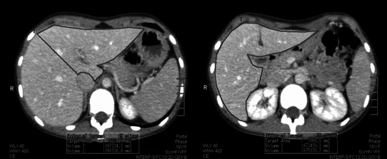
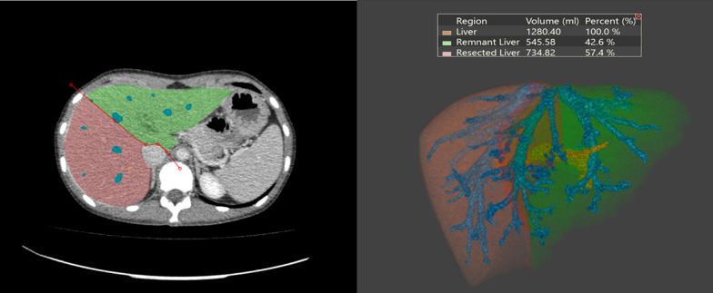
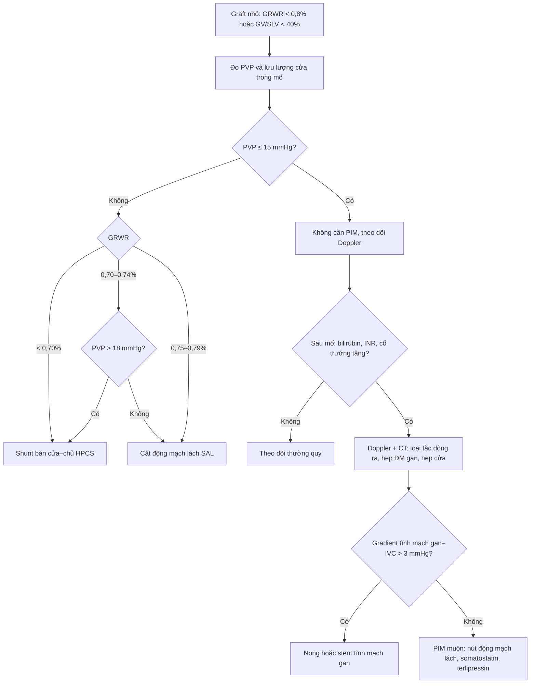
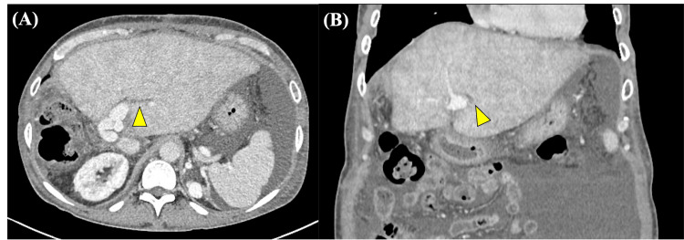
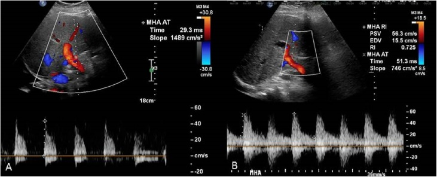
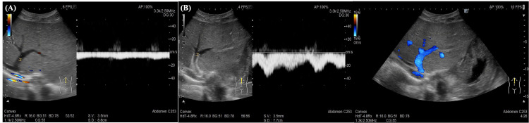

# 1825 — Hội chứng gan nhỏ sau ghép/cắt gan lớn: thể tích – dòng cửa – tắc dòng ra / Small-for-size syndrome (SFSS)

**Tags:** `pattern:gan-nho` `pattern:tang-tuoi-mau-cua` `pattern:ung-huyet-gan-ghep` `pattern:suy-chuc-nang-gan` `vung:gan` `score:GRWR` `score:GV-SLV` `score:ILTS-SFSS-2023` `protocol:CT-volumetry` `protocol:Doppler-cua` `protocol:SAE`
**Mức chắc chắn (certainty):** tổng hợp y văn (literature synthesis) — ghép 2 tổng quan về SFSS trong ghép gan sống cho (LDLT) (*Clin Mol Hepatol* 2025, **PMC11925445**, CC BY-NC 3.0; *Ann Gastroenterol Surg* 2026, **PMC12757166**, CC BY-NC 4.0), 1 đoàn hệ 577 ca ghép có cắt lách đồng thời áp dụng phân độ ILTS 2023 (**PMC13327040**, CC BY 4.0), 1 nghiên cứu so sánh 3 cách đo thể tích gan trên CT (**PMC10185718**, CC BY 4.0), 1 ca tắc dòng ra tĩnh mạch gan sau ghép có đủ CT – Doppler – can thiệp (**PMC13124245**, CC BY 4.0) và 1 ca **cướp máu lách (splenic steal)** có chụp mạch + Doppler trước/sau nút động mạch lách (**PMC6138849**, CC BY-NC-ND 4.0 — ảnh giữ nguyên bản). Không gắn một bệnh án đơn lẻ cho phần số liệu.

> **Bài này là nhánh "thể tích – dòng chảy" của [1821 – Suy gan sau cắt gan (PHLF)](../1821-suy-gan-sau-cat-gan/lesson.md).** 1821 dạy **định nghĩa suy gan bằng INR + bilirubin từ ngày 5** và các thang ISGLS/50-50/FLIS. Bài này trả lời câu hỏi khác: **khi gan còn lại/graft nhỏ thì cơ chế gây suy là gì, đọc thể tích trên CT ra sao, và khi nào phải can thiệp vào dòng cửa chứ không phải chờ** — đồng thời tách SFSS khỏi **tắc dòng ra tĩnh mạch gan**, thứ trông giống hệt trên phim nhưng xử trí ngược lại.

> **Câu chốt:** **"gan nhỏ" là chuyện của thể tích, nhưng tổn thương thật là chuyện của dòng chảy.** Ngưỡng kinh điển **GRWR ≥ 0,8% và/hoặc GV/SLV ≥ 40%** giữ tỉ lệ SFSS **dưới 10%**, nhưng cùng một thể tích, ai có **áp lực tĩnh mạch cửa (PVP) > 20 mmHg** hoặc **lưu lượng cửa > 250–300 mL/phút/100 g gan** thì vẫn suy — đó là khái niệm **"small-for-flow"**. Điều trị không phải truyền albumin, mà là **giảm dòng cửa (PIM): cắt/nút động mạch lách, shunt cửa–chủ, somatostatin**; và trước khi làm bất cứ điều gì, **phải loại tắc dòng ra** — gradient tĩnh mạch gan–IVC **> 3 mmHg** hoặc gradient cửa **> 5 mmHg** là chỉ định can thiệp cơ học.

## 1. Tổng quan bệnh học – cơ chế hình ảnh

### 1.1 Vì sao một graft nhỏ lại bị "đánh" bởi chính dòng máu nuôi nó

- **Sinh lý bình thường:** gan nhận **~75% lưu lượng từ tĩnh mạch cửa** nhưng **~50% oxy từ động mạch gan**; hai hệ bù trừ nhau qua **phản ứng động mạch gan (hepatic arterial buffer response)** — cửa xuống thì động mạch lên và ngược lại.
- **Trong graft/gan còn lại quá nhỏ:** toàn bộ lưu lượng cửa của một cơ thể lớn dồn vào một khối nhu mô nhỏ → **tăng vận tốc và áp lực trong sinusoid**. Lực cắt (shear stress) làm **tổn thương nội mô xoang, phù – ứ huyết xoang, hoại tử tế bào gan vùng quanh tĩnh mạch trung tâm**, đồng thời **ức chế dòng động mạch gan** → **thiếu máu đường mật** (đường mật chỉ nuôi bằng động mạch) → ứ mật, hẹp đường mật, nhiễm trùng. Đây là chuỗi giải thích tại sao SFSS biểu hiện bằng **vàng da + cổ trướng + rối loạn đông máu** chứ không chỉ "men gan cao" (PMC11925445; PMC12757166).
- **Vì sao có cổ trướng "không cạn":** tăng áp lực xoang + tăng áp cửa + giảm tổng hợp albumin → **dịch tiết vào ổ bụng với tốc độ hàng lít/ngày**, đáp ứng kém với lợi tiểu; tổng quan nhấn mạnh **bù albumin 5% theo lượng dịch mất**, không phải hạn chế nước (PMC11925445).
- **Vì sao tắc dòng ra (hepatic venous outflow obstruction, HVOO) trông y hệt:** nếu miệng nối tĩnh mạch gan hẹp, máu ứ lại **sau** xoang → **phù gan, ngấm thuốc không đồng nhất, dấu "cổ áo quanh cửa" (periportal collar sign)**, giãn tĩnh mạch gan, và **mất phổ ba pha trên Doppler**. Trên CT, hình ảnh này **không phân biệt được với SFSS**; chỉ **gradient áp lực** và **đáp ứng với nong/stent** mới chốt (PMC13124245).
- **Vì sao CT đo thể tích lại quan trọng mà vẫn hay sai:** thể tích CT **ước lượng quá cân nặng graft thật** vì gan được tưới máu và chứa máu/dịch; trong 60 người hiến, sai số trung bình **12,7 ± 16,6% (thủ công)**, **17,1 ± 17,3% (bán tự động)** và **14,7 ± 16,8% (tự động)**, tương quan với cân nặng graft **r = 0,730 / 0,685 / 0,699** (PMC10185718). Nghĩa là **một "GV/SLV 40%" trên phần mềm có thể là 35% thật** — vì vậy ngưỡng an toàn phải dùng kèm **cân nặng thật của mảnh ghép** và **đo áp lực trong mổ**.

### 1.2 Ngưỡng định lượng nằm lòng

| Đại lượng | Ngưỡng / số liệu | Ý nghĩa thực hành | Nguồn |
|---|---|---|---|
| **GRWR** (graft-to-recipient weight ratio) | **≥ 0,8%** (một số trung tâm nhận **0,6%** khi có PIM) | Ngưỡng chọn graft; dưới ngưỡng → SFSS tăng | PMC11925445 |
| **GV/SLV** (graft volume / standard liver volume) | **≥ 40%** | Tương đương GRWR 0,8%; **< 25–27%** gắn với bệnh suất – tử vong cao | PMC11925445; PMC12757166 |
| Tỉ lệ SFSS khi đạt ngưỡng | **< 10%** | Nền để so sánh khi đánh giá một ca "đã đủ thể tích mà vẫn suy" | PMC11925445 |
| **PVP** (áp lực tĩnh mạch cửa) trong mổ | **> 20 mmHg → phải PIM** (ILTS 2017); **> 15 mmHg** là ngưỡng của nhiều trung tâm | Biến số **dự báo mạnh hơn thể tích** | PMC11925445; PMC12757166 |
| **PVF** (lưu lượng cửa) | **> 250 mL/phút/100 g** → cân nhắc shunt; **> 300 mL/phút/100 g** → nguy cơ SFSS tăng rõ | Dùng Doppler trong mổ / sau mổ | PMC11925445 |
| **Lưu lượng động mạch gan** | **< 100 mL/phút** = giảm tưới máu ("cướp máu lách") | Chỉ định nút/cắt động mạch lách | PMC11925445; PMC6138849 |
| Gradient cửa | **> 5 mmHg** → can thiệp | Loại/tách tắc cửa | PMC11925445 |
| Gradient tĩnh mạch gan – IVC | **> 3 mmHg** → can thiệp | Chốt **HVOO**, không phải SFSS | PMC11925445 |
| Sai số đo thể tích CT | **12,7% (thủ công) · 17,1% (bán tự động) · 14,7% (tự động)** | Không bao giờ đọc thể tích như số tuyệt đối | PMC10185718 |
| SFSS độ B/C dù đã cắt lách | **18,2% (105/577)**; sống 1 năm **81,9% vs 93,9%** | Ngay cả khi đã PIM vẫn còn 1/5 thất bại | PMC13327040 |
| Yếu tố nguy cơ độc lập (dù đã cắt lách) | **MELD ≥ 30 · NLR ≥ 4,5 · tuổi người hiến ≥ 50** | Dùng để chọn ca cần theo dõi sát | PMC13327040 |

## 2. Mẫu hình + chẩn đoán phân biệt theo cơ chế (Gamut)

### 2.1 Ba câu hỏi phải trả lời trước mọi ca "gan ghép xấu đi"

1. **Thể tích có đủ không?** (GRWR, GV/SLV, cân nặng graft thật)
2. **Dòng vào có quá nhiều không?** (PVP, PVF, kích thước lách, lưu lượng động mạch gan)
3. **Dòng ra có tắc không?** (miệng nối tĩnh mạch gan, gradient, phổ Doppler)

Ba câu này tương ứng ba nhóm nguyên nhân **chữa được bằng ba cách khác nhau**: chọn graft/PIM – PIM – nong/stent.

### 2.2 Gamut theo bối cảnh

- **Sau LDLT, tuần đầu:** SFSS (thể tích ± dòng), **EAD** (tổn thương do thiếu máu – tái tưới máu), **PAD** (suy graft nguyên phát), **HVOO**, **huyết khối/ hẹp động mạch gan**, **hẹp miệng nối cửa**, **rò mật/nhiễm trùng**.
- **Sau cắt gan lớn:** **PHLF** (định nghĩa ISGLS, bài 1821) với **sFLR < 20/30/40%** theo nền gan; **SFSS do tăng dòng cửa** ở gan còn lại; **rò mật** (bài 1814) và **nhiễm trùng ổ bụng**.
- **Sau nút mạch / tắc mạch cửa (PVE) chờ cắt gan:** **hội chứng sau nút mạch** (bài 1834) — sốt trong 72 giờ, **WBC đi xuống**, không phải suy gan.

### 2.3 Hai khái niệm dễ lẫn

- **SFSS (small-for-size syndrome):** **graft quá nhỏ so với nhu cầu chuyển hóa** — tiêu chuẩn gắn với **GRWR < 0,8–1,0%**.
- **Small-for-flow:** **mất cân bằng giữa dòng cửa và kích thước graft** — graft có thể "đủ cân" nhưng **áp lực/lưu lượng cửa quá cao**; đây là lý do **ILTS-iLDLT-LTSI 2023 chuyển trọng tâm từ "size" sang "flow"** và đưa ra **phân độ A/B/C** (PMC11925445; PMC12757166).

## 3. Bảng so sánh phân biệt (ma trận đối chiếu)

| Thực thể (entity) | Hình ảnh điển hình | Chốt vào (rule-in) | Chốt loại (rule-out) | Gợi ý xác nhận |
|---|---|---|---|---|
| **SFSS** | Graft nhỏ; CT: gan **ngấm thuốc không đồng nhất nhẹ**, có thể **phù quanh cửa**; Doppler: **PVV cao**, động mạch gan **RI cao/giảm dòng tâm trương**; cổ trướng nhiều | **GRWR < 0,8% + PVP > 20 mmHg + bilirubin/INR tăng từ ngày 3–5 kèm cổ trướng > 1 L/ngày**, sau khi loại trừ kỹ thuật | **Gradient tĩnh mạch gan–IVC ≤ 3 mmHg + miệng nối cửa thông + không hẹp động mạch** → không phải nguyên nhân cơ học | Đo PVP/PVF trong mổ; Doppler + CT; thử PIM |
| **Tắc dòng ra tĩnh mạch gan (HVOO)** | CT: **ngấm thuốc không đồng nhất + dấu "cổ áo quanh cửa"**, giãn tĩnh mạch gan so với IVC; Doppler: **mất phổ ba pha, dòng giảm/đảo** | **Gradient tĩnh mạch gan–IVC > 3 mmHg**; giãn tĩnh mạch gan; đáp ứng sau nong/stent | Gradient bình thường + phổ ba pha còn → loại | Doppler có/không cản quang; chụp tĩnh mạch gan + đo gradient; stent |
| **Hẹp/huyết khối động mạch gan** | Doppler: **không thấy dòng động mạch**, **RI = 1** hoặc dòng đảo; CTA: chỗ hẹp/không ngấm | **Mất tín hiệu động mạch trên Doppler + CTA xác nhận** | Động mạch thông, phổ tốt → loại | CTA mỏng; Doppler hàng ngày tuần đầu |
| **Hẹp miệng nối tĩnh mạch cửa** | CTA/CTV: chỗ hẹp; Doppler: **PVV tăng tại chỗ hẹp, phổ liên tục**, giãn cửa trước hẹp | **Chênh áp > 5 mmHg qua chỗ hẹp**; giãn tĩnh mạch cửa trước hẹp | Không chênh áp, phổ bình thường → loại | CTV + đo áp lực khi chụp can thiệp |
| **EAD / PAD** | Không có dấu hiệu cơ học; men gan tăng mạnh | **EAD: bilirubin > 10 mg/dL hoặc INR > 1,6 ngày 7**; **PAD: bilirubin > 20 mg/dL, INR > 2 sau ngày 7** | Có nguyên nhân cơ học/dòng chảy → không quy cho EAD/PAD | Theo dõi xét nghiệm, loại trừ cơ học |
| **Cướp máu lách (splenic steal)** | Lách to; Doppler động mạch gan **mất dòng tâm trương**; chụp mạch: dòng dồn về lách | **Lưu lượng động mạch gan < 100 mL/phút** + hình chụp mạch; **cải thiện ngay sau nút/cắt động mạch lách** | Sau nút lách phổ không đổi → tìm nguyên nhân khác | Chụp mạch; Doppler trước/sau can thiệp |
| **Rò mật / nhiễm trùng ổ bụng** | Dịch quanh gan, biloma, khí; sốt, WBC tăng | **Bilirubin dịch/máu > 1** (bài 1820); cấy dương; ổ dịch ngấm viền | Dịch trong, cấy âm, không ổ → loại | Siêu âm/CT; chọc hút; ERCP/PTBD |

*Hình trái: đặt vùng quan tâm (ROI) **thủ công** trên từng lát cắt thì tĩnh mạch cửa; đây là cách tương quan tốt nhất với cân nặng graft thật (**r = 0,730**) nhưng vẫn sai **12,7%**. Nguồn: *Insights Imaging* 2023 (PMC10185718), Fig. 2 — CC BY 4.0, nguyên bản.*

## 4. Protocol chụp + hệ phân độ/điểm chuẩn hóa

### 4.1 Protocol CT thể tích trước ghép/cắt gan

- **Thì chụp:** **tĩnh mạch cửa (portal venous phase, ~70–80 giây)** — cần cả nhu mô và tĩnh mạch để phân vùng; **lát ≤ 1–2 mm**, tái tạo **1 mm** cho dựng 3D.
- **Cách đo:** **thủ công (manual)** vẽ contour từng lát → **tương quan tốt nhất** với cân nặng graft (**r = 0,730**, sai số **12,7%**); **bán tự động** (OsiriX) **r = 0,685**, sai **17,1%**; **tự động** **r = 0,699**, sai **14,7%** — khác biệt có ý nghĩa giữa thủ công và bán tự động (p = 0,017) nhưng **không** giữa thủ công và tự động (p = 0,199) (PMC10185718).
- **Nguyên tắc đọc số:** luôn ghi **thể tích (mL)**, **ước tính cân nặng (g)** và **sai số ±10–17%**; nếu kết quả nằm sát ngưỡng (GV/SLV 38–42%) thì **không được kết luận một mình** — phải dùng **cân nặng graft thật** trong mổ và **PVP**.
- **Mốc tham chiếu:** trong 60 người hiến, thể tích gan toàn bộ **1.164,4 ± 137,0 mL** (thủ công), thùy phải **762,0 ± 122,4 mL**, cân nặng graft thật **711,2 ± 142,9 g** (PMC10185718) — cho thấy **thể tích > cân nặng** khoảng **7%** ngay cả khi đo tốt.

*Phần mềm tự động tô màu nhu mô và dựng cây mạch; bảng số ghi **gan 1.280,40 mL**, **phần còn lại 545,58 mL (42,6%)**, **phần cắt 734,82 mL (57,4%)**. Đây là dạng báo cáo chuẩn để hội chẩn: **thể tích tuyệt đối + % + sai số**, không chỉ "còn 42%". Nguồn: *Insights Imaging* 2023 (PMC10185718), Fig. 5 — CC BY 4.0, nguyên bản.*

### 4.2 Protocol Doppler sau ghép (ngày 1–7, rồi theo lịch)

- **Tĩnh mạch cửa:** đường kính, **vận tốc trung bình (PVV)**, hướng dòng; **PVV giảm rõ hoặc đảo dòng** = nghi tắc/hẹp; **PVV tăng kèm phổ liên tục tại một điểm** = nghi hẹp miệng nối. (Các nguồn đã đọc **không đưa ra một ngưỡng cm/s thống nhất** — mỗi trung tâm tự đặt; bài không bịa số.)
- **Động mạch gan:** **PSV**, **RI**; **RI = 1** hoặc **mất hoàn toàn dòng tâm trương** = nghi hẹp/tắc hoặc **cướp máu lách** (ca PMC6138849: sau nút lách **PSV 56,3 cm/s, EDV 15,5 cm/s, RI 0,725**).
- **Tĩnh mạch gan:** phổ **ba pha** là bình thường; **mất phổ ba pha, dòng đơn hướng/giảm** = nghi tắc dòng ra → **đo gradient**.
- **Trong mổ (chuẩn vàng):** **PVP > 20 mmHg → PIM**; **PVF > 250 mL/phút/100 g** → cân nhắc shunt cửa–chủ; ghi lại **lưu lượng động mạch gan** trước và sau PIM.

### 4.3 Phân độ SFSS (ILTS-iLDLT-LTSI 2023) và thuật toán PIM

- **Định nghĩa cũ vẫn phải nhớ vì còn dùng trong y văn:** **Soejima 2003** — bilirubin **> 5 mg/dL** ở ngày 14 + cổ trướng **> 1 L/ngày** (hoặc **> 500 mL/ngày** ở ngày 28); **Dahm 2005** — **GRWR < 0,8%** + **≥ 2 tiêu chí** (bilirubin **> 100 µmol/L**, **INR > 2**, bệnh não gan **độ 3–4**) kéo dài **3 ngày liên tiếp** trong tuần đầu, sau khi loại trừ nguyên nhân kỹ thuật/miễn dịch/nhiễm (PMC11925445).
- **Phân độ 2023 (A/B/C) đổi cách xử trí:**
  - **Độ A** — rối loạn chức năng nhẹ: **điều trị nội khoa** (somatostatin/terlipressin, kiểm soát dịch).
  - **Độ B** — đã có **tăng áp lực tĩnh mạch cửa**: **can thiệp ngoại khoa hoặc điện quang (PIM)**.
  - **Độ C** — **suy gan**: PIM + **tích cực tìm ghép lại** (PMC11925445; áp dụng trong PMC13327040 với **18,2% độ B/C**).

*Thuật toán PIM lấy từ protocol của Soin và cộng sự (dẫn trong PMC11925445): **không PIM nếu PVP ≤ 15 mmHg** hoặc **PVP > 15 mmHg nhưng GRWR ≥ 0,80%**.*

## 5. Biến thể bình thường và cạm bẫy

- **"Đủ thể tích" không loại trừ SFSS:** trong 577 ca đã cắt lách đồng thời, **18,2% vẫn SFSS độ B/C**; **MELD ≥ 30, NLR ≥ 4,5, tuổi hiến ≥ 50** là yếu tố độc lập (PMC13327040). Đừng đọc GRWR 0,85% rồi kết luận an toàn.
- **Thể tích CT ≠ cân nặng graft:** sai số **12,7–17,1%**, và thể tích luôn **lớn hơn** cân nặng thật (PMC10185718). Ca sát ngưỡng phải dùng **cân nặng thật** + **PVP**.
- **Ngấm thuốc không đồng nhất sau ghép không đồng nghĩa SFSS:** dấu **"cổ áo quanh cửa"** + giãn tĩnh mạch gan là **HVOO** — phải đo gradient trước khi tăng thuốc/nuôi dưỡng (PMC13124245). Đây là cạm bẫy "điều trị gan nhỏ" trong khi có **miệng nối hẹp**.
- **Cướp máu lách không phải SFSS:** lách to + **mất dòng tâm trương động mạch gan**; sau **nút động mạch lách**, phổ tâm trương hồi phục ngay (PMC6138849). Nếu chỉ nhìn bilirubin sẽ truy "suy graft" và bỏ mất can thiệp 20 phút.
- **Đừng nhầm với hội chứng sau nút mạch:** sốt – đau – tăng bạch cầu trong **72 giờ** sau nút mạch/PVE là **phản ứng viêm vô khuẩn**, **WBC đi xuống**, không phải suy gan (bài 1834).
- **Gan nhiễm mỡ và tuổi người hiến** làm graft "nhỏ về chức năng" dù thể tích đạt: cùng GRWR, graft thoái hóa mỡ/người hiến lớn tuổi chịu **PVP > 15 mmHg** kém hơn (PMC11925445).
- **Sai số do phần mềm:** tự động có thể **tô nhầm nhu mô thận/tụy** vào gan (đã báo trong PMC10185718) — luôn xem lại đường contour, nhất là mặt dưới gan.

## 6. Tự lượng giá — Blind Quiz

**Ca 1 — Nam 57 tuổi, LDLT thùy phải, GRWR 0,72%. Ngày 6: vàng da tăng, cổ trướng 1,2 L/ngày, dẫn lưu 400 mL dịch trong. CT thì tĩnh mạch cửa:**

- Gợi ý: không sốt, WBC giảm dần, cấy dịch âm.
- Hỏi: mô tả kiểu ngấm thuốc? Ba chẩn đoán phân biệt? Dấu hiệu nào tách SFSS khỏi nguyên nhân cơ học?

<b>Bấm để hiện đáp án (findings + chẩn đoán)</b>

- **Findings:** ngấm thuốc **không đồng nhất lan tỏa** toàn gan ghép + **dấu "cổ áo quanh cửa" (periportal collar sign)** — viền giảm tỷ trọng chạy theo khoảng cửa (mũi tên vàng, ảnh A trục và B coronal).
- **Chẩn đoán:** **tắc dòng ra tĩnh mạch gan (HVOO)** — không phải SFSS thuần. Cơ chế: ứ máu sau xoang → phù khoảng cửa và ngấm thuốc không đều.
- **Dấu hiệu tách bạch:** Doppler tĩnh mạch gan **mất phổ ba pha** + **gradient tĩnh mạch gan–IVC > 3 mmHg**; nong/stent làm hết phù và giảm bilirubin. Nếu gradient bình thường và miệng nối cửa thông → quay lại SFSS và PIM.
- **Nguồn ảnh:** *Cureus* 2026 (PMC13124245), Fig. 1 — CC BY 4.0, nguyên bản.

**Ca 2 — Người hiến 32 tuổi, CT thì cửa, phần mềm báo:**

- Hỏi: đọc bảng số? Phần còn lại có an toàn cho người hiến? Cần thêm số nào trước khi quyết định lấy thùy phải?

<b>Bấm để hiện đáp án</b>

- **Số liệu:** gan **1.280,40 mL**; **phần còn lại 545,58 mL = 42,6%**; phần cắt **734,82 mL = 57,4%**.
- **Diễn giải:** với người hiến gan lành, **FLR 42,6% (> 30%)** là an toàn về thể tích; nhưng phải trừ **sai số 14,7%** của phương pháp tự động và xem lại contour.
- **Còn thiếu:** **cân nặng graft thật** (thể tích 734,8 mL ước ~700 g, sai ±15%), **GRWR của người nhận** sau khi biết cân nặng, và **đánh giá mỡ gan** — vì **thể tích đủ không bảo đảm chức năng**.
- **Nguồn ảnh:** *Insights Imaging* 2023 (PMC10185718), Fig. 5 — CC BY 4.0.

**Ca 3 — Bệnh nhân sau LDLT, ngày 4, lách to, Doppler động mạch gan:**

- Hỏi: mô tả phổ A và B? Chẩn đoán? Vì sao can thiệp này chứ không phải tăng thuốc vận mạch?

<b>Bấm để hiện đáp án</b>

- **Phổ A (trước):** động mạch gan **mất dòng tâm trương** (dòng chỉ có thì tâm thu, không về đường đáy) — dấu của **cướp máu lách (splenic steal)**/tăng sức cản ngoại vi.
- **Phổ B (sau nút động mạch lách):** **dòng tâm trương hồi phục**, PSV **56,3 cm/s**, EDV **15,5 cm/s**, **RI 0,725**.
- **Chẩn đoán:** cướp máu lách → **nút động mạch lách (SAE)**; đây là PIM "kiểu mạch" chứ không phải "kiểu thể tích".
- **Vì sao không tăng vận mạch:** vấn đề là **phân bố dòng**, không phải huyết áp; thuốc vận mạch không mở được tuần hoàn gan, còn giảm dòng lách thì **tăng ngay lưu lượng động mạch gan**.
- **Nguồn ảnh:** *Int J Surg Case Rep* 2018 (PMC6138849), Fig. 2 — CC BY-NC-ND 4.0, **nguyên bản, không cắt/ghép**.

**Ca 4 — Cùng bệnh nhân Ca 1, sau khi đặt stent tĩnh mạch gan, Doppler tĩnh mạch gan:**

- Hỏi: hình A và B khác nhau ở đâu? Điều đó chứng minh gì?

<b>Bấm để hiện đáp án</b>

- **A (trước):** dòng **ứ trệ, mất dạng phổ ba pha** bình thường.
- **B (sau):** phổ **ba pha trở lại** sau khi tái thông.
- **Ý nghĩa:** xác nhận nguyên nhân **cơ học** của "gan xấu đi" và rằng **thể tích không phải vấn đề** — đây là lý do phải làm Doppler **trước** khi truy SFSS.
- **Nguồn ảnh:** *Cureus* 2026 (PMC13124245), Fig. 8 — CC BY 4.0, nguyên bản.

## Bài liên quan chéo
- [1821 – Suy gan sau cắt gan (PHLF)](../1821-suy-gan-sau-cat-gan/lesson.md) (định nghĩa INR/bilirubin, ISGLS, FLIS)
- [1814 – Rò mật sau cắt gan](../1814-ro-mat-sau-cat-gan/lesson.md) (biloma, CE-MRCP)
- [1820 – Rò mật–màng phổi](../1820-ro-mat-mang-phoi/lesson.md) (bilothorax, tỷ lệ bilirubin dịch/máu)
- [1834 – Hội chứng sau nút mạch](../1834-hoi-chung-sau-nut-mach/lesson.md) (sốt sau PVE/nút mạch không phải suy gan)
- [1810 – Cắt/ghép gan trong sán thể hang](../1810-cat-ghep-gan-trong-san-the-hang/lesson.md)

## Ảnh
- 3 ảnh CT (2 thể tích, 1 ngấm thuốc), 1 ảnh Doppler tĩnh mạch gan, 1 ảnh Doppler + chụp mạch động mạch lách. Nguồn + giấy phép từng ảnh: `images/CREDITS.md`.
- Không tạo ảnh ghép: 5 ảnh thuộc **4 bệnh nhân, 3 tạp chí**; một ảnh là **CC BY-NC-ND** (không được phái sinh).

> Không dùng để chẩn đoán độc lập khi chưa có người hướng dẫn.
