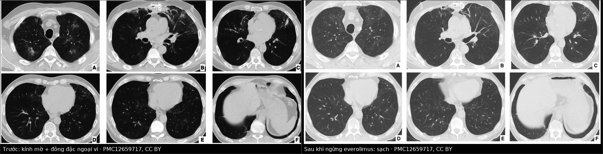
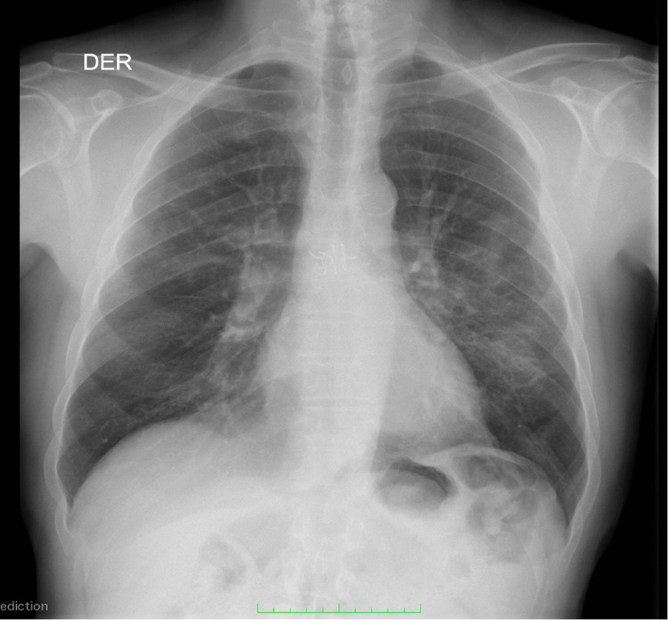
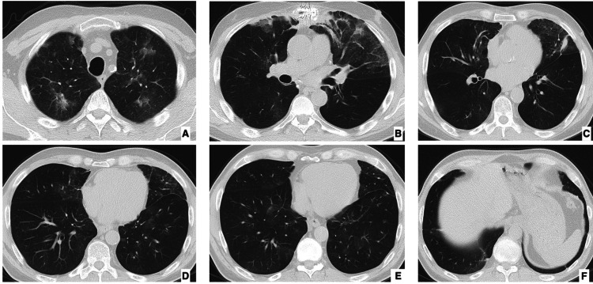
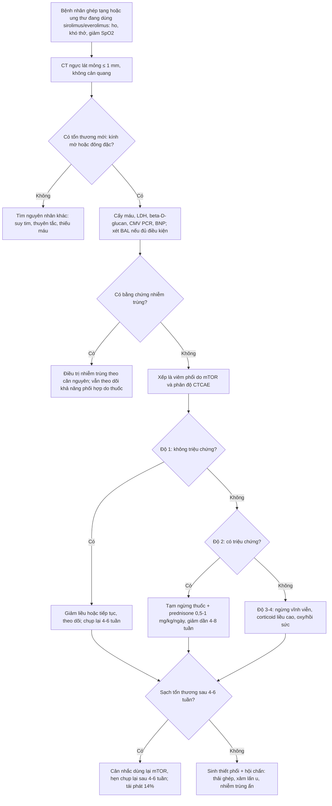
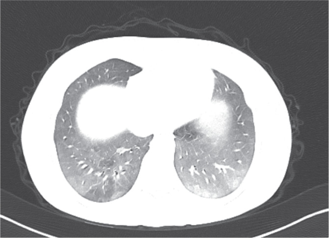

# 1826 — Viêm phổi do thuốc ức chế mTOR (sirolimus / everolimus) / mTOR inhibitor-associated pneumonitis

**Tags:** `pattern:kinh-mo` `pattern:dong-dac` `pattern:vien-kinh-mo` `pattern:day-ke` `vung:phoi` `protocol:CT-nguc-lat-mong` `protocol:BAL` `incidentaloma:to-thuoc`

**Mức chắc chắn (certainty):** tổng hợp y văn (literature synthesis) — số liệu dịch tễ và chẩn đoán từ **1 đoàn hệ thực tế 122 bệnh nhân ung thư thần kinh nội tiết** (*The Oncologist* 2022, PMC8895743, CC BY 4.0), **1 phân tích gộp 16 RCT / 8.377 bệnh nhân**, **1 đoàn hệ ghép thận 205 ca đổi thuốc**, và **3 ca nguyên văn có ảnh** (*Cureus* 2025 — ghép phổi, *Turk J Surg* 2025 — ghép gan, *BMC Nephrol* 2024 — ghép thận). Nhóm **không có bệnh nhân của mình**.

> **Câu chốt:** đây là **chẩn đoán loại trừ có thời gian**: **23%** bệnh nhân dùng everolimus trong thực tế có viêm phổi do thuốc, khởi phát **trung vị 3,6 tháng** (0,8–50,7 tháng) sau khi bắt đầu — nhưng **X-quang ngực có thể gần như bình thường** trong khi CT đã lan tỏa hai bên. Ba số phải thuộc: **1,7% viêm phổi NẶNG** (16 RCT, 8.377 người; **OR 3,36** so với nhóm chứng), **68% hồi phục hoàn toàn sau khi ngừng thuốc**, và **14% tái phát khi dùng lại** — nghĩa là **ngừng thuốc là điều trị**, không phải "chờ kháng sinh".

## 1. Tổng quan bệnh học – cơ chế hình ảnh

### 1.1 Vì sao thuốc ức chế miễn dịch lại gây viêm phổi "vô khuẩn"

- **Đích của thuốc:** sirolimus/everolimus ức chế **mTORC1**, làm giảm tín hiệu **VEGF và PDGF** — hai yếu tố **nuôi dưỡng và ổn định nội mô mao mạch**. Hệ quả trên thực nghiệm: **nội mô co lại và tăng tính thấm (endothelial contraction and hyperpermeability)** qua con đường **phosphoryl hóa myosin light chain**, tức **dịch huyết tương thoát vào khoảng kẽ và phế nang** ngay cả khi không có vi khuẩn (Chen X và cs, *Am J Respir Cell Mol Biol* 2021, DOI 10.1165/rcmb.2020-0390oc).
- **Thành phần tế bào:** dịch rửa phế quản–phế nang (BAL) ở bệnh nhân viêm phổi do mTOR cho thấy **viêm phế nang lympho (lymphocytic alveolitis)** — trong loạt 6 ca ghép thận, **4/4 ca có BAL lympho** (Rodríguez-Moreno A và cs, *Transplant Proc* 2009, DOI 10.1016/j.transproceed.2009.06.003). Tức tổn thương **vừa do rò dịch (mạch máu) vừa do phản ứng lympho (miễn dịch)** — giải thích vì sao hình ảnh **giống NSIP/OP** chứ không giống phù phổi cấp.
- **Vì sao thời điểm lại "tháng thứ 3":** cần thời gian để **nội mô mất ổn định + tích lũy lympho**; trong đoàn hệ 122 ca, **thời gian tới viêm phổi trung vị 3,6 tháng (0,8–50,7)**. Nhưng khoảng **0,8 tháng** nghĩa là **không có "thời gian ân hạn" an toàn**, và đuôi **50,7 tháng** nghĩa là **bệnh nhân dùng 4 năm vẫn có thể mới khởi phát** (ca ghép thận: sau **50 tháng** dùng sirolimus).
- **Nồng độ thuốc KHÔNG dự báo:** trong loạt ghép thận, nồng độ đáy lúc khởi phát **8,2 µg/L (5,5–13,8)** — **nằm trong khoảng trị liệu**. ⇒ **Không loại trừ vì "nồng độ thuốc bình thường"**.

### 1.2 Dịch tễ — bốn bộ số khác nhau vì bốn bối cảnh khác nhau

| Bối cảnh | Tỉ lệ viêm phổi do mTOR | Nguồn |
|---|---|---|
| **Ung thư thần kinh nội tiết, thực tế (đọc có hệ thống báo cáo hình ảnh)** | **22,9% (28/122)**, trong đó **G1 32% · G2 50% · G3 14% · G4 4%** | PMC8895743 |
| **Thử nghiệm everolimus ở NET** | **12–17%** mọi độ | PMC8895743 (tổng hợp thử nghiệm) |
| **Thử nghiệm ở ung thư vú và ung thư thận** | **8–16%** mọi độ; gộp các thử nghiệm: **2,4% độ 3–4** | PMC8895743 |
| **Phân tích gộp 16 RCT / 8.377 bệnh nhân** | **1,7% (95% CI 1,1–2,5%) viêm phổi NẶNG**; **OR 3,36 (2,20–5,12)** so với chứng | Zhang X và cs, *Future Oncol* 2016, DOI 10.2217/fon-2016-0020 |
| **Ghép thận, đổi từ ức chế calcineurin sang mTOR** | **2,9% (6/205)**; **4 ca khởi phát 34 ngày (24–46)**, **2 ca 491 ngày (454–528)** | Rodríguez-Moreno A và cs 2009 |

- **Vì sao chênh nhau 10 lần:** nghiên cứu **đọc có hệ thống báo cáo CT** bắt được cả **thể không triệu chứng (G1)**, còn thử nghiệm chỉ ghi **biến cố có triệu chứng**. Vì vậy **23% là "có tổn thương trên CT", 1,7–2,4% là "viêm phổi nặng"** — hai con số **không mâu thuẫn**, và cả hai đều cần thuộc.
- **Yếu tố nguy cơ:** trong đoàn hệ 122 ca, **vị trí u nguyên phát, bệnh phổi nền, hút thuốc, tiền sử điều trị đều KHÔNG liên quan** (p > 0,05) → **không có bảng điểm nguy cơ đáng tin**. Điều duy nhất liên quan là **thời gian dùng thuốc dài hơn** (18 tháng so với 6 tháng, p = 0,0018) — tức **dùng càng lâu, càng dễ gặp**, không phải "chỉ trong 3 tháng đầu".
- **Điểm phản trực giác nhưng có thật:** có viêm phổi do thuốc lại **sống lâu hơn** (OS 77 tháng so với 52 tháng; **HR 0,39, 95% CI 0,19–0,82, p = 0,013**) — nhiều khả năng vì nhóm này **dùng thuốc đủ lâu để thuốc có tác dụng**. **Không dùng số này để trấn an bệnh nhân**, nhưng dùng để **không ngừng thuốc vĩnh viễn một cách máy móc**.

### 1.3 Vì sao phải chụp CT chứ không dựa vào X-quang (vật lý + con số)

- **X-quang là ảnh chiếu chồng (projection)**: toàn bộ chiều dày lồng ngực **cộng dồn** lên một mặt phẳng, nên **tổn thương kính mờ mỏng, phân bố rải rác bị trung bình hóa** và **bị xương/trung thất che**. Trong ca ghép phổi (PMC12659717), **phim ngực lúc vào viện gần như bình thường** nhưng **CT đã có kính mờ + đông đặc nhiều tầng** — và bệnh nhân **cần oxy bổ sung**.
- **CT (lát mỏng ≤ 1 mm, không cản quang) đo được đúng thứ cần đo:** **tính chất (kính mờ vs đông đặc)**, **phân bố (ngoại vi/ven phế quản, dưới hay trên)**, **dấu hiệu đi kèm (dày vách, giãn phế quản co kéo, giãn mạch)** và **thay đổi theo thời gian** — tức toàn bộ **kiểu hình (pattern)** quyết định chẩn đoán phân biệt.
- **Phân bố tổn thương trong 28 ca có CT (PMC8895743):** **chỉ kính mờ 46,4% (13)**, **kính mờ + lưới 14,2% (4)**, **kính mờ + đông đặc 25% (7)**, **cả ba 14,2% (4)**. Tức **~46% chỉ có kính mờ** — loại tổn thương **dễ bị bỏ nhất trên X-quang**.

### 1.4 Vì sao "kính mờ" khác "đông đặc" — và tại sao dấu này quan trọng

- **Kính mờ (ground-glass opacity):** phế nang **đầy một phần** (dịch, tế bào) nên **vẫn nhìn thấy mạch máu và thành phế quản xuyên qua**. Tương ứng mô học: **viêm phế nang lan tỏa/NSIP/OP giai đoạn sớm**.
- **Đông đặc (consolidation):** phế nang **đầy hoàn toàn** → **mạch máu bị xóa**. Tương ứng: **OP/AFOP, viêm phổi thật, nhồi máu**.
- **Dày vách + lưới + giãn phế quản co kéo:** **xơ hóa** → gợi ý **thể NSIP xơ (fibrotic NSIP)** — đã gặp ở ca ghép thận dùng sirolimus **50 tháng** (PMC11555871), nơi tổn thương **không hồi phục hoàn toàn**.
- **Vì sao cần biết:** thể **kính mờ/OP** thường **hồi phục trong vài tuần sau ngừng thuốc**, còn thể **xơ (lưới + giãn phế quản)** có thể **để di chứng** — tiên lượng và lời hẹn khám **khác nhau ngay từ lúc đọc CT**.

*Trái — **trước**: kính mờ + đông đặc dải, **ưu thế ngoại vi và vùng sau dưới**, kèm dày vách và giãn mạch; đây là kiểu hình **OP/AFOP**. Phải — **4 tuần sau khi ngừng everolimus và chuyển lại tacrolimus liều thấp + prednisone**: các tổn thương **sạch hoàn toàn**. Nguồn: *Cureus* 2025, PMC12659717, CC BY 4.0; ảnh ghép letterbox, không crop, không kéo giãn.*

## 2. Mẫu hình + chẩn đoán phân biệt theo vị trí (gamut)

### 2.1 Gamut theo KIỂU HÌNH trên CT (cách đọc thực dụng)

- **NSIP-like (hay gặp nhất):** **kính mờ lan tỏa hai bên, đối xứng**, **dày vách nội tiểu thùy**, **dưới phổi nhiều hơn**, **chừa dưới màng phổi (subpleural sparing)** ở thể không xơ; thể xơ thêm **lưới + giãn phế quản co kéo**.
- **OP / AFOP:** **đông đặc dải hoặc nốt, phân bố ngoại vi/ven phế quản**, có thể **dấu hiệu halo ngược (reverse halo)**; mô học **AFOP** đã được chứng minh ở 2 ca (PMC12659717 — ghép phổi; PMC12539980 — ung thư vú).
- **Hypersensitivity-like:** **nốt trung tâm tiểu thùy + kính mờ rải rác**, khó phân biệt với **nhiễm nấm/lao lan tỏa** nếu chỉ nhìn hình.
- **Kiểu "lúc có lúc không" (waxing and waning):** tổn thương **tự giảm rồi tái phát dù vẫn dùng thuốc** — đã mô tả trong ung thư thận; **rất dễ bị đọc thành "nhiễm trùng tái phát"**.

### 2.2 Gamut theo BỐI CẢNH (người ghép tạng: 5 thứ phải loại trừ)

- **Nhiễm trùng cơ hội:** *Pneumocystis jirovecii* (kính mờ + nang, LDH tăng, beta-D-glucan), **CMV** (nốt nhỏ + halo, PCR máu/dịch rửa), **nấm xâm lấn**, **vi khuẩn không điển hình**, **lao**.
- **Phù phổi do chức năng mảnh ghép:** tim to, tràn dịch hai bên, dày vách **trơn đều**, đáp ứng lợi tiểu; **không có sốt**.
- **Xuất huyết phế nang lan tỏa (DAH):** kính mờ + **thiếu máu**, ho ra máu, **BAL có hemosiderin**.
- **Tái phát bệnh nền / xâm lấn u:** đông đặc **khu trú**, không đối xứng, có thể **di lệch theo thời gian**.
- **Thải ghép cấp (ghép phổi):** đông đặc + dày vách, **giảm FEV1**, đáp ứng corticoid liều cao — trong ca PMC12659717, mô học **đồng thời AFOP + thải ghép cấp độ A4B1R**.

*Phim ngực thẳng lúc vào viện của bệnh nhân **ghép phổi hai bên**, khởi phát khó thở sau **6 tháng** dùng everolimus: **không có đông đặc rõ, không tràn dịch lớn** — trong khi CT cùng ngày (ảnh dưới) đã có **kính mờ + đông đặc nhiều tầng**. Đây là lý do **không được dùng X-quang để loại trừ** viêm phổi do thuốc. Nguồn: *Cureus* 2025, PMC12659717, CC BY 4.0.*

## 3. Bảng so sánh phân biệt (ma trận đối chiếu)

| Thực thể (entity) | Hình ảnh điển hình | Chốt vào (rule-in) | Chốt loại (rule-out) | Gợi ý xác nhận |
|---|---|---|---|---|
| **Viêm phổi do mTOR** | **Kính mờ hai bên đối xứng**, dày vách, **chừa dưới màng phổi**, ưu thế **dưới – ngoại vi**; thể xơ có lưới + giãn phế quản co kéo; có thể **OP/AFOP** | **Khởi phát 0,8–6 tháng sau khi bắt đầu (hoặc tới 50 tháng) + cải thiện sau khi ngừng thuốc**, cấy/PCR âm, **BAL lympho** | Có **căn nguyên nhiễm trùng được chứng minh** (PJP PCR, CMV PCR, cấy dương) → không quy cho thuốc | **Ngừng thuốc là phép thử**: hồi phục trong **4 tuần**; BAL + PCR; sinh thiết khi không rõ |
| **Viêm phổi do *Pneumocystis*** | **Kính mờ đối xứng quanh rốn**, **nang khí (pneumatocele) là dấu hiệu gợi ý**, **không dày vách rõ** | **Beta-D-glucan dương + LDH tăng + BAL PJP PCR dương** | **Hồi phục nhanh sau ngừng mTOR mà không cần trimethoprim–sulfamethoxazole** → không phải PJP | BAL + PCR PJP; **không chờ** nếu giảm oxy |
| **Viêm phổi do CMV** | **Nốt nhỏ + halo kính mờ**, đông đặc mảng, **dày vách** | **CMV PCR máu/dịch rửa dương**, **neutropenia** | PCR âm **2 lần** + hồi phục sau ngừng mTOR → ít khả năng CMV | CMV PCR định lượng; BAL |
| **Phù phổi do chức năng mảnh ghép** | **Dày vách trơn đều + tràn dịch hai bên + tim to**, phân bố **thấp – trung tâm** | **Đáp ứng lợi tiểu trong 24–48 giờ**, **BNP tăng**, không sốt | **Tổn thương ngoại vi, không tràn dịch, không đáp ứng lợi tiểu** → không phải phù | BNP, siêu âm tim, cân nặng/thể tích |
| **Xuất huyết phế nang lan tỏa** | **Kính mờ lan tỏa**, có thể **đông đặc thùy**, không phân bố đối xứng | **Ho ra máu + Hb giảm + BAL có hemosiderin/đại thực bào chứa hemosiderin** | Không thiếu máu, không ho ra máu, BAL không có hemosiderin → loại | BAL; CT lặp lại (kính mờ **di chuyển**) |
| **Thải ghép cấp (ghép phổi)** | Đông đặc + dày vách, **giảm FEV1 ≥ 10%**, có thể kèm tràn dịch | **FEV1 giảm + đáp ứng corticoid xung**, sinh thiết **A-grade** | **FEV1 ổn định** + tổn thương **đối xứng kiểu NSIP** → nghĩ thuốc | Hô hấp ký, sinh thiết xuyên phế quản |
| **Tái phát/xâm lấn u** | **Đông đặc khu trú, không đối xứng**, lớn dần theo thời gian, có thể **hoại tử** | **Tổn thương đơn ổ, lớn dần trên 2 lần CT**, PET dương | **Đối xứng hai bên, giảm sau ngừng thuốc** → không phải u | So sánh CT cũ, PET/CT, sinh thiết |

*Sáu lát trục (A–F) cùng bệnh nhân: **kính mờ + đông đặc dải, ưu thế ngoại vi và vùng sau dưới**, kèm **dày vách nội tiểu thùy** và **giãn mạch**; không có tràn dịch lớn, không có nang. Kiểu hình này gợi **OP/AFOP** — và mô học sau đó xác nhận **AFOP + thải ghép cấp A4B1R**. Nguồn: *Cureus* 2025, PMC12659717, CC BY 4.0 (nguyên bản, không crop).*

## 4. Protocol chụp + phân độ và xử trí

### 4.1 Protocol

- **CT ngực lát mỏng ≤ 1 mm, không cản quang, thì hít vào sâu, cả 3 mặt phẳng dựng lại** — **không cần cản quang** cho câu hỏi "có viêm phổi do thuốc hay không" (cản quang chỉ để tìm thuyên tắc/nhiễm trùng ổ).
- **Chụp ngay khi có triệu chứng mới** (ho, khó thở, giảm SpO₂) — **không chờ "đủ 3 tháng"**; và **chụp lại 4–6 tuần** sau khi ngừng thuốc để xác nhận **hồi phục** (đây là bằng chứng chẩn đoán quan trọng nhất).
- **BAL trước khi tăng corticoid** nếu bệnh nhân đủ điều kiện: **đếm tế bào (lympho trội — trong loạt ghép thận 4/4 ca có viêm phế nang lympho; chưa có ngưỡng % thống nhất)**, **PJP PCR, CMV PCR, cấy vi khuẩn/nấm/lao**, **hemosiderin** (loại DAH).
- **Sinh thiết phổi** khi: hình ảnh không điển hình, **không hồi phục sau 4 tuần ngừng thuốc**, hoặc cần phân biệt **thải ghép/xâm lấn u**. Hai ca có ảnh trong bài đều **được sinh thiết** và cho **AFOP**.
- **Xét nghiệm máu:** công thức, **LDH**, **beta-D-glucan**, **CMV PCR**, **BNP**, khí máu; **KL-6** nếu có (ngưỡng **≥ 500 U/mL** đã dùng để định nghĩa tăng KL-6 ở người ghép tim dùng everolimus — PMC13599193).

### 4.2 Phân độ và xử trí theo độ (CTCAE) — bộ số từ 28 ca

| Độ | Định nghĩa | Xử trí đã dùng trong loạt | Tỉ lệ |
|---|---|---|---|
| **G1** | **Không triệu chứng**, chỉ bất thường hình ảnh | **Giảm liều 6/9**, **tạm ngừng 4/9**; **không cần corticoid** (0/9); theo dõi CT | **32% (9/28)** |
| **G2** | **Có triệu chứng** (ho, khó thở) cần can thiệp | **Giảm liều 9**, **tạm ngừng 10**, ngừng vĩnh viễn 2; **corticoid 7/14** | **50% (14/28)** |
| **G3** | **Cần oxy/nhập viện** | **Ngừng vĩnh viễn 4/4**, **corticoid 4/4** | **14% (4/28)** |
| **G4** | **Suy hô hấp đe dọa tính mạng** | **Ngừng vĩnh viễn**, corticoid liều cao, hồi sức | **4% (1/28)** |

- **Tổng hợp xử trí:** **giảm liều 32% (9/28)**, **tạm ngừng 50% (14/28)**, **ngừng vĩnh viễn 25% (7/28)**; **corticoid 12/28 (43%)**; **kháng sinh uống 16/28** và **tĩnh mạch 4/28** (dùng theo kinh nghiệm trước khi loại trừ nhiễm trùng).
- **Kết cục:** **hồi phục hoàn toàn 68% (19/28)**, **di chứng nhẹ 25% (7/28)**, **di chứng nặng 1 ca**, **không ca nào tử vong vì viêm phổi** trong loạt này.
- **Dùng lại thuốc:** trong 14 ca tạm ngừng rồi dùng lại, **2 ca (14%) tái phát viêm phổi** — 1 ca hết triệu chứng, 1 ca còn di chứng nhẹ. ⇒ **Được phép thử lại sau khi hình ảnh sạch, nhưng phải hẹn chụp lại**.
- **Corticoid liều thực hành:** **prednisone 0,5–1 mg/kg/ngày** (giảm dần 4–8 tuần) là mức thường dùng trong các ca công bố; **không có RCT** so với chỉ ngừng thuốc.

### 4.3 Nguyên tắc "ngừng thuốc nhưng không bỏ ghép"

- **Không được chỉ ngừng mTOR rồi để bệnh nhân không có ức chế miễn dịch.** Trong các ca công bố, cách làm là **chuyển sang ức chế calcineurin (tacrolimus/cyclosporine) ± prednisone liều thấp**: ca ghép phổi chuyển về **tacrolimus liều thấp + prednisone**, ca ghép thận chuyển **cyclosporine**, ca ghép gan **giảm/ngừng everolimus trong phác đồ có tacrolimus**.
- **Với ung thư:** cân nhắc **giảm liều hoặc tạm ngừng** thay vì ngừng vĩnh viễn ở G1–G2, vì **có viêm phổi do thuốc gắn với thời gian dùng thuốc dài hơn và sống lâu hơn** (HR 0,39).
- **Dự phòng PJP** khi tăng corticoid — vì **nhiễm PJP là bẫy chết người** đúng ở nhóm này.

## 5. Biến thể bình thường và cạm bẫy

- **X-quang bình thường KHÔNG loại trừ** — ca ghép phổi có **phim gần bình thường** cùng ngày CT lan tỏa. **Chỉ CT trả lời được.**
- **"Nồng độ thuốc bình thường" không loại trừ** — nồng độ đáy lúc khởi phát **8,2 µg/L (5,5–13,8)**, trong khoảng trị liệu.
- **Không có "cửa sổ an toàn" về thời gian:** **0,8 tháng** tới **50,7 tháng**; ca ghép thận khởi phát sau **50 tháng** dùng sirolimus. **Hỏi thuốc trong mọi lần đọc CT phổi ở người ghép.**
- **Bẫy "waxing and waning":** tổn thương **tự giảm rồi tăng lại** dù vẫn dùng thuốc, rất dễ bị đọc là **nhiễm trùng tái phát** → chuỗi **kháng sinh lặp lại không cần thiết** trong khi thuốc vẫn là nguyên nhân.
- **Bẫy "đã có chẩn đoán nhiễm trùng":** 43% ca trong loạt **được cho kháng sinh** trước/song song; nhiễm trùng **và** thuốc có thể **cùng tồn tại**. **Không vì "đã dùng kháng sinh mà không đỡ" để loại nhiễm trùng**, và **không vì "có sốt" để loại thuốc**.
- **Bẫy ghép phổi:** tổn thương có thể là **thải ghép cấp** — ca PMC12659717 có **AFOP + A4B1R** cùng lúc; **ngừng thuốc mà không tăng ức chế miễn dịch hợp lý** có thể làm **thải ghép nặng lên**.
- **Bẫy thể xơ:** **lưới + giãn phế quản co kéo** là **di chứng**, không phải "đang viêm" → **không tăng corticoid** chỉ vì hình ảnh còn bất thường; đánh giá bằng **chức năng hô hấp và xu hướng theo thời gian**.
- **Ung thư dùng everolimus:** đừng quy mọi đông đặc mới cho thuốc — **tái phát/xâm lấn u** cũng là đông đặc; so **CT cũ**, xem **tính đối xứng** và **đáp ứng sau ngừng thuốc**.

## 6. Tự lượng giá — Blind Quiz

**Ca 1 — Nam 66 tuổi, ghép phổi hai bên 18 tháng, dùng everolimus 6 tháng nay, khó thở tăng dần + ban đỏ mặt. Nhìn phim ngực và CT, trả lời trước khi mở đáp án.**

- Câu hỏi: Phim này **loại trừ** được viêm phổi không? Nếu không, cần làm gì tiếp và **ba xét nghiệm** phải có trước khi tăng corticoid?

<b>Bấm để hiện đáp án (findings + chẩn đoán)</b>

- **Phim ngực gần bình thường** — **KHÔNG loại trừ** viêm phổi do thuốc. Bước tiếp: **CT ngực lát mỏng**, và nó cho thấy **kính mờ + đông đặc ưu thế ngoại vi/vùng sau**.
- **Ba xét nghiệm trước khi tăng corticoid:** **BAL (đếm tế bào + PJP PCR + CMV PCR)**, **beta-D-glucan**, **cấy máu/đờm**; thêm **BNP/siêu âm tim** để loại phù do mảnh ghép.
- **Chẩn đoán:** **viêm phổi do everolimus, kiểu hình OP/AFOP**; sinh thiết xác nhận **AFOP + thải ghép cấp A4B1R**.
- **Xử trí:** **ngừng everolimus**, chuyển **tacrolimus liều thấp + prednisone** → **hình ảnh sạch hoàn toàn trong 4 tuần**.
- **Nguồn:** *Cureus* 2025, PMC12659717, CC BY 4.0.

**Ca 2 — Nữ 19 tuổi, ghép gan vì viêm gan nhiễm độc, dùng everolimus + tacrolimus 6 tháng, ho và khó thở. CT dưới đây; mọi cấy và marker nhiễm trùng âm. Nhìn CT, chọn bước tiếp.**

- Câu hỏi: Kiểu hình gì? Vì sao "cấy âm" lại quan trọng ở đây? Bước điều trị **quyết định** là gì?

<b>Bấm để hiện đáp án</b>

- **Kiểu hình:** **đông đặc dải + nốt ở đáy hai bên + kính mờ lan tỏa** — phù hợp **OP/NSIP** do thuốc, không có tràn dịch lớn, không có nang.
- **Vì sao "cấy âm" quan trọng:** đây là **chẩn đoán loại trừ**; nhưng **âm tính không đủ** — cái chốt là **hồi phục sau khi ngừng thuốc**. Trong loạt 122 ca, **68% hồi phục hoàn toàn** sau khi giảm/ngừng thuốc.
- **Bước quyết định:** **ngừng everolimus** (giữ ức chế miễn dịch bằng thuốc khác), **không tăng kháng sinh**; nếu triệu chứng nặng → **corticoid 0,5–1 mg/kg** giảm dần; **chụp lại 4–6 tuần**.
- **Nguồn:** *Turk J Surg* 2025;41(1):105–107, PMC11878176, CC BY-NC 4.0.

**Ca 3 — Bệnh nhân ung thư thần kinh nội tiết dùng everolimus tháng thứ 5, ho khan, không sốt, SpO₂ 96%, CT chỉ có kính mờ nhẹ hai bên dưới. Đây là độ mấy và có phải ngừng thuốc vĩnh viễn?**

<b>Bấm để hiện đáp án</b>

- **Độ 1–2 (tùy có triệu chứng hay không):** trong loạt 122 ca, **32% là G1 (không triệu chứng)** và **50% là G2**; **G1 không cần corticoid** (0/9), chủ yếu **giảm liều hoặc tạm ngừng** rồi **chụp lại**.
- **Không ngừng vĩnh viễn ngay:** ngừng vĩnh viễn chỉ ở **25% (7/28)** ca — chủ yếu **G3–G4**. Với G1–G2, **giảm liều/tạm ngừng + theo dõi**; nếu sạch tổn thương có thể **dùng lại** (tái phát **14%**).
- **Bắt buộc:** loại trừ **PJP/CMV** trước khi kết luận "chỉ do thuốc", vì **cùng hình ảnh** mà **điều trị khác hẳn**.
- **Nguồn số liệu:** *The Oncologist* 2022, PMC8895743, CC BY 4.0.

## Bài liên quan chéo

- [196 – Hội chứng gan phổi tồn tại sau ghép gan](../196-hps-ton-tai-sau-ghep-gan/lesson.md) (giảm oxy sau ghép gan **không phải** luôn do shunt)
- [116 – Nhiễm trùng nặng ở bệnh nhân ghép thận](../116-nhiem-trung-nang-gan-ghep-than/lesson.md) (bối cảnh ức chế miễn dịch, cùng nhóm nhiễm trùng cơ hội)
- [085 – Độc tính miễn dịch quanh mô ung thư phổi](../085-doc-tinh-mien-dich-quanh-mo-ung-thu-phoi/lesson.md) (viêm phổi do thuốc/thải ghép — cùng khung "chẩn đoán loại trừ")
- [001 – Tổng quan hệ Ngực](../001-tong-quan-he-nguc/lesson.md)
- [020 – Nốt phổi](../020-not-phoi/lesson.md) (khi tổn thương là nốt, không phải kính mờ lan tỏa)

## Ảnh

- `1826_mtor-pneumonitis_XR_PMC12659717.jpg` — X-quang ngực gần bình thường (bẫy "X-quang âm").
- `1826_mtor-pneumonitis_CT_PMC12659717.jpg` — CT 6 tầng: kính mờ + đông đặc ngoại vi/vùng sau.
- `1826_mtor-pneumonitis_CT-sau-ngung-thuoc_PMC12659717.jpg` — CT sau 4 tuần ngừng thuốc: sạch.
- `composite_truoc-sau.jpg` — ảnh ghép đối chiếu trước/sau (cùng bệnh nhân).
- `1826_mtor-pneumonitis_CT-gan-ghep_PMC11878176.jpg` — ca ghép gan: đông đặc dải + kính mờ lan tỏa.
- `1826_mtor-pneumonitis_CT-gan-ghep-hoi-phuc_PMC11878176.jpg` — ca ghép gan sau ngừng thuốc: cải thiện rõ.
- Nguồn và giấy phép từng ảnh: `images/CREDITS.md`. Tác giả **đã đối chiếu `authorString` qua Europe PMC** (PMC12659717: Varón-Vega F và cs; PMC11878176: Sağlam K và cs).

> Không dùng để chẩn đoán độc lập khi chưa có người hướng dẫn.
