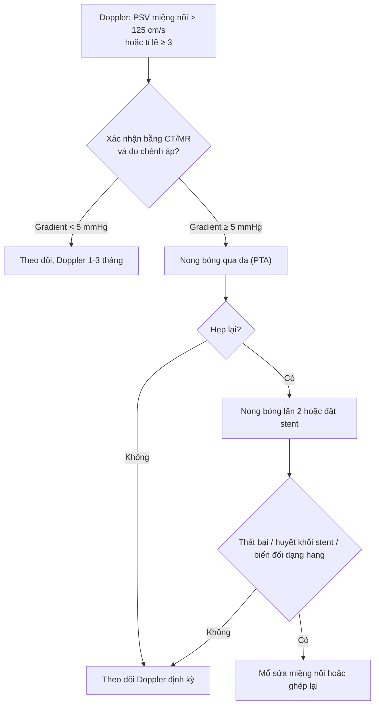
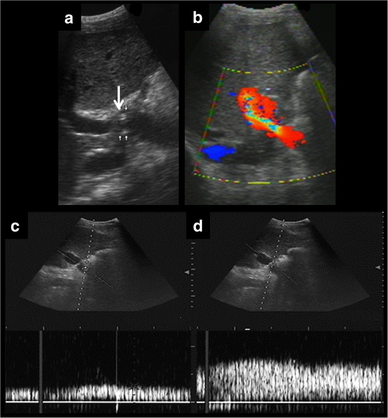
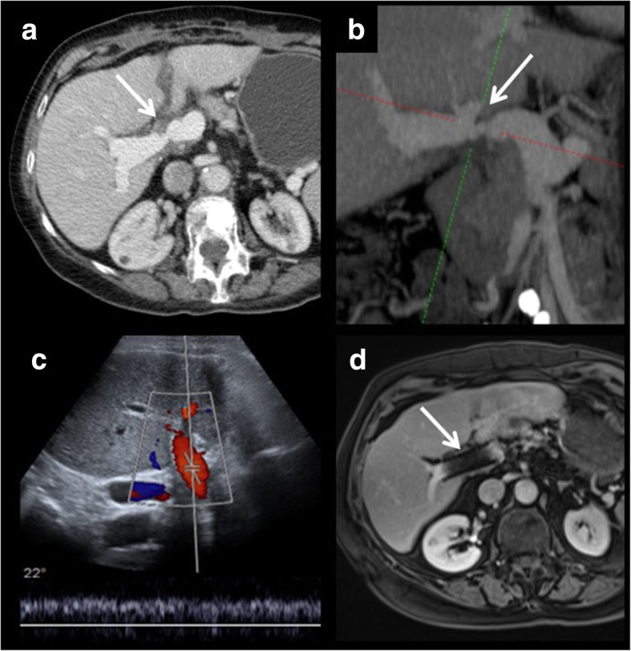
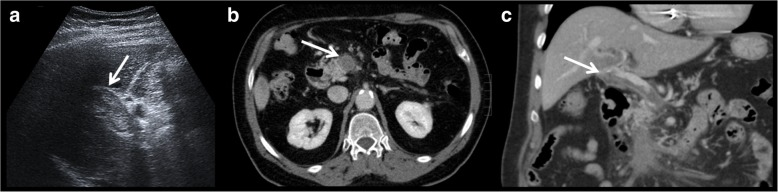

# 1827 — Hẹp tĩnh mạch cửa sau ghép gan / Portal vein stenosis after liver transplantation

**Tags:** `pattern:hep` `pattern:hep-dong-mach` `vung:gan` `vung:o-bung` `score:PSV-ratio` `protocol:Doppler-sieu-am` `protocol:CT-tinh-mach-cua` `protocol:MRCP` `incidentaloma:khong`

**Mức chắc chắn (certainty):** tổng hợp y văn (literature synthesis) — 1 bài tổng quan hình ảnh có ảnh Doppler/CT kinh điển (*Insights Imaging* 2019, PMC6694376, CC BY 4.0), 1 đoàn hệ nhi 92 ca ghép gan với protocol Doppler chuẩn hóa (*Ultrasound Int Open* 2022, PMC9668490, CC BY 4.0) và 2 loạt can thiệp nhi khoa (**30 trẻ** — *Ann Transplant* 2017, PMC12577528; **67 trẻ/884 ca ghép** — *Ann Transplant* 2025, PMC12377406). Nhóm **không có bệnh nhân của mình**; chỗ hai nguồn lệch nhau (ngưỡng vận tốc, tỉ lệ hẹp lại) được ghi là **mâu thuẫn nguồn**, không chọn bừa.

> **Câu chốt:** hẹp tĩnh mạch cửa (portal vein stenosis, PVS) sau ghép gan **không phải biến chứng hiếm ở trẻ** — **7,6% (67/884)** ca ghép nhi trong một trung tâm, khởi phát trung bình **119,3 ngày** (8–786 ngày) sau ghép (PMC12377406). Ba số phải thuộc: **(1)** ngưỡng Doppler **PSV tại miệng nối > 125 cm/s** hoặc **tỉ lệ chỗ hẹp/trước hẹp ≥ 3–4** (hai nguồn ghi 3 và 4 — xem mục 4.2); **(2)** **chênh áp ≥ 5 mmHg là chỉ định can thiệp kể cả khi chưa có triệu chứng** (PMC12577528); **(3)** **nong bóng đơn thuần giải quyết 81,25%** nhưng **18,75% hẹp lại** (trung bình 162,8 ngày), và **cầu nối tĩnh mạch cửa (PVB) + lệch cỡ mạch** là hai yếu tố dự báo hẹp lại (OR **2,3** và **5,7**) (PMC12377406). Nghĩa là: **chẩn đoán bằng Doppler, quyết định bằng chênh áp, theo dõi sau nong bằng Doppler lặp lại** — không chờ triệu chứng.

## 1. Tổng quan bệnh học – cơ chế hình ảnh

### 1.1 Vì sao tĩnh mạch cửa là "điểm yếu" của mảnh ghép

- Gan nhận **~75% lưu lượng máu qua tĩnh mạch cửa** nhưng cửa chỉ mang **~50% oxy**; dòng cửa là dòng **áp lực thấp, vận tốc thấp, liên tục, hướng về gan (hepatopetal)**. Vì áp lực thấp, **một vòng xơ vài mm tại miệng nối cũng đủ làm mất gradient** — khác động mạch gan (áp lực cao, hẹp phải rất nặng mới mất dòng).
- Hẹp cửa → **tăng áp cửa sau ghép**: giãn tĩnh mạch thực quản, cổ trướng, lách to, **giảm tiểu cầu**, và về lâu dài **suy mảnh ghép**. Loạt 32 ca của Gao cho thấy sau khi giải phóng hẹp, tiểu cầu tăng từ **128,56 ± 62,84** lên **163,65 ± 70,49 × 10⁹/L** (p < 0,05) — bằng chứng rằng giảm tiểu cầu ở bệnh nhân ghép gan có thể **do hẹp cửa chữa được**, không phải di chứng cố định (PMC12577528).
- Hẹp kéo dài còn được cho là dẫn tới **hội chứng gan–phổi (HPS) và tăng áp phổi** làm **mất khả năng ghép lại** — đây là lý do phải can thiệp sớm, trước khi có triệu chứng (PMC12577528 dẫn Ueda). Bài [196](../196-hps-ton-tai-sau-ghep-gan/lesson.md) mô tả đúng bệnh cảnh "giảm oxy dai dẳng sau ghép gan" mà nguyên nhân có thể nằm ở **dòng cửa**, không chỉ ở nhu mô gan.

### 1.2 Vì sao hẹp hay nằm ĐÚNG miệng nối — và vì sao trẻ nhiều hơn người lớn

- Biến chứng mạch máu sau ghép gan gặp ở **~7%** ca ghép gan người chết não và **~13%** ca ghép gan sống (PMC6694376), nhưng **biến chứng tĩnh mạch cửa < 2%** ở người lớn. Ở trẻ, tỉ lệ **cao hơn hẳn: 2–14%** ở nhóm ghép giảm thể tích/ghép gan sống (PMC12577528 dẫn y văn), và **7,6% (67/884)** trong đoàn hệ 2020–2024 (PMC12377406).
- Lý do giải phẫu: tĩnh mạch cửa trẻ **rất nhỏ** — trong đoàn hệ 67 ca, đường kính cửa **người nhận 0,41 ± 0,15 cm** so với **người cho 0,69 ± 0,23 cm**, tức lệch cỡ trung bình **88,5 ± 112,21%** (1–792%) (PMC12377406). Miệng nối **nhỏ + lệch cỡ + xoắn cuống mạch** là ba cơ chế tạo hẹp.
- Về mô bệnh: hẹp muộn thường do **tăng sinh nội mạc/xơ hóa tại miệng nối** (intimal hyperplasia/fibrosis); hẹp sớm do **gập góc, xoắn, huyết khối, hoặc hẹp do thiếu mô** (kỹ thuật miệng nối). Bài học hình ảnh: **vị trí hẹp = vị trí miệng nối**, nên phải biết **kiểu miệng nối của từng bệnh nhân** (tận–tận, mảnh ghép cầu nối, patch tĩnh mạch chậu) trước khi đọc siêu âm.

### 1.3 Vật lý: vì sao "vận tốc tăng" và "chênh áp" là hai câu chuyện khác nhau

- Theo **nguyên lý liên tục**, cùng một lưu lượng qua tiết diện hẹp hơn → **vận tốc tăng theo bình phương bán kính**. Doppler đo **vận tốc**, không đo áp lực; vận tốc còn phụ thuộc **góc đầu dò** (cos θ). Vì vậy **vận tốc tuyệt đối dễ sai**, còn **tỉ lệ vận tốc chỗ hẹp/trước hẹp** ít phụ thuộc góc hơn — đây là lý do các protocol dùng **cả hai**.
- Ước lượng chênh áp bằng **Bernoulli rút gọn**: ΔP (mmHg) ≈ **4 × V²** (V tính bằng m/s). Với **V = 1,25 m/s (125 cm/s)** → ΔP ≈ **6,25 mmHg**; với **V = 2 m/s** → **16 mmHg**. Con số này khớp một cách hợp lý với ngưỡng can thiệp **chênh áp ≥ 5 mmHg** mà Gao dùng (PMC12577528) — **đây là suy luận vật lý của nhóm biên soạn, không phải kết luận của bài gốc**.
- Hệ quả thực hành: **một vận tốc "dưới ngưỡng" không loại trừ hẹp có ý nghĩa huyết động**. Trong loạt của Gao, **vận tốc cửa trước nong trung bình chỉ 114,73 ± 31,37 cm/s** (73–174) — tức **trung bình nằm dưới ngưỡng 125 cm/s** — nhưng **chênh áp trung bình 10,97 ± 4,25 mmHg** và tất cả đều được can thiệp (PMC12577528). Đây là **mâu thuẫn quan trọng giữa "ngưỡng vận tốc" và "ngưỡng chênh áp"**: vận tốc dùng để **sàng lọc**, chênh áp dùng để **quyết định**.

### 1.4 Thời điểm xuất hiện — "cửa sổ" theo dõi

- **Trung bình 119,3 ± 126,3 ngày** (8–786 ngày) sau ghép; **65,7% là hẹp đơn thuần**, phần còn lại tắc (PMC12377406).
- Loạt 30 trẻ: **9,15 ± 8,86 tháng** (0,5–37 tháng), **chỉ 2 ca sớm** (một ca **2 tuần**, một ca **2 tháng**), 28 ca còn lại **sau 3 tháng** (PMC12577528).
- Vì vậy **theo dõi phải kéo dài ít nhất 1 năm**, không chỉ tuần đầu: trong đoàn hệ 92 ca ghép nhi, **84,6% biến chứng mạch được phát hiện trong mổ hoặc tuần đầu**, nhưng **15,4% xuất hiện sau ngày 8** — và với tĩnh mạch cửa, **73,1% (19/26)** được phát hiện trong tuần đầu, phần còn lại muộn hơn (PMC9668490).

## 2. Mẫu hình + chẩn đoán phân biệt theo vị trí (gamut)

### 2.1 Gamut theo cơ chế tại miệng nối

- **Hẹp xơ/tăng sinh nội mạc thật** (true anastomotic stenosis) — hẹp khu trú, thành dày, không thay đổi theo nhịp thở; thường muộn (tháng 3–12).
- **Hẹp do lệch cỡ mạch** (size-mismatch narrowing) — chỗ nối hình phễu nhẵn giữa cửa nhỏ của nhận và cửa lớn của cho; **không có chênh áp đáng kể** khi nghỉ, nhưng **là tiền đề của hẹp thật** (PMC6694376).
- **Gập/xoắn cuống mạch** (kinking/torsion) — hẹp khi gập, rộng ra khi đổi tư thế; trong loạt Gao có **3 ca** được xác định là "portal vein angulation" và phải đặt stent vì nong bóng không cải thiện (PMC12577528).
- **Huyết khối cửa** (portal vein thrombosis, PVT) — vật liệu trong lòng mạch, **không có dòng**, hoặc **khiếm khuyết bắt thuốc** trên CT; hẹp và huyết khối là **cùng một phổ bệnh** (PMC6694376).
- **Chèn ép từ ngoài** (extrinsic compression) — tụ dịch/máu tụ/áp-xe quanh miệng nối; hẹp **dài, bờ ngoài**, thay đổi khi tụ dịch nhỏ đi.
- **Hẹp cầu nối tĩnh mạch (PVB)** — miệng nối dùng mạch ghép (tĩnh mạch chậu) khi cửa nhận quá nhỏ/ngắn; đây là **yếu tố nguy cơ độc lập của hẹp lại** (OR **2,3**) (PMC12377406).
- **Biến đổi dạng hang (cavernous transformation)** — hẹp mạn tính → lưới tĩnh mạch bàng hệ quanh rốn gan; trong 67 ca có **3 ca** không thể đưa dây dẫn qua, phải **ghép lại hoặc chờ ghép** (PMC12377406).

### 2.2 Gamut theo hình thái trên Doppler (dùng khi đang cầm đầu dò)

- **Hẹp khu trú có ý nghĩa huyết động**: PSV tại chỗ hẹp cao, **aliasing**, sau hẹp **mất pha dao động**, giãn tĩnh mạch trước hẹp, **chênh áp**.
- **Hẹp không có ý nghĩa**: lệch cỡ nhẵn, không giãn trước hẹp, **tỉ lệ < 3** và **gradient < 5 mmHg**.
- **Tắc hoàn toàn**: không có phổ Doppler trong lòng cửa, **vật liệu sinh hồi âm** trong lòng, bàng hệ rốn gan.
- **Hẹp + huyết khối**: hẹp tại miệng nối **kèm** khiếm khuyết trong lòng — cần CT/MR để phân biệt huyết khối mới (mềm, không ngấm) với **giả u** (pseudothrombus do dòng chảy chậm/không đều).

## 3. Bảng so sánh phân biệt (ma trận đối chiếu)

| Thực thể (entity) | Hình ảnh điển hình (US/CT/MRI) | Chốt vào (rule-in) | Chốt loại (rule-out) | Gợi ý xác nhận |
|---|---|---|---|---|
| **Hẹp miệng nối thật (PVS)** | Hẹp khu trú đúng miệng nối; PSV **> 125 cm/s**; tỉ lệ hẹp/trước hẹp **≥ 3–4**; giãn cửa trước hẹp; **chênh áp ≥ 5 mmHg** | **Tỉ lệ ≥ 3 + giãn trước hẹp + gradient ≥ 5 mmHg** | Tỉ lệ < 3 và gradient < 5 mmHg; hẹp nhẵn kiểu lệch cỡ | Doppler lặp + CT tĩnh mạch cửa; đo áp lực qua catheter khi can thiệp |
| **Lệch cỡ mạch (pseudo-stenosis)** | Chỗ nối hình phễu **nhẵn**, đối xứng; không giãn trước hẹp; **không có gradient** | **Đường kính nhận < cho + hình phễu nhẵn + gradient < 5 mmHg** | Bờ không đều, giãn trước hẹp, gradient ≥ 5 → hẹp thật | So phim mổ/ghi chú kỹ thuật; Doppler 24–48 giờ sau |
| **Huyết khối cửa (PVT)** | Vật liệu sinh hồi âm trong lòng; **không có phổ Doppler**; CT: khiếm khuyết trong lòng, **không ngấm** | **Không có dòng + khiếm khuyết bắt thuốc** | Có dòng quanh vật liệu + ngấm thuốc → u/giả u | CT/MR; CEUS; can thiệp lấy huyết khối |
| **Gập/xoắn cuống** | Hẹp **thay đổi theo tư thế/nhịp thở**; góc gập rõ trên MPR | **Hẹp thay đổi + không có xơ tại chỗ** | Hẹp cố định mọi tư thế → hẹp thật | CT MPR; Doppler 2 tư thế |
| **Chèn ép từ ngoài** | Hẹp **dài, bờ ngoài**, có khối/tụ dịch kế cận; hết khi tụ dịch tiêu | **Khối kế cận + hẹp dài + hết sau khi khối nhỏ** | Hẹp đúng miệng nối, không khối → hẹp thật | CT/MR; theo dõi tụ dịch |
| **Hẹp cầu nối (PVB)** | Hẹp tại đoạn mạch ghép; thường kèm lệch cỡ; tiền sử PVB | **Tiền sử PVB + hẹp tại đoạn ghép** | Tiền sử nối tận–tận không có mạch ghép | Đối chiếu hồ sơ mổ; CT |
| **Biến đổi dạng hang** | Lưới mạch bàng hệ quanh rốn; cửa chính **hẹp/tắc mạn**; lách to | **Lưới bàng hệ + cửa chính không thấy** | Cửa chính còn dòng, chỉ hẹp khu trú | CT/MR; cân nhắc ghép lại |

## 4. Protocol chụp + phân độ và xử trí

### 4.1 Protocol Doppler sau ghép gan (lấy theo hai protocol đã công bố)

- **Lịch:** trong mổ + ngay sau đóng bụng (ngày 0); **hàng ngày ngày 1–7**; **1 tháng, 3 tháng, 12 tháng** (PMC9668490). Protocol khác: **24–48 giờ, ngày 7, tháng 1 và tháng 3** (PMC6694376). Điểm chung: **tuần đầu là cửa sổ vàng**, nhưng **phải theo tới 1 năm**.
- **Cách đo:** lấy mẫu tại **miệng nối**; nếu không xác định được miệng nối, lấy **chỗ hẹp nhất của cửa rốn**; nếu có **mạch ghép/patch**, lấy **chỗ hẹp nhất của đoạn ghép** (PMC9668490). Luôn ghi **PSV tại chỗ hẹp, PSV trước hẹp, tỉ lệ**, và **phổ ở nhánh trong gan**.
- **Góc:** giữ góc **< 60°**, ưu tiên **tỉ lệ** hơn vận tốc tuyệt đối; nếu cửa sổ siêu âm kém → **CEUS/CT**.
- **Khi nào chụp CT/MR:** Doppler bất thường, không kết luận được, hoặc chức năng gan xấu đi; **CT tĩnh mạch cửa** để đo đường kính, đánh giá huyết khối, và quy hoạch can thiệp; **MRI** hữu ích cho mô mềm nhưng **stent gây nhiễu kim loại** (PMC6694376).

### 4.2 Ngưỡng chẩn đoán — và chỗ hai nguồn lệch nhau

| Thông số | Ngưỡng | Nguồn |
|---|---|---|
| PSV tại miệng nối | **> 125 cm/s** | PMC6694376; PMC9668490 |
| Tỉ lệ PSV chỗ hẹp/trước hẹp | **≥ 3** | PMC6694376 |
| Tỉ lệ PSV chỗ hẹp/trước hẹp | **≥ 4** | PMC9668490 |
| Chênh áp qua chỗ hẹp | **≥ 5 mmHg → điều trị** | PMC12577528 |
| Đường kính cửa hẹp | **3,25 ± 0,64 mm** (1,5–4 mm) trong loạt 24 ca | PMC12577528 |
| Giá trị dự báo dương của Doppler cho biến chứng cửa | **88,5% (23/26)**; 3 dương tính giả | PMC9668490 |

- **Mâu thuẫn nguồn có ý nghĩa:** tỉ lệ **≥ 3** và **≥ 4** cùng tồn tại; **≥ 4** đặc hiệu hơn nhưng bỏ sót nhiều hơn, **≥ 3** nhạy hơn. Nhóm biên soạn khuyến nghị: **dùng ≥ 3 để sàng lọc, xác nhận bằng gradient khi can thiệp** — đây là **suy luận**, không phải khuyến cáo chính thức.
- **Dương tính giả:** 3 ca hẹp cửa trên Doppler (2 ca ngay sau đóng bụng, 1 ca tháng thứ 4) được CT loại trừ (PMC9668490) — **không can thiệp dựa trên một lần siêu âm**.

### 4.3 Điều trị: nong bóng trước, stent khi thất bại, mổ/ghép lại khi hết đường

- **Kết quả nong bóng (PTA) ở trẻ:** **81,25% (52/64)** khỏi sau **một lần** nong; **12/64 (18,75%)** hẹp lại, trung bình **162,8 ± 153,4 ngày** (58–626); trong 12 ca hẹp lại, **4 ca đặt stent**, **7 ca nong lần 2** (4 khỏi, 3 phải stent), **1 ca huyết khối trong stent** → ghép lại và tử vong (PMC12377406).
- **Hiệu quả huyết động ngay sau nong:** vận tốc cửa **52,8 ± 28,7 → 31,1 ± 12,1 cm/s**; đường kính **0,21 ± 0,06 → 0,51 ± 0,15 cm** (p < 0,001) (PMC12377406). Loạt khác: **114,73 ± 31,37 → 39,43 ± 13,23 cm/s**; đường kính **3,25 → 7,54 mm**; **gradient 10,97 → 1,63 mmHg**; tiểu cầu **128,56 → 163,65 × 10⁹/L** (PMC12577528).
- **Độ bền:** thông suốt sau điều trị lần đầu **89,29% (25/28)**, sau lần hai **100% (28/28)** (PMC12577528); sống 1 năm **100%**, 3 năm **95%**; sống mảnh ghép 1 năm **100%**, 3 năm **91%** (PMC12377406).
- **Yếu tố dự báo hẹp lại:** **PVDr** (OR **5,7**) và **PVB** (OR **2,3**); mô hình logistic **AUC 0,778**, độ chính xác **89,1%**, độ nhạy **66,7%**, độ đặc hiệu **92,3%** (PMC12377406). Ý nghĩa lâm sàng: bệnh nhân **có mạch ghép cầu nối hoặc lệch cỡ lớn** cần **theo dõi sát hơn** và **hạ ngưỡng chụp lại**.
- **Chỉ định can thiệp:** **chênh áp ≥ 5 mmHg → điều trị kể cả không triệu chứng**; không chờ cổ trướng/chảy máu (PMC12577528). Can thiệp sớm cũng tránh **biến đổi dạng hang** khiến không còn đường vào.

## 5. Biến thể bình thường và cạm bẫy

- **Aliasing ngay sau mổ là bình thường:** dòng xoáy tại miệng nối trong 24–72 giờ đầu gặp ở nhiều bệnh nhân; **không gọi hẹp nếu không có tăng vận tốc khu trú + giãn trước hẹp + gradient**. Đây là lý do protocol phải **lặp lại** (PMC6694376).
- **Lệch cỡ mạch:** hẹp nhẵn hình phễu giữa cửa nhận nhỏ và cửa cho lớn là **bình thường về giải phẫu**, nhưng **là yếu tố nguy cơ** — theo dõi, không can thiệp ngay.
- **Vận tốc phụ thuộc góc:** đặt đầu dò song song hoặc vuông góc làm vận tốc đo **thấp hơn thực**; vì vậy **tỉ lệ** và **phổ** đáng tin hơn vận tốc tuyệt đối (PMC6694376).
- **Vận tốc "bình thường" mà vẫn hẹp:** loạt Gao có **trung bình 114,73 cm/s** trước nong — dưới ngưỡng 125 cm/s (PMC12577528). **Không loại trừ hẹp chỉ vì PSV < 125 cm/s** nếu có giãn trước hẹp/giảm tiểu cầu/cổ trướng.
- **Chức năng gan "đang cải thiện" không loại trừ hẹp:** Gao ghi rõ nhiều ca vẫn có xu hướng cải thiện men gan dù hẹp (PMC12577528) — **không dùng men gan để trấn an**.
- **Nhiễu kim loại của stent trên MRI:** sau đặt stent, MRI có thể cho **tín hiệu trống quanh stent** giả hẹp; dùng **Doppler/CT** để đánh giá (PMC6694376, Fig. 11).
- **Bỏ sót huyết khối mới:** huyết khối non **sinh hồi âm thấp**, dễ bị coi là "dòng chảy chậm"; nếu không thấy phổ rõ → **CEUS/CT** trước khi kết luận.
- **"Satisfaction of search":** thấy hẹp cửa là dừng, bỏ sót **hẹp động mạch gan** hoặc **hẹp đường mật** đi kèm — trong cùng một lần siêu âm phải đọc **đủ 4 miệng nối** (động mạch, cửa, đường mật, TM gan/IVC).

## 6. Tự lượng giá — Blind Quiz

**Ca 1 — Trẻ 8 tháng sau ghép gan sống, cổ trướng tăng, tiểu cầu giảm. Nhìn phổ Doppler trước, mô tả trước.**

- Gợi ý lâm sàng: ghép gan sống 8 tháng, bụng to, tiểu cầu 90 × 10⁹/L, men gan bình thường.
- Câu hỏi: (1) Khung nào là **chỗ hẹp**, khung nào là **trước hẹp**? (2) Dấu hiệu nào chứng minh **hẹp có ý nghĩa huyết động**? (3) Hai phép đo nào nên ghi vào báo cáo?

<b>Bấm để hiện đáp án (findings + chẩn đoán)</b>

- **Findings:** (a) B-mode thấy **nhiều chỗ hẹp** trên tĩnh mạch cửa (mũi tên trắng) và **(b)** dòng xoáy/aliasing tại chỗ hẹp; (c) phổ **trước hẹp**: vận tốc thấp, phổ yếu; (d) phổ **tại chỗ hẹp**: **vận tốc tăng cao** (đỉnh > 125 cm/s trong ca gốc), phổ liên tục mất pha dao động.
- **Chẩn đoán:** **hẹp tĩnh mạch cửa tại miệng nối** — cơ chế xơ/tăng sinh nội mạc tại miệng nối, gây tăng áp cửa (cổ trướng, giảm tiểu cầu).
- **Hai phép đo phải ghi:** **PSV tại chỗ hẹp** và **tỉ lệ PSV chỗ hẹp/trước hẹp** (ca gốc: tỉ lệ **> 3**); kèm **đường kính** và **chênh áp** khi can thiệp.
- **Nguồn ảnh:** Delgado-Moraleda JJ, Ballester-Vallés C, Marti-Bonmati L, *Insights Imaging* 2019;10:78, PMC6694376 Fig. 10 — **CC BY 4.0**, nguyên bản.

**Ca 2 — Bệnh nhân ghép gan 6 tháng, Doppler nghi hẹp cửa. Xem CT và kết quả sau can thiệp.**

- Câu hỏi: (1) Hẹp nằm ở đâu trên CT axial và MPR? (2) Sau stent, vì sao **MRI có thể không đánh giá được lòng stent**? (3) Theo dõi sau can thiệp bằng gì?

<b>Bấm để hiện đáp án</b>

- **Findings:** (a) CT axial và (b) MPR cho thấy **hẹp khu trú tại miệng nối tĩnh mạch cửa**; (c) sau đặt stent, **Doppler kiểm tra** cho dòng cửa bình thường; (d) MRI kiểm tra cho thấy **nhiễu kim loại của stent** nhưng ngấm thuốc bình thường trước và sau stent.
- **Chẩn đoán:** hẹp miệng nối có ý nghĩa huyết động, được **đặt stent** sau khi nong bóng/thất bại (tùy ca).
- **Vì sao MRI hạn chế:** stent kim loại tạo **vùng tín hiệu trống** quanh lòng mạch (susceptibility artifact) — dễ đọc nhầm là hẹp/tắc; **Doppler là phương tiện theo dõi chính**, CT khi cần.
- **Nguồn ảnh:** PMC6694376 Fig. 11 — **CC BY 4.0**, nguyên bản.

**Ca 3 — Bệnh nhân ghép gan ngày thứ 2, siêu âm không thấy dòng cửa. Xem ảnh CT.**

- Câu hỏi: (1) Dấu hiệu trên siêu âm và CT? (2) Phân biệt với hẹp đơn thuần? (3) Ngưỡng thời gian quyết định **mổ lại**?

<b>Bấm để hiện đáp án</b>

- **Findings:** (a) siêu âm: **vật liệu sinh hồi âm trong lòng tĩnh mạch cửa**, không thấy phổ; (b) CT axial: **khiếm khuyết trong lòng** tại miệng nối; (c) MPR xác định **độ dài huyết khối**.
- **Chẩn đoán:** **huyết khối tĩnh mạch cửa** — hẹp và huyết khối là **cùng một phổ** (hẹp tiến triển thành tắc).
- **Ngưỡng thời gian:** huyết khối trong **72 giờ đầu** → **mổ sửa miệng nối**; sau 72 giờ → **tiêu sợi huyết/nong/stent** qua da, mổ khi thất bại (PMC6694376).
- **Nguồn ảnh:** PMC6694376 Fig. 9 — **CC BY 4.0**, nguyên bản.

## Bài liên quan chéo
- [196 – HPS tồn tại sau ghép gan](../196-hps-ton-tai-sau-ghep-gan/lesson.md) (giảm oxy dai dẳng sau ghép — nguyên nhân có thể từ dòng cửa)
- [176 – TIPS/DIPS theo dõi shunt](../176-tips-dips-theo-doi-shunt/lesson.md) (bệnh cảnh tăng áp cửa và theo dõi shunt)
- [1906 – Hẹp đường ra tĩnh mạch gan sau ghép gan](../1906-hep-dong-ra-tm-gan-sau-ghep-gan/lesson.md) (hẹp phía sau gan — cùng nhóm biến chứng mạch máu)
- [1913 – Hẹp/huyết khối động mạch gan sau ghép](../1913-hep-huyet-khoi-hep-dong-mach-gan-sau-ghep/lesson.md)
- [1914 – Suy chức năng mảnh ghép sớm](../1914-suy-chuc-nang-manh-ghep-som/lesson.md)
- [117 – Tương tác thuốc và theo dõi tacrolimus](../117-tuong-tac-thuoc-va-theo-doi-tacrolimus/lesson.md)

## Ảnh
- 3 ảnh Doppler/CT từ PMC6694376 (CC BY 4.0), **nguyên bản, không crop/ghép**; nguồn + giấy phép từng file trong `images/CREDITS.md`.
- Không dùng ảnh từ bài CC BY-NC-ND (PMC12377406, PMC12577528) — chỉ dùng số liệu.

> Không dùng để chẩn đoán độc lập khi chưa có người hướng dẫn.
