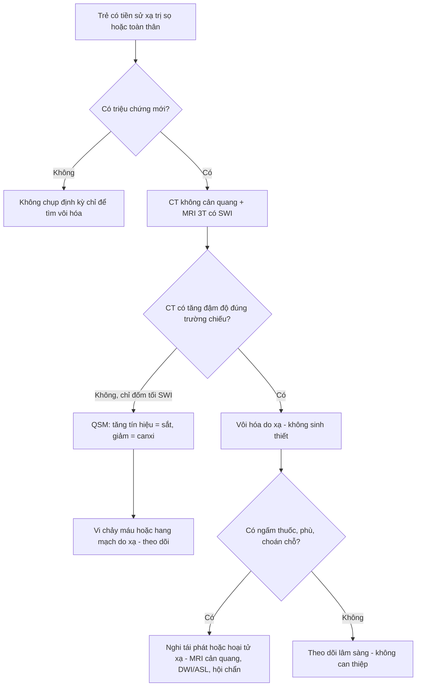
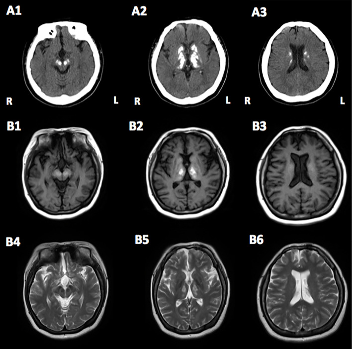
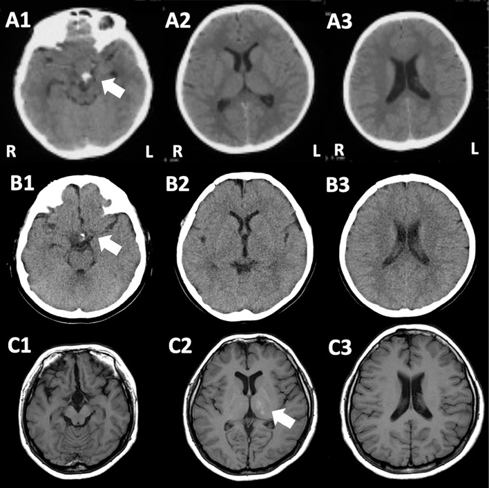
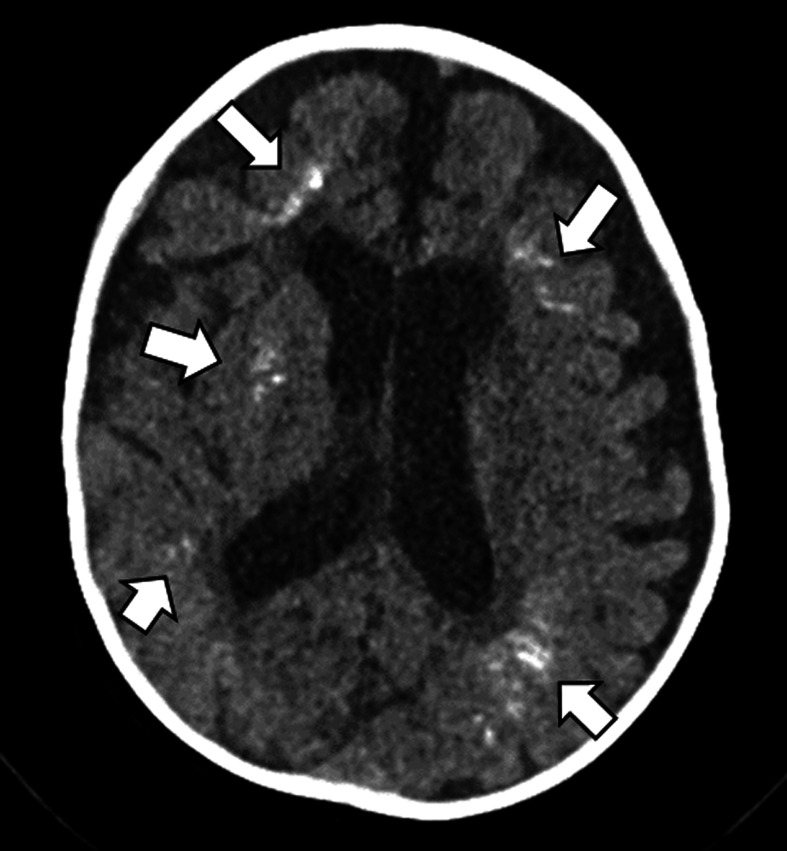
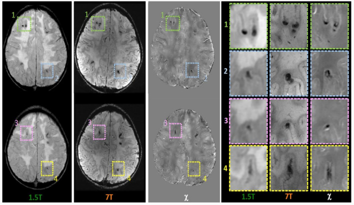

# 1828 — Vôi hóa não do xạ trị ở trẻ / Radiation-induced brain calcification (mineralizing microangiopathy)

**Tags:** `pattern:voi-hoa` `pattern:doi-xung` `pattern:ton-thuong-sau-xa` `pattern:vi-chay-mau` `vung:nao-nhi` `vung:nao` `vung:chat-trang-quanh-nao-that` `protocol:CT-nao-khong-can-quang` `protocol:SWI-3T` `protocol:QSM` `protocol:MRI-nao` `incidentaloma:ton-thuong-sau-xa`

**Mức chắc chắn (certainty):** tổng hợp y văn (literature synthesis) — ghép **2 ca nguyên văn có ảnh** (u sọ hầu xạ **54 Gy**, *Intern Med* 2022, PMC9841112, CC BY-NC-ND; Fanconi anemia xạ toàn thân **4,5 Gy**, *PCN Rep* 2022, PMC11114304, CC BY), **1 tổng quan hình ảnh nhi** có ca 4 tháng tuổi sau xạ + MTX nội tủy (*Turk Arch Pediatr* 2022, PMC9131816, CC BY-NC), **1 ca 7T–QSM** phân biệt canxi với hemosiderin (*Front Neurol* 2024, PMC10899325, CC BY) và **1 đoàn hệ 101 người sống sót ALL** dùng SWI 3T (*Sci Rep* 2020, PMC6971068, CC BY). Nhóm **không có bệnh nhân của mình**; chỗ nguồn không đủ để trả lời (tỉ lệ mắc chính xác) được ghi **"chưa rõ"**, không suy ra.

> **Câu chốt:** vôi hóa não sau xạ trị ở trẻ là **tổn thương theo TRƯỜNG CHIẾU, không theo lãnh thổ mạch**, xuất hiện **nhiều năm sau xạ** và **thường không triệu chứng**. Ba số phải thuộc: **(1)** dấu hiệu đầu tiên có thể chỉ sau **4 năm** (MRI T1 sáng ở đồi thị trái, ca 54 Gy) và **triệu chứng sau 13–14 năm** (PMC9841112); **(2)** trên CT là **đậm độ canxi đối xứng ở nhân xám sâu + chất trắng quanh não thất**, trong khi **SWI chỉ thấy "đốm tối"** — cùng một hình ảnh với **vi chảy máu do xạ (85% người sống sót ALL sau 18–24 Gy có ≥ 1 vi chảy máu)** (PMC6971068); **(3)** **QSM là chốt phân biệt**: canxi **nghịch từ (diamagnetic) → giảm tín hiệu trên QSM**, hemosiderin **thuận từ → tăng tín hiệu** (PMC10899325). Vì vậy: **CT không cản quang là chuẩn để xác nhận vôi hóa; không sinh thiết tổn thương vôi hóa đơn thuần.**

## 1. Tổng quan bệnh học – cơ chế hình ảnh

### 1.1 Bệnh học: "vi mạch khoáng hóa" chứ không phải "u canxi hóa"

- Thuật ngữ gốc là **mineralizing microangiopathy** (vi mạch khoáng hóa) — tổn thương **thành mao mạch – tiểu động mạch nhỏ** trong trường chiếu, dẫn tới **lắng đọng canxi** quanh mạch và trong nhu mô kế cận. Đây là **di chứng muộn của xạ trị**, thường đi kèm **methotrexate nội tủy** ở trẻ điều trị bạch cầu cấp (PMC9131816).
- Vì sao **nhân xám sâu và chất trắng quanh não thất**: đây là vùng **mật độ mao mạch cao nhất** và là **nơi dòng máu chảy chậm nhất** trong não; nội mô mạch là một trong ít quần thể tế bào còn tăng sinh ở não trưởng thành nên **rất nhạy với xạ** (PMC10899325). Tổn thương nội mô → **hyalin hóa, hoại tử fibrin, tắc mạch nhỏ** → thiếu máu vi thể → **khoáng hóa dystrophic**.
- Hệ quả hình ảnh: vôi hóa **đối xứng, nhiều ổ nhỏ**, phân bố **trong thể tích đã chiếu xạ** — không tôn trọng ranh giới lãnh thổ động mạch. Đây là điểm khác biệt cốt lõi với **nhồi máu** và với **di căn**.

### 1.2 Vật lý: vì sao canxi "sáng trên CT, sáng trên T1, tối trên SWI"

- **CT:** canxi hấp thụ tia X mạnh hơn nhu mô mềm → **tăng đậm độ**. Trên CT không cản quang, canxi điển hình **100–1.000 HU** (vật lý chung, không phải số của bài gốc); mỡ **−40 đến −120 HU**; máu tụ cấp **50–90 HU**. Vì vậy **CT là "chuẩn vàng" để khẳng định canxi** — không có mô nào khác trong não đạt đậm độ này ngoài xương sọ, kim loại và canxi.
- **MRI T1:** canxi **có thể tăng tín hiệu T1** — nghịch lý nhưng đã được mô tả từ lâu (PMID 10955675). Cơ chế được chấp nhận: **diện tích bề mặt tinh thể lớn** làm tăng tương tác với nước tự do + **tạp chất kim loại (sắt, mangan, magiê)** trong tinh thể canxi + canxi **ngậm nước**. Vì vậy **T1 sáng KHÔNG loại trừ canxi** và **không đồng nghĩa mỡ/máu/melanin**.
- **T2:** tín hiệu **thay đổi** (tăng ở vùng khoáng hóa ngậm nước, giảm ở ổ đặc) — không dùng một mình.
- **SWI/T2\*:** canxi gây **mất tín hiệu (blooming)** do **khác biệt từ tính giữa canxi và nước**, nên **giống hệt vi chảy máu**. Đây là **cạm bẫy số 1** của bài này.
- **QSM:** đo **độ cảm từ (χ)** định lượng. **Canxi = nghịch từ → χ âm → giảm tín hiệu trên ảnh QSM**; **hemosiderin/ferritin = thuận từ → χ dương → tăng tín hiệu**. Ca 7T của Celardo cho thấy đúng nguyên tắc này: ổ **tăng tín hiệu QSM** = hang mạch/vi chảy máu do xạ; ổ **giảm tín hiệu QSM** = vôi hóa nhu mô sau hóa–xạ (PMC10899325).

### 1.3 Thời gian tiềm tàng và liều — hai con số quyết định cách theo dõi

- **Ca u sọ hầu (PMC9841112):** xạ phân liều **54 Gy** quanh hố yên (gồm **hai đồi thị, nhân đậu, thân não trên**) lúc **7 tuổi**; mổ lại lúc 8 tuổi; **MRI 11 tuổi** đã có **điểm tăng tín hiệu T1 ở đồi thị trái**, lan dần sang **hai đồi thị, nhân đậu, nhân đỏ trong 3 năm**; đến **20 tuổi** mới có **parkinson + thất điều**. Tức **4 năm** để có dấu hiệu hình ảnh, **13–14 năm** để có triệu chứng.
- **Ca Fanconi anemia (PMC11114304):** xạ toàn thân **chỉ 4,5 Gy** lúc **5 tuổi** (chuẩn bị ghép tủy), **MRI lúc đó bình thường**; **12 năm sau** CT thấy vôi hóa **lan rộng** ở **thùy trán, thùy đỉnh, thùy chẩm, nhân xám, đồi thị, trung não, thân não**, kèm **triệu chứng loạn thần**. Bài học: **liều thấp không loại trừ** — Fanconi là hội chứng **tăng nhạy cảm phóng xạ** do khiếm khuyết sửa chữa DNA.
- **Nhóm ALL sau xạ 18–24 Gy (PMC6971068):** 101 người sống sót, **trung bình 27,6 năm** sau chẩn đoán, **97% có MTX nội tủy**; **85% có ≥ 1 vi chảy máu** trên SWI 3T; **liều 24 Gy làm tăng gấp 5 lần** nguy cơ **nhiều vi chảy máu** so với 18 Gy (**RR 5,0; KTC 95% 2,57–10,32**). Đây là **bằng chứng định lượng mạnh nhất** cho việc **liều xạ thấp cũng để lại tổn thương vi mạch**.
- **Tỉ lệ mắc vôi hóa não sau xạ ở trẻ: chưa rõ** — không có nghiên cứu đoàn hệ đếm tỉ lệ bằng CT ở mọi bệnh nhi sau xạ; y văn chỉ mô tả **"thỉnh thoảng gặp"** ở người sống sót bạch cầu cấp nhi (PMC9131816). Không được trích con số không tồn tại.

### 1.4 Vì sao vôi hóa lại gây triệu chứng — và vì sao thường KHÔNG

- **Thường không triệu chứng** vì canxi nằm trong **mô đã mất chức năng từ trước** (di chứng vi mạch), không choán chỗ, không phù. Nhiều ca chỉ phát hiện tình cờ khi chụp vì lý do khác.
- **Có triệu chứng** khi tổn thương **đủ lan**: ca 54 Gy có **parkinson không đáp ứng levodopa** kèm **thất điều**, **DaT-SPECT chỉ giảm nhẹ** (SBR phải **7,46**, trái **6,94**) → triệu chứng **không do mất tế bào dopaminergic** mà do **tổn thương lan tới chất trắng quanh não thất**; **SPECT tưới máu** cho thấy **giảm tưới máu toàn tiểu não** kèm nhân xám hai bên = **crossed cerebellar diaschisis** (PMC9841112). Đây là lý do **không được quy mọi parkinson sau xạ cho "tái phát u"**.

## 2. Mẫu hình + chẩn đoán phân biệt theo vị trí (gamut)

### 2.1 Gamut theo vị trí trong trường chiếu

- **Nhân xám sâu (đồi thị, nhân đậu, đuôi, nhân đỏ):** vôi hóa do xạ (đối xứng, theo trường), **Fahr/PFBC**, **suy cận giáp**, **nhiễm trùng bẩm sinh**, **thiếu oxy–thiếu máu cục bộ cũ**.
- **Chất trắng quanh não thất:** vôi hóa do xạ ± MTX, **CMV bẩm sinh**, **di chứng viêm màng não**, **xơ hóa chất trắng do xạ (bài 261)**.
- **Vỏ não/thùy (gyriform, theo bờ cuộn não):** **mineralizing microangiopathy** thể vỏ (QSM giảm tín hiệu theo dải — PMC10899325), **vi chảy máu vỏ–dưới vỏ** (QSM tăng tín hiệu), **di căn canxi hóa** (hiếm, thường có phù/ngấm).
- **Thân não/tiểu não:** vôi hóa do xạ (ca 54 Gy lan tới trung não; ca Fanconi tới thân não), **thoái hóa thần kinh**, **phình/canxi mạch**.

### 2.2 Gamut theo cơ chế (dùng khi chỉ có "đốm tối trên SWI")

- **Canxi (nghịch từ):** vôi hóa do xạ, Fahr, suy cận giáp, u canxi hóa.
- **Sắt (thuận từ):** vi chảy máu do xạ, hang mạch do xạ, microbleed tăng huyết áp, amyloid angiopathy (hiếm ở trẻ).
- **Không phải cả hai:** khí, kim loại (nhiễu), xương sọ ở rìa trường nhìn, **hiệu ứng trường (field inhomogeneity)**.

## 3. Bảng so sánh phân biệt (ma trận đối chiếu)

| Thực thể (entity) | Hình ảnh điển hình (CT/MRI) | Chốt vào (rule-in) | Chốt loại (rule-out) | Gợi ý xác nhận |
|---|---|---|---|---|
| **Vôi hóa do xạ trị (mineralizing microangiopathy)** | CT: **đốm tăng đậm độ đối xứng** ở nhân xám sâu + chất trắng quanh não thất, **trong thể tích đã chiếu**; T1 có thể **sáng**; SWI **tối**; QSM **giảm tín hiệu** | **Tiền sử xạ trị sọ/đầu cổ + phân bố khớp trường chiếu + CT tăng đậm độ + QSM nghịch từ** | **Tổn thương ngoài trường chiếu**, có phù/ngấm thuốc/choán chỗ → không phải di chứng đơn thuần | So CT cũ, đối chiếu kế hoạch xạ (dose map), QSM 3T nếu có |
| **Fahr / vôi hóa não nguyên phát (PFBC)** | Vôi hóa **hai bên nhân đậu, đuôi, đồi thị, tiểu não**, đối xứng, không phù | **Không tiền sử xạ**, canxi–phospho bình thường, **tiền sử gia đình**, gen *SLC20A2/PDGFB/PDGFRB/XPR1/MYORG* | **Tiền sử xạ đúng vùng + phân bố theo trường** → không quy cho Fahr | CT + canxi/PTH + gen |
| **Suy cận giáp / giả suy cận giáp** | Vôi hóa nhân xám hai bên, có thể lan chất trắng | **Ca↓, P↑, PTH↓ (hoặc PTH↑ nếu đề kháng)** | **Ca/P/PTH bình thường** → loại | Xét nghiệm canxi, phospho, PTH |
| **Mineralizing angiopathy ở nhũ nhi** | **Canxi dọc động mạch đậu–vân**, nhồi máu nhân xám sau **chấn thương nhẹ**; nhánh mạch **cong** trên CTA | **Trẻ < 2 tuổi, chấn thương nhẹ, nhồi máu nhân xám + canxi dọc mạch** | **Không có xạ trị, tuổi lớn, không nhồi máu** → loại | CT + CTA/3D tái tạo theo trục mạch |
| **Nhiễm trùng bẩm sinh (CMV, toxoplasma)** | Canxi **quanh não thất** (CMV) hoặc **rải rác + não nhỏ** (toxo), có thể kèm giãn não thất | **Huyết thanh mẹ/trẻ dương, canxi quanh não thất từ nhỏ, không liên quan trường xạ** | **Khởi phát sau xạ, trường chiếu rõ** → loại | PCR/huyết thanh, so phim sơ sinh |
| **Vi chảy máu do xạ (microbleed)** | SWI: **đốm tối < 5 mm**, nhiều ổ, **thùy trán** nhiều nhất; QSM **tăng tín hiệu** | **Tiền sử xạ + đốm tối SWI + QSM thuận từ** | **CT không tăng đậm độ tại cùng vị trí** → không phải canxi | SWI 3T + QSM; không cần sinh thiết |
| **Hang mạch do xạ (cavernoma)** | SWI: **ổ tối lớn có vòng hemosiderin**, "popcorn"; QSM **tăng tín hiệu** | **Tiền sử xạ 3–9 tháng đến nhiều năm + hình popcorn + QSM thuận từ** | **CT tăng đậm độ đặc, không vòng** → canxi | MRI 3T + SWI, theo dõi |
| **Tái phát u / hoại tử xạ** | Khối **ngấm thuốc**, phù, choán chỗ, tăng tưới máu; có thể vôi hóa trong u | **Ngấm thuốc tiến triển + phù + hiệu ứng khối** | **Vôi hóa đơn thuần, không ngấm, không phù, không choán chỗ** → không phải tái phát | MRI cản quang + DWI/ASL/PET; sinh thiết chỉ khi thật cần |

### 3.1 Dấu hiệu "chốt" trên ảnh — đọc theo thứ tự

1. **CT không cản quang trước:** có **tăng đậm độ thật** không? (so với vỏ não và với phim cũ).
2. **Vị trí so với trường chiếu:** nằm trong **thể tích 54 Gy** (ca u sọ hầu) hay **toàn não** (xạ toàn thân)? Nếu ngoài trường → nghĩ nguyên nhân khác.
3. **Đối xứng:** vôi hóa do xạ **đối xứng nhưng không hoàn toàn**; bất đối xứng mạnh gợi ý **nguyên nhân mạch/tái phát**.
4. **SWI/QSM:** nếu chỉ có SWI → **không phân biệt được**; QSM mới tách canxi (χ âm) khỏi sắt (χ dương).

## 4. Protocol chụp + hệ phân độ/theo dõi

### 4.1 Protocol

- **CT não không cản quang, lát ≤ 1 mm**, cửa sổ nhu mô + cửa sổ xương; **đo HU** tại ổ tổn thương và **so sánh với CT nền trước xạ** nếu có. CT là **bắt buộc** khi nghi vôi hóa — MRI một mình **có thể bỏ sót** (canxi có thể **không thấy** trên MRI thường).
- **MRI 3T:** T1, T2, FLAIR, DWI/ADC, **SWI**; **QSM** nếu có (3T hoặc 7T) khi cần phân biệt canxi–sắt. **Không cần cản quang** nếu mục tiêu chỉ là di chứng vôi hóa; **có cản quang** khi nghi tái phát/hoại tử xạ.
- **Đánh giá kèm:** khám thần kinh – nhận thức (ca Fanconi có **IQ toàn phần 74**, tốc độ xử lý **55** ở 15 tuổi, giảm thêm ở 17 tuổi), **nội tiết trục dưới đồi–yên** nếu xạ vùng trên yên (bài 1752), và **thính lực/thị lực** nếu trường xạ bao gồm.

### 4.2 Theo dõi — khi nào chụp lại

- **Không có guideline riêng** cho theo dõi vôi hóa não do xạ. Nguyên tắc thực hành từ 2 ca và tổng quan: **chụp theo triệu chứng**, không chụp định kỳ chỉ để "theo dõi canxi"; **không sinh thiết** tổn thương vôi hóa không ngấm thuốc; **theo dõi nội tiết và nhận thức** là phần bắt buộc của khám muộn sau xạ.

## 5. Biến thể bình thường và cạm bẫy

- **Vôi hóa sinh lý nhân đậu/đuôi ở người lớn** (rất thường gặp, tăng theo tuổi) — ở trẻ **hiếm**, nên **không được quy sinh lý** khi chưa loại nguyên nhân.
- **Canxi "sáng T1" bị đọc nhầm là mỡ hoặc máu:** T1 sáng + **CT tăng đậm độ** = canxi; T1 sáng + **CT giảm đậm độ** = mỡ/máu cũ/melanin. **Luôn đặt CT cạnh MRI.**
- **SWI "đốm tối" không phải lúc nào cũng là máu:** canxi cũng blooming. Trong đoàn hệ ALL, **85%** người sống sót có vi chảy máu — nếu chỉ dựa SWI sẽ **gán nhầm mọi đốm tối là máu** và bỏ qua vôi hóa.
- **QSM đọc ngược dấu:** canxi **giảm** tín hiệu, hemosiderin **tăng**. Nếu không có QSM, **không được khẳng định** bản chất bằng SWI.
- **Liều thấp ≠ an toàn:** ca Fanconi chỉ **4,5 Gy** vẫn vôi hóa lan rộng sau 12 năm — vì **tăng nhạy cảm phóng xạ**. Hỏi kỹ hội chứng nền (Fanconi, AT, Nijmegen).
- **Vôi hóa ≠ tái phát:** vôi hóa đơn thuần **không ngấm thuốc, không phù, không choán chỗ**. Ngược lại, **khối ngấm thuốc trong vùng xạ cũ** phải loại **tái phát/hoại tử xạ** trước khi gọi là di chứng.
- **Bỏ sót trên MRI thường:** canxi có thể **gần như vô hình** trên T1/T2; nếu chỉ có MRI mà không CT, dễ bỏ sót hoàn toàn — đúng như tổng quan nhi đã cảnh báo (PMC9131816).
- **Hiệu ứng trường tại rìa trường chiếu:** đốm tối ở **ranh giới trường xạ** có thể do **bất đồng nhất từ trường**, không phải tổn thương thật — đối chiếu vị trí với kế hoạch xạ.

## 6. Tự lượng giá — Blind Quiz

**Ca 1 — Trẻ 7 tuổi xạ 54 Gy vùng hố yên vì u sọ hầu; ảnh chụp lúc 20 tuổi vì chậm chạp, run, đi loạng choạng.**

- Gợi ý: không có sốt, không tăng canxi máu, không tiền sử gia đình.
- Hỏi: (1) Mô tả phân bố tổn thương trên CT; (2) vì sao T1 **sáng**? (3) Ba chẩn đoán phân biệt và dấu hiệu nào chốt?

<b>Bấm để hiện đáp án</b>

- **Dấu hiệu:** CT (A1–A3) **tăng đậm độ đối xứng** ở **trung não, đồi thị, nhân đậu, nhân đuôi và chất trắng quanh não thất**; MRI T1 (B1–B3) và T2 (B4–B6) **tăng tín hiệu** tại cùng vị trí.
- **Chẩn đoán:** **vôi hóa não do xạ trị** (mineralizing microangiopathy) — canxi lắng trong vùng **đã chiếu 54 Gy**, T1 sáng do **diện bề mặt tinh thể + tạp chất kim loại**, không phải mỡ/máu.
- **Phân biệt:** Fahr (không tiền sử xạ, canxi–PTH bình thường), suy cận giáp (Ca↓/PTH↓), tái phát u (ngấm thuốc, phù). **Chốt:** tiền sử xạ + phân bố khớp trường chiếu + CT tăng đậm độ.
- **Điểm hay bị bỏ:** **DaT-SPECT chỉ giảm nhẹ** (SBR 7,46/6,94) — parkinson **không do mất tế bào dopaminergic** mà do tổn thương chất trắng lan rộng.
- **Nguồn ảnh:** Shimada T và cs., *Intern Med* 2022;61(24):3723–3727, PMC9841112 Fig. 2 — **CC BY-NC-ND 4.0**, ảnh nguyên bản (không cắt/ghép).

**Ca 2 — Trẻ 11 tuổi, tiền sử xạ vùng hố yên lúc 7 tuổi; MRI tình cờ thấy một điểm sáng T1 ở đồi thị trái.**

- Hỏi: Điểm sáng T1 là gì? Có phải tái phát u? Theo dõi thế nào?

<b>Bấm để hiện đáp án</b>

- **Dấu hiệu:** A1–A3 (7 tuổi) và B1–B3 (8 tuổi) **chưa có bất thường** ở đồi thị/nhân đậu/chất trắng; C2 (11 tuổi) có **điểm tăng tín hiệu T1 ở đồi thị trái** (mũi tên trắng).
- **Chẩn đoán:** **khởi đầu vôi hóa do xạ** — xuất hiện **4 năm sau xạ**, trước triệu chứng **9–10 năm**. Không phải tái phát: không ngấm thuốc, không phù, không choán chỗ.
- **Theo dõi:** không sinh thiết; chụp lại **khi có triệu chứng mới**; đánh giá nội tiết (sau xạ vùng trên yên) và nhận thức.
- **Nguồn ảnh:** Shimada T và cs., *Intern Med* 2022, PMC9841112 Fig. 1 — **CC BY-NC-ND 4.0**.

**Ca 3 — Trẻ 4 tháng tuổi, bạch cầu cấp, đã xạ sọ + methotrexate nội tủy; CT sàng lọc.**

- Hỏi: Mô tả tổn thương và vì sao trẻ **không có triệu chứng thần kinh**?

<b>Bấm để hiện đáp án</b>

- **Dấu hiệu:** **nhiều ổ canxi hóa dystrophic** ở **chất trắng quanh não thất hai bên** (mũi tên trắng), không phù, không choán chỗ.
- **Chẩn đoán:** **mineralizing microangiopathy** sau xạ + MTX nội tủy. **Thường không triệu chứng** vì canxi nằm trong mô đã mất chức năng, không chèn ép.
- **Nguồn ảnh:** Kalın S, Koral K., *Turk Arch Pediatr* 2022;57(3):267–281, PMC9131816 Fig. 12 — **CC BY-NC 4.0**, ảnh nguyên bản.

**Ca 4 — Bệnh nhi có nhiều đốm tối trên SWI sau xạ; QSM được chụp thêm.**

- Hỏi: Ổ nào là **canxi**, ổ nào là **sắt**? Vì sao SWI một mình không trả lời được?

<b>Bấm để hiện đáp án</b>

- **Dấu hiệu:** các ổ được khoanh (1–4) trên SWI **đều tối** ở cả 1,5T và 7T; trên **bản đồ χ (QSM)** một số ổ **tăng tín hiệu** (thuận từ → **hang mạch/vi chảy máu**), số khác **giảm tín hiệu** (nghịch từ → **vôi hóa nhu mô** theo dải vỏ).
- **Vì sao:** canxi và hemosiderin **cùng gây mất tín hiệu SWI**; chỉ **QSM đo dấu của độ cảm từ** mới tách được.
- **Nguồn ảnh:** Celardo G và cs., *Front Neurol* 2024;15:1362704, PMC10899325 Fig. 1 — **CC BY 4.0**, ảnh nguyên bản.

## Bài liên quan chéo

- [1797 – Vi chảy máu & hang mạch do xạ trị sọ ở trẻ](../1797-vi-chay-mau-hang-mach-sau-xa/lesson.md) — cùng trường xạ, cùng "đốm tối SWI", khác bản chất (sắt).
- [261 – Bệnh não chất trắng do xạ trị](../261-benh-nao-chat-trang-do-xa-tri/lesson.md) — tổn thương chất trắng lan tỏa, không vôi hóa.
- [262 – Bệnh mạch máu lớn do xạ trị (moyamoya)](../262-benh-mach-mau-lon-do-xa-tri-moyamoya/lesson.md) — hẹp mạch lớn nhiều năm sau xạ.
- [268 – Bệnh tủy do xạ trị](../268-benh-tuy-do-xa-tri/lesson.md) — cùng nguyên lý "di chứng muộn theo trường chiếu".
- [1752 – Suy tuyến yên sau xạ trị sọ ở trẻ](../1752-suy-tuyen-yen-sau-xa-tri-so-o-tre/lesson.md) — phần nội tiết bắt buộc của khám muộn.
- [200 – Tổng quan hệ Thần kinh](../200-tong-quan-he-than-kinh/lesson.md)

> Không dùng để chẩn đoán độc lập khi chưa có người hướng dẫn.
