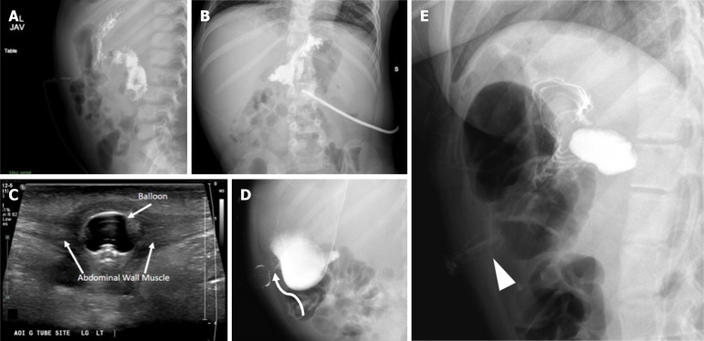
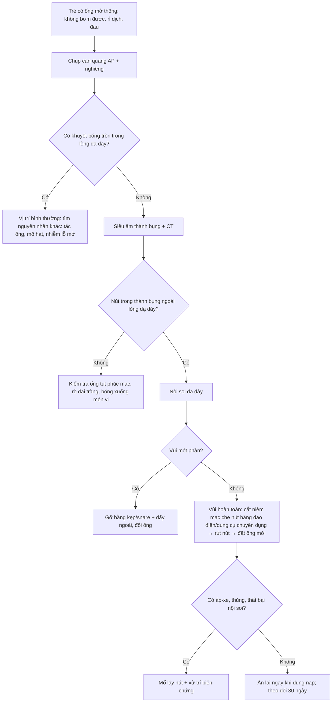
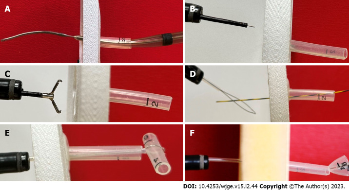
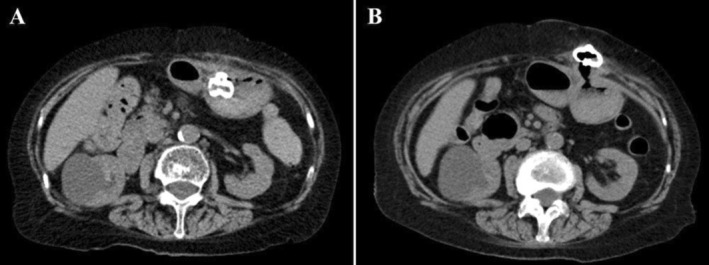
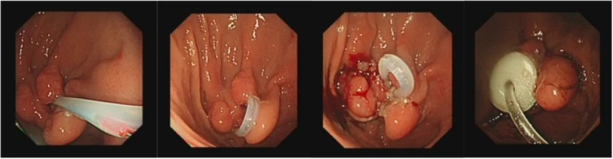

# 1829 — Hội chứng nút bị vùi sau mở thông dạ dày ở trẻ / Buried bumper syndrome (BBS) in children

**Tags:** `pattern:nut-bi-vui` `pattern:ro-quanh-lo-mo` `vung:da-day` `vung:thanh-bung` `protocol:chup-ro-can-quang` `protocol:CT-bung` `protocol:sieu-am` `protocol:noi-soi`
**Mức chắc chắn (certainty):** tổng hợp y văn (literature synthesis) — tổng hợp từ y văn mở, đối chiếu PMCID (Europe PMC): Menni A, *World J Gastrointest Endosc* 2023, PMC10011891; Patel DD, *World J Radiol* 2025, PMC12210205; Inaba S, *Clin Case Rep* 2025, PMC12665147; Adima A & Patel Y, *JPGN Rep* 2026, PMC13699950. Số chưa kiểm chứng ghi "chưa rõ".

> Bài này trả lời **"vì sao không bơm được sữa dù ống còn đó"**: nút trong (internal bumper) đã chui vào thành dạ dày/thành bụng. Rò da–dạ dày sau khi **rút** ống ở [1813](../1813-ro-da-da-day-sau-rut-ong-mo-thong-tre/lesson.md); cai nuôi ống và rút ống ở [1805](../1805-rut-ong-mo-thong-da-day-cai-ong-tre/lesson.md); chăm sóc ống và kiểm tra vị trí ở [083](../083-nuoi-an-qua-sonde/lesson.md).

## 1. Tổng quan bệnh học – cơ chế hình ảnh

- **Định nghĩa (BBS):** nút giữ trong (internal bumper/balloon) của ống mở thông dạ dày (gastrostomy tube, G-tube) **di chuyển từ lòng dạ dày vào thành dạ dày, rồi ra đường hầm da–dạ dày**, nằm bất kỳ đâu giữa niêm mạc dạ dày và mặt da (Menni A 2023, PMC10011891). Đường hầm xẹp lại và **biểu mô hóa lỗ trong** → thức ăn không vào được dạ dày, ống "còn nguyên" nhưng vô dụng.
- **Cơ chế — TẠI SAO nút bị vùi (không chỉ "do lâu ngày"):**
  1. **Chèn ép kéo dài** giữa nút ngoài (external bolster) và nút trong → mô dạ dày + thành bụng bị kẹp như "bánh sandwich" → **thiếu máu niêm mạc → loét → xơ** tại chỗ nút tỳ (Menni A 2023, PMC10011891).
  2. **Lực kéo ngoài quá mức** (bít ngoài quá chặt, kéo ống, tăng cân nhanh) làm tăng áp lực kẹp — đây là yếu tố được nêu ở cả loạt người lớn và ca trẻ.
  3. **Vật liệu nút cứng/nửa cứng** (polyurethane; hệ Sacks-Vine bị nhắc nhiều lần) dễ gây BBS hơn nút mềm/bóng (Menni A 2023, PMC10011891).
  4. **Béo lên nhanh sau khi nuôi ăn hiệu quả:** ca 84 tuổi tăng **37,5 → 41,3 kg (BMI 17,4 → 19,1)** trong **6 tuần**, lớp mỡ dưới da lỗ mở **22 mm** — đủ để "nuốt" nút (Inaba S 2025, PMC12665147). Ở trẻ, cân nặng tăng nhanh sau đặt ống là bối cảnh tương tự.
- **Tần suất:** **0,3–2,4% mỗi bệnh nhân PEG mỗi năm**, có loạt tới **2,0–6,7% số lần đặt PEG**; ước tính chung **~2,8%** (Menni A 2023, PMC10011891; Inaba S 2025, PMC12665147). Ca đầu tiên: **7/125 lần PEG trong 2 năm (1988)**; thuật ngữ do Klein đặt năm **1990**.
- **Thời điểm:** điển hình là biến chứng **muộn (tháng–năm)**, nhưng **có thể trong vài tuần** — ca trên chỉ **6 tuần** sau PEG (Inaba S 2025, PMC12665147). Vì vậy "mới đặt 1–2 tháng" **không loại trừ** BBS.
- **Ở trẻ — điều đã biết và điều chưa:** loạt nhi duy nhất dùng dụng cụ cắt nội soi (Flamingo) gồm **9 trẻ 2–16 tuổi (6 nữ/3 nam), ASA trung vị 3**, tức trẻ **đa bệnh nền, suy dinh dưỡng/thần kinh nặng** (Adima A & Patel Y 2026, PMC13699950). **Tỉ lệ BBS riêng ở trẻ chưa rõ** — các loạt nhi chỉ mô tả ca được điều trị, không có mẫu số.
- **Vì sao hình ảnh "bình thường" mà vẫn có bệnh — vật lý học:**
  - Nút là **polymer tỷ trọng mô mềm**, không cản quang mạnh: trên X-quang nó chỉ là **bóng mờ mềm**, không tạo **khuyết thuốc tròn (filling defect)** trong lòng dạ dày như bóng chứa khí/dịch bình thường. Thuốc cản quang vẫn chảy theo niêm mạc dạ dày → **hình ảnh trông "bình thường"** dù nút đã ra ngoài (Patel DD 2025, PMC12210205).
  - **Siêu âm:** bóng/nút nằm trong **mô mỡ dưới da (−50 đến −100 HU tương đương giảm âm)**, tạo **cấu trúc tròn/ống giảm âm trong thành bụng**, không thấy trong lòng dạ dày.
  - **CT:** nút nằm **ngoài lòng dạ dày**, trong lớp mỡ thành bụng; đo được **độ dày mỡ dưới da** và **khoảng cách nút–da**, đồng thời thấy **áp-xe/tụ dịch** đi kèm. Khí tự do lượng nhỏ ngay sau đặt ống là bình thường, nhưng **khí + dịch + thành bụng dày** sau vài tuần là nhiễm trùng.

## 2. Mẫu hình + chẩn đoán phân biệt theo vị trí (gamut)

- **Theo mức độ (chốt xử trí):**
  - **Vùi một phần (partial):** nút còn nhìn thấy một phần trong lòng dạ dày, đầu nối còn thông; có thể gỡ bằng kẹp/snare từ trong + đẩy từ ngoài.
  - **Vùi hoàn toàn (complete):** nút nằm trong thành/thành bụng, lỗ trong bị niêm mạc che kín → **không bơm được**, phải can thiệp chuyên khoa (Menni A 2023, PMC10011891; Adima A & Patel Y 2026, PMC13699950).
- **Theo vị trí nút trên hình ảnh:**
  1. **Trong thành dạ dày** — dày niêm mạc quanh nút, có "vòm" niêm mạc.
  2. **Trong đường hầm da–dạ dày** — nút ở giữa thành bụng, ổ dịch/quanh nút.
  3. **Dưới da** — sờ thấy cục, da đỏ, rỉ dịch; dễ nhầm hạch/áp-xe.
- **Gamut "rỉ dịch + đau quanh lỗ mở":** BBS · nhiễm/tụ dịch lỗ mở · ống tụt vào phúc mạc · rò dạ dày–đại tràng · hẹp/phì đại mô hạt · ống gãy/hở thành ống.
- Gợi nhớ **"ỐNG CÒN, SỮA KHÔNG VÀO"**: **B**umper buried, **B**alloon ngoài lòng, **B**owel interposed (đại tràng chen giữa), **B**reak (gãy ống), **B**lock (tắc do mô hạt/sỏi sữa).

## 3. Bảng so sánh phân biệt (ma trận đối chiếu)

| Thực thể (entity) | Hình ảnh điển hình | Chốt vào (rule-in) | Chốt loại (rule-out) | Gợi ý xác nhận |
|---|---|---|---|---|
| **BBS vùi một phần** | Chụp cản quang: còn **khuyết thuốc/bóng** một phần trong dạ dày; nội soi thấy nút bị niêm mạc phủ một phần | **Đầu nối còn thông nhưng lưu lượng giảm + nội soi thấy nút trong "vòm" niêm mạc** | Thuốc ra tự do, **khuyết bóng tròn đầy đủ** trong lòng dạ dày = vị trí bình thường | Nội soi + thử đẩy/kẹp; không cần CT |
| **BBS vùi hoàn toàn** | X-quang cản quang **"bình thường" nhưng KHÔNG có khuyết bóng**; **US: bóng trong thành bụng**; **CT: nút ngoài lòng dạ dày trong mỡ thành bụng** | **Không bơm được + không thấy bóng trong dạ dày trên ≥ 2 phương thức** | Có bóng tròn trong lòng dạ dày trên US/CT = không vùi | **US/CT là chốt** khi X-quang không giải thích được (Patel DD 2025) |
| Nhiễm/áp-xe lỗ mở | Dày mô mềm quanh lỗ, ổ dịch **có vỏ ngấm thuốc**; khí trong mô | **Sốt + đau + ổ dịch có vỏ + khí trong mô** | Nút nằm đúng trong lòng dạ dày, không ổ dịch | US (ổ dịch, Doppler vỏ) → CT nếu sâu |
| Ống tụt vào phúc mạc | Thuốc cản quang **chảy tự do trong phúc mạc**, không ôm niêm mạc; bóng ở ngoài dạ dày nhưng **không trong thành bụng** | **Thuốc ngoài lòng + đau bụng cấp** | Thuốc ôm niêm mạc dạ dày = trong lòng | Chụp cản quang AP + nghiêng; CT khi nghi thủng |
| Rò dạ dày–đại tràng | Thuốc từ dạ dày vào **đại tràng (thấy haustra)**; tiêu chảy sau đổi ống, hơi thở hôi | **Tiêu chảy ngay sau bơm + thuốc vào khung đại tràng** | Chỉ dạ dày–ruột non bình thường | Chụp cản quang/fluoroscopy; CT |
| Bóng di chuyển xuống môn vị/tá tràng | Dạ dày **căng, mất niêm mạc**, mức khí–dịch; bóng ở môn vị/tá tràng | **Nôn + bụng chướng + bóng ở môn vị** | Bóng ở đáy/thân dạ dày = bình thường | X-quang nghiêng + US |

*Trẻ 5 tuổi, rỉ dịch và đau quanh lỗ mở. (A, B) Chụp cản quang: thuốc đầy dạ dày và ruột non, **không thoát ra ngoài** — trông "bình thường"; (C) siêu âm: **bóng ống nằm trong thành bụng trước**, ngoài lòng dạ dày; (D) fluoroscopy kiểm tra: bóng nằm trong thành bụng trước; (E) ca khác: bóng méo trong thành bụng. Nguồn: Patel DD et al., *World J Radiol* 2025, Fig. 7 — CC BY-NC 4.0.*

### Dấu hiệu "khuyết bóng mất" — đọc thế nào
- Bình thường, bóng chứa khí/dịch trong lòng dạ dày tạo **khuyết thuốc tròn, đều** ở mặt trong thành bụng, **sâu hơn cân cơ**.
- Trong BBS: **khuyết đó biến mất**; nếu bóng bị bóp méo thấy được **trong thành bụng** thì đó là dấu hiệu trực tiếp (Patel DD 2025, PMC12210205).
- Vì vậy **câu hỏi đúng khi đọc phim không phải "có thuốc trong dạ dày không" mà là "có khuyết bóng tròn trong lòng dạ dày không"**.

## 4. Protocol chụp + phân độ + xử trí

- **Bước 1 — Chụp cản quang dạ dày (contrast radiography) AP + nghiêng ngang:** bơm **10 mL** thuốc tan trong nước **180–300 mgI/mL** (giảm còn **5 mL** ở trẻ **< 1 tuổi**), chụp ngay tư thế nghiêng ngang + AP ngửa. **Không dùng baryt** vì nguy cơ tràn phúc mạc (Patel DD 2025, PMC12210205).
- **Bước 2 — Siêu âm đầu dò cao tần thành bụng:** tìm **bóng/nút trong thành bụng**, ổ dịch, mô hạt; không nhiễm xạ, làm tại giường.
- **Bước 3 — CT bụng có cản quang:** khi X-quang "không giải thích được triệu chứng", nghi nút ngoài lòng hoặc có biến chứng (áp-xe, thủng, đại tràng chen giữa). Đo **độ dày mỡ dưới da** và **vị trí nút so với thành dạ dày**.
- **Bước 4 — Nội soi dạ dày:** xác nhận và **điều trị**. Đây là bước quyết định "vùi một phần hay hoàn toàn".
- **Mốc thời gian cần nhớ:** đường hầm **trưởng thành sau 2–4 tuần**; đặt lại ống muộn **> 24 giờ** ở đường hầm đã trưởng thành có thể gây **hẹp đường hầm** → cần chụp kiểm tra khi đặt lại muộn/sau tụt sớm (Patel DD 2025, PMC12210205).
- **Phân độ thực hành:** **một phần** (gỡ bằng kẹp/snare ± đẩy ngoài) vs **hoàn toàn** (cần kỹ thuật nội soi chuyên dụng hoặc mổ) (Menni A 2023, PMC10011891).

*(A) Kỹ thuật "đẩy": nong Savary luồn theo dây dẫn, đẩy từ ngoài vào lòng dạ dày; (B, C) kỹ thuật "dao nhọn" (needle-knife): rạch hình nan hoa trên "vòm" niêm mạc rồi kẹp/rút nút. Nguồn: Menni A et al., *World J Gastrointest Endosc* 2023, Fig. 2 — CC BY-NC 4.0.*

## 5. Biến thể bình thường và cạm bẫy

- **Bóng mờ mềm "lạ" cạnh dạ dày** trên phim không cản quang có thể là **nút bình thường trong lòng dạ dày** hoặc **nút đã vùi** — không phân biệt được nếu không có thuốc cản quang/US.
- **Cạm bẫy số 1 — tin vào "chụp cản quang bình thường":** đây là bẫy được nêu đích danh; thuốc chảy đầy dạ dày–ruột non **không loại trừ BBS** vì thiếu khuyết bóng (Patel DD 2025, PMC12210205). Trẻ **rỉ dịch + đau + không bơm được** mà phim "bình thường" → **phải siêu âm/CT**.
- **Cạm bẫy số 2 — khí tự do sau đặt ống:** một lượng nhỏ khí phúc mạc **được phép** sau đặt ống do chọc xuyên phúc mạc; chỉ lo khi **khí nhiều, tăng lên, kèm dịch/đau**.
- **Cạm bẫy số 3 — kéo mạnh để "lấy nút":** nút vùi nằm trong thành, kéo cưỡng bức có thể **rách thành dạ dày/thành bụng** và làm nặng nhiễm trùng; đây là **suy luận cơ học** từ giải phẫu, không phải số liệu thử nghiệm — nguyên tắc là **cắt mô che trước, rút sau**.
- **Cạm bẫy số 4 — tái phát sớm:** trong loạt nhi, **1/9 tái phát trong 2 tháng** và được điều trị lại thành công; sau thủ thuật cần **kiểm tra lại độ khít của nút ngoài** (Adima A & Patel Y 2026, PMC13699950).
- **Cạm bẫy số 5 — ống GJ tụt vào dạ dày:** bơm qua cổng hỗng tràng nhưng sữa ra dạ dày → nôn/chướng; khác BBS nhưng cùng bệnh cảnh "ống còn mà nuôi không được".
- **Dự phòng (thực hành, chưa có thử nghiệm):** giữ **nút ngoài không quá chặt**, kiểm tra lại độ khít khi **cân nặng tăng nhanh**, và **kéo nhẹ vào–ra** sau khi đường hầm trưởng thành; ghi nhận **đau/rỉ dịch/mất lưu lượng** là cờ đỏ.

## 6. Tự lượng giá — Blind Quiz

**Ca 1 — Trẻ 5 tuổi, rỉ dịch và đau quanh lỗ mở thông dạ dày. Nhìn phim cản quang trước.**

- Gợi ý: ống vẫn nguyên, mẹ báo "bơm sữa vào là trào ra lỗ".
- Câu hỏi: Thuốc cản quang có thoát ra ngoài không? Dấu hiệu nào **thiếu**? Hai thăm dò tiếp theo?

<b>Bấm để hiện đáp án (findings + chẩn đoán)</b>

- Findings: (A, B) thuốc đầy dạ dày và ruột non, **không thoát tự do** — nhưng **không có khuyết bóng tròn** của bóng ống trong lòng dạ dày; (C) siêu âm thành bụng: **bóng nằm trong thành bụng trước**, ngoài dạ dày; (D) fluoroscopy kiểm tra xác nhận bóng trong thành bụng trước; (E) ca khác: bóng méo.
- Chẩn đoán: **hội chứng nút bị vùi (BBS), vùi hoàn toàn** — vì nút đã ra khỏi lòng dạ dày nên không còn khuyết thuốc; thuốc vẫn chảy theo niêm mạc nên phim "giả bình thường".
- Bước tiếp: **siêu âm → CT → nội soi** để gỡ; không kéo mạnh từ ngoài.
- Nguồn ảnh: Patel DD et al., *World J Radiol* 2025, Fig. 7 — CC BY-NC 4.0.

**Ca 2 — Người bệnh tăng 3,8 kg trong 6 tuần sau đặt PEG, đau quanh lỗ mở. So sánh CT ngay sau đặt và 6 tuần sau.**

- Câu hỏi: Hai thì CT khác nhau ở điểm nào? Đo gì để giải thích cơ chế?

<b>Bấm để hiện đáp án (findings + chẩn đoán)</b>

- Findings: (A) ngay sau đặt — ống và nút trong **đúng vị trí trong lòng dạ dày**, lớp mỡ dưới da tại lỗ mở **22 mm**; (B) 6 tuần sau — nút **đã nằm trong thành bụng**, ngoài lòng dạ dày.
- Chẩn đoán: **BBS** do **chèn ép kéo dài + tăng cân nhanh** (37,5 → 41,3 kg; BMI 17,4 → 19,1) làm dày lớp mỡ dưới da và tăng lực tỳ của nút ngoài.
- Điểm cần nhớ: BBS có thể xuất hiện **trong vài tuần**, không chỉ sau nhiều tháng.
- Nguồn ảnh: Inaba S et al., *Clin Case Rep* 2025, Fig. 1 — CC BY-NC 4.0.

**Ca 3 — Trẻ 8 tuổi, nút vùi hoàn toàn, ASA 3. Nhìn bộ dụng cụ và các bước.**

- Câu hỏi: Dụng cụ đi vào theo đường nào? Vì sao phải **cắt 3–4 đường riêng phần tư** thay vì kéo?

<b>Bấm để hiện đáp án (findings + chẩn đoán)</b>

- Findings: cắt ống PEG để chừa **5–10 cm ngoài da** → luồn dây dẫn qua đầu ống vào dạ dày → đưa dụng cụ theo dây dẫn → gập dụng cụ **180°** → **3–4 đường cắt dọc riêng phần tư** trên niêm mạc phủ nút → đẩy nút vào lòng sau mỗi đường cắt → rút dụng cụ và đổi ống.
- Chẩn đoán/xử trí: **gỡ nút vùi hoàn toàn bằng nội soi** — cắt có kiểm soát thay vì kéo cưỡng bức (kéo mạnh có nguy cơ rách thành).
- Kết quả loạt nhi: **9/9 gỡ thành công**, thời gian trung bình **46,1 phút (20–82)**, **1 tái phát < 2 tháng**, **1 nhập viện ngày 26** do tuột ống hỗng tràng, **không biến chứng trong 30 ngày**.
- Nguồn ảnh: Adima A & Patel Y, *JPGN Rep* 2026, Fig. 1 — CC BY-NC-ND 4.0 (nguyên bản, không chỉnh sửa).

## Bài liên quan chéo
- [1813 – Rò da–dạ dày tồn tại sau rút ống mở thông ở trẻ](../1813-ro-da-da-day-sau-rut-ong-mo-thong-tre/lesson.md)
- [1805 – Rút ống mở thông & cai nuôi ống ở trẻ](../1805-rut-ong-mo-thong-da-day-cai-ong-tre/lesson.md)
- [083 – Nuôi ăn qua sonde](../083-nuoi-an-qua-sonde/lesson.md)
- [081 – Sặc và rối loạn nuốt](../081-sac-va-roi-loan-nuot/lesson.md)

> Không dùng để chẩn đoán độc lập khi chưa có người hướng dẫn.
