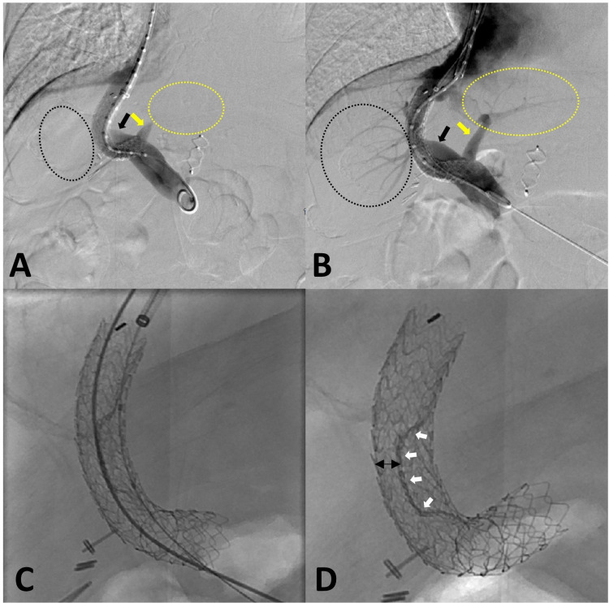
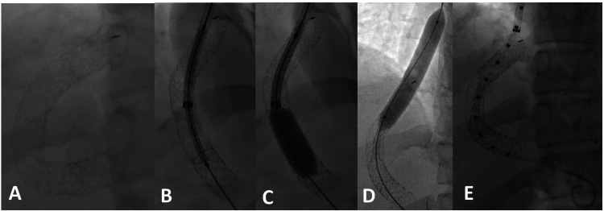
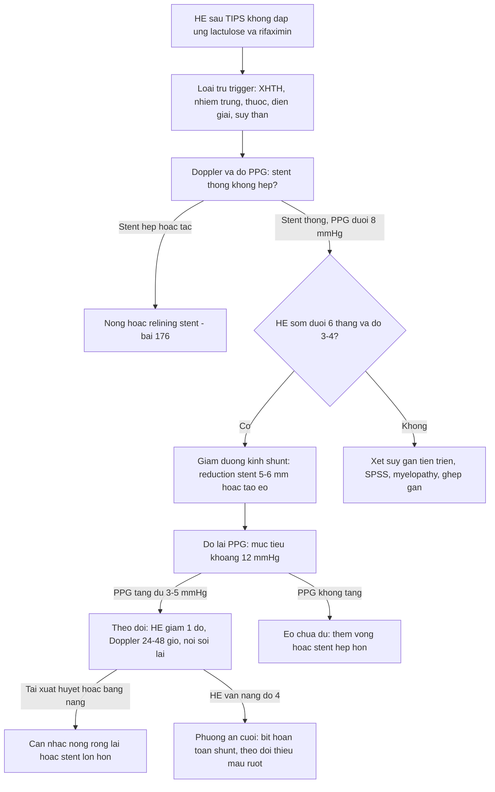
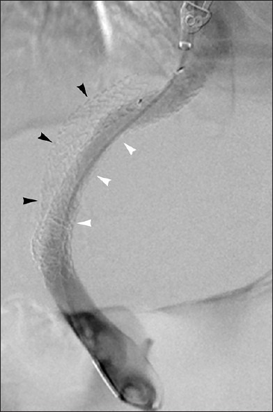
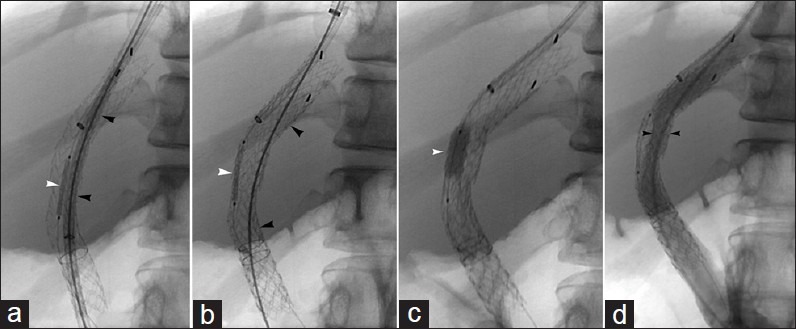

# 183 — Giảm đường kính shunt & bệnh não gan kháng trị sau TIPS / TIPS reduction for refractory hepatic encephalopathy

**Tags:** `pattern:shunt-cua-chu` `pattern:bien-nao-gan` `vung:gan` `vung:mach-cua` `score:West-Haven` `score:PPG` `protocol:DSA-do-ap-luc`
**Mức chắc chắn (certainty):** tổng hợp y văn (literature synthesis) — cohort 344 ca có số liệu giảm đường kính (J Clin Med 2020, PMC7073830), ca kỹ thuật "waist" một stent (Cureus 2021, PMC8592787, CC BY), atlas can thiệp shunt (J Clin Imaging Sci 2013, PMC3690677, CC BY-NC-SA), RCT 7 mm vs 8 mm (Liver Int 2026, PMC13562823, CC BY), case hepatic myelopathy (Eur J Case Rep Intern Med 2026, PMC13166998) và ca nút động mạch lách cứu vãn (Cureus 2026, PMC13286737).

> **Câu hỏi gốc của bài:** bệnh nhân **đã đặt TIPS vì xuất huyết giãn tĩnh mạch**, vài tuần đến vài tháng sau **lú lẫn, ngủ gà, asterixis** — đã dùng **lactulose + rifaximin đủ liều** mà không cải thiện. Doppler cho thấy **stent THÔNG TỐT, không hẹp**, PPG rất thấp (**5–8 mmHg**). Vậy: **có nên giảm đường kính shunt? giảm bằng cách nào? đo gì để biết đã "đủ"? và đánh đổi gì?**
> **Điểm tựa:** bệnh não gan (hepatic encephalopathy – HE) sau TIPS là bệnh của **lưu lượng shunt quá lớn (over-shunting)**, KHÔNG phải bệnh của hẹp stent. Mọi quyết định xoay quanh một câu: **tăng lại được bao nhiêu phần trăm máu về gan mà không làm tái xuất huyết?**

## 1. Tổng quan bệnh học – cơ chế hình ảnh

**A. Vì sao TIPS gây HE (và vì sao "thu nhỏ lòng" lại chữa được):**
- TIPS nối **tĩnh mạch gan ↔ nhánh tĩnh mạch cửa** trong nhu mô gan. Máu cửa đi tắt qua ống nối, **bỏ qua nhu mô gan** — nơi duy nhất khử amoniac (NH₃) thành ure và glutamine. Gan còn **giảm tưới máu động mạch bù trừ (buffer response)** → giảm khối lượng tế bào gan hoạt động → **giảm khử độc + tăng neurotoxin (amoniac, mercaptan, axit béo chuỗi ngắn)** vượt hàng rào máu–não (BBB).
- **Giảm đường kính shunt (TIPS reduction)** = đặt **một vòng/vật liệu hẹp lại giữa lòng stent** để tăng **gradient áp lực cửa–chủ (portosystemic pressure gradient – PPG)** → tăng tưới máu gan → giảm amoniac. Đây là **can thiệp đảo ngược một phần "quá tải shunt"**, không phải nong rộng thêm.

**B. Ngưỡng định lượng bắt buộc (cửa 1 Argon):**

| Đại lượng | Con số đã kiểm chứng | Ý nghĩa thực hành |
|---|---|---|
| HE rõ (overt HE) sau TIPS | **20–50%** (cohort 344 ca, PMC7073830); **21–53% trong năm đầu** với stent 10 mm (PMC13562823, PMC13286737) | HE là biến chứng **phổ biến nhất** của TIPS |
| HE **kháng trị** (không đáp ứng thuốc) | **5,8%** (20/344 ca, PMC7073830); y văn tới **8%** | Chỉ nhóm này mới cân nhắc can thiệp vào shunt |
| PPG mục tiêu sau TIPS (phòng xuất huyết) | **< 12 mmHg** | Khi PPG **< 8 mmHg** mà HE nặng → "quá tải shunt" |
| PPG sau **giảm đường kính** (cohort 20 ca) | **7 (1–17) → 12 (6–21) mmHg**; tăng trung bình **3,8 ± 4,3 mmHg** (đáp ứng) vs **5,6 ± 4,9** (không đáp ứng) | Đích: **kéo PPG lên ~12 mmHg**, không nhất thiết lên 20 |
| Đường kính "giảm" | **5 mm** (reduction stent chuyên dụng); **6 mm** bóng-expandable trong stent 10 mm; **waist** không nong giữa của stent 10 mm | Cùng một nguyên lý: tạo **eo giữa (waist)** |
| Thời điểm HE | **HE sớm < 6 tháng** → 8/11 ca đáp ứng (72,7%); HE muộn > 6 tháng → 4/9 (PMC7073830) | HE **càng sớm càng do shunt**, càng dễ đáp ứng |
| Độ nặng HE (West Haven) | **10/11 ca đáp ứng có HE độ 3–4**; **9/9 ca không đáp ứng chỉ độ 1–2** (p = 0,019) | HE **nặng** là yếu tố dự báo đáp ứng **duy nhất** |
| Sống 6 tháng sau can thiệp | **91% (10/11) nhóm đáp ứng** vs **67% (6/9) nhóm không đáp ứng** | Can thiệp đúng chỗ có lợi về sống còn |

- **Yếu tố nguy cơ HE sau TIPS (dùng để chọn bệnh nhân TRƯỚC khi đặt):** tuổi cao (**> 65**), **creatinin và INR tăng trong tuần đầu sau TIPS** (hồi quy đa biến, PMC7073830); **Child–Pugh C**, **tiền sử HE**, **amoniac cao trước mổ**, **hạ natri**, **PPG giảm quá mức**, **đường kính stent lớn** (PMC13562823). RCT 7 mm vs 8 mm: HE rõ **20,7% vs 35,9%**, tích lũy 2 năm **21,4% vs 37,2% (p = 0,02)** mà **hẹp stent 8,7% vs 8,7%**, **tái xuất huyết 10,9% vs 9,8%**, sống không ghép **91,3% vs 88,0%**.

**C. TẠI SAO ảnh trông như vậy:**
- **DSA (digital subtraction angiography) shuntogram:** cột thuốc cản quang chạy qua stent; **"eo" giữa = chỗ lòng bị bóp nhỏ** (stent thứ hai hoặc bóng không nong hết). Đo **PPG = áp lực tĩnh mạch cửa − áp lực tĩnh mạch chủ dưới**, đo **trước và sau** khi thả stent — đây là "xét nghiệm" thật sự của can thiệp.
- **Doppler sau giảm đường kính:** vận tốc **tăng tại eo** (hẹp có chủ ý) — **đừng đọc là hẹp bệnh lý**; quan trọng là **PPG** và **dòng trong tĩnh mạch cửa trở lại hướng gan (hepatopetal)**.
- **CT:** xác nhận **vị trí/đường kính stent, không huyết khối, không hẹp đầu gan**, và **không có shunt tự phát (SPSS) lớn** cạnh tranh — vì SPSS lớn sẽ **"ăn" mất" phần giảm lưu lượng** bạn vừa tạo.

## 2. Mẫu hình + chẩn đoán phân biệt theo cơ chế (Gamut)

- **Nhóm 1 — Shunt quá lớn (over-shunting):** HE **sớm < 6 tháng**, **độ 3–4**, **stent thông không hẹp**, **PPG < 8 mmHg**, chức năng gan còn tương đối tốt → **ứng viên giảm đường kính**.
- **Nhóm 2 — Suy gan tiến triển (không do shunt):** bilirubin/INR tăng dần, albumin giảm, báng tái phát; PPG không quá thấp → **giảm shunt ít hiệu quả, có thể làm nặng thêm**; hướng **ghép gan**.
- **Nhóm 3 — Hẹp/tắc shunt:** **không gây HE** (ngược lại gây tái xuất huyết/báng); nong/relining (bài 176).
- **Nhóm 4 — Yếu tố thúc đẩy cấp:** xuất huyết tiêu hóa, nhiễm trùng (SBP, viêm phổi), mất nước, **thuốc (benzodiazepine, opioid)**, rối loạn điện giải, táo bón, suy thận → **điều trị nguyên nhân trước, không can thiệp shunt**.
- **Nhóm 5 — Bệnh tủy do gan (hepatic myelopathy):** **liệt cứng hai chi dưới, đối xứng, thuần vận động**, không rối loạn cơ tròn, không asterixis — **bệnh cảnh khác HE**, có thể **hồi phục một phần sau bít/giảm shunt** (PMC13166998).
- **Nhóm 6 — Shunt tự phát lớn (SPSS) song song:** HE kháng trị mà TIPS "không phải thủ phạm duy nhất" → cân nhắc **nút SPSS** (bài 181 – BRTO; PMC7533929).

**Mnemonic "SHUNT" cho HE kháng trị sau TIPS:**
**S**tenosis? (loại trừ hẹp — hẹp **không** gây HE) · **H**epatic reserve (suy gan tiến triển?) · **U**ncontrolled triggers (XHTH, nhiễm trùng, thuốc) · **N**euro khác (myelopathy, xuất huyết não, Wernicke) · **T**oo much shunt (quá tải — **đích của giảm đường kính**).

## 3. Bảng so sánh phân biệt (ma trận đối chiếu)

| Thực thể (entity) | Hình ảnh điển hình | Chốt vào (rule-in) | Chốt loại (rule-out) | Gợi ý xác nhận |
|---|---|---|---|---|
| **HE do shunt quá lớn** | Stent **thông đều, không hẹp**; PPG **5–8 mmHg**; dòng cửa **giảm/hepatofugal** | **HE sớm < 6 tháng + độ 3–4 + PPG thấp + stent thông** | **Hẹp/tắc stent** hoặc **suy gan tiến triển** (bilirubin/INR tăng nhanh) → không giảm shunt | Đo PPG; Doppler; loại trừ trigger |
| **Suy gan tiến triển sau TIPS** | Gan teo, báng tăng, stent thông | **Bilirubin/INR tăng dần + albumin giảm + báng kháng trị** | PPG rất thấp + HE đơn thuần, gan còn bù → nghĩ quá tải shunt | Child–Pugh/MELD, CLIF-C AD; xét ghép |
| **Hẹp/tắc shunt** | Doppler: vận tốc tăng khu trú/không có dòng; DSA: hẹp đầu gan | **Tái xuất huyết/tái báng + chênh áp còn cao** | **HE đơn thuần không sốt, không tái xuất huyết** → không phải hẹp | DSA + PPG; nong/relining (bài 176) |
| **HE do yếu tố thúc đẩy** | Không có tổn thương cấu trúc; có ổ nhiễm, XHTH, thuốc an thần | **Trigger rõ + HE xuất hiện cấp sau một biến cố** | Trigger đã xử lý mà HE vẫn dai dẳng → xét lại shunt | Cấy, nội soi, điện giải, danh mục thuốc |
| **Bệnh tủy do gan (hepatic myelopathy)** | MRI tủy **bình thường** hoặc teo nhẹ; không phù tủy | **Liệt cứng đối xứng, thuần vận động, không rối loạn cơ tròn** | **Asterixis + lú lẫn + run vỗ cánh** → là HE, không phải myelopathy | Khám thần kinh; loại trừ B12/đồng; thử giảm/bít shunt |
| **Giảm đường kính shunt (điều trị)** | DSA: **eo giữa stent**, PPG tăng lên ~12 mmHg; dòng cửa **hepatopetal trở lại** | **PPG tăng ≥ 3–5 mmHg + HE cải thiện ≥ 1 độ West Haven** | PPG không đổi (eo không hiệu quả) → xét kỹ thuật khác | DSA + PPG trước/sau; Doppler 24–48 giờ |
| **Bít hoàn toàn shunt (phương án cuối)** | Plug/vật liệu bít lấp toàn bộ lòng stent | **Giảm đường kính thất bại + HE độ 4 + không còn nguy cơ xuất huyết cao** | **Nguy cơ tái xuất huyết/báng cao, chức năng gan kém** → tránh bít | DSA; theo dõi sát 1 tuần (thiếu máu ruột) |

*Kỹ thuật **stent song song**: (A) shuntogram trước giảm — dòng cửa trái nghịch hướng (mũi tên vàng), nhánh cửa trái không hiện (vòng tròn đứt nét); (B) sau giảm — dòng **hepatopetal** trở lại cả hai bên; (C–D) hai stent đặt song song, đoạn giữa bị bóp tạo **eo** (mũi tên trắng). Nguồn: Khan A, Bailey CW, *Cureus* 2021 (PMC8592787) Fig. 4, CC BY 4.0.*

### Ba kỹ thuật "tạo eo" và một kỹ thuật "bít"
1. **Reduction stent chuyên dụng (5 mm):** stent hẹp có sẵn, thả trong lòng TIPS cũ → **đơn giản, chuẩn hóa**, dùng cho 18/20 ca trong cohort PMC7073830.
2. **Hai stent song song:** một **balloon-expandable** + một **covered stent** trên **hai dây dẫn**, nong đồng thời → **eo giữa** (kỹ thuật Rowley; Hình trên).
3. **Một stent balloon-expandable có "waist":** stent phủ **10 × 59 mm** thả **coaxial** trong TIPS cũ, **nong 10 mm hai đầu, KHÔNG nong đoạn giữa** → eo tự nhiên; **HVPG 10 → 15 mmHg**, **chỉ 1 stent, 1 đường vào tĩnh mạch cảnh trong** (PMC8592787).
4. **Bít hoàn toàn (occlusion):** plug Amplatzer/vascular plug — hiệu quả giảm HE **tương đương** giảm đường kính (58% đáp ứng trong cohort Kochar) nhưng **nguy cơ cao**: **8/38 ca chết trong tuần đầu**, một phần do **tăng áp cửa đột ngột → thiếu máu ruột** (dẫn trong PMC8592787). → **Chỉ dùng khi giảm đường kính thất bại/không khả thi.**

*Kỹ thuật **một stent**: (A) TIPS trước can thiệp; (B) stent phủ balloon-expandable (Viabahn VBX 10 × 59 mm) đặt trong stent cũ; (C–D) nong 10 mm **hai đầu**; (E) **đoạn giữa không nong** tạo "eo" — giảm lưu lượng tắt qua gan, tăng tưới máu cửa cho gan. Nguồn: Khan A, Bailey CW, *Cureus* 2021 (PMC8592787) Fig. 5, CC BY 4.0.*

## 4. Protocol can thiệp + theo dõi

**A. Trước can thiệp — chốt "đúng bệnh nhân" (quan trọng hơn kỹ thuật):**
1. **Xác nhận HE kháng trị:** còn HE **sau ≥ 2–4 tuần** tối ưu thuốc — **lactulose 3 × 15–20 mL/ngày + rifaximin 550 mg × 2/ngày**, dinh dưỡng đạm **1,2–1,5 g/kg/ngày**, điều trị táo bón/điện giải (liều dùng đúng như cohort PMC7073830).
2. **Loại trừ trigger và chẩn đoán khác:** nội soi (XHTH), cấy máu/nước tiểu/dịch báng, creatinin/điện giải, **rá soát thuốc an thần**, khám thần kinh tìm **myelopathy**.
3. **Đánh giá shunt:** Doppler + **đo PPG xâm lấn**; **stent phải THÔNG và KHÔNG hẹp** — nếu hẹp thì điều trị hẹp, không giảm đường kính.
4. **Đánh giá "giá phải trả":** nội soi phân độ giãn tĩnh mạch, tiền sử xuất huyết, mức báng, Child–Pugh/MELD; **bệnh nhân có nguy cơ tái xuất huyết cao là chống chỉ định tương đối**.

**B. Kỹ thuật (thứ tự ưu tiên):**
- **Bước 1 — đường vào tĩnh mạch cảnh trong phải**, sheath; chụp shuntogram, **đo PPG gốc**.
- **Bước 2 — chọn cỡ "eo":** bắt đầu **5–6 mm** (hoặc waist của stent 10 mm); **không bít hoàn toàn ngay**.
- **Bước 3 — thả stent/vòng tạo eo**, nong hai đầu, **đo lại PPG**; mục tiêu **PPG ~12 mmHg** (từ 7 → 12 mmHg trong cohort; PPG **tăng ≥ 3–5 mmHg** là dấu hiệu kỹ thuật có hiệu lực).
- **Bước 4 — kiểm tra:** shuntogram (dòng cửa **hepatopetal**), chụp kiểm tra vị trí, **không để hẹp đầu gan**; nếu PPG không tăng → **eo chưa đủ** (stent tự mở) → thêm vòng/stent hẹp hơn.
- **Bước 5 — nếu thất bại/HE độ 4:** cân nhắc **bít hoàn toàn** — chỉ khi không còn lựa chọn và đã chuẩn bị theo dõi thiếu máu ruột.

**C. Theo dõi sau can thiệp:**

| Thời điểm | Việc cần làm | Ngưỡng cảnh báo |
|---|---|---|
| 24–48 giờ | Doppler shunt, tri giác, amoniac, điện giải | Vận tốc tại eo tăng **là chủ ý**; **không có dòng** = tắc |
| 1 tuần | Nội soi lại nếu có giãn lớn; theo dõi báng, cân nặng | Tái xuất huyết → **nong rộng lại/đặt stent lớn hơn** |
| 1 tháng | **Đánh giá đáp ứng: HE giảm ≥ 1 độ West Haven**; amoniac; Child–Pugh | Không giảm → xét nguyên nhân khác, không lặp can thiệp mù |
| 3–6 tháng | Doppler + PPG nếu tái phát; nội soi; tầm soát HCC | **PPG > 12 mmHg** kèm giãn độ III = nguy cơ chảy máu |
| Dài hạn | Duy trì lactulose/rifaximin; xét **ghép gan** nếu suy gan tiến triển | Suy gan tiến triển sau can thiệp = chỉ định ghép |

## 5. Biến thể bình thường và cạm bẫy

- **"Hẹp" sau giảm đường kính là CHỦ Ý:** vận tốc Doppler tăng tại eo **không phải hẹp bệnh lý**; đừng nong lại chỉ vì số đo vận tốc — quyết định bằng **PPG + triệu chứng**.
- **Giả hẹp (pseudostenosis) trên Doppler** do stent gấp khúc/vôi hóa thành mạch: luôn đối chiếu DSA trước khi can thiệp (bài 176).
- **Giảm quá tay → tái xuất huyết/báng:** trong cohort 20 ca, **1/11 ca đáp ứng** và **2/9 ca không đáp ứng** tái phát chỉ định TIPS chính (PMC7073830); bít hoàn toàn có thể gây **thiếu máu ruột do tăng áp cửa đột ngột**.
- **HE "không đáp ứng" thường KHÔNG phải vì eo chưa đủ** mà vì **suy gan tiến triển** hoặc **trigger chưa xử lý** — trong cohort, **9/9 ca không đáp ứng chỉ có HE độ 1–2**, tức là chọn bệnh nhân sai nhiều hơn là kỹ thuật sai.
- **Bệnh tủy do gan bị gọi nhầm là HE:** liệt cứng đối xứng, không asterixis, không lú lẫn; MRI tủy thường bình thường; **bít/giảm shunt có thể hồi phục một phần** (PMC13166998) — nhưng **đừng chờ** vì tổn thương thần kinh có thể không hồi phục.
- **HE thể ẩn (covert/minimal HE):** chỉ phát hiện bằng **test giấy bút nối số (number connection test)**; là **yếu tố nguy cơ độc lập** cho HE rõ sau TIPS (PMC13562823) — **không** phải chỉ định giảm đường kính.
- **SPSS lớn còn tồn tại:** giảm đường kính TIPS mà còn **shunt lách–thận/cửa–chủ lớn** thì HE ít cải thiện; cần CT/Hình ảnh 3D lập kế hoạch (bài 181).
- **Cạm bẫy mặt cắt:** trên CT, **"eo" của stent nhìn giống hẹp thật** ở thì cửa; phân biệt bằng **vị trí đúng chỗ đặt vật liệu** + **PPG**, không bằng mắt trên MPR.

## 6. Tự lượng giá — Blind Quiz ngay trên trang tĩnh

**Ca 1 — Nữ 27 tuổi, xơ gan cryptogenic, TIPS cấp cứu vì xuất huyết giãn tĩnh mạch. Vài tháng sau nhập viện trong tình trạng lú lẫn từng cơn, không đáp ứng lactulose + rifaximin. Shuntogram cho thấy stent thông, PPG thấp.**

- Gợi ý: không sốt, không xuất huyết, amoniac cao; stent không hẹp.
- Câu hỏi: (1) Vì sao **không** đi tìm hẹp stent? (2) Kỹ thuật trong hình tạo ra cái gì? (3) Đo gì để biết thành công?

<b>Bấm để hiện đáp án (findings + chẩn đoán)</b>

- **Không tìm hẹp** vì HE sau TIPS là bệnh **quá tải shunt**, không phải hẹp: hẹp/tắc shunt gây **tái xuất huyết/báng**, không gây thêm HE.
- Hình: (A) trước giảm — dòng tĩnh mạch cửa **nghịch hướng (hepatofugal)**, nhánh cửa trái không hiện; (B) sau giảm — dòng **hepatopetal** trở lại; (C–D) **hai stent song song** (balloon-expandable + covered) bóp **eo giữa** lòng TIPS.
- Đo **PPG trước/sau**: mục tiêu **~12 mmHg** (cohort: 7 → 12 mmHg); kèm **HE giảm ≥ 1 độ West Haven**.
- Kỹ thuật một stent (waist) cho kết quả tương tự với **1 stent, 1 đường vào** — HVPG **10 → 15 mmHg** trong ca gốc.
- Nguồn ảnh: Khan A, Bailey CW, *Cureus* 2021 (PMC8592787) Fig. 4, CC BY 4.0.

**Ca 2 — Nữ 52 tuổi, TIPS 10 mm vì báng kháng trị. Sau thủ thuật bilirubin tăng dần, PPG cuối 6 mmHg. Chưa có xuất huyết.**

- Gợi ý: đây là **suy gan do quá tải shunt**, không phải HE đơn thuần.
- Câu hỏi: (1) Hai bóng mờ song song trong hình là gì? (2) Vì sao PPG 6 mmHg là bất thường ở bệnh nhân này? (3) Đánh đổi chính của can thiệp?

<b>Bấm để hiện đáp án (findings + chẩn đoán)</b>

- Hình: **hai stent song song** — **6 mm balloon-expandable** + **10 mm covered stent** đưa vào song song; stent phủ được thả để **kẹp (pin)** stent bóng, sau đó nong lại **6 mm** (c) → lòng shunt bị **bóp nhỏ** (d, đầu mũi tên), **PSG tăng từ 6 lên 15 mmHg**, suy gan hồi phục.
- **PPG 6 mmHg** = shunt **quá lớn** → gan bị "bỏ đói" → bilirubin tăng; đây là **chỉ định giảm đường kính** (cùng nhóm với HE kháng trị).
- Đánh đổi: tăng PPG → **nguy cơ tái xuất huyết/báng**; trong cohort giảm đường kính, tái phát chỉ định chính gặp ở **3/20 ca**.
- Nguồn ảnh: Parvinian A et al., *J Clin Imaging Sci* 2013 (PMC3690677) Fig. 17, CC BY-NC-SA 4.0.

**Ca 3 — Nam 58 tuổi, HE kháng trị 1 tháng sau TIPS, đã dùng thuốc tối ưu. Giảm đường kính không khả thi, quyết định bít hoàn toàn shunt.**

- Gợi ý: bệnh nhân hồi phục tri giác sau thủ thuật; theo dõi sát 1 tuần.
- Câu hỏi: (1) Vật liệu bít là gì? (2) Vì sao bít hoàn toàn **không** phải lựa chọn đầu tay? (3) Biến chứng sớm nguy hiểm nhất cần theo dõi?

<b>Bấm để hiện đáp án (findings + chẩn đoán)</b>

- Hình: (a–d) đặt **vascular plug 10 mm** vào lòng TIPS, bít hoàn toàn dòng shunt; bệnh nhân hồi phục tri giác.
- **Không phải lựa chọn đầu tay** vì bít hoàn toàn làm **tăng áp cửa đột ngột** → **thiếu máu ruột**, tái xuất huyết, báng; cohort Kochar: **76% ca bít hoàn toàn, 8/38 chết trong tuần đầu**.
- Theo dõi sớm: **đau bụng, chướng, toan chuyển hóa, lactate, tái xuất huyết** — dấu hiệu thiếu máu ruột; nội soi/doppler sớm.
- Nguồn ảnh: Parvinian A et al., *J Clin Imaging Sci* 2013 (PMC3690677) Fig. 18, CC BY-NC-SA 4.0.

## Bài liên quan chéo
- [176 – TIPS/DIPS: chỉ định, kỹ thuật & theo dõi shunt](../176-tips-dips-theo-doi-shunt/lesson.md) (chẩn đoán thông/hẹp/tắc; cTIPS và lựa chọn đường kính ban đầu)
- [182 – Biến chứng SỚM sau TIPS](../182-bien-chung-som-sau-tips/lesson.md) (hemobilia, hemoperitoneum, suy gan cấp)
- [181 – BRTO/RTO cho giãn tĩnh mạch dạ dày](../181-brto-thuyen-tac-nguoc-tm-than-trai-gian-tm-da-day/lesson.md) (shunt tự phát – SPSS)
- [179 – Hoại tử ống mật & cholangiopathy sau can thiệp u gan](../179-bien-chung-duong-mat-sau-can-thiep-u-gan/lesson.md) (đọc ảnh sau can thiệp gan)
- [100 – Tổng quan hệ Bụng](../100-tong-quan-he-bung/lesson.md)

> Không dùng để chẩn đoán độc lập khi chưa có người hướng dẫn.
