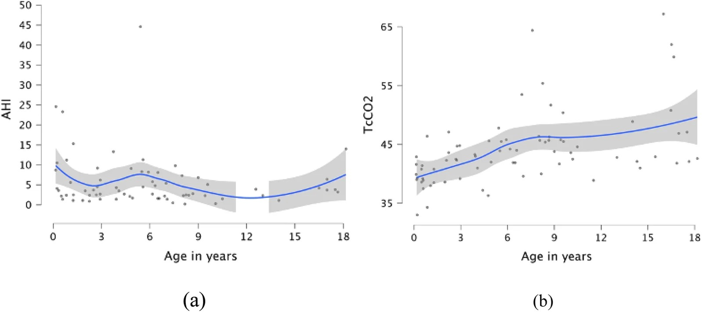
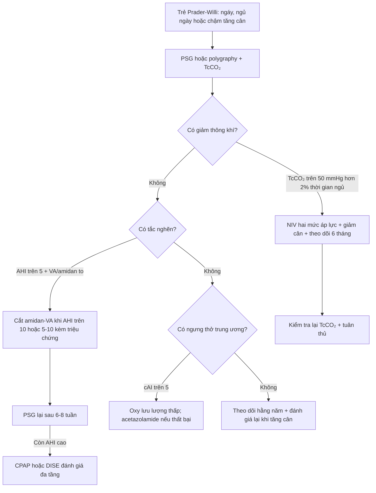
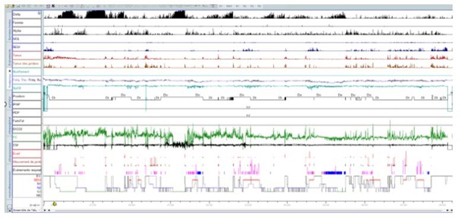
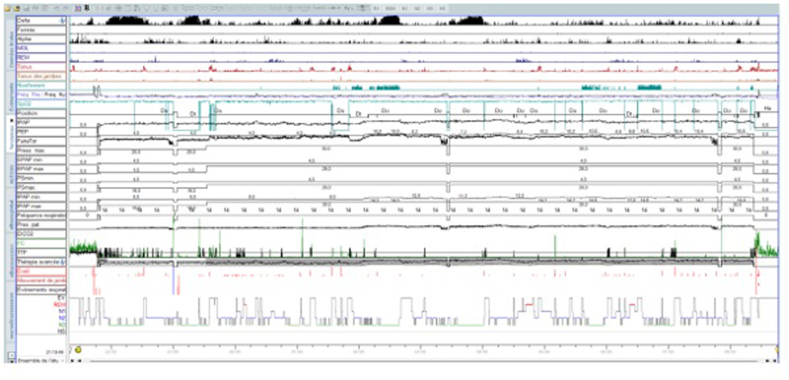

# 1830 — OSA và rối loạn thở khi ngủ ở trẻ Prader–Willi / Sleep-disordered breathing in Prader–Willi syndrome

**Tags:** `pattern:ngung-tho-khi-ngu` `pattern:gia-dam-thong-khi` `vung:duong-tho-tren` `vung:hau-mieng` `score:AHI` `score:TcCO2` `protocol:PSG` `protocol:capnometry` `protocol:NIV`
**Mức chắc chắn (certainty):** tổng hợp y văn (literature synthesis) — tổng hợp y văn mở, đối chiếu PMCID (Europe PMC): Basa M, *Front Pediatr* 2026, PMC13662172; Bouhamdi A, *Respir Med Case Rep* 2025, PMC12590233; Butler MG, *Curr Pediatr Rev* 2019, PMC7040524; Alsaffar H, *Front Endocrinol (Lausanne)* 2026, PMC13503540. Số chưa kiểm chứng ghi "chưa rõ".

> Bài này trả lời **"vì sao trẻ Prader–Willi ngáy/ngưng thở mà AHI bình thường vẫn nguy hiểm"**: ở hội chứng này có **ba kiểu rối loạn chồng lên nhau — trung ương, tắc nghẽn và giảm thông khí** — và kiểu thay đổi theo tuổi. OSA tồn dư sau cắt amidan–VA ở trẻ Down/béo phì ở [1812](../1812-osa-ton-du-sau-cat-amidan-tre-down-beo-phi/lesson.md); OSA ở trẻ bệnh phổi mạn ở [1803](../1803-ngung-tho-khi-ngu-tac-nghen-tre-benh-phoi-man/lesson.md); theo dõi dài hạn sau tăng áp phổi ở [1802](../1802-theo-doi-dai-han-sau-pphn/lesson.md).

## 1. Tổng quan bệnh học – cơ chế hình ảnh

- **Bệnh nền:** Prader–Willi (PWS) do mất biểu hiện gen phía cha ở **15q11–q13**: **deletion ~60%**, **maternal UPD ~35%**, **khiếm khuyết imprinting 1–3%**; tần suất **1/10.000–1/30.000 trẻ sinh sống** (Alsaffar H 2026, PMC13503540; Bouhamdi A 2025, PMC12590233). Rối loạn chủ đạo là **suy chức năng vùng dưới đồi** → thiếu GH, giảm trương lực cơ, cuồng ăn, béo phì, giảm kiểm soát hô hấp.
- **Vì sao hô hấp là nguyên nhân tử vong hàng đầu:** trong khảo sát nguyên nhân tử vong ở PWS, **suy hô hấp 31%**, tim **16%**, tiêu hóa **10%**, nhiễm trùng **9%**, béo phì **7%**, thuyên tắc phổi **7%** (Butler MG 2019, PMC7040524). Tức là **gần 1/3 tử vong do hô hấp** — không phải biến chứng phụ.
- **Ba cơ chế — TẠI SAO hình ảnh/PSG lại có ba kiểu khác nhau:**
  1. **Trung ương (central):** giảm đáp ứng với **tăng CO₂ và giảm O₂** do rối loạn vùng dưới đồi, **độc lập với yếu tố cơ học**; trẻ nhỏ thở chu kỳ (periodic breathing), ngưng thở trung ương nhiều hơn khi **REM** và desaturation nặng hơn trong REM (Bouhamdi A 2025, PMC12590233).
  2. **Tắc nghẽn (obstructive):** giảm trương lực cơ hầu + **phì đại amidan/VA** + béo phì + bất thường sọ mặt (retrognathia, vòm miệng cao) → hẹp nhiều tầng; nặng hơn khi **mất trương lực cơ ở REM**.
  3. **Giảm thông khí (hypoventilation):** béo phì làm giảm compliance thành ngực + giảm đáp ứng trung ương → **CO₂ tăng dần**, thường ở trẻ lớn/dậy thì, và **có thể không có AHI cao**.
- **Diễn tiến theo tuổi (số liệu dọc):** 29 trẻ PWS, **70 lần polygraphy + 75 lần capnometry**; trung vị tuổi chẩn đoán gen **10,5 tháng** nhưng tuổi **PSG đầu tiên 32,5 tháng** (p < 0,001) — **trễ trung bình ~2 năm**; **16/29 (55%)** cần can thiệp; trung ương chiếm ưu thế **tuổi nhỏ**, tắc nghẽn **tuổi mẫu giáo/học đường**, giảm thông khí **tuổi lớn/dậy thì** (Basa M 2026, PMC13662172).
- **Ngưỡng định lượng cần nhớ (theo bài gốc):**
  - **Ngưng thở trung ương:** chỉ số **cAI > 5 sự kiện/giờ** là ngưỡng trung tâm này cân nhắc **oxy**; nhóm trung ương có **cAI trung vị 4,8 (IQR 3,1–6,4)** lúc bắt đầu điều trị.
  - **Giảm thông khí:** **TcCO₂ > 50 mmHg trong > 2% tổng thời gian ngủ** (định nghĩa AASM qua capnometry); nhóm giảm thông khí có **TcCO₂ trung vị 62 mmHg (IQR 50,8–64,4)**.
  - **Tắc nghẽn:** nhóm được cắt amidan–VA có **AHI trung vị 10,3 (6,25–14,8)**; chỉ định phẫu thuật khi **AHI > 10**, hoặc **AHI 5–10 kèm triệu chứng** (ngáy, thở miệng, vã mồ hôi, ngủ ngày) hoặc **SpO₂ nadir < 80% / T90 > 2%** (Basa M 2026, PMC13662172).
  - **Hypopnea trên polygraphy** (không có kênh thần kinh): **giảm luồng ≥ 30% + giảm SpO₂ ≥ 3%**.
- **Vì sao "chỉ số ngưng thở" không đủ:** triệu chứng chỉ có ở **12/29 (41,4%)**; **không bệnh nhân trung ương nào có triệu chứng**. Có triệu chứng làm tăng khả năng cần điều trị **OR 14,0 (95% CI 1,8–124,7)**, nhưng **vắng triệu chứng không loại trừ** giảm thông khí. Đây là lý do phải **đo CO₂ qua đêm**, không chỉ đếm AHI (Basa M 2026, PMC13662172).
- **Vai trò hình ảnh (không thay PSG):** PSG trả lời *có rối loạn và kiểu gì*; hình ảnh trả lời **tắc ở đâu** — **sọ mặt nghiêng/CBCT** (retrognathia, vòm cao, hẹp mũi hầu), **CT/MRI** đánh giá amidan–VA và đường thở, **nội soi đường thở khi ngủ do thuốc (DISE)** cho tắc nhiều tầng, **siêu âm tim** tìm tăng áp phổi khi giảm thông khí nặng.

## 2. Mẫu hình + chẩn đoán phân biệt theo vị trí (gamut)

- **Theo kiểu hình (quyết định điều trị):**
  - **Trung ương – nhũ nhi:** thở chu kỳ, ngưng thở trung ương, **desaturation nặng trong REM**, không ngáy; có thể kèm trào ngược.
  - **Tắc nghẽn – mẫu giáo/học đường:** ngáy, thở miệng, ngủ ngày, phì đại VA/amidan; AHI tăng.
  - **Giảm thông khí – trẻ lớn/dậy thì/béo phì:** ngủ ngày, đau đầu sáng, **CO₂ tăng**, AHI có thể **thấp**; nguy cơ tăng áp phổi và suy tim phải.
- **Theo mức tắc nghẽn (khi cần DISE/hình ảnh):** mũi hầu (VA) · khẩu cái (amidan, vòm mềm) · đáy lưỡi · nắp thanh môn · đa tầng (thường gặp ở PWS + béo phì).
- **Gamut "trẻ ngáy + ngủ ngày":** PWS · Down · béo phì đơn thuần/OHS · phì đại VA–amidan · hẹp sọ mặt (Pierre Robin, achondroplasia) · CCHS (trung ương) · động kinh/trào ngược · thiếu sắt.
- Gợi nhớ **PWS-SLEEP**: **P**hì đại VA/amidan, **W**eight (béo phì), **S**ọ mặt hẹp, **S**uy giảm trương lực cơ, **L**oop gain cao (thở chu kỳ), **E**ndocrine (thiếu GH), **E**xtra CO₂ (giảm thông khí), **P**eriodic breathing.

## 3. Bảng so sánh phân biệt (ma trận đối chiếu)

| Thực thể (entity) | Hình ảnh/PSG điển hình | Chốt vào (rule-in) | Chốt loại (rule-out) | Gợi ý xác nhận |
|---|---|---|---|---|
| **PWS – trung ương (nhũ nhi)** | Thở chu kỳ; **cAI tăng**, ngưng thở trung ương **nhiều ở REM**, desaturation nặng; không tắc nghẽn | **PWS + cAI > 5 + không có tắc nghẽn + desat trong REM** | AHI tăng do tắc nghẽn thuần + phì đại VA rõ = kiểu tắc nghẽn | PSG/polygraphy **+ TcCO₂**; theo dõi 6–12 tháng |
| **PWS – tắc nghẽn (mẫu giáo)** | Ngáy + thở miệng; **AHI 10,3 (6,25–14,8)**; VA/amidan to; giảm sau cắt | **AHI > 10 hoặc 5–10 kèm triệu chứng + VA/amidan to** | cAI chiếm ưu thế, không ngáy → kiểu trung ương | PSG; DISE nếu đa tầng; đánh giá lại sau 6–8 tuần |
| **PWS – giảm thông khí (lớn/dậy thì)** | **TcCO₂ 62 mmHg (50,8–64,4)**; AHI **chỉ 5,75 (4,05–7,92)**; BMI cao; ngủ ngày | **TcCO₂ > 50 mmHg > 2% thời gian ngủ** — kể cả AHI thấp | TcCO₂ bình thường + AHI thấp + không triệu chứng = chưa có chỉ định NIV | **Capnometry bắt buộc**; siêu âm tim; khí máu |
| Down + OSA | Hẹp mũi hầu, lưỡi to, giảm trương lực; AHI cao, **tồn dư sau cắt 54–68%** | **Down + hẹp đa tầng + AHI tồn dư sau AT** | PWS có kiểu trung ương + giảm thông khí chiếm ưu thế | PSG lặp; DISE (xem bài 1812) |
| CCHS (PHOX2B) | Ngưng thở trung ương **chủ yếu NREM**, không tắc nghẽn, **không đáp ứng CO₂** | **Ngưng thở trung ương khi thức/NREM + gen PHOX2B** | Có tắc nghẽn + ngáy → không phải CCHS thuần | PSG + xét nghiệm gen; khởi phát sơ sinh |
| Béo phì – OHS | BMI rất cao; **CO₂ ngày tăng**, AHI có thể thấp hoặc cao | **BMI cao + PaCO₂ ngày > 45 mmHg** | CO₂ bình thường, chỉ tắc nghẽn = OSA đơn thuần | Khí máu + PSG + capnometry |
| Phì đại VA–amidan đơn thuần | Amidan/VA to, AHI tăng, **hết sau cắt** | **Trẻ khỏe + VA/amidan to + AHI giảm rõ sau AT** | AHI không giảm/giảm ít + đa tầng = nghĩ PWS/Down | PSG trước–sau; DISE |

*Scatterplot + LOESS: **ngưng thở** có hai đỉnh (trung ương ở tuổi nhỏ, tắc nghẽn ở tuổi mẫu giáo/học đường), trong khi **TcCO₂/giảm thông khí** tăng dần ở trẻ lớn — hai quỹ đạo **không song hành**. Nguồn: Basa M et al., *Front Pediatr* 2026, Fig. 1 — CC BY 4.0.*

### Ba câu hỏi phải trả lời trước khi kết luận "OSA"
1. **Có tắc nghẽn thật không** (ngáy + AHI + VA/amidan) hay chỉ **thở chu kỳ/trung ương**?
2. **Có giảm thông khí không** (TcCO₂ > 50 mmHg > 2% thời gian ngủ), dù AHI thấp?
3. **Kiểu hình có đổi theo tuổi không** — trẻ nhỏ trung ương, lớn hơn tắc nghẽn, dậy thì giảm thông khí?

## 4. Protocol + điều trị theo kiểu hình

- **PSG/polygraphy chuẩn AASM nhi:** đếm hypopnea theo **giảm ≥ 30% luồng + desat ≥ 3%** (khi không có EEG); **bắt buộc kèm capnometry qua da (TcCO₂)** để bắt giảm thông khí — đây là điểm khác biệt cốt lõi so với PSG OSA thông thường.
- **Lịch theo dõi (thực hành trong loạt):** đánh giá **hằng năm** cho mọi trẻ PWS; **mỗi 6 tháng** nếu đang oxy/NIV; PSG **trước khi khởi trị GH** ở trẻ **> 2 tuổi** vì **GH có thể làm nặng OSA ở trẻ lớn**, và ở nhũ nhi **PSG trước + sau 3 tháng** điều trị (Butler MG 2019, PMC7040524). Trong loạt Basa: GH khởi trị trung vị **31 tháng**, **tạm ngừng 1 ca** vì phì đại VA + OSA nặng (hồi phục sau mổ), **ngừng vĩnh viễn 4 ca** vì béo phì nặng + giảm thông khí cần NIV.
- **Điều trị theo kiểu hình:**
  - **Trung ương:** **oxy lưu lượng thấp** khi cAI > 5 (khởi trị trung vị **15,5 tháng**, kéo dài **21 tháng**); nếu xấu đi → **acetazolamide** (ca cAI **9,6 → 42,5/giờ sau 6 tháng oxy**, giảm **11,5** sau 1 tháng và **0,5** sau 12 tháng acetazolamide).
  - **Tắc nghẽn:** **cắt amidan–VA** (trung vị **44,5 tháng**); AHI **10,3 → 5,8** sớm và **0,6** dài hạn; **5/6** khỏi, **1** tồn dư + giảm thông khí → NIV.
  - **Giảm thông khí ± tắc nghẽn:** **NIV hai mức áp lực (BiPAP)**; nhóm này **lớn hơn** nhóm cắt amidan (trung vị **172 tháng**, p = 0,04), **BMI** là yếu tố dự báo cần NIV **OR 19,65 (1,24–311,46)**.
  - **CPAP** cho OSA trung bình–nặng **không** giảm thông khí; **tuân thủ kém**: trong Global PWS Registry **< 50%** người được kê CPAP dùng đúng hoặc dùng chút nào (Butler MG 2019, PMC7040524).
- **Lưu ý về "loop gain" cao:** CPAP cố định có thể **không xóa hết ngưng thở trung ương** (ca minh họa: CPAP 7 cmH₂O kiểm soát tắc nghẽn nhưng còn sự kiện trung ương ngắn); **auto-SV** kiểm soát tốt hơn, sau đó **CPAP cố định 6 cmH₂O** ổn định lại (Bouhamdi A 2025, PMC12590233). Đây là **kinh nghiệm ca**, chưa phải khuyến cáo chuẩn cho trẻ.

## 5. Biến thể bình thường và cạm bẫy

- **Thở chu kỳ ở nhũ nhi** có thể là sinh lý; ở PWS, **mức độ và desaturation trong REM** mới là điều quyết định — đừng quy mọi "thở chu kỳ" cho sinh lý.
- **Cạm bẫy số 1 — "AHI bình thường nên không sao":** nhóm giảm thông khí có **AHI trung vị chỉ 5,75** nhưng **TcCO₂ 62 mmHg**; bỏ capnometry là bỏ sót (Basa M 2026, PMC13662172).
- **Cạm bẫy số 2 — "không ngáy nên không ngưng thở":** **0/4** ca trung ương có triệu chứng; **41,4%** tổng số có triệu chứng. Triệu chứng **không dùng để sàng lọc** kiểu trung ương/giảm thông khí.
- **Cạm bẫy số 3 — CPAP làm lộ ngưng thở trung ương:** ở trẻ **loop gain cao**, áp lực dương có thể làm giảm CO₂ và **gây thêm ngưng thở trung ương**; nếu AHI tắc nghẽn giảm mà trung ương tăng → **giảm áp lực/đổi sang BiPAP–ASV** và đánh giá lại.
- **Cạm bẫy số 4 — GH:** GH cải thiện thành phần cơ thể nhưng **có thể làm nặng OSA** (phì đại VA, phì đại mô lympho) ở trẻ lớn → **PSG trước và sau khởi trị**, và **tạm ngừng** nếu AHI tăng kèm triệu chứng (Butler MG 2019, PMC7040524; Basa M 2026).
- **Cạm bẫy số 5 — quy mọi béo phì cho "ăn nhiều":** ở PWS, **BMI dự báo cần NIV** nhưng **kiểu gen không dự báo kiểu hình hô hấp** (p = 0,363) — không dùng kiểu gen để quyết định theo dõi.
- **Cạm bẫy số 6 — bỏ qua tăng áp phổi:** giảm thông khí mạn → tăng áp phổi → suy tim phải; **siêu âm tim** khi TcCO₂ cao/ngủ ngày, đừng chỉ nhìn AHI.

## 6. Tự lượng giá — Blind Quiz

**Ca 1 — Bé gái 10,5 tuổi PWS, BMI 26,1, ngáy + ngủ ngày (Epworth 16). Nhìn PSG trước khi kết luận.**

- Gợi ý: bố mẹ không thấy cơn ngưng thở rõ; trẻ vẫn ngủ ngày nhiều.
- Câu hỏi: AHI 31,8/giờ — tắc nghẽn hay trung ương chiếm ưu thế? Vì sao **CPAP thường** có thể không đủ?

<b>Bấm để hiện đáp án (findings + chẩn đoán)</b>

- Findings: hypnogram có **thở chu kỳ**, **AHI 31,8/giờ**, **chỉ số trung ương 15,2/giờ**, phân mảnh giấc ngủ — kiểu **hỗn hợp nhưng trung ương chiếm ưu thế**, phù hợp **loop gain cao**.
- Chẩn đoán: **rối loạn thở khi ngủ hỗn hợp ở PWS**, không phải OSA đơn thuần.
- Điều trị: CPAP cố định 7 cmH₂O kiểm soát **effort** nhưng **còn sự kiện trung ương ngắn**; auto-SV kiểm soát tốt hơn; sau đó CPAP cố định 6 cmH₂O ổn định.
- Nguồn ảnh: Bouhamdi A et al., *Respir Med Case Rep* 2025, Fig. 5 — CC BY-NC-ND 4.0 (nguyên bản).

**Ca 2 — Cùng bệnh nhân, đêm chuẩn độ lại. Nhìn hình và cho biết điều gì thay đổi.**

- Câu hỏi: Vì sao chọn **auto-SV** thay vì tăng áp lực CPAP? Dấu hiệu nào chứng minh hiệu quả?

<b>Bấm để hiện đáp án (findings + chẩn đoán)</b>

- Findings: dưới **auto-SV**, dao động luồng khí và **sự kiện trung ương giảm rõ**, đường cong ổn định hơn so với CPAP cố định.
- Chẩn đoán: **thất bại một phần của CPAP do kiểu hình trung ương/loop gain cao**; auto-SV hỗ trợ nhịp thở khi mất drive trung ương.
- Caveat: đây là **kinh nghiệm một ca**; auto-SV **chưa có khuyến cáo chuẩn** cho trẻ — cần PSG kiểm chứng và theo dõi.
- Nguồn ảnh: Bouhamdi A et al., *Respir Med Case Rep* 2025, Fig. 6 — CC BY-NC-ND 4.0 (nguyên bản).

**Ca 3 — Ba trẻ PWS: 8 tháng, 4 tuổi, 15 tuổi. Chỉ nhìn hình quỹ đạo và đoán kiểu hình.**

- Câu hỏi: Ở tuổi nào nên tìm **ngưng thở trung ương**, tuổi nào **tắc nghẽn**, tuổi nào **giảm thông khí**? Chỉ số nào **không** đủ để loại trừ?

<b>Bấm để hiện đáp án (findings + chẩn đoán)</b>

- Findings: **tuổi nhỏ** — đỉnh ngưng thở **trung ương**; **mẫu giáo/học đường** — đỉnh **tắc nghẽn** (VA/amidan); **trẻ lớn/dậy thì** — **TcCO₂ tăng**, giảm thông khí, nhiều khi **AHI thấp**.
- Chẩn đoán: SDB trong PWS là **một continuum**, không phải ba bệnh tách rời; vì vậy **đánh giá lại theo tuổi** và **đo CO₂ mỗi lần**.
- Chỉ số **không đủ**: AHI đơn thuần — có thể bình thường/thấp trong giảm thông khí.
- Nguồn ảnh: Basa M et al., *Front Pediatr* 2026, Fig. 1 — CC BY 4.0.

## Bài liên quan chéo
- [1812 – OSA tồn dư sau cắt amidan–VA ở trẻ (Down, béo phì): PSG lặp, DISE, A/N](../1812-osa-ton-du-sau-cat-amidan-tre-down-beo-phi/lesson.md)
- [1803 – Ngưng thở khi ngủ tắc nghẽn ở trẻ bệnh phổi mạn](../1803-ngung-tho-khi-ngu-tac-nghen-tre-benh-phoi-man/lesson.md)
- [1802 – Theo dõi dài hạn sau tăng áp phổi tồn tại (PPHN)](../1802-theo-doi-dai-han-sau-pphn/lesson.md)

> Không dùng để chẩn đoán độc lập khi chưa có người hướng dẫn.
