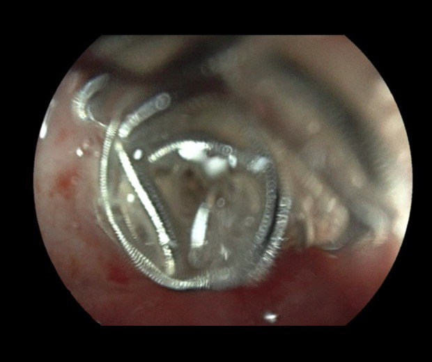
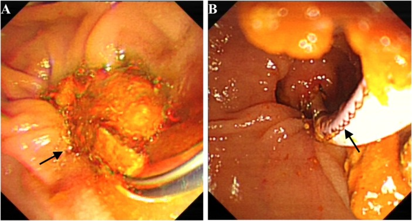
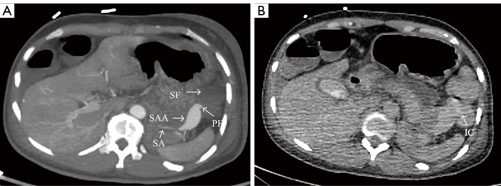
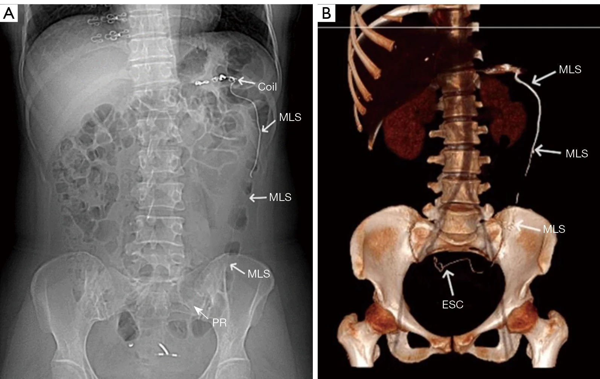
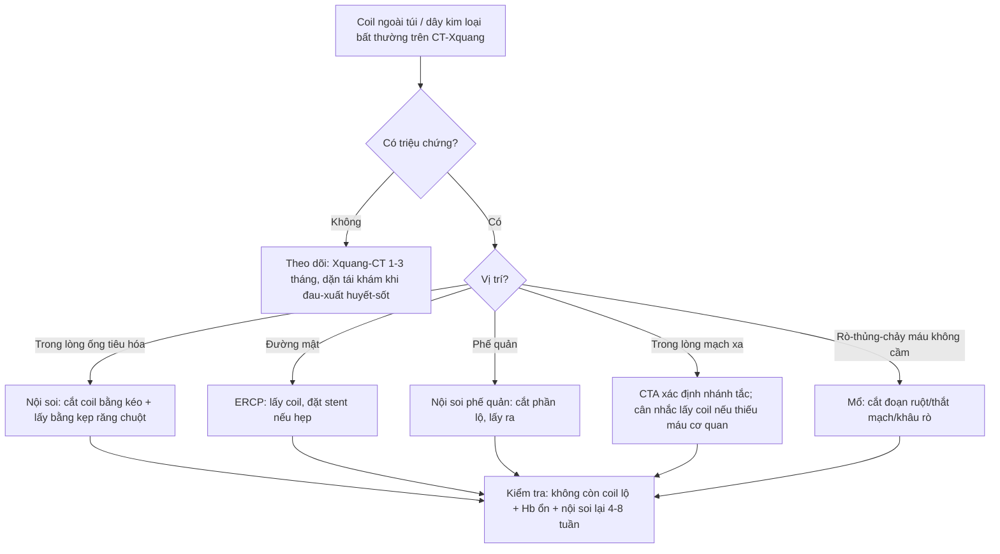
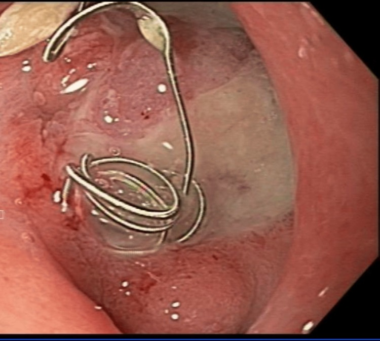
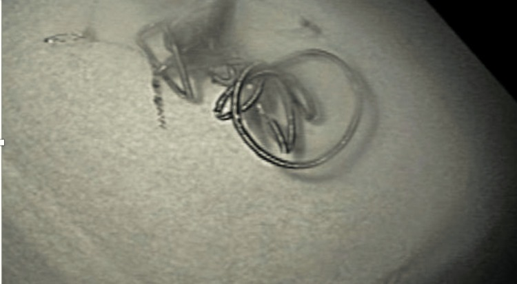
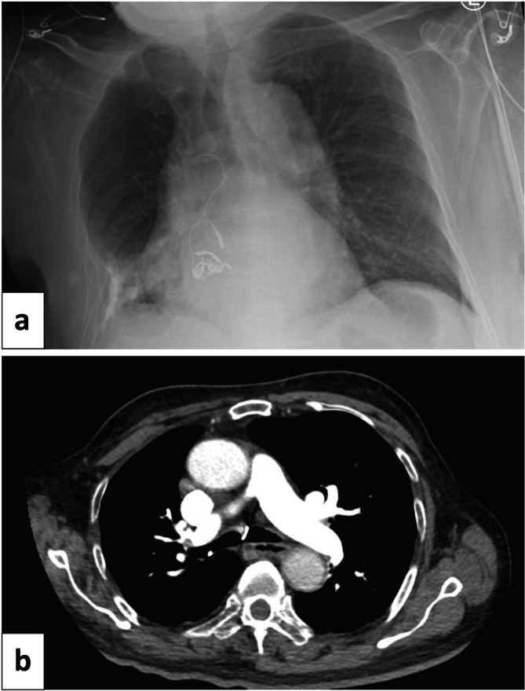

# 1831 — Coil di trú & xuyên thành sau nút mạch tạng / Coil migration & coil erosion after visceral artery embolization

**Tags:** `pattern:di-tru-coil` `pattern:xuyen-thanh` `pattern:di-vat-lieu-nut` `pattern:ro-dong-ruot` `vung:mach-tang` `vung:ta-trang` `vung:dai-trang` `vung:duong-mat` `vung:phe-quan` `protocol:CTA` `protocol:X-quang-bung` `protocol:noi-soi-tieu-hoa` `protocol:ERCP` `protocol:noi-soi-phe-quan`
**Mức chắc chắn (certainty):** tổng hợp y văn (literature synthesis) — ghép 1 tổng quan phình giả mạch tạng (*Medicina* 2025, PMC12299956, CC BY), 1 đoàn hệ 26 bệnh nhân/29 túi phình quanh tụy (*Sci Prog* 2026, PMC12966526, CC BY-NC), 1 tổng quan hệ thống EUS (*Cureus* 2026, PMC13413726, CC BY 4.0) và **7 ca nguyên văn** di trú/xuyên thành coil (PMC13654179, PMC13422218, PMC12040520, PMC12983898, PMC11198983, PMC7283936, PMC6791628). Không có nghiên cứu đoàn hệ nào đo **tỉ lệ** di trú coil sau nút mạch tạng → mọi tỉ lệ dưới đây ghi đúng nguồn, phần chưa có ghi "chưa rõ".

> **Câu chốt:** coil **không nằm yên vĩnh viễn**. Coil có thể **di trú trong lòng mạch** (xuôi dòng → tắc nhánh xa, vào tim/phổi) hoặc **xuyên qua thành mạch vào ống rỗng** (tá tràng, đại tràng, đường mật, phế quản) tạo **rò + chảy máu tái phát + nhiễm trùng**. Khoảng cách thời gian rất rộng: **13 ngày → 34 tháng**; dấu hiệu sớm nhất trên X-quang/CT là **coil bị duỗi thẳng ("unwinding") và có đoạn dây kim loại nằm NGOÀI bó coil**. **Không triệu chứng → theo dõi được (đã có ca đào thải tự nhiên sau 5 tháng)**; **lộ trong lòng ống tiêu hóa → nội soi cắt/lấy**; **rò, thủng, chảy máu không kiểm soát → mổ**.

## 1. Tổng quan bệnh học – cơ chế hình ảnh

### 1.1 Vì sao coil "chui" ra khỏi mạch

- **Bối cảnh mô học:** phần lớn túi được nút là **giả phình (pseudoaneurysm)** sau viêm tụy, nhiễm trùng, mổ hoặc xạ trị — thành **không có lớp áo giữa/cơ trơn**, chỉ là **mô xơ + cục máu + nang giả**. Coil tựa vào một thành **mỏng, viêm, thiếu máu**, lại **đập theo mạch 90–130 lần/phút** → cọ xát liên tục.
- **Bốn yếu tố đẩy coil ra ngoài:** (1) **cổ túi rộng** và **nhồi coil không đủ chặt** (inadequate packing); (2) **dịch tụy giàu enzyme tiêu protein** và **ổ hoại tử** sát túi; (3) **nhiễm trùng** tại ổ dịch làm mềm thành; (4) **đoạn mạch nhỏ, xoắn**, coil quá dài/ quá cứng tạo **vòng cung đẩy vào thành**. Tổng quan mạch tạng ghi rõ: di trú **gặp nhiều hơn ở túi cổ rộng hoặc nhồi không đủ**, và biện pháp giảm nguy cơ là **balloon remodeling / stent-assisted coiling** (PMC12299956).
- **Di trú ≠ xuyên thành:** *migration* = coil **bật khỏi túi vào lòng mạch**, trôi xuôi dòng; *erosion* = coil **xuyên qua thành vào cơ quan rỗng** (tá tràng, đại tràng, đường mật, phế quản). Hai cơ chế có thể nối tiếp nhau: coil lộ ra khỏi túi → mô xơ quanh mạch dính vào thành ruột → **rò động–ruột**.
- **Tần suất:** **chưa rõ** — không có đoàn hệ nào báo tỉ lệ. Đoàn hệ **26 bệnh nhân/29 túi phình quanh tụy** nút mạch có **0 ca di trú** trong **trung vị 48 tháng** (PMC12966526); ngược lại y văn chỉ toàn ca lẻ, nghĩa là **tỉ lệ thấp nhưng tử số không bằng 0**. Đừng vì "hiếm" mà bỏ qua khi bệnh nhân có triệu chứng mới.

### 1.2 Vì sao CT/X-quang thấy được (vật lý)

- Coil là **kim loại cản quang cực mạnh** → trên CT tạo **streak artifact** và trên X-quang là **hình xoắn/đường kim loại đậm**. Chính vì quá đậm, **artifact có thể che mất phần coil đã lộ ra ngoài thành** nếu chỉ xem một lát cắt ngang.
- **Cách đọc đúng:** dùng **MIP + dựng hình thể tích (VR)** và **cửa sổ xương**, đối chiếu **phim/CT lần trước**. Bó coil đúng vị trí có hình **khối tròn, gọn, không có dây thò ra**; khi di trú, xuất hiện **cấu trúc dạng dây (linear structure) chạy xa khối coil** — đây là dấu chốt trên CT (ca PMC13654179: dây kim loại **45 cm** chạy từ đại tràng xuống trực tràng, VR thấy rõ).
- **Dấu sớm trên X-quang:** coil **bị kéo giãn/duỗi thẳng** ("unwinding") — ca ho ra máu sau nút mạch phổi có **coil duỗi một phần** trên phim ngực trước khi CT xác nhận coil đã vào **carina** (PMC12040520).
- **Đậm độ/tín hiệu không dùng để chẩn đoán** — coil đậm hơn xương, không đo HU có ý nghĩa; điều cần đo là **vị trí tương đối so với thành mạch/ống rỗng** và **khoảng cách tới lòng ruột**.

### 1.3 Ngưỡng định lượng nằm lòng

| Đại lượng | Số liệu | Nguồn |
|---|---|---|
| Tỉ lệ phình giả mạch tạng trong dân số | **0,1–0,2%**; **động mạch lách 60–65%** | PMC12299956 |
| Nguy cơ vỡ / tử vong sau vỡ | vỡ **tới 50%**; tử vong sau vỡ **15–40%** | PMC7035033 |
| Tử vong nếu không điều trị | **tới 90%** | PMC12299956 |
| Đoàn hệ nút mạch quanh tụy | **26 bệnh nhân/29 túi**, kỹ thuật **88,5%**, **0 di trú coil**, tái phát/hẹp **4,0%** mỗi loại, theo dõi **48 tháng** | PMC12966526 |
| Thời gian tới khi phát hiện di trú | **13 ngày** (tá tràng) · **2 tháng** (xuyên thành dạ dày) · **2 năm** (đường mật) · **34 tháng** (đại tràng) | PMC12983898, PMC7283936, PMC13422218, PMC13654179 |
| Kích thước túi trong ca di trú | **4,2 cm** (động mạch lách) · **2,6 × 2,4 cm** (tụy–tá tràng) | PMC13654179, PMC12851075 |
| Chiều dài coil lộ ra ngoài | **45 cm** dây kim loại thò ra hậu môn | PMC13654179 |
| Ca theo dõi bảo tồn dài nhất | coil **chưa đào thải sau 21 tháng**, triệu chứng ngắt quãng | PMC12983898 |
| Thời gian đào thải tự nhiên | coil xuyên thành dạ dày tháng thứ **2**, dây vào lòng dạ dày tháng **4**, **không còn thấy tháng 5** | PMC7283936 |

## 2. Mẫu hình + chẩn đoán phân biệt theo vị trí (gamut)

### 2.1 Tá tràng – dạ dày (vị trí hay gặp nhất: GDA, vị–mạc nối, vị trái)

- **Coil lộ qua ổ loét:** nội soi thấy **vòng/sợi coil nằm trong đáy ổ loét Forrest III**, quanh coil là **mô loét xơ**; bệnh nhân **xuất huyết tiêu hóa tái phát** dù trước đó đã nút mạch thành công.
- **Cơ chế:** túi giả phình GDA nằm **sát hành tá tràng**, coil nhồi trong túi **ăn mòn qua lớp cơ ruột** → coil lộ vào lòng; máu có thể chảy lại từ **nhánh bàng hệ** hoặc từ **đầu coil sắc** cọ vào niêm mạc.
- **Hai thái cực xử trí đều có thật:** (1) **cắt coil bằng kéo nội soi + lấy bằng kẹp răng chuột**, ổ loét lành ~**50% sau 3 tháng** (PMC11198983); (2) **không lấy vì nguy cơ chảy máu**, theo dõi **21 tháng** coil vẫn nằm tại **góc hành–D2** (PMC12983898).

*Nội soi: **coil** nằm ở **góc hành tá tràng – D2**, một phần chìm trong niêm mạc loét; bệnh nhân 90 tuổi được **theo dõi bảo tồn**, coil **chưa đào thải sau 21 tháng**. Nguồn: *Am J Case Rep* 2026 (PMC12983898), Fig. 1 — CC BY-NC-ND 4.0, nguyên bản.*

### 2.2 Đại tràng – trực tràng

- **Rò động mạch lách–đại tràng** rồi **di trú xuyên đại tràng**: CT thì muộn thấy **cản quang trong lòng đại tràng góc lách** (dấu **IC** — intraluminal contrast) chứng minh **thông trực tiếp túi–lòng ruột**; **34 tháng sau** bệnh nhân thấy **dây kim loại thò ra hậu môn**, CT/VR cho thấy coil chạy **từ đại tràng xuống trực tràng** (PMC13654179).
- **Bài học:** "phình giả đã nút kín" không loại trừ **đường rò đã hình thành** — dấu **cản quang trong lòng ruột ở thì muộn** là chốt.

### 2.3 Đường mật

- **Di trú vào ống mật chủ** sau nút **động mạch gan phải**: **2 năm** sau, bệnh nhân **tắc mật/cholangitis tái phát**; hình ảnh học khó vì **bóng kim loại chồng lên khung gan**, không thấy rõ **khuyết thuốc** trên cholangiography; **ERCP** mới thấy **sợi coil lộ trong lòng ống mật** và lấy ra (PMC13422218).
- **Bẫy:** trên CT, coil trong **cuống gan** có thể bị đọc là "coil đúng chỗ" — phải tìm **dấu hiệu tắc mật** (giãn đường mật trong gan, dày thành ống mật) mới nghĩ tới di trú.

*ERCP: **sợi coil lộ trong lòng ống mật** (mũi tên, A) và được **lấy ra bằng dụng cụ nội soi** (B). Coil di trú **2 năm** sau nút động mạch gan phải, gây **cholangitis tái phát**. Nguồn: *Front Surg* 2026 (PMC13422218), Fig. 3 — CC BY, nguyên bản.*

### 2.4 Phế quản – đường thở

- **Coil xuyên từ động mạch phổi vào phế quản**: bệnh nhân **ho ra máu**, **coil thấy ở carina** trên CT; X-quang trước đó có **coil duỗi một phần** (PMC12040520).
- **Xử trí nội soi phế quản:** **cắt phần coil lộ trong lòng bằng kéo nội soi** rồi lấy ra — nhưng có thể **tái di trú** sau **sinh thiết xuyên thành ngực/EBUS** vì mô quanh coil đã yếu (PMC12040520).

### 2.5 Trong lòng mạch xa (thuyên tắc không đích)

- Coil trôi **xuôi dòng** → tắc nhánh tạng xa (lách/gan/ruột), hoặc về **nhĩ phải/thất phải** và **tuần hoàn phổi**; y văn có ca **lấy coil từ nhĩ phải bằng đường qua da** và ca **di trú muộn vào thất phải phải mổ** (PMC12905704, PMC13222107).
- **Khác với coil đặt đúng trong túi:** coil đúng vị trí **không di chuyển giữa 2 lần chụp**; coil trôi **mất khỏi túi** và **xuất hiện ở nhánh xa** trên CTA.

### 2.6 Trong ổ hoại tử / nang giả tụy (không phải di trú, nhưng là "bàn đạp" của rò)

- Khi coil được đặt **trong túi giả nằm giữa ổ hoại tử**, CT thấy coil **ngoài lòng mạch** — đây là **đúng kế hoạch**, không phải biến chứng. Nhưng chính vị trí này **dễ xuyên vào tá tràng/dạ dày** vì không có thành mạch che.
- Phân biệt bằng **DSA/CTA thì động mạch**: coil trong túi **vẫn có cổ thông với mạch**; coil trong ổ dịch **không có cổ**.

## 3. Bảng so sánh phân biệt (ma trận đối chiếu)

| Thực thể (entity) | Hình ảnh điển hình | Chốt vào (rule-in) | Chốt loại (rule-out) | Gợi ý xác nhận |
|---|---|---|---|---|
| **Coil đúng vị trí** | Bó coil **gọn, tròn**, không dây thò ra; không đổi giữa 2 lần chụp | **Bó coil kín trong túi + không dây ngoài + không đổi trên phim cũ** | Có **dây kim loại chạy xa bó coil** → đã di trú | So phim/CT lần trước, MIP |
| **Coil di trú trong lòng mạch** | Coil **mất khỏi túi**, xuất hiện ở **nhánh xa**; thiếu máu cơ quan | **Coil ở nhánh xa + mất hình coil tại túi** | Coil vẫn trong túi, chỉ artifact → không phải | CTA 2–3 thì + DSA |
| **Coil xuyên tá tràng/dạ dày** | **Sợi coil trong đáy ổ loét** trên nội soi; CT: coil **ngoài thành mạch**, sát/trong lòng ruột | **Nội soi thấy coil trong lòng + ổ loét Forrest III + tiền sử nút GDA** | Nội soi âm + coil còn trong túi → chưa xuyên | Nội soi tiêu hóa trên; CT lát mỏng |
| **Coil xuyên đại tràng** | **Cấu trúc dây kim loại dài trong đại tràng** trên CT/VR; có thể thò ra hậu môn | **Dây kim loại chạy trong lòng đại tràng/trực tràng** | Coil nằm ngoài ruột, không có dây trong lòng → chưa xuyên | CT bụng–chậu + VR; nội soi đại tràng |
| **Coil trong đường mật** | **Bóng kim loại trong ống mật**, giãn đường mật trong gan, cholangitis tái phát | **ERCP thấy coil trong lòng ống mật** | Bóng kim loại ở cuống gan nhưng không có tắc mật → chưa chắc | ERCP; MRCP; CT 3 thì |
| **Coil trong phế quản** | **Coil ở carina/phế quản gốc** trên CT; X-quang có coil duỗi | **Nội soi phế quản thấy coil trong lòng** | Coil nằm trong nhu mô/mạch, không vào lòng khí → chưa xuyên | Nội soi phế quản; CT ngực |
| **Rò động–ruột (arterial-enteric fistula)** | Túi giả **sát ruột**, **khí trong thành mạch** hoặc **cản quang trong lòng ruột thì muộn**, chảy máu ồ ạt | **Cản quang lòng ruột ở thì muộn + túi sát ruột + chảy máu tái phát** | Không có cản quang trong ruột, không khí trong mạch → chưa rò | CTA 3 thì; nội soi; mổ |
| **Clip/thức ăn/viên thuốc giả** | **Cấu trúc kim loại rời**, không có bó coil; bệnh nhân không nút mạch | **Tiền sử nút mạch + bó coil tại chỗ** | Không tiền sử can thiệp, hình dạng clip → không phải coil | Hỏi bệnh sử; so phim cũ |

*Trái (A): CT thì động mạch — túi **giả phình động mạch lách 4,2 cm** (SAA) sát **góc lách** (SF), mặt phẳng mỡ với ruột mất (PF = đường rò giả định). Phải (B): thì muộn — **cản quang trong lòng đại tràng góc lách** (IC) = bằng chứng thông trực tiếp túi–ruột. Nguồn: *Quant Imaging Med Surg* 2026 (PMC13654179), Fig. 2 — CC BY-NC-ND 4.0, nguyên bản.*

*Trái (A): phim bụng — **bó coil** còn ở hạ vị trái, kèm **cấu trúc dây kim loại (MLS)** chạy dọc khung đại tràng xuống tiểu khung (PR = đường đi giả định). Phải (B): dựng hình thể tích — coil **đã vào lòng đại tràng sigma/trực tràng** (ESC). Bệnh nhân thấy **45 cm dây kim loại thò ra hậu môn**. Nguồn: *Quant Imaging Med Surg* 2026 (PMC13654179), Fig. 4 — CC BY-NC-ND 4.0, nguyên bản.*

### Dấu hiệu hình ảnh chốt (đọc nhanh)

- **"Coil phải gọn"**: một bó coil đúng chỗ **không có dây thò ra**; bất kỳ **đoạn dây thẳng** nào ngoài bó = nghi di trú/xuyên thành.
- **Đổi vị trí giữa 2 lần chụp** là dấu mạnh nhất — luôn so với phim/CT ngay sau thủ thuật.
- **Cản quang trong lòng ruột ở thì muộn** = rò đang hoạt động, không phải "tồn lưu thuốc".
- **Nội soi là tiêu chuẩn vàng** khi coil nghi ở ống tiêu hóa: thấy coil **trong lòng** là chốt, đồng thời là **đường lấy**.

## 4. Protocol chụp/can thiệp + hệ phân độ

### 4.1 Phòng ngừa ngay trong lần nút mạch (quan trọng hơn chẩn đoán muộn)

- **Chọn kỹ thuật theo hình thái túi:** túi **cổ hẹp** → nhồi kín túi (sac packing); túi **cổ rộng** → **balloon remodeling / stent-assisted coiling** hoặc **vascular plug** thay vì coil rời (PMC12299956).
- **Với túi sát ống tiêu hóa (GDA, vị–mạc nối):** ưu tiên **vascular plug** hoặc **trapping hai đầu** thay vì coil nhồi trong túi sát thành ruột; nếu buộc dùng coil, **tránh coil quá dài**, kiểm tra **coil không thò ra cổ túi** ở thì cuối.
- **Khi có ổ hoại tử/tụy dịch sát túi:** điều trị ổ dịch (dẫn lưu) và **theo dõi sát** vì đây là môi trường tiêu protein làm coil dễ xuyên.
- **Ghi lại "trạng thái cuối"** trong báo cáo: số coil, chiều dài, vị trí đầu coil so với cột mạch, có plug/stent hay không — đây là **mốc so sánh** cho mọi lần chụp sau.

### 4.2 Theo dõi sau thủ thuật

- **Không có lịch theo dõi chuẩn** cho coil mạch tạng. Đề xuất thực hành (dựa trên các ca đã báo): **X-quang bụng hoặc CT tại 1–3 tháng** ở bệnh nhân **nguy cơ cao** (túi cổ rộng, coil sát ruột, viêm tụy hoại tử, nhiễm trùng), sau đó **mỗi 6–12 tháng** nếu ổn định.
- **Chụp ngay khi có triệu chứng mới:** đau bụng kéo dài, **xuất huyết tiêu hóa tái phát**, **sốt/cholangitis**, **ho ra máu**, **thiếu máu không giải thích** → **CTA bụng 3 thì** (hoặc CT ngực nếu nghi đường thở).
- **Kỹ thuật CT:** lát **0,5–1 mm**, **không cản quang + thì động mạch + thì cổng**, dựng **MIP/VR**, **cửa sổ xương**; so **trực tiếp** với CT/phim ngay sau nút mạch.

### 4.3 Xử trí theo vị trí và triệu chứng

- **Nội soi lấy coil:** chỉ khi coil **lộ rõ trong lòng** và **không có dấu rò/thủng**; dùng **kéo nội soi cắt** phần lộ rồi **kẹp răng chuột** kéo ra — không kéo mạnh vì có thể **rách thành ruột** hoặc **kéo tuột coil khỏi mạch** (PMC11198983, PMC6095728).
- **Theo dõi bảo tồn:** chấp nhận được ở bệnh nhân **không triệu chứng/ triệu chứng nhẹ**, đã có ca **đào thải tự nhiên** trong **5 tháng** và ca **nằm yên 21 tháng** (PMC7283936, PMC12983898) — nhưng phải **dặn bệnh nhân theo dõi phân** và tái khám khi đau/sốt.
- **Mổ:** **rò động–ruột, thủng, chảy máu không kiểm soát, cholangitis tái phát nhiều lần, coil trong ổ nhiễm trùng** — ca **rò động mạch gan–tá tràng** do coil di trú phải **khâu rò + cắt động mạch gan chung + thắt thân tạng** (PMC12817484); ca **rò động mạch lách–đại tràng** phải mổ lấy coil và xử lý đoạn đại tràng (PMC13654179).

## 5. Biến thể bình thường và cạm bẫy

- **Streak artifact che mất đầu coil:** trên lát cắt ngang, **artifact kim loại** có thể trông như "coil vẫn trong túi" — luôn dựng **MIP/VR** và so phim cũ.
- **Coil trong ổ hoại tử là đúng kế hoạch**, không phải di trú; nhưng chính nó **dễ xuyên vào tá tràng** — đọc kèm **dấu hiệu viêm/dính quanh ruột**.
- **"Coil biến mất"** khỏi vị trí cũ có thể do **di trú**, **đào thải qua phân**, hoặc **bị che bởi artifact/khung xương** — cần **phim bụng + CT** trước khi kết luận.
- **Coil trong lòng đại tràng có thể gây thủng muộn**: không được **kéo coil qua nội soi** khi chưa xác định hai đầu tự do; có ca phải mổ vì **dây coil xuyên qua thành** (PMC13654179).
- **Coil ở carina dễ bị đọc là "dị vật hít vào"**: hỏi **tiền sử nút mạch động mạch phổi**, tìm **coil duỗi trên phim cũ** (PMC12040520).
- **Không loại trừ di trú khi X-quang âm**: coil nhỏ, nằm sau khung xương hoặc đã đào thải; **triệu chứng mới + tiền sử nút mạch = chỉ định CT**.
- **Đừng nhầm clip phẫu thuật/thức ăn với coil:** clip **không có dây xoắn** và **không đổi vị trí**; hỏi bệnh sử can thiệp mạch.
- **Túi giả đã "nút kín" vẫn có thể đã rò:** dấu **cản quang trong lòng ruột ở thì muộn** xuất hiện **trước** khi coil di trú nhiều tháng — đọc thì muộn, đừng chỉ đọc thì động mạch.

## 6. Tự lượng giá — Blind Quiz

**Ca 1 — Nữ 40 tuổi, xuất huyết tiêu hóa dưới ồ ạt, không tiền sử bệnh; CT bụng có túi cạnh đuôi tụy.**

- Hỏi: mô tả tổn thương ở (A)? Dấu hiệu nào ở (B) chứng minh đã có **đường rò vào ruột**? Vì sao "đã nút kín" vẫn phải theo dõi dài hạn?

<b>Bấm để hiện đáp án (findings + chẩn đoán)</b>

- **Findings:** (A) túi **4,2 cm** phình giả động mạch lách, **mặt phẳng mỡ với góc lách mất**, có **đường rò giả định**; (B) thì muộn có **cản quang trong lòng đại tràng góc lách (IC)** = **thông trực tiếp túi–lòng ruột**.
- **Chẩn đoán:** **rò giả phình động mạch lách–đại tràng**; đã nút **6 coil** động mạch lách gần, không nhồi túi.
- **Vì sao theo dõi dài hạn:** đường rò **vẫn tồn tại** sau khi nút gần → **34 tháng sau** coil **di trú qua đường rò vào đại tràng**, **45 cm dây thò ra hậu môn**, phải mổ.
- Nguồn ảnh: *Quant Imaging Med Surg* 2026 (PMC13654179), Fig. 2 — CC BY-NC-ND 4.0.

**Ca 2 — Nam 55 tuổi, tiền sử loét tá tràng chảy máu đã nút coil GDA; nay phân đen, Hb giảm 2 g/dL.**

- Hỏi: dấu hiệu trong ảnh? Vì sao không được kéo mạnh? Cách lấy?

<b>Bấm để hiện đáp án (findings + chẩn đoán)</b>

- **Findings:** **vòng coil kim loại** nằm trong **đáy ổ loét Forrest III**, xung quanh là **mô loét xơ**, không thấy máu đang phun.
- **Chẩn đoán:** **coil xuyên thành vào lòng tá tràng** sau nút GDA — nguyên nhân **chảy máu tái phát**.
- **Cách lấy:** **cắt phần coil lộ bằng kéo nội soi**, rồi **kẹp răng chuột** kéo ra; **không kéo mạnh** vì coil còn neo trong mô/mạch, kéo mạnh có thể **rách thành ruột** hoặc **tuột coil khỏi mạch**.
- **Kết quả:** hết melena, ổ loét lành ~**50% sau 3 tháng**.
- Nguồn ảnh: *Cureus* 2024 (PMC11198983), Fig. 1 — CC BY 4.0.

*Đoạn coil đã cắt và lấy ra: vòng xoắn còn nguyên, đầu coil sắc — chính đầu này cọ vào niêm mạc gây chảy máu tái phát. Nguồn: cùng bài, Fig. 2 — CC BY 4.0.*

**Ca 3 — Bệnh nhân ho ra máu sau nút mạch giả phình động mạch phổi; phim ngực có "sợi dây" bất thường.**

- Hỏi: dấu hiệu trên phim (a)? CT (b) xác nhận gì? Xử trí nội soi và rủi ro?

<b>Bấm để hiện đáp án (findings + chẩn đoán)</b>

- **Findings:** (a) **coil duỗi một phần**, đoạn dây chạy lên **carina**; (b) CT ngực — **coil trong lòng phế quản gốc phải**, sát carina.
- **Chẩn đoán:** **coil xuyên thành mạch vào đường thở** sau nút mạch động mạch phổi.
- **Xử trí:** **nội soi phế quản cắt phần coil lộ bằng kéo nội soi** và lấy ra; nhưng **có thể tái di trú** sau **sinh thiết xuyên thành ngực/EBUS** vì mô quanh coil đã yếu.
- Nguồn ảnh: *Respirol Case Rep* 2025 (PMC12040520), Fig. 2 — CC BY 4.0.

## Bài liên quan chéo
- [1819 – Chảy máu tiêu hóa muộn do giả phình động mạch tạng](../1819-chay-mau-muon-gia-phinh-mach-tang/lesson.md)
- [920 – Nút mạch cầm máu tiêu hóa](../920-vascular-embolization-gi-bleed/lesson.md)
- [1832 – Nút mạch giả phình tạng dưới hướng dẫn EUS](../1832-nut-mach-gia-phinh-eus/lesson.md)
- [1811 – Loét & hẹp thực quản–dạ dày–tá tràng sau TACE/TARE](../1811-loet-da-day-ta-trang-sau-tace-tare/lesson.md)
- [900 – Đại cương IR: kim, đông máu & cửa sổ chọc](../900-ir-fundamentals-biopsy/lesson.md)

## Ảnh & giấy phép
- `1831_di-tru-coil_CT_PMC13654179-f2.jpg`, `1831_di-tru-coil_CT-PR_PMC13654179-f4.jpg` — *Quant Imaging Med Surg* 2026 (PMC13654179), **CC BY-NC-ND 4.0**, nguyên bản.
- `1831_di-tru-coil_Noi-soi_PMC12983898-f1.jpg` — *Am J Case Rep* 2026 (PMC12983898), **CC BY-NC-ND 4.0**, nguyên bản.
- `1831_di-tru-coil_Noi-soi_PMC11198983-f1.jpg`, `1831_di-tru-coil_Noi-soi-sau-lay_PMC11198983-f2.jpg` — *Cureus* 2024 (PMC11198983), **CC BY 4.0**.
- `1831_di-tru-coil_XR-CT_PMC12040520-f2.jpg` — *Respirol Case Rep* 2025 (PMC12040520), **CC BY 4.0**.
- `1831_di-tru-coil_ERCP_PMC13422218-f3.jpg` — *Front Surg* 2026 (PMC13422218), **CC BY**.
- Chi tiết từng file + ghi chú phái sinh: `images/CREDITS.md`.

> Không dùng để chẩn đoán độc lập khi chưa có người hướng dẫn.
