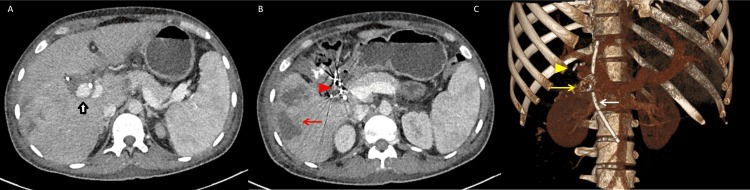
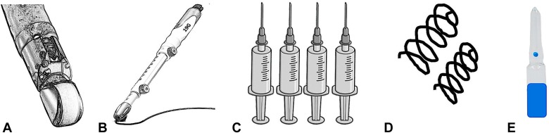
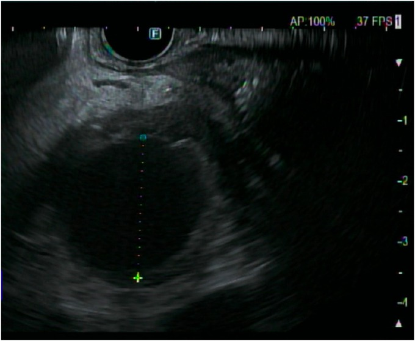
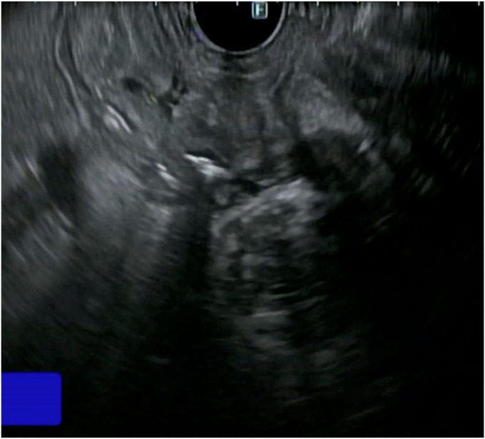
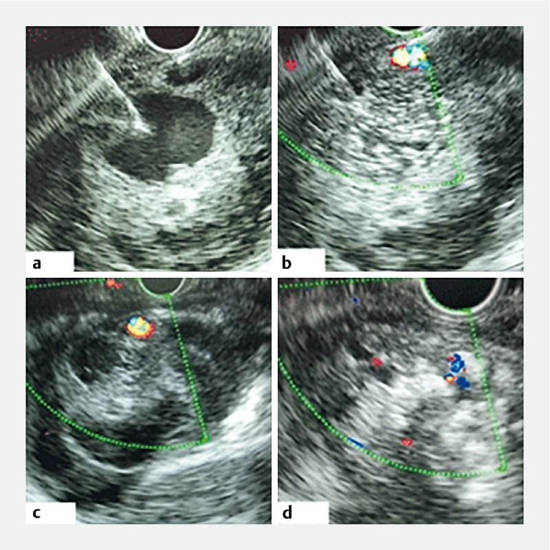
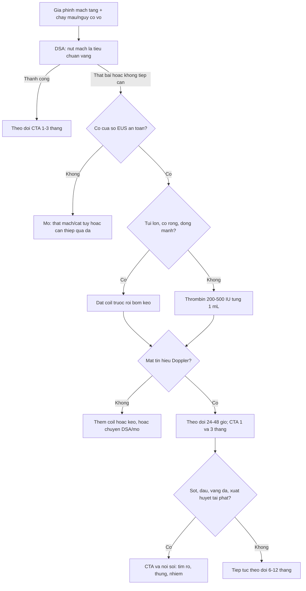
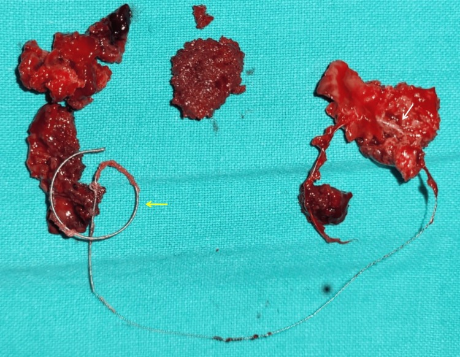
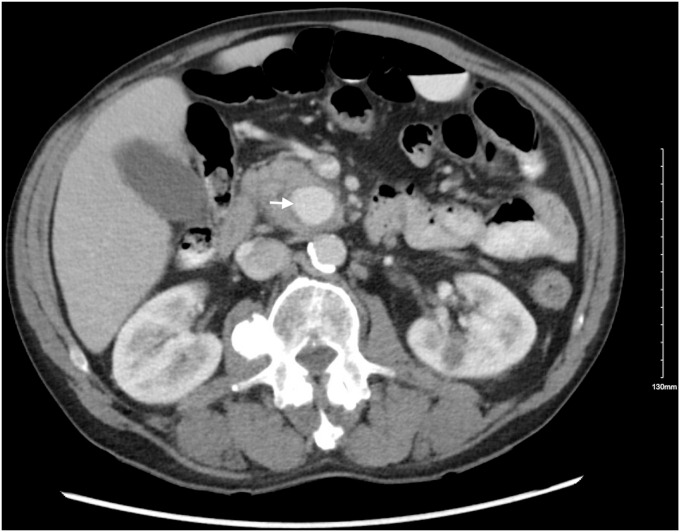
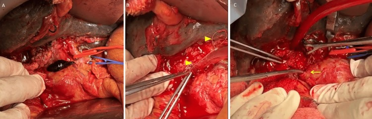

# 1832 — Nút mạch giả phình tạng dưới hướng dẫn EUS / EUS-guided coil + glue/thrombin for visceral artery pseudoaneurysm

**Tags:** `pattern:gia-phinh-mach` `pattern:nut-mach-EUS` `pattern:chay-mau-tieu-hoa` `vung:tuy` `vung:ta-trang` `vung:lach` `vung:o-bung-tren` `protocol:EUS` `protocol:CTA-2-thi` `protocol:DSA` `protocol:noi-soi-tieu-hoa`
**Mức chắc chắn (certainty):** tổng hợp y văn (literature synthesis) — ghép **tổng quan hệ thống 30 nghiên cứu/122 bệnh nhân** (*Cureus* 2026, PMC13413726, CC BY 4.0), **nghiên cứu tiến cứu 8 bệnh nhân tiêm thrombin** (*Endosc Int Open* 2020, PMC7035033, CC BY-NC-ND), **ca nguyên văn** giả phình nhánh tụy–tá tràng dưới (*iGIE* 2024, PMC12851075, CC BY 4.0), **kỹ thuật** (*VideoGIE* 2024, PMC11009482, CC BY-NC-ND), **meta-analysis coil + glue** (*Clin Endosc* 2026, PMC13624758, CC BY-NC) và 2 tổng quan EUS mạch máu (PMC11355666 CC BY; PMC8411556 CC BY-NC-SA). Số nào nguồn không đưa thì ghi "chưa rõ".

> **Câu chốt:** **DSA vẫn là tiêu chuẩn vàng** (CIRSE), EUS chỉ là **cứu cánh** khi **không tiếp cận được bằng catheter** — cổ túi quá ngắn, mạch cho không xác định, giả phình **không thấy trên chụp mạch**, bệnh nhân không đủ điều kiện gây mê/mổ. Trong **122 bệnh nhân** được EUS, **thành công kỹ thuật 100%, thành công lâm sàng 94,25% (88,43–97,40%), biến chứng 11,54% (6,11–19,29%)**, **chảy máu tái phát 3,85%**. Bắt buộc **coil trước – keo sau** (keo một mình dễ trôi), **đích là mất tín hiệu Doppler**, và **phải theo dõi vì keo/coil có thể ăn mòn thành tá tràng tạo rò** — đúng biến chứng đã xảy ra ở chính ca trong bài tổng quan.

## 1. Tổng quan bệnh học – cơ chế hình ảnh

### 1.1 Vì sao chọn EUS: "cửa sổ" mà catheter không tới được

- **Giả phình tạng thường nằm trong/ sát ổ hoại tử tụy**, thành **không có lớp áo giữa**, nguy cơ vỡ **tới 50%** và tử vong sau vỡ **15–40%** (PMC7035033). Điều trị chuẩn là **nút mạch qua DSA**.
- **Vì sao DSA thất bại:** (1) **cổ túi ngắn/rộng** không giữ được coil; (2) **mạch cho rất nhỏ** (nhánh tụy–tá tràng dưới) không chọn được catheter; (3) **co thắt mạch** hoặc **giả phình đã huyết khối một phần** nên không thấy trên chụp mạch; (4) **giải phẫu biến thể**; (5) bệnh nhân **không đủ tiền/ không đồng ý mổ**. Trong 122 ca, lý do hay gặp nhất là **giải phẫu không thuận lợi 21,3%**, **DSA thất bại 15,6%**, **chọn EUS ngay từ đầu 15,6%** (PMC13413726).
- **Vì sao EUS tới được:** đầu dò cong nằm **sát dạ dày/tá tràng**, túi giả phình trong **đầu/thân tụy** chỉ cách thành ống tiêu hóa **vài mm đến vài cm**; kim **19–22 G** chọc **xuyên thành dạ dày/tá tràng** vào túi dưới **hướng dẫn Doppler thời gian thực**.

### 1.2 Vì sao "coil trước – keo sau" (vật lý của hỗn hợp)

- **Coil** tạo **bộ khung kim loại** làm **giảm tốc dòng** trong túi → máu dễ đông và **keo không bị cuốn trôi** ngay khi bơm.
- **Keo cyanoacrylate (n-BCA/n-octyl-CA)**: polymer hóa **tức thì khi gặp ion/nước trong máu**, tạo **khối cast** bịt kín túi. Nếu bơm keo **một mình vào túi có dòng chảy mạnh**, keo có thể **trôi vào tĩnh mạch/tuần hoàn phổi** — đây là lý do **57,4%** ca dùng **coil + keo**, chỉ **4,1%** dùng keo đơn thuần (PMC13413726).
- **Thrombin** (khác keo): **chuyển fibrinogen → fibrin**, gây **huyết khối tại chỗ trong vài giây–vài phút**, không tạo khối nhựa; dùng khi túi **nhỏ, thành mỏng, không muốn để lại vật liệu cứng** — **32,8%** ca trong tổng quan dùng thrombin đơn thuần (PMC13413726). Liều trong nghiên cứu tiến cứu: **trung vị 400 IU (200–500)**, bơm **từng 1 mL** đến khi túi **tăng hồi âm** và **mất tín hiệu Doppler** (PMC7035033).
- **Đích thủ thuật trên hình ảnh:** **mất tín hiệu Doppler trong túi** + túi **tăng hồi âm/đặc** trên EUS; trên CT sau thủ thuật là **túi không ngấm thuốc + không còn cổ thông**.

### 1.3 Ngưỡng định lượng nằm lòng

| Đại lượng | Số liệu | Nguồn |
|---|---|---|
| Tổng quan EUS cho giả phình tạng | **30 nghiên cứu / 122 bệnh nhân**; nam **88,5%**, tuổi trung bình **41,9 (18–73)** | PMC13413726 |
| Bệnh nền | **viêm tụy mạn 69,7%**, viêm tụy cấp **18%** | PMC13413726 |
| Triệu chứng | **xuất huyết tiêu hóa trên 68%**, đau bụng **12,3%**, không triệu chứng **8,2%** | PMC13413726 |
| Mạch tổn thương | **lách 61,8%**, **GDA 17,1%**, vị trái **4%**, mạc treo tràng trên **3,2%** | PMC13413726 |
| Kích thước túi | trung bình **3,56 cm (0,7–9,7)** | PMC13413726 |
| Vật liệu | **coil + keo 57,4%**, **thrombin 32,8%**, keo đơn thuần **4,1%**, coil đơn thuần **2,5%** | PMC13413726 |
| Kết quả | kỹ thuật **100%**; lâm sàng **94,25% (88,43–97,40)** | PMC13413726 |
| Biến chứng | **11,54% (6,11–19,29)**; chảy máu tái phát **3,85%**; nhồi máu/áp-xe lách–gan **4,8%**; tái thông túi **1,64%** | PMC13413726 |
| Theo dõi | trung bình **22 tháng (1 tuần – 101 tháng)** | PMC13413726 |
| Tiêm thrombin | **8 bệnh nhân**, liều **400 IU (200–500)**, túi **2,9 × 2,6 cm**, tắc hoàn toàn **87,5%** lúc 3 tháng, **tái phát 12,5%** lúc 6 tuần | PMC7035033 |
| Coil + keo so với keo đơn thuần (giãn tĩnh mạch dạ dày) | tái chảy máu **OR 0,28 (0,16–0,51)**, can thiệp lại **OR 0,28 (0,15–0,52)**, thuyên tắc phổi **OR 0,52 (0,19–1,47)** | PMC13624758 |

## 2. Mẫu hình + chẩn đoán phân biệt theo vị trí (gamut)

### 2.1 Động mạch lách (61,8%) — trong thân/đuôi tụy, đường vào **qua dạ dày**

- Túi nằm trong **nang giả/hoại tử** thân–đuôi tụy; EUS từ **thân vị** chọc trực tiếp qua thành sau dạ dày.
- **Bẫy:** túi có thể **không thấy trên DSA** vì đã huyết khối hoặc do mạch xoắn; **EUS thấy rõ** vì đọc theo **mô, không theo dòng**.
- **Nguy cơ riêng:** nhồi máu/áp-xe lách **4,8%** — sốt sau thủ thuật phải chụp CT, không chỉ dùng kháng sinh mù.

### 2.2 Động mạch vị–tá tràng (17,1%) — đầu tụy, đường vào **qua tá tràng**

- Túi sát **hành/D1–D2**; đường vào **xuyên thành tá tràng** ngắn nhất, nhưng chính **vị trí chọc** là nơi **keo cast dễ ăn mòn** về sau.
- Biểu hiện: **xuất huyết tiêu hóa trên**, **hemosuccus pancreaticus** (máu qua bóng Vater) nếu thông ống tụy.

### 2.3 Nhánh tụy–tá tràng dưới (IPDA/SMA) — "vùng khó" của DSA

- Nhánh **rất nhỏ**, chạy trong **móc tụy/đầu tụy**, thường **không chọn được catheter**; đây là chỉ định EUS điển hình.
- Ca nguyên văn: giả phình **2,6 × 2,4 cm** ở **móc tụy**, thông **nhánh IPDA**, nội soi thấy **máu chảy từ bóng Vater**; EUS từ **tá tràng** chọc túi, đặt **2 coil** rồi bơm **0,3 mL histoacryl** → hết chảy máu, Hb **13 g/dL** sau 1 tháng (PMC12851075).

### 2.4 Động mạch gan phải/trái, động mạch túi mật — sau can thiệp gan–mật

- Sau **cắt túi mật nội soi, PTBD, nút mạch gan**, giả phình có thể **rò vào đường mật** (hemobilia) hoặc **vào tá tràng**.
- Ca trong tổng quan: giả phình **động mạch túi mật** sau cắt túi mật nội soi **kèm tổn thương đường mật**; EUS coil + keo thất bại → **rò giả phình–tá tràng + chảy máu tái phát** → mổ cấp cứu (PMC13413726).

### 2.5 Động mạch vị trái (4%) và động mạch hoành dưới trái

- Thường sau **viêm tụy mạn**, túi nằm **quanh thân tạng**; EUS từ **dạ dày** dễ tiếp cận nhưng phải phân biệt với **giãn tĩnh mạch dạ dày** (xem mục 5).

## 3. Bảng so sánh phân biệt (ma trận đối chiếu)

| Thực thể (entity) | Hình ảnh/kỹ thuật điển hình | Chốt vào (rule-in) | Chốt loại (rule-out) | Gợi ý xác nhận |
|---|---|---|---|---|
| **Giả phình tạng nút được bằng DSA** | Túi có **cổ rõ** trên CTA, chọn được catheter | **Cổ túi thấy trên CTA + catheter vào được nhánh cho** | Cổ quá ngắn/mạch không chọn được → chuyển EUS | CTA 2–3 thì → DSA |
| **Giả phình chỉ nút được bằng EUS** | Túi **sát dạ dày/tá tràng**, DSA âm hoặc thất bại | **Khoảng cách tới thành ống tiêu hóa ngắn + không có mạch chen giữa + DSA thất bại** | Có mạch lớn chen giữa hoặc túi quá xa → không chọc | EUS Doppler + CTA |
| **Coil + keo EUS** | **Bó coil trong túi + cast keo**; mất Doppler | **Túi có dòng chảy mạnh, cổ rộng, cần bộ khung** | Túi nhỏ, thành mỏng, sát ống tiêu hóa → cân nhắc thrombin | EUS Doppler trong lúc làm; CT 1–3 tháng |
| **Thrombin EUS** | Túi **tăng hồi âm**, **mất Doppler**, không còn vật liệu cứng | **Túi nhỏ/ trung bình, không muốn để coil, không có dòng tốc độ cao** | Túi lớn, cổ rộng, dòng mạnh → dễ tái thông | Doppler 72 giờ + CT 3 tháng |
| **Nút mạch DSA (coil/glue/stent-graft)** | Coil/keo trong túi, kiểm tra mạch cuối | **Tiêu chuẩn vàng, chọn được nhánh** | Thất bại/ không tiếp cận → EUS hoặc mổ | DSA + CTA sau |
| **Mổ (thắt mạch/cắt tụy)** | Kiểm soát mạch trực tiếp | **Không can thiệp được + huyết động không ổn định/ rò-thủng** | Bệnh nhân ổn định, túi tiếp cận được → can thiệp trước | Mổ + giải phẫu bệnh |
| **Giãn tĩnh mạch dạ dày** | Cấu trúc **dạng búi**, có **dòng tĩnh mạch**, không có cổ động mạch | **Dòng tĩnh mạch trên Doppler + bối cảnh tăng áp cửa** | Có **cổ động mạch + phổ động mạch** → giả phình | EUS Doppler; CTA |
| **Nang giả tụy tăng ngấm** | Ngấm **viền**, không đầy cùng thì động mạch | **Ngấm viền, không có cổ mạch** | **Đầy cùng đậm độ ĐMC ở thì động mạch** → giả phình | So đậm độ với ĐMC |

*(A) Túi giả phình **động mạch túi mật** (mũi tên đen); (B) **artifact do coil đã đặt** (đầu mũi tên đỏ) + **áp-xe gan phải** (mũi tên đỏ); (C) dựng hình 3D — coil ở **hố túi mật** (mũi tên vàng), clip mổ cũ, stent ống mật chủ. Đây là ca **EUS coil + keo thất bại** vì còn **tổn thương đường mật** và **rò sang tá tràng**. Nguồn: *Cureus* 2026 (PMC13413726), Fig. 1 — CC BY 4.0.*

### Dấu hiệu chốt trên EUS (đọc nhanh)

- **Cổ túi + phổ động mạch** trên Doppler = giả phình; **búi không cổ + phổ tĩnh mạch** = giãn tĩnh mạch.
- **Khoảng cách từ đầu dò tới túi** càng ngắn càng an toàn; phải chắc **không có động mạch lớn nằm giữa** đường kim.
- **Sau bơm:** túi **đặc/tăng hồi âm** + **mất Doppler**; nếu còn dòng → **thêm coil** hoặc **thêm keo**, đừng kết thúc sớm.

## 4. Protocol chụp/can thiệp + hệ phân độ

### 4.1 Trước thủ thuật

- **CTA bụng 2–3 thì, lát 0,5–1 mm**, dựng **MIP/coronal**: xác định **vị trí túi, cổ túi, mạch cho–mạch nhận, khoảng cách tới dạ dày/tá tràng**, có **mạch lớn chen giữa** không.
- **Nội soi tiêu hóa trên** tìm nguồn chảy/máu ở bóng Vater, nhưng **không trì hoãn can thiệp**.
- **Đánh giá đông máu** (SIR): INR **< 1,5–1,8**, tiểu cầu **> 50 × 10³/µL** cho thủ thuật nguy cơ cao; **kháng sinh dự phòng 30 phút trước** (PMC7035033).
- **Chuẩn bị phương án dự phòng:** đặt sẵn kế hoạch **DSA** và **mổ** nếu EUS thất bại/chảy máu; **gây mê toàn thân** thường cần.

### 4.2 Kỹ thuật EUS (theo bước)

1. **Ống soi siêu âm cong** (curvilinear) → định vị túi, **Doppler màu + phổ** xác nhận **dòng động mạch** và **cổ túi**.
2. **Kim 19 G** (cho coil) hoặc **22 G** (cho thrombin/keo) chọc **xuyên thành** vào túi dưới hướng dẫn siêu âm; xác nhận **máu phụt/ kim trong lòng túi**.
3. **Coil trước:** đưa coil **0,035 hoặc 0,018 inch** (kích thước theo túi, ví dụ **16 mm × 14 cm** và **20 mm × 20 cm**) đến khi **dòng chậm/ giảm** (PMC12851075, PMC11009482).
4. **Keo sau:** bơm **n-BCA hoặc n-octyl-CA** (thường trộn **lipiodol** để nhìn huỳnh quang), **thể tích nhỏ 0,3–1 mL**, bơm chậm đến khi túi **đặc** và **mất Doppler**.
5. **Hoặc thrombin:** **200–500 IU**, bơm **từng 1 mL** đến khi **túi tăng hồi âm**, kiểm tra Doppler (PMC7035033).
6. **Kết thúc:** Doppler **không còn dòng trong túi**, không thấy keo trôi vào tĩnh mạch; rút kim, quan sát **chảy máu qua đường chọc**.

*Bộ dụng cụ: ống soi siêu âm cong (A), **kim FNA 19 G** (B), bơm dung dịch (C), **coil 0,035 hoặc 0,018 inch** (D), **keo n-octyl-cyanoacrylate hoặc n-butyl-cyanoacrylate** (E). Nguồn: *VideoGIE* 2024 (PMC11009482), Fig. 2 — CC BY-NC-ND 4.0, nguyên bản.*

*EUS: túi giả phình **2,5 × 2,5 cm** trong đầu tụy, tương ứng với CT — xác định **cửa sổ chọc** và **khoảng cách tới thành tá tràng** trước khi đưa kim. Nguồn: *iGIE* 2024 (PMC12851075), Fig. 4 — CC BY 4.0.*

*EUS sau khi đặt **2 coil** và bơm **0,3 mL histoacryl**: túi **đặc, tăng hồi âm**, không còn khoang dòng chảy. Nguồn: *iGIE* 2024 (PMC12851075), Fig. 6 — CC BY 4.0.*

*(a) Kim **22 G** vào túi giả phình; (b) **mất tín hiệu Doppler** ngay sau bơm; (c–d) túi **huyết khối hoàn toàn** trên EUS sau **72 giờ**. Nguồn: *Endosc Int Open* 2020 (PMC7035033), Fig. 2 — CC BY-NC-ND 4.0, nguyên bản.*

### 4.3 Sau thủ thuật và theo dõi

- **Theo dõi 24–48 giờ:** Hb, đau bụng, sốt, dấu hiệu chảy máu tiêu hóa; **không xuất viện ngay** ở ca nguy cơ cao.
- **CT/CTA hoặc siêu âm Doppler tại 1 tháng và 3 tháng**; sau đó **6–12 tháng** nếu ổn định. Trong tổng quan, theo dõi trung bình **22 tháng** (PMC13413726).
- **Nội soi lại** nếu có máu; đặc biệt sau **coil + keo ở GDA/tá tràng** vì nguy cơ **rò do cast keo**.

### 4.4 Thuật toán chọn đường can thiệp

## 5. Biến thể bình thường và cạm bẫy

- **"Mất Doppler" giả:** khí/coil trong túi tạo **bóng lưng âm** che dòng — phải xoay đầu dò nhiều góc, bật **Doppler năng lượng** và xác nhận bằng **CTA** sau 24–48 giờ.
- **Rò do cast keo:** ca trong tổng quan bị **rò giả phình–tá tràng** ngay tại **vị trí kim chọc**, do (1) **còn dòng vào túi**, (2) **viêm mô tại chỗ**, (3) **keo ăn mòn thành ruột** — ổ keo + coil **lộ vào tá tràng** phải mổ (PMC13413726). **Phòng:** bơm ít keo, đặt coil làm khung, đảm bảo **tắc hoàn toàn dòng vào**, tránh chọc **sát thành tá tràng**.

*Mảnh **cast keo** (mũi tên vàng) dính máu cục, bên trong có **coil** (mũi tên trắng) — chính khối này ăn mòn qua thành tá tràng tạo rò. Nguồn: *Cureus* 2026 (PMC13413726), Fig. 3 — CC BY 4.0.*
- **Thuyên tắc keo về phổi:** hiếm nhưng có thật; sau thủ thuật nếu **khó thở/ đau ngực** phải **X-quang/CT ngực**. Meta coil + keo ở giãn tĩnh mạch cho thấy **không tăng thuyên tắc phổi** so với keo đơn thuần (**OR 0,52; 0,19–1,47**) (PMC13624758).
- **Nhồi máu/áp-xe lách (4,8%)** và **nhồi máu gan**: sốt sau thủ thuật **không được quy hết cho nhiễm trùng ổ dịch** — chụp CT có cản quang.
- **Nhầm giãn tĩnh mạch với giả phình:** búi giãn có **phổ tĩnh mạch**, bóp **không xẹp**; chọc nhầm có thể gây **chảy máu ồ ạt** — Doppler phổ là bắt buộc, không chỉ Doppler màu.
- **Không phải lựa chọn đầu tay:** tổng quan kết luận EUS là **cứu cánh**, **không thay thế DSA**; dùng EUS ngay từ đầu chỉ nên trong nghiên cứu/ ca đặc biệt (PMC13413726).
- **Bỏ sót tổn thương đường mật đi kèm:** ca thất bại có **hẹp đường mật Strasberg V** — nếu chỉ xử lý mạch mà bỏ đường mật, bệnh nhân vẫn **nhiễm trùng/ vàng da** sau đó.

## 6. Tự lượng giá — Blind Quiz

**Ca 1 — Nam 45 tuổi, viêm tụy mạn, xuất huyết tiêu hóa; CTA thấy túi ở móc tụy, DSA không chọn được nhánh cho.**

- Hỏi: mô tả túi? Vì sao DSA khó? Đường vào nào hợp lý và cần kiểm tra gì trước khi chọc?

<b>Bấm để hiện đáp án (findings + chẩn đoán)</b>

- **Findings:** túi **2,6 × 2,4 cm** trong **móc tụy**, ngấm thuốc **cùng thì động mạch**, thông với **nhánh động mạch tụy–tá tràng dưới** (IPDA).
- **Vì sao DSA khó:** nhánh **rất nhỏ, xoắn**, xuất phát từ **mạc treo tràng trên**, khó chọn catheter.
- **Đường vào:** **EUS từ tá tràng** — kim **19 G**, đặt **2 coil** rồi **0,3 mL histoacryl**; đích là **mất Doppler**.
- **Kiểm tra trước chọc:** Doppler phổ xác nhận **dòng động mạch**, đo **khoảng cách tới thành tá tràng**, loại trừ **mạch lớn nằm giữa** đường kim.
- Nguồn ảnh: *iGIE* 2024 (PMC12851075), Fig. 1 — CC BY 4.0.

**Ca 2 — Bệnh nhân sau cắt túi mật nội soi, vàng da + sốt; CT có túi cạnh gan, đã đặt coil + keo qua EUS, nay xuất huyết tiêu hóa tái phát.**

- Hỏi: biến chứng gì đã xảy ra? Ba cơ chế? Xử trí?

<b>Bấm để hiện đáp án (findings + chẩn đoán)</b>

- **Findings:** (A) túi giả phình + **cục máu lớn**, đã kiểm soát động mạch gan; (B) **coil cũ được lấy ra khỏi túi**; (C) **lỗ rò tá tràng** lộ ra sau khi lấy cast keo + coil + máu cục.
- **Chẩn đoán:** **rò giả phình–tá tràng** sau EUS coil + keo, gây **chảy máu tái phát**.
- **Ba cơ chế:** (1) **không tắc hoàn toàn dòng vào**; (2) **viêm mô tại chỗ** do thủ thuật; (3) **keo ăn mòn thành tá tràng**.
- **Xử trí:** **mổ cấp cứu** lấy coil/cast, khâu rò; sau đó **sửa đường mật** (hẹp Strasberg V) thì hai.
- Nguồn ảnh: *Cureus* 2026 (PMC13413726), Fig. 2 — CC BY 4.0.

**Ca 3 — Bệnh nhân giả phình động mạch lách 2,5 cm trong nang giả tụy; chọn tiêm thrombin dưới EUS.**

- Hỏi: liều và cách bơm? Đích đánh giá? Theo dõi sau bao lâu?

<b>Bấm để hiện đáp án (findings + chẩn đoán)</b>

- **Findings:** (a) kim **22 G** trong túi; (b) **mất tín hiệu Doppler** sau bơm; (c–d) túi **huyết khối** trên EUS **72 giờ**.
- **Liều/cách bơm:** **thrombin 200–500 IU** (trung vị **400 IU**), bơm **từng 1 mL** đến khi túi **tăng hồi âm**.
- **Đích:** **mất Doppler** + túi đặc; **theo dõi Doppler 72 giờ**, **CT 3 tháng**.
- **Giới hạn:** nghiên cứu **8 bệnh nhân**, tắc hoàn toàn **87,5%**, **tái phát 12,5%** sau **6 tuần** — không dùng cho túi lớn/cổ rộng/dòng mạnh.
- Nguồn ảnh: *Endosc Int Open* 2020 (PMC7035033), Fig. 2 — CC BY-NC-ND 4.0.

## Bài liên quan chéo
- [1819 – Chảy máu tiêu hóa muộn do giả phình động mạch tạng](../1819-chay-mau-muon-gia-phinh-mach-tang/lesson.md)
- [1831 – Coil di trú & xuyên thành sau nút mạch tạng](../1831-di-tru-coil-sau-nut-mach-tang/lesson.md)
- [920 – Nút mạch cầm máu tiêu hóa](../920-vascular-embolization-gi-bleed/lesson.md)
- [135 – Viêm tụy cấp (Atlanta)](../135-viem-tuy-Atlanta/lesson.md)
- [900 – Đại cương IR: kim, đông máu & cửa sổ chọc](../900-ir-fundamentals-biopsy/lesson.md)

## Ảnh & giấy phép
- `1832_nut-mach-eus_CT_PMC13413726-f1.jpg`, `1832_nut-mach-eus_Mo_PMC13413726-f2.jpg`, `1832_nut-mach-eus_Glue-cast_PMC13413726-f3.jpg` — *Cureus* 2026 (PMC13413726), **CC BY 4.0**.
- `1832_nut-mach-eus_CT_PMC12851075-f1.jpg`, `1832_nut-mach-eus_EUS_PMC12851075-f4.jpg`, `1832_nut-mach-eus_EUS-coil-glue_PMC12851075-f6.jpg` — *iGIE* 2024 (PMC12851075), **CC BY 4.0**.
- `1832_nut-mach-eus_EUS-thrombin_PMC7035033-f2.jpg` — *Endosc Int Open* 2020 (PMC7035033), **CC BY-NC-ND 4.0**, nguyên bản.
- `1832_nut-mach-eus_Dung-cu_PMC11009482-f2.jpg` — *VideoGIE* 2024 (PMC11009482), **CC BY-NC-ND 4.0**, nguyên bản.
- Chi tiết từng file + ghi chú phái sinh: `images/CREDITS.md`.

> Không dùng để chẩn đoán độc lập khi chưa có người hướng dẫn.
