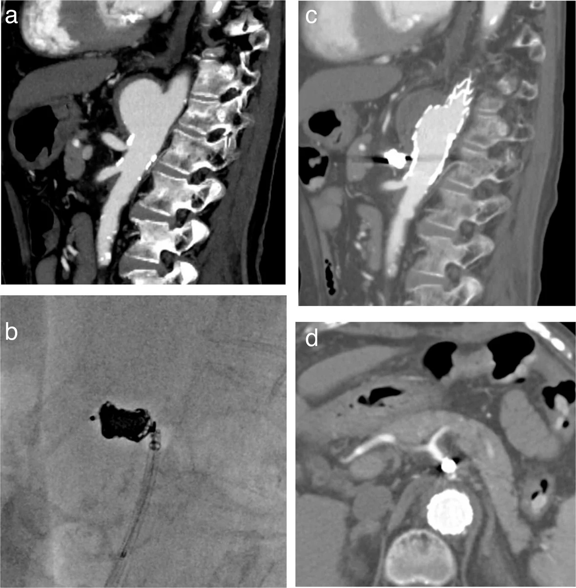
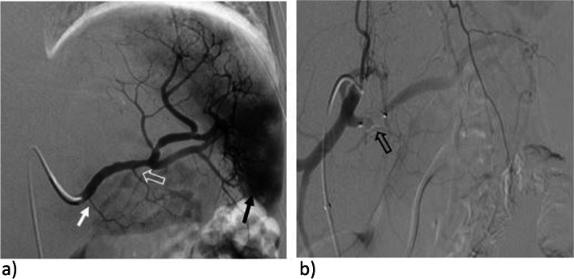
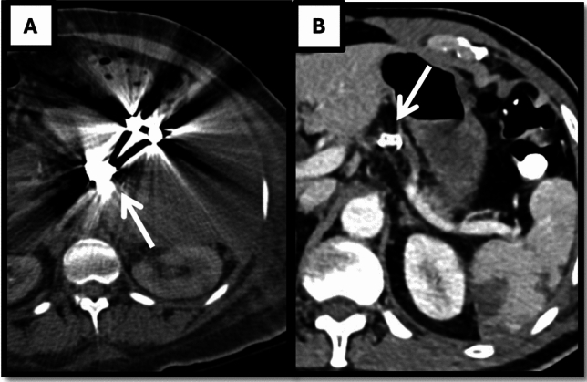
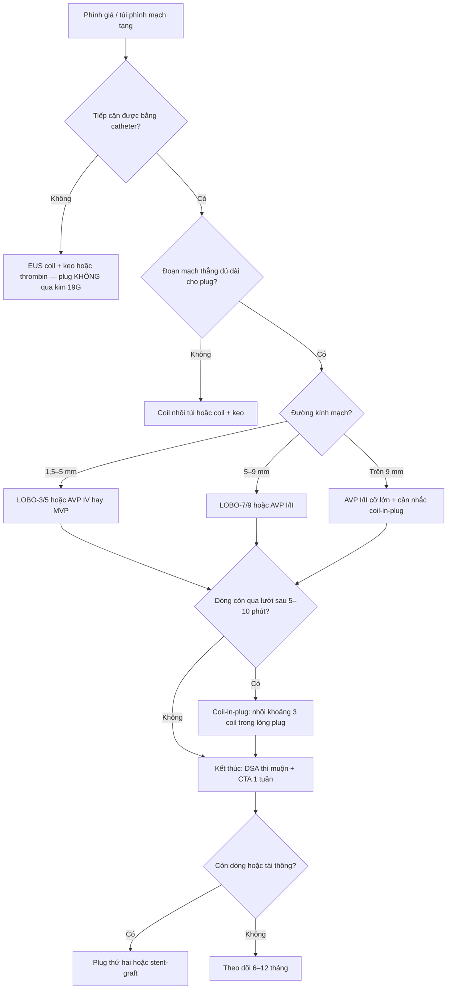
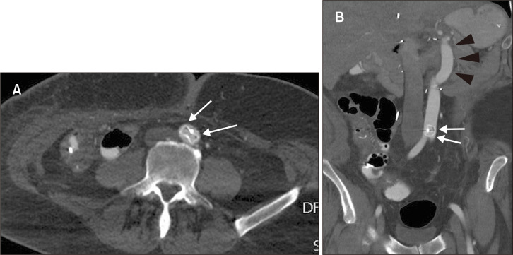

# 1833 — Vascular plug trong nút mạch tạng: chọn cỡ, kỹ thuật thả & ranh giới với coil / Vascular plugs in visceral artery embolization: sizing, deployment and where coils still win

**Tags:** `pattern:bit-mach` `pattern:qua-co` `pattern:di-tru-plug` `pattern:con-dong-ton-luu` `vung:mach-tang` `vung:lach` `vung:gan` `vung:ta-trang` `vung:tuy` `protocol:DSA` `protocol:CTA` `protocol:X-quang-bung`
**Mức chắc chắn (certainty):** tổng hợp y văn (literature synthesis) — ghép 1 nghiên cứu so sánh thiết bị với coil (*Cardiovasc Intervent Radiol* 2026, PMC13337838, CC BY 4.0), 1 đoàn hệ 11 năm nút mạch lách bằng plug (*CVIR Endovasc* 2023, PMC9832195, CC BY 4.0), 1 nghiên cứu kỹ thuật coil-in-plug 40 mạch (*CVIR Endovasc* 2026, PMC13722663, CC BY 4.0), 1 so sánh plug vs coil sau ghép gan (*Diagn Interv Radiol* 2022, PMC9682605, CC BY-NC 4.0), 1 tổng quan kỹ thuật phình tạng thật (*CVIR Endovasc* 2023, PMC10247946, CC BY 4.0) và 3 ca/bài về quá cỡ – di trú – lấy lại plug (PMC11221997 CC BY, PMC12202918 CC BY-NC, PMC6047098 CC BY-NC-ND). Không có thử nghiệm ngẫu nhiên nào so plug với coil ở mạch tạng → mọi so sánh dưới đây là **hồi cứu**, không phải bằng chứng mức cao.

> **Câu chốt:** plug bít mạch bằng **khung lưới nitinol tự bung + lực hướng tâm**, không phải bằng cách nhồi kín túi như coil — nên **một thiết bị thay cho 4,6 coil**, **giảm thời gian chiếu và liều**, và **không tạo artifact kim loại che CT theo dõi**. Ba con số phải nhớ: **quá cỡ 30–50% theo khuyến cáo nhà sản xuất** (không phải 10–20%), **đường kính mạch chọn theo bảng của từng họ thiết bị**, và **plug không bít ngay lập tức** — dòng tồn lưu ở mạch tốc độ cao phải xử lý bằng **coil trong lòng plug (coil-in-plug)**. Sai cỡ → **di trú** (ca 16 mm vào mạch 8 mm trôi xuống ĐMC bụng); đặt đúng cỡ nhưng **sai chỗ** (quá xa lỗ nguyên ủy) → trôi ngược.

## 1. Tổng quan bệnh học – cơ chế hình ảnh

### 1.1 Vì sao một khung lưới bít được động mạch

- **Cơ chế ba lớp:** (1) khung nitinol bung ra **áp sát thành mạch** bằng lực hướng tâm; (2) lưới nitinol **chia dòng thành nhiều tia nhỏ** làm vận tốc giảm dưới ngưỡng duy trì dòng chảy; (3) **huyết khối lấp mắt lưới** hoàn tất việc bít. Vì bước (3) cần thời gian, plug **không bít tức thì** như túi coil nhồi kín — đây là gốc của biến chứng "còn dòng tồn lưu" ở mạch tốc độ cao hoặc lòng mạch không đều (PMC13722663).
- **Vì sao lực hướng tâm tỉ lệ với quá cỡ:** lưới nitinol bung theo đường kính danh định; nếu chọn **bằng** đường kính mạch, khung chỉ chạm thành ở vài điểm rời rạc → **không kín chu vi**, dòng chảy lách qua khe. Quá cỡ vừa đủ làm lưới **ép đều toàn chu vi**; quá cỡ quá mức làm thiết bị **không bung hết**, gấp nếp và **tăng nguy cơ trôi hoặc rách mạch**.
- **Con số đúng của "quá cỡ":** khuyến cáo của nhà sản xuất là **30–50%** lớn hơn đường kính mạch đích (PMC11221997; PMC12202918). Con số **10–20%** hay được truyền miệng **không khớp** hướng dẫn sử dụng: trong loạt 40 mạch dùng kỹ thuật coil-in-plug, tỉ lệ **plug/đường kính mạch trung bình 1,44 = quá cỡ 44%**; trong thực hành lâm sàng, **AVP-2 quá cỡ trung vị 53% (14–135%)**, **AVP-4 60% (27–150%)**, **không có ca di trú hay vỡ mạch** (PMC13722663; PMC11221997).
- **Coil thì ngược lại:** coil "bít" bằng **khối lượng kim loại trong túi**, phải nhồi đủ mật độ; ở mạch lớn cần **4,6 coil/ca** (trung vị 3,5) và **đoạn nút dài** hơn, đồng nghĩa **nhiều thời gian chiếu và liều hơn** (PMC13337838).

### 1.2 Bốn họ thiết bị — chọn sai họ là hỏng kế hoạch

| Họ thiết bị | Cấu trúc | Cỡ / đường kính mạch đích | Điểm mạnh | Điểm yếu |
|---|---|---|---|---|
| **AVP I** (Abbott) | Một đoạn lưới nitinol, không tháo rời | Cỡ lớn, dùng cho đoạn mạch **thẳng** | Đơn giản, ít artifact, hợp đoạn hạ cánh ngắn | Bít chậm; cần **đoạn mạch thẳng ≥ chiều dài thiết bị** |
| **AVP II** | Ba đoạn (hai đĩa + eo) | **3–22 mm** | Bít nhanh hơn AVP I, **ôm lòng mạch không đều, đoạn hạ cánh ngắn** | Cứng hơn AVP IV ở mạch xoắn |
| **AVP III** | Lưới dày, một đoạn | Dùng cho **dòng tốc độ cao** | **Bít nhanh nhất** trong họ AVP | Cứng, khó vào mạch xoắn nhỏ |
| **AVP IV** | Lưới mềm, hai đĩa | **4–8 mm**; thả qua **4–5 F** | **Mềm, qua được mạch xoắn**, dùng cho mạch nhỏ | Lực hướng tâm thấp hơn, cần quá cỡ nhiều hơn (trung vị 60%) |
| **MVP** (Medtronic) | Lưới nitinol + **màng PTFE một mặt**, đẩy rời được | MVP-3/5/7/9 mm; vi ống thông | Bít **gần tức thì** nhờ màng PTFE; thả rời được | Quá cỡ theo kinh nghiệm **30% (chọn lịch) – 40% (cấp cứu)** |
| **LOBO** (Okami) | Lưới bện profile thấp, FDA 2020 | LOBO-3: **1,5–3 mm** (2,8 F); LOBO-5: **3–5 mm** (2,9 F); LOBO-7: **5–7 mm** (5–5,5 F); LOBO-9: **7–9 mm** (5,5–6 F) | Chọn **đúng đường kính danh định, không cần quá cỡ thêm**; ít artifact | Họ mới, ít dữ liệu dài hạn |

- Nguồn bảng: PMC10247946 (AVP I–IV, MVP), PMC8273051 (MVP quá cỡ 30%/40%), PMC13337838 (LOBO theo đường kính danh định), PMC11221997 (AVP-2/AVP-4 quá cỡ thực tế).
- **Điểm cực kỳ thực dụng:** mọi AVP cần **ống thông ≥ 4–5 F**. Vì vậy trong nút mạch qua **kim FNA 19 G của EUS**, plug **không đi qua được** — đó là lý do trong 122 ca EUS nút giả phình tạng, vật liệu là **coil + keo 57,4%**, **thrombin 32,8%**, không có plug (bài 1832, PMC13413726).

### 1.3 Ngưỡng định lượng nằm lòng

| Đại lượng | Số liệu | Nguồn |
|---|---|---|
| Quá cỡ khuyến cáo (IFU) | **30–50%** lớn hơn đường kính mạch | PMC11221997, PMC12202918 |
| Quá cỡ thực tế AVP-2 / AVP-4 | trung vị **53% (14–135%)** / **60% (27–150%)** | PMC11221997 |
| Tỉ lệ plug:mạch ở kỹ thuật coil-in-plug | **1,44 ± 0,20** (quá cỡ 44%), 40 mạch | PMC13722663 |
| Coil mồi (anchoring coil) | quá cỡ **30–50%** so với đường kính mạch | PMC13337838 |
| LOBO — chọn cỡ | theo **đường kính danh định**, không quá cỡ thêm | PMC13337838 |
| Số coil thay thế 1 plug (nút lách gần) | **4,6 coil/ca** (trung vị 3,5) so với **1 plug** | PMC13337838 |
| Thời gian chiếu — plug vs coil | **11,65 vs 18,9 phút** (p = 0,01) | PMC13337838 |
| Liều — plug vs coil | **128,4 vs 198,5 mGy** (p = 0,04) | PMC13337838 |
| Nhồi máu lách — plug vs coil | **22,7% vs 33,3%** (p = 0,046) | PMC13337838 |
| Nút lách gần bằng plug ở chấn thương độ IV–V | **76 bệnh nhân**, plug **10,8 ± 1,4 mm**, kỹ thuật **100%**, lâm sàng **94,7%**, giữ lách **96,1%** | PMC9832195 |
| Biến cố nặng — plug đơn thuần vs plug + coil | **10,3% (6/58) vs 33,3% (6/18)**, p = 0,03 | PMC9832195 |
| Độ bền coil-in-plug | **40 mạch**, theo dõi **619 ngày**, **0** tái thông / **0** di trú / **0** can thiệp lại | PMC13722663 |
| Phình tạng thật (94 bệnh nhân/97 túi) | kỹ thuật **100%**, biến chứng nặng chu phẫu **5,2%**, can thiệp lại **2,1%**, tái tưới máu túi **8,2%**, theo dõi **44,7 tháng** | PMC12950147 |
| Tỉ lệ di trú plug | **chưa rõ** — không có đoàn hệ nào báo tỉ lệ; y văn chỉ có ca lẻ | PMC6047098 |

## 2. Mẫu hình + chẩn đoán phân biệt theo vị trí (gamut)

### 2.1 Thân tạng (celiac trunk) — "mở rộng vùng hạ cánh" trước stent-graft

- **Bối cảnh:** túi phình/giả phình ngay sát lỗ thân tạng, cần **bít thân tạng** để có đủ chiều dài hạ cánh cho stent-graft động mạch chủ. Trong loạt coil-in-plug, thân tạng chiếm **6/40 mạch (15%)**, đường kính trung bình toàn loạt **7,7 mm** (PMC13722663).
- **Điều kiện sống còn:** phải chứng minh **tuần hoàn bàng hệ từ mạc treo tràng trên** nuôi gan–lách; bít thân tạng mà không có bàng hệ → **nhồi máu gan/lách**. Đây là lý do phải chụp kiểm tra thì muộn sau bít.
- **Kỹ thuật hay dùng:** **AVP I 10 mm** trong thân tạng + **coil nhồi trong lòng plug** (P-CIP), sau đó đặt stent-graft; CT 1 tuần cho thấy **loại trừ hoàn toàn túi**, CTA sau đó xác nhận **động mạch gan chung và lách còn cản quang** (PMC13722663).

*(a) CT sagittal trước mổ: túi phình dạng túi ngay sát lỗ thân tạng; (b) **fluoroscopy**: AVP I **10 mm** trong thân tạng, **coil nhồi trong lòng plug**, vi ống thông đi xuyên lưới; (c) CT 1 tuần sau đặt stent-graft: túi được loại trừ hoàn toàn; (d) CTA: **động mạch gan chung và lách vẫn còn cản quang** nhờ bàng hệ. Nguồn: *CVIR Endovasc* 2026 (PMC13722663), Fig. 1 — CC BY 4.0, nguyên bản (giữ nhãn a–d).*

### 2.2 Động mạch lách — nơi plug có bằng chứng tốt nhất

- **Hai bối cảnh khác nhau về sinh lý:** (1) **chấn thương lách độ IV–V**: bít **gần (proximal)** để giảm áp lực tưới máu nhưng **giữ tuần hoàn bàng hệ** qua mạch vị ngắn; (2) **phình/túi phình động mạch lách**: bít gần hoặc "sandwich" (bít cả hai đầu + túi).
- **Vì sao chọn plug:** ở 76 bệnh nhân chấn thương độ IV–V, **plug đơn thuần có biến cố nặng 10,3%** so với **33,3%** khi thêm coil (p = 0,03) — thêm coil không tăng hiệu quả mà **tăng nhồi máu** (PMC9832195).
- **Vị trí đặt:** **sau lỗ động mạch tụy lưng** để giữ nhánh này; nếu đặt quá gần lỗ thân tạng sẽ **mất nhánh tụy lưng** và tăng nhồi máu (mô tả trong PMC9832195).
- **So với coil:** nhồi máu lách **22,7% vs 33,3%** (p = 0,046), thời gian chiếu và liều thấp hơn có ý nghĩa (PMC13337838); ở bệnh nhân cổ trướng khó trị sau ghép gan, plug **rút ngắn thủ thuật** (p = 0,029) và **giảm thể tích lách nhiều hơn** (p = 0,012) (PMC9682605).

*(a) DSA động mạch lách trước nút: vùng tăng tưới máu cực dưới lách (mũi tên đen đặc) và giả phình nghi ngờ; **động mạch tụy lưng** (mũi tên trắng đặc) và **động mạch tụy lớn** (mũi tên trắng rỗng) phải được bảo tồn; (b) DSA thân tạng sau bít gần: **plug** (mũi tên rỗng) che lỗ động mạch tụy lưng, dòng chảy về lách giảm. Nguồn: *CVIR Endovasc* 2023 (PMC9832195), Fig. 3 — CC BY 4.0, nguyên bản (giữ nhãn a–b).*

### 2.3 Động mạch gan — bít "cửa trước" để tái phân bố dòng, không bít "cửa sau"

- **Chỉ định:** trước **cắt thân tụy–lách en bloc thân tạng (DP-CAR)**, cần bít **động mạch gan chung** để dòng từ mạc treo tràng trên qua động mạch vị–tá tràng nuôi gan; hoặc bít **động mạch vị–tá tràng (GDA)** khi loét chảy máu/giả phình.
- **Nguyên tắc "front and back door":** bít **cửa trước** bằng plug và **cửa sau** bằng coil (hoặc ngược lại) khi túi nằm giữa hai cửa — mô tả trong tổng quan phình tạng thật (PMC10247946).
- **Cạm bẫy đã xảy ra:** AVP II **6 mm** đặt giữa động mạch gan chung **trôi về động mạch gan riêng**; không lấy lại được qua ống 5 F, phải **thả sang động mạch lách** (dự kiến cắt bỏ) rồi đặt **AVP II 10 mm** ở phần gần mới tắc được (PMC6047098). Bài học: **đo lại đường kính tại đúng đoạn sẽ thả**, không dùng đường kính đoạn gần.

### 2.4 Vị–tá tràng (GDA) — nơi plug và coil đều có giá, tùy cổ túi

- **Giả phình GDA sau viêm tụy/loét:** túi nằm **sát hành tá tràng**, thành mỏng. Plug đặt **trong đoạn mạch** (không trong túi) an toàn hơn coil nhồi túi — vì coil nhồi túi sát ruột là **bàn đạp của xuyên thành** (bài 1831).
- **Khi nào plug thua:** **cổ túi ngắn** hoặc **túi không có cổ** (giả phình "không cuống") — plug cần **đoạn mạch thẳng đủ dài** để bám; trường hợp này phải **coil + keo**, hoặc **EUS** nếu catheter không tới (bài 1832).

### 2.5 Mạc treo tràng trên và nhánh — mạch lớn, sai cỡ trả giá ngay

- **Đường kính lớn (8–9 mm):** plug phải rất lớn; ca 16 mm plug cho mạch 8 mm **trôi xuống ĐMC bụng trong 5 ngày** sau ghép đa tạng, dù trên DSA lúc thả **không thò vào lòng ĐMC** (PMC12202918).
- **Bài học kỹ thuật từ chính ca đó:** đặt **sâu hơn vào lòng mạch** (không sát lỗ nguyên ủy) và **quá cỡ vừa phải 30–50%**; nếu mạch nằm trong vùng mổ, nên **chụp X-quang bụng cuối mổ** để phát hiện trôi sớm.

### 2.6 Nhánh nhỏ trong ổ hoại tử / qua EUS — plug không vào được

- **Giới hạn vật lý:** plug cần **ống thông 4–6 F**; **kim FNA 19 G** của EUS chỉ cho coil 0,018–0,035 inch và keo/thrombin. Vì vậy **plug không nằm trong bộ dụng cụ EUS** (bài 1832).
- **Hệ quả thực hành:** với giả phình nhánh tụy–tá tràng dưới mà DSA không chọn được, con đường là **coil + keo**, không phải plug (PMC13413726).

## 3. Bảng so sánh phân biệt (ma trận đối chiếu)

| Thực thể (entity) | Hình ảnh điển hình | Chốt vào (rule-in) | Chốt loại (rule-out) | Gợi ý xác nhận |
|---|---|---|---|---|
| **Plug đơn thuần** | Một khung lưới kim loại **hình trụ/đĩa** trong lòng mạch, **không có bó dây xoắn**; CT ít artifact | **Một thiết bị + mạch thẳng ≥ chiều dài plug + quá cỡ 30–50%** | Mạch **ngắn hơn thiết bị**, cổ túi ngắn, lòng mạch đổi cỡ đột ngột → không dùng plug | DSA thì cuối: mất dòng qua đoạn bít; CT 1 tuần |
| **Coil** | **Bó dây xoắn** đậm, nhiều vòng; **streak artifact mạnh** trên CT | **Túi/cổ ngắn, mạch nhỏ, cần nhồi kín túi** | Mạch lớn, dòng nhanh → cần 4–6 coil, dễ trôi | DSA; X-quang bụng so phim cũ |
| **Coil-in-plug (P-CIP)** | **Coil nằm gọn TRONG lòng khung lưới**; plug như "giỏ" giữ coil | **Dòng tốc độ cao, mạch lớn, cần bít chắc chắn** | Plug đơn thuần đã mất dòng hoàn toàn → không cần thêm coil | Fluoroscopy lúc thả; CT 1 tuần/6 tháng/1 năm |
| **Trapping (bít hai đầu)** | **Hai plug/coil ở hai phía túi**, túi bị cô lập | **Túi có cổ, hai đầu mạch tiếp cận được** | Chỉ tiếp cận được một đầu → không trapping được | DSA: túi không còn cản quang thì muộn |
| **Stent-graft (giữ mạch mẹ)** | Stent có màng trong lòng mạch, **túi bị loại trừ nhưng mạch chính còn thông** | **Cần giữ mạch mẹ** (gan, thận, mạc treo) và cổ túi đủ dài | Mạch xoắn/gấp, đường kính < 4–5 mm → không đặt được | CTA 1 tháng; kiểm tra endoleak |
| **Keo/thrombin (EUS hoặc qua kim)** | **Khối cast tăng hồi âm**, mất Doppler; không có kim loại cứng | **Nhánh nhỏ, không tiếp cận bằng catheter, kim 19–22 G** | Túi lớn/dòng mạnh → keo trôi, tái thông | Doppler 72 giờ + CT 3 tháng |
| **Di trú plug** | Plug **đổi vị trí** giữa hai lần chụp; có thể nằm ở **ĐMC bụng/động mạch xa** | **So phim: plug ra khỏi đoạn mạch đích** | Plug còn đúng chỗ, chỉ artifact → không phải di trú | X-quang bụng + CTA; lấy bằng snare nếu cần |
| **Còn dòng tồn lưu** | Plug đúng chỗ nhưng **vẫn thấy cản quang qua/ quanh lưới** ở thì muộn | **Cản quang qua lưới ở thì muộn + tăng áp lực túi** | Không còn cản quang, túi xẹp → thành công | DSA chờ 5–10 phút; CTA 1 tuần |

### Dấu hiệu chốt (đọc nhanh)

- **"Một khối, không dây"** = plug đúng vị trí; **"bó dây xoắn"** = coil; **"dây thò ra khỏi khối"** = coil di trú (bài 1831).
- **Artifact là biến số lâm sàng, không phải thẩm mỹ:** CT sau nút mạch lách bằng coil có **streak artifact che hoàn toàn nhu mô lách**, trong khi plug cho thấy **rõ nhu mô và mạch quanh** — cùng một bệnh nhân, hai chất lượng theo dõi khác nhau (PMC13337838, Hình dưới).

*(A) CT không cản quang sau nút **coil** phình động mạch lách: **streak artifact lan rộng** (mũi tên) che mất nhu mô lách xung quanh; (B) CT có cản quang sau nút bằng **LOBO**: thiết bị **không tạo artifact đáng kể**, thấy rõ nhu mô và mạch quanh (mũi tên). Nguồn: *Cardiovasc Intervent Radiol* 2026 (PMC13337838), Fig. 3 — CC BY 4.0, nguyên bản (giữ nhãn A–B).*

## 4. Protocol chụp/can thiệp + hệ phân độ

### 4.1 Chọn cỡ — quy trình 4 bước

1. **Đo đường kính mạch trên CTA** tại **đúng đoạn sẽ thả** (không đoạn gần), trên **mặt phẳng vuông góc trục mạch**; ghi mm. Đường kính thay đổi theo thì: đo ở **thì động mạch**.
2. **Chọn họ thiết bị theo giải phẫu:** mạch thẳng, lớn → **AVP I/II**; mạch xoắn, nhỏ → **AVP IV/MVP**; cần profile thấp → **LOBO** theo bảng cỡ danh định (1,5–3 / 3–5 / 5–7 / 7–9 mm).
3. **Tính quá cỡ:** **+30–50%** so với đường kính đo được (AVP-2/AVP-4 thực tế trung vị 53–60%). Ví dụ: mạch **5 mm** → plug **6,5–7,5 mm**; nếu chọn **5 mm** là **thiếu**, chọn **16 mm** cho mạch 8 mm là **quá mức và đã gây trôi** (PMC12202918).
4. **Kiểm tra chiều dài:** chiều dài thiết bị **≤ đoạn mạch thẳng** khả dụng; nếu đoạn thẳng ngắn hơn → chọn họ ngắn hơn hoặc chuyển **coil-in-plug**.

### 4.2 Kỹ thuật thả (theo bước, áp cho AVP)

1. **Tiếp cận:** ống thông dẫn đường **5–6 F** (AVP I/II), **4–5 F** (AVP IV), **2,8–2,9 F** vi ống thông (LOBO-3/5). Chụp DSA xác định **lỗ nguyên ủy nhánh phải giữ** (tụy lưng, gan riêng, mạc treo).
2. **Thả thiết bị ở đoạn mạch lành, sâu hơn lỗ nguyên ủy 1–2 cm** — không thả sát lỗ (nguy cơ trôi ngược vào ĐMC) (PMC12202918).
3. **Chờ huyết khối:** giữ ống thông, chụp kiểm tra sau **5–10 phút**; AVP **không bít ngay**. Nếu còn dòng qua lưới → **thêm coil trong lòng plug** (P-CIP) hoặc plug thứ hai.
4. **Coil-in-plug khi cần:** luồn vi ống thông **xuyên lưới** (làm sẵn ngoài cơ thể nếu muốn), nhồi **3,13 coil/plug** trung bình, thời gian nhồi **10,7 phút** (PMC13722663). Coil chọn **đường kính danh định ≈ đường kính mạch**, không quá cỡ.
5. **Kiểm tra cuối:** DSA thì muộn — **mất dòng qua đoạn bít**, **túi không còn cản quang**, **nhánh phải giữ còn thông**. Ghi lại **loại, cỡ, vị trí plug** trong báo cáo để làm mốc so sánh.

### 4.3 Theo dõi sau thủ thuật

- **Lịch của nghiên cứu coil-in-plug:** CTA **1 tuần, 6 tháng, 1 năm**, sau đó **mỗi 6–12 tháng** (PMC13722663). Đây là **lịch nghiên cứu**, không phải khuyến cáo hội — với nút mạch cầm máu đơn thuần, nhiều trung tâm chỉ chụp khi có triệu chứng.
- **Đọc CT theo 3 câu hỏi:** (1) plug còn đúng chỗ? (2) có cản quang **qua/ quanh lưới** (tái thông)? (3) có **nhồi máu cơ quan** (lách/gan) hoặc **áp-xe** không? — nhồi máu lách gặp **22,7–33,3%** tùy thiết bị (PMC13337838).
- **Chụp ngay khi có triệu chứng:** sốt/đau kéo dài (bài 1834), xuất huyết tiêu hóa tái phát, đau hạ sườn trái, tăng men gan.

### 4.4 Thuật toán chọn vật liệu

## 5. Biến thể bình thường và cạm bẫy

- **Di trú ngược vào ĐMC:** plug đặt **quá sát lỗ nguyên ủy** + **quá cỡ quá mức** (16 mm cho mạch 8 mm) → trôi về **ĐMC bụng** trong **5 ngày**, không triệu chứng, phát hiện trên CT (PMC12202918). Phòng: đặt sâu 1–2 cm, quá cỡ 30–50%, **X-quang bụng cuối mổ** nếu thao tác trong vùng mổ.
- **Di trú xuôi dòng:** AVP II 6 mm ở động mạch gan chung → **trôi về động mạch gan riêng**; **snare không kéo được qua ống 5 F** → giải pháp là **thả sang nhánh sẽ cắt bỏ** rồi đặt plug lớn hơn ở phần gần (PMC6047098). Đừng cố kéo qua ống nhỏ.
- **"Plug không bít ngay" bị đọc là thất bại:** trên DSA thì sớm vẫn thấy cản quang qua lưới — **không phải** chỉ định đặt thêm plug ngay; chờ **5–10 phút** rồi đánh giá, hoặc thêm **coil trong plug** nếu dòng còn thật.
- **Artifact coil che mất biến chứng:** CT sau nút coil có thể **không đánh giá được** nhồi máu/áp-xe quanh túi; nếu theo dõi là mục tiêu chính, **chọn plug** ngay từ đầu (PMC13337838).
- **Nhầm plug với coil trên phim:** plug là **một khối lưới**, coil là **bó dây xoắn**; trên CT không cản quang, plug **không có đầu dây thò ra** — nếu thấy dây, nghĩ **coil** hoặc **plug gãy**.
- **Quá cỡ "theo cảm giác":** dùng **10–20%** là **dưới khuyến cáo** và là nguyên nhân còn dòng; dùng **> 100%** làm plug không bung hết. Ghi **tỉ lệ quá cỡ** vào báo cáo để kiểm toán nội bộ.
- **Bỏ sót nhánh phải giữ:** bít thân tạng mà quên **động mạch tụy lưng** → viêm tụy/thiếu máu tá tràng; bít động mạch gan chung mà **không kiểm tra bàng hệ GDA** → nhồi máu gan.
- **Nút mạch lách "thành công" vẫn có thể nhồi máu:** **22,7–33,3%** có nhồi máu trên CT theo dõi; đa số **không triệu chứng** và **< 33% nhu mô**, nhưng nhồi máu **> 50%** hoặc có **khí trong nhu mô** phải loại trừ **áp-xe** (bài 1834).

## 6. Tự lượng giá — Blind Quiz

**Ca 1 — Nam 49 tuổi, đã nút phình động mạch lách 6 tháng; CT bụng không cản quang để theo dõi. Ảnh A là bệnh nhân khác, cùng loại thủ thuật.**

- Hỏi: (A) và (B) khác nhau ở **thiết bị nào**? Vì sao (A) không đánh giá được nhu mô lách? Điều này ảnh hưởng gì tới lựa chọn vật liệu?

<b>Bấm để hiện đáp án (findings + chẩn đoán)</b>

- **Findings:** (A) **streak artifact dạng tia** lan tỏa từ **bó coil** trong động mạch lách, che mất nhu mô lách; (B) một **khung lưới** (LOBO) trong động mạch lách, **không artifact đáng kể**, thấy rõ nhu mô và mạch.
- **Chẩn đoán:** (A) nút bằng **coil**; (B) nút bằng **vascular plug**.
- **Vì sao quan trọng:** mục tiêu theo dõi sau nút lách là phát hiện **nhồi máu/áp-xe** — artifact coil **che chính vùng cần xem**. Trong loạt so sánh, plug còn **giảm nhồi máu lách (22,7% vs 33,3%)** và **giảm thời gian chiếu/liều**.
- Nguồn ảnh: *Cardiovasc Intervent Radiol* 2026 (PMC13337838), Fig. 3 — CC BY 4.0.

**Ca 2 — Nam 22 tuổi, tai nạn xe máy, lách độ IV, huyết động ổn định; chụp mạch lách có giả phình trong nhu mô.**

- Hỏi: mô tả (a) và (b)? Vì sao chọn **bít gần** thay vì bít túi? Hai nhánh nào phải giữ?

<b>Bấm để hiện đáp án (findings + chẩn đoán)</b>

- **Findings:** (a) động mạch lách xoắn, **vùng tăng tưới máu cực dưới lách** + giả phình nghi ngờ; (b) sau thả **plug**, dòng qua đoạn gần giảm, **nhánh tụy lưng** và **động mạch tụy lớn** vẫn còn.
- **Chẩn đoán:** **chấn thương lách độ IV**, chỉ định **nút mạch lách gần bằng vascular plug**.
- **Vì sao bít gần:** giảm áp lực tưới máu toàn lách nhưng **giữ tuần hoàn bàng hệ mạch vị ngắn** → tỉ lệ giữ lách **96,1%**; thêm coil không giúp mà **tăng biến cố nặng (33,3% vs 10,3%)**.
- Nguồn ảnh: *CVIR Endovasc* 2023 (PMC9832195), Fig. 3 — CC BY 4.0.

**Ca 3 — Nam 47 tuổi, ghép đa tạng; trong mổ bít thân tạng 9 mm và mạc treo tràng trên 8 mm bằng plug 16 mm. Ngày 5 sau mổ, CT bụng.**

- Hỏi: bất thường ở (A)? (B) cho thấy gì? Hai sai lầm kỹ thuật nào dẫn tới đây và cách phòng?

<b>Bấm để hiện đáp án (findings + chẩn đoán)</b>

- **Findings:** (A) **plug nằm trong lòng ĐMC bụng dưới** (mũi tên trắng), **không còn ở mạc treo tràng trên**; (B) CT coronal 1 năm sau mổ: plug **bung hoàn toàn trong ĐMC** (đường kính **17 mm**), kèm ống ghép ĐMC–thân tạng.
- **Chẩn đoán:** **di trú ngược của plug vào ĐMC bụng**, không triệu chứng.
- **Hai sai lầm:** (1) **quá cỡ quá mức** (16 mm cho mạch 8 mm = +100%, ngoài khuyến cáo 30–50%); (2) **đặt quá sát lỗ nguyên ủy**. Phòng: đặt sâu 1–2 cm, quá cỡ 30–50%, **X-quang bụng cuối mổ**.
- Nguồn ảnh: *Vasc Specialist Int* 2025 (PMC12202918), Fig. 2 — CC BY-NC 4.0.

## Bài liên quan chéo
- [1831 – Coil di trú & xuyên thành sau nút mạch tạng](../1831-di-tru-coil-sau-nut-mach-tang/lesson.md)
- [1832 – Nút mạch giả phình tạng dưới hướng dẫn EUS](../1832-nut-mach-gia-phinh-eus/lesson.md)
- [1819 – Chảy máu tiêu hóa muộn do giả phình động mạch tạng](../1819-chay-mau-muon-gia-phinh-mach-tang/lesson.md)
- [920 – Nút mạch cầm máu tiêu hóa](../920-vascular-embolization-gi-bleed/lesson.md)
- [900 – Đại cương IR: kim, đông máu & cửa sổ chọc](../900-ir-fundamentals-biopsy/lesson.md)

## Ảnh & giấy phép
- `1833_vascular-plug_CT_PMC13337838-f3.jpg`, `1833_vascular-plug_DSA_PMC9832195-f3.jpg`, `1833_vascular-plug_Fluoroscopy_PMC13722663-f1.jpg` — **CC BY 4.0**, nguyên bản (giữ nhãn của hình gốc).
- `1833_vascular-plug_CT-di-tru_PMC12202918-f2.jpg` — *Vasc Specialist Int* 2025 (PMC12202918), **CC BY-NC 4.0**, nguyên bản.
- Chi tiết từng file + ghi chú phái sinh: `images/CREDITS.md`.

> Không dùng để chẩn đoán độc lập khi chưa có người hướng dẫn.
