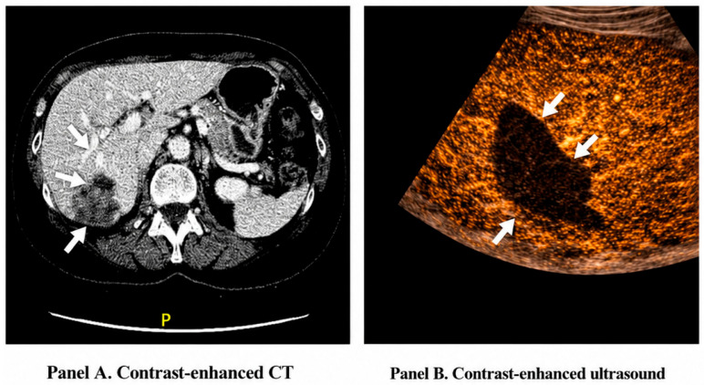
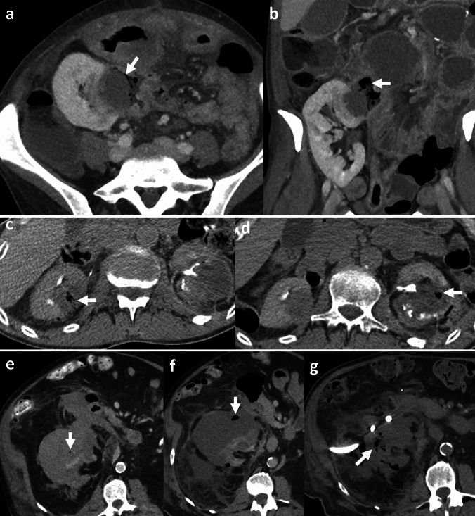
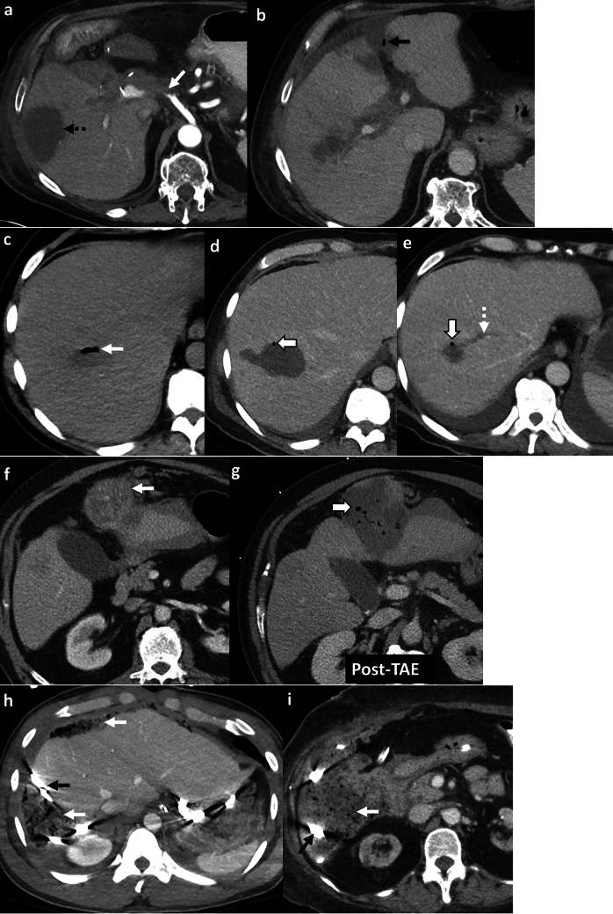
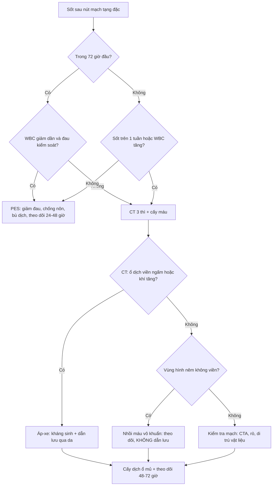

# 1834 — Hội chứng sau nút mạch: phân biệt viêm lành tính với nhiễm trùng/áp-xe / Post-embolization syndrome vs infection and abscess after transarterial embolization

**Tags:** `pattern:hoi-chung-sau-nut-mach` `pattern:sot-sau-can-thiep` `pattern:ap-xe` `pattern:nhoi-mau` `pattern:khi-trong-o-hoai-tu` `vung:gan` `vung:lach` `vung:than` `vung:tu-cung` `vung:tuy` `protocol:CT-3-thi` `protocol:CTA` `protocol:MRI` `protocol:sieu-am`
**Mức chắc chắn (certainty):** tổng hợp y văn (literature synthesis) — ghép 1 tổng quan khí bệnh lý ổ bụng có phần **post-embolization changes** (*Abdom Radiol* 2026, PMC12830503, CC BY 4.0), 1 tổng quan **nhồi máu gan – phân biệt với áp-xe** (*Healthcare* 2026, PMC13410876, CC BY 4.0), 1 tổng quan **áp-xe gan sau điều trị tại chỗ** (*Diagnostics* 2025, PMC11817204, CC BY 4.0), 2 đoàn hệ PES sau TACE/TAE (PMC10853204 CC BY 4.0; PMC7903567 CC BY-NC-SA 3.0), 1 meta phân tích dexamethasone (PMC12341330 CC BY-NC-ND 4.0), 1 đoàn hệ PES sau nút mạch tử cung (PMC12012349 CC BY-NC 4.0) và 2 đoàn hệ nhồi máu lách sau nút mạch (PMC13190409 CC BY 4.0; PMC13337838 CC BY 4.0). Không có thử nghiệm ngẫu nhiên nào về **ngưỡng chụp CT** sau nút mạch → phần "khi nào chụp" là **tổng hợp thực hành**, không phải khuyến cáo mức cao.

> **Câu chốt:** **hội chứng sau nút mạch (post-embolization syndrome, PES) là một phản ứng viêm do hoại tử mô — không phải nhiễm trùng**, và **khí trong tổn thương vừa nút là bình thường**. Hai biến số tách PES khỏi áp-xe **không phải hình ảnh mà là thời gian + xu hướng bạch cầu**: PES xuất hiện **24–72 giờ** (trong tuần đầu), **WBC đi xuống**; áp-xe thường **1–2 tuần**, **WBC đi lên**, kèm **khí tăng dần, ổ đọng có viền ngấm, cấy máu dương**. Tỉ lệ PES rất cao (**58,9% sau TACE**, **72,5% gộp TACE+TAE**, **47,8% sau nút mạch tử cung**) nên "sốt sau nút mạch" là **chuyện thường**, còn áp-xe gan chỉ **0,2–6%** — trừ khi bệnh nhân **đã can thiệp đường mật**, lúc đó áp-xe nhảy lên **12–86%** và phải **dự phòng bằng làm sạch ruột + kháng sinh**.

## 1. Tổng quan bệnh học – cơ chế hình ảnh

### 1.1 Vì sao nút mạch gây sốt mà không có vi khuẩn

- **Chuỗi sự kiện:** thiếu máu nuôi → **hoại tử đông (coagulative necrosis)** mô đích → giải phóng **cytokine (IL-6, TNF-α)** và sản phẩm thoái giáng tế bào vào tuần hoàn → **sốt, đau, buồn nôn, tăng bạch cầu, tăng men gan**. Đây là **phản ứng viêm vô khuẩn**, không phải nhiễm trùng; triệu chứng thường xuất hiện **trong 72 giờ đầu** sau nút mạch tạng đặc và **tự giới hạn** (PMC13521999; PMC12830503).
- **Vì sao đau:** mô hoại tử phù nề trong vỏ bao căng (gan, lách, thận) → kích thích thụ cảm thể bao; đau **cùng bên, cùng vùng**, không lan kiểu đau tạng.
- **Vì sao có khí:** sau nút mạch, CT **ngay sau thủ thuật** có thể thấy **khí trong tổn thương đã nút** do (1) **hoại tử mô sinh hơi** và (2) **khí đi theo vật liệu nút/dung dịch bơm**. Khí này **mất dần trên CT theo dõi** và **không kèm WBC tăng dần** (PMC12830503). Cùng cơ chế, sau **nút mạch tử cung** có thể thấy **khí trong cơ tử cung** — bình thường.
- **Vì sao áp-xe lại khác:** ổ hoại tử **bị bội nhiễm** → vi khuẩn sinh hơi + phản ứng viêm mủ → **khí tăng dần**, **dịch hóa trung tâm**, **viền ngấm thuốc**, **WBC tăng dần**, **cấy máu dương** (chỉ **47,6%** ca áp-xe gan có cấy máu dương — nên cấy âm **không loại trừ**) (PMC11817204; PMC13410876).
- **Ngưỡng định lượng nằm lòng** (bảng dưới) — điểm quan trọng nhất: **thời gian** và **xu hướng WBC**, không phải một con số CRP đơn lẻ.

### 1.2 Ngưỡng định lượng nằm lòng

| Đại lượng | Số liệu | Nguồn |
|---|---|---|
| Thời điểm PES | **trong 3 ngày** sau can thiệp (định nghĩa nghiên cứu); thực tế **24–72 giờ**, trong tuần đầu | PMC10853204; PMC10082639; PMC12830503 |
| Tỉ lệ PES sau TACE | **58,9% (106/180)** | PMC10853204 |
| Tỉ lệ PES gộp TACE + TAE | **72,5% (124/171)**; TACE **74,7%** vs TAE **68,7%** | PMC7903567 |
| Tỉ lệ PES sau nút mạch tử cung | **47,8% (33/69)** "có ý nghĩa lâm sàng" | PMC12012349 |
| PES sau nút mạch lách (kỹ thuật) | **mushroom 10,2% (12/118)** vs **sandwich 37,3% (38/102)** | PMC13318778 |
| Yếu tố dự báo PES sau TACE | loại TACE (p = 0,015), **mức độ nút mạch** (p = 0,008), **số u** (p = 0,026); C-index **0,713/0,703** | PMC10853204 |
| Yếu tố dự báo PES (TACE/TAE) | nữ **OR 2,76 (1,04–7,34)**; HCC do rượu **OR 3,14 (1,42–6,95)** | PMC7903567 |
| PES sau nút mạch tử cung | **sinh con lần đầu (nulliparity) OR 5,51 (1,30–23,41)** | PMC12012349 |
| Thời điểm áp-xe gan sau nút mạch | **1–2 tuần** sau thủ thuật | PMC12830503 |
| Áp-xe gan sau điều trị tại chỗ (chung) | **0,2–6%** | PMC11817204 |
| Áp-xe gan sau TACE | **0,2–8,8%** (8,8% là ngoại lệ DEB-TACE) | PMC11817204 |
| Áp-xe gan khi **đã can thiệp đường mật** | **10,6–100%**; TACE **12–86%** | PMC11817204 |
| Tử vong do áp-xe gan | **13,3–50%** | PMC11817204 |
| Dự phòng ở nhóm nguy cơ cao | **làm sạch ruột + kháng sinh dự phòng: 60% → 0%** | PMC11817204 |
| Nhồi máu lách sau nút mạch phình lách | **37,5% (24/64)**, gắn với vị trí **xa/rốn lách** (p = 0,007) và thể tích lách lớn (p = 0,018) | PMC13190409 |
| Nhồi máu lách — plug vs coil | **22,7% vs 33,3%** (p = 0,046) | PMC13337838 |
| Áp-xe lách sau nút mạch lách | **6/202 (3,0%)**, 5 ca nút mạch xa (p = 0,092) | PMC13521999 (dẫn nghiên cứu 202 ca) |
| Cấy máu dương trong áp-xe gan | **47,6%**; **E. coli 52,4%** | PMC11817204 |

## 2. Mẫu hình + chẩn đoán phân biệt theo cơ quan (gamut)

### 2.1 Gan sau TACE/TARE — "khí trong u đã nút" là bình thường

- **Hình ảnh bình thường:** khí **lấm tấm trong tổn thương đã nút** trên CT **1–3 ngày** sau thủ thuật, kèm **giảm ngấm thuốc do hoại tử u**; **khí mất dần** trên CT sau, **WBC bình thường hoặc giảm dần** (PMC12830503).
- **Áp-xe:** khí **tăng dần**, **dịch hóa**, **viền ngấm**, thường **1–2 tuần** sau, **WBC tăng dần**; đau tăng, sốt cao dai dẳng, có thể vàng da/nhiễm khuẩn huyết.
- **Nhồi máu gan vô khuẩn:** vùng **hình nêm/địa lý, giảm ngấm, theo lãnh thổ mạch**, **không có viền ngấm**; CEUS cho thấy vùng **không ngấm hoàn toàn, giảm ngấm dai dẳng** — **không được chọc dẫn lưu chỉ vì có sốt** (PMC13410876).

*Panel A: CT có cản quang — vùng **giảm tỷ trọng hình nêm/địa lý ở hạ phân thúc VII** (mũi tên), bờ không viền ngấm; Panel B: CEUS — vùng **không ngấm thuốc hoàn toàn, giảm ngấm dai dẳng** (mũi tên), xác nhận **nhồi máu vô khuẩn** chứ không phải ổ mủ. Nguồn: *Healthcare* 2026 (PMC13410876), Fig. 3 — CC BY 4.0, nguyên bản (giữ nhãn A–B).*

### 2.2 Lách sau nút mạch — nhồi máu là "giá phải trả", áp-xe là biến chứng

- **Nhồi máu lách** gặp **22,7–37,5%** tùy chỉ định và thiết bị; đa số **không triệu chứng** hoặc đau nhẹ, **< 33% nhu mô**, tự lành; trên CT là **vùng hình nêm giảm ngấm ở ngoại vi** (PMC13337838; PMC13190409).
- **Áp-xe lách** chỉ **3,0% (6/202)**, hay gặp hơn sau **nút mạch xa (DSE)**; hình ảnh **ổ dịch viền ngấm ± khí**, bệnh nhân **sốt cao kéo dài, đau tăng** (PMC13521999).
- **Điểm cần nhớ:** khí trong nhu mô lách đã nút **không đồng nghĩa áp-xe**; phải xem **xu hướng** — khí tăng + WBC tăng + ổ dịch hóa mới là nhiễm trùng.

### 2.3 Thận sau nút mạch — khí sớm bình thường, khí muộn là nhiễm trùng

- **Ca minh họa (PMC12830503):** nút mạch thận cầm máu; CT **3 ngày** sau có **vài bọt khí nhỏ** (bình thường); CT **6 tuần** khí **nhiều hơn + thâm nhiễm mỡ quanh thận** → **nhiễm trùng sinh hơi**; phải **dẫn lưu**, cuối cùng **cắt thận**; cấy dịch dẫn lưu **Pseudomonas aeruginosa**.
- **Bài học:** với tạng đặc, **mốc so sánh là CT ngay sau thủ thuật** — không có phim mốc thì "khí" không nói được gì.

*Nhóm e–h: bệnh nhân nút mạch thận cầm máu tụ quanh thận; (e) **3 ngày**: vài bọt khí nhỏ (mũi tên) — bình thường; (f) **6 tuần**: khí **nhiều hơn** + thâm nhiễm mỡ quanh thận → nhiễm trùng sinh hơi; (g) **3 tháng** sau dẫn lưu: khí và viêm quanh thận vẫn tiếp diễn → phải cắt thận. Nguồn: *Abdom Radiol* 2026 (PMC12830503), Fig. 15 — CC BY 4.0, nguyên bản (giữ nhãn e–h).*

### 2.4 Tử cung sau nút mạch — PES rất thường, khí trong cơ tử cung là bình thường

- **PES "có ý nghĩa lâm sàng" 47,8%**: đau vùng chậu, buồn nôn, **sốt nhẹ**, mệt; **sinh con lần đầu** làm tăng nguy cơ **OR 5,51** (PMC12012349).
- **Khí trong cơ tử cung/u xơ** sau nút mạch là **thay đổi mong đợi**; triệu chứng và hình ảnh **tự hết** trên theo dõi (PMC12830503).
- **Khác biệt với hoại tử sinh hơi tử cung:** hoại tử sinh hơi có **khí lan ra ngoài tử cung**, bệnh cảnh **nhiễm trùng huyết**, cần **cắt tử cung + rửa ổ bụng**.

### 2.5 Ổ hoại tử tụy / sau EUS — nhiễm trùng ổ hoại tử là hàng DDx bắt buộc

- Sau **EUS coil + keo** (bài 1832), bệnh nhân có thể **sốt, đau** do PES; nhưng **khí trong ổ hoại tử tụy** đã có **stent hoại tử** hoặc **can thiệp nội soi** là **bình thường trong vài ngày đầu** (PMC12830503, Fig. 7).
- **Nhiễm trùng ổ hoại tử** (infected walled-off necrosis): khí **tăng dần**, ổ **to ra**, **bệnh cảnh nhiễm trùng**; chỉ định **dẫn lưu/necrosectomy** — không chờ.
- **Không được nhầm** khí do **can thiệp** với khí do **rò tiêu hóa** (Fig. 8): rò có **khí + dịch chuyển theo tư thế**, bệnh nhân **đau bụng cấp, nhiễm trùng**.

## 3. Bảng so sánh phân biệt (ma trận đối chiếu)

| Thực thể (entity) | Hình ảnh điển hình | Chốt vào (rule-in) | Chốt loại (rule-out) | Gợi ý xác nhận |
|---|---|---|---|---|
| **PES (hội chứng sau nút mạch)** | Không có ổ đọng; có thể **khí lấm tấm trong tổn thương đã nút**; mô hoại tử giảm ngấm | **Sốt + đau trong 24–72 giờ + WBC đi xuống + khí không tăng** | Khí **tăng dần**, ổ **dịch hóa có viền**, WBC **tăng** → không phải PES | WBC/CRP **lặp lại sau 24–48 giờ**; CT so với phim ngay sau thủ thuật |
| **Áp-xe gan** | **Ổ dịch viền ngấm ± khí**, có thể đa ổ; thường **1–2 tuần** sau | **Khí tăng + viền ngấm + WBC tăng + cấy máu dương** | Ổ **hình nêm không viền**, khí giảm dần → nhồi máu/PES | CT 3 thì; cấy máu; chọc hút **chỉ khi** đủ tiêu chuẩn |
| **Nhồi máu gan vô khuẩn** | **Hình nêm/địa lý, giảm ngấm, theo lãnh thổ mạch**, không viền | **Bờ thẳng theo phân thúc + không viền + CEUS không ngấm** | Viền ngấm + khí + sốt dai dẳng → áp-xe | CEUS/MRI; **theo dõi**, không dẫn lưu |
| **Nhồi máu lách** | **Vùng nêm giảm ngấm ngoại vi**, thường **< 33%** nhu mô | **Hình nêm + không khí + đau nhẹ + WBC ổn** | Khí trong nhu mô + sốt cao → áp-xe lách | CT có cản quang; theo dõi 4–6 tuần |
| **Áp-xe lách** | **Ổ dịch viền ngấm ± khí**, có thể vỡ | **Khí + ổ dịch + sốt kéo dài + tăng WBC** | Chỉ nhồi máu không khí → không áp-xe | CT; dẫn lưu qua da + cấy |
| **Nhiễm trùng ổ hoại tử tụy** | Khí **tăng dần** trong ổ hoại tử, ổ to ra | **Khí tăng + bệnh cảnh nhiễm trùng + ổ lớn dần** | Khí ổn định vài ngày sau can thiệp → thay đổi sau thủ thuật | CT so phim cũ; dẫn lưu/necrosectomy |
| **Khí do thủ thuật (không nhiễm)** | Vài bọt khí **ngay sau** can thiệp, không ổ dịch | **Khí ít + không đổi/giảm + bệnh nhân ổn** | Khí tăng + ổ dịch mới → nhiễm | CT lặp lại 1–2 tuần |
| **Tồn lưu u bắt thuốc** | **Nốt ngấm thuốc trong vùng đã nút**, không khí, không dịch | **Ngấm thuốc thì động mạch, không khí** | Khí + dịch + viền → áp-xe, không phải u sống | CTA 1 tháng; PET nếu còn nghi |

### Dấu hiệu chốt (đọc nhanh)

- **"Khí + 2 ngày + WBC giảm" = PES**; **"khí + 2 tuần + WBC tăng" = áp-xe**.
- **Viền ngấm thuốc (rim enhancement) là dấu mạnh nhất của ổ mủ**; vùng **hình nêm không viền** là nhồi máu (PMC13410876).
- **Không chọc/dẫn lưu ổ nhồi máu vô khuẩn chỉ vì bệnh nhân sốt** — sai lầm này gây chảy máu, rò và nhiễm trùng thứ phát (PMC13410876).
- **Cấy máu âm không loại trừ áp-xe**: chỉ **47,6%** dương; cần cấy **dịch ổ mủ** (PMC11817204).

*(a, b) **Ổ mật nhiễm trùng** sau mổ Whipple: nhiều ổ dịch, một số có khí (mũi tên đen), động mạch gan huyết khối; (c–e) **thay đổi sau đốt u bị nhiễm**: ổ to ra, khí tăng, huyết khối tĩnh mạch gan giữa; (f, g) **thay đổi sau nút mạch (TAE)**: (f) u gan đang chảy máu; (g) **2 ngày sau TAE** — khí lấm tấm trong u đã nút (mũi tên trắng đặc), **giảm ngấm do hoại tử**, **WBC bình thường**, khí tự hết trên CT sau. Nguồn: *Abdom Radiol* 2026 (PMC12830503), Fig. 12 — CC BY 4.0, nguyên bản (giữ nhãn a–i).*

## 4. Protocol chụp/can thiệp + hệ phân độ

### 4.1 Khi nào chụp CT sau nút mạch

- **Không chụp thường quy** nếu bệnh nhân đi đúng "đường PES": sốt ≤ 38,5 °C, đau kiểm soát, WBC **giảm dần** — điều trị hỗ trợ và **đánh giá lại lâm sàng 24–48 giờ**.
- **Chụp khi** (tổng hợp từ PMC12830503 + PMC13410876): sốt **kéo dài > 1 tuần** hoặc **tăng dần**; **WBC/CRP tăng** trên 2 lần xét nghiệm; **khí mới xuất hiện hoặc tăng**; **đau tăng/đề kháng thành bụng**; **vàng da, nhiễm khuẩn huyết**; **suy chức năng cơ quan**; nghi **rò mạch–ruột/thiếu máu tạng**.
- **CT bụng–chậu 3 thì** (không cản quang + động mạch + cổng), lát **≤ 1 mm**, kèm **cửa sổ khí** và **so trực tiếp với CT ngay sau thủ thuật** — không có phim mốc thì "khí" mất giá trị.

### 4.2 Đọc CT theo 4 câu hỏi

1. **Có ổ đọng không?** Ổ **dịch hóa + viền ngấm** → nghĩ mủ; **hình nêm không viền** → nhồi máu.
2. **Khí ở đâu, tăng hay giảm?** Khí **trong tổn thương đã nút, ít, giảm dần** = thay đổi sau thủ thuật; khí **tăng, lan ra ngoài tổn thương** = nhiễm trùng.
3. **Mạch còn thông không?** CTA: **tắc/hẹp mạch tạng** giải thích nhồi máu; **giả phình/tái thông** giải thích chảy máu lại.
4. **Có biến chứng cơ học không?** **Rò mạch–ruột** (cản quang trong lòng ruột thì muộn — bài 1831), **di trú vật liệu** (bài 1831/1833), **huyết khối tĩnh mạch cửa**.

### 4.3 Điều trị PES và ngưỡng can thiệp

- **PES:** **giảm đau** (paracetamol/opioid ngắn), **chống nôn**, **bù dịch**, **hạ sốt**; **không kháng sinh thường quy** vì là viêm vô khuẩn; theo dõi **WBC/CRP mỗi 24 giờ** trong 2–3 ngày đầu.
- **Dexamethasone dự phòng — bằng chứng mâu thuẫn, phải nói rõ:** meta 5 nghiên cứu/400 bệnh nhân cho thấy **giảm đau RR 0,61 (0,51–0,75)**, **giảm sốt RR 0,46 (0,35–0,60)**, **giảm nôn RR 0,57 (0,43–0,76)** (PMC12341330); nhưng đoàn hệ 171 bệnh nhân **không thấy giảm PES hay thời gian nằm viện** (PMC7903567). Bài **không khuyến cáo thường quy**; nếu dùng, dùng ở bệnh nhân nguy cơ cao và theo phác đồ địa phương.
- **Áp-xe:** **kháng sinh + dẫn lưu qua da**; áp-xe gan tử vong **13,3–50%** nếu chậm trễ (PMC11817204); **áp-xe lách** dẫn lưu qua da, cắt lách nếu thất bại/vỡ.
- **Nhiễm trùng ổ hoại tử tụy:** **dẫn lưu (EUS/qua da) ± necrosectomy**, kháng sinh theo cấy.

### 4.4 Dự phòng ở nhóm nguy cơ cao (can thiệp đường mật trước đó)

- **Nhận diện trước thủ thuật:** tiền sử **Whipple/PPPD, nối mật–ruột, stent đường mật, PTBD** → áp-xe **10,6–100%** (PMC11817204).
- **Biện pháp:** **làm sạch ruột + kháng sinh dự phòng** (phổ Gram âm + kỵ khí) trước và sau thủ thuật — trong loạt được dẫn, tỉ lệ áp-xe giảm **60% → 0%** (PMC11817204).
- **Theo dõi sát 2 tuần đầu** ở nhóm này, kể cả khi chỉ sốt nhẹ — vì "PES" và "áp-xe sớm" chồng lấp.

### 4.5 Thuật toán sốt sau nút mạch

## 5. Biến thể bình thường và cạm bẫy

- **Khí trong tổn thương đã nút là bình thường:** gặp sau **TAE/TACE, nút mạch thận, nút mạch tử cung**; khí **ít, không đổi hoặc giảm**, bệnh nhân ổn (PMC12830503). **Đừng gọi áp-xe chỉ vì thấy khí.**
- **PES bị đọc là nhiễm trùng:** sốt + tăng men gan + tăng WBC nhẹ trong 72 giờ đầu là **sinh lý**; kháng sinh không cải thiện gì mà **che mất áp-xe thật về sau**.
- **Áp-xe bị đọc là PES:** sốt **kéo dài > 1 tuần**, **WBC tăng dần**, **khí tăng** — đây là áp-xe cho tới khi chứng minh ngược (PMC12830503).
- **Chọc/dẫn lưu ổ nhồi máu vô khuẩn:** sai lầm có hại, gây **chảy máu, rò mật, nhiễm trùng thứ phát**; hình nêm không viền + CEUS không ngấm = **theo dõi** (PMC13410876).
- **Cấy máu âm không loại trừ áp-xe:** chỉ **47,6%** dương; phải cấy **dịch ổ mủ** (PMC11817204).
- **Nhầm tồn lưu u bắt thuốc với áp-xe:** nốt **ngấm thuốc thì động mạch, không khí, không dịch** = u sống/tái phát; cần CTA 1 tháng và đánh giá theo tiêu chuẩn đáp ứng (mRECIST).
- **DEB-TACE có tỉ lệ áp-xe cao hơn:** **8,8%** trong một loạt — nếu dùng hạt vi cầu giải phóng thuốc, ngưỡng nghi ngờ phải thấp hơn (PMC11817204).
- **Không có phim mốc:** "khí" sau nút mạch không diễn giải được; luôn lưu **CT/fluoroscopy ngay sau thủ thuật** làm mốc.

## 6. Tự lượng giá — Blind Quiz

**Ca 1 — Nam 63 tuổi, xơ gan, ung thư gan chảy máu, được nút mạch (TAE) cầm máu. Ngày 2 sau thủ thuật: sốt 38,2 °C, đau hạ sườn phải, WBC 9,8 → 8,1 ×10⁹/L.**

- Hỏi: hình (f) và (g) khác nhau thế nào? Khí trong (g) nói lên điều gì? Có cần kháng sinh/dẫn lưu không?

<b>Bấm để hiện đáp án (findings + chẩn đoán)</b>

- **Findings:** (f) trước nút: **u gan ngấm thuốc, đang chảy máu** (mũi tên trắng đặc); (g) **2 ngày sau TAE**: **khí lấm tấm trong u đã nút** (mũi tên trắng đặc), **giảm ngấm do hoại tử**, **không có ổ dịch viền ngấm**.
- **Chẩn đoán:** **hội chứng sau nút mạch (PES)** — khí do hoại tử + vật liệu nút, **không phải áp-xe**.
- **Xử trí:** giảm đau, bù dịch, hạ sốt, **theo dõi WBC 24–48 giờ**; **không kháng sinh thường quy, không dẫn lưu**. WBC **đi xuống** và khí **tự hết** trên CT sau.
- Nguồn ảnh: *Abdom Radiol* 2026 (PMC12830503), Fig. 12 — CC BY 4.0.

**Ca 2 — Nữ 58 tuổi, sốc nhiễm khuẩn, men gan tăng mạnh; CT bụng có tổn thương gan mới. Siêu âm thường không phân định được.**

- Hỏi: mô tả tổn thương trên CT (A)? CEUS (B) thêm thông tin gì? Vì sao **không** dẫn lưu ngay?

<b>Bấm để hiện đáp án (findings + chẩn đoán)</b>

- **Findings:** (A) vùng **giảm tỷ trọng hình nêm/địa lý ở hạ phân thúc VII**, **bờ theo lãnh thổ mạch**, **không viền ngấm**; (B) CEUS: vùng **không ngấm hoàn toàn, giảm ngấm dai dẳng**, không có viền tăng sinh mạch.
- **Chẩn đoán:** **nhồi máu gan vô khuẩn** (bối cảnh sốc/nhiễm khuẩn, giảm tưới máu), **không phải áp-xe**.
- **Vì sao không dẫn lưu:** ổ nhồi máu **không có mủ**; chọc vào gây **chảy máu, rò mật, nhiễm trùng thứ phát**. Điều trị nguyên nhân (huyết động, nhiễm khuẩn) + theo dõi hình ảnh.
- Nguồn ảnh: *Healthcare* 2026 (PMC13410876), Fig. 3 — CC BY 4.0.

**Ca 3 — Nam 71 tuổi, bệnh thận giai đoạn cuối, nút mạch thận cầm máu tụ quanh thận. Ngày 3 sau thủ thuật CT thấy vài bọt khí; tuần 6 sốt lại, CT mới.**

- Hỏi: khí ở (e) và (f) khác nhau thế nào? Vì sao (e) không cần xử trí mà (f) phải dẫn lưu? Bài học về "phim mốc"?

<b>Bấm để hiện đáp án (findings + chẩn đoán)</b>

- **Findings:** (e) **3 ngày**: **vài bọt khí nhỏ** trong vùng nút, **không thâm nhiễm mỡ**; (f) **6 tuần**: **khí nhiều hơn**, **thâm nhiễm mỡ quanh thận**, thận teo; (g) **3 tháng** sau dẫn lưu: khí và viêm vẫn tiếp diễn → **cắt thận**.
- **Chẩn đoán:** (e) **khí sau thủ thuật, không nhiễm**; (f) **nhiễm trùng sinh hơi quanh thận** (cấy dịch: *Pseudomonas aeruginosa*).
- **Vì sao khác nhau:** khí sớm **ít, không đổi/giảm**, bệnh nhân ổn; khí muộn **tăng dần** kèm **viêm mô** và **sốt lại** = nhiễm trùng thật.
- **Bài học:** phải có **CT mốc ngay sau thủ thuật**; nếu không, "khí" ở lần chụp sau **không thể** phân định bình thường hay nhiễm.
- Nguồn ảnh: *Abdom Radiol* 2026 (PMC12830503), Fig. 15 — CC BY 4.0.

## Bài liên quan chéo
- [1832 – Nút mạch giả phình tạng dưới hướng dẫn EUS](../1832-nut-mach-gia-phinh-eus/lesson.md)
- [1831 – Coil di trú & xuyên thành sau nút mạch tạng](../1831-di-tru-coil-sau-nut-mach-tang/lesson.md)
- [1833 – Vascular plug trong nút mạch tạng](../1833-vascular-plug-nut-mach-tang/lesson.md)
- [1819 – Chảy máu tiêu hóa muộn do giả phình động mạch tạng](../1819-chay-mau-muon-gia-phinh-mach-tang/lesson.md)
- [135 – Viêm tụy cấp (Atlanta) & ổ hoại tử](../135-viem-tuy-Atlanta/lesson.md)

## Ảnh & giấy phép
- `1834_hoi-chung-sau-nut-mach_CT_PMC12830503-f12.jpg`, `1834_hoi-chung-sau-nut-mach_CT_PMC12830503-f15.jpg` — *Abdom Radiol* 2026 (PMC12830503), **CC BY 4.0**, nguyên bản (giữ nhãn a–i / e–h).
- `1834_hoi-chung-sau-nut-mach_CT-CEUS_PMC13410876-f3.jpg` — *Healthcare* 2026 (PMC13410876), **CC BY 4.0**, nguyên bản (giữ nhãn A–B).
- Chi tiết từng file + ghi chú phái sinh: `images/CREDITS.md`.

> Không dùng để chẩn đoán độc lập khi chưa có người hướng dẫn.
