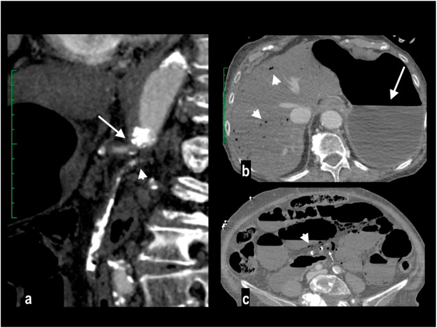
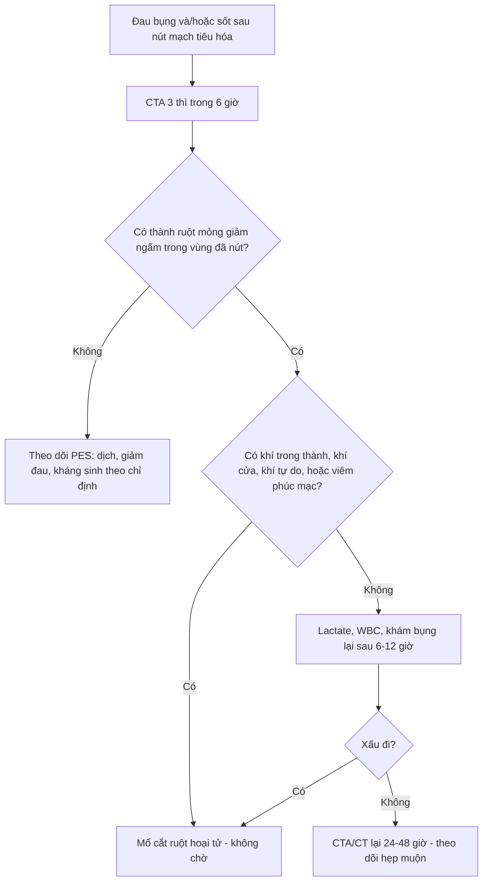
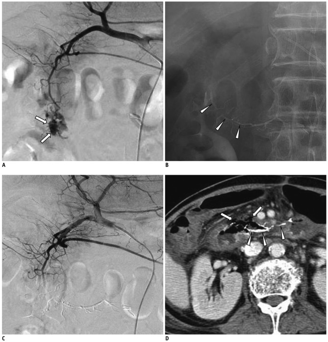
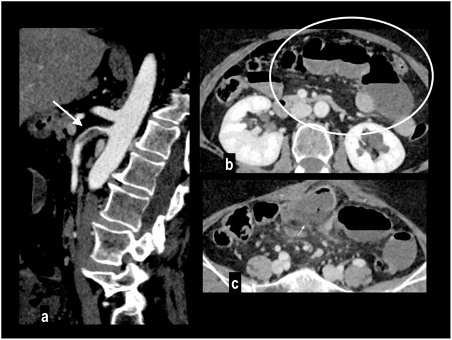

# 1835 — Thiếu máu ruột sau nút mạch mạc treo: vùng nào không được nút / Post-embolization bowel ischemia

**Tags:** `pattern:thieu-mau-ruot` `pattern:nhoi-mau-ruot` `pattern:khi-trong-thanh-ruot` `pattern:hep-mach-mac-treo` `pattern:chay-mau-tieu-hoa` `vung:ruot-non` `vung:dai-trang` `vung:o-bung` `vung:mach-treo-trang-tren` `protocol:CTA-3-thi` `protocol:DSA-nut-mach` `protocol:CT-bung`
**Mức chắc chắn (certainty):** tổng hợp y văn (literature synthesis) — ghép 1 meta phân tích 58 nghiên cứu/2.262 bệnh nhân về nút mạch chảy máu tiêu hóa dưới (*Eur J Med Res* 2025, PMC12776983, CC BY 4.0), 1 đoàn hệ 31 ca nút mạch ruột non (*Ann Gastroenterol* 2024, PMC11372541, CC BY-NC-SA 4.0), 1 tổng quan kỹ thuật nút mạch tiêu hóa trên (*Korean J Radiol* 2012, PMC3341458, CC BY-NC 3.0), 1 tổng quan chảy máu tiêu hóa dưới (*J Interv Med* 2019, PMC8562260, CC BY-NC-ND 4.0), 2 tổng quan hình ảnh thiếu máu mạc treo (*Diagnostics* 2024 PMC11202795 CC BY 4.0; *Diagnostics* 2026 PMC12840507 CC BY 4.0) và 1 đoàn hệ so sánh siêu chọn lọc – chọn lọc (*Front Med* 2025, PMC12702910, CC BY 4.0). Không có thử nghiệm ngẫu nhiên nào về **ngưỡng mổ sau nút mạch** → mục 4 là tổng hợp thực hành, không phải khuyến cáo hội.

> **Câu chốt:** nút mạch tiêu hóa **trên dây chằng Treitz an toàn vì có vòng nối đôi**, còn **dưới dây chằng Treitz (trừ trực tràng) là mạch tận — không có nguồn máu thứ hai** (PMC8562260). Vì vậy "nút mạch cầm máu" và "nút mạch gây thiếu máu ruột" chỉ khác nhau ở **vị trí và mức độ chọn lọc**: nút **siêu chọn lọc tại điểm chảy** giữ được vòng nối, nút **đoạn dài/thân chung** thì không. Tỉ lệ thiếu máu nhẹ sau nút mạch chảy máu tiêu hóa dưới gộp là **4,7% (95% CI 2,9–6,7)**, biến chứng nặng **4,3%** — và đã giảm từ **12,7% xuống 6,3%** sau 2010 (PMC12776983). Dấu CT sớm nhất **không phải khí** mà là **thành ruột mỏng như giấy, giảm ngấm**; khí trong thành và khí cửa chỉ xuất hiện khi đã có **hoại tử xuyên thành**.

## 1. Tổng quan bệnh học – cơ chế hình ảnh

### 1.1 Vì sao nút mạch gây thiếu máu: áp lực tưới máu và giải phẫu mạch tận

- **Nút mạch không "cắt" máu mà hạ áp lực tưới máu** xuống dưới ngưỡng nuôi niêm mạc. Ruột chịu được **giảm 75% lưu lượng trong 12 giờ** mà chưa tổn thương, nhờ ba tầng vòng nối: **thân tạng – mạc treo tràng trên (vòng tá tụy)**, **mạc treo tràng trên – mạc treo tràng dưới (cung Riolan + động mạch bờ Drummond)**, và **trực tràng (mạc treo tràng dưới + động mạch chậu trong)** (PMC12840507; PMC11202795).
- **Ba điểm phân thủy (watershed)** thiếu máu trước tiên khi lưu lượng giảm: **góc hồi–manh tràng**, **góc lách (điểm Griffiths)** và **góc trực–sigma (điểm Sudeck)** (PMC11202795). Đây cũng là nơi tổn thương lan rộng nhất khi nút mạch bờ.
- **Mạch tận là tử huyệt:** các nhánh **jejunal/ileal** và **vasa recta** đi thẳng vào thành ruột, **không có vòng nối trong thành**. Nút một nhánh tận = nút cả đoạn ruột do nhánh đó nuôi. Ngược lại, **dạ dày – tá tràng – trực tràng** có hai nguồn nên nút một nguồn vẫn sống (PMC8562260; PMC3341458).
- **Vì sao thành ruột "mỏng như giấy":** niêm mạc và lớp cơ mất trương lực do thiếu ATP → ruột giãn, thành mỏng, **không ngấm cản quang** vì không còn dòng máu mang iod tới. Khi tái tưới máu, thành **dày lên và ngấm trở lại** — đó là lý do cùng một bệnh cảnh có thể thấy "mỏng" ở thì sớm và "dày" ở lần chụp sau (PMC11202795, Bảng 1).
- **Vì sao có khí:** hoại tử niêm mạc → vi khuẩn sinh hơi vào thành (pneumatosis) → hơi theo **tiểu tĩnh mạch mạc treo** về **hệ cửa** (khí cửa – khí gan). Vì vậy **khí là dấu hiệu muộn của hoại tử xuyên thành**, không phải dấu hiệu sớm (PMC11202795).
- **Ba giai đoạn mô bệnh** (quyết định can thiệp): **I** – hoại tử/loét/phù chỉ ở niêm mạc (hồi phục); **II** – lan tới dưới niêm mạc và lớp cơ; **III** – hoại tử xuyên thành (phải cắt ruột) (PMC11202795).

### 1.2 Ngưỡng định lượng nằm lòng

| Đại lượng | Số liệu | Nguồn |
|---|---|---|
| Khả năng chịu thiếu máu của ruột | giảm **75% lưu lượng × 12 giờ** không tổn thương (nhờ vòng nối) | PMC12840507 |
| Độ nhạy/độ đặc hiệu MDCTA | **Se 94% / Sp 95%** | PMC11202795 |
| Thuốc cản quang cho CTA mạc treo | **2 mL/kg** nồng độ **350 mgI/mL**, tốc độ **4 mL/s**; bolus-tracking ngưỡng **150 HU** | PMC12840507 |
| Thì chụp | không cản quang → **động mạch 30 giây** → **tĩnh mạch 60–70 giây**; thì muộn **3 phút** khi cần | PMC11202795 |
| Lát cắt / tái tạo | **1–2 mm** + MPR/MIP | PMC11202795 |
| Lactate máu | chỉ tăng ở **32–50%** ca thiếu máu mạc treo → lactate bình thường **không loại trừ** | PMC12840507 |
| Tỉ lệ tử vong thiếu máu mạc treo cấp | **50%** (AMESI, 32 trung tâm); tới **90%** nếu chẩn đoán muộn | PMC12840507; PMC11202795 |
| Nút mạch chảy máu tiêu hóa dưới (gộp 58 nghiên cứu, 2.262 ca) | kỹ thuật **97,7%**, lâm sàng **75,0%**, tái chảy máu **17,3%**, biến chứng nặng **4,3%**, **thiếu máu nhẹ 4,7%**, biến chứng phụ **10,8%** | PMC12776983 |
| Xu hướng theo thời gian | biến cố thiếu máu gộp **12,7% (trước 2010) → 6,3% (sau 2010)** | PMC12776983 |
| Nút mạch ruột non (31 ca) | cắt ruột vì thiếu máu **6,5% (2/31)**; tái chảy máu **29%**; tử vong trong viện **23%** | PMC11372541 |
| Chất nút và thiếu máu (dẫn từ y văn) | NBCA: **14% (10/72)** và **5,5% (2/36)**; **coil đơn thuần: 0%** (2 loạt nhỏ) | PMC11372541 |
| Nút mạch tiêu hóa trên | kỹ thuật **92–100%**, lâm sàng **51–94%**, tái chảy máu **9–47%**, tử vong 30 ngày **3–27%**; **hẹp tá tràng 16% (9/57)** | PMC3341458 |
| Siêu chọn lọc vs chọn lọc (116 ca) | tái chảy máu trong 3 ngày **8,33% vs 27,50%** (p = 0,017); **cả 5 ca thiếu máu ruột đều thuộc nhóm chảy máu tiêu hóa dưới (28 ca)** | PMC12702910 |
| Ngưỡng phát hiện của chẩn đoán | DSA cần **≥ 1 mL/phút**; CTA **≥ 0,5 mL/phút**; Tc-99m RBC **0,1–0,4 mL/phút** | PMC8562260 |

## 2. Mẫu hình + chẩn đoán phân biệt theo vị trí (gamut)

**Mẫu hình chung:** một **đoạn ruột** (không phải toàn bộ) giãn, **thành mỏng như giấy, giảm ngấm** ở thì động mạch–tĩnh mạch, **ranh giới theo lãnh thổ mạch đã nút**; sau 24–72 giờ có thể thêm **khí trong thành**, **khí cửa**, **dịch quanh ruột**, **thành ruột không xác định bờ**.

- **Nút mạch tiêu hóa trên (thân tạng):** dạ dày, tá tràng, GDA. **Nguy cơ thấp** nhờ vòng tá tụy và thân tạng; biến chứng muộn hay gặp hơn là **hẹp tá tràng (16%)** chứ không phải hoại tử (PMC3341458).
- **Nút mạch ruột non (nhánh jejunal/ileal, mạc treo tràng trên):** **nguy cơ cao nhất** — mạch tận; đây là nơi gặp **6,5–14%** thiếu máu phải cắt ruột (PMC11372541).
- **Nút mạch đại tràng phải (ileocolic, right/middle colic):** nguy cơ trung bình — có **động mạch bờ**, nhưng **góc hồi–manh tràng** là điểm phân thủy.
- **Nút mạch đại tràng trái (left colic, mạc treo tràng dưới):** nguy cơ trung bình–cao — **điểm Griffiths** ở góc lách; vùng chuyển tiếp giữa hai hệ.
- **Nút mạch trực tràng:** **an toàn** vì có nguồn thứ hai từ **động mạch chậu trong** (PMC8562260).
- **Nút mạch "mù" (prophylactic) khi DSA âm:** **chấp nhận được ở tiêu hóa trên**, **nguy hiểm ở tiêu hóa dưới** vì không có mạch đôi — chỉ làm khi đã định vị chắc bằng CTA/xạ hình (PMC8562260).

## 3. Bảng so sánh phân biệt (ma trận đối chiếu)

| Thực thể (entity) | Hình ảnh điển hình | Chốt vào (rule-in) | Chốt loại (rule-out) | Gợi ý xác nhận |
|---|---|---|---|---|
| **Thiếu máu ruột do nút mạch (sớm, < 72 giờ)** | Đoạn ruột giãn, **thành mỏng như giấy, giảm ngấm**, ranh giới đúng lãnh thổ mạch đã nút; dịch quanh ruột | **Đau bụng tăng sau nút mạch + thành mỏng/giảm ngấm trong vùng đã nút** | Thành dày đều, ngấm bình thường, không đau → chỉ theo dõi | CTA 3 thì; nội soi/CT lại sau 24–48 giờ; lactate |
| **Hội chứng sau nút mạch (PES)** | Sốt, đau, buồn nôn **24–72 giờ**, không có dấu ruột; tổn thương đích có thể có **khí "bình thường"** | **WBC đi xuống + đau giảm dần trong 3–5 ngày** | **WBC đi lên, đau tăng, khí tăng dần, thành ruột mỏng** → không phải PES | Theo dõi 48–72 giờ; CT khi xấu đi (bài 1834) |
| **Nhồi máu ruột do huyết khối/thuyên tắc (không do nút)** | Cùng mẫu hình nhưng **có cục máu tắc trong động mạch** hoặc **không có tiền sử can thiệp** | **Khuyết thuốc trong SMA/nhánh + thiếu máu ngoài vùng can thiệp** | Có can thiệp đúng vùng, mạch thông → nghĩ do nút mạch | CTA; DSA; siêu âm tim nếu nghi nguồn thuyên tắc |
| **Viêm ruột do xạ / viêm ruột cấp** | Thành dày, phù dưới niêm mạc, **ngấm tăng**, mạch thông | **Thành dày + ngấm mạnh + mạch thông + bối cảnh xạ/viêm** | Thành mỏng, giảm ngấm, có can thiệp mạch → thiếu máu | CTA; nội soi; bệnh sử |
| **Hẹp ruột do thiếu máu (muộn, 2–6 tuần)** | Đoạn hẹp, thành dày xơ, giãn ruột phía trên, **không khí trong thành** | **Hẹp + tiền sử nút mạch/thiếu máu + không khối** | Khối u/viêm Crohn (có tổn thương niêm mạc đặc trưng) | CT bụng có cản quang; nội soi; mô bệnh nếu cần |

*Trái (a): MIP sagittal — tắc nguyên ủy thân tạng (mũi tên) và mạc treo tràng trên (đầu mũi tên). (b): **khí trong gan** (đầu mũi tên) + dạ dày giãn (mũi tên). (c): **thành ruột giãn mỏng như giấy, giảm ngấm**, khí trong thành (đầu mũi tên) và khí trong tĩnh mạch mạc treo (mũi tên) — giai đoạn III, bệnh nhân tử vong. Nguồn: *Diagnostics* 2024, PMC11202795, CC BY 4.0.*

### Dấu hiệu đọc đúng thứ tự thời gian

- **Sớm (0–6 giờ):** thành **mỏng, giảm ngấm**, ruột giãn, dịch quanh ruột ít. **Đây là cửa sổ can thiệp.**
- **Trung gian (6–24 giờ):** bờ thành **không xác định**, **dịch quanh ruột nhiều hơn**, mạch máu mạc treo **ứ/căng**.
- **Muộn (> 24 giờ):** **khí trong thành**, **khí cửa–khí gan**, **khí tự do**, **hơi trong tổn thương đã nút không còn "bình thường"** nếu kèm thành mỏng và WBC tăng.

## 4. Protocol chụp + hệ phân độ/điểm chuẩn hóa

### 4.1 CTA mạc treo — protocol tối thiểu

- **Không cản quang** trước: tìm **thành ruột/tổ chức trong lòng tăng đậm tự nhiên** (dấu xuất huyết niêm mạc) và **vôi hóa mạch**.
- **Thì động mạch** (bolus-tracking **150 HU**, khoảng **30 giây**): tìm **tắc – hẹp – giả phình – coil/plug đã đặt**, và **thành ruột giảm ngấm**.
- **Thì tĩnh mạch cửa** (**60–70 giây**): đánh giá **tĩnh mạch mạc treo**, **khí cửa**, **ngấm thành ruột thì muộn** (thành ngấm bù sau thiếu máu).
- **Thì muộn 3 phút** khi nghi **thiếu máu không tắc (NOMI)** hoặc cần phân biệt ngấm bù.
- **Tái tạo 1–2 mm + MPR/MIP**, đo **đường kính và độ dày thành** tại chỗ dày nhất và chỗ mỏng nhất; **cửa sổ nhu mô** để không bỏ khí thành.
- **Không dùng cản quang đường uống** (che thành ruột, giảm tương phản thành–lòng) (PMC11202795).

### 4.2 Chọn mức nút mạch — quyết định trước khi gây thiếu máu

Ba kiểu nút theo **mức** (PMC3341458, Fig. 1):

1. **Khu trú (localized):** siêu chọn lọc **đúng điểm chảy**, không nút nhánh lành → **giữ vòng nối**, nguy cơ thiếu máu thấp nhất.
2. **Gần (proximal):** nút **thân nhánh phía trên điểm chảy** khi microcatheter không vào được — chấp nhận mất một phần lãnh thổ.
3. **Đoạn (segmental):** nút **cả điểm chảy + nhánh bên cạnh** để chặn dòng ngược — **nguy cơ thiếu máu cao nhất**.

- **Chọn chất nút:** **coil** cho mạch lớn, nhìn thấy rõ, ít nguy cơ hoại tử nhất trong các loạt nhỏ; **NBCA/keo** khi rối loạn đông hoặc cần nút mao mạch — nhưng **keo đi xa và gây thiếu máu nhiều hơn**; **hạt (particles)** chỉ dùng khi điểm chảy không thấy được và chấp nhận nguy cơ (PMC3341458; PMC11372541).
- **Nguyên tắc vàng:** **nút càng xa càng tốt, càng ít nhánh càng tốt**; nếu phải nút đoạn dài ở **ruột non/đại tràng trái**, ghi rõ trong phiếu để theo dõi sát 24–48 giờ.

### 4.3 Phân độ và ngưỡng xử trí

| Mức | Dấu hiệu | Xử trí |
|---|---|---|
| **0 – Không thiếu máu** | Thành ruột bình thường, mạch thông | Theo dõi PES (bài 1834) |
| **1 – Thiếu máu niêm mạc (hồi phục)** | Thành mỏng nhẹ, giảm ngấm khu trú, **không khí** | Nhịn ăn, dịch, kháng sinh, **CTA lại 24 giờ** |
| **2 – Thiếu máu xuyên thành** | Thành mỏng rõ + **khí trong thành**, dịch quanh ruột, lactate tăng | **Mổ** (cắt đoạn, không nối thì đầu) |
| **3 – Hoại tử/thủng** | **Khí cửa–khí gan**, khí tự do, viêm phúc mạc | **Mổ cấp cứu**, hồi sức |

- **Ngưỡng mổ không phải một con số lactate** mà là **tổ hợp**: khí trong thành/khí cửa + đau tăng + viêm phúc mạc. Lactate chỉ tăng ở **32–50%** ca (PMC12840507) nên **không dùng lactate để loại trừ**.
- **Sau nút mạch tiêu hóa dưới**, nếu bệnh nhân đau nhiều và có **tiền sử nút đoạn dài**, hạ ngưỡng chụp lại xuống **6–12 giờ** thay vì 24 giờ.

## 5. Biến thể bình thường và cạm bẫy

- **PES là bắt chước số 1:** sốt + đau + tăng bạch cầu trong **24–72 giờ** sau nút mạch là **phản ứng viêm vô khuẩn**, không phải thiếu máu. Phân biệt bằng **xu hướng WBC** và **thời gian**, không bằng một lần CRP (bài 1834).
- **Khí trong tổn thương đã nút là bình thường** — nhưng **khí trong thành ruột thì không**. Hai chữ "khí" khác hẳn nhau về ý nghĩa.
- **"Thành mỏng như giấy" có thể là ruột giãn do tắc ruột non** — đo trên **cửa sổ nhu mô**, so sánh **đoạn bệnh/đoạn lành**, và luôn tìm **giảm ngấm** đi kèm; giãn đơn thuần vẫn **ngấm đều**.
- **Thiếu máu không tắc (NOMI)** cho hình ảnh **giống hệt** nhưng **mạch thông hoàn toàn**, thường sau sốc/hồi sức; đừng quy cho "nút mạch" khi bệnh nhân vừa bị tụt áp kéo dài.
- **Nút mạch "mù" ở tiêu hóa dưới** là cạm bẫy chết người: **không có mạch đôi**, thiếu máu có thể xảy ra dù không thấy điểm chảy (PMC8562260).
- **Coil ở mạch tận nhỏ** có thể gây **viêm ruột thừa do thiếu máu** (nút động mạch ruột thừa) hoặc **thiếu máu đại tràng phải phải cắt nửa đại tràng** — biến chứng của chính kỹ thuật, không phải của bệnh nền.
- **Nút mạch ở bệnh nhân đã mổ/mô phúc mạc dính hoặc đã xạ:** vòng nối **đã bị cắt** → nguy cơ thiếu máu tăng rõ; đây là nhóm **không được nút mù** (PMC3341458).

## 6. Tự lượng giá — Blind Quiz

**Ca 1 — Nam 65 tuổi, melena, nút mạch nhánh GDA bằng NBCA đoạn dài. Ngày 4 đau bụng tăng, sốt 38,5 °C.**

- Hỏi: (1) Mô tả tổn thương trên CT; (2) ba chẩn đoán phân biệt; (3) xử trí?

<b>Bấm để hiện đáp án (findings + chẩn đoán)</b>

- **Dấu hiệu:** (A) thoát mạch từ nhánh nhỏ GDA (mũi tên); (B, C) **cast NBCA đoạn dài** (đầu mũi tên); (D) CT ngày 4: **thiếu máu và thủng ruột** (mũi tên) + **viêm phúc mạc quanh vật liệu nút** (đầu mũi tên).
- **Chẩn đoán:** **thiếu máu – thủng ruột sau nút mạch đoạn dài bằng NBCA** — keo đi xa vào mao mạch, không còn vòng nối.
- **Phân biệt:** PES (không có khí/thủng, WBC đi xuống); thiếu máu do huyết khối mới; áp-xe ổ hoại tử (khí trong ổ, không trong thành ruột).
- **Xử trí:** **mổ cấp cứu** — cắt đoạn ruột hoại tử, không nối thì đầu; kháng sinh phổ rộng.
- **Phản biện:** ca này **dưới dây chằng Treitz** nhưng tổn thương lại ở **tá tràng/GDA** — vùng *có* mạch đôi; thiếu máu xảy ra vì **nút đoạn dài + keo lỏng đi xa**, không phải vì giải phẫu. Đây chính là điểm cần nhớ: **kỹ thuật quan trọng hơn vùng**.
- Nguồn ảnh: *Korean J Radiol* 2012, PMC3341458, CC BY-NC 3.0.

**Ca 2 — Nữ 78 tuổi, đau bụng dữ dội, không có tiền sử can thiệp.**

- Hỏi: dấu hiệu nào cho biết đã **hoại tử xuyên thành**? Vì sao **khí trong gan** lại xuất hiện?

<b>Bấm để hiện đáp án (findings + chẩn đoán)</b>

- **Dấu hiệu:** tắc **nguyên ủy thân tạng và mạc treo tràng trên**; **khí trong gan** (khí cửa lan vào gan); **thành ruột mỏng như giấy, giảm ngấm**, **khí trong thành** và **khí tĩnh mạch mạc treo**.
- **Cơ chế:** hoại tử niêm mạc → vi khuẩn sinh hơi vào thành → hơi theo **tiểu tĩnh mạch mạc treo** → **tĩnh mạch cửa** → **gan** (khí cửa thường ngoại vi, khác khí trong đường mật ở trung tâm).
- **Chẩn đoán:** **thiếu máu mạc treo giai đoạn III** — chỉ định mổ, tiên lượng rất xấu.
- Nguồn ảnh: *Diagnostics* 2024, PMC11202795, CC BY 4.0.

**Ca 3 — Nam 66 tuổi, hẹp mạc treo tràng trên, đau bụng 12 giờ, lactate 2,1 mmol/L.**

- Hỏi: vì sao **lactate bình thường không loại trừ**? Dấu hiệu nào trên (b) là **sớm nhất**?

<b>Bấm để hiện đáp án (findings + chẩn đoán)</b>

- **Dấu hiệu:** (a) **mảng xơ đậm độ thấp ở SMA gần nguyên ủy, hẹp lòng** (mũi tên); (b) **quai ruột non giãn, thành mỏng như giấy** (vòng tròn); (c) **hoại tử xuyên thành từng đoạn** ở bờ mạc treo (mũi tên).
- **Vì sao lactate bình thường:** lactate chỉ tăng ở **32–50%** ca; tổn thương niêm mạc khu trú chưa đủ gây toan chuyển hóa. **Quyết định dựa vào hình ảnh + đau lệch xa thăm khám**, không dựa lactate.
- **Chẩn đoán:** thiếu máu mạc treo do **huyết khối trên mảng xơ** (khác thuyên tắc: thường có vòng nối, khởi phát từ từ).
- Nguồn ảnh: *Diagnostics* 2024, PMC11202795, CC BY 4.0.

## Bài liên quan chéo
- [1834 – Hội chứng sau nút mạch: phân biệt viêm lành tính với nhiễm trùng/áp-xe](../1834-hoi-chung-sau-nut-mach/lesson.md)
- [1833 – Vascular plug trong nút mạch tạng: chọn cỡ, kỹ thuật, khi nào plug hơn coil](../1833-vascular-plug-nut-mach-tang/lesson.md)
- [1819 – Chảy máu muộn & giả phình mạch tạng](../1819-chay-mau-muon-gia-phinh-mach-tang/lesson.md)
- [135 – Viêm tụy cấp (Atlanta) & ổ hoại tử](../135-viem-tuy-Atlanta/lesson.md)
- [920 – Nút mạch trong chảy máu tiêu hóa](../920-vascular-embolization-gi-bleed/lesson.md)

> Không dùng để chẩn đoán độc lập khi chưa có người hướng dẫn.
