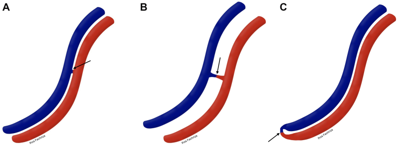
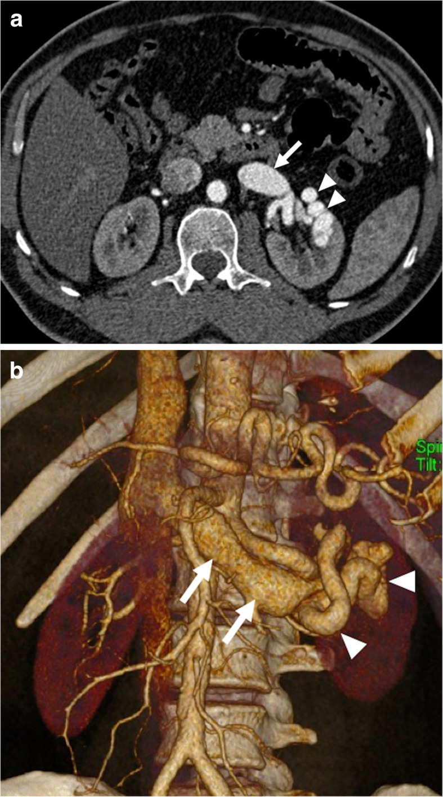
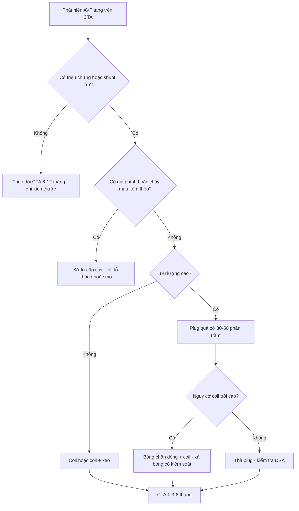
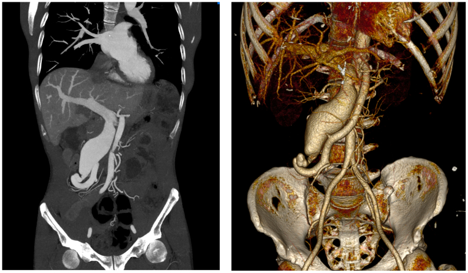
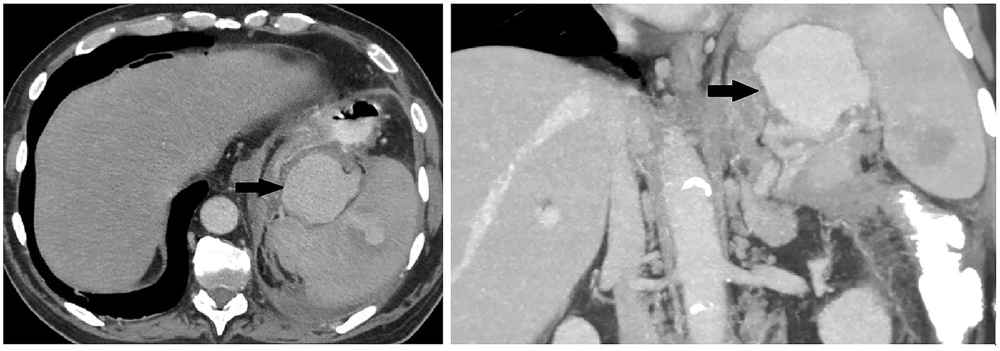

# 1836 — Rò động – tĩnh mạch tạng sau chấn thương và sau mổ: chẩn đoán, phân biệt với giả phình, chọn coil – plug – stent phủ / Visceral arteriovenous fistula

**Tags:** `pattern:ro-dong-tinh-mach` `pattern:shunt-mach` `pattern:gia-phinh-mach` `pattern:hep-tinh-mach-cua` `pattern:giai-doan-som-tinh-mach` `vung:gan` `vung:lach` `vung:than` `vung:mach-cua` `vung:ruot-non` `vung:o-bung` `protocol:CTA-3-thi` `protocol:DSA` `protocol:balloon-assisted`
**Mức chắc chắn (certainty):** tổng hợp y văn (literature synthesis) — ghép 1 tổng quan hình ảnh cấp cứu mạch tạng (*Insights Imaging* 2020, PMC7561664, CC BY 4.0), 1 tổng quan + 3 ca bệnh HHT thể gan (*Front Med* 2026, PMC13404187, CC BY 4.0), 1 ca + tổng quan 26 bệnh nhân rò động–tĩnh mạch gan bẩm sinh (*J Med Case Rep* 2025, PMC12763836, CC BY 4.0), 1 ca rò mạc treo tràng trên được bít bằng **một plug** (*J Vasc Surg Cases Innov Tech* 2026, PMC13092855, CC BY 4.0), 1 ca rò thân tạng–tĩnh mạch cửa sau đạn (*Radiol Case Rep* 2026, PMC13181249, CC BY-NC-ND 4.0), 1 ca rò thận lưu lượng cao có giãn tĩnh mạch chủ dưới (*Radiol Case Rep* 2026, PMC13196357, CC BY-NC-ND 4.0), 2 ca rò thận lưu lượng cao (*J Vasc Surg Cases Innov Tech* 2023, PMC9883246, CC BY-NC-ND 4.0), 1 ca bẫy **máu tụ tổ chức hóa + rò** giả giả phình lách (*Radiol Case Rep* 2026, PMC13586829, CC BY 4.0) và 2 ca rò lách sau chấn thương (*Cureus* 2024 PMC11302989 CC BY 4.0; *Acta Med Litu* 2025 PMC12875546 CC BY 4.0). Không có thử nghiệm ngẫu nhiên nào về **ngưỡng can thiệp rò tạng** → mục 4 là tổng hợp thực hành.

> **Câu chốt:** rò động–tĩnh mạch (arteriovenous fistula, AVF) tạng là **một lỗ thông trực tiếp giữa động mạch và tĩnh mạch, không qua giường mao mạch** — nên trên **CTA thì động mạch** luôn có **một dấu hiệu chốt: tĩnh mạch dẫn lưu đã ngấm thuốc SỚM, cùng lúc với động mạch, và giãn to** (PMC7561664). Giả phình (pseudoaneurysm) **không** làm ngấm sớm tĩnh mạch — đây là điểm phân biệt quan trọng nhất, vì **giả phình thì theo dõi/nút túi**, còn **rò thì phải bít lỗ thông và bảo tồn tĩnh mạch**. Hệ quả lâm sàng chia hai nhánh: rò **vào hệ cửa** gây **tăng áp cửa trước xoang** (giãn tĩnh mạch thực quản–dạ dày), rò **vào tĩnh mạch hệ thống** gây **suy tim lưu lượng cao** khi lưu lượng shunt **vượt 20% cung lượng tim** (PMC13404187).

## 1. Tổng quan bệnh học – cơ chế hình ảnh

### 1.1 Vì sao AVF vừa "ồn ào" trên hình ảnh vừa dễ bị bỏ sót

- **Vật lý của shunt:** máu đi từ động mạch (áp lực cao) sang tĩnh mạch (áp lực thấp) **không qua tiểu động mạch** → **sức cản ngoại vi giảm** → lưu lượng qua lỗ thông tăng, **chênh áp duy trì**. Hệ quả: **tĩnh mạch dẫn lưu giãn và "động mạch hóa"**, thành dày; **động mạch nuôi giãn**; và **dòng "ăn cắp" (steal)** khỏi mô phía sau lỗ thông.
- **Vì sao thấy được trên thì động mạch:** bình thường thuốc cản quang phải qua mao mạch nên tĩnh mạch chỉ ngấm ở thì tĩnh mạch (**60–70 giây**). Có lỗ thông, thuốc **đi thẳng** sang tĩnh mạch → **ngấm ở thì động mạch (25–35 giây)**. Đây là **cơ sở vật lý của dấu "early venous filling"** — không phải "tĩnh mạch sáng hơn" mà là **tĩnh mạch sáng SỚM** (PMC7561664).
- **Vì sao có hại:** (1) **quá tải thể tích** → tăng tiền tải → **suy tim lưu lượng cao**; (2) nếu đổ vào **hệ cửa** → tăng áp lực tĩnh mạch cửa **trước xoang** → giãn tĩnh mạch, cổ trướng; (3) **steal** → thiếu máu mô đích (ví dụ **hoại tử đường mật** trong HHT gan) (PMC13404187).
- **Ngưỡng suy tim lưu lượng cao:** shunt trong gan **> 20% cung lượng tim** mới có ý nghĩa lâm sàng; **chỉ số tim tăng 4,2–7,3 L/phút/m²** (bình thường **2,5–4,0**) (PMC13404187).
- **Nguồn gốc:** **bẩm sinh** (HHT, loạn sản mạch, AVF thận bẩm sinh) hoặc **mắc phải** — **chấn thương**, **thủ thuật** (sinh thiết thận/gan, dẫn lưu đường mật, phẫu thuật cắt tạng, TIPS), **vỡ phình vào tĩnh mạch**, **viêm tụy**, **u**. Đa số rò thận là **mắc phải**; tỉ lệ AVF thận nói chung khoảng **0,04%** (PMC9883246).
- **Vì sao dễ bỏ sót:** rò lưu lượng nhỏ **không triệu chứng** trong nhiều năm; sau chấn thương có thể xuất hiện **muộn (ngày → nhiều năm)**; và tổn thương có thể **không thấy trên CT ban đầu** — trong chấn thương lách, **> 25% tổn thương mạch không hiện trên CT** lần đầu (PMC11302989).

### 1.2 Ngưỡng định lượng nằm lòng

| Đại lượng | Số liệu | Nguồn |
|---|---|---|
| Tỉ lệ AVF thận (chung) | **0,04%**; đa số **mắc phải** (thủ thuật, chấn thương, viêm, u) | PMC9883246 |
| Thời điểm ngấm tĩnh mạch bình thường | thì tĩnh mạch **60–70 giây** (động mạch **25–35 giây**) | PMC7561664; PMC11202795 |
| Ngưỡng shunt gây suy tim lưu lượng cao | **> 20% cung lượng tim**; chỉ số tim **4,2–7,3 L/phút/m²** | PMC13404187 |
| HHT thể gan | **70%** bệnh nhân HHT có tổn thương gan trên CT, chỉ **5–8%** có triệu chứng; tuổi chẩn đoán trung bình **48** | PMC13404187 |
| Rò động–tĩnh mạch gan bẩm sinh (tổng quan 26 ca) | can thiệp nội mạch **22/26 (84,6%)**, chẹn beta **2 (7,7%)**, mổ/ghép gan **2 (7,7%)**; **2 trẻ tử vong** sau nút mạch, **1** phải ghép gan | PMC12763836 |
| Rò mạc treo tràng trên (ca) | lỗ thông **10 × 12 mm**, tiền sử mổ xoắn ruột **20 năm** trước; bít **1 plug Amplatzer** | PMC13092855 |
| Rò lách do chấn thương (ca) | lách **độ IV**, nhiều giả phình; CT **ngày 5** mới thấy giả phình + AVF → nút mạch **ngày 7** | PMC11302989 |
| Rò thận lưu lượng cao (ca) | tĩnh mạch thận **giãn 4,0 × 4,0 cm**; bít bằng coil + **0,2 mL NBCA 50%** | PMC9883246 |
| Bẫy máu tụ + rò ở rốn lách (ca) | tổn thương **22 mm → 54 mm trong 13 ngày**, ngấm cả thì tĩnh mạch cửa | PMC13586829 |
| Biến chứng của chính can thiệp | **coil di trú vào nhĩ phải** khi xả bóng; **thiếu máu cực dưới thận** 1/2 ca; **huyết khối tĩnh mạch cửa** sau nút mạch gan trong HHT | PMC13196357; PMC13404187 |

## 2. Mẫu hình + chẩn đoán phân biệt theo vị trí (gamut)

**Mẫu hình chung:** trên **CTA thì động mạch**, một **tĩnh mạch lớn ngấm thuốc sớm** nối với động mạch qua **lỗ thông hẹp**; tĩnh mạch **giãn, thành dày**; mô đích có thể **giảm ngấm do steal**; trên **MIP/VRT** thấy rõ **"cầu nối" động–tĩnh mạch**.

- **Gan:** (1) **rò động–tĩnh mạch cửa (arterioportal)** — tăng áp cửa trước xoang, có thể **ho ra máu/đi cầu phân đen**; (2) **rò động–tĩnh mạch gan** — suy tim lưu lượng cao; (3) **HHT thể gan** — tổn thương **lan tỏa, nhiều shunt phối hợp**; (4) sau **sinh thiết/dẫn lưu đường mật/TIPS**; (5) do **HCC** (shunt trong u).
- **Lách:** rò **động mạch lách – tĩnh mạch lách** → **tăng áp cửa trái** (giãn tĩnh mạch **dạ dày đơn độc**), lách to; nguyên nhân **chấn thương, vỡ phình, sau mổ (kể cả mổ giảm béo), viêm tụy**.
- **Thận:** rò **động mạch – tĩnh mạch thận** → **đái máu**, **tăng huyết áp**, **suy tim lưu lượng cao**, suy thận; sau **sinh thiết thận** là nguyên nhân hay gặp nhất.
- **Mạc treo:** rò **mạc treo tràng trên – tĩnh mạch mạc treo**, **mạc treo tràng dưới – tĩnh mạch mạc treo dưới**; sau **mổ bụng**, chấn thương; có thể **giả khối đập theo mạch** ở thượng vị (bắt chước phình động mạch chủ) (PMC13092855).
- **Hình thái lỗ thông** (theo phân loại SMAVF): **type 1A** — thông **bên–bên không có đoạn rò**; **type 1B** — bên–bên **có đoạn rò xác định**; **type 2** — **tận–bên/tận–tận** (đầu động mạch đổ thẳng vào tĩnh mạch) (PMC13092855). Type 2 khó bảo tồn nhánh hơn.

*Sơ đồ: (A) type 1A — thông bên–bên **không có đoạn rò**; (B) type 1B — bên–bên **có đoạn rò**; (C) type 2 — **tận–bên**. Đỏ = động mạch, xanh = tĩnh mạch, mũi tên = lỗ thông. Nguồn: *J Vasc Surg Cases Innov Tech* 2026, PMC13092855, CC BY 4.0.*

## 3. Bảng so sánh phân biệt (ma trận đối chiếu)

| Thực thể (entity) | Hình ảnh điển hình | Chốt vào (rule-in) | Chốt loại (rule-out) | Gợi ý xác nhận |
|---|---|---|---|---|
| **Rò động – tĩnh mạch (AVF)** | Lỗ thông động–tĩnh mạch + **tĩnh mạch dẫn lưu ngấm SỚM ở thì động mạch**, giãn to | **Ngấm sớm tĩnh mạch cùng thì động mạch + tĩnh mạch giãn** | Tĩnh mạch chỉ ngấm ở thì tĩnh mạch → không phải rò | CTA 3 thì + MIP/VRT; DSA xác nhận và đo lưu lượng |
| **Giả phình động mạch (pseudoaneurysm)** | Túi ngấm thuốc **giữ nguyên hình**, **không có tĩnh mạch ngấm sớm**; có thể có "rửa song hành" | **Túi ngấm ở thì động mạch, không thấy tĩnh mạch sớm** | **Tĩnh mạch dẫn lưu ngấm sớm** → là rò, không phải giả phình | CTA; DSA; theo dõi kích thước |
| **Shunt lách – thận bẩm sinh (splenorenal shunt)** | Giãn tĩnh mạch lách–thận, **không có lỗ thông động mạch**, không có dòng động mạch vào tĩnh mạch | **Không thấy dòng động mạch đổ trực tiếp vào tĩnh mạch** | **Thấy dòng động mạch–tĩnh mạch trực tiếp** → rò | CTA thì động mạch; DSA |
| **Máu tụ tổ chức hóa có rò (bẫy)** | Khối ở rốn lách **tăng nhanh (22 → 54 mm)**, ngấm **cả thì tĩnh mạch cửa**; DSA có hình giống giả phình | **Ngấm kéo dài sang thì tĩnh mạch + tăng kích thước nhanh + bối cảnh viêm tụy hoại tử** | Ngấm **chỉ thì động mạch**, hình túi cố định → giả phình thật | CTA nhiều thì; DSA; **mô bệnh sau mổ** là chốt |
| **Dị dạng động – tĩnh mạch (AVM) có nidus** | **Nidus** nhiều cuộn mạch, nhiều động mạch nuôi và nhiều tĩnh mạch dẫn | **Nidus + nhiều cuống mạch** | Một lỗ thông đơn độc → AVF | CTA/MRA; DSA; phân độ Spetzler–Martin nếu ở não |

*(a) Thì động mạch: **tĩnh mạch thận trái giãn ngấm thuốc sớm** (mũi tên) + cụm mạch giãn (đầu mũi tên). (b) VRT: động mạch–tĩnh mạch thông trực tiếp, tĩnh mạch giãn ngoằn ngoèo. Bệnh nhân **53 tuổi, đái máu 2 tháng sau sinh thiết thận qua da**. Nguồn: *Insights Imaging* 2020, PMC7561664, CC BY 4.0.*

### Dấu hiệu chốt trên từng thì

- **Thì không cản quang:** máu tụ, vôi hóa, **dịch quanh tạng**; không chẩn đoán được rò.
- **Thì động mạch:** **dấu chốt** — tĩnh mạch ngấm sớm + giãn; đo **đường kính lỗ thông**, **đường kính tĩnh mạch dẫn lưu**, tìm **động mạch nuôi**.
- **Thì tĩnh mạch cửa:** xác nhận **hướng dẫn lưu** (hệ cửa hay hệ thống), tìm **huyết khối trong tĩnh mạch**, đánh giá **giãn tĩnh mạch thực quản–dạ dày**.
- **Thì muộn:** đánh giá **ngấm bù/steal** của nhu mô và **giả phình kèm theo**.

## 4. Protocol chụp + phân loại, chọn dụng cụ

### 4.1 CTA tạng 3 thì — protocol tối thiểu

- **Không cản quang** → **động mạch** (bolus-tracking, **4–5 mL/s**, ngưỡng **150 HU**, ~**25–35 giây**) → **tĩnh mạch cửa** (**60–70 giây**) → **muộn 3 phút** khi cần.
- **Lát cắt 1–2 mm**, tái tạo **MPR + MIP + VRT** theo trục mạch; **VRT rất hữu ích để thuyết phục phẫu thuật viên** về vị trí và kích thước lỗ thông.
- **Đo và ghi vào phiếu:** đường kính lỗ thông (mm), đường kính tĩnh mạch dẫn lưu (mm), động mạch nuôi, **có/không giả phình kèm**, **huyết khối tĩnh mạch**, **giãn tĩnh mạch**.
- **DSA** là **tiêu chuẩn vàng** để xác nhận và đo lưu lượng; luôn chụp **chọn lọc động mạch nuôi** + **chụp thì muộn** để thấy đường dẫn lưu.

### 4.2 Chọn dụng cụ bít — theo lưu lượng và hình thái

| Tình huống | Lựa chọn | Lý do |
|---|---|---|
| Lỗ thông **nhỏ, một cuống, mạch thẳng** | **Coil** (đơn thuần hoặc coil + keo) | Rẻ, dễ kiểm soát; coil đơn thuần trong dòng chảy thấp |
| Lỗ thông **lớn, lưu lượng cao** | **Vascular plug** (Amplatzer) | Bít nhanh, ít coil, ít di trú; **quá cỡ 30–50%** theo IFU (bài 1833) |
| **Lưu lượng rất cao, nguy cơ coil trôi** | **Bóng chặn dòng + coil/keo** (balloon-assisted) | Hạ dòng trong lúc thả coil; **phải xả bóng có kiểm soát** vì coil có thể trôi khi xả (ca thực tế: coil vào nhĩ phải) |
| Cần **giữ động mạch nuôi** (thận, gan) | **Stent phủ (covered stent)** | Bít lỗ thông, bảo tồn nhánh lành |
| **Tổn thương lan tỏa/nhiều shunt** (HHT) | Cân nhắc **không can thiệp** hoặc nút **chọn lọc từng cuống** | Nút lan tỏa gây **hoại tử đường mật, huyết khối tĩnh mạch cửa** |

- **Nguyên tắc:** bít **lỗ thông**, không bít **tĩnh mạch dẫn lưu** (trừ khi không còn cách); giữ **động mạch nuôi** khi có thể; **kiểm tra DSA sau bít** phải hết **ngấm sớm tĩnh mạch**.
- **Theo dõi:** CTA **1 – 3 – 6 tháng**, sau đó mỗi năm; đích là **hết shunt**, **giảm đường kính tĩnh mạch dẫn lưu**, **không hẹp/tắc động mạch nuôi**.

### 4.3 Phân độ nặng để quyết định can thiệp

| Mức | Đặc điểm | Xử trí |
|---|---|---|
| **1 – Không triệu chứng, shunt nhỏ** | Tình cờ, tĩnh mạch dẫn lưu **không giãn nhiều** | Theo dõi CTA **6–12 tháng**; can thiệp khi giãn tiến triển |
| **2 – Có triệu chứng, shunt vừa** | Đau, đái máu, tăng huyết áp, giãn tĩnh mạch cửa nhẹ | **Bít nội mạch chọn lọc** |
| **3 – Shunt lớn / suy tim lưu lượng cao / tăng áp cửa có biến chứng** | Chỉ số tim cao, giãn tĩnh mạch thực quản, cổ trướng | **Bít sớm**, cân nhắc **plug/balloon-assisted/stent phủ** |
| **4 – Tổn thương lan tỏa, hoại tử mô đích** | HHT lan tỏa, hoại tử đường mật, huyết khối cửa | **Hội chẩn đa chuyên khoa**, cân nhắc **ghép gan** thay vì nút |

## 5. Biến thể bình thường và cạm bẫy

- **Giả phình vs rò:** chỉ **một** khác biệt quyết định — **tĩnh mạch dẫn lưu có ngấm ở thì động mạch hay không**. Đừng đoán theo kích thước hay "hình tròn".
- **Bẫy máu tụ tổ chức hóa + rò:** tổn thương rốn lách **tăng 22 → 54 mm trong 13 ngày**, ngấm **cả thì tĩnh mạch cửa**; DSA trông như giả phình; nút mạch gần **không hiệu quả** (vẫn còn dòng động mạch) → **phải cắt lách** và mô bệnh mới chốt (PMC13586829). Bài học: **ngấm kéo dài sang thì tĩnh mạch + tăng nhanh** là cờ đỏ của rò, không phải giả phình.
- **Shunt lách–thận bẩm sinh** không phải rò: không có dòng **động mạch** vào tĩnh mạch; đừng nút.
- **Rò "im lặng" sau chấn thương:** có thể xuất hiện **ngày 5** hoặc **nhiều năm** sau; CT lần đầu có thể **âm** (> 25% tổn thương mạch không thấy) → chụp lại khi có triệu chứng mới (PMC11302989).
- **Rò thận sau sinh thiết:** phần lớn **nhỏ và tự kín**; chỉ can thiệp khi **đái máu kéo dài, tăng huyết áp, suy tim, hoặc giãn tĩnh mạch chủ** — can thiệp sớm quá có thể mất nhu mô thận (PMC13196357).
- **Coil trôi:** khi dùng **bóng chặn dòng**, lúc **xả bóng** dòng chảy trở lại có thể **kéo coil vào nhĩ phải** — luôn có **vòng lấy coil** và kiểm tra huỳnh quang trước khi xả (PMC13196357).
- **Nút mạch gan lan tỏa trong HHT** có thể gây **huyết khối tĩnh mạch cửa** và **hoại tử đường mật** (ca thứ 3 trong PMC13404187) → **không nút "cho hết shunt"**, chỉ nút khi có chỉ định rõ.

## 6. Tự lượng giá — Blind Quiz

**Ca 1 — Nam 53 tuổi, đái máu 2 tháng sau sinh thiết thận qua da. CTA thì động mạch.**

- Hỏi: dấu hiệu chốt? Ba chẩn đoán phân biệt? Có phải can thiệp ngay không?

<b>Bấm để hiện đáp án (findings + chẩn đoán)</b>

- **Dấu hiệu:** **tĩnh mạch thận trái giãn, ngấm thuốc SỚM ở thì động mạch** (mũi tên); cụm mạch giãn (đầu mũi tên); VRT thấy rõ **cầu nối động–tĩnh mạch**.
- **Chẩn đoán:** **rò động – tĩnh mạch thận sau sinh thiết** (acquired AVF).
- **Phân biệt:** giả phình sau sinh thiết (không ngấm sớm tĩnh mạch); rò động–tĩnh mạch bẩm sinh (không tiền sử thủ thuật, thường một cuống lớn); dị dạng mạch (có nidus).
- **Xử trí:** **không phải mọi ca đều can thiệp** — theo dõi nếu nhỏ, không triệu chứng; can thiệp khi **đái máu kéo dài, tăng huyết áp, suy tim, giãn tĩnh mạch chủ**; bít chọn lọc bằng coil/keo, giữ nhánh lành.
- Nguồn ảnh: *Insights Imaging* 2020, PMC7561664, CC BY 4.0.

**Ca 2 — Nam 49 tuổi, khối đập thượng vị, tiền sử mổ xoắn ruột 20 năm trước.**

- Hỏi: vì sao tĩnh mạch cửa đã ngấm thuốc? Chọn dụng cụ gì?

<b>Bấm để hiện đáp án (findings + chẩn đoán)</b>

- **Dấu hiệu:** **tĩnh mạch mạc treo tràng trên và tĩnh mạch cửa giãn rất lớn, ngấm thuốc ở thì động mạch**; VRT thấy **động mạch mạc treo nối trực tiếp với tĩnh mạch giãn**.
- **Cơ chế:** lỗ thông **10 × 12 mm** → thuốc đi thẳng vào hệ cửa → **ngấm sớm**; lưu lượng lớn tạo **khối đập** giả phình động mạch chủ.
- **Chẩn đoán:** **rò động – tĩnh mạch mạc treo tràng trên** (type 1B/2 tùy hình thái) sau mổ cũ.
- **Xử trí:** **một plug Amplatzer** đủ bít; kiểm tra DSA sau thả phải **hết shunt và giữ nhánh ruột**.
- Nguồn ảnh: *J Vasc Surg Cases Innov Tech* 2026, PMC13092855, CC BY 4.0.

**Ca 3 — Bệnh nhân viêm tụy hoại tử, tổn thương rốn lách 22 mm rồi 54 mm sau 13 ngày.**

- Hỏi: vì sao **không** gọi là giả phình? Nút mạch gần có đủ không?

<b>Bấm để hiện đáp án (findings + chẩn đoán)</b>

- **Dấu hiệu:** khối rốn lách **tăng 22 → 54 mm trong 13 ngày**, **ngấm mạnh ở thì tĩnh mạch cửa** (mũi tên), kéo dài quá thì động mạch; DSA có hình giống giả phình + thoát mạch.
- **Chẩn đoán thật (mô bệnh):** **máu tụ tổ chức hóa kèm rò động – tĩnh mạch**, **không phải giả phình động mạch lách**.
- **Vì sao nút gần thất bại:** bít **động mạch lách gần** không bít được **lỗ thông** và **dòng bàng hệ**; CT sau nút vẫn còn **dòng động mạch + rò** → phải **cắt lách**.
- **Bài học:** **ngấm sang thì tĩnh mạch cửa + tăng kích thước nhanh** → nghĩ **rò**, đừng chỉ nhìn "túi tròn ngấm thuốc".
- Nguồn ảnh: *Radiol Case Rep* 2026, PMC13586829, CC BY 4.0.

## Bài liên quan chéo
- [1835 – Thiếu máu ruột sau nút mạch mạc treo](../1835-thieu-mau-ruot-sau-nut-mach/lesson.md)
- [1833 – Vascular plug trong nút mạch tạng: chọn cỡ, kỹ thuật](../1833-vascular-plug-nut-mach-tang/lesson.md)
- [1819 – Chảy máu muộn & giả phình mạch tạng](../1819-chay-mau-muon-gia-phinh-mach-tang/lesson.md)
- [1831 – Di trú & xuyên thành của coil sau can thiệp mạch tạng](../1831-di-tru-coil-sau-nut-mach-tang/lesson.md)
- [187 – Giãn tĩnh mạch lạc chỗ: TIPS, BATO/ATO hay PTO](../187-can-thiep-gian-tinh-mach-lac-cho/lesson.md)
- [920 – Nút mạch trong chảy máu tiêu hóa](../920-vascular-embolization-gi-bleed/lesson.md)

> Không dùng để chẩn đoán độc lập khi chưa có người hướng dẫn.
