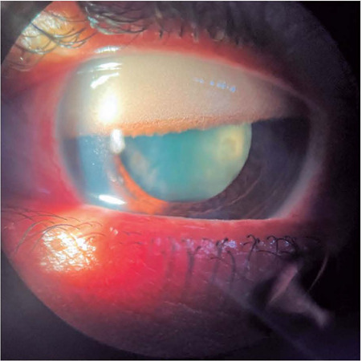
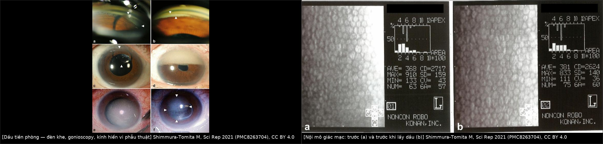
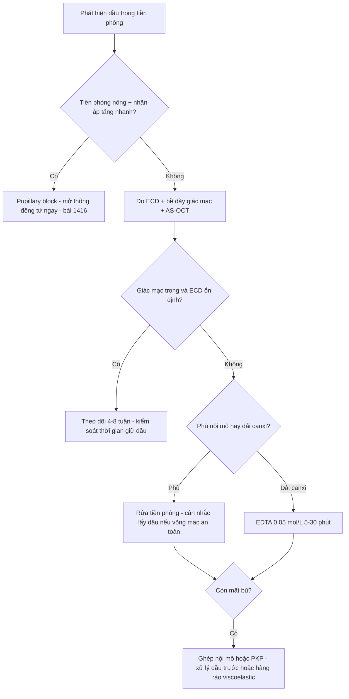
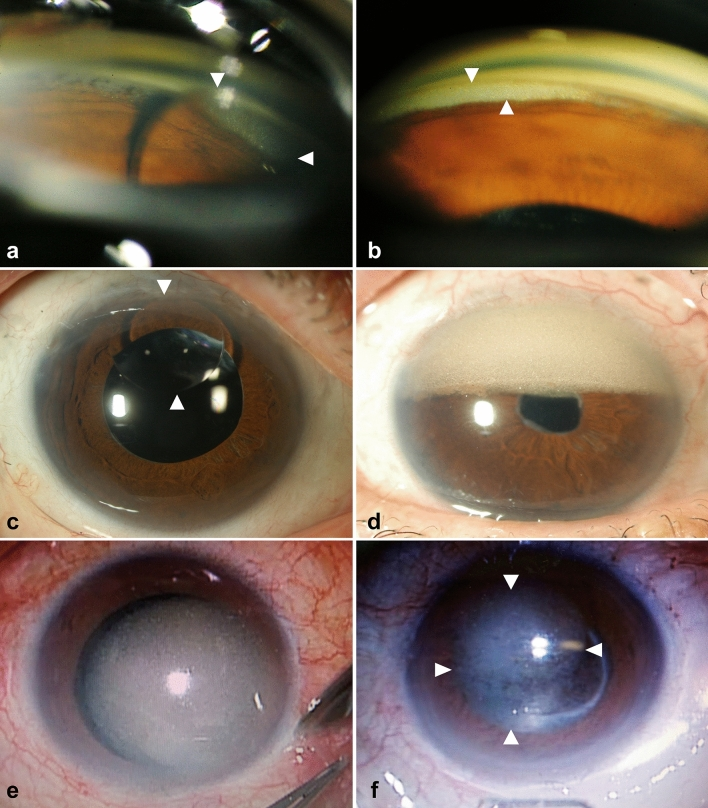
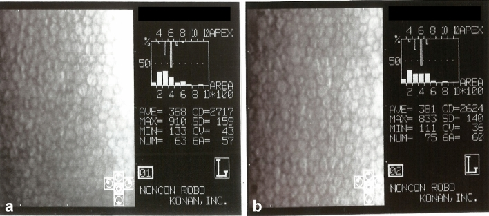
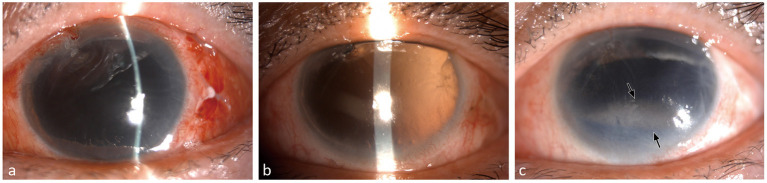
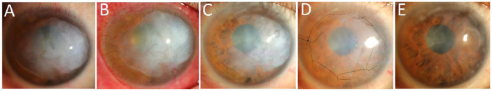
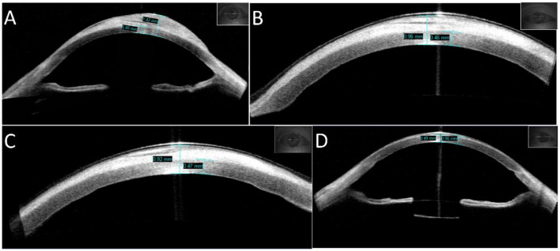

# 1837 — Dầu silicone trong tiền phòng & tổn thương nội mô giác mạc / Silicone oil in the anterior chamber & corneal endothelial damage

**Tags:** `pattern:dau-tien-phong` `pattern:nhu-tuong-hoa` `pattern:benh-giac-mac-dai` `pattern:phu-giac-mac` `pattern:lang-dong-duoi-bieu-mo` `vung:giac-mac` `vung:tien-phong` `vung:noi-mo` `protocol:slit-lamp` `protocol:specular-microscopy` `protocol:AS-OCT` `protocol:gonioscopy` `protocol:PPV`
**Mức chắc chắn (certainty):** tổng hợp y văn (literature synthesis) — nhóm tự biên từ 9 nguồn mở, đã đối chiếu `authorString`/PMCID: đoàn hệ 54 mắt nội mô–dầu tiền phòng (CC BY 4.0, PMC8263704), nghiên cứu bệnh–chứng 100 mắt bệnh dải (CC BY 4.0, PMC8342885), tổng quan cơ chế biến chứng dầu (CC BY 4.0, PMC13169982), ca lắng đọng dưới biểu mô 12 năm (CC BY 4.0, PMC10288839), kỹ thuật viscoelastic hai lớp (CC BY-NC 4.0, PMC9834487), ca dầu di trú vào mặt phân cách DSAEK (CC BY-NC 4.0, PMC13124131), kỹ thuật lấy nhũ tương bằng PFCL 20 mắt (CC BY-NC 4.0, PMC13050964), ảnh lâm sàng nhũ tương tiền phòng (CC BY 4.0, PMC11627275), kỹ thuật EDTA/PTK cho bệnh dải (CC BY 4.0, PMC11476468). Mọi con số dưới đây lấy từ các nguồn này; chỗ suy luận của nhóm được ghi rõ "suy luận".

> **Vì sao bài này quan trọng:** bài **1410** dạy *nhận diện dầu tồn lưu và khi nào lấy dầu*, bài **1416** dạy *tăng nhãn áp do dầu*, bài **1433** dạy *viêm nội nhãn ở mắt bơm dầu*. Bài này trả lời câu hỏi còn trống: **khi dầu đã sang tiền phòng, giác mạc bị gì, đo bằng gì, và lúc nào phải rửa tiền phòng thay vì ngồi chờ?** Câu trả lời không nằm ở "thấy dầu thì xử lý", mà ở ba biến số: **thời gian giữ dầu**, **lượng dầu tiếp xúc nội mô**, và **mật độ tế bào nội mô còn lại**. Bỏ sót giai đoạn phù nhẹ → mất bù giác mạc không hồi phục, và khi đó ghép giác mạc trên mắt còn dầu lại là một ca rất khó.

## 1. Tổng quan bệnh học – cơ chế hình ảnh: vì sao dầu trong tiền phòng làm hỏng giác mạc

- **Vật lý của dầu silicone (silicone oil, SO):** polydimethylsiloxane, **tỷ trọng 0,97 g/cm³** (nhẹ hơn nước → **nổi lên trên**), chiết suất **n = 1,40** (khác giác mạc/dịch tiền phòng → tạo **hiện tượng quang học**: phản xạ sáng chói, đảo chiều chiếu sáng, vân giao thoa khi dầu chạm nội mô — dấu hiệu rất dễ bị đọc nhầm là "giác mạc hơi mờ"). Dầu **không tan trong nước** nhưng bị **nhũ tương hóa** dưới lực cắt của mắt và phẫu thuật thành giọt **dưới 1 µm đến vài chục µm** — giọt nhỏ **vô hình trên đèn khe** nhưng vẫn tới được nội mô.
- **Đường vào tiền phòng:** qua **đồng tử** khi **mất vách ngăn mống mắt–thể thủy tinh** (aphakia, rách bao, đứt zonule, aniridia, IOL đặt góc/trước), qua **khuyết mống mắt**, qua **lỗ mở** (iridotomy, lỗ củng mạc sau PPV, van dẫn lưu). Đây là lý do **aphakia + aniridia** là nhóm nguy cơ cao nhất trong mọi loạt.
- **Vì sao nội mô là mô đích (TẠI SAO):** nội mô là **một lớp tế bào không tái sinh**, bơm Na⁺/K⁺-ATPase liên tục hút nước ra khỏi mô đệm; mô đệm **ứ nước → dày lên → mất trong suốt**. Nội mô **không có mạch máu**, lấy glucose/oxy từ **dịch tiền phòng**. Ba cơ chế hỏng:
  1. **Rào cản cơ học (mechanical barrier):** giọt dầu nằm trên mặt nội mô **chặn trao đổi chất tại chỗ** — vùng dưới giọt thiếu glucose và bị ứ CO₂, bơm suy cục bộ. Đây là lý do tổn thương **khu trú theo vùng tiếp xúc**, không lan tỏa.
  2. **Độc tế bào (cytotoxic):** dầu và các **thành phần phân tử lượng thấp (low molecular weight components)** kéo dài gây **apoptosis** nội mô.
  3. **Viêm:** dầu trong tiền phòng gây viêm, đại thực bào "ăn dầu" (**silicomacrophage**), đồng thời kích thích bè → **tăng nhãn áp** (bài 1416) → thêm stress cơ học lên nội mô.
- **Vì sao thành "dải" (band keratopathy) — giải thích bằng vật lý bề mặt:** phù nội mô mạn + màng nước mắt bốc hơi ở **khe mi** làm **pH và nồng độ canxi bề mặt tăng cục bộ** → canxi (calci hydroxyapatit) lắng ở **màng Bowman/lớp đáy biểu mô**. Khe mi là nơi phơi bày nhiều nhất → tổn thương **hình dải ngang**, không phải đốm tròn. Dải lan vào trục thị giác mới làm giảm thị lực; trước đó bệnh nhân chỉ **cộm, chói, chảy nước mắt**.
- **Ngưỡng định lượng (bắt buộc theo `PROMPT_SYNTHESIZER.md`):**
  - **Tần suất bệnh giác mạc do dầu nói chung: 2–30%** (khác nhau do chọn bệnh, cách phát hiện, thời gian giữ dầu).
  - **Bệnh dải:** **28% (28/100 mắt)** trong nhóm aphakia sau chấn thương xuyên nhãn cầu; thời gian giữ dầu **13,96 ± 10,71 tháng** ở nhóm bệnh dải so với **7,86 ± 6,81 tháng** ở nhóm không bệnh dải (p = 0,001); **vùng chấn thương III** (≥ 5 mm sau rìa giác mạc) **OR 6,88 (95% CI 1,94–24,44)**; giữ dầu **≥ 6 tháng** làm tăng nguy cơ rõ ở mắt có **vỡ nhãn cầu (OR 5,08)**, **aniridia (OR 9,84)**, **vùng III (OR 7,74)**; đường cong nguy cơ **tăng vọt từ ≥ 10 tháng**, gần như phẳng trong **4–6 tháng đầu**.
  - **Mất bù nội mô:** **4,7%** sau lấy dầu (loạt Shah) và **12%** khi dầu lưu **> 12 tháng** (loạt Morphis); **bệnh dải 6,4–8%** trong cùng các loạt đó.
  - **Mật độ tế bào nội mô (endothelial cell density, ECD):** trong 54 mắt, giảm trung bình **7,6% (0–38,1%)** từ trước khi bơm dầu tới trước khi lấy dầu; **70% mắt có giảm**, **30% không giảm**; 53/54 mắt giác mạc vẫn trong, chỉ **1 mắt** có bệnh dải. Nền sinh lý để so: người khỏe giảm **0,6 ± 0,5%/năm**; phaco đơn thuần giảm khoảng **10%/năm đầu**; ghép xuyên (PKP) thường **2.722 ± 56 tế bào/mm²** sau mổ → **< 2.000 sau 12 tháng**.
  - **Bất thường dưới lâm sàng:** confocal thấy bất thường hình thái nội mô ở **tới 75%** mắt có dầu tiền phòng và **~40%** toàn bộ mắt bơm dầu **dù đèn khe bình thường**.
- **Phản biện nguồn (điểm dễ dạy sai nhất):** điều hay được nhắc "dầu trong tiền phòng độc trực tiếp cho nội mô" **không được đoàn hệ 54 mắt xác nhận nguyên vẹn**: tốc độ mất tế bào **tương quan với thời gian giữ dầu** (p = 0,0001) và với dầu **nhìn thấy trên đèn khe** (p = 0,042), nhưng **không tương quan** với dầu thấy trên **gonioscopy** (p = 0,11), với **diện tích bám** (p = 0,93), hay với **tình trạng thể thủy tinh** (p = 0,16). Diễn giải đúng: **thời gian phơi nhiễm** và **lượng dầu đủ lớn để nhìn thấy** mới là biến quyết định; một vài giọt ở góc **không tự động** là chỉ định mổ. Ngược lại, nghiên cứu chỉ có 54 mắt, hồi cứu, một trung tâm, và **không có nhóm chứng không bơm dầu** — nên không được biến "không tương quan" thành "dầu vô hại".

## 2. Mẫu hình + chẩn đoán phân biệt theo vị trí (gamut)

- **Ba câu hỏi với mọi mắt có dầu tiền phòng:** **(1) dầu ở dạng nào? (giọt lớn / nhũ tương mịn / lớp bám nội mô) (2) chiếm bao nhiêu diện tích nội mô và ở đâu? (3) nội mô còn bù được không?**
- **Mẫu hình theo dạng dầu:**
  - **Bọt dầu lớn, không nhũ tương:** thấy rõ trên đèn khe, **bờ cong theo mặt sau giác mạc**, **nổi phía trên** khi bệnh nhân ngồi; nếu bít đồng tử → **pupillary block, nhãn áp 60–67 mmHg** (bài 1416).
  - **Nhũ tương mịn (emulsified droplets):** dạng **"sương" lấm tấm** hoặc **màng váng dầu** ở tiền phòng, khó thấy nếu không dùng **ánh sáng hẹp + phóng đại cao + retroillumination**; khi ngồi, giọt **nổi phía trên (12 giờ)**; khi **nằm ngửa**, dầu nổi lên **chạm mặt sau giác mạc** — tư thế ngủ vì thế ảnh hưởng thời lượng tiếp xúc nội mô (suy luận từ tỷ trọng 0,97 g/cm³).
  - **Lớp dầu bám nội mô (endothelial coating):** dải khúc xạ mảnh chạy theo mặt sau giác mạc, **thấy rõ nhất khi bật khe sáng hẹp quét ngang**; đây là dạng nguy hiểm nhất cho nội mô vì tiếp xúc liên tục trên diện rộng.
- **Gamut theo vị trí tổn thương giác mạc:**
  - **Khe mi, dải ngang:** bệnh giác mạc dải (canxi) — đục **trắng xám, bờ rõ, có "lỗ" (Swiss-cheese)**, thường bắt đầu từ **rìa** hai bên rồi nối vào giữa.
  - **Nửa trên (12 giờ):** mất tế bào nội mô nhiều hơn do dầu **nổi** và tiếp xúc lâu — vùng này phải đo ECD riêng nếu máy cho phép.
  - **Trung tâm:** mất bù nội mô (phù lan tỏa, vi nang biểu mô, bọng biểu mô) → giảm thị lực.
  - **Lệch tâm, dưới biểu mô:** mảng trắng đặc, **mô đệm bên dưới KHÔNG dày** trên AS-OCT — thể lắng đọng dưới biểu mô (khác phù nội mô).
  - **Góc tiền phòng:** dầu bít bè → glôcôm (bài 1416); góc cũng là nơi dầu **bám dai nhất** khi đã nhũ tương hóa.
- **Gamut theo "màu trắng trên giác mạc" (dùng cho ca chưa rõ tiền sử):** sẹo giác mạc cũ, loạn dưỡng canxi (band/salzmann), phù nội mô sau mổ, mảng mủ tiền phòng (viêm nội nhãn — bài 1433), và **lắng đọng dầu**. Chốt phân biệt nằm ở **tiền sử bơm dầu + bờ tổn thương + AS-OCT** (dầu: khoang giảm phản xạ / lắng đọng trên mô đệm bình thường; phù: mô đệm dày, nếp Descemet).

*Dầu nhũ tương trong tiền phòng — chú ý đường bờ rõ giữa lớp dầu và dịch tiền phòng, cùng phản xạ sáng khác thường do chiết suất dầu (n = 1,40). Không phải mủ: không lắng đáy, không viêm. Nguồn: Cyrino LG, Arq Bras Oftalmol 2024 (PMC11627275), CC BY 4.0.*

## 3. Bảng so sánh phân biệt (ma trận đối chiếu)

| Thực thể (entity) | Hình ảnh điển hình | Chốt vào (rule-in) | Chốt loại (rule-out) | Gợi ý xác nhận |
|---|---|---|---|---|
| **Nhũ tương dầu trong tiền phòng** | Giọt lấm tấm/"sương" trong tiền phòng, **nổi phía trên**, phản xạ sáng chói, vân giao thoa; góc có dầu | **Tiền sử bơm dầu + giọt di động theo tư thế + tiền phòng KHÔNG có mủ** | Không có tiền sử dầu → nghĩ viêm tiền phòng/TASS; mủ lắng đáy (hypopyon) → viêm nội nhãn (bài 1433) | Đèn khe khe hẹp ×10–16, **gonioscopy**, AS-OCT; chụp lại sau 1–2 tuần |
| **Bọt dầu lớn không nhũ tương** | Bọt tròn, bờ cong, **nổi trên cùng**, có thể bít đồng tử | **Bọt + tiền phòng nông + nhãn áp tăng nhanh** | Không tăng nhãn áp, tiền phòng sâu → chỉ theo dõi | Đèn khe + đo nhãn áp; xử trí như bài 1416 |
| **Bệnh giác mạc dải (band keratopathy)** | Dải **trắng xám ngang khe mi**, bờ rõ, **lỗ nhỏ kiểu phô mai Thụy Sĩ**, bắt đầu từ rìa | **Dải ngang đúng khe mi + tiền sử dầu lâu (> 6–10 tháng) + canxi** | Đục toàn bộ/lệch tâm, mô đệm dày → phù nội mô, không phải dải | Đèn khe + **AS-OCT** (lắng đọng nông, mô đệm bình thường); điều trị **EDTA 0,05 mol/L, 5–30 phút** |
| **Mất bù nội mô do dầu** | Phù lan tỏa, **vi nang biểu mô, bọng biểu mô**, nếp màng Descemet, dày giác mạc | **ECD giảm nhiều + giác mạc dày lên + tiền sử dầu** | Giác mạc trong dù có dầu + ECD ổn định → chưa mất bù, theo dõi | **Specular/confocal** (ECD, CV, % lục giác) + **AS-OCT đo bề dày** |
| **Lắng đọng dưới biểu mô do dầu** | Mảng trắng **lệch tâm**, đặc, không đúng khe mi; hay bị gọi là "sẹo" | **AS-OCT: dày lớp dưới biểu mô, MÔ ĐỆM BÌNH THƯỜNG** | Mô đệm dày + phù → mất bù nội mô; dải đúng khe mi → bệnh dải | AS-OCT; cắt biểu mô/tổn thương + màng ối nếu dai dẳng |

*Trái (a–f): dầu trong tiền phòng — (a,b) gonioscopy: dầu ở góc (mũi tên); (c,d) đèn khe: bọt/lớp dầu trong tiền phòng; (e,f) dưới kính hiển vi phẫu thuật: dầu bám mặt sau giác mạc trước khi lấy. Phải: specular microscopy cùng một mắt — (a) trước khi bơm dầu, CD = 2.717 tế bào/mm²; (b) trước khi lấy dầu, CD = 2.624 tế bào/mm². Ảnh ghép letterbox bằng `tools/make_composite.py`, giữ nguyên tỷ lệ, không crop. Nguồn: Shimmura-Tomita M, *Sci Rep* 2021 (PMC8263704), CC BY 4.0.*

### Đọc đèn khe cho đúng (dấu hiệu quyết định)

- **Khe sáng hẹp quét ngang mặt sau giác mạc:** dầu cho **dải khúc xạ sắc nét, di động**, phù cho **dày mờ lan tỏa, không di động**. Đây là điểm phân biệt rẻ nhất, làm trước khi nghĩ tới xét nghiệm.
- **Retroillumination:** giọt dầu **cản sáng thành đốm tối** trên nền hồng của đồng tử; nhũ tương mịn cho **"mưa bụi"** — nhiều ca chỉ thấy ở thì này.
- **Đổi tư thế (ngồi ↔ nằm ngửa 2–3 phút):** bọt dầu **di chuyển lên trên**, giọt nhũ tương **lắng xuống góc thấp** — nghiệm pháp phân biệt dầu với **mảng mủ/cặn canxi dính cố định**.
- **So với mắt bên:** ECD và bề dày giác mạc hai mắt là "đường nền" tốt nhất khi không có dữ liệu trước bơm dầu.

## 4. Protocol chụp/đo + phân tầng xử trí

- **Đèn khe (bắt buộc mọi lần khám):** khe hẹp ×10–16 quét mặt sau giác mạc, retroillumination, **gonioscopy ghi số độ dầu bám ở góc** (loạt tham chiếu: dải tiếp xúc trung bình **50 ± 18°**, khoảng 15–150° trên 360°), đo **chiều cao dải canxi** và **phần trăm bề rộng trục thị giác bị che**.
- **Specular microscopy / confocal (nếu có):** ECD, hệ số biến thiên (CV), **% tế bào lục giác**; đo **trước khi lấy dầu** và mỗi **3–6 tháng** khi còn dầu. Nhớ trừ **nền sinh lý 0,6%/năm** và tổn thất do phẫu thuật trước đó (phaco ~10% năm đầu) trước khi quy tội cho dầu.
- **AS-OCT tiền phòng:** bề dày giác mạc, **lắng đọng dưới biểu mô**, nếp Descemet, khoang giảm phản xạ dưới mảnh ghép (nếu đã ghép nội mô), và **độ sâu tiền phòng** (nông + dầu = nguy cơ block).
- **Siêu âm B / đáy mắt:** bắt buộc trước khi quyết định lấy dầu, để biết **võng mạc có dính không** (lấy dầu làm bong tái phát **14,9–22,4%** — bài 1410).
- **Phân tầng thực hành (bậc thang của nhóm, suy luận từ các ngưỡng trên — KHÔNG phải guideline chính thức):**
  - **Bậc A — dầu thấy được, giác mạc trong, ECD ổn định:** theo dõi **4–8 tuần/lần**, đo lại ECD; xử lý nguyên nhân (thời gian giữ dầu, vách ngăn mống mắt–thể thủy tinh, nhãn áp). Không mổ chỉ vì "có giọt dầu".
  - **Bậc B — ECD giảm tiến triển hoặc bắt đầu phù, dầu bám diện rộng:** **rửa tiền phòng** bằng BSS/viscoelastic, gạn dầu; nếu thị lực còn tiềm năng và võng mạc an toàn → cân nhắc **lấy dầu** (bài 1410).
  - **Bậc C — bệnh dải hoặc mất bù nội mô:** bệnh dải → **EDTA 0,05 mol/L trong 5–30 phút** ± gọt biểu mô; mất bù → **ghép nội mô (DSAEK/DMEK) hoặc PKP**, nhưng **phải xử lý dầu trước** hoặc tạo **hàng rào viscoelastic hai lớp** trong mổ, vì dầu còn trong mắt sẽ **phá mảnh ghép**.
- **Bằng chứng cho bậc C (để không hứa hão):** hai mắt ghép xuyên "truyền thống" trên mắt còn dầu bị **đục mảnh ghép sau 9 và 6 tháng**; kỹ thuật **viscoelastic hai lớp (DDVT)** ở 5 mắt giữ mảnh ghép trong **3–24 tháng** nhưng ECD vẫn giảm **3,1–25,0% trong 6 tháng đầu** rồi chậm lại (**0,6–4,5%/năm** từ 6–12 tháng). Nghĩa là hàng rào **làm chậm**, không **ngăn tuyệt đối**.
- **Lấy nhũ tương khó sạch:** kỹ thuật **PFCL (perfluorodecalin) đẩy giọt ra trước + rửa tiền phòng ≥ 30 phút** cho **17/20 mắt (85%)** hết giọt thấy được, không ca nào nhãn áp > 21 mmHg; 3/20 mắt còn giọt vi mô "không có ý nghĩa lâm sàng".

## 5. Biến thể bình thường và cạm bẫy

- **"Không thấy dầu" ≠ "không có dầu":** cùng 54 mắt, dầu thấy ở **12/54 trên đèn khe**, **18/28 khi soi góc**, và **32/52 dưới kính hiển vi phẫu thuật** — tỷ lệ phát hiện **phụ thuộc dụng cụ**, không phụ thuộc bệnh. Đừng loại trừ dầu chỉ vì đèn khe "sạch".
- **Nhầm phù nhẹ với phản xạ dầu:** dầu cho **phản xạ sáng chói, đảo chiều chiếu sáng, vân giao thoa** (do n = 1,40); phù cho **mờ đục đều + dày**. Bật khe hẹp và so bề dày là đủ phân biệt trong phần lớn ca.
- **Quy tội oan cho dầu:** ECD giảm sau phẫu thuật là chuyện bình thường (phaco ~10% năm đầu; PKP còn mất nhiều hơn). Trước khi kết luận "do dầu", phải có **ECD trước bơm dầu** hoặc **mắt bên** làm chuẩn.
- **Bẫy thể tích/mặt phẳng:** trên AS-OCT, một **khoang giảm phản xạ mảnh dưới mảnh ghép** có thể là **nếp gấp, khí, hoặc dầu** — phải đối chiếu đèn khe và **tiền sử còn dầu trong mắt**. Ca DSAEK thực tế: giọt dầu xuất hiện **ngày 9**, tăng dần tới **ngày 14**, rửa tiền phòng **không lấy được** dầu ở mặt phân cách, còn tồn tại **ngày 45** — tức "rửa tiền phòng" không phải nghiệm pháp chữa khỏi cho dầu đã kẹt dưới mảnh ghép.
- **Thỏa mãn tìm kiếm (satisfaction of search):** thấy dầu là dừng lại. Phải khám tiếp **nhãn áp (block/bít bè)**, **góc (dầu bám, synechia)**, **võng mạc (bong tái phát nếu định lấy dầu)**, và **tình trạng mảnh ghép** nếu đã ghép.
- **Ảo giác "dầu tự hết":** giọt nhỏ có thể bị đại thực bào dọn và biến mất khỏi tiền phòng, nhưng **tổn thương nội mô đã xảy ra thì không hồi phục** — không được dùng "dầu đã hết" để trấn an về thị lực tương lai.
- **Bẫy đếm giọt:** số giọt **không** tương quan với mất tế bào trong loạt 54 mắt; đừng lấy "nhiều giọt" làm chỉ định mổ, hãy lấy **thời gian phơi nhiễm + ECD + tình trạng giác mạc**.

## 6. Tự lượng giá — Blind Quiz

**Ca 1 — Mắt đã bơm dầu silicone, thể thủy tinh nhân tạo; khám định kỳ, không đau.** (Ảnh đại diện trích từ loạt 54 mắt, không phải một bệnh nhân duy nhất.)

- Hỏi: mô tả tổn thương ở mặt sau giác mạc. Có phải phù nội mô không? Ba bước xác nhận tiếp theo?
- Gợi ý: chú ý (a) khe sáng trên mặt sau giác mạc và (d) vùng giới hạn rõ trong tiền phòng.

<b>Bấm để hiện đáp án</b>

- (a,b) **gonioscopy**: dầu ở góc tiền phòng (mũi tên) — dải tiếp xúc liên tục, không phải mảng viêm. (c,d) **đèn khe**: dầu/lớp dầu trong tiền phòng với **bờ giới hạn rõ**, khác phù lan tỏa. (e,f) dưới **kính hiển vi phẫu thuật** thấy dầu bám mặt sau giác mạc **trước khi lấy dầu**.
- Đây là **dầu tiền phòng**, không phải phù nội mô đơn thuần — nhưng hai thứ thường cùng tồn tại.
- Ba bước tiếp: **(1)** đo **nhãn áp** (loại trừ pupillary block/bít bè); **(2)** **specular/confocal** đo ECD so với mắt bên; **(3)** **AS-OCT** đo bề dày và tìm lắng đọng dưới biểu mô. Nếu giác mạc trong + ECD ổn định → theo dõi, không mổ.
- Nguồn ảnh: Shimmura-Tomita M, *Sci Rep* 2021 (PMC8263704) Fig. 1, CC BY 4.0.

**Ca 2 — Cùng bệnh nhân, hai lần đo specular microscopy: trước khi bơm dầu và trước khi lấy dầu.**

- Hỏi: mật độ giảm bao nhiêu phần trăm? Con số đó nói gì về chỉ định lấy dầu? Cần thêm dữ liệu gì trước khi kết luận?

<b>Bấm để hiện đáp án</b>

- (a) CD = **2.717 tế bào/mm²**, (b) CD = **2.624 tế bào/mm²** → giảm **93 tế bào/mm² ≈ 3,4%** — **dưới mức trung bình 7,6%** của loạt 54 mắt.
- Như vậy: **mất tế bào nhẹ không đồng nghĩa phải mổ ngay**; quyết định dựa trên **xu hướng theo thời gian** + nhãn áp + tình trạng giác mạc.
- Cần thêm: **thời gian còn phải giữ dầu** (nguy cơ tăng vọt sau 10 tháng), **tình trạng võng mạc** (lấy dầu → bong tái phát 14,9–22,4%), và **mắt bên** làm chuẩn.
- Phản biện: đây là **một** mắt trong loạt; 30% mắt trong loạt **không giảm ECD** chút nào, nên không được lấy ca này làm quy luật.
- Nguồn ảnh: Shimmura-Tomita M, *Sci Rep* 2021 (PMC8263704) Fig. 2, CC BY 4.0.

**Ca 3 — Nữ 58 tuổi, chấn thương xuyên nhãn cầu vùng III, vỡ nhãn cầu, aphakia + aniridia; dầu giữ nhiều tháng; mắt cộm, chói, thị lực giảm dần.**

- Hỏi: chẩn đoán? Vì sao tổn thương có hình **dải ngang** chứ không phải đốm? Yếu tố nào quyết định nguy cơ này? Điều trị bước đầu?

<b>Bấm để hiện đáp án</b>

- **Bệnh giác mạc dải (band keratopathy)** do dầu: canxi lắng ở **màng Bowman/lớp đáy biểu mô**, hình dải vì **khe mi là vùng màng nước mắt bốc hơi mạnh nhất** → pH/canxi bề mặt tăng cục bộ.
- Yếu tố nguy cơ trong loạt 100 mắt: **giữ dầu ≥ 6 tháng** (nhóm bệnh dải 13,96 ± 10,71 tháng so với 7,86 ± 6,81; p = 0,001), **chấn thương vùng III** (OR 6,88), **vỡ nhãn cầu + aniridia**; nguy cơ **tăng vọt từ ≥ 10 tháng**.
- Điều trị: **EDTA 0,05 mol/L thấm 5–30 phút** rồi bóc canxi bằng tăm bông/gọt nông; EDTA chỉ lấy canxi, **không lấy được lắng đọng không canxi**. Kiểm soát **thời gian giữ dầu** là dự phòng thật.
- Cạm bẫy: dải mờ nhẹ dễ bị bỏ qua vì bệnh nhân "chỉ cộm"; khi dải vào trục thị giác thì thị lực mất **không hồi phục** dù lấy canxi.
- Nguồn ảnh: He K, *Front Med* 2021 (PMC8342885) Fig. 1, CC BY 4.0.

**Ca 4 — Nam 36 tuổi, giữ dầu 12 năm, mảng trắng lớn lệch tâm; nhãn áp 40 mmHg, không còn cảm giác sáng.**

- Hỏi: đây là bệnh dải, phù nội mô, hay thể khác? Vì sao mô đệm bình thường lại quan trọng?

<b>Bấm để hiện đáp án</b>

- **Lắng đọng dưới biểu mô do dầu** (subepithelial white deposition): AS-OCT cho **dày lớp dưới biểu mô, mô đệm KHÔNG dày** — khác **phù nội mô** (mô đệm dày, nếp Descemet) và khác **bệnh dải** (đúng khe mi, canxi nông).
- Vì sao quan trọng: mô đệm còn lành nghĩa là **nội mô chưa mất bù** → có thể **cắt tổn thương bề mặt + màng ối** và cứu được giác mạc, không cần ghép xuyên.
- Trong ca nguồn: **lấy dầu + rửa tiền phòng** ở thì 1, mảng trắng nhạt dần; **cắt biểu mô + màng ối** ở thì 2 → giác mạc trong hơn rõ rệt. Thị lực vẫn mất vì **teo thị** do nhãn áp 40 mmHg kéo dài — bài học: **giác mạc cứu được nhưng thị thần kinh thì không**.
- Nguồn ảnh: Shao Y, *Front Med* 2023 (PMC10288839) Fig. 2, CC BY 4.0.

## Bài liên quan chéo
- [400 – Tổng quan Mắt & thị giác](../400-tong-quan-mat-thi-giac/lesson.md)
- [1410 – Lấy dầu silicone & dầu tồn lưu: nhũ tương hóa, khi nào lấy](../1410-lay-dau-silicone-va-dau-ton-luu/lesson.md)
- [1416 – Glôcôm do dầu silicone: pupillary block & bít bè](../1416-glaucom-do-dau-silicone/lesson.md)
- [1432 – Thay dầu silicone: khi nào, kỹ thuật, biến chứng](../1432-thay-dau-silicone/lesson.md)
- [1433 – Viêm nội nhãn ở mắt bơm dầu: phân biệt với dầu tiền phòng](../1433-viem-noi-nhan-mat-bom-dau/lesson.md)
- [1428 – Phù giác mạc sau implant tiền phòng: phân biệt với bệnh giác mạc do dầu](../1428-phu-giac-mac-sau-implant-tien-phong/lesson.md)

## Ảnh
- Tên file: `1837_<slug>_<Modality>_<SourceID>.jpg`; nguồn + giấy phép từng ảnh ở `images/CREDITS.md`.
- Tất cả ảnh dùng trong bài đều **tải được** (open access, CC BY hoặc CC BY-NC) từ Europe PMC; **không crop, không kéo giãn**; chỉ ảnh ghép có dải attribution.
- EyeWiki / Retina Image Bank / AuntMinnie / Radiopaedia: **chỉ dẫn link, không tải** (xem `sources.md`).

> Không dùng để chẩn đoán độc lập khi chưa có người hướng dẫn.
